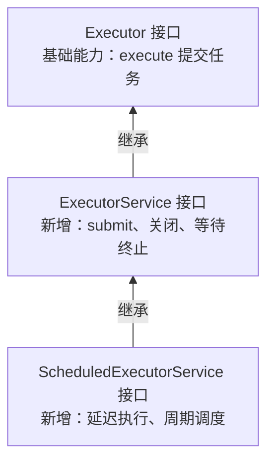
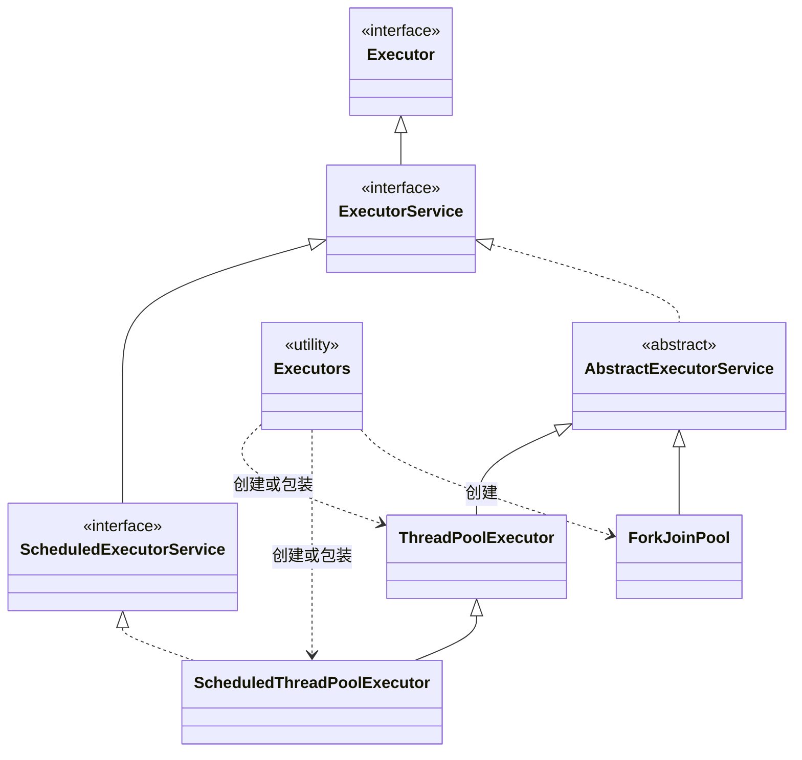

# 016_不停机数据迁移_在线历史迁移_线程池_Java 中的线程池体系

以下内容按照当前项目 `AGENTS.md` 项目级规则中规定的技术栈版本为准，使用 Java 8。本文说明 JDK 执行器框架中的主要接口、抽象类、线程池实现和创建工具；代码及参数仅为教学示例，未编译运行或做性能测试。

## 1 问题

Java 中的线程池体系是怎样的？主要接口、实现类和工具类之间是什么关系？

## 2 面试口述精炼版本

口述内容字符数：391（不含辅助图）

**接口定义能力**

Java 线程池属于执行器框架。Executor 定义 execute，用来提交任务；ExecutorService 扩展它，增加 submit、关闭和等待终止等操作；ScheduledExecutorService 再扩展延迟和周期调度能力。



箭头指向父接口。子接口保留父接口的能力，再增加自己的方法；这些接口定义能力，具体操作由实现类完成。

**类提供实现**

AbstractExecutorService 提供提交任务等通用实现。ThreadPoolExecutor 和 ForkJoinPool 都继承它，分别支持普通任务执行和工作窃取；ScheduledThreadPoolExecutor 继承 ThreadPoolExecutor，并实现调度接口。

**工具负责创建**

Executors 是工具类，通过静态工厂方法创建执行器。调用方通常用接口类型接收返回对象，具体操作由实际对象的方法实现完成。

[详细说明](<D:/000/sources/eas/002_消费记录分库分表、不停机数据迁移、ES 改造/016_不停机数据迁移_在线历史迁移_线程池_Java 中的线程池体系.md:37>)

## 3 详细方案

### 3.1 先看关系：接口、抽象类、具体类与工具

“线程池体系”通常从执行器框架来介绍。接口定义能做什么，抽象类提供部分公共实现，具体类决定任务怎样执行，工具类提供便捷创建方式。接口本身不是线程池，也不保证任务一定在新线程中执行。



实线空心箭头表示继承，虚线空心箭头表示实现接口，二者都指向父类型；普通虚线箭头表示创建依赖，指向所创建或包装的实现类。`Executors` 不属于继承链，它是提供静态工厂方法的工具类。

本次已核对以下 [OpenJDK 8 并发包源码](https://github.com/openjdk/jdk8u/tree/master/jdk/src/share/classes/java/util/concurrent)中的类型声明：Executor、ExecutorService、ScheduledExecutorService、AbstractExecutorService、ThreadPoolExecutor、ScheduledThreadPoolExecutor、ForkJoinPool。

### 3.2 三个接口：逐层增加能力

**Executor：提交任务的基础入口**

只有 `void execute(Runnable command)` 这一个方法，定义把任务交给执行器的入口，不规定任务必须由哪个线程执行。例如自定义实现可以直接在调用线程执行任务，因此不能将 `Executor` 接口本身等同于线程池。

**ExecutorService：增加结果获取和生命周期管理**

它继承 `Executor`，增加 `submit`、`invokeAll`、`invokeAny`，以及 `shutdown`、`shutdownNow`、`awaitTermination` 等方法。

例如提交一个计算任务，`submit` 返回 `Future`，调用方可以通过它等待结果、检查完成状态或尝试取消。`shutdown` 停止接收新任务，但不等待已有任务全部结束；需要等待终止时使用 `awaitTermination`。

**ScheduledExecutorService：增加按时间调度的能力**

它继承 `ExecutorService`，增加 `schedule`、`scheduleAtFixedRate` 和 `scheduleWithFixedDelay`，用于延迟执行、按固定频率执行或按两次执行之间的固定间隔执行。

例如要求一个任务延迟 1 秒执行，就使用 `schedule`；1 秒为示例延迟，到期只表示任务具备执行条件，不保证精确在该时刻开始。

接口依据：[Executor](https://docs.oracle.com/javase/8/docs/api/java/util/concurrent/Executor.html)、[ExecutorService](https://docs.oracle.com/javase/8/docs/api/java/util/concurrent/ExecutorService.html)、[ScheduledExecutorService](https://docs.oracle.com/javase/8/docs/api/java/util/concurrent/ScheduledExecutorService.html) 的 Java 8 API。

### 3.3 抽象类：复用通用的任务提交逻辑

`AbstractExecutorService` 实现 `ExecutorService`，提供 `submit`、`invokeAll` 等方法的通用实现，但没有完整实现一个线程池，不能直接实例化。

以它提供的 `submit` 实现为例：先将任务包装成 `RunnableFuture`，默认是 `FutureTask`，再调用 `execute` 交给具体实现处理，同时返回 `Future`。子类可以覆盖这些方法，所以不能据此断言所有执行器的内部提交过程都完全相同。

来源：[AbstractExecutorService Java 8 API](https://docs.oracle.com/javase/8/docs/api/java/util/concurrent/AbstractExecutorService.html)。

### 3.4 三个具体类：采用不同的执行机制

**ThreadPoolExecutor：普通异步任务**

它继承 `AbstractExecutorService`，管理工作线程、等待队列和拒绝策略。核心线程数与最大线程数由调用方配置，例如核心数和最大数都为 2，表示池内最多使用 2 条工作线程；这只是示例配置。

**ScheduledThreadPoolExecutor：延迟和周期任务**

它继承 `ThreadPoolExecutor`，同时实现 `ScheduledExecutorService`。例如核心线程数设为 1，可以串行处理到期任务；若当前任务耗时较长，其他到期任务会等待。它使用无界延迟队列，执行并发主要由核心线程数决定，调整最大线程数没有实际扩容效果。

**ForkJoinPool：工作窃取与并行计算**

它直接继承 `AbstractExecutorService`，不是 `ThreadPoolExecutor` 的子类。它采用工作窃取机制，让空闲工作线程获取其他工作队列中的待执行任务，适合可拆分的计算工作。

创建时可指定目标并行度，例如 `new ForkJoinPool(2)`；无参构造默认采用 JVM 可用处理器数。目标并行度不是严格的总线程数上限，部分等待或阻塞场景可能触发补充线程，不能直接套用普通线程池的核心数与最大数配置方式。

实现依据：[ThreadPoolExecutor](https://docs.oracle.com/javase/8/docs/api/java/util/concurrent/ThreadPoolExecutor.html)、[ScheduledThreadPoolExecutor](https://docs.oracle.com/javase/8/docs/api/java/util/concurrent/ScheduledThreadPoolExecutor.html)、[ForkJoinPool](https://docs.oracle.com/javase/8/docs/api/java/util/concurrent/ForkJoinPool.html) 的 Java 8 API。

### 3.5 Executors：提供创建入口，不负责定义继承体系

`Executors` 是工具类，不是线程池实现类，也不是 `ExecutorService` 接口。它的静态工厂方法帮调用方选择实现、设置部分参数，有些方法还会包装底层对象。

例如 `Executors.newFixedThreadPool(2)` 返回类型声明是 `ExecutorService`，实际创建的是 `ThreadPoolExecutor`，核心线程数和最大线程数均为 2；2 是示例值。`newSingleThreadExecutor()` 返回的则是包装对象，内部使用线程数为 1 的 `ThreadPoolExecutor`。

工厂方法与直接调用构造方法都是创建方式，不能把工厂方法名称当成独立的实现类。默认配置也不等于适合生产，例如固定池工厂使用的队列容量为 `Integer.MAX_VALUE`，通常视为无界队列，任务积压时可能耗尽内存。

来源：[OpenJDK 8 Executors 源码](https://github.com/openjdk/jdk8u/blob/master/jdk/src/share/classes/java/util/concurrent/Executors.java)。

### 3.6 用一段代码串起接口、工具类和实际对象

```java
import java.util.concurrent.ExecutorService;
import java.util.concurrent.Executors;
import java.util.concurrent.Future;

// 放在方法体中；2 是教学示例线程数。
ExecutorService executor = Executors.newFixedThreadPool(2);
try {
    Future<Integer> result = executor.submit(() -> 1 + 2);
    System.out.println(result.get()); // 等待结果；调用方法需处理或声明相关异常。
} finally {
    executor.shutdown(); // 停止接收新任务，已接收任务继续执行。
}
```

1. `Executors` 是工具类，`newFixedThreadPool` 是创建线程池的静态方法。
2. `executor` 的声明类型是接口 `ExecutorService`，实际引用的是 `ThreadPoolExecutor` 对象。
3. 调用 `submit` 时，使用该对象继承的通用提交实现，再由 `ThreadPoolExecutor.execute` 安排执行。
4. `Future` 表示任务结果，`get` 可以等待结果返回；它不是线程池实现类。
5. 最后调用 `shutdown` 发起有序关闭，不代表调用返回时所有任务都已结束。

为了突出关系，本例只提交一个任务后等待结果，不能据此作为批量任务并发处理的写法。

## 4 已确认规则

- 本文围绕“Java 中的线程池体系”展开，区分接口、抽象类、具体实现类和工具类。
- 使用关系图和示例解释主要类型之间的关系。
- 在口述版的“接口定义能力”段落后补充接口继承图，说明父子关系与逐层增加的能力。
- 本次保留现有文件名与编号，不修改另一篇 016“核心参数”文档。

## 5 待确认或待验证事项

- 示例未编译运行，未验证线程池性能或项目生产配置。
- 关系图和链接已做静态检查，未在 Codex 阅读器中验证实际渲染与点击效果。
- 当前两篇文档同为 016，本次按确认范围保留；后续如需统一编号，应同时更新标题和引用。

## 6 复核记录

2026-11-12 17:45：已执行 [$java-interview-doc-review-loop](C:/Users/Administrator/.codex/skills/java-interview-doc-review-loop/SKILL.md)。
