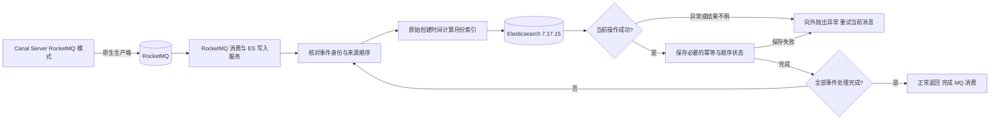

# 036_001–035整理初稿_汇总

本初稿用于本次重新梳理考点前的材料核实。内容按文件名顺序汇集 001–035 文档正文，保留原文的技术结论、项目事实、示例、来源、待确认或待验证事项和异议与分析。当前答题范围见[037 已确认的 39 道题](<./037_候选考点与答题范围_导航.md>)。

## 本轮核实后的答题依据

- 001–003 说明容量、路由与检索分工。商户号定位分片，消费主键携带分片编号，迁移验收用跨表稳定的流水号。32 个分片是容量规划方案，实际容量与热点仍需演练。
- 002、007、011、022 和 023 开头的当前方案共同确定上线顺序。双写覆盖全部入口，上线时开启新表到 ES 的同步，再在线搬运。切读前在线比对，允许延迟的查询按档放量。最终切写才暂停新写、等待在途事务结束、追平并校验。023 中标注「重组前」的材料按历史记录阅读。
- 012–020 按启动、派发、分页、收尾和恢复核对批次。数据库提交成功才取得派发资格。进度推进到整页已确认的位置。停止派发后还要核实在途 JDBC 请求的结果。锁租约、线程结束或一次超时都不能单独证明批次已结束。
- 007、021、024 分别回答版本由谁生成、新旧表如何验收、新表与 ES 怎样对账。首次业务创建写版本 1，业务更新递增，搬运、消息重放使用原版本。重复订单在插入前返回当前处理结果。
- 025–035 涵盖采集、消息发布、消费、索引写入与生命周期。撤销新增一条业务记录，使用自己的唯一流水号，并另行关联原消费流水号。保留期 DELETE 在消费者中保留必要事件信息，年度自动任务另按元数据清单删除到期月份索引。ILM 负责冷热迁移。迟到回放必须检查保留窗口，在线校验从现存源行出发时也有扫描盲区。
- 以下原文保留设计、示例及待验证事项。本文核对的是材料，生产时延、恢复能力和验收结果仍以实际演练记录为准。

## 材料范围

本汇总按编号收录 001–035。完整考点与答题入口见[41 道考点与答题范围](<./037_候选考点与答题范围_导航.md>)。

## 来源文档：001_改造原因

以下内容按照当前项目 `AGENTS.md` 项目级规则中规定的技术栈版本为准。

## 1 面试口述精炼版本

口述内容字符数：206

**单表维护**

消费记录持续增长，表和索引越大，维护和恢复的成本越高。按商户分片可以分散数据和交易写入。

**跨商户查询**

后台列表跨商户筛选时，往往要查多个分片，再合并排序和分页结果。

**索引成本**

查询条件组合多，为每种组合建索引会增加存储和交易写入的维护成本。

**读写争用**

把列表查询交给 ES，可以减少复杂查询与交易写入对数据库资源的争用。

**可接受的延迟**

后台列表能接受正常同步时几秒的延迟。ES 每 3 秒刷新一次，采集和消费还需要时间。单笔详情和最终交易状态仍查 MySQL。

## 2 详细原因分析

### 2.1 单表和单实例的规模压力

分库分表解决的是数据、索引、读写和维护任务集中在单表或单实例的问题。它不会减少数据总量，也不能仅凭表数量保证性能提升；实际收益取决于数据分布、查询范围、索引设计、资源规格和维护窗口。容量基准、保留周期和具体拓扑属于分库分表设计，详见[003_分库分表](<./003_分库分表.md>)。

### 2.2 跨分片查询的额外成本

分片键用于确定数据所在的库表。查询条件无法提供可用的分片定位信息时，系统需要向多个分片发起请求，再合并各分片的结果。全局排序、分页和总数统计通常需要额外的归并处理，深分页和大范围查询会进一步放大请求、传输和合并成本。并行访问可以减少部分等待，但不能消除多分片访问带来的资源消耗；实际耗时仍需结合数据量、索引和并发验证。

### 2.3 多条件查询与索引取舍

联合索引的效果受字段顺序、过滤条件、范围查询和排序要求影响。后台查询条件组合灵活，一个索引难以覆盖所有组合。增加合适的索引可以改善对应查询，但会增加存储、缓存和写入维护成本。因此，ES 适合作为后台列表的检索副本，承担灵活过滤、排序和分页；MySQL 继续作为交易权威数据源。

### 2.4 列表查询与交易写入隔离

复杂列表查询可能扫描较多数据、执行排序和跨分片归并，与实时交易写入共享数据库资源时会产生争用。将列表查询交给 ES 可以把这类查询流量从交易数据库中分离出来，但会增加同步链路、数据一致性保障和运维成本，不能直接等同于查询一定更快。

### 2.5 同步延迟的业务边界

ES 的 `refresh_interval` 为 3 秒，表示新写入数据等待刷新后才具备可搜索性。端到端可见延迟还包括 Canal 采集、RocketMQ 传输和消费、ES 写入等环节，因此不能把 3 秒直接当成列表可查上限。当前已确认业务可以接受正常链路下的几秒级延迟；具体秒数上限、达标比例和异常情况下的提示方式仍需通过验收规则明确。

## 3 已确认规则

- 面试口述中的改造原因，每个原因单独一个段落，并用一个简短、具体的加粗小标题概括该原因。
- 列表查询迁移到 ES 的原因包括跨分片查询成本、多条件组合下的索引取舍，以及列表查询与交易写入的资源争用。
- ES 刷新间隔为 3 秒；该数值不代表端到端同步延迟，也不代表业务容忍上限。
- 后台列表业务可以接受同步链路无积压、无重试且处理及时情况下预期的几秒级延迟；实际延迟仍需验证。
- MySQL 仍是交易权威数据源，单笔详情和最终交易状态以 MySQL 为准。

## 4 待确认或待验证事项

- 分库分表后的容量、热点、跨分片查询性能和维护窗口，需要结合[003_分库分表](<./003_分库分表.md>)中的容量目标和专项演练确认。
- 列表查询迁移到 ES 后的响应时间、资源占用和查询切换效果仍需结合主要查询组合和预期并发验证。
- 实际索引刷新间隔及从 MySQL 提交到 ES 可检索的端到端延迟分布仍需核验。
- 量化验收所需的具体秒数上限、达标比例，以及异常情况下的延迟和提示方式仍需确认。

## 5 复核记录

本次复核完成时间：2026-11-21 20:53

已执行 java-interview-doc-review。追加整理 0 轮。已核对本篇与本轮考点的对应关系、文件编号和关联入口。当前文档重组范围内的修改已完成。

---

## 来源文档：002_改造计划

以下内容按照当前项目 `AGENTS.md` 项目级规则中规定的技术栈版本为准。

## 1 面试口述精炼版本

口述内容字符数：217

**根据数据量评估确定分库分表**

根据数据量增长情况，确认采用分库分表方案；具体容量评估和分片设计见[003_分库分表](<./003_分库分表.md>)。

旧表上线双写时，同时开启新表到 ES 的同步，再在线搬运历史记录。同步和校验运行期间发布新查询和新写入代码。切读前在线校验通过且同步延迟满足要求后，允许短暂延迟的查询逐步读新表，后台列表单独验收后逐步查 ES。要求写后立即可见的查询继续读旧表。最终交接时暂停新业务写，等在途事务结束、旧表变更全部追平并校验通过，再切换剩余查询和主写。新表单写后，回退前须回补并验收这段时间的变更。

## 2 详细改造计划

### 2.1 改造方向确认

根据数据量增长情况，确认采用分库分表方案。具体容量评估、保留周期、分片拓扑、主键规则和容量验证统一见[003_分库分表](<./003_分库分表.md>)；002 只说明这些设计在迁移和上线流程中的使用顺序。

### 2.2 启用双写并在线搬运历史数据

先改造旧表全部写入口，确保变更和同步消息在同一事务提交。在双写产生首笔新表变更前，分别记录两个新库的采集基线。双写上线时，同时开启新表到 ES 的同步。保持旧表读写，启动历史搬运，按稳定的 serialNo 核对新旧记录。分别运行新旧表、新表与 ES 的校验，在此期间部署新查询和写入路径。

### 2.3 第二轮：逐步切换查询链路

在线核对新旧表、单独验收新表与 ES，差异处理完毕且同步延迟符合查询要求后，分别使用开关逐步切换两条查询路径：

- 允许短暂延迟的业务查询逐步读新表，需要写后立即可见的查询仍读旧表；
- 后台列表查询从旧表切换到 ES。

切换期间分别观察新表查询和 ES 列表的结果、响应时间、错误情况及同步延迟。出现问题时，通过开关切回原查询链路。只要仍有查询需要回退，或仍有业务依赖旧表，就继续双写并运行旧表与新表增量校验。

新表到 ES 的同步和新表与 ES 的增量校验属于新链路功能，查询切换后继续运行，不因过渡查询完成而停止。

### 2.4 最终收尾：停止过渡校验并恢复新表单写

纳入灰度的读流量全部切换并稳定至少半天后，进入交接窗口。暂停新增业务写入，让在途事务提交或回滚，让旧方向同步及重试追平最后一次提交。最终校验通过后，隔离旧写入口，将剩余强一致查询和主写切到新表，再恢复业务写入。此后若需回切旧表，先回补新表单写后的变更并验收。

新表到 ES 的同步和新表与 ES 的增量校验属于新链路功能，长期保留。ES 列表允许正常链路下的几秒级同步延迟，具体延迟分布和异常边界按验收规则验证。

## 3 已确认规则

- 业务双写上线时同时开启新表到 ES 的同步，历史搬运随后进行。

- 改造计划只确认根据数据量增长情况采用分库分表；详细容量评估和分片设计以[003_分库分表](<./003_分库分表.md>)为准。
- 历史搬运期间旧表持续承接业务写入；新链路就绪后列表仍先查询旧表。
- 首批约 5% 观察 30 分钟到 1 小时，指标正常后依次放到 20%、50%、100%。每档核对结果、成功率、延迟和负载；出现未查清的差异就暂停放量。
- 灰度切读期间由开关控制查询路由，旧表仍主写时可以切回原查询链路。
- 全部旧表依赖切换完成且验收条件满足后，关闭旧表写入，改成新表单写，停止旧表与新表校验；新表到 ES 的同步和新表与 ES 增量校验长期保留。

## 4 待确认或待验证事项

- 停写窗口、历史迁移耗时、迁移异常恢复和新旧记录字段验收仍需按迁移方案验证。
- 双写、Canal 到 ES 同步、两项增量校验和回退开关的实际实现状态仍需结合代码与环境核验。
- 切读前的一致性验收记录、查询切换指标、ES 端到端延迟及异常情况下的处理方式仍需形成验收证据。
- 003 中确定的容量、拓扑、热点、查询性能、索引维护、备份恢复和扩容窗口仍需演练确认。

## 5 复核记录

本次复核完成时间：2026-11-21 20:53

已执行 java-interview-doc-review。追加整理 0 轮。已核对本篇与本轮考点的对应关系、文件编号和关联入口。当前文档重组范围内的修改已完成。

---

## 来源文档：003_分库分表

以下内容按照当前项目 `AGENTS.md` 项目级规则中规定的技术栈版本为准。技术栈包括 Java 8、Spring Boot 2.7.18、MySQL 8.0.33 和 Elasticsearch 服务端 7.17.15。

## 1 面试口述精炼版本

口述内容字符数：700

以下按已确认方案说明；分片路由、主键生成和版本同步的实际实现仍需结合代码核验，容量和运行效果仍需演练验证。

**先根据容量目标确定分片规模**

项目以上一年度年新增 7,300 万条记录为基准，按自然年保留当前年份和前 4 个自然年。容量规划的目标是确保数据库能够存下未来第 6 年至第 10 年的保留数据量。根据这个容量目标，最终采用 2 个 MySQL 实例、每个实例 16 张消费记录表，共 32 个物理分片，把数据、索引和维护压力分散到多个实例和物理表中。分库分表不会减少数据总量，验收时先按保留窗口估算峰值，再逐实例、逐表核对数据和索引占用、维护空间及热点商户的负载。平均分摊后的容量只是估算，仍需通过演练确认，详见[容量目标与拓扑规模（第 33 行）](<D:/000/sources/eas/002_消费记录分库分表、不停机数据迁移、ES 改造/003_分库分表.md:33>)。

**再用商户号完成分片路由**

分片键使用商户号 `merchantNo`。写入时对规范化的商户号做哈希，按 32 非负取模得到分片编号 `shardIndex`。编号整除 16 得到实例编号，对 16 取余得到实例内的逻辑表编号，最后按统一配置映射到物理表，因此同一商户能够稳定落到同一个分片。查询条件没有商户号或其他分片定位信息时，可能需要访问多个分片并合并结果，详见[分片键与分片编号（第 52 行）](<D:/000/sources/eas/002_消费记录分库分表、不停机数据迁移、ES 改造/003_分库分表.md:52>)和[分片编号到实例和物理表的路由（第 64 行）](<D:/000/sources/eas/002_消费记录分库分表、不停机数据迁移、ES 改造/003_分库分表.md:64>)。

**主键携带分片信息，支持按主键回查**

新表的 `consumeId` 由雪花算法生成的 ID 拼接固定两位分片编号组成，首次写入后保持不变；按主键查询时解析末尾分片编号，就能定位目标库表，详见[主键设计与回查（第 84 行）](<D:/000/sources/eas/002_消费记录分库分表、不停机数据迁移、ES 改造/003_分库分表.md:84>)。

**版本字段支持 ES 同步控制**

在线迁移前，先为旧表增加业务版本号 `version` 并改造全部写入口。切写前由旧表生成版本，历史迁移和双写将来源版本保存到新表，同步到 ES 时由 ES 比较新旧版本，防止乱序消息用旧数据覆盖新数据，详见[版本字段与 ES 同步（第 96 行）](<D:/000/sources/eas/002_消费记录分库分表、不停机数据迁移、ES 改造/003_分库分表.md:96>)。

**历史迁移用业务流水号做验收依据**

历史迁移会重新生成 `consumeId`，所以不能比较旧表 `id` 和新表主键，而要用迁移前后不变且全局唯一的 `serialNo` 关联记录，再核对字段和数量，详见[历史迁移与数据验收（第 102 行）](<D:/000/sources/eas/002_消费记录分库分表、不停机数据迁移、ES 改造/003_分库分表.md:102>)。

## 2 详细方案

### 2.1 容量目标与拓扑规模

项目按完整年度的历史新增量作为预测基准。以当前年份 2026 年为例，上一完整年度 2025 年的新增量约为 7,300 万条，作为预测基准。数据库按自然年保留当前年份和前 4 个自然年，例如 2026 年保留 2022—2026 年的数据。由于年度新增量持续增长，未来第 10 年的保留窗口（第 6 年至第 10 年）数据量最大，因此容量目标只计算未来第 6 年至第 10 年的数据总量，不把未来 10 年的累计数据全部当作当前保留容量。

最终方案采用 2 个 MySQL 实例，每个实例部署 16 张消费记录表，共 32 个物理分片。分表用于控制单表数据、索引和维护任务的规模，分实例用于分散读写、索引维护、备份和后台查询对单个实例的资源占用。分库分表不会减少数据总量，实际收益还取决于数据分布、查询范围、索引设计和资源规格。

**容量计算过程**

先使用 2022—2025 年的完整年度数据计算历史 CAGR（复合年增长率，表示这段时间按同一比例复合增长时的平均年度增长率）。未来年度的 `gY` 统一采用 2022—2025 年的历史 CAGR 作为基准值。

```text
gY = g_base = (A2025 ÷ A2022) ^ (1 ÷ 3) - 1
预测年度 Y 的新增量 AY = 上一年度新增量 A(Y-1) × (1 + gY)
未来第 10 年保留量 = A6 + A7 + A8 + A9 + A10
容量目标 = A6 + A7 + A8 + A9 + A10
```

未来年度统一使用历史 CAGR 作为 `gY`，据此递推未来 10 个年度的数据量。以 2026 年为例，保留范围是 2022—2026 年；进入下一个自然年后，窗口整体向前移动一年。CAGR 的具体数值仍需根据 2022—2025 年实际年度数据计算，不能仅凭上一年度约 7,300 万条证明 32 个分片足够。还需用单条数据和索引占用换算存储空间，并结合分片倾斜、实例资源和维护空间验证。

### 2.2 分片键与分片编号

选键依据与代价见[商户号作为分片键](<./004_分库分表_分片键选择.md>)。分片键使用 `merchantNo`。每笔消费记录归属于一个商户，创建记录时可以取得该字段，且商户号在交易生命周期内保持不变，因此可以在新增、更新和按商户查询时定位分片。

对规范化后的 `merchantNo` 做哈希取模：

```text
shardIndex = hash(merchantNo) mod 32
```

`shardIndex` 的范围为 `0～31`。这里的 mod 表示非负取模；Java 实现需处理负哈希值，不能直接假定 `% 32` 的结果非负。哈希取模可以把商户分散到 32 个分片，但不保证数据量和负载完全均匀；大商户集中时仍可能形成热点。

### 2.3 分片编号到实例和物理表的路由

每个实例承载 16 张表，使用整数除法和取余得到逻辑实例、逻辑表编号：

```text
实例编号 = shardIndex / 16    // 整数除法，结果为 0 或 1
表编号   = shardIndex % 16    // 余数范围为 0～15
```

例如：

```text
shardIndex = 7  → 实例 0、表 7
shardIndex = 23 → 实例 1、表 7
```

逻辑编号还要经过项目统一的库表名称映射，才能得到实际数据库和物理表名。新增、更新、查询和迁移工具必须使用同一套映射规则；当前映射生成、解析及与生产配置的一致性仍需结合实际路由代码验证。

如果查询条件既没有 `merchantNo`，也没有其他能够推导目标分片的信息，可能需要把请求路由到多个分片，再由分库分表中间件或上层合并结果。跨分片排序、分页和总数统计会增加数据库请求、数据传输和结果合并成本，具体性能仍需验证。

### 2.4 主键设计与回查

新表使用字符串类型的 `consumeId` 作为主键，规则为：

```text
consumeId = snowflakeId + twoDigit(shardIndex)
```

例如分片编号 7 写成 `07`。主键生成时使用与分片路由相同的 `merchantNo` 和取模规则，保证主键后缀与实际写入分片一致。记录首次创建时生成一次；后续更新、同步和 Canal 重放继续使用原值。

按主键回查时，先读取 `consumeId` 末尾固定两位并解析为 `shardIndex`，再使用 2.3 的映射定位实例和表。只有主键后缀、`merchantNo` 计算结果和库表映射相互一致，才能稳定定位目标分片。生成器、后缀解析、字段长度及路由代码仍需结合实际实现验证。

### 2.5 版本字段与 ES 同步

用户自行确认的项目方案：开启双写前，先为旧表新增 version 字段，将已有记录初始化为 1；新增记录 version = 1，业务更新在同一条 SQL 中校验预期版本、修改业务字段并递增 version。所有相关写入入口完成改造并上线后，才开启双写。 切写前，新表保存旧表传入的版本，历史迁移沿用读取到的旧表版本，不重新初始化为 1；切写后新表业务更新沿用已有版本继续递增。导入重跑不重置已有版本，消息重试沿用原消息的数据和版本。版本维护规则见[008_业务双写](<./008_不停机数据迁移_业务双写.md>)，该文档记录的是设计要求，不代表实现已经验证。

同步新增、更新数据时，消费服务将业务版本随 Index API 请求传给 ES，并设置 `version_type=external`。ES 在同一物理索引、同一文档 `_id` 内比较版本，仅接受更高版本的写入；相同或更低版本会发生版本冲突，需要区分重复、过期和异常。仅在表中增加字段并不能自动阻止旧数据覆盖，必须正确维护版本并传入 ES 请求。索引定位及写入规则见[031_ES改造_ES_索引设计、创建与写入](<./031_ES改造_ES_索引设计、创建与写入.md>)，实际代码和请求行为仍需验证。

### 2.6 历史迁移与数据验收

历史迁移会在新表生成新的 `consumeId`，旧表 `id` 与新表主键不直接相等。迁移校验应使用迁移前后保持不变且全局唯一的 `serialNo` 匹配新旧表中对应的两条记录，再按验收清单逐项比较业务字段，并汇总核对记录数量。例如，消费记录的流水号为 A，就比对旧表 A 与新表 A 的字段。撤销记录的流水号为 B，就比对旧表 B 与新表 B 的字段。业务字段比较排除新表的 `version`，但修复写入仍须携带旧表来源版本并按版本条件执行。在线比对需考虑同步延迟，最终切写交接按 006 核对对应版本，并验证导入重跑不重置版本。

DBA 负责按迁移方案执行导入，记录批次、范围、结果和耗时。文档中的校验规则只是验收设计，不能据此认定字段映射、历史数据完整性或恢复能力已经验证。

### 2.7 容量、性能与维护验证

容量验证的主场景是未来第 10 年能够存下第 6 年至第 10 年的数据量。由于年度新增量持续增长，只需计算 `A6 + A7 + A8 + A9 + A10` 作为容量目标；预测前几年的保留量仍需在迁移和上线安排中单独核对。验证范围还应包括大商户热点、数据和索引占用、跨分片查询、索引创建、表结构变更、备份恢复、迁移窗口和扩容窗口。

单项演练只能支持对应范围的结论。例如，单表索引维护演练只能说明特定数据规模和环境下的维护耗时，不能直接证明两个实例能够承接全部业务峰值；容量、路由、查询性能、迁移和恢复仍需分别验证。

## 3 已确认规则

- 以下内容按照当前项目 `AGENTS.md` 项目级规则中规定的技术栈版本为准。
- 采用 2 个 MySQL 实例，每个实例 16 张消费记录表，共 32 个物理分片。
- 使用 `merchantNo` 作为分片键，并按 32 个分片计算 `shardIndex`。
- `shardIndex` 按每实例 16 张表映射到实例编号和表编号；实际库表名称以统一映射配置为准。
- 新表主键使用字符串类型的 `consumeId`，由雪花 ID 拼接固定两位分片编号生成。
- 用户自行确认的项目方案：开启双写前，先为旧表新增 version 字段，将已有记录初始化为 1；新增记录 version = 1，业务更新在同一条 SQL 中校验预期版本、修改业务字段并递增 version。所有相关写入入口完成改造并上线后，才开启双写。 新表版本继续用于 ES 同步控制。
- 历史迁移使用不变的 `serialNo` 关联新旧记录，不能直接比较旧表 `id` 和新表 `consumeId`。
- 数据库按自然年保留当前年份和前 4 个自然年；容量目标是未来第 10 年能够存下第 6 年至第 10 年的数据量。
- 未来年度的 `gY` 统一采用 2022—2025 年完整年度数据计算出的历史 CAGR，并据此计算未来第 6 年至第 10 年的数据量。

## 4 待确认或待验证事项

- `merchantNo` 的规范化、哈希取模实现，以及 `shardIndex` 到实际库表名称的映射代码仍需核验。
- `consumeId` 生成器、主键后缀解析、固定长度和写入路由的一致性仍需核验。
- 2022—2025 年实际年度数据计算出的历史 CAGR、未来第 6 年至第 10 年的总数据量、大商户热点和两个实例的资源规格仍需结合实际数据与压测确认。
- `version` 的历史初始化、同 SQL 递增和导入重跑不重置规则已确定，实际实现仍需核验。
- version 的字段类型和取值范围仍需确认；旧表历史初始化和新增初始值为 1 已确认，实际部署仍需验证。
- 消费服务是否正确传递业务版本、设置 ES 外部版本参数并处理版本冲突，仍需集成验证。
- 跨分片查询的排序、分页、总数统计和并发资源占用仍需验证。
- 历史迁移的字段映射、数量核对、异常恢复和 `serialNo` 关联结果仍需按验收计划验证。
- 索引维护、表结构变更、备份恢复和扩容窗口仍需通过演练确认。

## 5 复核记录

本次复核完成时间：2026-11-21 20:53

已执行 java-interview-doc-review。追加整理 0 轮。已核对本篇与本轮考点的对应关系、文件编号和关联入口。当前文档重组范围内的修改已完成。

---

## 来源文档：004_分库分表_分片键选择

## 1 说明

以下内容按照当前项目 `AGENTS.md` 项目级规则中规定的技术栈版本为准。

## 2 问题

消费记录为什么选择商户号作为分片键？这个选择有什么代价？

## 3 高级 Java 面试核心考点

写入时能否确定分片，路由能否保持稳定，常用查询命中几个分片，以及热点风险。

## 4 面试口述版本

口述内容字符数：116

消费记录创建时就有商户号，同一笔交易的商户号保持不变。按商户号分片，交易写入和按商户回查都能直接定位目标表。同一商户的数据集中也有代价：大商户的写入压力会集中在一个分片。跨商户列表可能需要访问多个分片，再合并排序、分页，所以项目把这类后台查询交给 ES。

[详细方案（第 23 行）](</D:/000/sources/eas/002_消费记录分库分表、不停机数据迁移、ES 改造/004_分库分表_分片键选择.md:23>)

## 5 详细方案

例如，同一商户的消费记录使用相同的商户号计算分片，按该商户查询时可以定向访问。哈希能分散不同商户，却无法把同一热点商户的写入分散到多张表。容量评估还要按商户分布检查最忙的分片。[分片计算和容量评估](<./003_分库分表.md>)

## 6 待确认或待验证事项

各分片实际数据量、热点商户的峰值负载和跨分片查询耗时仍需验证。

## 7 复核记录

本次复核完成时间：2026-11-21 20:53

已执行 java-interview-doc-review。追加整理 0 轮。已核对本篇与本轮考点的对应关系、文件编号和关联入口。当前文档重组范围内的修改已完成。

---

## 来源文档：005_不停机数据迁移

以下内容按照当前项目 `AGENTS.md` 项目级规则中规定的技术栈版本为准。本文导航覆盖业务双写、在线历史迁移、新旧表一致性校验和流量切换。原 004–017 的完整材料见 [迁移汇总](<./023_不停机数据迁移_迁移汇总.md>)。

## 1 已确认考点

启动流程新增独立考点见[第 40 题：批次启动锁设计](<./013_不停机数据迁移_在线历史迁移_批次启动锁设计.md>)。以下为原有 16 项。第 1–4 项经逐项确认，其余按用户授权确定。面渣逆袭的原题及覆盖范围沿用材料记录，来源待确认，岗位级别和出题频率未核实。

### 1.1 为什么选择在线迁移？它具体缩短了哪一段停写时间？

**答题范围** 在线搬运的耗时与可用性，最终停写的原因。

**入选依据** 基于项目拟题。文档 006 的第 4.1 至 4.3 节。考察如何把耗时的数据搬运与需要隔离旧写的交接分开。公开题「如何设计可以动态扩容缩容的分库分表方案？」提到迁移和双写。最终停写交接来自本项目。[题库原文](https://github.com/doocs/advanced-java/blob/main/docs/high-concurrency/database-shard-dynamic-expand.md)

**答题文档** [006_不停机数据迁移_采用原因](<./006_不停机数据迁移_采用原因.md>)

### 1.2 同一条记录的两次修改具有相同的 update_time，同步又是乱序到达的，怎样防止旧数据覆盖新数据？

**答题范围** 业务乐观锁生成版本、同步写入的版本谓词、切写前后的版本归属。

**入选依据** 基于项目拟题。文档 007 的第 4.1 至 4.7 节。考察同时间戳、写入乱序及版本生成权三个边界。

**答题文档** [007_不停机数据迁移_如何防止旧版本数据覆盖新版数据](<./007_不停机数据迁移_如何防止旧版本数据覆盖新版数据.md>)

### 1.3 旧表业务变更已经提交，应用却在写新表前宕机，怎样让后台恢复后能继续同步这次变更？

**答题范围** 本地事务保存业务变更和同步消息，宕机后扫描恢复，确认目标写入后标记完成。

**入选依据** 基于项目拟题。文档 008 的第 4.2 节、文档 009 的第 4.1 至 4.3 节。考察提交之后如何保留可追踪的同步依据，并解释完成标记丢失后的重复执行。

**答题文档** [008_不停机数据迁移_业务双写](<./008_不停机数据迁移_业务双写.md>)

### 1.4 启动在线历史迁移前，怎样判断业务双写已经覆盖了所有写入口？

**答题范围** 覆盖服务、定时任务和脚本的增删改入口，核对版本改造和同步消息，解释漏改入口的后果。

**入选依据** 基于项目拟题。文档 009 的第 4.1 节。考察能否识别绕过双写的变更，并判断在线迁移的启动条件。

**答题文档** [009_不停机数据迁移_业务双写_启用条件](<./009_不停机数据迁移_业务双写_启用条件.md>)

### 1.5 新表可能已写成功，但同步任务没有收到响应。再次处理这条消息时，怎样判断它能否标记为完成？

**答题范围** 用原消息重试、根据目标版本判定结果、完成标记与超限告警。

**入选依据** 基于项目拟题。文档 010 的第 4.1 节。考察原消息的重试语义和目标库已写入但消息仍待处理的状态。

**答题文档** [010_不停机数据迁移_业务双写_失败重试与重复乱序处理](<./010_不停机数据迁移_业务双写_失败重试与重复乱序处理.md>)

### 1.6 旧表持续写入时，哪些查询可以灰度切读，如何判断能否继续放量？

**答题范围** 在线比对同一请求的新旧结果，核对同步延迟、成功率和负载。列表独立验收 ES 搜索可见性，要求写后立即可见的查询仍读旧表。首批约 5% 观察 30 分钟到 1 小时，再到 20%、50%、100%。扩大后指标异常就暂停或回切。

**入选依据** 基于项目拟题。文档 011 的第 4.1 节、重组前文档 019 的第 4.2 节。考察只改变查询路由时，怎样继续追平新数据并保留旧表回切条件。

**答题文档** [011_不停机数据迁移_业务双写_切读期间的同步与查询边界](<./011_不停机数据迁移_业务双写_切读期间的同步与查询边界.md>)

### 1.7 旧系统持续服务时，历史迁移批次从什么条件下启动，到什么条件下可以交给一致性校验？

**答题范围** 双写前置、批次初始化、派发、分页写入、暂停恢复、校验交接。第 37 题追问任务区间如何覆盖稀疏主键，第 39 题追问部分派发失败如何安全收尾。 [部分派发失败的处置（第 348 行）](<D:/000/sources/eas/002_消费记录分库分表、不停机数据迁移、ES 改造/012_不停机数据迁移_在线历史迁移.md:348>)

**入选依据** 基于项目拟题。文档 012 的第 4.1 至 4.6 节。考察按执行顺序说明依赖关系及阶段完成条件。

**答题文档** [012_不停机数据迁移_在线历史迁移](<./012_不停机数据迁移_在线历史迁移.md>)

### 1.8 多实例争抢同一批次，启动锁在事务提交前过期，最终谁有资格派发任务？

**答题范围** 同批次锁、数据库条件更新、提交确认、租约过期与跨轮迟到请求。

**入选依据** 题库收录「有哪些分布式锁的实现方案呢？」和「Redis 怎么实现分布式锁？」。公开题覆盖锁机制，项目追问要求分析租约已过而启动事务尚未提交的竞争。见原 012。[面渣逆袭·分布式](https://javabetter.cn/sidebar/sanfene/fenbushi.html)

**答题文档** [014_不停机数据迁移_在线历史迁移_多实例启动互斥](<./014_不停机数据迁移_在线历史迁移_批次启动锁设计_多实例启动互斥.md>)

### 1.9 首次启动时，为什么修改批次状态和初始化任务必须在同一个事务中执行？

**答题范围** 分别提交的故障后果、完整回滚、语句失败和启动提交结果未知。

**入选依据** 基于项目拟题。文档 012 的第 4.2.8 至 4.2.15 节。考察如何根据失败后留下的持久化状态划定启动事务边界。

**答题文档** [015_不停机数据迁移_在线历史迁移_修改批次状态和初始化任务必须在同一个事务中执行](<./015_不停机数据迁移_在线历史迁移_修改批次状态和初始化任务必须在同一个事务中执行.md>)

### 1.10 怎样限制历史迁移对在线业务的影响？出现什么现象时应该降低并发？

**答题范围** 连接与内存预算、有界队列、页大小、批间等待和压测。

**入选依据** 题库收录「线程池的线程数应该怎么配置？」和「使用无界队列的线程池会出现什么问题？」。项目追问要求用数据库资源和在线业务延迟约束并发。见原 013。[面渣逆袭·Java 并发](https://javabetter.cn/sidebar/sanfene/javathread.html)

**答题文档** [016_不停机数据迁移_在线历史迁移_并发与限流](<./016_不停机数据迁移_在线历史迁移_并发与限流.md>)

### 1.11 同一页历史数据被重放时，怎样避免重复插入和旧值覆盖，又能识别真正的数据冲突？

**答题范围** 唯一键、版本条件更新、同版本字段差异、零行更新和删除后的迟到插入。

**入选依据** 题库收录「怎么保证接口幂等性？」。题库覆盖重复执行及其副作用，项目追问要求分别处理插入、更新和物理删除。见原 014 和 文档 012 的第 4.4.3 至 4.4.4 节。[面渣逆袭·分布式](https://javabetter.cn/sidebar/sanfene/fenbushi.html)

**答题文档** [017_不停机数据迁移_在线历史迁移_迁移写入幂等与版本防护](<./017_不停机数据迁移_在线历史迁移_迁移写入幂等与版本防护.md>)

### 1.12 并行迁移时，一页数据写成功但进度保存失败，重启后从哪里继续？

**答题范围** 任务级持久化游标、整页确认、结果未知和重放边界。

**入选依据** 基于项目拟题。文档 012 的第 4.4.1 至 4.4.2 节、第 4.4.5 至 4.4.7 节。考察用已确认的连续范围恢复并防止遗漏。

**答题文档** [018_不停机数据迁移_在线历史迁移_断点续跑](<./018_不停机数据迁移_在线历史迁移_断点续跑.md>)

### 1.13 收到暂停请求后，要等到什么条件满足，才能把批次记为“已暂停”？

**答题范围** 停止信号、Future 与 JDBC 收尾、全任务清单和终态竞争。

**入选依据** 题库收录「线程池怎么关闭知道吗？」及等待多个线程结果的场景题。项目追问要求判断 JDBC 在途结果和批次终态。见原 015。[面渣逆袭·Java 并发](https://javabetter.cn/sidebar/sanfene/javathread.html)

**答题文档** [019_不停机数据迁移_在线历史迁移_协作式停止与任务收尾](<./019_不停机数据迁移_在线历史迁移_协作式停止与任务收尾.md>)

### 1.14 实例宕机后批次仍显示“运行中”，怎样判断能否安全恢复？

**答题范围** 旧执行隔离、未决事务、任务状态修复与人工重新启动。

**入选依据** 基于项目拟题。文档 012 的第 4.2.13 节、第 4.2.15 节、第 4.5.10 至 4.5.12 节。考察在持久化状态与进程状态可能脱节时判断恢复资格。

**答题文档** [020_不停机数据迁移_在线历史迁移_故障恢复](<./020_不停机数据迁移_在线历史迁移_故障恢复.md>)

### 1.15 旧表仍在写入时，怎样找到缺失、多余和字段不一致的记录，并安全修复？

**答题范围** 分片、分块双向扫描，用稳定流水号关联。行数和指纹用于缩小差异范围，逐字段定位，修复时核实来源并用版本条件防止覆盖新值。说明完成一轮核对后仍可能产生变化。

**入选依据** 基于项目拟题。重组前文档 018 的第 4.1 至 4.5 节。考察如何识别缺失、多余和并发更新，以及如何证明校验覆盖完整。

**答题文档** [021_不停机数据迁移_新旧表一致性校验](<./021_不停机数据迁移_新旧表一致性校验.md>)

### 1.16 全量灰度读已稳定，怎样证明可以交接主写？切写后回退需要什么条件？

**答题范围** 纳入灰度的读流量全部切换并稳定至少半天后，才能进入写交接。暂停新写，等在途事务结束，追平最后一笔旧表提交并完成最终校验，隔离旧写入口后交接。新表单写后回切须先回补。观察时间不能证明已追平。

**入选依据** 基于项目拟题。重组前文档 019 的第 4.3 至 4.4 节、文档 007 的第 4.5 至 4.6 节。考察先恢复旧表漏掉的业务变更，再决定能否交还主写。

**答题文档** [022_不停机数据迁移_流量切换与回滚预案](<./022_不停机数据迁移_流量切换与回滚预案.md>)

## 2 待确认或待验证事项

- **已确认** 按 002 的现行方案，双写上线时开启新表到 ES 的同步，再在旧表持续接受业务写入期间搬运历史数据，最终切写前短暂停写。

- **已确认** 切写前由旧表生成版本，切写后由新表接续。版本初始化和实际运行效果仍待验证。

- **待验证** 数据库容量、故障恢复、数据校验及切换演练结果。各专题记录具体待验证事项。

## 3 拆分记录

- 首次拆分时梳理了原 004–017 的 15 个考点，新增 [015_不停机数据迁移_在线历史迁移_修改批次状态和初始化任务必须在同一个事务中执行](<./015_不停机数据迁移_在线历史迁移_修改批次状态和初始化任务必须在同一个事务中执行.md>)、[018_不停机数据迁移_在线历史迁移_断点续跑](<./018_不停机数据迁移_在线历史迁移_断点续跑.md>)、[020_不停机数据迁移_在线历史迁移_故障恢复](<./020_不停机数据迁移_在线历史迁移_故障恢复.md>) 和 [023_不停机数据迁移_迁移汇总](<./023_不停机数据迁移_迁移汇总.md>)。
- 原 013、014、015、016 和 017 分别调整为 014、015、017、019 和 020。原 018–029 顺延至 022–033。
- 首次拆分时核对了 15 个导航条目、原 14 篇的汇总、顺延编号和本地链接目标。Codex 阅读器点击跳转及运行效果尚未验证。

- 后续将 008 的双写启用条件独立列题，当前共 16 项，对应 005–020。

## 4 复核记录

本次复核完成时间：2026-11-21 20:53

已执行 java-interview-doc-review。追加整理 0 轮。已核对本篇与本轮考点的对应关系、文件编号和关联入口。当前文档重组范围内的修改已完成。

---

## 来源文档：006_不停机数据迁移_采用原因

本文依据参考文章 01_1 和 007 说明方案选择原因，不代表实现或生产效果已经验证。

## 1 问题

为什么选择在线迁移？它具体缩短了哪一段停写时间？

## 2 高级 Java 面试核心考点

- 迁移耗时与在线迁移边界。
- 双写、历史迁移和一致性校验的职责划分。
- 最终停写交接与零停机表述的边界。

## 3 面试口述版本

口述内容字符数：146

**避免长时间业务中断**

全程停写会让业务等到历史数据搬完、差异核对完才能继续写。在线迁移期间，旧表继续接收业务写入，历史迁移负责搬已有记录，双写负责同步新变更。这样大部分搬运和校验可以在业务运行时完成。最终交接主写时仍要停旧写，否则刚核对完又可能产生尚未同步的变更。等在途写入和同步任务收尾、最终核对通过，再开放新表写入。

[详细方案（第 25 行）](</D:/000/sources/eas/002_消费记录分库分表、不停机数据迁移、ES 改造/006_不停机数据迁移_采用原因.md:25>)

## 4 详细方案

### 4.1 迁移耗时决定业务不能一直等待

参考文章方案指出，大量历史数据的搬运耗时较长，停机迁移会让业务在整个搬运期间停止服务，完成时间难以控制。这是选择在线迁移的核心理由，不是分库分表本身必然要求不停机。来源：[参考文章 01_1 第 6 行](</D:/000/sources/eas/002_消费记录分库分表、不停机数据迁移、ES 改造/ref_不停机数据迁移_参考文章_01_1.md:6>)。

例如，假设需要迁移 3 亿条记录，端到端有效速度为每秒 1,000 条，仅搬运就需要 300,000 秒，约 83.3 小时，校验和失败重试还会增加时间。如果全程停机，业务就要等待这些工作完成。上述数字仅为假设估算，不是项目实际数据量或生产实测吞吐。来源：[008 的耗时示例](</D:/000/sources/eas/002_消费记录分库分表、不停机数据迁移、ES 改造/008_不停机数据迁移_业务双写.md:59>)。

### 4.2 在线迁移的做法与边界

旧表继续承接业务，历史迁移补齐已有数据，双写将迁移期间的业务变更同步到新表，再通过一致性校验发现和修复差异，满足验收条件后进入切换。双写负责同步变更，不能替代历史迁移或数据校验。来源：[参考文章 01_1 第 8 行](</D:/000/sources/eas/002_消费记录分库分表、不停机数据迁移、ES 改造/ref_不停机数据迁移_参考文章_01_1.md:8>)及 [008 的在线搬运方案](</D:/000/sources/eas/002_消费记录分库分表、不停机数据迁移、ES 改造/008_不停机数据迁移_业务双写.md:49>)。

按 007 记录的用户自行确认的项目方案，异步同步仍有延迟，最终切写仍需停写交接。因此“不停机”强调的是旧表继续服务、历史迁移同时进行，避免在整个搬运期间持续停止服务，不承诺全程零停写。来源：[008 的一致性与切写边界](</D:/000/sources/eas/002_消费记录分库分表、不停机数据迁移、ES 改造/008_不停机数据迁移_业务双写.md:49>)。

### 4.3 分期改造和灰度切换属于配套措施

007 从业务双写的角度说明了分期改造和在线迁移两个作用。本文回答的是为什么选择不停机迁移，因此不把分期改造列为并列的核心原因。灰度切换是先让少量请求访问新系统，观察后再扩大范围，用于降低切换风险；双写则为在线迁移提供业务变更同步能力。来源：[008 的分期上线与灰度切读](</D:/000/sources/eas/002_消费记录分库分表、不停机数据迁移、ES 改造/008_不停机数据迁移_业务双写.md:26>)。

例如，小流量查询发现响应变慢时，可以停止扩大灰度；这解释了如何控制切换风险，并不能替代“避免长时间业务中断”这一迁移方式的选择理由。旧表主写期间的查询回切还依赖数据、路由和承载能力，不能推导为切写后也可无条件回滚。

## 5 已确认规则

- 根据参考文章 01_1 和 007 回答采用不停机迁移的原因，并将讨论结论写回 005。
- 核心原因聚焦于避免历史数据搬运和校验造成长时间业务中断。
- 分期改造、双写和灰度切换作为配套措施说明，不把分期改造列为采用不停机迁移的并列核心原因。
- 保留最终切写仍需停写交接的边界，不承诺全程零停写。

## 6 待确认或待验证事项

- 实际迁移数据量待核实，本文假设不能作为项目存量。
- 端到端迁移吞吐需演练测定，本文估算不能替代实测。
- 校验耗时需演练测定。
- 在线迁移对业务负载的影响尚未验证。
- 异步同步延迟尚未验证。
- 最终停写交接时长尚未验证。

## 7 异议与分析

参考文章 01_1 第 8 行使用“用户体验零中断”的表述，但 007 明确最终切写仍需停写交接。本文判断：不能把参考文章的理想目标写成项目已实现的效果，应按 007 保留停写与延迟边界。

## 8 复核记录

本次复核完成时间：2026-11-21 20:53

已执行 java-interview-doc-review。追加整理 0 轮。已核对本篇与本轮考点的对应关系、文件编号和关联入口。当前文档重组范围内的修改已完成。

---

## 来源文档：007_不停机数据迁移_如何防止旧版本数据覆盖新版数据

以下内容按照当前项目 `AGENTS.md` 项目级规则中规定的技术栈版本为准。

本文先说明为什么采用 version 判断同一记录的新旧，再按双写、消息重试、历史迁移、校验修复和切写交接展开处理流程。以下是已确认的设计，代码实现及运行效果仍需核验。

## 1 问题

同一条记录的两次修改具有相同的 update_time，同步又是乱序到达的，怎样防止旧数据覆盖新数据？

## 2 高级 Java 面试核心考点

- 使用 version 记录同一条业务记录的修改顺序。
- 业务更新采用乐观锁，消息、迁移和修复都携带来源版本。
- 目标表只接受更大版本，并结合重试、幂等和切写交接保证边界清楚。
## 3 面试口述版本

口述内容字符数：215

首次创建由当前主写表写入版本 1。重复订单请求在插入前返回当前结果，版本保持原值。旧表主写时，业务更新用乐观锁校验预期版本，并在更新字段的同一条 SQL 里递增 version。仅用更新时间，两次修改可能落在同一个时间值，迟到时就无法分辨先后。双写、历史迁移和校验修复都携带来源版本，目标已有记录时在 UPDATE 中只接受更高版本。旧消息重试沿用原版本。切写前先排空并隔离旧方向，切写后由新表继续递增已有版本。版本比较解决已有记录的覆盖顺序，缺失和删除后的重建还需单独处理。

[详细方案（第 24 行）](</D:/000/sources/eas/002_消费记录分库分表、不停机数据迁移、ES 改造/007_不停机数据迁移_如何防止旧版本数据覆盖新版数据.md:24>)

## 4 详细方案

### 4.1 update_time 能解决什么，不能解决什么

**比较主题：如何判断同一记录的新旧**

不论使用时间还是版本，都不能只在 Java 查询后判断，再执行无条件 UPDATE。查询与更新之间，新表可能已被其他任务修改；条件必须在实际写入时生效，数据也必须携带与它对应的时间或版本。

不同点在于：update_time 依靠时间先后，version 依靠业务修改序号；保存时间相同时，时间本身无法区分两次修改。

**update_time：**

例如迟到的旧消息携带“异常、10:00”，新表已经是“成功、10:06”，条件更新能拒绝这条旧消息。这个场景不必为了处理并发就一定引入 version。

真正的缺口是：不同内容可能保存相同更新时间。

- 允许相等时间覆盖，迟到的旧数据可能覆盖较新内容。
- 只允许时间严格更晚，能拒绝相等时间的旧数据，也可能拒绝相等时间的较新数据。

所以，简单把 `<=` 改成 `<`，没有解决“如何辨认相等时间下的数据先后”。

**version：**

例如某条记录先是 version=2，后来业务修改为 version=3。即使两次 update_time 相同，也能知道 version=3 更新。版本只比较同一条记录，不要求不同交易之间的 version 可比较。

参考文章 01_1 在[第 86～89 行](</D:/000/sources/eas/002_消费记录分库分表、不停机数据迁移、ES 改造/ref_不停机数据迁移_参考文章_01_1.md:86>)采用更新时间、更晚或相等覆盖。参考文章 04 在[第 163 行](</D:/000/sources/eas/002_消费记录分库分表、不停机数据迁移、ES 改造/ref_不停机数据迁移_参考文章_04.md:163>)提出 update_time 或 version 两种标识，但后续 SQL 使用时间戳，没有给出完整的 version 维护方案。本文的版本流程是结合项目目标确认的设计，不能当作参考文章已有的完整实现。

### 4.2 示例：同时间戳的旧补偿为什么可能覆盖新数据

**前提：两份内容不同，但保存的时间完全相同**

新表已有这笔消费记录。示例假设两次修改都保存为 10:00:00；本地消息保存本次业务修改的数据，且后台 UPDATE 会写入核心流水号字段。这些实现前提尚未核验。

1. 消费过程中，旧表修改部分字段，形成数据 A，此时核心流水号为空，update_time=10:00:00。同事务记录携带 A 的消息；后台写新表失败，消息保留待重试。

2. 同一秒内，核心系统返回流水号，旧表补上该字段，形成数据 B，update_time 仍为 10:00:00，并在同事务中记录 B 的消息。

3. 后台先成功处理 B 的消息，新表已有核心流水号。

4. 后台任务随后重试 A 的消息。如果允许相等时间更新，就可能把新表中的核心流水号覆盖回空值。

这不要求整个消费流程在一秒内结束，只要求其中两次字段修改保存了相同时间戳。若两次保存的时间实际不同，该具体例子便不成立。

**改用 version：两种到达顺序都能保留较新内容**

假设 A 对应 version=2，B 对应 version=3，数据和版本一起传递：

- B 先到：新表成为 version=3，迟到的 A 不满足 `3 < 2`，不能覆盖核心流水号。
- A 先到：新表先成为 version=2，B 到达时满足 `2 < 3`，更新为包含核心流水号的 version=3。

两种顺序都能保留较新内容。若只按时间严格比较，A 先到后，B 会因时间相等而被跳过。

### 4.3 双写阶段：旧表与消息同事务提交，后台写新表

本节及 2.4 适用于旧表主写阶段。双写采用参考文章_03 的本地消息表 + 定时扫描方案，流程见 [009](<./009_不停机数据迁移_业务双写_启用条件.md#42-本地消息表与重试机制>)。机制来源：[参考文章_03，第 482—513 行](</D:/000/sources/eas/002_消费记录分库分表、不停机数据迁移、ES 改造/ref_不停机数据迁移_参考文章_03.md:482>)。本文在此基础上说明用户自行确认的 version 维护设计；双写启用前提已确认，具体实现和部署结果仍需验证。

用户自行确认的项目方案：开启双写前，先为旧表新增 version 字段，将已有记录初始化为 1；新增记录 version = 1，业务更新在同一条 SQL 中校验预期版本、修改业务字段并递增 version。所有相关写入入口完成改造并上线后，才开启双写。

#### 4.3.1 业务事务：更新旧表并记录同步消息

业务更新旧表时，在同一个旧库本地事务中完成业务字段修改、version 递增和本地消息记录插入。消息保存本次修改对应的数据与新版本，不能拿旧字段拼上后来查询到的版本。消息插入失败时，业务修改与版本递增一起回滚。

以下为旧表业务更新的乐观锁示例：`version = :expected_version` 检查读取后是否发生并发修改，`version = version + 1` 与字段修改在同一条 SQL 中完成。该 UPDATE 与消息插入需放在同一本地事务中：

```sql
-- expected_version 来自本次修改前读取的旧表记录。
-- 未命中时重新读取并判断业务状态，不为未成功的更新生成同步消息。
UPDATE old_record
SET status = :new_status,
    version = version + 1
WHERE serial_no = :serial_no
  AND version = :expected_version;
-- 确认更新成功后，在当前事务内插入本次数据和新版本的消息记录，再提交。
```

这样旧表提交成功时，同步任务也已持久化。例如旧表由 version=2 更新为 version=3，消息同时记录 version=3 对应的数据；应用随后崩溃，恢复后仍能扫描该消息。

#### 4.3.2 消息处理：写入新表并标记完成

后台任务扫描已提交的待处理消息，按 merchantNo 路由、serialNo 定位新表记录。对已有记录，只接受更大的 version，业务字段与传入版本一起更新，不自行加一。

```sql
-- source_version 来自消息中与数据对应的旧表版本，不是新增字段。
-- 示例仅展示部分字段；实际需携带该版本对应的完整同步数据。
UPDATE new_record
SET status = :source_status,
    core_serial_no = :source_core_serial_no,
    update_time = :source_update_time,
    version = :source_version
WHERE serial_no = :serial_no
  AND version < :source_version;
```

确认新表写入成功后，后台任务将旧库消息标记为完成；写入失败则保留待处理消息，进入重试。新表提交与消息完成标记不是一个本地事务，可能因完成标记失败而重复处理。重试及 UPDATE 未命中的处理见 2.4.1。

### 4.4 同步消息写新表失败重试、历史迁移与校验修复阶段

以下阶段都可能在双写期间执行，但数据来源、目标是否存在时的处理方式和完成判定不同；不能把消息重试、历史迁移和校验修复合并成同一条流程。

#### 4.4.1 同步消息写新表失败重试：沿用原消息，不生成新版本

**消息重试处理：** 写入新表失败后保留原消息，记录重试次数，超过阈值告警。重试沿用原消息数据和版本，不重新执行业务修改，也不生成新版本。不以重新读取旧表替换原消息内容；重试退避、超限处理和并发领取方式见 [010 失败重试与重复乱序处理](<./010_不停机数据迁移_业务双写_失败重试与重复乱序处理.md>)，具体实现仍需验证。

**写入结果与完成状态：** 对已有记录沿用原消息的 version 执行条件更新。写入成功后再标记消息完成；UPDATE 未命中时，核实新表当前状态：

- 新表版本更大：例如重试 version=2 时新表已是 version=3，旧消息无需再覆盖，可标记完成。
- 版本相同且同步字段相同：例如新表已写入 version=2，但响应丢失或消息完成状态更新失败。再次处理时无需重复更新业务数据，只需将消息标记完成；标记仍失败则保留消息继续重试。
- 版本相同但同步字段不同：保留异常并排查，不能直接标记完成。
- 目标记录不存在：尚不能证明消息数据已写入，应进入消息写入的补写或核查流程，具体实现仍需落实。

原消息重试和完成状态恢复仍需代码验证。

#### 4.4.2 历史迁移：读取旧表已有数据与版本

**读取来源：** 迁移工具从旧表读取同一条记录的业务数据与 version，不为搬运生成新版本。此时业务双写仍按本篇第 4.3 节运行。

**写入目标：** 先按 merchantNo 路由，再按 serialNo 查询新表是否存在目标记录。

- 目标不存在：执行 INSERT，写入迁移读取到的业务字段和来源 version。
- 目标已存在：再执行带版本条件的 UPDATE。迁移数据 version=2 时，如果消息已先将新表推进到 version=3，则 `3 < 2` 不成立，迁移跳过旧数据；如果迁移先写入 version=2，后续 version=3 的消息仍可更新。

新表保存来源版本，不自行递增。查询不存在与 INSERT 之间可能有双写或其他迁移任务抢先创建记录，因此必须依靠唯一约束防止重复记录；仅在同一记录的唯一键冲突时，再重新读取并按版本判断，不能直接覆盖。

#### 4.4.3 一致性校验修复：读取旧表依据，修复新表差异

**比较依据：** 在旧表主写阶段，读取旧表记录存在性、业务字段及对应 version，与新表比较；校验读取不改变版本。

**修复差异：** 对新表已有记录执行版本条件更新，保存来源版本，不自行递增。例如校验读取旧表 version=2 后，业务更新为 version=3，且消息已写入新表，此时 version=2 的修复应被拒绝。随后重新核对差异，不能把跳过更新直接记为修复成功。

版本相同也要核对字段；内容不同属于异常，排查方向见 2.7，不能直接视为校验通过。

### 4.5 切写交接阶段：先停旧写并清理旧方向任务

**采用方案与适用边界**

本节的“旧方向任务”指旧表主写期间，将旧表数据写入新表的消息扫描与重试、历史迁移及校验修复任务。

以下是用户自行确认的项目方案：本地消息表 + 定时扫描负责旧表主写期间的增量同步；最终切写采用短暂停写交接，按“暂停旧表业务写入 → 清理旧方向任务 → 最终核对 → 开放新表业务写入”执行。这是最终写入交接，不是读流量灰度期间关闭双写，也不声称整个迁移完全没有停写窗口。

**具体操作与完成条件**

1. **暂停旧表业务写入。** 关闭所有旧表业务写入口，包括相关接口、业务消息消费、定时任务和脚本；新表业务写入保持关闭。等待已进入旧表的事务提交或回滚，核实提交结果未知的事务，确认不再产生新的旧表业务变更和同步消息。不能只关闭接口就认为旧写已经结束。
2. **处理完未完成消息。** 在旧写已停止后，继续运行本地消息扫描与重试，将最终提交的消息处理完。失败、超限或结果未知的任务必须解决，不能删除消息或直接标记完成来清空积压。按既有版本及重复处理规则核实结果，确认没有待处理、重试中或正在执行的消息任务后，再停止旧表到新表的扫描与重试调度。
3. **结束迁移与修复任务。** 确认历史迁移范围处理完成、遗留差异完成修复，停止相关调度，等待已发出的数据库操作结束并核实结果。旧表业务写入和新表业务写入此时仍保持关闭；不能只停调度而留下在途写入。
4. **完成最终一致性核对。** 在两边业务停写、旧方向任务无在途写入的条件下，核对记录存在性、业务字段及对应 version，确认新表已承接旧表最终状态。发现差异时继续保持停写，完成修复、再次等待任务结束并重新核对；有差异或结果未知就不通过。
5. **隔离旧方向后开放新写。** 确认旧表写入口、消息扫描与重试、迁移和修复入口不会再向新表发起旧方向写入，并核对重启后不会按旧配置自动恢复。随后一次性将业务写入入口切到新表，按 2.6 的规则维护 version；旧表保持停止写入和同步。

每一步都以前一步完成为前提。任一步失败、仍有未解决任务或结果不明，都保持停写，不开放新表业务写入；故障处置及恢复方式需在演练中落实，不能临时跳过检查。

**为什么必须先清理再交接**

假设未完成最终核对就提前切写：新表从 version=8 产生业务版本 9，而旧方向还有 version=9 的消息，两个 9 就可能代表不同修改；若旧消息版本更大，还可能覆盖新表业务状态。版本只比较数值，无法识别这种写入职责冲突。因此必须先收尾再交接；正常完成交接后，合法旧消息的版本不应高于交接时的新表版本。

停写窗口包含事务收尾、消息追平、任务退出和最终核对所需时间，不能预先承诺固定分钟数。窗口时长、超时处理及入口隔离能力必须通过演练评估；本节记录方案，不表示已实施或验证。

### 4.6 切写后阶段：新表业务更新自行递增 version

**旧表处理：** 旧表停止业务写入和同步，不再生成新的业务版本；旧方向消息、迁移和修复任务不再写新表。保留旧表数据不等于保留实时副本，回切旧表不能只改路由；切回前的数据恢复与验收方案仍待另行确认。

**新表处理：** 新表成为唯一业务主写表，业务更新时在同一事务中修改业务字段并递增自身 version，失败回滚时两者一起回滚。已有记录沿用切写时的版本，不重新初始化，也不再等待旧表提供新版本。

以下为切写后新表业务更新的乐观锁示例，使用预期版本相等条件；切写前的同步 UPDATE 则比较来源版本大小并保存来源版本：

```sql
-- expected_version 来自本次业务修改前读取的新表记录。
-- 未命中时重新读取并判断业务状态，不能直接执行无条件覆盖。
UPDATE new_record
SET status = :new_status,
    version = version + 1
WHERE serial_no = :serial_no
  AND version = :expected_version;
```

例如新表切写时 version=8，成功更新后变为 9；重置为 1 会破坏已有版本顺序，业务数据变化而版本不变也无法标识新状态。切写前版本来自旧表，切写后版本由新表产生，但同一记录的版本序列持续递增。首次创建订单时，当前主写表写入 `version = 1`。切写前由旧表生成业务版本，历史迁入与双写保留来源版本。切写后由新表继续维护版本，每次成功更新都在同一条 SQL 中修改业务字段并递增版本。同步到 ES 和消息重投沿用原事件版本。EAS 在插入新记录前判断请求是否重复。同一订单的重复请求直接返回当前处理结果（未知、成功或失败），本次请求到此结束。比如订单 B 已由“未知”变为“失败”，再次收到同一请求时直接返回“失败”，订单版本保持原值。

### 4.7 version 的作用边界：防覆盖不等于最终一致已完成

**版本比较只判断已有记录是否允许更新**

`新表 version < 来源 version` 只允许较新数据更新已有记录，不负责创建缺失记录，也不决定消息或迁移任务是否完成。消息重试按 2.4.1 核实写入结果并处理消息状态；历史迁移按 2.4.2 先判断存在性，再选择 INSERT 或条件 UPDATE；校验修复按 2.4.3 重新核对差异。

版本相同但同步字段不同，正常版本维护下不应出现。应排查字段修改未递增版本、消息内容与版本不对应或同步字段遗漏；现有版本条件不会自动修复这种异常。

**最终追平仍需要可靠重试和校验**

例如旧表 version=3，新表仍为 version=2。version 比较不会主动把数据送到新表，需要扫描消息、失败重试或校验修复真正写入 version=3。失败任务不能丢失，迁移范围不能遗漏，差异要持续处理并复核；当旧版本都无法覆盖、最新数据最终写入成功，才能让记录追平。

**物理删除后，版本条件无法阻止旧数据重新插入**

物理删除会移除记录及版本，迟到 INSERT 仍可能重新插入旧数据。以下是假设迁移期间允许物理删除目标记录的示例，不代表项目已发生这种情况：

1. 迁移任务从旧表读取记录 A，version=3，尚未执行新表写入；此时新表也已有 A。
2. 新表中的 A 被物理删除，整行数据及 version 一起消失。
3. 迁移任务继续处理之前读到的 A，查询新表发现记录不存在，于是执行 INSERT，将旧数据和 version=3 一起插入。

结果是已经删除的记录被迟到的迁移任务重新插回。`version < :source_version` 只保护已有记录的 UPDATE，目标不存在时没有可比较的版本；对应唯一键已经空出，唯一约束也不会阻止这次 INSERT。

是否允许迁移期间物理删除目标记录、如何防止记录重新插入，仍需核实。该示例不代表项目已有删除处理方案。

## 5 已确认规则

### 5.1 阶段划分与版本规则

- 用户自行确认的项目方案：开启双写前，先为旧表新增 version 字段，将已有记录初始化为 1；新增记录 version = 1，业务更新在同一条 SQL 中校验预期版本、修改业务字段并递增 version。所有相关写入入口完成改造并上线后，才开启双写。

- 版本比较和版本更新涉及面试考察点“乐观锁”，必须在面试口述版本中明确说明使用了乐观锁，并说明业务更新的预期版本校验与同步写入的版本新旧判断。

- 标题层级清晰，按上下文去重，保留必要示例，适合面试口述；优化后再次执行连续复核。
- 每个阶段只说明实际涉及的对象和职责，不机械拆分旧表、新表处理。
- 消息重试、历史迁移和校验修复按阶段分别说明；历史迁移先查询目标是否存在，不存在执行 INSERT，存在才执行版本条件 UPDATE。

- 采用本地消息表 + 定时扫描，由后台任务直接写新表；旧表业务数据与消息记录同一本地事务提交。
- 切写前旧表生成 version，新表比较并保存传入版本；切写后新表业务字段更新与 version 递增在同一事务中完成，沿用已有版本，不重置。
- 最终切写采用短暂停写交接：暂停旧表业务写入，等待在途事务结束，处理完未完成消息，结束迁移和修复任务，完成最终一致性核对，隔离旧方向后才开放新表业务写入；任一步未完成不进入下一步。
- 切写后旧表停止写入和同步；不得仅凭版本比较允许旧方向任务继续写新表。
- 文档需说明采用的方案、具体操作与完成条件、设计原因及尚未验证的边界；停写窗口时长需演练评估。

- 章节先按双写、同步消息写新表失败重试、历史迁移和一致性校验修复划分，再在各阶段内区分相关处理职责；双写流程以 008 的本地消息表与重试机制为依据。
- 同步消息写新表失败重试只涉及消息处理与新表写入，不属于旧表业务更新；消息表位于旧库，不等于重试需要重新处理旧表。

### 5.2 切读期间的业务约束

- **用户自行确认的项目方案：双写期间逐步完成查询改造和上线。** 后台列表查询由旧表切换到 ES，其他查询功能由旧表切换到新表；对应功能上线后，再开始灰度切换读流量。
- **读流量通过应用配置逐步切换。** 将少量读请求路由到对应的新查询链路（后台列表查 ES，其他查询查新表），其余读请求继续查旧表；可参考按用户 ID 哈希划分灰度范围，以 5% → 20% → 50% → 100% 逐步扩大比例。
- **每个灰度阶段都要观察后再扩大。** 监控业务成功率、查询结果、响应时间，以及 ES 或新库的负载；首阶段观察 30 分钟至 1 小时作为参考，正常后再扩大比例，每次扩大后仍需观察。比例和时间是参考值，不表示已通过实际验证。
- **整个切读期间必须持续双写。** 业务仍以旧表主写，并同步新表，不因暂停灰度或切换查询而关闭双写；旧表持续接收业务变更，以保留通过配置随时切回旧表查询的条件。仅保留旧表而停止写入，不能保证安全回切；实际回切能力仍需验证。
- **持续双写是对参考文章 04 切读步骤的项目调整。** 参考文章 04 的[读灰度与观察步骤](<./ref_不停机数据迁移_参考文章_04.md:452>)作为参考，但不采用其[切读前暂停双写](<./ref_不停机数据迁移_参考文章_04.md:444>)的安排。读流量灰度用于验证查询结果和性能，本阶段不切换业务主写目标。

### 5.3 判断依据与事实边界

- 本文回答双写、同步消息写新表失败重试、迁移和一致性校验修正执行 UPDATE 时，使用 update_time 还是 version、为什么，以及相应示例。
- 消费流程中可能在同一秒多次修改记录，例如补充核心流水号；这不代表整个消费流程一秒内完成。
- 同一笔交易通过 merchantNo 路由、serialNo 定位，serialNo 全局唯一且不复用。
- 时间或版本比较应在实际 UPDATE 中执行，不能只在 Java 查询后判断。
- 本次写入比较结论和 version 推荐方案；现有代码、字段和迁移文档的时间比较规则尚未统一改造，不将文档建议写成已实现事实。

## 6 待确认或待验证事项

- 最终切写时，需要核对的版本范围与验收口径仍待确认，参见 022 的主写交接说明。

- 停写入口是否覆盖全部服务、业务消费者、任务和脚本，以及在途事务与提交结果未知的核实方式。
- 未完成消息、超限重试和正在执行任务的排空标准，以及旧方向调度停止、重启隔离和在途写入收尾是否有效。
- 最终数据与版本核对的范围、完成标准，停写窗口耗时、超时及失败恢复演练。
- 新表主写后的原子版本递增、并发冲突、业务请求重试与新记录版本初始化。
- 切写后如需回切旧表，增量数据恢复和回切验收方案。
- 迁移期间是否允许物理删除目标记录，以及如何避免迟到 INSERT 重新插入已删除数据。

- 后台列表查 ES、其他查询查新表的灰度配置是否生效，持续双写期间切回旧表查询的正确性与操作流程是否经过验证。
- 核验旧表历史 version 已初始化为 1，所有写入入口按已确认规则维护版本，并在开启双写前完成发布；检查滚动发布期间是否仍有未改造实例写入。
- 旧表并发业务更新未命中版本条件时，如何重新判断业务状态并重试。
- 同步消息是否包含该版本的完整业务数据，如何确保数据与 version 对应。
- 旧表业务更新、版本递增和本地消息是否原子提交，原消息重试与完成标记是否能可靠恢复。
- 消息首次写入、消息重试、历史迁移和校验修复对已有记录执行 UPDATE 时，是否都在 SQL 内比较版本。
- 同版本不同字段、目标版本反而大于旧表等异常如何排查和安全修复。
- 原有时间比较方案切换到 version 的具体实施，以及并发、乱序、漏写和重复执行测试。

## 7 异议与分析

**提高时间精度不能替代明确的版本顺序**

毫秒时间能减少碰撞，但不能保证同一记录的不同修改一定有不同时间，也不能消除时钟回退。采用 version 后仍须保证业务修改递增、数据与版本对应、同步写入原子比较；字段存在本身不构成保护。

**关联文档尚未完全同步为本篇方案**

011 的迁移流程和 015 的写入专题均使用来源版本判断。019 的在线校验以业务记录为比较对象，最终切写时核对版本的范围和验收口径仍待确认。

**不停机迁移仍包含最终停写窗口**

历史搬运和切读期间业务继续运行；最终切写采用用户确认的短暂停写交接。不能因文件名含“不停机”就承诺整个过程完全不停止写入，也不能预先保证窗口足够短。

## 8 复核记录

本次复核完成时间：2026-11-21 20:53

已执行 java-interview-doc-review。追加整理 0 轮。已核对本篇与本轮考点的对应关系、文件编号和关联入口。当前文档重组范围内的修改已完成。

---

## 来源文档：008_不停机数据迁移_业务双写

以下内容按照当前项目 `AGENTS.md` 项目级规则中规定的技术栈版本为准。

本文依据 [005 的参考方案与已确认规则](</D:/000/sources/eas/002_消费记录分库分表、不停机数据迁移、ES 改造/005_不停机数据迁移.md>)解释为什么采用业务双写，只保留“分期改造”和“在线迁移”两个核心原因。以下为方案说明，不代表代码或生产效果已经验证。

## 1 问题

旧表业务变更已经提交，应用却在写新表前宕机，怎样让后台恢复后能继续同步这次变更？

## 2 高级 Java 面试核心考点

- 识别业务提交与同步任务登记之间的故障窗口。
- 本地事务消息保证旧表提交成功时同步任务已持久化。
- 后台扫描恢复与完成标记丢失后的重复执行。
## 3 面试口述版本

口述内容字符数：134

如果先提交旧表，再单独登记同步任务，两步之间宕机会让后台找不到这次变更。项目设计把业务变更和携带来源版本的同步消息放进旧库同一个事务。提交之后，即使应用退出，后台恢复时仍能扫描到消息，按原数据写新表，确认成功后再标记完成。如果新表已经写入，完成标记却没保存，消息还会重试，因此目标写入需要幂等。

[详细方案（第 24 行）](</D:/000/sources/eas/002_消费记录分库分表、不停机数据迁移、ES 改造/008_不停机数据迁移_业务双写.md:24>)

## 4 详细方案

### 4.1 分期上线与灰度切读

**参考文章方案：按功能选择来源**

按 [005 的参考文章章节](</D:/000/sources/eas/002_消费记录分库分表、不停机数据迁移、ES 改造/005_不停机数据迁移.md>)，业务双写采用[参考文章_03 的本地消息表 + 重试机制](</D:/000/sources/eas/002_消费记录分库分表、不停机数据迁移、ES 改造/ref_不停机数据迁移_参考文章_03.md:482>)；历史迁移、数据校验及流量切换分别参考文章_04 的对应章节。本文不再把整套实现统一归到参考文章 01_1。

**用户自行确认的项目方案：切读期间持续双写**

旧表主写时，逐步完成后台列表查 ES、其他查询查新表的代码改造和上线。满足数据与查询验收条件后，通过配置灰度切读；可按用户 ID 哈希划分范围，以 5% → 20% → 50% → 100% 逐步扩大。监控业务成功率、查询结果、响应时间及 ES 或新库负载，首阶段观察 30 分钟至 1 小时作为参考，每次扩大后继续观察。比例与时长均不是项目实测结论。

后台列表切向 ES 还需单独验收新表与 ES，连续多轮校验一致后才能开始灰度；具体轮数待确认。这是用户自行确认的项目要求，见 [022 的后台列表切读前验收规则](</D:/000/sources/eas/002_消费记录分库分表、不停机数据迁移、ES 改造/022_不停机数据迁移_流量切换与回滚预案.md>)。例如新旧表都有流水 S8，但 ES 尚未同步，直接切读会漏查 S8，因此新旧表一致不能替代新表与 ES 的校验。

整个切读期间，旧表持续接受业务写入，并通过双写同步新表；暂停灰度或切回旧表查询时，也不关闭双写。这样既让新查询链路持续接收变更，又保留旧表作为查询回切目标。这是 [005 的切读约束](</D:/000/sources/eas/002_消费记录分库分表、不停机数据迁移、ES 改造/005_不停机数据迁移.md>)，不采用参考文章_04 在[切读前暂停双写](</D:/000/sources/eas/002_消费记录分库分表、不停机数据迁移、ES 改造/ref_不停机数据迁移_参考文章_04.md:444>)的安排；灰度与观察步骤参考[文章第 452 行起](</D:/000/sources/eas/002_消费记录分库分表、不停机数据迁移、ES 改造/ref_不停机数据迁移_参考文章_04.md:452>)。

**示例：小流量发现问题，保留查询回切条件**

1. 某项非列表查询改查新表，先放入 5% 读流量，业务写入仍在旧表，并持续同步新表。
2. 发现该查询响应变慢，停止扩大灰度；必要时通过配置将该项查询切回旧表。
3. 旧表一直承接业务变更，因此保留了回切所需的数据条件；路由配置、查询结果及承载能力仍需验证。
4. 修复并验证后再扩大比例，小流量正常不等于全量一定正常。

这里的退路是旧表主写期间的查询回切。切写后旧表停止接收业务变更，不能只改路由就回切；恢复数据及验收方案需另行落实，不能承诺所有阶段都能无条件回滚。

### 4.2 在线搬运与一致性边界

**增量和历史数据分别处理**

业务双写采用参考文章_03 的本地消息表方案：旧表业务修改与消息记录在同一个本地事务中提交，后台定时扫描消息并写入新表，成功后标记完成，失败保留消息重试，超限告警。这样业务提交后即使应用崩溃，仍有持久化消息供恢复处理。来源：[参考文章_03 第 482—513 行](</D:/000/sources/eas/002_消费记录分库分表、不停机数据迁移、ES 改造/ref_不停机数据迁移_参考文章_03.md:482>)；实现说明见 [008](</D:/000/sources/eas/002_消费记录分库分表、不停机数据迁移、ES 改造/008_不停机数据迁移_业务双写.md>)。

消息负责启用双写后的业务变更，启用前已有的记录仍需历史迁移补齐，再通过一致性校验发现和修复差异。历史迁移参考[文章_04 第 192 行起](</D:/000/sources/eas/002_消费记录分库分表、不停机数据迁移、ES 改造/ref_不停机数据迁移_参考文章_04.md:192>)，校验参考[第 331 行起](</D:/000/sources/eas/002_消费记录分库分表、不停机数据迁移、ES 改造/ref_不停机数据迁移_参考文章_04.md:331>)。因此双写不能替代历史迁移或校验。

**耗时示例：在线搬运避免长时间停止服务**

假设需要搬运 300,000,000 条，端到端有效速度为每秒 1,000 条，耗时为 300,000 秒，约 83.3 小时；全量校验和失败重试还需额外时间。在线迁移让旧表继续处理业务，避免用户等待整个搬运过程结束。

上述数字仅用于估算，不是当前数据库行数或生产吞吐。容量背景见 [003](</D:/000/sources/eas/002_消费记录分库分表、不停机数据迁移、ES 改造/003_分库分表.md:1>)；真实数据量、吞吐和业务负载影响需演练测定，不能简单按上一年新增量乘以保留年数推算历史存量。

**异步同步仍有延迟**

例如旧表已更新为“成功”，消息还没处理，新表可能仍是“处理中”。定时扫描、失败重试和校验修复负责追平，但几轮校验一致不能证明后续查询始终实时一致；对最新状态敏感的查询如何处理仍待确认，ES 查询也需验证自身同步延迟。

在线搬运避免的是等待全量迁移期间一直停写；最终写入切换仍按项目已确认方案收尾，不能据此宣称全程零停写。具体交接步骤见 [007](</D:/000/sources/eas/002_消费记录分库分表、不停机数据迁移、ES 改造/007_不停机数据迁移_如何防止旧版本数据覆盖新版数据.md>)。

## 5 已确认规则

- 文档新增“方案调整记录”，用于记录对参考文章方案进行调整的历史；后续调整应追加记录，保留已有调整历史，不与只保留最新一次的“复核记录”混用。
- 对话中的讨论、建议和方案，在用户明确要求写回文档之前，只输出到当前对话，不得写入文档；用户确认方案本身，不等于授权写回文档。
- 文档内容必须明确标识方案来源：用户自行确认的方案标为“用户自行确认的项目方案”；参考文章提出的方案标为“参考文章方案”，并注明参考文章及对应行号。参考文章之外的建议，未经用户确认不得标为已确认方案。
- 本文只保留分期改造、不停机平滑迁移两个核心原因，每个原因单独成段并设小标题。
- 保留耗时估算，并明确是假设示例，不是当前数据量或生产实测。
- 功能参考来源及切读约束以 005 为准：双写参考文章_03，历史迁移、校验和切换参考文章_04；切读期间持续双写是用户自行确认的项目调整。
- 双写期间逐步上线后台列表查 ES、其他查询查新表的改造，之后灰度切读；整个切读期间保持旧表主写及新表同步，保留切回旧表查询的条件。
- 用“旧表继续服务，历史迁移同时进行”解释不停机，不使用抽象的停机窗口表述。
- 用户自行确认：后台列表查询切向 ES 前，须校验新表与 ES 数据一致性，连续多轮一致后才能灰度切读。

## 6 待确认或待验证事项

- 真实迁移数据量、端到端吞吐及业务负载影响需演练测定。
- 后台列表切读前，新表与 ES 连续一致的具体校验轮数及验收证据。
- 灰度路由和查询回切的正确性、旧表完整性及承载能力需验证，不能由配置开关存在推断。
- 新表和 ES 的查询延迟是否满足各查询功能要求；需要写后立即可见的查询在主写交接前继续读旧表。
- 本地消息与业务数据的事务边界、失败重试及完成标记恢复需代码和故障测试验证。
- 切写后回切旧表所需的数据恢复与验收方案仍需落实。

## 7 方案调整记录

- 2026-11-10：按用户要求结合 005 更新本文，方案来源由统一引用参考文章 01_1 调整为按功能引用文章_03、文章_04；补入切读期间持续双写及查询改造约束，保留两个核心原因和假设耗时示例，明确异步延迟与回切边界。仅更新文档，未验证运行效果。

## 8 复核记录

本次复核完成时间：2026-11-21 20:53

已执行 java-interview-doc-review。追加整理 0 轮。已核对本篇与本轮考点的对应关系、文件编号和关联入口。当前文档重组范围内的修改已完成。

---

## 来源文档：009_不停机数据迁移_业务双写_启用条件

以下内容按照当前项目 `AGENTS.md` 项目级规则中规定的技术栈版本为准。

本文的业务双写机制采用参考文章_03 的“本地消息表 + 重试机制”（第 482—513 行）；启用顺序仍沿用参考文章 01_1，二者来源分别标注。项目独有约束和实施建议单独标识；方案整理不代表代码、数据库或生产效果已验证。

## 1 问题

启动在线历史迁移前，怎样判断业务双写已经覆盖了所有写入口？

## 2 高级 Java 面试核心考点

- 写入口覆盖决定是否会漏掉业务变更。
- 本地事务消息把业务提交和同步任务绑定。
- 旧入口遗漏版本维护或消息登记时对目标数据的影响。
## 3 面试口述版本

口述内容字符数：224

**清点全部写入口**

沿着旧表的新增、修改和删除操作，逐个核对服务、定时任务和脚本。每个仍能写旧表的入口都要覆盖。

**核对版本和消息**

先给旧表历史记录初始化版本，新记录从版本 1 开始。更新入口在同一条 SQL 中校验并递增版本。全部入口改造上线后开启双写，同时开启新表到 ES 的同步。每次业务变更都要在旧库事务中留下同步消息，再启动历史迁移。

**漏掉一个入口的后果**

例如一条流水迁完后，旧脚本把它改为成功，却没有登记消息。迁移游标已经越过这条流水，后台也找不到这次更新，新表就可能一直保留旧状态，直到校验发现差异。

[详细方案（第 34 行）](</D:/000/sources/eas/002_消费记录分库分表、不停机数据迁移、ES 改造/009_不停机数据迁移_业务双写_启用条件.md:34>)

## 4 详细方案

### 4.1 启用顺序与入口覆盖

**双写上线前先完成版本改造**

用户自行确认的项目方案：开启双写前，先为旧表新增 version 字段，将已有记录初始化为 1；新增记录 version = 1，业务更新在同一条 SQL 中校验预期版本、修改业务字段并递增 version。所有相关写入入口完成改造并上线后，才开启双写。

例如，已有流水初始化为版本 1，改造后的写入口将业务字段更新并把版本增至 2；随后开启双写时，消息携带本次数据对应的版本。若仍有旧入口修改字段却不递增版本，不同状态就可能共用版本，无法可靠判断新旧。具体上线完成情况仍需核验。

启用顺序参考文章 01_1：服务升级并开启双写 → 历史迁移 → 全量校验与修复 → 灰度切换。双写覆盖 INSERT、UPDATE、DELETE；所有可能写库的服务、Job 和脚本都要纳入改造与切换范围。来源：[参考文章 01_1：写操作改造（第 16 行）](</D:/000/sources/eas/002_消费记录分库分表、不停机数据迁移、ES 改造/ref_不停机数据迁移_参考文章_01_1.md:16>)、[参考文章 01_1：双写后迁移（第 79 行）](</D:/000/sources/eas/002_消费记录分库分表、不停机数据迁移、ES 改造/ref_不停机数据迁移_参考文章_01_1.md:79>)、[参考文章 01_1：写入口审计（第 133 行）](</D:/000/sources/eas/002_消费记录分库分表、不停机数据迁移、ES 改造/ref_不停机数据迁移_参考文章_01_1.md:133>)。

文章检查清单要求双写开启后观察至少一个业务高峰周期，例如 24 小时，但没有明确要求必须等观察期结束后才能启动历史迁移。不要将观察建议改写成额外迁移门槛。来源：[参考文章 01_1：双写观察（第 144 行）](</D:/000/sources/eas/002_消费记录分库分表、不停机数据迁移、ES 改造/ref_不停机数据迁移_参考文章_01_1.md:144>)。

**示例：为什么不能先迁移再开启双写**

1. 未开启双写时，迁移将历史流水 S1 的金额 100 写入新表。
2. 业务将旧表 S1 改为 200，但没有同步到新表。
3. 之后才开启双写，不会自动重放这次已发生的变更。
4. 因此先让双写生效，再迁移；双写失败仍需补偿和校验处理。

### 4.2 本地消息表与重试机制

**参考文章_03 的方案：业务数据与同步任务一起提交**

本地消息表是保存在旧库中的待同步任务表。旧表主写期间，一次业务事务同时修改旧表并插入消息记录；两者必须使用同一个旧库数据源和本地事务，消息写入失败时业务修改也回滚。来源：[参考文章_03：本地事务写业务数据和消息（第 482 行起）](</D:/000/sources/eas/002_消费记录分库分表、不停机数据迁移、ES 改造/ref_不停机数据迁移_参考文章_03.md:482>)。

这替代原来“旧表提交成功后再记录失败消息并发送 MQ”的补偿方式。业务成功表示旧表数据和同步任务已提交，不表示新表已经写入成功。

后台扫描已提交消息并写新表，确认成功后标记完成，失败保留重试、超限告警。重试流程、提交后崩溃示例、重复执行与乱序处理见 [失败重试与重复乱序处理](</D:/000/sources/eas/002_消费记录分库分表、不停机数据迁移、ES 改造/010_不停机数据迁移_业务双写_失败重试与重复乱序处理.md>)。

### 4.3 项目身份、链路与职责边界

以下内容是项目自身约束，不是参考文章的表结构设计：

- 新旧表主键独立，通过全局唯一的 serialNo 关联同一交易。
- 新表首次创建生成 consumeId，后续沿用；merchantNo 在交易生命周期内不变，按现有分片规则路由。
- 撤销和退货新增独立交易，tradeType 分别为 BS0013、BS0024，并关联原消费记录，不直接改原消费记录的交易类型。
- 新表业务链路应提前完成适配，目标是在切写时无需临时修改业务代码；迁移、补偿和校验专用逻辑不混入正常业务处理。该目标仍需实现和演练验证。
- 旧表到新表采用应用层双写；保留新表到 ES 的 Binlog、Canal、RocketMQ 链路。新旧表一致不代表 ES 已同步或搜索可见。

路由和身份基础见[003_分库分表](</D:/000/sources/eas/002_消费记录分库分表、不停机数据迁移、ES 改造/003_分库分表.md:1>)；历史迁移见[012_不停机数据迁移_在线历史迁移](</D:/000/sources/eas/002_消费记录分库分表、不停机数据迁移、ES 改造/012_不停机数据迁移_在线历史迁移.md>)；校验见[021_不停机数据迁移_新旧表一致性校验](</D:/000/sources/eas/002_消费记录分库分表、不停机数据迁移、ES 改造/021_不停机数据迁移_新旧表一致性校验.md>)；主写交接与回滚见[022_不停机数据迁移_流量切换与回滚预案](</D:/000/sources/eas/002_消费记录分库分表、不停机数据迁移、ES 改造/022_不停机数据迁移_流量切换与回滚预案.md>)。

### 4.4 面试追问导航

- [写新表失败、重复执行和旧消息晚到时如何处理](</D:/000/sources/eas/002_消费记录分库分表、不停机数据迁移、ES 改造/010_不停机数据迁移_业务双写_失败重试与重复乱序处理.md>)。
- [切读期间为什么仍要双写，如何理解同步延迟](</D:/000/sources/eas/002_消费记录分库分表、不停机数据迁移、ES 改造/011_不停机数据迁移_业务双写_切读期间的同步与查询边界.md>)。

## 5 已确认规则

- 文档更名为“008_不停机数据迁移_业务双写”，并执行连续复核。

- 文档新增“方案调整记录”，用于记录对参考文章方案进行调整的历史；后续调整应追加记录，保留已有调整历史，不与只保留最新一次的“复核记录”混用。
- 对话中的讨论、建议和方案，在用户明确要求写回文档之前，只输出到当前对话，不得写入文档；用户确认方案本身，不等于授权写回文档。
- 文档内容必须明确标识方案来源：用户自行确认的方案标为“用户自行确认的项目方案”；参考文章提出的方案标为“参考文章方案”，并注明参考文章及对应行号。参考文章之外的建议，未经用户确认不得标为已确认方案。
- 本文业务双写机制改为参考文章_03 的“本地消息表 + 重试机制”，明确标注来源；其余迁移启用顺序仍按参考文章 01_1，不将两篇文章视为同一套实现。
- 旧表主写阶段，业务数据与待同步消息在旧库同一本地事务中提交；后台扫描消息写新表，成功标记完成，失败重试、超限告警。
- 项目自行确认的业务身份、交易类型、ES 链路和新表代码复用目标单独标识。
- 用户自行确认的项目方案：开启双写前，先为旧表新增 version 字段，将已有记录初始化为 1；新增记录 version = 1，业务更新在同一条 SQL 中校验预期版本、修改业务字段并递增 version。所有相关写入入口完成改造并上线后，才开启双写。
- 示例按时间顺序逐项说明；不把文档确认当作实现或生产验证完成。

## 6 待确认或待验证事项

- 旧表版本初始化、所有写入口版本维护及发布完成的验证证据，包括滚动发布期间未改造实例是否已退出。

- 旧表提交结果未知时的接口返回及核实恢复流程。
- 旧表与消息表是否共用同一本地事务。
- 所有写入口、分片组件版本、路由和配置是否完整核验。
- 新表业务代码复用及事务边界是否通过演练。

## 7 异议与分析

**本地原子提交不等于两库同步提交**

参考文章_03 虽将该方案放在“同步双写的一致性方案”下，其代码实际通过后台任务异步写新库。本文按代码说明本地事务与异步追平边界，不将其描述为跨库强一致；重试机制需要幂等、持续处理和异常恢复配合，才能支撑最终追平。

## 8 方案调整记录

- 2026-11-10：按用户要求，将业务双写机制由参考文章 01_1 的失败后 MQ 补偿调整为参考文章_03 的“本地消息表 + 重试机制”。旧表业务数据与消息原子提交，后台扫描写新表，失败重试并告警；明确新表仍存在同步延迟。仅更新设计文档，未验证实现。

- 2026-11-10：更名为业务双写方案设计，补入 005 的切读约束，记录与 006、003 的版本前提冲突；保留原方案调整历史，未验证实现。

- 2026-11-10：按口述长度和追问边界拆出失败重试、切读查询两篇文档，原文保留主流程；原 009—032 顺延为 011—034，未改变方案及验证状态。

- 2026-11-10：用户确认双写必须在旧表新增 version、历史记录初始化为 1、全部写入入口完成版本维护并上线之后开启；替代此前不以旧表版本为上线前提的规则，设计确认不代表实现已验证。

## 9 复核记录

本次复核完成时间：2026-11-21 20:53

已执行 java-interview-doc-review。追加整理 0 轮。已核对本篇与本轮考点的对应关系、文件编号和关联入口。当前文档重组范围内的修改已完成。

---

## 来源文档：010_不停机数据迁移_业务双写_失败重试与重复乱序处理

以下内容按照当前项目 `AGENTS.md` 项目级规则中规定的技术栈版本为准。

## 1 问题

新表可能已写成功，但同步任务没有收到响应。再次处理这条消息时，怎样判断它能否标记为完成？

## 2 高级 Java 面试核心考点

- 失败消息保留并重试，不能重新生成业务版本。
- 重复执行必须幂等，乱序消息按 version 拒绝旧数据。
- 超过重试阈值告警并保留人工排查边界。
## 3 面试口述版本

口述内容字符数：158

**沿用原消息**

新表可能已经提交。重试要沿用原消息的数据和版本。重新执行业务更新会产生新的业务变更。

**根据目标结果决定是否完成**

以更新为例，目标版本较低时用条件更新，确认写入成功后标记完成。更新零行就读回核实。目标版本更高，可以跳过旧消息；同版本且业务字段一致，可以确认已生效。同版本字段不同则记录异常。结果仍未知时保留消息，重试超限告警，后续处置待确认。

[详细方案（第 28 行）](</D:/000/sources/eas/002_消费记录分库分表、不停机数据迁移、ES 改造/010_不停机数据迁移_业务双写_失败重试与重复乱序处理.md:28>)

## 4 详细方案

### 4.1 扫描重试与重复处理

前提：旧表主写，业务数据与消息已在旧库同一本地事务提交。本地消息机制来自参考文章_03；本文从 008 拆出失败处理的展开内容，不代表代码已实现。

**后台扫描消息，成功完成，失败重试**

1. 后台任务扫描已提交的待处理消息，取得操作类型、业务身份和对应数据，按项目分片规则写入新表。
2. 确认新表写入成功后，将旧库消息记录标记为完成。
3. 写入失败时保留未完成消息，记录重试次数，由后续扫描继续处理；重试超过阈值时告警。

来源：[参考文章_03：扫描、写入与重试（第 493 行起）](<./ref_不停机数据迁移_参考文章_03.md:493>)。原文的扫描间隔、每批数量是示例；项目参数、超限后是否继续自动重试及人工恢复方式仍待确认。该链路由任务直接写新表，不以额外 MQ 投递作为必经步骤；新表到 ES 的既有 MQ 链路不受影响。

**示例：提交后崩溃也保留同步依据**

1. 旧库在同一事务中新增流水 S2 和待同步消息，随后提交。
2. 应用在新表写入前崩溃；消息已在旧库持久化，不会因这次进程退出而丢失。
3. 后台任务恢复后扫描该消息，继续写入新表，再标记完成。

这一设计解决业务提交与同步任务记录之间的原子性问题；实际恢复仍依赖扫描任务正常运行和失败处理落实。

**重复执行和乱序仍需防护**

重试使用原消息的业务数据，不重新执行业务修改；按已确认的 006 版本设计，沿用消息原有版本。

新表已提交，但响应丢失或消息完成标记失败时，同一消息会再次执行。因此写入必须幂等，即重复执行不产生额外业务结果；同一记录的旧消息也不能覆盖较新的状态。具体消息身份、并发领取及新增、更新、删除处理仍需验证。版本防覆盖设计见 [007](<./007_不停机数据迁移_如何防止旧版本数据覆盖新版数据.md>)，开启双写前，旧表版本改造及全部写入口发布必须完成。原文主要展示 INSERT，不能把该示例当作所有写操作均已实现。

## 5 已确认规则

- 用户自行确认的项目方案：开启双写前，先为旧表新增 version 字段，将已有记录初始化为 1；新增记录 version = 1，业务更新在同一条 SQL 中校验预期版本、修改业务字段并递增 version。所有相关写入入口完成改造并上线后，才开启双写。

- 沿用参考文章_03 的本地消息表方案，后台直接写新表，成功后标记完成，失败保留重试、超限告警。
- 重试使用原消息，不重新执行业务修改；版本方案沿用 006 的已确认设计，实际实现仍需验证。
- 来源与用户自行确认的项目方案分别标识；示例不作为实现或运行验证证据。

## 6 待确认或待验证事项

- 扫描任务并发领取、幂等和乱序防护的实现。
- 新表已提交但消息完成标记失败时的恢复。
- 扫描间隔、批量大小、重试退避、超限处理及人工恢复流程。
- 新表影响 0 行的分类和后续处理。
- 消息字段是否完整覆盖新增、更新、删除。

## 7 异议与分析

参考文章主要展示 INSERT，不能据此认定更新和删除已实现。旧表版本上线前提已统一，但删除操作、幂等和乱序防护的实现仍需核验，不能将已确认规则当作运行验证结果。

## 8 复核记录

本次复核完成时间：2026-11-21 20:53

已执行 java-interview-doc-review。追加整理 0 轮。已核对本篇与本轮考点的对应关系、文件编号和关联入口。当前文档重组范围内的修改已完成。

---

## 来源文档：011_不停机数据迁移_业务双写_切读期间的同步与查询边界

以下内容按照当前项目 `AGENTS.md` 项目级规则中规定的技术栈版本为准。

## 1 问题

查询已逐步切到新表或 ES，为什么旧表还要主写并持续双写？

## 2 高级 Java 面试核心考点

- 切读只改变查询路由，不立即改变旧表主写。
- 持续双写保留新链路追平和查询回切条件。
- 新表与 ES 的一致性验收必须分别完成。
## 3 面试口述版本

口述内容字符数：251

**切读期间保持旧表主写和双写**

首批约 5% 观察 30 分钟到 1 小时，指标正常后依次放到 20%、50%、100%。每档核对结果、成功率、延迟和负载；出现未查清的差异就暂停放量。后台列表改查 ES，允许延迟的业务查询改查新表，需要写后立即可见的查询继续读旧表，逐步灰度；暂停灰度或切回旧表查询时也继续双写，保留旧表承接查询的数据条件。后台列表还须先完成新表与 ES 的连续多轮一致性校验。详见 [4.1](#41-切读期间的约束)。

**校验一致不代表实时无延迟**

例如旧表已更新为“成功”，消息尚未处理，新表仍可能是“处理中”。重试和校验只能追平，不能消除同步期间的延迟。查询延迟容忍度、最新状态查询的处理及回切能力仍需验证。详见 [4.1](#41-切读期间的约束)。

[详细方案（第 28 行）](</D:/000/sources/eas/002_消费记录分库分表、不停机数据迁移、ES 改造/011_不停机数据迁移_业务双写_切读期间的同步与查询边界.md:28>)

## 4 详细方案

### 4.1 切读期间的约束

**用户自行确认的项目方案：切读时保持旧表主写和双写**

以 [022 的切读约束](<./022_不停机数据迁移_流量切换与回滚预案.md#41-切换前检查与验收>)为准：双写期间逐步上线后台列表查 ES、其他查询查新表的改造，再灰度切读。可参考按用户 ID 哈希划分，以 5% → 20% → 50% → 100% 扩大比例；每阶段观察业务成功率、查询结果、响应时间及 ES 或新库负载，首阶段 30 分钟至 1 小时仅为参考。

暂停灰度或切回旧表查询时仍持续双写，不采用参考文章_04 切读前暂停双写的安排。旧表持续承接业务变更，为查询回切提供数据条件；这不等于切写后也可以不补数据就直接回切。最终切写的收尾方案见 007，流量与回滚细节见 [022 流量切换与回滚预案](<./022_不停机数据迁移_流量切换与回滚预案.md>)。

**同步延迟需要单独验证**

例如旧表已将 S2 更新为“成功”，消息仍待处理时，新表可能还是“处理中”。重试与校验修复用于追平，不能消除期间的读取延迟。切读前需明确查询能否接受这种延迟；需要写后立即可见的查询在交接主写前继续读旧表。新旧表一致也不代表 ES 已同步或搜索可见。

后台列表开始灰度切向 ES 前，还必须先校验新表与 ES，连续多轮结果一致后才能开始。此项是用户自行确认的项目要求，具体轮数待确认，依据见 [切读验收规则](<D:/000/sources/eas/002_消费记录分库分表、不停机数据迁移、ES 改造/022_不停机数据迁移_流量切换与回滚预案.md>)。例如新旧表均有 S8 而 ES 尚未同步，列表仍会漏查；不能用新旧表一致替代新表与 ES 的验收。

## 5 已确认规则

- 用户自行确认：切读期间保持旧表主写和双写，后台列表查 ES，其他查询查新表；查询回切或暂停灰度也不关闭双写。
- 用户自行确认：后台列表切向 ES 前，新表与 ES 必须连续多轮校验一致。
- 灰度采用 021 已确认的放量节奏，具体运行效果待验证；切读不等于切写。

## 6 待确认或待验证事项

- 新表同步延迟的监控与查询容忍度。
- 切读后依赖最新状态的查询如何处理。
- 持续双写期间查询回切的实际能力。
- 新表与 ES 连续一致的校验轮数和验收证据。

## 7 复核记录

本次复核完成时间：2026-11-21 20:53

已执行 java-interview-doc-review。追加整理 0 轮。已核对本篇与本轮考点的对应关系、文件编号和关联入口。当前文档重组范围内的修改已完成。

---

## 来源文档：012_不停机数据迁移_在线历史迁移

以下内容按照当前项目 `AGENTS.md` 项目级规则中规定的技术栈版本为准。

## 1 问题

旧系统持续服务时，历史迁移批次从什么条件下启动，到什么条件下可以交给一致性校验？追问包括如何划分稀疏主键区间，以及线程池只接收部分任务时如何收尾。

## 2 高级 Java 面试核心考点
- 第 11、37、39 题分别考查批次全流程、扫描范围覆盖和部分派发失败后的收尾。
- [多实例启动互斥](./014_不停机数据迁移_在线历史迁移_批次启动锁设计_多实例启动互斥.md)
- [线程池容量与调优](./016_不停机数据迁移_在线历史迁移_并发与限流.md)
- [迁移写入幂等与版本防护](./017_不停机数据迁移_在线历史迁移_迁移写入幂等与版本防护.md)
- [协作式停止与任务收尾](./019_不停机数据迁移_在线历史迁移_协作式停止与任务收尾.md)

- [015_不停机数据迁移_在线历史迁移_修改批次状态和初始化任务必须在同一个事务中执行](<./015_不停机数据迁移_在线历史迁移_修改批次状态和初始化任务必须在同一个事务中执行.md>)
- [018_不停机数据迁移_在线历史迁移_断点续跑](<./018_不停机数据迁移_在线历史迁移_断点续跑.md>)
- [020_不停机数据迁移_在线历史迁移_故障恢复](<./020_不停机数据迁移_在线历史迁移_故障恢复.md>)

## 3 面试口述版本

口述内容字符数：385

先确认业务双写已生效，再启动批次。首次启动时，在同一事务保存运行状态、扫描边界和完整任务清单。首次划分任务时取旧主键的最小值和最大值，按固定跨度连续分段，每个主键只落入一个区间。先核对任务数上限，计算边界时防止溢出。稀疏主键可能产生空区间，应按主键跨度估算任务数。空表不生成任务，批次终态仍待确认。事务提交后用专用线程池分范围分页迁移。写入按唯一键和版本控制，每页确认后保存该任务进度。发生暂停或失败时，先停止派发并核实在途操作，满足恢复条件后按每个任务的确认进度续跑。完整任务清单全部成功后，再做新旧表校验并移交切换。

**部分派发失败** 线程池拒绝后续任务时，马上停止提交。保留已接收任务的 Future，通知这些任务停止，再核实已经发出的数据库操作是提交了还是回滚了。未接收的任务保留原状态。接收结果不明时，结合任务入口状态、日志和在途操作核实。最后对照启动时保存的完整任务清单判断批次状态。即使所有 Future 都结束，也可能还有任务从未派发。 [部分派发失败的处置（第 348 行）](<D:/000/sources/eas/002_消费记录分库分表、不停机数据迁移、ES 改造/012_不停机数据迁移_在线历史迁移.md:348>)

[详细方案（第 31 行）](</D:/000/sources/eas/002_消费记录分库分表、不停机数据迁移、ES 改造/012_不停机数据迁移_在线历史迁移.md:31>)

## 4 详细方案

阅读顺序为迁移前置条件、启动与初始化、任务派发、数据处理、收尾恢复和验收交接。

- [迁移目标与前置条件](#migration-4-1-1)
- [批次启动与任务初始化](#migration-4-2-1)
- [任务派发与资源控制](#migration-4-3-1)
- [分页迁移、写入与进度](#migration-4-4-1)
- [暂停、收尾与故障恢复](#migration-4-5-1)
- [一致性校验与切换交接](#migration-4-6-1)

### 4.1 迁移目标与前置条件

<a id="migration-4-1-1"></a>

#### 4.1.1 存量与增量的交接

开启双写前，先完成旧表 version 初始化和全部相关业务写入口改造。旧表业务修改与版本递增、本地消息记录在同一事务中提交，后台任务将消息写入新表；这是当前项目设计，不能仅凭文档认定已上线。版本及增量同步依据见 [007 版本与同步方案](<D:/000/sources/eas/002_消费记录分库分表、不停机数据迁移、ES 改造/007_不停机数据迁移_如何防止旧版本数据覆盖新版数据.md>)。

双写生效后首次查询旧表 MIN/MAX，将扫描上下界保存到批次信息表，再生成完整任务清单。恢复时不重新查询边界或扩大范围。固定上界不形成数据库快照：例如迁移已扫描过某个 ID，相关事务之后才提交，一次扫描不能自行保证捕获它，仍需增量同步和一致性校验。

双写和历史迁移的失败处理不同：同步消息按消息补偿规则处理；历史迁移任务不自动重试，统一暂停、告警并由人工恢复。不能把参考文章中的消息重试队列当成历史任务自动重派的依据。

### 4.2 批次启动与任务初始化

<a id="migration-4-2-1"></a>

#### 4.2.1 批次状态和操作入口

一个迁移批次包含多个范围任务。批次表保存整个批次的控制状态与扫描边界，任务表维护任务范围、确认进度及结果，沿用现有表设计。页面显示状态，提供启动和暂停。后端独立校验数据库状态。

| 状态 | 含义 | 启动 | 暂停 |
| --- | --- | --- | --- |
| 未启动 | 尚未完成首次初始化 | 可用 | 禁用 |
| 运行中 | 启动事务已提交，正在准备派发或执行任务 | 禁用 | 可用 |
| 暂停中 | 已请求停止，正在核实执行收尾 | 禁用 | 禁用 |
| 已暂停 | 已安全收尾，仍有待执行的工作 | 可用 | 禁用 |
| 已完成 | 完整任务清单全部确认成功 | 禁用 | 禁用 |
| 异常待处理 | 有失败、未知结果或无法核实的旧执行 | 禁用 | 禁用 |

<a id="migration-4-2-2"></a>

#### 4.2.2 所有入口共用的状态更新规则

依据触发动作和观察到的原状态选择合法转换。使用批次标识与原状态执行条件更新，确认影响一行且提交成功后，才按新状态执行后续动作。影响零行时复读最新状态并按合法转换重新判定。提交结果未知时停止依赖新状态的操作并核实数据库。只检查状态值无法识别两次进入同一状态的执行，现有恢复以确认旧执行彻底退出为前提。执行轮次校验属于待确认设计。

<a id="migration-4-2-3"></a>

#### 4.2.3 两个请求如何竞争

1. 两个实例使用同一批次锁键。加锁位置、租约及释放时机见[批次启动锁设计](<./013_不停机数据迁移_在线历史迁移_批次启动锁设计.md>)。拿不到锁的请求结束。拿到锁的请求重新读数据库状态。
2. 可启动状态仅为未启动、已暂停。更新条件为 `WHERE id = ? AND status = ?`，新状态为运行中。成功更新的一方在事务内履行初始化或恢复校验，确认提交后才获调度资格。
3. 若 A 的锁在事务提交前到期，B 可能进入数据库流程。A 已更新同一行时，B 的竞争更新需等待数据库锁。A 提交后，B 用旧状态更新将影响零行。A 确认回滚后，B 才可能凭重新满足的条件启动。
4. 确认提交后释放启动锁。执行期间，由持久化的运行中或暂停中状态拒绝新启动。启动入口与核心代码见 [启动处理逻辑](#migration-4-2-5)。

<a id="migration-4-2-4"></a>

#### 4.2.4 固定租约和跨轮请求的边界

Redisson 客户端基线为 3.17.7，固定租约 15 分钟，正常事务提交后主动释放。获取、租约和持有者释放由客户端机制承担。Redis 通信异常或结果未知时停止本次启动并告警，数据库提交后发生解锁异常时按 [任务调度交接失败](#migration-4-3-7) 排查交接。

条件更新防止同一轮并发启动。如果旧请求超时后重发，且批次已完成一轮暂停并重新可启动，单看状态无法判断它是否代表新的启动意图。请求标识以及跨轮去重策略属于待确认的设计边界。旧实例可能恢复执行时先隔离并核实旧操作，具体见 [宕机后运行中批次恢复](#migration-4-5-12)。

[Redisson 3.17.7 RLock API](https://www.javadoc.io/doc/org.redisson/redisson/3.17.7/org/redisson/api/RLock.html) · [MySQL InnoDB 锁](https://docs.oracle.com/cd/E17952_01/mysql-8.0-en/innodb-locking.html)

<a id="migration-4-2-5"></a>

#### 4.2.5 从启动入口到任务调度

1. 通过同一批次的启动锁约束并发请求。数据库事务按批次标识和原状态条件更新，影响一行才继续。锁和状态各自的职责见 [多实例执行与并发启动互斥](#migration-4-2-3)。
2. 首次启动时检查残留任务，保存旧表主键扫描上下界，按固定 ID 跨度生成完整任务清单，初始状态为待处理，确认进度为 NULL。核对范围、任务上限、算术溢出和写入结果。详见 [任务范围划分](#migration-4-2-6)。
3. 从已暂停恢复时检查原清单完整，确认没有尚未处理的失败、未知结果或残留处理中任务。保留原扫描范围和各任务进度。旧线程、进程和数据库操作已结束是恢复前提。
4. 首次启动的扫描边界、任务清单和状态一起提交。恢复分支也须确认事务提交，随后释放启动锁，再按原清单派发。初始化和恢复校验失败时回滚原事务。需要保存告警或异常状态时，按控制规则在原事务结束后处理。提交结果未知见 [启动事务结果未知](#migration-4-2-13)。

<a id="migration-4-2-6"></a>

#### 4.2.6 范围与字段

首次启动批次时，通过同一次查询取得旧消费记录表的 MIN(id) 和 MAX(id)，作为 minId、maxId 保存在批次信息表中，分别表示整个批次的扫描下界和上界。再次启动同一批次时沿用这两个边界，不重新查询或扩大范围。每段按 1,000,000 个 ID 值的跨度生成，末段不足时按最大 ID 截止，不保证包含 100 万条记录。闭区间划分如下：

- 第一段：[minId, min(minId + 999999, maxId)]。
- 第二段：[minId + 1000000, min(minId + 1999999, maxId)]，仅当起点不超过 maxId 时生成。
- 后续按同样跨度推进，最后一段结束于 maxId，相邻范围连续且不重叠。

非空表的任务数为 floor((maxId - minId) / 1000000) + 1，等价于向上取整((maxId - minId + 1) / 1000000)。例如 minId=10、maxId=2000010，生成 [10,1000009]、[1000010,2000009]、[2000010,2000010] 三个任务；数字仅演示边界。

约 3 亿条是记录量背景；只有 ID 总跨度约为 3 亿时，任务数量才约为 300。固定跨度可能产生空范围或不同耗时的任务。生成前校验任务总数上限，算术使用可容纳主键范围的类型并防止溢出，不直接以 long 做可能溢出的加减。空表的 MIN/MAX 返回 NULL，须走明确的零任务流程，不能套用公式或生成虚假范围；零任务最终状态待确认。

固定上下界不形成数据库快照，期间的数据变化仍由双写和一致性校验处理。即使记录 ID 小于扫描上界，也可能在游标经过后才提交；一次主键扫描本身不能保证捕获这类数据，不能据此宣称迁移无遗漏。实际数据量、ID 分布和类型尚未查询核验。

任务表至少维护以下字段：

| 字段 | 含义 |
| --- | --- |
| task_id | 唯一标识范围任务 |
| start_id | 扫描起始 ID，包含 |
| end_id | 扫描结束 ID，包含 |
| current_id | 最后确认处理成功并保存的位置；初始为 NULL，表示尚无确认页 |
| status | 待处理、处理中、成功、失败、已暂停 |
| failure_reason | 失败阶段和原因 |

首次写入时，任务状态为待处理，`current_id` 初始化为 NULL。再次启动同一批次时不重新生成任务；需要继续执行的任务沿用任务表中各自的扫描范围和 current_id，不重置已经保存的进度。任务表不维护批次 ID、执行者标识和执行尝试编号。

<a id="migration-4-2-7"></a>

#### 4.2.7 初始化和分页的交接

范围清单与批次运行中状态一起提交，防止部分任务已生成却被误认为初始化完成，事务过程见 [启动处理逻辑](#migration-4-2-5)。

首批分页包含 start_id；已有 current_id 时从其后继续。完整算法、失败页重做和全空范围判断见 [断点续跑](#migration-4-4-1)。任务表只保存本次迁移的完整任务，不混入其他迁移历史。

MIN/MAX 和任务跨度是已确认方案；实际主键类型、过滤条件、稳定性与数据分布仍待核验。参考文章按区间读取的示例见 [参考文章_04 第 267 行](<D:/000/sources/eas/002_消费记录分库分表、不停机数据迁移、ES 改造/ref_不停机数据迁移_参考文章_04.md:267>)；固定 100 万跨度、NULL 初始进度和任务表协议属于项目设计，不是文章已实现功能。

<a id="migration-4-2-8"></a>

#### 4.2.8 为什么状态与任务清单不能分别保存

首次启动将批次状态、上下界和完整任务清单放在同一数据库事务中。确认提交后才调度。 详见 [015_不停机数据迁移_在线历史迁移_修改批次状态和初始化任务必须在同一个事务中执行](<./015_不停机数据迁移_在线历史迁移_修改批次状态和初始化任务必须在同一个事务中执行.md>)。

<a id="migration-4-2-9"></a>

#### 4.2.9 分别提交会留下什么问题

分别提交可能留下运行中状态和不完整的清单，导致后续启动拒绝补齐。 详见 [015_不停机数据迁移_在线历史迁移_修改批次状态和初始化任务必须在同一个事务中执行](<./015_不停机数据迁移_在线历史迁移_修改批次状态和初始化任务必须在同一个事务中执行.md>)。

<a id="migration-4-2-10"></a>

#### 4.2.10 事务应怎样组织

应用在同一数据库事务中校验和写入启动结果，完整回滚后才允许重新初始化。 详见 [015_不停机数据迁移_在线历史迁移_修改批次状态和初始化任务必须在同一个事务中执行](<./015_不停机数据迁移_在线历史迁移_修改批次状态和初始化任务必须在同一个事务中执行.md>)。

<a id="migration-4-2-11"></a>

#### 4.2.11 为什么检查已有任务和唯一约束不能代替事务

任务表检查和唯一约束分别用于发现存量任务和拦截重复，启动写入的原子性由同一事务保障。 详见 [015_不停机数据迁移_在线历史迁移_修改批次状态和初始化任务必须在同一个事务中执行](<./015_不停机数据迁移_在线历史迁移_修改批次状态和初始化任务必须在同一个事务中执行.md>)。

<a id="migration-4-2-12"></a>

#### 4.2.12 Java 8 核心流程示例

示例使用连接到同一 DataSource 的 `TransactionTemplate`，启动入口拒绝外层事务，确保回调返回后的提交已完成。启动事务负责准备任务，迁移数据和等待 Future 都在该事务之外。

```java
void start(long batchId) throws InterruptedException {
    if (TransactionSynchronizationManager.isActualTransactionActive()) {
        throw new IllegalStateException("启动入口不能处于外层事务中");
    }
    RLock lock = redissonClient.getLock(lockKey(batchId));
    if (!lock.tryLock(0, 15, TimeUnit.MINUTES)) {
        return;
    }
    Boolean ready;
    try {
        ready = transactionTemplate.execute(new TransactionCallback<Boolean>() {
            @Override
            public Boolean doInTransaction(TransactionStatus txStatus) {
                String state = queryBatchState(batchId);
                if (!"NOT_STARTED".equals(state) && !"PAUSED".equals(state)) {
                    return false;
                }
                if (changeToRunningIfStateMatches(batchId, state) != 1) {
                    return false;
                }
                if ("NOT_STARTED".equals(state)) {
                    initializePendingTasks(batchId);
                } else {
                    checkResumeConditions(batchId);
                }
                return true;
            }
        });
    } finally {
        // 由 Redisson 在解锁时校验所有权。租约到期后锁可能已交给其他线程。
        if (lock.isHeldByCurrentThread()) {
            lock.unlock();
        }
    }
    if (Boolean.TRUE.equals(ready)) {
        dispatchTasks(batchId);
    }
}
```

示例省略辅助方法、告警和依赖配置。入口应区分抢锁失败、抢锁结果未知、事务异常及解锁异常。事务已提交而解锁结果未知时停止派发并告警。启动和解锁同时失败时需保留两个异常。显式租约到期后，持有检查和解锁之间仍可能发生竞争，实际解锁异常分类仍待验证。

<a id="migration-4-2-13"></a>

#### 4.2.13 核实事务结局

启动提交未知时，停止依赖新状态的操作，核对数据库事务和任务清单。 详见 [020_不停机数据迁移_在线历史迁移_故障恢复](<./020_不停机数据迁移_在线历史迁移_故障恢复.md>)。

<a id="migration-4-2-14"></a>

#### 4.2.14 区别语句失败和整个事务回滚

单条语句失败时，应确认整个初始化事务是否回滚。 详见 [015_不停机数据迁移_在线历史迁移_修改批次状态和初始化任务必须在同一个事务中执行](<./015_不停机数据迁移_在线历史迁移_修改批次状态和初始化任务必须在同一个事务中执行.md>)。

<a id="migration-4-2-15"></a>

#### 4.2.15 回滚与提交结果未知要分开处理

已确认回滚、提交结果未知及提交后未派发分别处置。 详见 [020_不停机数据迁移_在线历史迁移_故障恢复](<./020_不停机数据迁移_在线历史迁移_故障恢复.md>)。

### 4.3 任务派发与资源控制

<a id="migration-4-3-1"></a>

#### 4.3.1 类型与线程数：专用固定线程池

确认启动事务提交成功后才查询和提交任务；提交前复查最新批次状态，暂停请求不能被启动流程覆盖。初始化已提交后发生启动失败，应停止新处理并核实已接收任务，进入异常待处理，不能回退为未启动。

手工创建 ThreadPoolExecutor，核心数与最大数都设为正整数 N，线程执行的是一个个范围任务。N 依据连接预算、数据库负载、在线业务延迟和迁移时限压测确定，2、4、8 仅为候选测试值。一次运行中不改变 N，需要调整时先停止并核实收尾。

线程数对照压测见 [线程数选择](#migration-4-3-8)。

每个范围同步分页处理，不再内部创建迁移线程。专用线程池隔离线程资源，但仍会与在线业务竞争数据库连接、锁和磁盘资源。

<a id="migration-4-3-2"></a>

#### 4.3.2 有界队列与内存预算

令 M 为本次查询到的待处理或已暂停任务数，使用容量 M 的 ArrayBlockingQueue，固定 N 个线程。正在执行的任务不占等待队列容量；容量 M 足以缓冲本次清单，前提是只通过这一入口提交该清单一次。

必须先检查 M 不超过配置的任务总数上限 MAX_TASKS，再创建队列和任务对象。MAX_TASKS 由单任务描述、包装对象、Future 及其引用的内存测量确定，生产取值待确认；约 300 个任务是规划估算，不是无限增长的许可。示例 M=300 表示队列最多缓冲 300 个任务，不代表实际必然排满。

内存长期保留 M 个任务描述及至多 M 个 Future，并可能保留返回结果；任务结果只返回状态，不返回整页数据。约 300 个轻量对象也占内存，不能声称可忽略。分页数据的峰值另受 N、每页条数、字段和驱动缓冲影响。

先核对符合状态条件的任务数量，再以最多 MAX_TASKS+1 条的受限查询加载任务，超过上限即拒绝启动；规划完成后禁止并发新增任务或修改恢复状态，避免查询期间清单变化。M=0 时不创建容量为 0 的队列，直接核对完整任务表，不能据此自动判成功。

<a id="migration-4-3-3"></a>

#### 4.3.3 拒绝策略与提交中断

采用 AbortPolicy，提交失败抛 RejectedExecutionException。保存成功返回的 Future；被拒任务没有本次可等待的 Future，仍留在任务表，不能静默丢弃或标成功。不用 CallerRunsPolicy，以免调度线程执行迁移而增加数据库并发。

发生提交拒绝、线程创建失败、执行异常或状态保存失败时，先设置停止信号，再记录与告警，停止后续提交。已接收任务按入口及分页边界检查信号，未提交范围保留待处理或已暂停原状态。不要自动重复提交被拒任务；核实收尾后人工处理。部分提交失败仍需等待所有已经接收的任务，不能直接返回后启动另一组线程。

<a id="migration-4-3-4"></a>

#### 4.3.4 创建线程池与提交任务

以下为 Java 8 核心流程示意，需导入 java.util、java.util.concurrent 和 AtomicBoolean；TaskSpec、TaskResult 及业务方法均需实现，不是可直接运行的完整代码。任务查询、数量上限、启动事务提交和上次操作收尾在进入片段前完成。currentRunStopSignal 返回已登记给暂停入口的同一个 AtomicBoolean；登记、状态检查与暂停处理须协调，保证暂停不会因启动晚创建停止信号而丢失；只做一次普通查询不足以证明不存在竞争。具体交接协议仍需实现验证。示例 N 是可配置的正整数，不代表生产取值。

```java
int m = specs.size();
if (N <= 0 || MAX_TASKS <= 0 || m > MAX_TASKS) {
    throw new IllegalArgumentException("Invalid thread or task count");
}
if (m == 0) {
    // 没有待处理或已暂停任务不代表全部成功，必须查完整清单。
    inspectAllTaskStates();
    return;
}
// 取得与暂停入口共享的本次执行停止信号，不能重新创建 false 覆盖已收到的暂停。
AtomicBoolean stop = currentRunStopSignal();
ThreadPoolExecutor pool = new ThreadPoolExecutor(
        N, N, 0L, TimeUnit.MILLISECONDS,
        new ArrayBlockingQueue<Runnable>(m),
        Executors.defaultThreadFactory(),
        new ThreadPoolExecutor.AbortPolicy());
List<Future<TaskResult>> futures = new ArrayList<>(m);
try {
    for (TaskSpec spec : specs) {
        if (stop.get()) {
            break;
        }
        futures.add(pool.submit(() -> executeRange(spec, stop)));
    }
} catch (RuntimeException submissionFailure) {
    stop.set(true);
    reportSubmissionFailure(submissionFailure);
} finally {
    pool.shutdown(); // 已接收任务仍会执行，入口必须检查 stop。
}
// 由池外协调线程继续收集结果并确认实际收尾，方法流程见完成结果判定文档。
finishAcceptedTasks(pool, futures, stop);
```

executeRange 的任务入口、状态条件更新和失败通知统一按 4.5 执行；此处代码只展示提交与结果收集之间的调用关系。

线程池创建和线程创建的严重错误仍需外层生命周期管理兜底。提交失败报告方法必须内部处理日志或告警失败，不能抛出异常而跳过 finishAcceptedTasks。此处仅展示提交骨架，不能作为完整故障处理代码。

finishAcceptedTasks 在池外逐个收集已接收任务的结果，确认线程和数据库操作实际结束，再核对完整任务表；取消、中断和未知结果不能当成收尾成功。方法骨架及其业务实现约束见 [批次状态和完成结果判定](#migration-4-5-9)。

来源：[ThreadPoolExecutor API](https://docs.oracle.com/javase/8/docs/api/java/util/concurrent/ThreadPoolExecutor.html)。本次未联网核验或编译运行示例。

<a id="migration-4-3-5"></a>

#### 4.3.5 任务状态与分页交接

任务真正开始读取数据前，检查共享停止信号，再按 task_id 和查询时的原状态（待处理或已暂停）条件更新为处理中。只有影响行数为 1 且提交确认成功，才能扫描；更新结果不符或未知时停止并核实，不能因为已经显示处理中就当作自己取得任务。

状态更新后再次检查停止信号；已改为处理中但尚未扫描时收到暂停，则安全保存为已暂停后退出。任务状态更新、读取、写入、保存进度的异常都必须在任务内部立即设置停止信号并告警，不能只等协调线程逐个 get 才发现失败。

条件更新不能代替批次启动互斥，也无法区分恢复前后的执行身份。没有执行者字段时，恢复前必须确认上一次执行已停止。运行中不允许人工重置任务状态或新增任务。

每页结果和进度确认后才继续，分页算法见 [断点续跑](#migration-4-4-1)。暂停协议见 [异常待处理批次恢复](#migration-4-5-10)，最终结果见 [批次状态和完成结果判定](#migration-4-5-9)。

<a id="migration-4-3-6"></a>

#### 4.3.6 任务对象与数据的内存生命周期

**长时间执行与数据引用的生命周期**

每个任务最多覆盖 100 万个 ID 值，实际记录数可能更少；处理耗时需测量。执行期间，任务 ID、范围边界、进度和执行所需的服务引用可以持续保留；不会因此把整个范围的记录同时保存在内存。

数据按页读取，例如每页最多 500 条是教学示例。应在本页写入结果已确认、进度成功保存后，解除对本页记录及不再需要的写入缓冲的引用，再读取下一页；不得将各页不断追加到任务级大列表，也不要让闭包、日志缓存或结果对象长期持有历史页。异常路径若需保留现场，应保留必要标识和错误信息，不能无界积累数据；未确认进度仍按原位置恢复。

释放引用不等于内存立刻归还：只有对象不再被其他存活引用持有时，才具备被垃圾回收器回收的条件，实际回收时机由 JVM 决定。不能通过任务执行时间长直接判断内存一定持续增长，也不能只因采用分页就保证没有内存泄漏。

任务和 Future 的固定开销见 4.3.2；本节强调分页数据应随处理循环解除引用。两部分一起计入内存预算，不能仅因分页就承诺内存始终平稳。

进程重启后不能复用旧队列或 Future；重新创建执行对象前，须满足 [异常待处理批次恢复](#migration-4-5-10) 中的人工核实和恢复条件。

<a id="migration-4-3-7"></a>

#### 4.3.7 按派发进度处置

| 场景 | 处理 |
| --- | --- |
| 事务已提交，解锁结果未知或尚未派发即宕机 | 告警并保留原任务清单，核实旧执行与实际派发情况 |
| 创建线程失败，或提交部分任务后被线程池拒绝 | 终止后续提交，保留成功接收的 Future。通知已接收任务停止并等待安全收尾 |
| 记录已接收结果失败 | 结合任务入口状态、运行日志和在途操作核对未知结果。核实前禁止恢复 |

未接收任务保持待处理或已暂停。部分派发失败时不自动重复提交，也不另开线程池继续跑。池外协调线程负责等待已接收任务及实际数据库操作结束，最终按完整任务清单判定。见 [线程池调度](#migration-4-3-1) 和 [任务失败与批次收尾并发](#migration-4-5-5)。

<a id="migration-4-3-8"></a>

#### 4.3.8 不能按任务总量或 CPU 核数直接计算

迁移任务主要受数据库连接、磁盘读写和锁竞争约束，也会占用在线业务的数据库资源。约 300 个范围任务表示工作总量，不能直接创建 300 个线程；仅按 CPU 核数倍数设置，也可能造成连接等待和业务延迟。

线程数还要结合部署实例数计算。本方案只允许一个迁移实例，所以总并发由该实例的 N 限制；若未来改为多实例，例如两个实例各 2 个线程合计为 4，则须重新设计全局控制，不能直接沿用本方案。

<a id="migration-4-3-9"></a>

#### 4.3.9 压测时固定其他变量

压测线程池大小时，先固定批次范围、批间等待、事务提交方式、字段大小、数据分布和在线业务负载。每批 500—1000 条是参考调参范围，100 毫秒批间等待是设计示例，均不是生产配置。

每次尽量只调整线程数，比较以下指标：

- 迁移吞吐和单批耗时；
- 连接池使用量和连接等待；
- 数据库 CPU、磁盘读写和锁等待；
- 在线请求延迟、错误率和资源余量。

吞吐不再明显提升，或数据库资源竞争和在线延迟超过验收阈值时，应降低线程数或延长批间等待。

<a id="migration-4-3-10"></a>

#### 4.3.10 示例：比较 2 个线程和 4 个线程

以下是压测方法示例，不是项目测试结果。

1. 选择具有代表性的主键范围，在 500—1000 条参考范围内先选定单批上限，例如 500 条，再固定事务方式、100 毫秒批间等待和在线负载；500 条和 100 毫秒为本例取值，两组压测保持一致。

2. 使用核心线程数和最大线程数均为 2 的固定线程池，记录吞吐、耗时和数据库指标。

3. 停止提交新任务，确认上一组任务和在途数据库操作收尾后，改用核心线程数和最大线程数均为 4 的配置。

4. 对比两组指标；如果吞吐提升有限但连接等待或在线延迟明显增加，采用 2 个线程或更低配置。

5. 记录最终候选配置及其在线业务负载条件；当前只允许一个迁移实例，未来多实例的扩展边界见 4.3.8。

<a id="migration-4-3-11"></a>

#### 4.3.11 安全调整边界

本设计示例采用暂停后恢复来降低并发，不把修改配置等同于在途任务已停止。应先停止提交新任务，让在途任务在分页边界保存结果并退出，确认线程池和数据库操作已经收尾，再用新的线程数恢复。线程池停止和结果核实见 [异常待处理批次恢复](#migration-4-5-10)。

来源：[参考文章_04 第 320 行](<D:/000/sources/eas/002_消费记录分库分表、不停机数据迁移、ES 改造/ref_不停机数据迁移_参考文章_04.md:320>)只提出按数据库负载调节并发；线程数候选值、指标和压测步骤属于项目设计建议，文章未提供项目测试结果。

<a id="migration-4-3-12"></a>

#### 4.3.12 并发限制与页大小

当前只允许一个迁移实例，用固定 N 个线程限制同时处理的范围任务数，一个任务内部不再创建额外迁移线程。N 为可配置正整数，生产取值待压测；线程池配置与内存预算见 [线程池调度](#migration-4-3-1)，候选线程数对照方法见 [线程数选择](#migration-4-3-8)。

任务总数表示总工作量，页大小表示单次最多读取多少条，线程数表示同时处理多少个范围，三者不能混为同一个参数。范围划分由 [任务范围划分](#migration-4-2-6) 维护；按主键游标和 LIMIT 读取、保存进度见 [断点续跑](#migration-4-4-1)。

页大小影响单次资源占用，分页间等待影响请求间隔。每页 500—1000 条是参考调参目标，实际取值需结合字段大小、驱动缓冲和数据库负载测试。分页大小、索引与事务提交的取舍由 [批次性能调优](#migration-4-3-15) 维护，不能用增加等待代替检查单次慢查询或长事务。

<a id="migration-4-3-13"></a>

#### 4.3.13 分页间等待

每个任务完成本批写入并保存进度后，等待配置的时长，再读取下一批。这会降低单个任务连续访问数据库的频率。并发任务数限制“同时有多少任务在跑”，批间等待限制“每个任务跑得多快”。

参考文章只写了“每批之间短暂休眠”的注释，没有实际等待语句或具体时长；不能把该示例视为已实现限流。项目需要补充等待和中断处理，等待时长通过压测确定。批间等待需要提供可调整的配置；具体阈值与调参验证由性能调优分文档维护，不假定已有自动调节能力。此方式不能保证精确固定的每秒写入条数。

**示例：两个线程按页处理后等待**

以下参数仅用于说明机制，不是生产配置：固定 2 个线程，每个任务每页最多读取 500 条。

1. 每个任务确认本页结果并保存进度后，等待 100 毫秒，再读取下一页。
2. 两个任务可以并行，但各自都在页与页之间等待；实际吞吐还取决于读写耗时，不能据此认定固定 QPS。
3. 数据库压力偏高时，可延长等待，或在安全暂停后降低并发。安全退出流程见 [异常待处理批次恢复](#migration-4-5-10)。

来源：[参考文章_04：批间休眠](<D:/000/sources/eas/002_消费记录分库分表、不停机数据迁移、ES 改造/ref_不停机数据迁移_参考文章_04.md:301>)、[并发度控制](<D:/000/sources/eas/002_消费记录分库分表、不停机数据迁移、ES 改造/ref_不停机数据迁移_参考文章_04.md:320>)。

<a id="migration-4-3-14"></a>

#### 4.3.14 安全调整与适用边界

当前设计在一次运行中保持线程数 N 不变。需要调整时先暂停，核实任务与数据库操作结束，再用新配置恢复；修改配置不代表在途请求已经停止。暂停与故障恢复完整协议见 [异常待处理批次恢复](#migration-4-5-10)。

等待时也应响应停止信号；中断等待后转入安全收尾，不能吞掉中断继续读取下一页。具体等待实现、信号通知和生产时长仍待验证，不宣称已有自动调速能力。

上述并发限制只适用于当前单迁移实例；多实例总并发问题见 [线程数选择](#migration-4-3-8)，不能直接沿用本方案。

<a id="migration-4-3-15"></a>

#### 4.3.15 批次大小：平衡往返开销与单次负担

参考文章建议从每批 500—1000 条开始测试。太小会增加查询与写入的调用次数，太大则可能增加客户端内存、单批耗时和失败后重做的数据量。该范围只是调参起点，不是项目已确认的固定批次配置。

文章示例按主键区间读取，有空洞时实际记录数少于区间跨度，例如 [1001,1500] 的跨度是 500，但可能只有 420 条记录。项目在任务内部使用主键游标和 LIMIT 分页，因此页大小约束返回条数，不是每次固定推进相同 ID 跨度。调整参数时应观察实际读取条数、批次耗时、内存和在线业务延迟，不能只比较主键跨度。每段 100 万 ID 的任务范围也不等于一次查询或一次事务处理 100 万条。

**示例：比较两个批次配置**

以下是压测方法示例，不是测试结果。

1. 保持并发数、事务提交方式等条件一致，先测试每批约 500 条。

2. 再测试每批约 1000 条，比较迁移吞吐、批次耗时、内存和在线业务延迟。

3. 若吞吐改善且业务指标满足验收要求，可以保留该候选值；若在线延迟或资源压力明显恶化，应降低批次大小。

来源：[参考文章_04 第 319 行：批次大小](<D:/000/sources/eas/002_消费记录分库分表、不停机数据迁移、ES 改造/ref_不停机数据迁移_参考文章_04.md:319>)。

<a id="migration-4-3-16"></a>

#### 4.3.16 并发与批次配合

比较每批 500 与 1000 条时，先固定并发，例如核心数和最大数均为 2；这是压测示例。线程数、连接预算及并发对照实验见 [线程数选择](#migration-4-3-8)；改变线程数前先暂停并核实上组执行收尾。

<a id="migration-4-3-17"></a>

#### 4.3.17 索引利用：确认范围查询真正减少扫描

参考文章以 id BETWEEN ? AND ? 为例，要求范围查询利用旧表主键或合适索引。项目按旧表主键划分迁移范围，应使用实际查询 SQL 核对执行计划，而不是因为主键上有索引就认定查询一定高效。

可在测试环境使用 EXPLAIN 查看访问方式、选择的索引及估算扫描行数，再结合实际查询耗时和扫描量验证。范围过大时，即使使用索引也可能读取大量数据；不能把“走索引”直接等同于“查询成本低”。

**示例：检查一批数据的查询**

1. 取一个符合每批 500—1000 条参考目标的主键范围，使用项目真实的字段和过滤条件生成 SQL。

2. 检查执行计划是否按该范围读取；若出现大范围扫描，核查条件是否能利用索引以及范围是否过大。

3. 在具有代表性的数据上验证耗时与扫描量，再决定是否调整查询或索引，不根据单个执行计划宣称性能已达标。

来源：[参考文章_04 第 328 行：索引利用](<D:/000/sources/eas/002_消费记录分库分表、不停机数据迁移、ES 改造/ref_不停机数据迁移_参考文章_04.md:328>)。以上检查方法是实现建议，未执行数据库验证。

<a id="migration-4-3-18"></a>

#### 4.3.18 事务大小：区分查询批次与提交单位

参考文章建议“无事务或小事务”，并举例每处理 100 条提交一次。其意图是避免长时间、覆盖大量写入的事务；100 条只是文章示例，不是项目参数。

这里的“无事务”应理解为不在应用层开启一个包住整个迁移过程的大事务。MySQL InnoDB 的写入仍在事务中执行；启用自动提交时，单条语句也有事务。若一条批量 SQL 写入很多数据，其事务仍可能较大。

查询一批数据、执行一条批量 SQL、提交一个事务是三件事。事务划分应结合写入量、锁持有时间、undo（回滚所需的旧数据记录）占用和失败回滚成本确定。不能断言“包含一个批次的事务一定过大”，也不能简单认为“每条提交一定最快”：过于频繁的提交也有开销。

**示例：一批读取与多次提交**

以下仅解释边界，不代表项目已选定方案。

1. 查询一批约 500—1000 条数据，按商户路由到目标分片。

2. 可以评估在各目标分片内按较小提交单位写入，例如参考文章举出的每 100 条提交一次；也需评估提交开销是否可接受。

3. 后续提交失败时，前面已提交的部分通常不会随之回滚。整批不能记为完成，恢复时需重新核实结果并幂等处理。

4. 所有记录的结果确认后，才能保存整批完成进度。分片之间的提交与进度保存不能假定天然原子一致。

恢复协议见[断点续跑](#migration-4-4-1)，重复执行规则见[重试幂等](#migration-4-4-3)。本文只说明事务规模的取舍，不指定事务实现。

来源：[参考文章_04 第 329 行：无事务或小事务](<D:/000/sources/eas/002_消费记录分库分表、不停机数据迁移、ES 改造/ref_不停机数据迁移_参考文章_04.md:329>)。

<a id="migration-4-3-19"></a>

#### 4.3.19 调参顺序与验收边界

建议先确认查询路径与事务边界，再以较低并发和每批 500—1000 条的参考范围建立基线。每次尽量只调整一个变量，比较迁移吞吐和在线业务表现；负载升高时降低并发或增加批间等待，必要时暂停。

压测应覆盖有代表性的字段大小、分片分布及在线负载。最终参数应以满足业务延迟与错误率要求为前提，不能只追求迁移最快。将活动线程数、排队数、拒绝次数、任务耗时、批次耗时与迁移吞吐同数据库负载和业务指标一起采集，用于定位压力来源；这些指标不能代替迁移范围的完成状态。以上属于验证建议，本次没有压测数据或运行结论。

### 4.4 分页迁移、写入与进度

<a id="migration-4-4-1"></a>

#### 4.4.1 并行恢复：不能用最大进度掩盖失败范围

各任务从自己的已确认进度恢复，完整保留尚未确认的范围。 详见 [018_不停机数据迁移_在线历史迁移_断点续跑](<./018_不停机数据迁移_在线历史迁移_断点续跑.md>)。

<a id="migration-4-4-2"></a>

#### 4.4.2 首批查询与后续分页

首批包含任务起点，后续分页以本任务已确认的主键作为排他下界。 详见 [018_不停机数据迁移_在线历史迁移_断点续跑](<./018_不停机数据迁移_在线历史迁移_断点续跑.md>)。

<a id="migration-4-4-3"></a>

#### 4.4.3 先确定重试对象，再判断目标记录

历史迁移任务发生数据库错误、死锁或数据约束错误时，保留确认进度，停止新处理并立即告警；由运维修复并核实上次操作结束后重新启动，不自动重试。本篇“重试”指人工恢复后重做未确认页，不重新执行消费业务。恢复规则见 [异常待处理批次恢复](#migration-4-5-10)。

迁移重试搬运旧表当前记录及对应版本，不重新执行消费业务，也不生成新的业务版本。重试可能再次执行 INSERT 或版本条件 UPDATE：

- 新表没有记录时，按 merchantNo 路由、serialNo 关联同一业务记录，INSERT 必须受相应业务唯一约束保护；查询后可能有双写先插入记录；仅确认是同一业务记录的唯一键冲突时，才重新读取并按版本判断，不能生成重复交易。其他约束冲突应保留异常，不能直接覆盖。
- 新表已有记录时，在同一条 UPDATE 中执行目标 version 小于来源 version 的条件判断，并一起写入业务字段和来源版本，不自行递增；不能先查询版本再无条件更新。只接受更大的业务版本；来源版本较旧或相等时不直接覆盖；相等版本仍存在字段差异时应排查，不能直接算修复成功。

上述版本规则依据 [007 的迁移与同步版本方案](<D:/000/sources/eas/002_消费记录分库分表、不停机数据迁移、ES 改造/007_不停机数据迁移_如何防止旧版本数据覆盖新版数据.md>)，不是参考文章已提供的完整实现。UPDATE 影响 0 行可能是记录缺失或版本条件未命中，不能直接判成功；应核实当前记录状态后，区分补建、安全跳过与同版本字段异常。

版本条件只保护已有记录的更新。如果目标记录已被物理删除，迟到的历史 INSERT 可能重新创建它，唯一键和 UPDATE 版本条件都无法单独阻止。006 已将迁移期间删除策略列为待确认，本篇不把幂等写入解释为已解决删除重建问题。

本篇负责判断每条记录是否处理成功；断点续跑分文档负责在整批结果确认后保存恢复位置。两者配合，才能在重复执行时既不漏批次，也不破坏较新状态。

<a id="migration-4-4-4"></a>

#### 4.4.4 示例：同一批重复执行

以下为幂等判断示例，不代表生产中已经发生。

1. 首次写入 S1 的版本 2 已成功，但整批未确认完成，任务需要重做。

2. 重试重新读取旧表，得到 S1 的版本 2 及对应字段，再检查新表。

3. 如果新表也是版本 2，且同步字段相同，说明这条数据已写入，可以跳过；无需再创建记录或递增版本。

**另一种到达顺序：双写先更新为版本 3**

1. 迁移读到版本 2 后，双写先将新表更新为版本 3。

2. 迁移再执行带版本条件的 UPDATE，条件不满足，不能把版本 3 改回版本 2。

3. 核实目标确实已有更高版本后，本条可安全跳过。

如果新表也是版本 2，但同步字段不同，这是异常分支：记录差异并排查，不能把“没有更新”当成成功。

部分目标分片已成功时，已成功部分也可能随批次重做。只有整批结果均已确认，才能保存完成进度。

恢复位置与失败缺口的保存方式见[断点续跑](#migration-4-4-1)。

<a id="migration-4-4-5"></a>

#### 4.4.5 先确认整批结果，再保存完成位置

整页结果确认后再保存完成位置。 详见 [018_不停机数据迁移_在线历史迁移_断点续跑](<./018_不停机数据迁移_在线历史迁移_断点续跑.md>)。

<a id="migration-4-4-6"></a>

#### 4.4.6 示例：写入成功但进度保存失败

进度未推进时先核实上次结果，再按原位置幂等重放。 详见 [018_不停机数据迁移_在线历史迁移_断点续跑](<./018_不停机数据迁移_在线历史迁移_断点续跑.md>)。

<a id="migration-4-4-7"></a>

#### 4.4.7 分开核对三类写入结果

分别核实数据写入、进度保存和状态落库的结果。 详见 [018_不停机数据迁移_在线历史迁移_断点续跑](<./018_不停机数据迁移_在线历史迁移_断点续跑.md>)。

### 4.5 暂停、收尾与故障恢复

<a id="migration-4-5-1"></a>

#### 4.5.1 发出暂停信号并收尾

用户点击暂停时，后端先将批次状态从运行中原子改为暂停中，再设置共享停止信号。暂停中状态下，启动和暂停按钮都禁用。

- 尚未提交的任务不再提交，继续保持待处理或已暂停。
- 已提交但尚未开始的任务，在线程入口检查停止信号后退出，保留原状态。
- 已开始处理的任务在分页边界检查停止信号，核实当前页结果并保存确认进度后退出；未完成任务改为已暂停。
- 已成功任务保持成功，失败任务保持失败。

`shutdown()` 只禁止后续提交，仍会执行队列中的任务，所以任务入口和分页边界必须检查停止信号。`shutdownNow()`、`cancel(true)` 或线程中断都不能单独证明 JDBC 请求和数据库事务已经结束。

只有所有已提交任务的线程、数据库操作和任务状态保存都已收尾，且没有失败或未知结果，批次状态才能从暂停中改为已暂停。若收尾时完整清单已经全部成功，可显示已完成；失败收尾仍进入异常待处理。无法确认结果或保存状态失败时，改为异常待处理，不允许直接重新启动。

任意任务失败都立即设置停止信号，并将仍为运行中的批次原子改为暂停中；已经暂停中时继续收尾，不覆盖其他终态。记录任务失败状态、失败原因并告警，不自动重试。若数据库不可用导致状态保存失败，仍停止本实例的新处理并告警；恢复前由运维核实残留状态和未知结果。其他已运行任务按暂停流程安全收尾；排队任务在入口检查信号后退出。失败发生时就告警，不等待所有 Future 结束。

入口检查和状态更新可能与暂停竞争。任务已改为处理中但尚未扫描时再次检查信号，安全保存为已暂停后退出；无法确认状态保存或写入结果时转异常待处理。

暂停请求可能进入另一个部署实例，执行实例需要感知持久化的暂停中状态，具体同步协议见 [启动与暂停并发](#migration-4-5-2)。收尾超时见 [暂停收尾超时](#migration-4-5-4)。

<a id="migration-4-5-2"></a>

#### 4.5.2 按事务与调度的时序处理

暂停读到未启动或已暂停时，本次暂停请求结束，不挂起等待下次启动。读到运行中时，以运行中为原状态申请转换。条件更新影响零行时复查当前状态，按合法转换处理。如果已经运行中但启动方还未派发，暂停中状态必须能被执行实例感知。

<a id="migration-4-5-3"></a>

#### 4.5.3 处理检查与派发之间的窗口

单次调度前检查仍可能与暂停同时发生。设计需要在提交循环、工作线程开始扫描前和分页边界检查停止条件，已经接收的任务按 [暂停批次处理逻辑](#migration-4-5-1) 收尾。不同实例之间如何传递停止信号，以及数据库短时不可用时如何同步，仍属实现验证项。

收尾还要等待本轮启动方确认停止派发。即使当前还没有任何 Future，仍可能有一个启动方停在事务提交与派发之间。若这时直接写成已暂停并允许下一轮启动，旧启动方恢复后可能误读到新一轮的运行中状态。恢复前应核实旧启动方已退出，跨实例确认协议仍待验证。

<a id="migration-4-5-4"></a>

#### 4.5.4 确认真正的收尾边界

等待超时后保留禁止启动状态，同时检查任务线程、连接和事务。若无法确认在途操作结束，或任务状态无法可靠保存，按异常待处理规则处置，状态落库失败时由告警和人工核实承接。已停止但仍有未知写入时，先按 [数据写入与进度或状态落库失败](#migration-4-4-7) 核实。暂停正常收尾见 [暂停批次处理逻辑](#migration-4-5-1)。

[Java 8 Future API](https://docs.oracle.com/javase/8/docs/api/java/util/concurrent/Future.html) · [ThreadPoolExecutor API](https://docs.oracle.com/javase/8/docs/api/java/util/concurrent/ThreadPoolExecutor.html)

<a id="migration-4-5-5"></a>

#### 4.5.5 收集结果后再汇总终态

提交任务结束后关闭线程池提交入口，等待全部已提交 Future 收尾，再核对完整任务表。Future 可能正常返回、抛出异常或被取消，全部结束不代表任务成功，更不能仅凭取消状态认定线程和数据库操作已停止。必须逐一处理结果或异常，并核实实际执行收尾后再判定批次状态。

- 任意任务失败：先停止新处理并等待收尾，最终批次状态为异常待处理。
- 无失败且安全暂停收尾后仍有待处理或已暂停任务：显示已暂停。
- 未收到停止信号且尚有运行任务：维持运行中；已收到暂停或失败信号时按暂停中流程等待收尾。线程退出后仍残留处理中、存在未知结果或无法确认数据库操作收尾：显示异常待处理，不能当作已暂停。
- 已核实实际执行收尾，且没有未决失败或未知结果，完整任务清单中的所有任务都可靠保存成功状态：批次状态为已完成，表示本批次任务执行完成；随后进行一致性校验，不能把任务成功直接等同于新旧数据一致。

正常情况下，任务全部成功后自动结束；不需要手动点击停止。暂停或失败导致的收尾不代表迁移成功。

最后写入终态时带当前批次原状态。条件不符时复读并核对任务结果。完成方必须先核实失败和未知结果，状态条件本身无法替代这一步。

<a id="migration-4-5-6"></a>

#### 4.5.6 在池外等待结果的代码示例

[线程池调度](#migration-4-3-1)负责创建线程池、记录成功提交的 Future，并在提交结束后调用 shutdown。随后由池外协调线程调用下列方法，避免协调线程占用迁移池中的工作线程。pool、futures 和 stop 必须来自同一次执行；TaskResult 及业务方法需要自行实现。本例为 Java 8 结构示意，需 java.util、java.util.concurrent 和 AtomicBoolean，不是可独立运行的完整代码。

```java
void finishAcceptedTasks(ThreadPoolExecutor pool,
                         List<Future<TaskResult>> futures,
                         AtomicBoolean stop) {
    for (Future<TaskResult> future : futures) {
        try {
            inspectResult(future.get()); // 暂停或未开始不能当成功。
        } catch (ExecutionException taskFailure) {
            stop.set(true);
            reportTaskFailure(taskFailure.getCause());
        } catch (CancellationException cancelled) {
            stop.set(true);
            reportTaskFailure(cancelled); // 取消不代表线程或 JDBC 已结束，仍需统一收尾。
        } catch (InterruptedException interrupted) {
            stop.set(true);
            // 转入统一收尾，核实全部已提交任务和数据库操作；不能立即恢复。
            try {
                drainAcceptedTasksAndCheckDatabase(pool, futures);
                inspectAllTaskStates(); // 收尾后仍要核对任务状态，不因等待被中断就漏判。
            } finally {
                Thread.currentThread().interrupt();
            }
            return;
        }
    }
    awaitPoolAndCheckDatabase(pool);
    inspectAllTaskStates();
}
```

逐个 get 可以简化等待，但前面的任务很慢时，后面的异常可能较晚被调度方读取。因此立即告警依赖任务内部异常处理；任务入口、状态更新和分页处理都要覆盖，告警失败不能绕过停止动作。严重进程故障仍靠外部监控与人工恢复兜底。

本方法只展示等待阶段的异常分支，线程池创建和提交失败由调度方处理，严重进程故障仍需外层管理和人工恢复。

代码中的报告、收尾和核对方法是待实现的业务协议；报告方法必须内部处理日志或告警失败，不向外抛出而跳过后续等待。结果检查方法也应记录业务状态，不通过抛异常提前跳过其余 Future；这些约束需在实现中验证。get 或 awaitTermination 等待超时、被中断或 Future 被取消，都不证明 JDBC 已停止。应配置数据库请求超时并核实在途结果，生产参数待确认；不因等待结束直接判整体成功。

来源：[ThreadPoolExecutor API](https://docs.oracle.com/javase/8/docs/api/java/util/concurrent/ThreadPoolExecutor.html)、[Future API](https://docs.oracle.com/javase/8/docs/api/java/util/concurrent/Future.html)。本次未联网核验或编译运行示例。

<a id="migration-4-5-7"></a>

#### 4.5.7 用完整任务清单确认成功

单个范围只有扫描结束、各页结果已确认、进度与成功状态均保存成功，才能计为成功。查询异常不能当作空页，最后确认位置也不一定等于范围上界。线程结束、队列为空或任务表查询失败，都不能替代成功判定。

汇总必须基于已经可靠生成的完整清单及一致的数据视图，不能将部分提交、任务表查询失败或初始化未完成的空清单判为成功。任务表保存任务结果，批次信息表保存控制状态，不另设批次结果表。

示例：T1 成功、T2 失败、T3 仍在执行时，先按失败流程停止新处理，收尾后批次为异常待处理。修复 T2 并重新启动后，按当前任务表重新汇总；不能因历史上失败过就永远判失败，也不能清除失败后直接判成功。历史原因保留在日志。

<a id="migration-4-5-8"></a>

#### 4.5.8 按完整清单决定终态

若正常完成先提交，暂停的运行中条件更新影响零行，复查后返回已完成。若暂停先提交，完成方按暂停中状态继续收尾和汇总。只查询当前活跃任务、队列为空或 Future 已返回，均无法证明完整清单全部成功。

<a id="migration-4-5-9"></a>

#### 4.5.9 状态转换和结果判定

1. 启动时取得同一批次的启动锁，在事务内按原状态更新为运行中。首次启动同时保存完整任务清单，恢复沿用原范围及进度。确认提交、退出启动锁保护后才开始派发。
2. 用户暂停或任务失败时停止新处理。暂停入口按原状态进入暂停中。任务失败立即告警，数据库不可用时仍应停止派发。批次状态更新失败可能留下原状态。
3. 池外协调方核实已接收任务和在途数据库操作，按完整任务表判定。全部成功时进入已完成，之后执行一致性校验。安全暂停且仍有未完成任务时进入已暂停。存在失败或未知结果时进入异常待处理。核实收尾前始终禁止恢复。
4. 运维修复并核实旧执行已结束后，仍需续跑的批次恢复为已暂停。恢复沿用原启动入口。完整任务表已经确认全部成功时按完成条件收尾。

结果以完整计划为准，包含未提交任务。清单为空时先区分旧表为空、初始化异常和本次无可调度任务。旧表为空时的最终状态仍待确认。池外收集结果的代码示例见 [任务失败与批次收尾并发](#migration-4-5-5)。

<a id="migration-4-5-10"></a>

#### 4.5.10 定位和记录失败现场

失败时停止新处理、告警并保留最后确认进度与必要的排查信息。 详见 [020_不停机数据迁移_在线历史迁移_故障恢复](<./020_不停机数据迁移_在线历史迁移_故障恢复.md>)。

<a id="migration-4-5-11"></a>

#### 4.5.11 修复后重新启动

运维核实旧执行结束并修复任务状态后，批次经已暂停状态走原启动入口。 详见 [020_不停机数据迁移_在线历史迁移_故障恢复](<./020_不停机数据迁移_在线历史迁移_故障恢复.md>)。

<a id="migration-4-5-12"></a>

#### 4.5.12 核实旧执行和持久化结果

先隔离旧实例并核对会话、事务和未决结果，再决定是否恢复。 详见 [020_不停机数据迁移_在线历史迁移_故障恢复](<./020_不停机数据迁移_在线历史迁移_故障恢复.md>)。

<a id="migration-4-5-13"></a>

#### 4.5.13 参考文章与项目设计

[参考文章_04 的在线双写异常处理](<D:/000/sources/eas/002_消费记录分库分表、不停机数据迁移、ES 改造/ref_不停机数据迁移_参考文章_04.md:133>)展示捕获异常、日志、告警和 retryQueue.push，但没有展示补偿队列消费与退避实现。这属于在线双写补偿，不能作为历史迁移任务自动重派的实现依据。

[历史迁移 migrateBatch 示例](<D:/000/sources/eas/002_消费记录分库分表、不停机数据迁移、ES 改造/ref_不停机数据迁移_参考文章_04.md:267>)没有捕获异常或重试循环；查询、写入或进度记录抛出异常时，会向调用方传播并结束本次方法执行。示例从传入的 minId 开始，写入后调用 progressRecorder.record，没有展示读取持久化进度恢复，也未展示调用方如何重新派发。本文的一次提交、统一失败告警和人工恢复协议属于补充设计，不是文章已经实现的功能。以上为本地文章静态核对，未执行示例代码。本次调整仅针对在线历史迁移任务，业务双写补偿仍由 010 维护。

### 4.6 一致性校验与切换交接

<a id="migration-4-6-1"></a>

#### 4.6.1 落库竞争与完成后的交接

终态写入带原状态条件。更新未成功时复查实际状态，重新判断转换是否仍成立。已完成表示任务运行结束，后续仍要做新旧表一致性校验。失败优先和完整清单核对见 [任务失败与批次收尾并发](#migration-4-5-5)。

<a id="migration-4-6-2"></a>

#### 4.6.2 写入结果与切换条件

迁移读取旧表当前数据及对应 version，不重新执行业务、不生成新版本。先按 merchantNo 路由，再按 serialNo 查询目标；缺失执行 INSERT，已有记录在 SQL 中用来源版本条件 UPDATE。唯一键冲突、同版本字段差异和 UPDATE 影响 0 行都需核实，具体规则见 [重试幂等](#migration-4-4-3)。

例如迁移读到 version=2，但双写已将新表更新到 version=3，迁移不能再覆盖为 2；这只证明旧写应被拒绝，不代表整体数据已一致。迁移期间的物理删除与迟到 INSERT 防护仍待确认，不能将已有记录的版本比较推广为完整删除保护。

完整任务清单全部成功才表示本批次执行完成。随后以旧表为依据进行新旧数据一致性校验，修复缺失、多余及字段差异，并重新核对结果。连续多轮完整校验无差异、双写正常、补偿无积压后，才具备灰度切读条件；具体轮数与验收指标仍待确认。任务完成判定见 [批次状态和完成结果判定](#migration-4-5-9)。

查询灰度期间继续以旧表主写并保持双写。最终切写另外执行已确认的短暂停写交接：暂停旧写、核实在途事务，处理完同步消息和迁移修复任务，最终核对并隔离旧方向后，再开放新表业务写入。交接细节沿用 006，不在历史迁移总览重复展开。

来源：[参考文章_04：工具架构与性能调优](<D:/000/sources/eas/002_消费记录分库分表、不停机数据迁移、ES 改造/ref_不停机数据迁移_参考文章_04.md:192>)提供范围并行、分批及调参方向；版本协议、批次状态机和 Java 调度属于项目设计。本次是文档核对，未执行迁移或数据库压测。

## 5 已确认规则

- 先完成旧表版本与业务写入口改造并开启双写，再迁移历史数据；双写负责在线变化。
- 旧表保留最近 5 年、约 3 亿条数据；按每段 100 万 ID 跨度划分任务，任务数由跨度决定。
- 首次保存扫描边界，恢复复用原任务和各自确认进度；同一时刻只允许一个迁移实例。
- 每页 500—1000 条只是参考调参目标，实际并发、页大小和等待时长需压测。
- merchantNo 用于路由，serialNo 全局唯一且不复用；插入防重复，更新只接受更大的来源版本。
- 历史任务任意失败立即停止新处理并告警，人工核实修复后再启动，不自动重试。
- 任务完成后仍需校验修复再灰度切读；最终切写采用短暂停写交接。
- 页面只提供启动和暂停，后端独立校验。异常由运维处理。
- 同一批次同一时刻只允许一个执行实例。启动锁、数据库条件更新和事务协调启动。
- 任一任务失败时停止新处理并告警。确认旧执行收尾后才可恢复，沿用原任务和确认进度。
- 完整清单全部成功后仍需校验新旧表。沿用批次表和任务表，批次结果由批次状态表达。
- 首次启动保存完整任务清单。恢复沿用原任务与确认进度。
- 确认事务提交后才调度。示例使用匿名内部类。
- 明确区分批次层操作与批次内任务层操作：批次状态、批次扫描边界属于批次；任务清单和任务记录属于批次内任务。
- 保留分别提交与同一事务的失败对比，并明确 300 个任务、100 个插入成功是教学示例。
- 不改变现有锁方案、状态命名和提交后调度规则。
- 暂停中禁止再次启动。未完成且安全收尾后才可进入已暂停。
- 任一任务失败时停止新处理、告警，由运维排查。
- 失败任务修复后改为待处理，宕机残留处理中任务核实后改为已暂停。
- 当前恢复走人工流程，不按心跳超时或租约到期自动接管。
- 同一批次同一时刻只允许一个执行实例。启动锁固定 15 分钟，正常提交后主动释放。
- 可启动状态与数据库条件更新共同约束调度资格。
- 已执行任务的结果和完整任务清单都要核对。全部成功后仍须一致性校验。
- 查询旧消费记录表 MIN/MAX，保存到批次信息表，后续复用。
- 按 1,000,000 个 ID 值的跨度划分闭区间，不按实际记录数保证每任务 100 万条。
- 任务表保存 task_id、start_id、end_id、current_id、status、failure_reason；不增加批次 ID 或执行身份字段。
- 新任务为待处理，current_id 为 NULL；任务范围和进度不因恢复而重置。
- 一次只运行一个迁移实例，启动时集中提交待处理、已暂停任务，暂停任务不必先改为待处理。
- 专用 ThreadPoolExecutor，核心数和最大数为 N，有界 ArrayBlockingQueue 和 AbortPolicy；N 不是固定为 2。
- 保存成功提交的 Future，协调线程在池外等待，任务内部失败立即停止新处理并告警。
- 队列和 Future 只保留轻量任务信息或状态，不积累整段或历史页数据。
- 线程池不能替代进度、幂等、事务或启动互斥。
- 线程池大小不能按任务总量直接推导，必须结合数据库资源和在线业务负载压测。
- 性能参数必须给出具体数值或范围、单位、作用对象和取值状态。
- 2、4 个线程是候选压测值，不是生产配置。
- 多实例运行时要计算所有实例的总并发。
- 重复 INSERT 不能产生重复记录。
- 旧版本 UPDATE 不能覆盖新版本。
- 同版本字段差异不能直接算修复成功。
- 历史迁移任意任务失败立即告警并停止新处理，人工核实修复后才能恢复，不自动重试。
- 每批成功后保存进度；保存失败允许重做，不能跳过。
- 各任务独立保存 current_id，初始为 NULL；首批包含 start_id，后续从已确认 ID 之后查询。
- 进度记录提供恢复位置，不自动实现暂停或全局并发控制。
- 不同任务处理互不重叠的主键范围。
- 约 3 亿条是数据规模背景；范围按固定 ID 跨度划分，任务数由跨度决定。
- 区分任务总数、并发数量和单批大小。
- 任务并发和批间等待都必须给出具体数值或范围，并标明示例或待压测状态。
- 500—1000 条、100 条提交和 2/4 个线程均为参考或压测示例，不是生产配置。
- 性能参数必须说明数值、单位、作用对象和取值状态。

## 6 待确认或待验证事项

- [改造计划](./002_改造计划.md) 记载首轮停写后迁移，再上线双写。本文沿用在线历史迁移设计，先让双写生效再迁移。实际首轮的上线顺序待确认。
- 旧表版本初始化、业务写入口改造和双写可靠性的实际实现与上线证据。
- 各专题中的状态、事务、进度、幂等和故障恢复实现及演练。
- 数据库资源预算、单页大小、并发数、分页间等待和验收阈值。
- 迁移期间物理删除与迟到 INSERT 的处理协议。
- 一致性校验轮数、差异修复、补偿排空与灰度切读验收标准。
- 最终停写交接窗口及在途写入核实的演练结果。
- 旧表为空时的零任务最终状态。
- 多实例并发、跨实例暂停通知、完整任务结果汇总、状态落库、异常恢复和超时在途操作待联调或演练。
- 实际配置、生产参数、代码编译和运行待验证。
- 旧表为空时的最终状态、稳定唯一键、任务数量上限、初始化耗时及事务接线待确认或验证。
- 暂停信号跨实例传递、租约行为以及代码编译与运行待验证。
- 待确认：实际事务管理器和数据库连接的配置，是否将所有初始化写入纳入同一事务。
- 待确认：任务表的唯一键定义是否能识别同一批次内的相同任务，而非仅保证每次新生成的 ID 不重复。
- 待验证：中途插入失败时，扫描边界、任务清单和状态能否完整回滚。
- 待验证：提交响应丢失时能否核实数据库中的持久化结果。
- 待验证：提交后、调度前宕机时能否按既有人工恢复规则继续执行。
- 停止信号可靠性、跨实例通知及 JDBC 在途操作收尾待验证。
- 运维修数、审计、状态更新与启动互斥仍待联调。
- 诊断与告警在数据库不可用时的可靠性待验证。
- 真实宕机、长时间挂起和未决事务核实的故障演练待执行。
- 提交响应丢失、数据库重连后核实以及明确回滚场景待故障演练。
- 事务提交后立即终止进程、线程池部分拒绝及解锁失败的故障演练待验证。
- 在途写入、进度事务未知、状态保存失败及幂等重放仍待验证。
- JDBC 请求超时、取消、中断与数据库收尾的实际行为仍待验证。
- 固定租约行为、提交前租约过期、并发条件更新和跨轮重发的故障演练待验证。
- 不同批次是否全局串行、接口跨轮幂等策略待确认。
- 启动提交后暂停和首次提交任务之间的竞争、跨实例停止通知仍待验证。
- 最后一个任务完成与暂停并发、终态保存失败及结果未知待故障演练。
- 完整任务表汇总的一致视图、取消及中断时的收尾和终态保存待验证。
- Java 示例未编译或运行。
- 源表实际主键类型、稳定性、过滤条件及 ID 分布。
- 任务总数上限、范围算术溢出防护和实际初始化耗时。
- 空表零任务的最终状态；不得将空任务表直接判成功。
- N、MAX_TASKS、队列容量与数据库连接预算的生产取值。
- 任务对象、Future、驱动缓冲及 N 份分页数据的峰值内存和长时间运行表现。
- 提交拒绝、线程创建失败、取消、中断及数据库请求超时后的收尾演练。
- 示例中的业务方法、线程池与状态机交接、停止信号可见性和故障告警仍待实现验证。
- 数据库连接池预算、CPU、磁盘和锁等待的验收阈值。
- 单实例启动约束的实现与部署验证；当前同一批次只允许一个执行实例。
- 线程池实际配置、动态调整能力和压测结果。
- 停止时 JDBC 在途操作的收尾协议。
- 迁移期间是否允许物理删除目标记录，以及迟到 INSERT 的防重建方案；不能只依靠已有记录的版本条件。
- 实际唯一索引、冲突分类和 UPDATE 影响 0 行的核实方式。
- 失败即时告警、人工恢复和重复页结果核实的实现验证。
- 并发恢复和提交结果未知的演练。
- 任务表进度存储、并行范围独立恢复和结果未知核实协议的实现验证。
- 进度保存与数据写入的事务边界。
- 故障演练结果。
- 实际主键分布、并发上限和批间等待。
- 单实例启动互斥、暂停通知及故障恢复验证。
- 负载指标与业务验收阈值。
- 实际 SQL 执行计划和扫描量。
- 线程数、事务提交单位、连接预算及业务阈值。
- 压测结果和最终参数。

## 7 异议与分析

不能把“线程越多，迁移越快”当成充分结论。线程增加可能只增加连接等待、锁竞争和在线延迟；最终取值必须以压测数据和业务验收指标为准。

## 8 复核记录

本次复核完成时间：2026-11-21 20:53

已执行 java-interview-doc-review。追加整理 0 轮。已核对本篇与本轮考点的对应关系、文件编号和关联入口。当前文档重组范围内的修改已完成。

---

## 来源文档：013_不停机数据迁移_在线历史迁移_批次启动锁设计

## 1 说明

以下内容按照当前项目 `AGENTS.md` 项目级规则中规定的技术栈版本为准。

## 2 问题

多个实例都能启动同一批次，启动锁怎样设计？

## 3 高级 Java 面试核心考点

同批次锁键、获取位置、持有范围、释放时机，以及固定租约的边界。

## 4 面试口述版本

口述内容字符数：398

首次启动和暂停后恢复都使用同一批次锁。为了让这些请求竞争同一把锁，每个实例都按批次 ID 生成锁键，用 Redisson 的分布式锁 RLock 立即尝试加锁。抢不到锁就结束本次请求。取得锁后，才开启数据库事务。

首次启动时，在同一个数据库事务中，先按批次 ID 把状态从“未启动”更新为“运行中”。更新命中一行后，保存扫描范围并初始化任务清单，三项写入一起提交。恢复时，按批次 ID 把“已暂停”更新为“运行中”，命中一行后核对恢复条件，通过才沿用已有任务，否则回滚。[恢复分支代码示例（第 192 行）](</D:/000/sources/eas/002_消费记录分库分表、不停机数据迁移、ES 改造/012_不停机数据迁移_在线历史迁移.md:192>) · [恢复条件清单（第 102 行）](</D:/000/sources/eas/002_消费记录分库分表、不停机数据迁移、ES 改造/012_不停机数据迁移_在线历史迁移.md:102>) 正常情况下，事务确认提交后释放锁，再派发任务。

固定租约从取得锁时起算，设计值为 15 分钟，具体取值依据待确认。无论是首次启动还是暂停后恢复，如果前一个实例的事务尚未提交，租约就已到期，另一个实例也可能拿到锁。这个实例还要尝试把批次从“未启动”或“已暂停”改为“运行中”。如果批次已经是“运行中”，这次更新就不会生效，请求到此结束。更新成功后，首次启动要初始化任务清单，暂停后恢复要检查能否沿用原任务。只有这些步骤完成并确认事务提交成功，这个实例才派发任务。

**业务入口怎样使用锁**

```text
锁 = redissonClient.getLock(lockKey(批次ID))       // A、B 启动同一批次，使用同一把锁
如果 锁.tryLock(0, 15, MINUTES) 返回 false：结束本次请求
尝试：
    在一个数据库事务中：
        读取批次状态
        如果状态既非“未启动”也非“已暂停”：结束本次请求
        按批次 ID 和刚读到的状态更新为“运行中”，更新 0 行则结束本次请求
        如果原状态是“未启动”：保存扫描范围，初始化任务清单
        如果原状态是“已暂停”：检查恢复条件，失败则回滚，通过则沿用原任务
    确认事务提交成功
最终清理（包括回滚或提前返回）：
    如果 锁.isHeldByCurrentThread()：调用 锁.unlock()
只有本次状态更新已提交，且清理正常结束，才派发任务
```

**Redisson 怎样识别持锁线程**

Redis 用哈希表保存锁，字段名由 Redisson 客户端 ID 和线程 ID 组成，字段值记录该线程加了几次锁。下面的加锁和解锁各由一段 Lua 脚本原子执行。

```text
加锁(锁键, 持有者)：
    如果锁键不存在，或哈希表中已有该持有者：
        将该持有者的计数加 1（首次从 0 开始）
        将锁键有效期设为 15 分钟，返回成功
    否则返回锁键剩余有效期     // 本例等待时间为 0，tryLock 直接返回 false

解锁(锁键, 持有者)：
    如果哈希表中没有该持有者：拒绝解锁
    将该持有者的计数减 1
    如果计数仍大于 0：重新设置 15 分钟有效期，保留锁
    否则：删除锁键，发布解锁通知
```

例如，A 的租约到期后 B 取得锁，即使 A 在到期前刚通过持锁检查，解锁脚本执行时也会再次核对持有者。此时锁里只有 B 的标识，A 的解锁请求会失败，B 的锁仍然有效。[Redisson 3.17.7 加解锁脚本](https://github.com/redisson/redisson/blob/redisson-3.17.7/redisson/src/main/java/org/redisson/RedissonLock.java) · [持有者标识的构造](https://github.com/redisson/redisson/blob/redisson-3.17.7/redisson/src/main/java/org/redisson/RedissonBaseLock.java)

[首次启动、暂停后恢复与锁的释放（第 65 行）](</D:/000/sources/eas/002_消费记录分库分表、不停机数据迁移、ES 改造/013_不停机数据迁移_在线历史迁移_批次启动锁设计.md:65>)

## 5 详细方案

启动入口调用 Redisson 3.17.7 的 `tryLock(0, 15, TimeUnit.MINUTES)`。第一个参数为零，锁被其他实例占用时直接返回。第二个参数指定租约，Redis 在加锁成功时设置 15 分钟的有效期。评估租约长短时，要看首次启动和暂停后恢复各自从取得锁到事务结束并释放锁需要多久。租约过短，前一个实例可能仍在准备任务，另一个实例就能取得锁。租约过长，持锁实例若宕机且未解锁，后续请求可能要等更久才能再次取得锁。项目选定 15 分钟的具体依据待确认。可通过记录首次启动和恢复时的实际持锁耗时，并结合故障后可接受的等待时间，验证该值是否合适。[Redisson 3.17.7 锁实现](https://github.com/redisson/redisson/blob/redisson-3.17.7/redisson/src/main/java/org/redisson/RedissonLock.java)

启动入口要求当前没有外层事务。持锁线程调用 `TransactionTemplate` 开启事务，首次启动时，批次状态更新、扫描范围保存和任务清单初始化都在这个事务内完成。如果任务初始化失败，应让整个事务回滚，避免留下“批次已运行、任务清单却不完整”的结果。恢复条件不满足时回滚。退出事务后，线程检查自己是否仍持锁，并由 Redisson 在解锁时校验所有权。上述调用顺序可对照 [012 启动入口代码示例（第 175 行）](</D:/000/sources/eas/002_消费记录分库分表、不停机数据迁移、ES 改造/012_不停机数据迁移_在线历史迁移.md:175>)。

获取锁的结果未知时停止启动并告警。提交结果或解锁结果未知时停止派发，核实交接状态。租约先到期时，两个实例如何竞争同一批次的派发资格，见 [014 多实例启动互斥](</D:/000/sources/eas/002_消费记录分库分表、不停机数据迁移、ES 改造/014_不停机数据迁移_在线历史迁移_批次启动锁设计_多实例启动互斥.md>)。

## 6 已确认规则

批次启动锁设计单独成篇。抢锁失败就结束本次请求，取得锁后才开启数据库事务。首次启动时，状态更新、保存扫描范围和初始化任务清单必须在同一数据库事务中完成。

写出数值参数的具体取值时，应说明选择该值的依据。取值已确定、理由尚未核实时，应将取值依据标为待确认。

013 的「面试口述版本」需要补充 Redisson 分布式锁的核心伪代码，便于理解批次启动锁的实现。

## 7 待确认或待验证事项

- 待确认：项目选择 15 分钟的具体依据。
- 待验证：实际持锁耗时及故障后等待锁到期的时间是否符合启动和恢复要求。
- 待验证：锁在事务提交前到期时，两个实例的状态更新和任务派发结果。
- 待验证：Redis 通信异常时，启动和解锁分支的实际行为。
- 待验证：数据库提交结果未知时，任务派发是否按设计停止。

## 8 复核记录

本次复核完成时间：2026-11-21 21:54

已执行 java-interview-doc-review。追加整理 0 轮。已对照 012 的启动示例和 015 的事务边界核对第 40 题，首次启动的三项写入和恢复失败的处理均已明确，本轮无待修改项。

---

## 来源文档：014_不停机数据迁移_在线历史迁移_批次启动锁设计_多实例启动互斥

以下内容按照当前项目 `AGENTS.md` 项目级规则中规定的技术栈版本为准。 直接主文档为[批次启动锁设计](<./013_不停机数据迁移_在线历史迁移_批次启动锁设计.md>)。本文从 [012 在线历史迁移](./012_不停机数据迁移_在线历史迁移.md) 提炼面试题，讨论已记录的设计及其验证边界。

## 1 问题

多实例争抢同一批次，启动锁在事务提交前过期，最终谁有资格派发任务？

## 2 高级 Java 面试核心考点

- 分布式锁、数据库条件更新和提交确认负责不同阶段。
- 同一轮启动互斥与跨轮迟到请求的识别边界。

第三方题库问「有哪些分布式锁的实现方案呢？」和「Redis 怎么实现分布式锁？」覆盖实现和选型。项目追问考察租约过期后谁能取得启动资格。 该题库条目未说明岗位级别或出题频率。[面渣逆袭·分布式 5–5.3](https://javabetter.cn/sidebar/sanfene/fenbushi.html)

## 3 面试口述版本

口述内容字符数：177

多个实例竞争同一批次的锁。首次启动时，A 在事务中将同一批次从“未启动”更新为“运行中”；恢复时则从“已暂停”更新为“运行中”，恢复条件不满足会回滚。假设 A 已完成条件更新但还没提交，锁先过期，B 可能拿到锁，但仍须按原状态更新同一行。如果 A 提交，B 的旧状态条件失效；如果 A 回滚，B 只有在状态仍允许启动、条件更新成功且自己的事务确认提交后才能派发。恢复前还要隔离旧执行，防止旧请求跨轮迟到时再次匹配相同状态。

[详细方案（第 24 行）](</D:/000/sources/eas/002_消费记录分库分表、不停机数据迁移、ES 改造/014_不停机数据迁移_在线历史迁移_批次启动锁设计_多实例启动互斥.md:24>)

## 4 详细方案

1. 两个实例使用同一批次锁键。拿到锁的一方读取状态，再按批次 ID 和原状态条件更新。更新影响一行只表示拿到了事务内的更新资格，确认提交后才派发。
2. A 更新后尚未提交，租约先到期，B 可能拿到锁。若 B 仍按旧状态更新，同一行的竞争由数据库协调。A 提交后 B 的旧状态条件失效。A 回滚时，B 仍须满足合法启动条件并确认自己的事务提交。
3. 正常流程在启动事务提交后主动释放锁，运行阶段由批次状态拒绝新的启动请求。若批次重新回到可启动状态，旧请求可能与新请求持有相同的状态值。当前人工恢复须先核实旧实例退出，跨轮请求去重和执行轮次校验待确认。

[012 对应流程](./012_不停机数据迁移_在线历史迁移.md#migration-4-2-3)

## 5 待确认或待验证事项

- 固定租约、数据库条件更新、多实例并发和迟到请求仍待故障验证。

## 6 复核记录

本次复核完成时间：2026-11-21 20:53

已执行 java-interview-doc-review。追加整理 0 轮。已核对本篇与本轮考点的对应关系、文件编号和关联入口。当前文档重组范围内的修改已完成。

---

## 来源文档：015_不停机数据迁移_在线历史迁移_修改批次状态和初始化任务必须在同一个事务中执行

## 1 说明

以下内容按照当前项目 `AGENTS.md` 项目级规则中规定的技术栈版本为准。 本文整理已确认的方案设计。对应完整流程见 [012_不停机数据迁移_在线历史迁移](<./012_不停机数据迁移_在线历史迁移.md>)。

## 2 问题

首次启动时，为什么修改批次状态和初始化任务必须在同一个事务中执行？

## 3 高级 Java 面试核心考点

- 原子提交保护批次状态、扫描上下界和完整任务清单。
- 区分单条 SQL 失败、完整回滚和提交结果未知。

**入选依据** 基于项目拟题。文档 012 的第 4.2.8 至 4.2.15 节。考察如何根据失败后留下的持久化状态划定启动事务边界。

## 4 面试口述版本

口述内容字符数：226

应用读取“未启动”才初始化任务。首次启动要保存扫描边界、写入任务清单并把批次改为运行中。若状态先提交而任务写入失败，下次启动会因运行中被拒绝，缺少的任务无法正常补齐。若任务先提交而状态更新失败，下次又会进入初始化分支。三项写入放在同一事务中，确认完整回滚后才能重新初始化，确认提交后才能派发。InnoDB 默认在锁等待超时时只回滚当前语句，应用要确保整个启动事务回滚，才能重新初始化。如果提交响应丢失，先核实持久化结果，再决定是否重试。事务保证参与写入一起生效，清单是否覆盖全部范围仍需应用检查。

[详细方案（第 26 行）](</D:/000/sources/eas/002_消费记录分库分表、不停机数据迁移、ES 改造/015_不停机数据迁移_在线历史迁移_修改批次状态和初始化任务必须在同一个事务中执行.md:26>)

## 5 详细方案

<a id="migration-4-2-8"></a>

### 5.1 为什么状态与任务清单不能分别保存

批次状态决定下一次启动是否需要初始化任务清单；批次内任务清单决定哪些范围会被迁移。首次初始化时，应用必须在同一事务中将扫描上下界写入批次表、将完整任务清单写入任务表，并将批次状态改为运行中，才能使批次状态与批次内任务的实际准备情况一致。任务初始状态为待处理，与批次未启动状态属于不同层级。

这里的“一起成功”指事务提交后的持久化结果，不要求事务内部某一条 SQL 执行后，其他 SQL 就已经完成。仅从原子性看，事务内可以先插入任务再更新状态，但不能把中间结果单独提交；当前启动实现先条件更新取得启动资格，再初始化任务，具体顺序见 4.2.10。后续任务处理必须等提交成功得到确认之后再开始。事务只保证参与其中的写入一起提交或回滚，不会自动判断任务是否覆盖了完整扫描范围；清单完整性仍需应用校验。

依据：[MySQL 8.0 COMMIT 与 ROLLBACK](https://docs.oracle.com/cd/E17952_01/mysql-8.0-en/commit.html)，说明提交使当前事务的更改持久化，回滚撤销当前事务的更改。

<a id="migration-4-2-9"></a>

### 5.2 分别提交会留下什么问题

**失败后的持久化结果**

下面比较相同目标：保存一份完整的批次内任务清单，同时把批次改为运行中。区别在于失败时能否统一撤销。

**分别提交：** 假设批次状态已经单独提交为运行中，计划生成 300 个批次内任务，却在插入 100 个后失败。即使任务插入事务回滚，已提交的批次运行中状态也不会一起撤销；如果任务分多次提交，还可能留下部分批次内任务。下一次启动读到运行中就拒绝，无法按正常首次初始化流程补齐。

**同一事务：** 批次状态更新和 300 个批次内任务插入都尚未提交时，第 100 个任务之后失败，应用完整回滚该事务。该事务已插入的批次内任务，以及已执行的批次扫描边界和状态修改一起撤销，不会留下“批次运行中但批次内任务清单不完整”的已提交结果。

另一种分别提交的顺序是先提交任务，再更新批次状态。若状态更新失败，任务已经保存，批次仍为“未启动”，下次请求会再次进入首次初始化分支。缺少有效的防重措施时，就可能重复创建任务。当前方案将这两项写入放在同一事务中，完整回滚会撤销本次任务写入，因而不会留下这种部分提交的结果。

<a id="migration-4-2-10"></a>

### 5.3 事务应怎样组织

1. 按当前 启动实现先获取 Redis 启动锁；进入数据库事务后检查已有批次状态，以原状态作为条件更新为运行中，影响行数为 1 才继续。未取得启动资格时结束，不初始化任务，并按启动流程 的退出流程释放自己仍持有的启动锁。
2. 首次启动时，在同一事务中保存批次扫描上下界和完整任务清单，各任务初始状态为待处理。这些写入与上一步运行中状态更新都暂不提交。
3. 检查任务清单是否覆盖完整扫描范围、写入是否成功。任一步失败或校验不通过，明确回滚整个事务，不吞掉异常后提交。
4. 全部检查通过后，提交上述写入。确认提交成功后，释放启动锁，再调度任务；失败路径也应按启动流程 释放自己仍持有的锁，但不能继续调度。不在初始化事务内执行历史数据迁移。

批次表和任务表应使用 InnoDB，批次状态、批次扫描边界和批次内任务清单的写入必须参与同一数据库事务和连接。不能让任务插入使用自动提交、独立事务或异步线程，否则外层回滚无法统一撤销这些已提交写入。Spring 事务是否真正生效、异常是否触发完整回滚，都要验证，不能只凭方法有事务注解判断。

代码与恢复分支见 [启动处理逻辑](<./012_不停机数据迁移_在线历史迁移.md#migration-4-2-5>)。

<a id="migration-4-2-11"></a>

### 5.4 为什么检查已有任务和唯一约束不能代替事务

首次启动的初始化逻辑规定，发现同一批次已有任务时，拒绝继续初始化。这条检查只说明发现已有任务时如何退出。当前方案在同一事务内写入任务并更新批次状态，完整回滚会撤销本次写入，因此无需靠这条检查处理本次初始化部分提交的问题。

唯一约束由数据库检查：同一任务再次写入时，如果违反唯一键，就拒绝该次写入。这里要求同一任务对应稳定的任务 ID 或批次内范围唯一键；如果每次生成新的任务 ID，且没有约束同一批次的任务范围，就不能仅凭主键唯一认为已经防止重复初始化。具体唯一键定义仍待确认。

因此，任务表检查负责发现已有任务，唯一约束负责拦截重复记录，事务负责将任务初始化、扫描边界保存和批次状态更新一起提交或回滚。前两项不能自动修复分别提交留下的不一致结果，也不能代替事务的原子性。相关方案见 [启动处理逻辑](<./012_不停机数据迁移_在线历史迁移.md#migration-4-2-5>)。上述机制的实际配置与运行效果仍待验证。

<a id="migration-4-2-12"></a>

### 5.5 Java 8 核心流程示例

示例使用连接到同一 DataSource 的 `TransactionTemplate`，启动入口拒绝外层事务，确保回调返回后的提交已完成。启动事务负责准备任务，迁移数据和等待 Future 都在该事务之外。

```java
void start(long batchId) throws InterruptedException {
    if (TransactionSynchronizationManager.isActualTransactionActive()) {
        throw new IllegalStateException("启动入口不能处于外层事务中");
    }
    RLock lock = redissonClient.getLock(lockKey(batchId));
    if (!lock.tryLock(0, 15, TimeUnit.MINUTES)) {
        return;
    }
    Boolean ready;
    try {
        ready = transactionTemplate.execute(new TransactionCallback<Boolean>() {
            @Override
            public Boolean doInTransaction(TransactionStatus txStatus) {
                String state = queryBatchState(batchId);
                if (!"NOT_STARTED".equals(state) && !"PAUSED".equals(state)) {
                    return false;
                }
                if (changeToRunningIfStateMatches(batchId, state) != 1) {
                    return false;
                }
                if ("NOT_STARTED".equals(state)) {
                    initializePendingTasks(batchId);
                } else {
                    checkResumeConditions(batchId);
                }
                return true;
            }
        });
    } finally {
        // 由 Redisson 在解锁时校验所有权。租约到期后锁可能已交给其他线程。
        if (lock.isHeldByCurrentThread()) {
            lock.unlock();
        }
    }
    if (Boolean.TRUE.equals(ready)) {
        dispatchTasks(batchId);
    }
}
```

示例省略辅助方法、告警和依赖配置。入口应区分抢锁失败、抢锁结果未知、事务异常及解锁异常。事务已提交而解锁结果未知时停止派发并告警。启动和解锁同时失败时需保留两个异常。显式租约到期后，持有检查和解锁之间仍可能发生竞争，实际解锁异常分类仍待验证。

<a id="migration-4-2-13"></a>

### 5.6 核实事务结局

首次启动时，状态、扫描上下界和完整清单同事务提交。暂停恢复时，原清单仍存在，须结合状态及事务证据判断本次启动是否生效，不能只凭清单存在判断。数据库不可用或仍有在途事务时保留现场并告警。提交成功后的调度交接见 [任务调度交接失败](<./012_不停机数据迁移_在线历史迁移.md#migration-4-3-7>)。

<a id="migration-4-2-14"></a>

### 5.7 区别语句失败和整个事务回滚

单条 SQL 失败后，应确认启动事务整体回滚。MySQL 8.0 的锁等待超时默认只回滚当前语句，配置会影响这一行为，项目实际配置待核实。[事务边界专题](#migration-4-2-8) 保留完整对比和核验依据。[MySQL InnoDB 错误处理](https://docs.oracle.com/cd/E17952_01/mysql-8.0-en/innodb-error-handling.html)

<a id="migration-4-2-15"></a>

### 5.8 回滚与提交结果未知要分开处理

仅一条 SQL 失败，不代表数据库已经回滚整个事务。例如锁等待超时默认只回滚当前语句；`innodb_rollback_on_timeout=OFF` 为默认设置，设为 `ON` 时，锁等待超时才会自动回滚整个事务。这是 MySQL 的行为说明，不代表项目已经核实该配置，也不要求为本方案修改服务端配置。应用不能只根据 SQL 报错就继续执行或提交，而应确保整个初始化事务已回滚。确认完整回滚后，才可按原未启动状态重新初始化该批次的任务清单。

如果 COMMIT 的响应丢失，数据库可能已经提交，不能因为客户端异常就认定状态和任务均已撤销。此时应停止本次启动、核实持久化结果，再按既有人工恢复规则处理。事务已提交但进程在调度前宕机，也会留下运行中状态和完整任务清单；这属于调度与恢复问题，不是事务原子性失效。

事务原子性解决的是本次多项写入一起提交或回滚。当前启动方案中，Redis 锁减少同时进入启动流程的请求，数据库条件更新以原状态匹配及影响行数保护同一次启动资格。仅靠原子性不能防止多个请求分别提交成功；本篇不展开锁实现，也不改变当前选型。历史行锁方案另见 [数据库行锁参考](./ref_不停机数据迁移_在线历史迁移_批次启动_数据库行锁方案.md)。

依据：[MySQL 8.0 COMMIT 与 ROLLBACK](https://docs.oracle.com/cd/E17952_01/mysql-8.0-en/commit.html) 及 [InnoDB Error Handling](https://docs.oracle.com/cd/E17952_01/mysql-8.0-en/innodb-error-handling.html)。2026-11-18 前次复核已在线查阅上述官方页面，核对提交使更改持久化、回滚撤销当前事务更改，以及锁等待超时默认仅回滚当前语句的规则。前者支持本篇的事务边界，后者支持本节的完整回滚要求；未执行数据库或故障实验。

## 6 待确认或待验证事项

- 启动事务中途失败、完整回滚及提交响应丢失的故障演练待验证。

## 7 复核记录

本次复核完成时间：2026-11-21 20:53

已执行 java-interview-doc-review。追加整理 0 轮。已核对本篇与本轮考点的对应关系、文件编号和关联入口。当前文档重组范围内的修改已完成。

---

## 来源文档：016_不停机数据迁移_在线历史迁移_并发与限流

以下内容按照当前项目 `AGENTS.md` 项目级规则中规定的技术栈版本为准。 本文从 [012 在线历史迁移](./012_不停机数据迁移_在线历史迁移.md) 提炼面试题，讨论已记录的设计及其验证边界。

## 1 问题

怎样限制历史迁移对在线业务的影响？出现什么现象时应该降低并发？

## 2 高级 Java 面试核心考点

- 有界线程池与任务总量及内存预算。
- 用数据库及在线请求指标验证并发取值。

第三方题库问「线程池的线程数应该怎么配置？」和「使用无界队列的线程池会出现什么问题？」覆盖线程数和队列。项目追问考察数据库和在线业务预算下的容量取舍。 该题库条目未说明岗位级别或出题频率。[面渣逆袭·Java 并发 61、63](https://javabetter.cn/sidebar/sanfene/javathread.html)

## 3 面试口述版本

口述内容字符数：149

我用专用固定线程池处理范围任务。线程数先按源库、目标库可用于迁移的连接预算设上限，再固定页大小、提交单位和在线负载压测。队列按本轮任务数设置容量，创建前用任务数上限限制任务描述和 Future 的内存占用。限流还可以控制每页条数和页间等待。加线程后如果吞吐提升有限，而连接等待、锁等待或在线请求延迟升高，就降低并发并排查瓶颈。

[详细方案（第 24 行）](</D:/000/sources/eas/002_消费记录分库分表、不停机数据迁移、ES 改造/016_不停机数据迁移_在线历史迁移_并发与限流.md:24>)

## 4 详细方案

1. 任务描述和待收集的 Future 都占内存。先检查本轮任务数是否超过配置上限，再按方案创建有界队列。线程池拒绝任务时，停止新派发，保留尚未提交任务的状态，核实已接收任务的结果。
2. 设置并发前考虑源库和目标库的连接预算、磁盘、锁和在线延迟。相同业务负载下固定其他变量，可以比较 2 个线程与 4 个线程的候选压测结果。吞吐收益很小时，继续加线程可能只增加连接等待。
3. 页大小决定每次读取的数据量，提交单位决定事务持锁与回滚成本，页间等待决定下一次访问的间隔。调优时分别调整这些参数。

[012 对应流程](./012_不停机数据迁移_在线历史迁移.md#migration-4-3-1)

## 5 待确认或待验证事项

- 实际线程数、任务上限、连接预算、内存峰值和验收阈值待压测。

## 6 复核记录

本次复核完成时间：2026-11-21 20:53

已执行 java-interview-doc-review。追加整理 0 轮。已核对本篇与本轮考点的对应关系、文件编号和关联入口。当前文档重组范围内的修改已完成。

---

## 来源文档：017_不停机数据迁移_在线历史迁移_迁移写入幂等与版本防护

以下内容按照当前项目 `AGENTS.md` 项目级规则中规定的技术栈版本为准。 本文从 [012 在线历史迁移](./012_不停机数据迁移_在线历史迁移.md) 提炼面试题，讨论已记录的设计及其验证边界。

## 1 问题

同一页历史数据被重放时，怎样避免重复插入和旧值覆盖，又能识别真正的数据冲突？

## 2 高级 Java 面试核心考点

- 唯一约束负责拦截重复插入，条件更新原子比较版本。
- 同版本异常、零行更新及物理删除后的边界。

第三方题库问「怎么保证接口幂等性？」覆盖重复执行与副作用。项目追问涉及较旧版本迟到、同版本字段不同、删除后迟到插入。 该题库条目未说明岗位级别或出题频率。[面渣逆袭·分布式 11](https://javabetter.cn/sidebar/sanfene/fenbushi.html)

## 3 面试口述版本

口述内容字符数：122

按商户号定位分片，用流水号识别记录。缺失时尝试插入，遇唯一键冲突就读回记录核实。已存在时，更新语句只接受更大的来源版本。更新零行也要读回判断：目标版本更高可跳过；同版本且字段一致可视为重复，字段不同则记录异常。目标已物理删除时，迟到记录可能被重新插入，删除保护仍待确认。

[详细方案（第 24 行）](</D:/000/sources/eas/002_消费记录分库分表、不停机数据迁移、ES 改造/017_不停机数据迁移_在线历史迁移_迁移写入幂等与版本防护.md:24>)

## 4 详细方案

1. 按 `merchantNo` 路由，并用全局唯一且不复用的 `serialNo` 识别记录。重复 INSERT 触发唯一约束后，核对实际存量记录及版本，区分可安全跳过与需要排查的冲突。
2. UPDATE 把目标版本小于来源版本写入条件。迁移读到版本 2 而双写已写入版本 3 时，旧更新不会覆盖版本 3。影响零行后重新读取并核实记录是否存在、版本是否更新及失败原因。
3. 已有记录版本相同且字段一致时可跳过，字段不一致时保留异常。物理删除会使迟到 INSERT 走缺失分支，防重建协议仍待确认。只有整页的写入与安全跳过都确认后才可保存进度。

[012 对应流程](./012_不停机数据迁移_在线历史迁移.md#migration-4-4-3)

## 5 待确认或待验证事项

- 实际唯一索引、冲突分类、未知结果核实及删除后迟到插入的处理待确认或验证。

## 6 复核记录

本次复核完成时间：2026-11-21 20:53

已执行 java-interview-doc-review。追加整理 0 轮。已核对本篇与本轮考点的对应关系、文件编号和关联入口。当前文档重组范围内的修改已完成。

---

## 来源文档：018_不停机数据迁移_在线历史迁移_断点续跑

## 1 说明

以下内容按照当前项目 `AGENTS.md` 项目级规则中规定的技术栈版本为准。 本文整理已确认的方案设计。对应完整流程见 [012_不停机数据迁移_在线历史迁移](<./012_不停机数据迁移_在线历史迁移.md>)。

## 2 问题

并行迁移时，一页数据写成功但进度保存失败，重启后从哪里继续？

## 3 高级 Java 面试核心考点

- 各范围任务各自保存已确认进度，恢复时以各任务的游标为准。
- 整页结果确认后再推进进度，未确认页可以幂等重放。

**入选依据** 基于项目拟题。文档 012 的第 4.4.1 至 4.4.2 节、第 4.4.5 至 4.4.7 节。考察用已确认的连续范围恢复并防止遗漏。

## 4 面试口述版本

口述内容字符数：145

每个范围任务独立保存最后确认成功的主键。首次查询包含范围起点，恢复从本任务游标之后继续。用所有任务的最大游标恢复，会跳过较慢任务尚未完成的区间。若目标写入成功但进度保存失败，核实原操作结果，再读取持久化游标。游标仍在旧位置就重放未确认页，以唯一键和版本规则保护目标。整页写入或安全跳过均已确认，才推进该任务的游标。

[详细方案（第 26 行）](</D:/000/sources/eas/002_消费记录分库分表、不停机数据迁移、ES 改造/018_不停机数据迁移_在线历史迁移_断点续跑.md:26>)

## 5 详细方案

<a id="migration-4-4-1"></a>

### 5.1 并行恢复：不能用最大进度掩盖失败范围

例如任务 A 的当前批次 1—500 失败，另一任务 B 的当前批次 1000001—1000500 成功；若直接保存全局进度 1000500，重启从它之后继续，就会漏掉 A 的失败范围。由“不能跳过失败批次”的已确认规则可知，恢复记录必须能够识别未完成区间；本方案在任务表中按 task_id 保存各自 current_id，不使用全局最大值作为恢复位置。

空区间只有查询成功且确认该范围无记录时才能视为扫描完成；查询异常不能当作空结果。任务扫描完成也不能代替后续一致性校验。

文章仅展示写入后调用进度记录器，并未给出进度表、持久化协议或并行恢复算法。来源：[参考文章_04：写入与记录进度（第 285 行）](<D:/000/sources/eas/002_消费记录分库分表、不停机数据迁移、ES 改造/ref_不停机数据迁移_参考文章_04.md:285>)。

<a id="migration-4-4-2"></a>

### 5.2 首批查询与后续分页

任务范围为 [start_id,end_id]。current_id 为 NULL 时，首批查询使用 id >= start_id AND id <= end_id；已有确认进度时，使用 id > current_id AND id <= end_id。两种查询均按 id 升序并限制页大小，500 条仅为教学示例。不能将初始进度设为 start_id 后直接使用大于条件，否则会漏掉范围起点。每页全部写入结果确认且进度保存成功后，才读取下一页；失败、部分成功或结果未知都不推进 `current_id`。查询成功且范围内没有剩余数据后，保存成功状态。全空范围可保持 current_id 为 NULL，不能要求进度等于 end_id 才算成功。失败在首批确认前发生时仍保留 NULL，恢复必须再次使用包含 start_id 的首批查询。

以下为查询示意；表名由受控配置确定，值使用绑定参数，500 条是教学示例。

```sql
-- current_id 为 NULL：包括任务起点
SELECT 所需字段 FROM 源表
WHERE id >= :start_id AND id <= :end_id
ORDER BY id LIMIT 500;

-- 已有确认进度：从最后确认 ID 之后继续
SELECT 所需字段 FROM 源表
WHERE id > :current_id AND id <= :end_id
ORDER BY id LIMIT 500;
```

<a id="migration-4-4-5"></a>

### 5.3 先确认整批结果，再保存完成位置

每批数据处理完成并确认成功后，才将本页实际返回记录中的最大 ID 保存为该任务的 current_id；不能用页大小直接计算下一个进度。任务恢复时，从最近一次成功保存的位置之后继续；未成功保存本批完成位置时，允许重做本批，不能跳过。全部处理成功包括确认写入成功或按版本规则安全跳过，不能只看批量调用正常返回；分片部分成功、结果未知和未处理差异都需要逐项核实。

如果数据已经写入新表，但进度保存失败，恢复任务可能再次读取同一批。这里分析的是数据写入成功、进度尚未保存成功的失败窗口；实际事务边界和保存协议待验证，不能仅凭进度记录认定不会重复处理。

<a id="migration-4-4-6"></a>

### 5.4 示例：写入成功但进度保存失败

以下为故障时序示例，不代表生产中已经发生。假设本页最多 500 条且主键连续，所以本例覆盖 500 个 ID；不能将实际分页条数普遍等同于主键跨度，500 也不是生产配置。

1. 已保存的完成位置是 1000，任务开始处理主键 1001—1500。

2. 本批写入已成功，但保存完成位置 1500 时失败。

3. 恢复时仍从 1000 之后继续，重新读取本批旧表当前数据及其对应版本。

4. 对已成功写入的记录进行幂等处理，本批全部结果确认后再保存完成位置 1500；再次失败则保留原恢复位置。

进度保存失败或保存响应未知时，工作线程应向调度方报告进度未确认，保留范围未完成状态，不能因为线程返回便增加成功范围数。恢复前先核实最后持久化的位置；本批结果与进度确认后才继续下一批，整个范围全部完成才报告范围完成。

重新派发前的在途操作收尾由 [异常待处理批次恢复](<./012_不停机数据迁移_在线历史迁移.md#migration-4-5-10>) 维护；本篇只维护恢复位置与失败缺口。

重复写入的具体判断见[重试幂等](<./012_不停机数据迁移_在线历史迁移.md#migration-4-4-3>)。

<a id="migration-4-4-7"></a>

### 5.5 分开核对三类写入结果

| 失败位置 | 核实和恢复 |
| --- | --- |
| 目标数据写入失败或超时 | 核实数据库已提交、已回滚或仍在途，保留最后确认进度 |
| 本页写入完成但进度保存失败 | 复查进度事务，按真实已确认位置恢复。需要重做的页按幂等和版本规则执行 |
| 任务或批次状态保存失败 | 停止新处理并告警。读取任务清单、进度、失败日志及数据库状态，人工修复残留状态 |

例如最后确认位置是 1000，下一页写入或进度结果无法确认，先核实未决操作。确认进度仍为 1000 时，恢复从 1000 之后的范围继续。数字为说明用例。存储故障也可能影响诊断记录，缺少失败记录时仍需独立核实。详见 [断点续跑](#migration-4-4-1) 和 [重试幂等](<./012_不停机数据迁移_在线历史迁移.md#migration-4-4-3>)。

写入幂等及来源版本规则见 [017_不停机数据迁移_在线历史迁移_迁移写入幂等与版本防护](<./017_不停机数据迁移_在线历史迁移_迁移写入幂等与版本防护.md>)。

## 6 待确认或待验证事项

- 页写入与进度保存结果未知时的核实方式和重放演练待验证。

## 7 复核记录

本次复核完成时间：2026-11-21 20:53

已执行 java-interview-doc-review。追加整理 0 轮。已核对本篇与本轮考点的对应关系、文件编号和关联入口。当前文档重组范围内的修改已完成。

---

## 来源文档：019_不停机数据迁移_在线历史迁移_协作式停止与任务收尾

以下内容按照当前项目 `AGENTS.md` 项目级规则中规定的技术栈版本为准。 本文从 [012 在线历史迁移](./012_不停机数据迁移_在线历史迁移.md) 提炼面试题，讨论已记录的设计及其验证边界。

## 1 问题

收到暂停请求后，要等到什么条件满足，才能把批次记为“已暂停”？

## 2 高级 Java 面试核心考点

- 协作式停止与线程池、Future、数据库操作之间的边界。
- 按完整任务清单区分完成、暂停与异常。

第三方题库问「线程池怎么关闭知道吗？」并有等待多个线程查完数据的场景题，覆盖关闭及等待结果。项目追问涉及 JDBC 在途结果与暂停、自然完成并发。 该题库条目未说明岗位级别或出题频率。[面渣逆袭·Java 并发 60 及查询场景题](https://javabetter.cn/sidebar/sanfene/javathread.html)

## 3 面试口述版本

口述内容字符数：123

暂停先把批次转为暂停中，通知提交方和工作线程停止新处理。任务在入口或分页边界检查停止信号，在途结果确认后再保存进度。协调线程在池外收集任务结果，并核实旧提交方、线程和数据库操作均已收尾。全部任务成功才写已完成，安全收尾但有余项写已暂停，失败或未知结果进入异常待处理。

[详细方案（第 24 行）](</D:/000/sources/eas/002_消费记录分库分表、不停机数据迁移、ES 改造/019_不停机数据迁移_在线历史迁移_协作式停止与任务收尾.md:24>)

## 4 详细方案

1. 暂停信号覆盖任务提交、线程入口和分页边界。提交结束前，协调方还要确认旧启动方不会继续派发。跨实例暂停通知和确认机制仍待验证。
2. `shutdown()` 后队列任务仍可能执行。Future 取消或线程收到中断时，需要另外确认线程和在途 JDBC 请求、事务是否已收尾。
3. 池外协调方核对已接收任务和完整任务清单，包含未派发部分。全部成功时可进入已完成。安全暂停且有余项时为已暂停，失败或结果未知时为异常待处理。终态条件更新冲突后重新读取状态及任务结果。

[012 对应流程](./012_不停机数据迁移_在线历史迁移.md#migration-4-5-1)

## 5 待确认或待验证事项

- 跨实例停止通知、暂停超时、自然完成竞态与终态保存仍待演练。

## 6 复核记录

本次复核完成时间：2026-11-21 20:53

已执行 java-interview-doc-review。追加整理 0 轮。已核对本篇与本轮考点的对应关系、文件编号和关联入口。当前文档重组范围内的修改已完成。

---

## 来源文档：020_不停机数据迁移_在线历史迁移_故障恢复

## 1 说明

以下内容按照当前项目 `AGENTS.md` 项目级规则中规定的技术栈版本为准。 本文整理已确认的方案设计。对应完整流程见 [012_不停机数据迁移_在线历史迁移](<./012_不停机数据迁移_在线历史迁移.md>)。

## 2 问题

实例宕机后批次仍显示“运行中”，怎样判断能否安全恢复？

## 3 高级 Java 面试核心考点

- 核实上次执行是否已隔离和收尾，并区分已提交、已回滚和结果未知。
- 人工修复状态后沿用原任务清单和确认进度恢复。

**入选依据** 基于项目拟题。文档 012 的第 4.2.13、第 4.2.15 节、第 4.5.10 至 4.5.12 节。考察在持久化状态与进程状态可能脱节时判断恢复资格。

## 4 面试口述版本

口述内容字符数：130

批次宕机后仍显示运行中时，先隔离可能恢复执行的旧实例，核对线程、数据库会话和在途事务。若启动提交结果未知，要查批次状态和任务清单，结合事务证据判断是否生效。确认旧操作都已结束，并核实未决写入后，由运维修复任务状态。仍需续跑时将批次恢复为已暂停，再走原启动入口，从各任务已保存的进度继续。

[详细方案（第 26 行）](</D:/000/sources/eas/002_消费记录分库分表、不停机数据迁移、ES 改造/020_不停机数据迁移_在线历史迁移_故障恢复.md:26>)

## 5 详细方案

<a id="migration-4-5-10"></a>

### 5.1 定位和记录失败现场

**保存失败现场，保留确认进度**

任务失败时先触发停止新处理，保留最后成功保存的 current_id，在任务表记录失败结果和原因，并发送告警。日志补充 task_id、失败阶段（读取源表、写目标表、保存进度）、本页范围、可定位的出错记录 ID、异常堆栈、SQLState、数据库错误码和发生时间；这些诊断信息不要求成为任务表独立字段，任务表也不保存整批业务数据。记录状态或发送告警失败，不能阻止暂停流程继续执行。

另外记录本页写入结果是否未知。写入或提交响应超时可能发生在数据库已经提交之后，不能将超时等同于没有写入，也不能直接跳过该页。恢复位置不推进，先核实原操作，再依靠幂等和版本控制安全重做。

如果任务表所在数据库也不可用，失败状态可能无法落库，任务会残留为处理中。此时通过独立可用的日志和告警报告状态持久化失败；这些机制也可能故障，不承诺必然记录成功。存储恢复后核对任务及日志再修复状态，不能把“没有失败记录”当作没有失败。

**人工排查，不直接跳过错误数据**

人工根据异常、出错记录、数据库监控和代码配置定位原因并修复。连接超时可能来自数据库不可用、网络或连接池耗尽，不能仅凭异常名称判断宕机；数据问题也不能直接跳过后标记成功。即使数据库已经能够连接，也要核实业务读写和上次未决操作，而不是立即重跑。

例如当前确认进度为 1000，下一页某条记录字段过长导致写入失败：进度保留在 1000，记录问题记录 ID 并停止新处理。人工确认是源数据、目标表定义还是转换代码的问题，按业务规则修复后再恢复。本例数字仅说明恢复位置，不是生产参数。

<a id="migration-4-5-11"></a>

### 5.2 修复后重新启动

运维负责排查代码、配置、数据、数据库和网络问题。修复后按以下顺序恢复：

1. 确认上一次迁移的线程、进程、事务和数据库操作已经停止，核实未知写入结果。
2. 失败任务由运维改为待处理；服务器宕机残留且已核实安全的处理中任务改为已暂停。保留原范围、`current_id` 和失败日志。
3. 运维在核实上一次迁移的全部操作已收尾且不存在未处理异常后，将批次状态恢复为已暂停，再点击启动；启动时查询待处理和已暂停任务，重新创建线程池和 Future。
4. 需要继续执行的任务从任务表中各自保存的确认进度继续，允许重做未确认页；幂等和版本规则必须防止重复写入产生业务影响或旧数据覆盖新数据。

不支持仅凭处理中状态持续时间或心跳过期自动接管。没有执行者标识和执行尝试编号时，恢复前必须人工确认上一次迁移的线程和数据库操作已经停止。

再次启动按 [启动处理逻辑](<./012_不停机数据迁移_在线历史迁移.md#migration-4-2-5>) 复查批次和任务状态。若完整清单已确认全部成功，按 [批次状态控制](<./012_不停机数据迁移_在线历史迁移.md#migration-4-2-1>) 的完成条件收尾。

恢复与新启动须互斥进行；不能在运行时修改任务恢复状态。按任务 ID 和原状态核对修数范围，保留 task_id、发生时间及失败日志，不增加执行尝试字段。短暂故障也可能需要人工介入，恢复时间取决于排查和核实进度。

<a id="migration-4-5-12"></a>

### 5.3 核实旧执行和持久化结果

1. 排查上次协调线程、工作线程和进程。若实例可能从挂起中恢复，先阻止旧执行继续。
2. 核对实际数据库会话和事务，区分已提交、已回滚和仍在处理。若启动事务已提交但还没开始派发，保留原任务清单。
3. 对照完整清单、各任务状态和确认进度，识别未执行、已确认成功与结果未知的范围。未知页先核实，再按幂等规则重做。
4. 旧执行已收尾并完成状态修复后，需要继续的批次经已暂停走原入口。进程重启、实例失联、锁到期只触发排查。异常已持久化时接 [异常待处理批次恢复](#migration-4-5-10) 的人工修复步骤。

启动事务的提交和回滚边界见 [015_不停机数据迁移_在线历史迁移_修改批次状态和初始化任务必须在同一个事务中执行](<./015_不停机数据迁移_在线历史迁移_修改批次状态和初始化任务必须在同一个事务中执行.md>)。游标和未确认页规则见 [018_不停机数据迁移_在线历史迁移_断点续跑](<./018_不停机数据迁移_在线历史迁移_断点续跑.md>)。

## 6 待确认或待验证事项

- 宕机、挂起及未决事务的故障演练待验证。
- 跨轮请求去重和执行轮次校验待确认。

## 7 复核记录

本次复核完成时间：2026-11-21 20:53

已执行 java-interview-doc-review。追加整理 0 轮。已核对本篇与本轮考点的对应关系、文件编号和关联入口。当前文档重组范围内的修改已完成。

---

## 来源文档：021_不停机数据迁移_新旧表一致性校验

以下内容按照当前项目 `AGENTS.md` 项目级规则中规定的技术栈版本为准。

本文采用参考文章 01_1 的迁移流程。项目独有约束和实施建议单独标识；方案整理不代表代码、数据库或生产效果已验证。

## 1 问题

旧表仍在写入时，怎样查全新旧表差异，并避免修复操作覆盖较新的数据？

## 2 高级 Java 面试核心考点

- 全量分块比较关键字段，不能只看总数或抽样。
- 差异以旧表为依据修复，再复核修复范围。
- 连续多轮一致后才灰度，校验和 ES 同步验收分开。
## 3 面试口述版本

口述内容字符数：203

历史迁移的完整任务清单全部成功后，再按范围对新旧表做全量核对。两边都扫描。行数和分块指纹可以缩小复核范围，指纹存在碰撞，仍需逐字段定位差异。以流水号匹配业务记录，再比对关键字段，识别缺失、多余和字段差异。按旧表当前数据修复，写入时检查目标版本，避免覆盖并发产生的新数据。分片并行时按库限流，每批处理确认后再保存本轮进度，失败后可以从断点继续并重新核实差异。全部范围和失败项都核对完才汇总，再做多轮验收。后台列表切向 ES 前，还要独立核验新表与 ES。

[详细方案（第 24 行）](</D:/000/sources/eas/002_消费记录分库分表、不停机数据迁移、ES 改造/021_不停机数据迁移_新旧表一致性校验.md:24>)

## 4 详细方案

### 4.1 校验范围、数据指纹与差异修复

文章要求切换前一次或多次全量校验，不能只比较 COUNT。对每行关键字段计算 MD5 或 CRC32 等数据指纹，再比对对应记录；发现差异以旧库为准自动或半自动修复，修复后再次校验。来源：[参考文章 01_1：全量校验（第 96 行）](<D:/000/sources/eas/002_消费记录分库分表、不停机数据迁移、ES 改造/ref_不停机数据迁移_参考文章_01_1.md:96>)、[参考文章 01_1：逐行比较（第 98 行）](<D:/000/sources/eas/002_消费记录分库分表、不停机数据迁移、ES 改造/ref_不停机数据迁移_参考文章_01_1.md:98>)、[参考文章 01_1：数据指纹（第 100 行）](<D:/000/sources/eas/002_消费记录分库分表、不停机数据迁移、ES 改造/ref_不停机数据迁移_参考文章_01_1.md:100>)、[参考文章 01_1：修复后复核（第 109 行）](<D:/000/sources/eas/002_消费记录分库分表、不停机数据迁移、ES 改造/ref_不停机数据迁移_参考文章_01_1.md:109>)。

**项目身份适配：比较业务记录，不比较独立主键**

按每条记录自己的唯一流水号 `serialNo` 匹配。消费流水 A 比较旧表 A 和新表 A，撤销流水 B 比较旧表 B 和新表 B；consumeId 与旧表 id 不同，业务字段的相等比较排除 version。修复时仍应携带旧表来源版本，在目标写入时比较版本，防止覆盖较新的变更。关键业务字段清单、NULL、时间精度和字段拼接方式需统一，避免把格式差异当作数据差异。

**项目保留的覆盖要求：两边都扫描**

分批查询旧表和新表中的业务标识，取得两个查询结果的并集，再回查对应记录。可分别扫描两边、分批处理，不需要把数亿条 serialNo 全放入内存。此方式是项目为覆盖缺失与多余记录保留的实现要求，不是文章给出的分页算法。

例如，旧表有 S1、新表缺失，旧表扫描能够发现；旧表已删 S2、新表仍有，只有新表扫描也覆盖到 S2 才能发现。两边查询不构成同一时刻快照，修数仍有并发边界。

**指纹与抽样的边界**

文章同时提到全量和抽样结合，但不能把抽样全部相同当成全量一致。指纹是筛查工具：CRC32、MD5 都有碰撞可能；字段编码、分隔符和 NULL 处理不规范也可能误判。若要求精确相等，需要明确逐字段复核策略，不声称指纹相同是数学证明。来源：[参考文章 01_1：并行与抽样（第 98 行）](<D:/000/sources/eas/002_消费记录分库分表、不停机数据迁移、ES 改造/ref_不停机数据迁移_参考文章_01_1.md:98>)、[参考文章 01_1：指纹方式（第 100 行）](<D:/000/sources/eas/002_消费记录分库分表、不停机数据迁移、ES 改造/ref_不停机数据迁移_参考文章_01_1.md:100>)。

### 4.2 分片并行与限流

参考文章采用多个任务，每个任务负责一个分片范围；并按主键范围拆小任务，以“分片、指纹、并行”控制处理耗时，同时控制数据库查询压力。来源：[参考文章 01_1：分片并行（第 108 行）](<D:/000/sources/eas/002_消费记录分库分表、不停机数据迁移、ES 改造/ref_不停机数据迁移_参考文章_01_1.md:108>)、[参考文章 01_1：范围拆分和查询压力（第 131 行）](<D:/000/sources/eas/002_消费记录分库分表、不停机数据迁移、ES 改造/ref_不停机数据迁移_参考文章_01_1.md:131>)。

**项目拓扑与调度建议**

项目为 2 个库、每库 16 张消费记录表，共 32 张，见[003_分库分表](<D:/000/sources/eas/002_消费记录分库分表、不停机数据迁移、ES 改造/003_分库分表.md:1>)。可以按表划分工作范围，共享受限线程池，每张表分别记录进度；旧表也必须分批扫描，避免 32 个任务各自全扫旧表。调度结构是实施建议，文章没有指定 32 个线程或调度平台配置。

**示例：并行不是无限增加线程**

1. 假设先用 4 个线程处理工作范围，其余范围等待。
2. 线程完成某范围后继续下一个范围。
3. 虽然新表查询分散在两个库，回查旧表仍集中到同一旧库。
4. 因此还要限制每库读取速率、修数写入速率和批量大小，不能只控制线程数。
5. 根据业务延迟、数据库负载和连接余量调整或暂停；参数需演练确定。

### 4.3 断点续跑、幂等与失败恢复

**项目保留的实现要求，不归为文章现成协议**

- 每轮全量校验分别记录扫描范围、游标、失败状态及完成结果。
- 同一工作范围避免并发重复调度；多实例协调机制需落实。
- 批次处理完成后才持久化完成进度；未处理成功不能记为通过。
- 重启从已保存进度继续；重复批次重新核对当前状态，不盲目重放旧修数快照。
- 本轮所有范围和失败项完成后才汇总；下一轮全量校验重新覆盖全量范围，不能只从上轮末尾继续。
- 日志用于排查，不能代替失败项的处理与最终复核。

**示例：断点续跑不等于幂等**

1. 某批修复成功，但保存进度前进程退出。
2. 恢复后同一批会再次运行。
3. 如果未重新判断差异而重复执行增量 SQL，可能重复增加金额。
4. 因此进度记录解决“从哪里继续”，幂等解决“重复运行是否改变正确结果”，两者都需要。

文章明确要求历史迁移支持断点续传和幂等，但未逐项给出校验的恢复协议；这里是项目为实现完整校验增加的约束。来源：[参考文章 01_1：迁移幂等要求（第 83 行）](<D:/000/sources/eas/002_消费记录分库分表、不停机数据迁移、ES 改造/ref_不停机数据迁移_参考文章_01_1.md:83>)、[参考文章 01_1：迁移断点续传（第 145 行）](<D:/000/sources/eas/002_消费记录分库分表、不停机数据迁移、ES 改造/ref_不停机数据迁移_参考文章_01_1.md:145>)；校验本身的文章依据是[参考文章 01_1：修复复核（第 109 行）](<D:/000/sources/eas/002_消费记录分库分表、不停机数据迁移、ES 改造/ref_不停机数据迁移_参考文章_01_1.md:109>)、[参考文章 01_1：任务拆分（第 131 行）](<D:/000/sources/eas/002_消费记录分库分表、不停机数据迁移、ES 改造/ref_不停机数据迁移_参考文章_01_1.md:131>)。

### 4.4 多轮验收、并发修复与主写交接

连续 2～3 轮比对完全一致后进入灰度阶段，这是文章清单要求；不沿用此前“连续 1 个月、3 个月”的项目窗口。来源：[参考文章 01_1：多轮一致（第 146 行）](<D:/000/sources/eas/002_消费记录分库分表、不停机数据迁移、ES 改造/ref_不停机数据迁移_参考文章_01_1.md:146>)、[参考文章 01_1：灰度观察（第 147 行）](<D:/000/sources/eas/002_消费记录分库分表、不停机数据迁移、ES 改造/ref_不停机数据迁移_参考文章_01_1.md:147>)。

**示例：一轮检查通过后仍可能产生差异**

1. S3 被检查时两边金额均为 100。
2. 本轮尚未结束，业务把旧表改为 200，新表失败，MQ 补偿待执行。
3. S3 不会因刚才检查通过就自动保持一致。
4. 后续补偿和校验要继续处理；最后一次检查与切写之间也需要明确交接机制。

文章要求旧库为准修复，但没有明确新表主写后修复方向、旧方向任务停止时点或在途任务隔离方式。不能擅自写成“切写前文章规定停掉校验”。阶段交接见[022_不停机数据迁移_流量切换与回滚预案](<D:/000/sources/eas/002_消费记录分库分表、不停机数据迁移、ES 改造/022_不停机数据迁移_流量切换与回滚预案.md>)。

### 4.5 新旧表校验与 ES 校验分开

这是项目保留边界：本篇校验数据库两边业务数据，新表到 ES 的 Binlog、Canal、RocketMQ 链路另行校验。新表与旧表一致不能证明 ES 已处理全部消息或搜索已可见；ES 增量游标与回看窗口不能直接作为本篇全量校验算法。

## 5 已确认规则

- 文档新增“方案调整记录”，用于记录对参考文章方案进行调整的历史；后续调整应追加记录，保留已有调整历史，不与只保留最新一次的“复核记录”混用。
- 对话中的讨论、建议和方案，在用户明确要求写回文档之前，只输出到当前对话，不得写入文档；用户确认方案本身，不等于授权写回文档。
- 文档内容必须明确标识方案来源：用户自行确认的方案标为“用户自行确认的项目方案”；参考文章提出的方案标为“参考文章方案”，并注明参考文章及对应行号。参考文章之外的建议，未经用户确认不得标为已确认方案。
- 采用参考文章 01_1 的全量、指纹、分片并行、旧库为准修复和修复后复核方向。
- 历史迁移全部批次完成后进行正式一致性校验。
- 保留双向覆盖、serialNo 关联和任务断点续跑、幂等、限流要求，并标识为项目落地约束。
- 切换前按文章连续 2～3 轮一致验收，不把抽样或任务停滞计为全量通过。
- 新旧表校验不承担 ES 同步验收职责。

## 6 待确认或待验证事项

- 全量扫描边界、分页游标和并发增删时的覆盖性。
- 指纹字段规范、碰撞风险及精确复核方式。
- 进度持久化、多实例任务互斥和失败恢复实现。
- 修复期间来源变化、目标变化、删除和重建处理。
- 修复失败后的处理周期、告警和验收阻断条件。
- 实际线程数、每库限流参数与业务负载演练。
- 主写交接时校验方向、停止顺序与在途任务处置。

## 7 异议与分析

参考文章的在线多轮检查能发现并减少差异，但其“确保 100% 一致”的表述不能直接视为严格保证：全量覆盖、指纹误判、读取后的并发变化以及最后一次检查后的写入都需要额外前提。这里采用其工作流程，保留证明与实现缺口。

## 8 复核记录

本次复核完成时间：2026-11-21 20:53

已执行 java-interview-doc-review。追加整理 0 轮。已核对本篇与本轮考点的对应关系、文件编号和关联入口。当前文档重组范围内的修改已完成。

---

## 来源文档：022_不停机数据迁移_流量切换与回滚预案

以下内容按照当前项目 `AGENTS.md` 项目级规则中规定的技术栈版本为准。

本文依据参考文章 04 第 5 节调整方案；“参考文章方案”“用户自行确认的项目方案”和“分析建议”分别标识。方案记录不代表代码已实现、切换已完成或回滚已演练通过。

## 1 问题

主写怎样从旧表交给新表？新表单写后出现问题，回切前必须补齐什么？

## 2 高级 Java 面试核心考点

- 先验收再灰度，按流量逐步扩大并观察指标。
- 切读期间旧表主写并持续双写。
- 新表单写后回滚必须先恢复旧表数据并完成验收，不能只切路由。
## 3 面试口述版本

口述内容字符数：174

先完成各查询链路所需的一致性验收，再灰度切读。切读期间继续旧表主写和双写，读链路异常时可按条件回切查询。纳入灰度的读流量全部切换并稳定至少半天后，才进入切写窗口。最终切写先停旧写，核实在途事务、同步消息及迁移修复任务都已处理，完成最终核对并隔离旧方向后，再开放新表业务写入。新表单写后，旧表缺少后续变更。如果要把主写交回旧表，先恢复这段变更并验收，再交接读写路由。回补方案仍待确认。

[详细方案（第 24 行）](</D:/000/sources/eas/002_消费记录分库分表、不停机数据迁移、ES 改造/022_不停机数据迁移_流量切换与回滚预案.md:24>)

## 4 详细方案

### 4.1 切换前检查与验收

**参考文章方案：切换当天逐项检查**

1. 至少完成两轮全量分块校验，且不一致块数为零。
2. 建立新库压力测试基线，检查 QPS（每秒查询数）、响应时间和连接数，与旧库相比没有显著劣化。
3. 慢查询、错误数、CPU、内存、磁盘监控及告警就绪，团队知道如何查看。
4. 演练读路由回切，确认配置生效方式；文章提及修改配置并重启应用，不能据此认定项目支持无需重启的即时切换。
5. 选择业务低峰，研发、DBA、运维核心人员在线。凌晨 2～4 点是文章示例，不作为项目固定窗口。

来源：[参考文章 04：最终检查清单（第 429 行）](<./ref_不停机数据迁移_参考文章_04.md:429>)。以上是执行前检查要求，本次没有执行压测或演练。

**用户自行确认的项目方案：先上线查询功能，再验收切读**

双写期间逐步完成查询改造和上线；后台列表改查 ES，其他查询改查新表，对应功能上线后才开始灰度。依据：[011 切读期间的约束](<./011_不停机数据迁移_业务双写_切读期间的同步与查询边界.md#41-切读期间的约束>)。

后台列表灰度前，必须校验新表与 ES 的数据一致性，连续多轮一致后才可切读；具体轮数待确认，不能套用新旧表“至少两轮”的要求。例如新旧表都有流水 S8，ES 尚未同步到 S8，此时新旧表验收通过仍不足以支持列表切读，须处理差异并重新完成 ES 验收。

**参考文章方案及限制：切换前快速比对**

文章在暂停双写后对核心表执行 COUNT 和关键聚合比对。来源：[参考文章 04：最终快照校验（第 451 行）](<./ref_不停机数据迁移_参考文章_04.md:451>)。项目不采用暂停双写安排；快速比对只能作为补充检查，不能替代全量分块校验，也不能据此宣称取得跨库一致快照，原因见[5.2](#72-数量和聚合相同不能证明逐条一致)。

### 4.2 查询灰度与持续双写

**用户自行确认的项目方案：切读全过程保持旧表主写**

整个切读期间持续双写，旧表接收业务变更并同步新表；暂停扩大灰度或回切查询时也不关闭双写。本阶段仅调整查询路由，不切业务主写目标。这是对文章“暂停新库写入”的明确调整，依据：[011 切读期间的约束](<./011_不停机数据迁移_业务双写_切读期间的同步与查询边界.md#41-切读期间的约束>)。

**参考文章方案：先小流量，再逐阶段扩大**

1. 通过配置引入少量读请求，文章以用户 ID 哈希划分灰度范围，首批示例为 5%。
2. 观察业务成功率、响应时间和新库负载；文章首阶段观察 30 分钟至 1 小时。
3. 正常后参考 20%、50%、100% 逐步扩大，每次扩大后仍须观察。
4. 按项目查询分工，后台列表观察 ES 查询结果与负载，其他查询观察新表；其余查询仍走旧表。

来源：[参考文章 04：读灰度（第 452 行）](<./ref_不停机数据迁移_参考文章_04.md:452>)、[观察与放大（第 462 行）](<./ref_不停机数据迁移_参考文章_04.md:462>)；ES 分工来自 005，并非参考文章内容。本项目采用上述灰度比例和观察时长，分流方式与告警阈值待确认。

**示例：小流量发现慢查询**

先切 5% 查询后，发现某类查询缺少索引、延迟升高，应暂停扩大并按回滚预案回切查询。修复后重新验收和观察，不能把小流量正常直接视为全量正常。本例是分析推演，不是本项目生产记录。

### 4.3 写入切换与旧库归档

**参考文章方案：全量读稳定后最终切写**

1. 100% 读流量在新库稳定运行至少半天后，进入最终切换。
2. 将写流量全部指向新库，旧库停止接收写入。
3. 停用指向旧库的数据源配置。
4. 旧库进入只读归档状态，保留一段时间再处理；一周是文章示例，不立即删除。

来源：[参考文章 04：写流量切换与旧库下线（第 463 行）](<./ref_不停机数据迁移_参考文章_04.md:463>)。至少半天是文章门槛，不表示时间一到就能切写；项目的列表查询目标还包含 ES，仍须满足项目验收条件和主写交接要求。

本次不再沿用参考文章 01_1 的“少量非核心业务灰度切写”“24 小时读观察”“全量后至少监控一周”“旧库保留一个月”等流程或示例。参考文章 04 的一周指旧库保留示例，不是全量切换后的强制监控时长。

**已确认的停写交接顺序**

先暂停旧表业务写入，确认在途事务结束。处理完待同步消息、迁移任务和差异修复任务，完成最终核对并隔离旧方向后，再开放新表业务写入。具体停写范围、排空判据和回补方案仍待确认。

新表写入链路提前实现，最终切换复用现有代码，不临时改业务写入逻辑；是否满足目标须结合代码和演练核验。旧表主写期间的迁移、补偿和修数以旧表为来源，切写时须明确其停止或转换方向的时机，并处理在途请求和迟到消息。

例如新表单写已将金额更新为 300，迟到的旧方向修数仍把旧表金额 200 写回新表，就可能破坏新状态。文章未给出这些任务的完整交接机制；未确认前，本节不能作为可直接执行的完整上线手册。

### 4.4 分阶段回滚

**参考文章方案：触发条件和动作**

触发条件包括新库数据错误、关键查询超时、核心指标异常。文章给出的顺序是：读路由调回 0% → 重新开启双写，并要求新库写入日志可追溯回放、旧库未被修改 → 排查并重新规划切换。来源：[参考文章 04：回滚预案（第 468 行）](<./ref_不停机数据迁移_参考文章_04.md:468>)。

**用户自行确认的项目方案：读灰度期间回切**

旧表仍主写、双写仍运行时，通过配置将受影响查询切回旧表。回切期间继续双写，不执行“重新开启”已在运行的双写；修复新查询后重新验收再灰度。旧表持续更新是回切的数据前提，路由生效和实际恢复效果仍需演练。

**分析建议：新表单写后的回退先处理数据缺口**

新表单写后新增流水 S7，旧表没有 S7；若先把读路由调回 0%，S7 会从查询结果中消失。只开启旧表到新表的双写，既不改变同步方向，也不会自动把 S7 回补到旧表。

因此不能把文章的回滚顺序直接用于新表单写阶段。需要先明确新表到旧表的数据恢复方式、回补范围、并发写入控制和验收，再安排读写路由交接；这些是分析提出的必要条件，具体方案仍待用户确认。保留旧库不等于保留实时副本，日志可回放也不等于恢复机制已实现。详见[7.3 重新开启双写不等于自动反向回补](#73-重新开启双写不等于自动反向回补)。

### 4.5 ES 同步的项目边界

**用户自行确认的项目方案**

旧表到新表不采用 Binlog 增量同步；新表到 ES 的既有 Binlog、Canal、RocketMQ 链路保留。数据库切写不代表 ES 已完成历史覆盖、实时同步或搜索可见；后台列表必须独立满足[新表与 ES 多轮校验要求](#41-切换前检查与验收)。

双写产生首笔新表变更前分别保存两个新库的采集起点，双写上线时开启新表到 ES 的同步。日志实际覆盖范围和故障追赶能力仍需验证；本文不自行确定参数，不恢复旧版连续 1 个月、3 个月无差异的切换窗口。

## 5 已确认规则

- 流量切换与回滚方案参考来源改为参考文章 04 第 5 节，修改后使用 java-interview-doc-review-loop 整理。
- 保留 005 已确认的项目调整：双写期间上线查询功能；后台列表查 ES，其他查询查新表；整个切读期间保持旧表主写并持续双写，不采用文章切读前暂停双写的步骤。
- **用户自行确认的项目方案：后台列表查询接口灰度切读之前，先校验新表与 ES 的数据一致性，连续多轮校验结果一致后，才能开始灰度切读。** 具体轮数待确认。
- 新表写入代码复用、业务身份和 ES 链路作为项目独立约束保留。
- 未明确的主写交接和旧库数据回补机制继续列为待确认，不能表述为已实现能力。
- 方案来源分别标识：用户自行确认的项目方案、参考文章方案及分析建议；文章引用标明对应行号。
- 方案调整记录保留历史并追加新条目；复核记录只保留最新一次。
- 对话讨论、建议或方案须获得明确写回授权后才能修改文档；确认方案本身不等于授权写回。

## 6 待确认或待验证事项

- 新表与 ES 连续一致的具体校验轮数。
- 新表与 ES 校验覆盖范围和字段口径。
- 全量分块校验及 ES 多轮一致的实际验收证据。
- 灰度流量划分方式及实际执行记录。
- 观察时长及业务成功率、响应时间、负载等指标阈值。
- 各应用实例配置生效、回切是否需要重启及生效验证方式。
- 切写时所有服务、任务、脚本的旧写入口关闭方式。
- 在途双写、补偿消息与迟到请求如何处理。
- 迁移、修数及校验任务停止或转换方向的时机。
- 新表单写后向旧表回补的日志来源及完整覆盖范围。
- 回补期间并发变更和读写路由交接方式。
- 回切验收条件及回退截止边界。
- 旧库保留期限和最终归档清理条件。
- ES 历史覆盖、日志保留及故障追赶能力。
- 压测、监控告警和各阶段回滚演练的实际证据。

## 7 异议与分析

### 7.1 暂停新库写入不会让新旧库同时静止

文章第 444 行声称暂停新库写入可使两库绝对静止，第 452 行又保留旧库写请求，这两个条件不能支持该结论。例如暂停后旧表金额从 100 改为 200，新表仍为 100，差异反而扩大。项目已按 005 明确持续双写；持续双写也不代表跨库瞬时一致，校验及同步延迟仍须处理。

### 7.2 数量和聚合相同不能证明逐条一致

两条记录的金额从“100、200”变成“150、150”，数量和金额总和都相同，但业务字段不同。这是逻辑反例，说明文章第 451 行的快速比对只能补充检查；持续写入时两次查询还可能读取不同时间的状态，不能将比对结果称为跨库一致快照。

### 7.3 重新开启双写不等于自动反向回补

文章第 475 行虽要求日志可回放，但未给出回放任务、恢复位点、幂等控制和并发交接实现。分析判断是：开关控制后续写入，历史变更恢复需要额外机制，且新表到旧表的方向不能由旧表到新表的实现直接推出。S7 示例说明旧库补齐之前先回切查询会暴露数据缺口。文章末尾的生产成功经历属于作者陈述，不是本项目验证证据。

## 8 方案调整记录

- 2026-11-10：用户自行确认，后台列表查询切向 ES 前增加新表与 ES 的一致性验收，连续多轮校验一致后才能灰度切读；具体轮数未指定。
- 2026-11-10：按用户要求，将切换与回滚参考来源由 01_1 改为参考文章 04 第 5 节，更新检查清单、灰度观察、最终切写和旧库归档内容；同步 005 已确认的切读期间持续双写规则，保留 ES 多轮验收，单写后回补与主写交接继续待确认。

## 9 复核记录

本次复核完成时间：2026-11-21 20:53

已执行 java-interview-doc-review。追加整理 0 轮。已核对本篇与本轮考点的对应关系、文件编号和关联入口。当前文档重组范围内的修改已完成。

---

## 来源文档：023_不停机数据迁移_迁移汇总

以下内容按照当前项目 `AGENTS.md` 项目级规则中规定的技术栈版本为准。 本文汇总重组前 004–017 的正文、示例、来源和维护记录。完整考点见[037 已确认的 39 道题](<./037_候选考点与答题范围_导航.md>)。迁移专题导航见 [005_不停机数据迁移](<./005_不停机数据迁移.md>)。

## 当前已确认方案：灰度切读与主写交接

### 上线顺序与选择理由

1. **先开双写，再搬历史数据。** 双写上线时开启新表到 ES 的同步。旧表持续承接业务写入，应用把已提交的变更同步到新表。后台分批搬运历史记录，同时完成新表读写和后台列表查 ES 的代码改造。代码可一并发布，读路由与主写路由分别启用，大批量搬运和常规校验都放在停写窗口之前。

2. **在线校验，按查询类型灰度切读。** 历史数据搬完后，先用相同请求比较新旧查询结果，用户仍看到原结果。差异已处理、同步延迟满足对应业务要求后，再逐步增加新路径的实际读流量。后台列表单独检查旧表到新表、新表到 ES 两段链路，以及数据何时能在 ES 搜到。需要写后立即可见的查询继续读旧表。整个切读阶段持续双写，出现异常时可把读路由切回仍在主写的旧表。

   首批约 5% 的灰度查询观察 30 分钟到 1 小时，核对查询结果、成功率、响应时间和新链路负载。指标正常后依次扩大到 20%、50%、100%，每档观察通过再放量。纳入灰度的读流量全部切换并稳定至少半天后，才进入主写交接。以上节奏取自[参考文章 04 第 5.2 节](<./ref_不停机数据迁移_参考文章_04.md:440>)。

3. **短暂停写，追平后一次性交接主写。** 暂停应用、定时任务和脚本的新业务写请求，等待旧表在途事务结束。让同步和补偿任务继续处理，核实截至最后一次旧表提交的变更均已写入新表、失败和结果未知的任务均已查清，再停止旧方向同步。在数据稳定时完成最终校验。能完整定位上轮校验后的增删改时，复核这些变更和此前的差异；无法证明覆盖完整时，扩大校验范围。追平或校验未通过，暂缓切写。通过后，在业务仍停写时关闭全部旧写入口，把主写和剩余需要写后立即可见的查询切到新表主库，确认路由生效，再恢复写入。

4. **按主写归属决定如何回退。** 切写前，旧表拥有全部已提交的业务变更，可以回切读流量。新表开始单写后，旧表会缺少此后发生的变更。若需回切，应暂停新的业务写入，等待在途写入结束，将缺失的增删改回补旧表，校验通过再交还主写。回补所需的变更记录和恢复流程须在切写前验证。

采用这套顺序，可以在旧表仍然完整时用真实流量观察新查询的正确性、延迟和负载，把停写窗口集中在最后的写入交接。切读前即使暂停写入并核对一致，恢复写入后，新提交的订单状态仍要等双写同步和 ES 刷新才能查到。因此切读前在线比对，发现原因未明的差异就暂缓放量。切写时则必须确定旧表最后一次提交的边界，才能验证新表已经接齐变更。主写一次交接则让同一笔业务在各阶段都有明确的写入归属，避免请求分流时新旧两侧同时成为写入源。

### 订单版本和重复请求

首次创建订单时，当前主写表写入 `version = 1`。切写前由旧表生成业务版本，历史迁入与双写保留来源版本。切写后由新表继续维护版本，每次成功更新都在同一条 SQL 中修改业务字段并递增版本。同步到 ES 和消息重投沿用原事件版本。

EAS 在插入新记录前判断请求是否重复。同一订单的重复请求直接返回当前处理结果（未知、成功或失败），本次请求到此结束。比如订单 B 已由“未知”变为“失败”，再次收到同一请求时直接返回“失败”，订单版本保持原值。

### 参考资料与适用范围

- 《参考文章_04》第 1 节提供在线双写、历史搬运和持续校验的阶段划分。第 5.2 节提出切读前暂停对新库写入，但未交代如何覆盖随后提交到旧库的变更。本项目在灰度切读期间持续同步。[参考文章_04](<./ref_不停机数据迁移_参考文章_04.md>)
- Stripe 的在线迁移案例先双写和回填，用相同请求比较新旧读路径，然后迁移读流量，最后调整写路径。这支持提前部署代码、分阶段启用读写路由。[Stripe：Online migrations at scale](https://stripe.com/blog/online-migrations)
- Vitess MoveTables 切读时检查复制延迟，切写时先阻止源端继续写入，再等目标追到停写位置，超时则报错。项目借鉴这个交接顺序，用应用双写的提交和同步记录核实追平。Vitess 的反向复制是工具能力，本项目能否安全回切取决于实际回补与验收能力。[Vitess MoveTables](https://vitess.io/docs/22.0/reference/vreplication/movetables/)

以上为已确认设计。具体延迟阈值、停写时长、追平证明和回切演练结果仍待验证。下文保存重组前的历史材料。

## 1 005_不停机数据迁移（重组前）

以下内容按照当前项目 AGENTS.md 项目级规则中规定的技术栈版本为准。本文是不停机数据迁移总览；各阶段的具体实现、参数和验证状态见对应分文档。

### 1 问题

分库分表后，如何在业务继续运行的情况下完成历史数据迁移、增量同步、一致性校验和流量切换？

### 2 高级 Java 面试核心考点

- 分阶段迁移与最终停写交接：区分在线搬运和最终写入切换。
- 双写的一致性边界：用本地事务消息保证变更可追踪，再靠重试和校验追平。
- 并发任务调度与断点恢复：限制并发、保存进度、处理失败和重复执行。
- 数据一致性验收与灰度发布：全量校验、差异修复、多轮验收和可回切路由。

### 3 面试口述精炼版本

口述内容字符数：873
我会把迁移拆成四个阶段。第一阶段先改造所有旧表写入口，业务事务更新旧表时同时记录同步消息，旧表仍是主写。第二阶段在线迁移历史数据，双写消息持续补齐增量，迁移任务按范围分批执行并保存进度，失败可重试和断点续跑。第三阶段以旧表为依据做全量一致性校验，修复差异并连续多轮验收；后台列表切到 ES 前，还要单独确认新表和 ES 一致。第四阶段先灰度切读，观察查询结果和负载，稳定后再安排停写交接，把写入切到新表。灰度期间仍持续双写，最终切写不能表述为全程零停机。具体原因、双写、在线迁移、校验和切换分别见 [006](./006_不停机数据迁移_采用原因.md)、[008](./008_不停机数据迁移_业务双写.md)、[012](./012_不停机数据迁移_在线历史迁移.md)、[021](./021_不停机数据迁移_新旧表一致性校验.md) 和 [022](./022_不停机数据迁移_流量切换与回滚预案.md)。

### 4 详细方案

#### 4.1 为什么采用不停机迁移

历史数据搬运和校验耗时较长，不能让业务在整个过程中持续停摆。旧表继续服务、迁移同时进行，是“不停机”的核心含义；最终切写仍需要停写交接。详见 [006_不停机数据迁移_采用原因](./006_不停机数据迁移_采用原因.md)。

#### 4.2 业务双写与版本控制

旧表主写，业务更新与同步消息在本地事务中提交，后台异步写新表并重试。业务数据和消息都携带同一条记录的 version，目标只接受更大的版本，避免迟到的旧数据覆盖新数据。详见 [007_如何防止旧版本数据覆盖新版数据](./007_不停机数据迁移_如何防止旧版本数据覆盖新版数据.md) 和 [008_业务双写](./008_不停机数据迁移_业务双写.md)。

#### 4.3 在线历史迁移

双写只能覆盖启用后的增量，已有存量必须由在线历史迁移补齐。批次先准备范围和进度，再由受限并发任务执行；批次状态、暂停恢复、线程池、重试和断点规则按 [012_在线历史迁移](./012_不停机数据迁移_在线历史迁移.md) 及其分文档执行。

#### 4.4 校验、灰度和切换

历史迁移完成后，以旧表为依据全量校验并修复差异，连续多轮一致后才进入灰度。后台列表切 ES 还要单独验收新表与 ES。切读期间持续双写；最终写切换前处理在途请求、补偿和修数任务，回滚不能只切开关，还要先解决新旧数据缺口。详见 [021_新旧表一致性校验](./021_不停机数据迁移_新旧表一致性校验.md) 和 [022_流量切换与回滚预案](./022_不停机数据迁移_流量切换与回滚预案.md)。

### 5 已确认规则

- 旧表继续主写，历史迁移与业务变更同步并行进行。
- 旧表到新表采用应用层双写，不采用旧表到新表的 Binlog 增量同步；新表到 ES 的 Binlog、Canal、RocketMQ 链路保留。
- 切读期间持续双写；后台列表切 ES 前必须完成新表与 ES 的连续多轮一致性验收。
- 最终写入切换需要停写交接，不能表述为全程零停写或零停机。
- 各分文档中的参考值、压测值和待验证参数不能当作生产已验证结论。

### 6 待确认或待验证事项

- 实际迁移吞吐、并发度、批次大小和限流参数。
- 任务暂停、失败恢复及切换时在途任务的最终交接协议。
- 新表与 ES 的校验轮数、覆盖范围和运行证据。
- 最终停写窗口、旧表归档期限及切换回滚演练结果。

### 7 复核记录

2026-11-14 00:00，已执行 `java-interview-doc-review-loop`（历史记录）。

## 2 005_不停机数据迁移_原因（重组前）

本文依据参考文章 01_1 和 007 说明方案选择原因，不代表实现或生产效果已经验证。

### 1 问题

从旧表迁往分库分表时，为什么采用不停机数据迁移？

### 2 高级 Java 面试核心考点

- 迁移耗时与在线迁移边界。
- 双写、历史迁移和一致性校验的职责划分。
- 最终停写交接与零停机表述的边界。

### 3 面试口述精炼版本

口述内容字符数：1098
**避免长时间业务中断**

历史数据迁移和校验耗时较长，如果全程停机，业务就要一直等待迁移完成，中断时间难以控制。因此采用不停机迁移，让旧表继续承接业务，同时搬运历史数据，并通过双写同步迁移期间的业务变更，校验并修复差异后再按验收条件切换。核心目的是避免数据搬运造成长时间业务中断；最终切写仍需停写交接，不能承诺全程零停写。详见 [4.1](<./006_不停机数据迁移_采用原因.md#41-迁移耗时决定业务不能一直等待>) 和 [4.2](<./006_不停机数据迁移_采用原因.md#42-在线迁移的做法与边界>)。

### 4 详细方案

#### 4.1 迁移耗时决定业务不能一直等待

参考文章方案指出，大量历史数据的搬运耗时较长，停机迁移会让业务在整个搬运期间停止服务，完成时间难以控制。这是选择在线迁移的核心理由，不是分库分表本身必然要求不停机。来源：[参考文章 01_1 第 6 行](</D:/000/sources/eas/002_消费记录分库分表、不停机数据迁移、ES 改造/ref_不停机数据迁移_参考文章_01_1.md:6>)。

例如，假设需要迁移 3 亿条记录，端到端有效速度为每秒 1,000 条，仅搬运就需要 300,000 秒，约 83.3 小时，校验和失败重试还会增加时间。如果全程停机，业务就要等待这些工作完成。上述数字仅为假设估算，不是项目实际数据量或生产实测吞吐。来源：[008 的耗时示例](</D:/000/sources/eas/002_消费记录分库分表、不停机数据迁移、ES 改造/008_不停机数据迁移_业务双写.md:59>)。

#### 4.2 在线迁移的做法与边界

旧表继续承接业务，历史迁移补齐已有数据，双写将迁移期间的业务变更同步到新表，再通过一致性校验发现和修复差异，满足验收条件后进入切换。双写负责同步变更，不能替代历史迁移或数据校验。来源：[参考文章 01_1 第 8 行](</D:/000/sources/eas/002_消费记录分库分表、不停机数据迁移、ES 改造/ref_不停机数据迁移_参考文章_01_1.md:8>)及 [008 的在线搬运方案](</D:/000/sources/eas/002_消费记录分库分表、不停机数据迁移、ES 改造/008_不停机数据迁移_业务双写.md:49>)。

按 007 记录的用户自行确认的项目方案，异步同步仍有延迟，最终切写仍需停写交接。因此“不停机”强调的是旧表继续服务、历史迁移同时进行，避免在整个搬运期间持续停止服务，不承诺全程零停写。来源：[008 的一致性与切写边界](</D:/000/sources/eas/002_消费记录分库分表、不停机数据迁移、ES 改造/008_不停机数据迁移_业务双写.md:49>)。

#### 4.3 分期改造和灰度切换属于配套措施

007 从业务双写的角度说明了分期改造和在线迁移两个作用。本文回答的是为什么选择不停机迁移，因此不把分期改造列为并列的核心原因。灰度切换是先让少量请求访问新系统，观察后再扩大范围，用于降低切换风险；双写则为在线迁移提供业务变更同步能力。来源：[008 的分期上线与灰度切读](</D:/000/sources/eas/002_消费记录分库分表、不停机数据迁移、ES 改造/008_不停机数据迁移_业务双写.md:26>)。

例如，小流量查询发现响应变慢时，可以停止扩大灰度；这解释了如何控制切换风险，并不能替代“避免长时间业务中断”这一迁移方式的选择理由。旧表主写期间的查询回切还依赖数据、路由和承载能力，不能推导为切写后也可无条件回滚。

### 5 已确认规则

- 根据参考文章 01_1 和 007 回答采用不停机迁移的原因，并将讨论结论写回 005。
- 核心原因聚焦于避免历史数据搬运和校验造成长时间业务中断。
- 分期改造、双写和灰度切换作为配套措施说明，不把分期改造列为采用不停机迁移的并列核心原因。
- 保留最终切写仍需停写交接的边界，不承诺全程零停写。

### 6 待确认或待验证事项

- 实际迁移数据量待核实，本文假设不能作为项目存量。
- 端到端迁移吞吐需演练测定，本文估算不能替代实测。
- 校验耗时需演练测定。
- 在线迁移对业务负载的影响尚未验证。
- 异步同步延迟尚未验证。
- 最终停写交接时长尚未验证。

### 7 异议与分析

参考文章 01_1 第 8 行使用“用户体验零中断”的表述，但 007 明确最终切写仍需停写交接。本文判断：不能把参考文章的理想目标写成项目已实现的效果，应按 007 保留停写与延迟边界。

### 8 复核记录

2026-11-14 00:00，已执行 `java-interview-doc-review-loop`（历史记录）。

## 3 007_不停机数据迁移_如何防止旧版本数据覆盖新版数据（重组前）

以下内容按照当前项目 `AGENTS.md` 项目级规则中规定的技术栈版本为准。

本文先说明为什么采用 version 判断同一记录的新旧，再按双写、消息重试、历史迁移、校验修复和切写交接展开处理流程。以下是已确认的设计，代码实现及运行效果仍需核验。

### 1 问题

在线迁移期间，如何防止旧版本数据覆盖新版本数据？

### 2 高级 Java 面试核心考点

- 使用 version 记录同一条业务记录的修改顺序。
- 业务更新采用乐观锁，消息、迁移和修复都携带来源版本。
- 目标表只接受更大版本，并结合重试、幂等和切写交接保证边界清楚。
### 3 面试口述精炼版本

口述内容字符数：8228
**业务更新用乐观锁生成版本**

同一记录的不同修改可能有相同更新时间，因此用递增的 version 区分先后。业务更新采用乐观锁：在同一条 UPDATE 中检查版本仍等于读取值，再修改字段并将版本加一；未命中就重新判断业务状态。两个请求都读到版本 2 时，第一个更新为 3，第二个就不能按版本 2 覆盖。详见 [2.3.1](<./007_不停机数据迁移_如何防止旧版本数据覆盖新版数据.md#431-业务事务更新旧表并记录同步消息>)。

**同步只接受更大版本**

切写前，旧表修改、版本递增和消息记录同事务提交。后台双写、原消息重试、迁移和校验修复都携带对应的旧表数据与版本；新表已有记录只在版本更小时更新，并保存来源版本，不自行加一。例如新表已是版本 3，迟到的版本 2 就被拒绝。目标缺失需补写，同版本字段不同需排查，不能直接算成功。详见 [2.4](<./007_不停机数据迁移_如何防止旧版本数据覆盖新版数据.md#44-同步消息写新表失败重试历史迁移与校验修复阶段>)。

**交接后由新表生成版本**

切写时先暂停旧写、等待在途事务结束，处理完消息并结束迁移和修复，最终核对通过、隔离旧方向写入后，才开放新表业务写入；新表沿用已有版本继续递增。版本条件只防止旧状态覆盖，追平还依赖消息重试和校验。以上是已确认设计，实现及停写时长尚需验证。详见 [2.5](<./007_不停机数据迁移_如何防止旧版本数据覆盖新版数据.md#45-切写交接阶段先停旧写并清理旧方向任务>)、[2.7](<./007_不停机数据迁移_如何防止旧版本数据覆盖新版数据.md#47-version-的作用边界防覆盖不等于最终一致已完成>)。

### 4 详细方案

#### 4.1 update_time 能解决什么，不能解决什么

**比较主题：如何判断同一记录的新旧**

不论使用时间还是版本，都不能只在 Java 查询后判断，再执行无条件 UPDATE。查询与更新之间，新表可能已被其他任务修改；条件必须在实际写入时生效，数据也必须携带与它对应的时间或版本。

不同点在于：update_time 依靠时间先后，version 依靠业务修改序号；保存时间相同时，时间本身无法区分两次修改。

**update_time：**

例如迟到的旧消息携带“异常、10:00”，新表已经是“成功、10:06”，条件更新能拒绝这条旧消息。这个场景不必为了处理并发就一定引入 version。

真正的缺口是：不同内容可能保存相同更新时间。

- 允许相等时间覆盖，迟到的旧数据可能覆盖较新内容。
- 只允许时间严格更晚，能拒绝相等时间的旧数据，也可能拒绝相等时间的较新数据。

所以，简单把 `<=` 改成 `<`，没有解决“如何辨认相等时间下的数据先后”。

**version：**

例如某条记录先是 version=2，后来业务修改为 version=3。即使两次 update_time 相同，也能知道 version=3 更新。版本只比较同一条记录，不要求不同交易之间的 version 可比较。

参考文章 01_1 在[第 86～89 行](</D:/000/sources/eas/002_消费记录分库分表、不停机数据迁移、ES 改造/ref_不停机数据迁移_参考文章_01_1.md:86>)采用更新时间、更晚或相等覆盖。参考文章 04 在[第 163 行](</D:/000/sources/eas/002_消费记录分库分表、不停机数据迁移、ES 改造/ref_不停机数据迁移_参考文章_04.md:163>)提出 update_time 或 version 两种标识，但后续 SQL 使用时间戳，没有给出完整的 version 维护方案。本文的版本流程是结合项目目标确认的设计，不能当作参考文章已有的完整实现。

#### 4.2 示例：同时间戳的旧补偿为什么可能覆盖新数据

**前提：两份内容不同，但保存的时间完全相同**

新表已有这笔消费记录。示例假设两次修改都保存为 10:00:00；本地消息保存本次业务修改的数据，且后台 UPDATE 会写入核心流水号字段。这些实现前提尚未核验。

1. 消费过程中，旧表修改部分字段，形成数据 A，此时核心流水号为空，update_time=10:00:00。同事务记录携带 A 的消息；后台写新表失败，消息保留待重试。

2. 同一秒内，核心系统返回流水号，旧表补上该字段，形成数据 B，update_time 仍为 10:00:00，并在同事务中记录 B 的消息。

3. 后台先成功处理 B 的消息，新表已有核心流水号。

4. 后台任务随后重试 A 的消息。如果允许相等时间更新，就可能把新表中的核心流水号覆盖回空值。

这不要求整个消费流程在一秒内结束，只要求其中两次字段修改保存了相同时间戳。若两次保存的时间实际不同，该具体例子便不成立。

**改用 version：两种到达顺序都能保留较新内容**

假设 A 对应 version=2，B 对应 version=3，数据和版本一起传递：

- B 先到：新表成为 version=3，迟到的 A 不满足 `3 < 2`，不能覆盖核心流水号。
- A 先到：新表先成为 version=2，B 到达时满足 `2 < 3`，更新为包含核心流水号的 version=3。

两种顺序都能保留较新内容。若只按时间严格比较，A 先到后，B 会因时间相等而被跳过。

#### 4.3 双写阶段：旧表与消息同事务提交，后台写新表

本节及 2.4 适用于旧表主写阶段。双写采用参考文章_03 的本地消息表 + 定时扫描方案，流程见 [008](<./008_不停机数据迁移_业务双写.md#42-本地消息表与重试机制>)。机制来源：[参考文章_03，第 482—513 行](</D:/000/sources/eas/002_消费记录分库分表、不停机数据迁移、ES 改造/ref_不停机数据迁移_参考文章_03.md:482>)。本文在此基础上说明用户自行确认的 version 维护设计；双写启用前提已确认，具体实现和部署结果仍需验证。

用户自行确认的项目方案：开启双写前，先为旧表新增 version 字段，将已有记录初始化为 1；新增记录 version = 1，业务更新在同一条 SQL 中校验预期版本、修改业务字段并递增 version。所有相关写入入口完成改造并上线后，才开启双写。

##### 4.3.1 业务事务：更新旧表并记录同步消息

业务更新旧表时，在同一个旧库本地事务中完成业务字段修改、version 递增和本地消息记录插入。消息保存本次修改对应的数据与新版本，不能拿旧字段拼上后来查询到的版本。消息插入失败时，业务修改与版本递增一起回滚。

以下为旧表业务更新的乐观锁示例：`version = :expected_version` 检查读取后是否发生并发修改，`version = version + 1` 与字段修改在同一条 SQL 中完成。该 UPDATE 与消息插入需放在同一本地事务中：

```sql
-- expected_version 来自本次修改前读取的旧表记录。
-- 未命中时重新读取并判断业务状态，不为未成功的更新生成同步消息。
UPDATE old_record
SET status = :new_status,
    version = version + 1
WHERE serial_no = :serial_no
  AND version = :expected_version;
-- 确认更新成功后，在当前事务内插入本次数据和新版本的消息记录，再提交。
```

这样旧表提交成功时，同步任务也已持久化。例如旧表由 version=2 更新为 version=3，消息同时记录 version=3 对应的数据；应用随后崩溃，恢复后仍能扫描该消息。

##### 4.3.2 消息处理：写入新表并标记完成

后台任务扫描已提交的待处理消息，按 merchantNo 路由、serialNo 定位新表记录。对已有记录，只接受更大的 version，业务字段与传入版本一起更新，不自行加一。

```sql
-- source_version 来自消息中与数据对应的旧表版本，不是新增字段。
-- 示例仅展示部分字段；实际需携带该版本对应的完整同步数据。
UPDATE new_record
SET status = :source_status,
    core_serial_no = :source_core_serial_no,
    update_time = :source_update_time,
    version = :source_version
WHERE serial_no = :serial_no
  AND version < :source_version;
```

确认新表写入成功后，后台任务将旧库消息标记为完成；写入失败则保留待处理消息，进入重试。新表提交与消息完成标记不是一个本地事务，可能因完成标记失败而重复处理。重试及 UPDATE 未命中的处理见 2.4.1。

#### 4.4 同步消息写新表失败重试、历史迁移与校验修复阶段

以下阶段都可能在双写期间执行，但数据来源、目标是否存在时的处理方式和完成判定不同；不能把消息重试、历史迁移和校验修复合并成同一条流程。

##### 4.4.1 同步消息写新表失败重试：沿用原消息，不生成新版本

**消息重试处理：** 写入新表失败后保留原消息，记录重试次数，超过阈值告警。重试沿用原消息数据和版本，不重新执行业务修改，也不生成新版本。不以重新读取旧表替换原消息内容；重试退避、超限处理和并发领取方式见 [010 失败重试与重复乱序处理](<./010_不停机数据迁移_业务双写_失败重试与重复乱序处理.md>)，具体实现仍需验证。

**写入结果与完成状态：** 对已有记录沿用原消息的 version 执行条件更新。写入成功后再标记消息完成；UPDATE 未命中时，核实新表当前状态：

- 新表版本更大：例如重试 version=2 时新表已是 version=3，旧消息无需再覆盖，可标记完成。
- 版本相同且同步字段相同：例如新表已写入 version=2，但响应丢失或消息完成状态更新失败。再次处理时无需重复更新业务数据，只需将消息标记完成；标记仍失败则保留消息继续重试。
- 版本相同但同步字段不同：保留异常并排查，不能直接标记完成。
- 目标记录不存在：尚不能证明消息数据已写入，应进入消息写入的补写或核查流程，具体实现仍需落实。

原消息重试和完成状态恢复仍需代码验证。

##### 4.4.2 历史迁移：读取旧表已有数据与版本

**读取来源：** 迁移工具从旧表读取同一条记录的业务数据与 version，不为搬运生成新版本。此时业务双写仍按 2.3 运行。

**写入目标：** 先按 merchantNo 路由，再按 serialNo 查询新表是否存在目标记录。

- 目标不存在：执行 INSERT，写入迁移读取到的业务字段和来源 version。
- 目标已存在：再执行带版本条件的 UPDATE。迁移数据 version=2 时，如果消息已先将新表推进到 version=3，则 `3 < 2` 不成立，迁移跳过旧数据；如果迁移先写入 version=2，后续 version=3 的消息仍可更新。

新表保存来源版本，不自行递增。查询不存在与 INSERT 之间可能有双写或其他迁移任务抢先创建记录，因此必须依靠唯一约束防止重复记录；仅在同一记录的唯一键冲突时，再重新读取并按版本判断，不能直接覆盖。

##### 4.4.3 一致性校验修复：读取旧表依据，修复新表差异

**比较依据：** 在旧表主写阶段，读取旧表记录存在性、业务字段及对应 version，与新表比较；校验读取不改变版本。

**修复差异：** 对新表已有记录执行版本条件更新，保存来源版本，不自行递增。例如校验读取旧表 version=2 后，业务更新为 version=3，且消息已写入新表，此时 version=2 的修复应被拒绝。随后重新核对差异，不能把跳过更新直接记为修复成功。

版本相同也要核对字段；内容不同属于异常，排查方向见 2.7，不能直接视为校验通过。

#### 4.5 切写交接阶段：先停旧写并清理旧方向任务

**采用方案与适用边界**

本节的“旧方向任务”指旧表主写期间，将旧表数据写入新表的消息扫描与重试、历史迁移及校验修复任务。

以下是用户自行确认的项目方案：本地消息表 + 定时扫描负责旧表主写期间的增量同步；最终切写采用短暂停写交接，按“暂停旧表业务写入 → 清理旧方向任务 → 最终核对 → 开放新表业务写入”执行。这是最终写入交接，不是读流量灰度期间关闭双写，也不声称整个迁移完全没有停写窗口。

**具体操作与完成条件**

1. **暂停旧表业务写入。** 关闭所有旧表业务写入口，包括相关接口、业务消息消费、定时任务和脚本；新表业务写入保持关闭。等待已进入旧表的事务提交或回滚，核实提交结果未知的事务，确认不再产生新的旧表业务变更和同步消息。不能只关闭接口就认为旧写已经结束。
2. **处理完未完成消息。** 在旧写已停止后，继续运行本地消息扫描与重试，将最终提交的消息处理完。失败、超限或结果未知的任务必须解决，不能删除消息或直接标记完成来清空积压。按既有版本及重复处理规则核实结果，确认没有待处理、重试中或正在执行的消息任务后，再停止旧表到新表的扫描与重试调度。
3. **结束迁移与修复任务。** 确认历史迁移范围处理完成、遗留差异完成修复，停止相关调度，等待已发出的数据库操作结束并核实结果。旧表业务写入和新表业务写入此时仍保持关闭；不能只停调度而留下在途写入。
4. **完成最终一致性核对。** 在两边业务停写、旧方向任务无在途写入的条件下，核对记录存在性、业务字段及对应 version，确认新表已承接旧表最终状态。发现差异时继续保持停写，完成修复、再次等待任务结束并重新核对；有差异或结果未知就不通过。
5. **隔离旧方向后开放新写。** 确认旧表写入口、消息扫描与重试、迁移和修复入口不会再向新表发起旧方向写入，并核对重启后不会按旧配置自动恢复。随后一次性将业务写入入口切到新表，按 2.6 的规则维护 version；旧表保持停止写入和同步。

每一步都以前一步完成为前提。任一步失败、仍有未解决任务或结果不明，都保持停写，不开放新表业务写入；故障处置及恢复方式需在演练中落实，不能临时跳过检查。

**为什么必须先清理再交接**

假设未完成最终核对就提前切写：新表从 version=8 产生业务版本 9，而旧方向还有 version=9 的消息，两个 9 就可能代表不同修改；若旧消息版本更大，还可能覆盖新表业务状态。版本只比较数值，无法识别这种写入职责冲突。因此必须先收尾再交接；正常完成交接后，合法旧消息的版本不应高于交接时的新表版本。

停写窗口包含事务收尾、消息追平、任务退出和最终核对所需时间，不能预先承诺固定分钟数。窗口时长、超时处理及入口隔离能力必须通过演练评估；本节记录方案，不表示已实施或验证。

#### 4.6 切写后阶段：新表业务更新自行递增 version

**旧表处理：** 旧表停止业务写入和同步，不再生成新的业务版本；旧方向消息、迁移和修复任务不再写新表。保留旧表数据不等于保留实时副本，回切旧表不能只改路由；切回前的数据恢复与验收方案仍待另行确认。

**新表处理：** 新表成为唯一业务主写表，业务更新时在同一事务中修改业务字段并递增自身 version，失败回滚时两者一起回滚。已有记录沿用切写时的版本，不重新初始化，也不再等待旧表提供新版本。

以下为切写后新表业务更新的乐观锁示例，使用预期版本相等条件；切写前的同步 UPDATE 则比较来源版本大小并保存来源版本：

```sql
-- expected_version 来自本次业务修改前读取的新表记录。
-- 未命中时重新读取并判断业务状态，不能直接执行无条件覆盖。
UPDATE new_record
SET status = :new_status,
    version = version + 1
WHERE serial_no = :serial_no
  AND version = :expected_version;
```

例如新表切写时 version=8，成功更新后变为 9；重置为 1 会破坏已有版本顺序，业务数据变化而版本不变也无法标识新状态。切写前版本来自旧表，切写后版本由新表产生，但同一记录的版本序列持续递增。新建记录的初始化规则、业务请求重试幂等及并发失败处理仍需落实，不把本示例当作完整实现。

#### 4.7 version 的作用边界：防覆盖不等于最终一致已完成

**版本比较只判断已有记录是否允许更新**

`新表 version < 来源 version` 只允许较新数据更新已有记录，不负责创建缺失记录，也不决定消息或迁移任务是否完成。消息重试按 2.4.1 核实写入结果并处理消息状态；历史迁移按 2.4.2 先判断存在性，再选择 INSERT 或条件 UPDATE；校验修复按 2.4.3 重新核对差异。

版本相同但同步字段不同，正常版本维护下不应出现。应排查字段修改未递增版本、消息内容与版本不对应或同步字段遗漏；现有版本条件不会自动修复这种异常。

**最终追平仍需要可靠重试和校验**

例如旧表 version=3，新表仍为 version=2。version 比较不会主动把数据送到新表，需要扫描消息、失败重试或校验修复真正写入 version=3。失败任务不能丢失，迁移范围不能遗漏，差异要持续处理并复核；当旧版本都无法覆盖、最新数据最终写入成功，才能让记录追平。

**物理删除后，版本条件无法阻止旧数据重新插入**

物理删除会移除记录及版本，迟到 INSERT 仍可能重新插入旧数据。以下是假设迁移期间允许物理删除目标记录的示例，不代表项目已发生这种情况：

1. 迁移任务从旧表读取记录 A，version=3，尚未执行新表写入；此时新表也已有 A。
2. 新表中的 A 被物理删除，整行数据及 version 一起消失。
3. 迁移任务继续处理之前读到的 A，查询新表发现记录不存在，于是执行 INSERT，将旧数据和 version=3 一起插入。

结果是已经删除的记录被迟到的迁移任务重新插回。`version < :source_version` 只保护已有记录的 UPDATE，目标不存在时没有可比较的版本；对应唯一键已经空出，唯一约束也不会阻止这次 INSERT。

是否允许迁移期间物理删除目标记录、如何防止记录重新插入，仍需核实。该示例不代表项目已有删除处理方案。

### 5 已确认规则

#### 5.1 阶段划分与版本规则

- 用户自行确认的项目方案：开启双写前，先为旧表新增 version 字段，将已有记录初始化为 1；新增记录 version = 1，业务更新在同一条 SQL 中校验预期版本、修改业务字段并递增 version。所有相关写入入口完成改造并上线后，才开启双写。

- 版本比较和版本更新涉及面试考察点“乐观锁”，必须在面试口述版本中明确说明使用了乐观锁，并说明业务更新的预期版本校验与同步写入的版本新旧判断。

- 标题层级清晰，按上下文去重，保留必要示例，适合面试口述；优化后再次执行连续复核。
- 每个阶段只说明实际涉及的对象和职责，不机械拆分旧表、新表处理。
- 消息重试、历史迁移和校验修复按阶段分别说明；历史迁移先查询目标是否存在，不存在执行 INSERT，存在才执行版本条件 UPDATE。

- 采用本地消息表 + 定时扫描，由后台任务直接写新表；旧表业务数据与消息记录同一本地事务提交。
- 切写前旧表生成 version，新表比较并保存传入版本；切写后新表业务字段更新与 version 递增在同一事务中完成，沿用已有版本，不重置。
- 最终切写采用短暂停写交接：暂停旧表业务写入，等待在途事务结束，处理完未完成消息，结束迁移和修复任务，完成最终一致性核对，隔离旧方向后才开放新表业务写入；任一步未完成不进入下一步。
- 切写后旧表停止写入和同步；不得仅凭版本比较允许旧方向任务继续写新表。
- 文档需说明采用的方案、具体操作与完成条件、设计原因及尚未验证的边界；停写窗口时长需演练评估。

- 章节先按双写、同步消息写新表失败重试、历史迁移和一致性校验修复划分，再在各阶段内区分相关处理职责；双写流程以 008 的本地消息表与重试机制为依据。
- 同步消息写新表失败重试只涉及消息处理与新表写入，不属于旧表业务更新；消息表位于旧库，不等于重试需要重新处理旧表。

#### 5.2 切读期间的业务约束

- **用户自行确认的项目方案：双写期间逐步完成查询改造和上线。** 后台列表查询由旧表切换到 ES，其他查询功能由旧表切换到新表；对应功能上线后，再开始灰度切换读流量。
- **读流量通过应用配置逐步切换。** 将少量读请求路由到对应的新查询链路（后台列表查 ES，其他查询查新表），其余读请求继续查旧表；可参考按用户 ID 哈希划分灰度范围，以 5% → 20% → 50% → 100% 逐步扩大比例。
- **每个灰度阶段都要观察后再扩大。** 监控业务成功率、查询结果、响应时间，以及 ES 或新库的负载；首阶段观察 30 分钟至 1 小时作为参考，正常后再扩大比例，每次扩大后仍需观察。比例和时间是参考值，不表示已通过实际验证。
- **整个切读期间必须持续双写。** 业务仍以旧表主写，并同步新表，不因暂停灰度或切换查询而关闭双写；旧表持续接收业务变更，以保留通过配置随时切回旧表查询的条件。仅保留旧表而停止写入，不能保证安全回切；实际回切能力仍需验证。
- **持续双写是对参考文章 04 切读步骤的项目调整。** 参考文章 04 的[读灰度与观察步骤](<./ref_不停机数据迁移_参考文章_04.md:452>)作为参考，但不采用其[切读前暂停双写](<./ref_不停机数据迁移_参考文章_04.md:444>)的安排。读流量灰度用于验证查询结果和性能，本阶段不切换业务主写目标。

#### 5.3 判断依据与事实边界

- 本文回答双写、同步消息写新表失败重试、迁移和一致性校验修正执行 UPDATE 时，使用 update_time 还是 version、为什么，以及相应示例。
- 消费流程中可能在同一秒多次修改记录，例如补充核心流水号；这不代表整个消费流程一秒内完成。
- 同一笔交易通过 merchantNo 路由、serialNo 定位，serialNo 全局唯一且不复用。
- 时间或版本比较应在实际 UPDATE 中执行，不能只在 Java 查询后判断。
- 本次写入比较结论和 version 推荐方案；现有代码、字段和迁移文档的时间比较规则尚未统一改造，不将文档建议写成已实现事实。

### 6 待确认或待验证事项

- 011、012、022 的关联规则与本文版本及切写交接方案的统一，实施前需完成。

- 停写入口是否覆盖全部服务、业务消费者、任务和脚本，以及在途事务与提交结果未知的核实方式。
- 未完成消息、超限重试和正在执行任务的排空标准，以及旧方向调度停止、重启隔离和在途写入收尾是否有效。
- 最终数据与版本核对的范围、完成标准，停写窗口耗时、超时及失败恢复演练。
- 新表主写后的原子版本递增、并发冲突、业务请求重试与新记录版本初始化。
- 切写后如需回切旧表，增量数据恢复和回切验收方案。
- 迁移期间是否允许物理删除目标记录，以及如何避免迟到 INSERT 重新插入已删除数据。

- 后台列表查 ES、其他查询查新表的灰度配置是否生效，持续双写期间切回旧表查询的正确性与操作流程是否经过验证。
- 核验旧表历史 version 已初始化为 1，所有写入入口按已确认规则维护版本，并在开启双写前完成发布；检查滚动发布期间是否仍有未改造实例写入。
- 旧表并发业务更新未命中版本条件时，如何重新判断业务状态并重试。
- 同步消息是否包含该版本的完整业务数据，如何确保数据与 version 对应。
- 旧表业务更新、版本递增和本地消息是否原子提交，原消息重试与完成标记是否能可靠恢复。
- 消息首次写入、消息重试、历史迁移和校验修复对已有记录执行 UPDATE 时，是否都在 SQL 内比较版本。
- 同版本不同字段、目标版本反而大于旧表等异常如何排查和安全修复。
- 原有时间比较方案切换到 version 的具体实施，以及并发、乱序、漏写和重复执行测试。

### 7 异议与分析

**提高时间精度不能替代明确的版本顺序**

毫秒时间能减少碰撞，但不能保证同一记录的不同修改一定有不同时间，也不能消除时钟回退。采用 version 后仍须保证业务修改递增、数据与版本对应、同步写入原子比较；字段存在本身不构成保护。

**关联文档尚未完全同步为本篇方案**

003、008、009 的双写版本上线前提已按本次确认统一；这不代表字段及全部写入入口已完成生产改造。011 仍沿用时间戳比较，需与本文版本条件及先查存在性的流程统一。012 仍记录“不要求新旧 version 相等”，与本篇切写交接时核对来源版本的已确认方案存在差异；022 的主写切换及同步任务收尾仍有待确认记录。本次仅整理 006，实施前需统一这些文档及代码口径，不把关联旧表述视为本篇已确认规则的替代。

**不停机迁移仍包含最终停写窗口**

历史搬运和切读期间业务继续运行；最终切写采用用户确认的短暂停写交接。不能因文件名含“不停机”就承诺整个过程完全不停止写入，也不能预先保证窗口足够短。

### 8 复核记录

2026-11-14 00:00，已执行 `java-interview-doc-review-loop`（历史记录）。

## 4 008_不停机数据迁移_业务双写（重组前）

以下内容按照当前项目 `AGENTS.md` 项目级规则中规定的技术栈版本为准。

本文依据 [005 的参考方案与已确认规则](</D:/000/sources/eas/002_消费记录分库分表、不停机数据迁移、ES 改造/005_不停机数据迁移.md>)解释为什么采用业务双写，只保留“分期改造”和“在线迁移”两个核心原因。以下为方案说明，不代表代码或生产效果已经验证。

### 1 问题

为什么采用业务双写，双写如何与历史迁移配合？

### 2 高级 Java 面试核心考点

- 双写覆盖启用后的增量，历史迁移覆盖已有存量。
- 本地事务消息保证旧表提交成功时同步任务已持久化。
- 灰度切读期间持续双写，最终切写仍需要停写交接。
### 3 面试口述精炼版本

口述内容字符数：2203
**分期改造，逐步切换查询**

旧表继续承接业务写入，通过本地消息同步新表，就能逐步上线查询改造。新旧表验收通过后灰度切读；后台列表切向 ES 前，还须新表与 ES 连续多轮校验一致。切读期间持续双写，发现问题可暂停扩大或切回旧表查询，实际回切能力需演练。详见 [2.1](</D:/000/sources/eas/002_消费记录分库分表、不停机数据迁移、ES 改造/009_不停机数据迁移_业务双写_启用条件.md>)。

**在线迁移，业务不必等待搬完数据**

假设迁移 3 亿条、每秒 1,000 条，仅搬运就约 83 小时，并非项目实测。双写同步期间的业务变更，迁移补齐历史数据，旧表同时继续服务，校验发现并修复差异。异步同步仍有延迟，最终切写仍需停写交接，不能承诺全程零停机。详见 [2.2](</D:/000/sources/eas/002_消费记录分库分表、不停机数据迁移、ES 改造/009_不停机数据迁移_业务双写_启用条件.md>)。

### 4 详细方案

#### 4.1 分期上线与灰度切读

**参考文章方案：按功能选择来源**

按 [005 的参考文章章节](</D:/000/sources/eas/002_消费记录分库分表、不停机数据迁移、ES 改造/005_不停机数据迁移.md>)，业务双写采用[参考文章_03 的本地消息表 + 重试机制](</D:/000/sources/eas/002_消费记录分库分表、不停机数据迁移、ES 改造/ref_不停机数据迁移_参考文章_03.md:482>)；历史迁移、数据校验及流量切换分别参考文章_04 的对应章节。本文不再把整套实现统一归到参考文章 01_1。

**用户自行确认的项目方案：切读期间持续双写**

旧表主写时，逐步完成后台列表查 ES、其他查询查新表的代码改造和上线。满足数据与查询验收条件后，通过配置灰度切读；可按用户 ID 哈希划分范围，以 5% → 20% → 50% → 100% 逐步扩大。监控业务成功率、查询结果、响应时间及 ES 或新库负载，首阶段观察 30 分钟至 1 小时作为参考，每次扩大后继续观察。比例与时长均不是项目实测结论。

后台列表切向 ES 还需单独验收新表与 ES，连续多轮校验一致后才能开始灰度；具体轮数待确认。这是用户自行确认的项目要求，见 [022 的后台列表切读前验收规则](</D:/000/sources/eas/002_消费记录分库分表、不停机数据迁移、ES 改造/022_不停机数据迁移_流量切换与回滚预案.md>)。例如新旧表都有流水 S8，但 ES 尚未同步，直接切读会漏查 S8，因此新旧表一致不能替代新表与 ES 的校验。

整个切读期间，旧表持续接受业务写入，并通过双写同步新表；暂停灰度或切回旧表查询时，也不关闭双写。这样既让新查询链路持续接收变更，又保留旧表作为查询回切目标。这是 [005 的切读约束](</D:/000/sources/eas/002_消费记录分库分表、不停机数据迁移、ES 改造/005_不停机数据迁移.md>)，不采用参考文章_04 在[切读前暂停双写](</D:/000/sources/eas/002_消费记录分库分表、不停机数据迁移、ES 改造/ref_不停机数据迁移_参考文章_04.md:444>)的安排；灰度与观察步骤参考[文章第 452 行起](</D:/000/sources/eas/002_消费记录分库分表、不停机数据迁移、ES 改造/ref_不停机数据迁移_参考文章_04.md:452>)。

**示例：小流量发现问题，保留查询回切条件**

1. 某项非列表查询改查新表，先放入 5% 读流量，业务写入仍在旧表，并持续同步新表。
2. 发现该查询响应变慢，停止扩大灰度；必要时通过配置将该项查询切回旧表。
3. 旧表一直承接业务变更，因此保留了回切所需的数据条件；路由配置、查询结果及承载能力仍需验证。
4. 修复并验证后再扩大比例，小流量正常不等于全量一定正常。

这里的退路是旧表主写期间的查询回切。切写后旧表停止接收业务变更，不能只改路由就回切；恢复数据及验收方案需另行落实，不能承诺所有阶段都能无条件回滚。

#### 4.2 在线搬运与一致性边界

**增量和历史数据分别处理**

业务双写采用参考文章_03 的本地消息表方案：旧表业务修改与消息记录在同一个本地事务中提交，后台定时扫描消息并写入新表，成功后标记完成，失败保留消息重试，超限告警。这样业务提交后即使应用崩溃，仍有持久化消息供恢复处理。来源：[参考文章_03 第 482—513 行](</D:/000/sources/eas/002_消费记录分库分表、不停机数据迁移、ES 改造/ref_不停机数据迁移_参考文章_03.md:482>)；实现说明见 [008](</D:/000/sources/eas/002_消费记录分库分表、不停机数据迁移、ES 改造/008_不停机数据迁移_业务双写.md>)。

消息负责启用双写后的业务变更，启用前已有的记录仍需历史迁移补齐，再通过一致性校验发现和修复差异。历史迁移参考[文章_04 第 192 行起](</D:/000/sources/eas/002_消费记录分库分表、不停机数据迁移、ES 改造/ref_不停机数据迁移_参考文章_04.md:192>)，校验参考[第 331 行起](</D:/000/sources/eas/002_消费记录分库分表、不停机数据迁移、ES 改造/ref_不停机数据迁移_参考文章_04.md:331>)。因此双写不能替代历史迁移或校验。

**耗时示例：在线搬运避免长时间停止服务**

假设需要搬运 300,000,000 条，端到端有效速度为每秒 1,000 条，耗时为 300,000 秒，约 83.3 小时；全量校验和失败重试还需额外时间。在线迁移让旧表继续处理业务，避免用户等待整个搬运过程结束。

上述数字仅用于估算，不是当前数据库行数或生产吞吐。容量背景见 [003](</D:/000/sources/eas/002_消费记录分库分表、不停机数据迁移、ES 改造/003_分库分表.md:1>)；真实数据量、吞吐和业务负载影响需演练测定，不能简单按上一年新增量乘以保留年数推算历史存量。

**异步同步仍有延迟**

例如旧表已更新为“成功”，消息还没处理，新表可能仍是“处理中”。定时扫描、失败重试和校验修复负责追平，但几轮校验一致不能证明后续查询始终实时一致；对最新状态敏感的查询如何处理仍待确认，ES 查询也需验证自身同步延迟。

在线搬运避免的是等待全量迁移期间一直停写；最终写入切换仍按项目已确认方案收尾，不能据此宣称全程零停写。具体交接步骤见 [007](</D:/000/sources/eas/002_消费记录分库分表、不停机数据迁移、ES 改造/007_不停机数据迁移_如何防止旧版本数据覆盖新版数据.md>)。

### 5 已确认规则

- 文档新增“方案调整记录”，用于记录对参考文章方案进行调整的历史；后续调整应追加记录，保留已有调整历史，不与只保留最新一次的“复核记录”混用。
- 对话中的讨论、建议和方案，在用户明确要求写回文档之前，只输出到当前对话，不得写入文档；用户确认方案本身，不等于授权写回文档。
- 文档内容必须明确标识方案来源：用户自行确认的方案标为“用户自行确认的项目方案”；参考文章提出的方案标为“参考文章方案”，并注明参考文章及对应行号。参考文章之外的建议，未经用户确认不得标为已确认方案。
- 本文只保留分期改造、不停机平滑迁移两个核心原因，每个原因单独成段并设小标题。
- 保留耗时估算，并明确是假设示例，不是当前数据量或生产实测。
- 功能参考来源及切读约束以 005 为准：双写参考文章_03，历史迁移、校验和切换参考文章_04；切读期间持续双写是用户自行确认的项目调整。
- 双写期间逐步上线后台列表查 ES、其他查询查新表的改造，之后灰度切读；整个切读期间保持旧表主写及新表同步，保留切回旧表查询的条件。
- 用“旧表继续服务，历史迁移同时进行”解释不停机，不使用抽象的停机窗口表述。
- 用户自行确认：后台列表查询切向 ES 前，须校验新表与 ES 数据一致性，连续多轮一致后才能灰度切读。

### 6 待确认或待验证事项

- 真实迁移数据量、端到端吞吐及业务负载影响需演练测定。
- 后台列表切读前，新表与 ES 连续一致的具体校验轮数及验收证据。
- 灰度路由和查询回切的正确性、旧表完整性及承载能力需验证，不能由配置开关存在推断。
- 新表和 ES 的查询延迟是否满足各查询功能要求；依赖最新状态的查询处理方式待确认。
- 本地消息与业务数据的事务边界、失败重试及完成标记恢复需代码和故障测试验证。
- 切写后回切旧表所需的数据恢复与验收方案仍需落实。

### 7 方案调整记录

- 2026-11-10：按用户要求结合 005 更新本文，方案来源由统一引用参考文章 01_1 调整为按功能引用文章_03、文章_04；补入切读期间持续双写及查询改造约束，保留两个核心原因和假设耗时示例，明确异步延迟与回切边界。仅更新文档，未验证运行效果。

### 8 复核记录

2026-11-14 00:00，已执行 `java-interview-doc-review-loop`（历史记录）。

## 5 008_不停机数据迁移_业务双写_原因（重组前）

以下内容按照当前项目 `AGENTS.md` 项目级规则中规定的技术栈版本为准。

本文的业务双写机制采用参考文章_03 的“本地消息表 + 重试机制”（第 482—513 行）；启用顺序仍沿用参考文章 01_1，二者来源分别标注。项目独有约束和实施建议单独标识；方案整理不代表代码、数据库或生产效果已验证。

### 1 问题

业务双写为什么要先改造全部写入口，再启动迁移？

### 2 高级 Java 面试核心考点

- 写入口覆盖决定是否会漏掉业务变更。
- 本地事务消息把业务提交和同步任务绑定。
- 异步重试、幂等和版本控制共同处理重复、乱序和失败。
### 3 面试口述精炼版本

口述内容字符数：2402
**先覆盖写入口，再启动迁移**

先为旧表新增 version，历史记录及新增记录初始值为 1，全部写入口完成版本维护并上线后才开启双写，再迁移历史数据，避免后续变更漏同步。双写负责增量，迁移负责存量，校验处理差异。详见 [2.1](</D:/000/sources/eas/002_消费记录分库分表、不停机数据迁移、ES 改造/008_不停机数据迁移_业务双写.md>)。

**旧表与消息一起提交，后台写新表**

旧表业务修改与消息记录在同一本地事务提交；后台扫描消息写新表，成功标记完成，失败保留重试、超限告警。应用提交后崩溃，仍可依据持久化消息恢复。业务成功不代表新表已同步，切读期间仍持续双写。详见 [2.2](</D:/000/sources/eas/002_消费记录分库分表、不停机数据迁移、ES 改造/008_不停机数据迁移_业务双写.md>)。

**设计已确认，实现仍需验证**

重试须处理重复和乱序。版本维护和双写恢复仍需验证，不能宣称已保证最终一致。详见 [异议与分析](</D:/000/sources/eas/002_消费记录分库分表、不停机数据迁移、ES 改造/008_不停机数据迁移_业务双写.md>)。

### 4 详细方案

#### 4.1 启用顺序与入口覆盖

**双写上线前先完成版本改造**

用户自行确认的项目方案：开启双写前，先为旧表新增 version 字段，将已有记录初始化为 1；新增记录 version = 1，业务更新在同一条 SQL 中校验预期版本、修改业务字段并递增 version。所有相关写入入口完成改造并上线后，才开启双写。

例如，已有流水初始化为版本 1，改造后的写入口将业务字段更新并把版本增至 2；随后开启双写时，消息携带本次数据对应的版本。若仍有旧入口修改字段却不递增版本，不同状态就可能共用版本，无法可靠判断新旧。具体上线完成情况仍需核验。

启用顺序参考文章 01_1：服务升级并开启双写 → 历史迁移 → 全量校验与修复 → 灰度切换。双写覆盖 INSERT、UPDATE、DELETE；所有可能写库的服务、Job 和脚本都要纳入改造与切换范围。来源：[参考文章 01_1：写操作改造（第 16 行）](</D:/000/sources/eas/002_消费记录分库分表、不停机数据迁移、ES 改造/ref_不停机数据迁移_参考文章_01_1.md:16>)、[参考文章 01_1：双写后迁移（第 79 行）](</D:/000/sources/eas/002_消费记录分库分表、不停机数据迁移、ES 改造/ref_不停机数据迁移_参考文章_01_1.md:79>)、[参考文章 01_1：写入口审计（第 133 行）](</D:/000/sources/eas/002_消费记录分库分表、不停机数据迁移、ES 改造/ref_不停机数据迁移_参考文章_01_1.md:133>)。

文章检查清单要求双写开启后观察至少一个业务高峰周期，例如 24 小时，但没有明确要求必须等观察期结束后才能启动历史迁移。不要将观察建议改写成额外迁移门槛。来源：[参考文章 01_1：双写观察（第 144 行）](</D:/000/sources/eas/002_消费记录分库分表、不停机数据迁移、ES 改造/ref_不停机数据迁移_参考文章_01_1.md:144>)。

**示例：为什么不能先迁移再开启双写**

1. 未开启双写时，迁移将历史流水 S1 的金额 100 写入新表。
2. 业务将旧表 S1 改为 200，但没有同步到新表。
3. 之后才开启双写，不会自动重放这次已发生的变更。
4. 因此先让双写生效，再迁移；双写失败仍需补偿和校验处理。

#### 4.2 本地消息表与重试机制

**参考文章_03 的方案：业务数据与同步任务一起提交**

本地消息表是保存在旧库中的待同步任务表。旧表主写期间，一次业务事务同时修改旧表并插入消息记录；两者必须使用同一个旧库数据源和本地事务，消息写入失败时业务修改也回滚。来源：[参考文章_03：本地事务写业务数据和消息（第 482 行起）](</D:/000/sources/eas/002_消费记录分库分表、不停机数据迁移、ES 改造/ref_不停机数据迁移_参考文章_03.md:482>)。

这替代原来“旧表提交成功后再记录失败消息并发送 MQ”的补偿方式。业务成功表示旧表数据和同步任务已提交，不表示新表已经写入成功。

后台扫描已提交消息并写新表，确认成功后标记完成，失败保留重试、超限告警。重试流程、提交后崩溃示例、重复执行与乱序处理见 [失败重试与重复乱序处理](</D:/000/sources/eas/002_消费记录分库分表、不停机数据迁移、ES 改造/010_不停机数据迁移_业务双写_失败重试与重复乱序处理.md>)。

#### 4.3 项目身份、链路与职责边界

以下内容是项目自身约束，不是参考文章的表结构设计：

- 新旧表主键独立，通过全局唯一的 serialNo 关联同一交易。
- 新表首次创建生成 consumeId，后续沿用；merchantNo 在交易生命周期内不变，按现有分片规则路由。
- 撤销和退货新增独立交易，tradeType 分别为 BS0013、BS0024，并关联原消费记录，不直接改原消费记录的交易类型。
- 新表业务链路应提前完成适配，目标是在切写时无需临时修改业务代码；迁移、补偿和校验专用逻辑不混入正常业务处理。该目标仍需实现和演练验证。
- 旧表到新表采用应用层双写；保留新表到 ES 的 Binlog、Canal、RocketMQ 链路。新旧表一致不代表 ES 已同步或搜索可见。

路由和身份基础见[003_分库分表](</D:/000/sources/eas/002_消费记录分库分表、不停机数据迁移、ES 改造/003_分库分表.md:1>)；历史迁移见[012_不停机数据迁移_在线历史迁移](</D:/000/sources/eas/002_消费记录分库分表、不停机数据迁移、ES 改造/012_不停机数据迁移_在线历史迁移.md>)；校验见[021_不停机数据迁移_新旧表一致性校验](</D:/000/sources/eas/002_消费记录分库分表、不停机数据迁移、ES 改造/021_不停机数据迁移_新旧表一致性校验.md>)；主写交接与回滚见[022_不停机数据迁移_流量切换与回滚预案](</D:/000/sources/eas/002_消费记录分库分表、不停机数据迁移、ES 改造/022_不停机数据迁移_流量切换与回滚预案.md>)。

#### 4.4 面试追问导航

- [写新表失败、重复执行和旧消息晚到时如何处理](</D:/000/sources/eas/002_消费记录分库分表、不停机数据迁移、ES 改造/010_不停机数据迁移_业务双写_失败重试与重复乱序处理.md>)。
- [切读期间为什么仍要双写，如何理解同步延迟](</D:/000/sources/eas/002_消费记录分库分表、不停机数据迁移、ES 改造/011_不停机数据迁移_业务双写_切读期间的同步与查询边界.md>)。

### 5 已确认规则

- 文档更名为“008_不停机数据迁移_业务双写”，并执行连续复核。

- 文档新增“方案调整记录”，用于记录对参考文章方案进行调整的历史；后续调整应追加记录，保留已有调整历史，不与只保留最新一次的“复核记录”混用。
- 对话中的讨论、建议和方案，在用户明确要求写回文档之前，只输出到当前对话，不得写入文档；用户确认方案本身，不等于授权写回文档。
- 文档内容必须明确标识方案来源：用户自行确认的方案标为“用户自行确认的项目方案”；参考文章提出的方案标为“参考文章方案”，并注明参考文章及对应行号。参考文章之外的建议，未经用户确认不得标为已确认方案。
- 本文业务双写机制改为参考文章_03 的“本地消息表 + 重试机制”，明确标注来源；其余迁移启用顺序仍按参考文章 01_1，不将两篇文章视为同一套实现。
- 旧表主写阶段，业务数据与待同步消息在旧库同一本地事务中提交；后台扫描消息写新表，成功标记完成，失败重试、超限告警。
- 项目自行确认的业务身份、交易类型、ES 链路和新表代码复用目标单独标识。
- 用户自行确认的项目方案：开启双写前，先为旧表新增 version 字段，将已有记录初始化为 1；新增记录 version = 1，业务更新在同一条 SQL 中校验预期版本、修改业务字段并递增 version。所有相关写入入口完成改造并上线后，才开启双写。
- 示例按时间顺序逐项说明；不把文档确认当作实现或生产验证完成。

### 6 待确认或待验证事项

- 旧表版本初始化、所有写入口版本维护及发布完成的验证证据，包括滚动发布期间未改造实例是否已退出。

- 旧表提交结果未知时的接口返回及核实恢复流程。
- 旧表与消息表是否共用同一本地事务。
- 所有写入口、分片组件版本、路由和配置是否完整核验。
- 新表业务代码复用及事务边界是否通过演练。

### 7 异议与分析

**本地原子提交不等于两库同步提交**

参考文章_03 虽将该方案放在“同步双写的一致性方案”下，其代码实际通过后台任务异步写新库。本文按代码说明本地事务与异步追平边界，不将其描述为跨库强一致；重试机制需要幂等、持续处理和异常恢复配合，才能支撑最终追平。

### 8 方案调整记录

- 2026-11-10：按用户要求，将业务双写机制由参考文章 01_1 的失败后 MQ 补偿调整为参考文章_03 的“本地消息表 + 重试机制”。旧表业务数据与消息原子提交，后台扫描写新表，失败重试并告警；明确新表仍存在同步延迟。仅更新设计文档，未验证实现。

- 2026-11-10：更名为业务双写方案设计，补入 005 的切读约束，记录与 006、003 的版本前提冲突；保留原方案调整历史，未验证实现。

- 2026-11-10：按口述长度和追问边界拆出失败重试、切读查询两篇文档，原文保留主流程；原 009—032 顺延为 011—034，未改变方案及验证状态。

- 2026-11-10：用户确认双写必须在旧表新增 version、历史记录初始化为 1、全部写入入口完成版本维护并上线之后开启；替代此前不以旧表版本为上线前提的规则，设计确认不代表实现已验证。

### 9 复核记录

2026-11-14 00:00，已执行 `java-interview-doc-review-loop`（历史记录）。

## 6 010_不停机数据迁移_业务双写_失败重试与重复乱序处理（重组前）

以下内容按照当前项目 `AGENTS.md` 项目级规则中规定的技术栈版本为准。

### 1 问题

双写消息失败、重复或乱序到达时如何处理？

### 2 高级 Java 面试核心考点

- 失败消息保留并重试，不能重新生成业务版本。
- 重复执行必须幂等，乱序消息按 version 拒绝旧数据。
- 超过重试阈值告警并保留人工排查边界。
### 3 面试口述精炼版本

口述内容字符数：1211
**原消息保留重试**

旧表业务数据和消息同事务提交后，后台直接写新表，确认成功再标记消息完成；失败保留消息重试，超限告警。重试使用原数据，不重做业务修改；沿用原消息版本。详见 [2.1](<./010_不停机数据迁移_业务双写_失败重试与重复乱序处理.md#41-扫描重试与重复处理>)。

**重复不多写，旧消息不覆盖新状态**

新表提交后，响应或完成标记可能丢失，导致重复执行。写入须幂等，旧消息晚到也不能覆盖新状态。具体实现、并发领取和超限处置仍需验证；开启双写前须先完成旧表版本改造。详见 [2.1](<./010_不停机数据迁移_业务双写_失败重试与重复乱序处理.md#41-扫描重试与重复处理>)。

### 4 详细方案

#### 4.1 扫描重试与重复处理

前提：旧表主写，业务数据与消息已在旧库同一本地事务提交。本地消息机制来自参考文章_03；本文从 008 拆出失败处理的展开内容，不代表代码已实现。

**后台扫描消息，成功完成，失败重试**

1. 后台任务扫描已提交的待处理消息，取得操作类型、业务身份和对应数据，按项目分片规则写入新表。
2. 确认新表写入成功后，将旧库消息记录标记为完成。
3. 写入失败时保留未完成消息，记录重试次数，由后续扫描继续处理；重试超过阈值时告警。

来源：[参考文章_03：扫描、写入与重试（第 493 行起）](<./ref_不停机数据迁移_参考文章_03.md:493>)。原文的扫描间隔、每批数量是示例；项目参数、超限后是否继续自动重试及人工恢复方式仍待确认。该链路由任务直接写新表，不以额外 MQ 投递作为必经步骤；新表到 ES 的既有 MQ 链路不受影响。

**示例：提交后崩溃也保留同步依据**

1. 旧库在同一事务中新增流水 S2 和待同步消息，随后提交。
2. 应用在新表写入前崩溃；消息已在旧库持久化，不会因这次进程退出而丢失。
3. 后台任务恢复后扫描该消息，继续写入新表，再标记完成。

这一设计解决业务提交与同步任务记录之间的原子性问题；实际恢复仍依赖扫描任务正常运行和失败处理落实。

**重复执行和乱序仍需防护**

重试使用原消息的业务数据，不重新执行业务修改；按已确认的 006 版本设计，沿用消息原有版本。

新表已提交，但响应丢失或消息完成标记失败时，同一消息会再次执行。因此写入必须幂等，即重复执行不产生额外业务结果；同一记录的旧消息也不能覆盖较新的状态。具体消息身份、并发领取及新增、更新、删除处理仍需验证。版本防覆盖设计见 [007](<./007_不停机数据迁移_如何防止旧版本数据覆盖新版数据.md>)，开启双写前，旧表版本改造及全部写入口发布必须完成。原文主要展示 INSERT，不能把该示例当作所有写操作均已实现。

### 5 已确认规则

- 用户自行确认的项目方案：开启双写前，先为旧表新增 version 字段，将已有记录初始化为 1；新增记录 version = 1，业务更新在同一条 SQL 中校验预期版本、修改业务字段并递增 version。所有相关写入入口完成改造并上线后，才开启双写。

- 沿用参考文章_03 的本地消息表方案，后台直接写新表，成功后标记完成，失败保留重试、超限告警。
- 重试使用原消息，不重新执行业务修改；版本方案沿用 006 的已确认设计，实际实现仍需验证。
- 来源与用户自行确认的项目方案分别标识；示例不作为实现或运行验证证据。

### 6 待确认或待验证事项

- 扫描任务并发领取、幂等和乱序防护的实现。
- 新表已提交但消息完成标记失败时的恢复。
- 扫描间隔、批量大小、重试退避、超限处理及人工恢复流程。
- 新表影响 0 行的分类和后续处理。
- 消息字段是否完整覆盖新增、更新、删除。

### 7 异议与分析

参考文章主要展示 INSERT，不能据此认定更新和删除已实现。旧表版本上线前提已统一，但删除操作、幂等和乱序防护的实现仍需核验，不能将已确认规则当作运行验证结果。

### 8 复核记录

2026-11-14 00:00，已执行 `java-interview-doc-review-loop`（历史记录）。

## 7 011_不停机数据迁移_业务双写_切读期间的同步与查询边界（重组前）

以下内容按照当前项目 `AGENTS.md` 项目级规则中规定的技术栈版本为准。

### 1 问题

切读期间为什么仍要持续双写，查询边界如何控制？

### 2 高级 Java 面试核心考点

- 切读只改变查询路由，不立即改变旧表主写。
- 持续双写保留新链路追平和查询回切条件。
- 新表与 ES 的一致性验收必须分别完成。
### 3 面试口述精炼版本

口述内容字符数：840
**切读期间保持旧表主写和双写**

后台列表改查 ES，其他查询改查新表，逐步灰度；暂停灰度或切回旧表查询时也继续双写，保留旧表承接查询的数据条件。后台列表还须先完成新表与 ES 的连续多轮一致性校验。详见 [2.1](<./011_不停机数据迁移_业务双写_切读期间的同步与查询边界.md#41-切读期间的约束>)。

**校验一致不代表实时无延迟**

例如旧表已更新为“成功”，消息尚未处理，新表仍可能是“处理中”。重试和校验只能追平，不能消除同步期间的延迟。查询延迟容忍度、最新状态查询的处理及回切能力仍需验证。详见 [2.1](<./011_不停机数据迁移_业务双写_切读期间的同步与查询边界.md#41-切读期间的约束>)。

### 4 详细方案

#### 4.1 切读期间的约束

**用户自行确认的项目方案：切读时保持旧表主写和双写**

以 [005 的切读约束](<./005_不停机数据迁移.md#42-切读期间的业务约束>)为准：双写期间逐步上线后台列表查 ES、其他查询查新表的改造，再灰度切读。可参考按用户 ID 哈希划分，以 5% → 20% → 50% → 100% 扩大比例；每阶段观察业务成功率、查询结果、响应时间及 ES 或新库负载，首阶段 30 分钟至 1 小时仅为参考。

暂停灰度或切回旧表查询时仍持续双写，不采用参考文章_04 切读前暂停双写的安排。旧表持续承接业务变更，为查询回切提供数据条件；这不等于切写后也可以不补数据就直接回切。最终切写的收尾方案见 006，流量与回滚细节见 025；关联文档口径仍需统一。

**同步延迟需要单独验证**

例如旧表已将 S2 更新为“成功”，消息仍待处理时，新表可能还是“处理中”。重试与校验修复用于追平，不能消除期间的读取延迟。切读前需明确查询能否接受这种延迟；依赖最新状态的查询如何处理仍待确认。新旧表一致也不代表 ES 已同步或搜索可见。

后台列表开始灰度切向 ES 前，还必须先校验新表与 ES，连续多轮结果一致后才能开始。此项是用户自行确认的项目要求，具体轮数待确认，依据见 [切读验收规则](<D:/000/sources/eas/002_消费记录分库分表、不停机数据迁移、ES 改造/022_不停机数据迁移_流量切换与回滚预案.md>)。例如新旧表均有 S8 而 ES 尚未同步，列表仍会漏查；不能用新旧表一致替代新表与 ES 的验收。

### 5 已确认规则

- 用户自行确认：切读期间保持旧表主写和双写，后台列表查 ES，其他查询查新表；查询回切或暂停灰度也不关闭双写。
- 用户自行确认：后台列表切向 ES 前，新表与 ES 必须连续多轮校验一致。
- 灰度比例和观察时间只作参考，不写成已验证参数；切读不等于切写。

### 6 待确认或待验证事项

- 新表同步延迟的监控与查询容忍度。
- 切读后依赖最新状态的查询如何处理。
- 持续双写期间查询回切的实际能力。
- 新表与 ES 连续一致的校验轮数和验收证据。

### 7 复核记录

2026-11-14 00:00，已执行 `java-interview-doc-review-loop`（历史记录）。

## 8 012_不停机数据迁移_在线历史迁移（重组前）

### 1 问题

如何在旧系统持续服务的情况下，启动、调度和恢复存量迁移任务，并将迁移结果交给一致性校验和流量切换？

### 2 高级 Java 面试核心考点

- [多实例启动互斥](./014_不停机数据迁移_在线历史迁移_批次启动锁设计_多实例启动互斥.md)
- [线程池容量与调优](./016_不停机数据迁移_在线历史迁移_并发与限流.md)
- [迁移写入幂等与版本防护](./017_不停机数据迁移_在线历史迁移_迁移写入幂等与版本防护.md)
- [协作式停止与任务收尾](./019_不停机数据迁移_在线历史迁移_协作式停止与任务收尾.md)

### 3 面试口述版本

口述内容字符数：24480

先确认业务双写已生效，再启动批次。首次启动时，在同一事务保存运行状态、扫描边界和完整任务清单。事务提交后用专用线程池分范围分页迁移。写入按唯一键和版本控制，每页确认后保存该任务进度。发生暂停或失败时，先停止派发，再核实在途操作，按已确认进度恢复。全部任务成功后校验新旧表，再交给灰度切读和切写流程。

[详细流程](#migration-4-1-1)

### 4 详细方案

阅读顺序为迁移前置条件、启动与初始化、任务派发、数据处理、收尾恢复和验收交接。

- [迁移目标与前置条件](#migration-4-1-1)
- [批次启动与任务初始化](#migration-4-2-1)
- [任务派发与资源控制](#migration-4-3-1)
- [分页迁移、写入与进度](#migration-4-4-1)
- [暂停、收尾与故障恢复](#migration-4-5-1)
- [一致性校验与切换交接](#migration-4-6-1)

#### 4.1 迁移目标与前置条件

<a id="migration-4-1-1"></a>

##### 4.1.1 存量与增量的交接

开启双写前，先完成旧表 version 初始化和全部相关业务写入口改造。旧表业务修改与版本递增、本地消息记录在同一事务中提交，后台任务将消息写入新表；这是当前项目设计，不能仅凭文档认定已上线。版本及增量同步依据见 [007 版本与同步方案](<D:/000/sources/eas/002_消费记录分库分表、不停机数据迁移、ES 改造/007_不停机数据迁移_如何防止旧版本数据覆盖新版数据.md>)。

双写生效后首次查询旧表 MIN/MAX，将扫描上下界保存到批次信息表，再生成完整任务清单。恢复时不重新查询边界或扩大范围。固定上界不形成数据库快照：例如迁移已扫描过某个 ID，相关事务之后才提交，一次扫描不能自行保证捕获它，仍需增量同步和一致性校验。

双写和历史迁移的失败处理不同：同步消息按消息补偿规则处理；历史迁移任务不自动重试，统一暂停、告警并由人工恢复。不能把参考文章中的消息重试队列当成历史任务自动重派的依据。

#### 4.2 批次启动与任务初始化

<a id="migration-4-2-1"></a>

##### 4.2.1 批次状态和操作入口

一个迁移批次包含多个范围任务。批次表保存整个批次的控制状态与扫描边界，任务表维护任务范围、确认进度及结果，沿用现有表设计。页面显示状态，提供启动和暂停。后端独立校验数据库状态。

| 状态 | 含义 | 启动 | 暂停 |
| --- | --- | --- | --- |
| 未启动 | 尚未完成首次初始化 | 可用 | 禁用 |
| 运行中 | 启动事务已提交，正在准备派发或执行任务 | 禁用 | 可用 |
| 暂停中 | 已请求停止，正在核实执行收尾 | 禁用 | 禁用 |
| 已暂停 | 已安全收尾，仍有待执行的工作 | 可用 | 禁用 |
| 已完成 | 完整任务清单全部确认成功 | 禁用 | 禁用 |
| 异常待处理 | 有失败、未知结果或无法核实的旧执行 | 禁用 | 禁用 |

<a id="migration-4-2-2"></a>

##### 4.2.2 所有入口共用的状态更新规则

依据触发动作和观察到的原状态选择合法转换。使用批次标识与原状态执行条件更新，确认影响一行且提交成功后，才按新状态执行后续动作。影响零行时复读最新状态并按合法转换重新判定。提交结果未知时停止依赖新状态的操作并核实数据库。只检查状态值无法识别两次进入同一状态的执行，现有恢复以确认旧执行彻底退出为前提。执行轮次校验属于待确认设计。

<a id="migration-4-2-3"></a>

##### 4.2.3 两个请求如何竞争

1. 两个实例使用同一批次锁键。拿不到锁的请求结束。拿到锁的请求重新读数据库状态。
2. 可启动状态仅为未启动、已暂停。更新条件为 `WHERE id = ? AND status = ?`，新状态为运行中。成功更新的一方在事务内履行初始化或恢复校验，确认提交后才获调度资格。
3. 若 A 的锁在事务提交前到期，B 可能进入数据库流程。A 已更新同一行时，B 的竞争更新需等待数据库锁。A 提交后，B 用旧状态更新将影响零行。A 确认回滚后，B 才可能凭重新满足的条件启动。
4. 确认提交后释放启动锁。执行期间，由持久化的运行中或暂停中状态拒绝新启动。启动入口与核心代码见 [启动处理逻辑](#migration-4-2-5)。

<a id="migration-4-2-4"></a>

##### 4.2.4 固定租约和跨轮请求的边界

Redisson 客户端基线为 3.17.7，固定租约 15 分钟，正常事务提交后主动释放。获取、租约和持有者释放由客户端机制承担。Redis 通信异常或结果未知时停止本次启动并告警，数据库提交后发生解锁异常时按 [任务调度交接失败](#migration-4-3-7) 排查交接。

条件更新防止同一轮并发启动。如果旧请求超时后重发，且批次已完成一轮暂停并重新可启动，单看状态无法判断它是否代表新的启动意图。请求标识以及跨轮去重策略属于待确认的设计边界。旧实例可能恢复执行时先隔离并核实旧操作，具体见 [宕机后运行中批次恢复](#migration-4-5-12)。

[Redisson 3.17.7 RLock API](https://www.javadoc.io/doc/org.redisson/redisson/3.17.7/org/redisson/api/RLock.html) · [MySQL InnoDB 锁](https://docs.oracle.com/cd/E17952_01/mysql-8.0-en/innodb-locking.html)

<a id="migration-4-2-5"></a>

##### 4.2.5 从启动入口到任务调度

1. 通过同一批次的启动锁约束并发请求。数据库事务按批次标识和原状态条件更新，影响一行才继续。锁和状态各自的职责见 [多实例执行与并发启动互斥](#migration-4-2-3)。
2. 首次启动时检查残留任务，保存旧表主键扫描上下界，按固定 ID 跨度生成完整任务清单，初始状态为待处理，确认进度为 NULL。核对范围、任务上限、算术溢出和写入结果。详见 [任务范围划分](#migration-4-2-6)。
3. 从已暂停恢复时检查原清单完整，确认没有尚未处理的失败、未知结果或残留处理中任务。保留原扫描范围和各任务进度。旧线程、进程和数据库操作已结束是恢复前提。
4. 首次启动的扫描边界、任务清单和状态一起提交。恢复分支也须确认事务提交，随后释放启动锁，再按原清单派发。初始化和恢复校验失败时回滚原事务。需要保存告警或异常状态时，按控制规则在原事务结束后处理。提交结果未知见 [启动事务结果未知](#migration-4-2-13)。

<a id="migration-4-2-6"></a>

##### 4.2.6 范围与字段

首次启动批次时，通过同一次查询取得旧消费记录表的 MIN(id) 和 MAX(id)，作为 minId、maxId 保存在批次信息表中，分别表示整个批次的扫描下界和上界。再次启动同一批次时沿用这两个边界，不重新查询或扩大范围。每段按 1,000,000 个 ID 值的跨度生成，末段不足时按最大 ID 截止，不保证包含 100 万条记录。闭区间划分如下：

- 第一段：[minId, min(minId + 999999, maxId)]。
- 第二段：[minId + 1000000, min(minId + 1999999, maxId)]，仅当起点不超过 maxId 时生成。
- 后续按同样跨度推进，最后一段结束于 maxId，相邻范围连续且不重叠。

非空表的任务数为 floor((maxId - minId) / 1000000) + 1，等价于向上取整((maxId - minId + 1) / 1000000)。例如 minId=10、maxId=2000010，生成 [10,1000009]、[1000010,2000009]、[2000010,2000010] 三个任务；数字仅演示边界。

约 3 亿条是记录量背景；只有 ID 总跨度约为 3 亿时，任务数量才约为 300。固定跨度可能产生空范围或不同耗时的任务。生成前校验任务总数上限，算术使用可容纳主键范围的类型并防止溢出，不直接以 long 做可能溢出的加减。空表的 MIN/MAX 返回 NULL，须走明确的零任务流程，不能套用公式或生成虚假范围；零任务最终状态待确认。

固定上下界不形成数据库快照，期间的数据变化仍由双写和一致性校验处理。即使记录 ID 小于扫描上界，也可能在游标经过后才提交；一次主键扫描本身不能保证捕获这类数据，不能据此宣称迁移无遗漏。实际数据量、ID 分布和类型尚未查询核验。

任务表至少维护以下字段：

| 字段 | 含义 |
| --- | --- |
| task_id | 唯一标识范围任务 |
| start_id | 扫描起始 ID，包含 |
| end_id | 扫描结束 ID，包含 |
| current_id | 最后确认处理成功并保存的位置；初始为 NULL，表示尚无确认页 |
| status | 待处理、处理中、成功、失败、已暂停 |
| failure_reason | 失败阶段和原因 |

首次写入时，任务状态为待处理，`current_id` 初始化为 NULL。再次启动同一批次时不重新生成任务；需要继续执行的任务沿用任务表中各自的扫描范围和 current_id，不重置已经保存的进度。任务表不维护批次 ID、执行者标识和执行尝试编号。

<a id="migration-4-2-7"></a>

##### 4.2.7 初始化和分页的交接

范围清单与批次运行中状态一起提交，防止部分任务已生成却被误认为初始化完成，事务过程见 [启动处理逻辑](#migration-4-2-5)。

首批分页包含 start_id；已有 current_id 时从其后继续。完整算法、失败页重做和全空范围判断见 [断点续跑](#migration-4-4-1)。任务表只保存本次迁移的完整任务，不混入其他迁移历史。

MIN/MAX 和任务跨度是已确认方案；实际主键类型、过滤条件、稳定性与数据分布仍待核验。参考文章按区间读取的示例见 [参考文章_04 第 267 行](<D:/000/sources/eas/002_消费记录分库分表、不停机数据迁移、ES 改造/ref_不停机数据迁移_参考文章_04.md:267>)；固定 100 万跨度、NULL 初始进度和任务表协议属于项目设计，不是文章已实现功能。

<a id="migration-4-2-8"></a>

##### 4.2.8 为什么状态与任务清单不能分别保存

批次状态决定下一次启动是否需要初始化任务清单；批次内任务清单决定哪些范围会被迁移。首次初始化时，应用必须在同一事务中将扫描上下界写入批次表、将完整任务清单写入任务表，并将批次状态改为运行中，才能使批次状态与批次内任务的实际准备情况一致。任务初始状态为待处理，与批次未启动状态属于不同层级。

这里的“一起成功”指事务提交后的持久化结果，不要求事务内部某一条 SQL 执行后，其他 SQL 就已经完成。仅从原子性看，事务内可以先插入任务再更新状态，但不能把中间结果单独提交；当前启动实现先条件更新取得启动资格，再初始化任务，具体顺序见 4.2.10。后续任务处理必须等提交成功得到确认之后再开始。事务只保证参与其中的写入一起提交或回滚，不会自动判断任务是否覆盖了完整扫描范围；清单完整性仍需应用校验。

依据：[MySQL 8.0 COMMIT 与 ROLLBACK](https://docs.oracle.com/cd/E17952_01/mysql-8.0-en/commit.html)，说明提交使当前事务的更改持久化，回滚撤销当前事务的更改。

<a id="migration-4-2-9"></a>

##### 4.2.9 分别提交会留下什么问题

**失败后的持久化结果**

下面比较相同目标：保存一份完整的批次内任务清单，同时把批次改为运行中。区别在于失败时能否统一撤销。

**分别提交：** 假设批次状态已经单独提交为运行中，计划生成 300 个批次内任务，却在插入 100 个后失败。即使任务插入事务回滚，已提交的批次运行中状态也不会一起撤销；如果任务分多次提交，还可能留下部分批次内任务。下一次启动读到运行中就拒绝，无法按正常首次初始化流程补齐。

**同一事务：** 批次状态更新和 300 个批次内任务插入都尚未提交时，第 100 个任务之后失败，应用完整回滚该事务。该事务已插入的批次内任务，以及已执行的批次扫描边界和状态修改一起撤销，不会留下“批次运行中但批次内任务清单不完整”的已提交结果。

另一种分别提交的顺序是先提交任务，再更新批次状态。若状态更新失败，任务已经保存，批次仍为“未启动”，下次请求会再次进入首次初始化分支。缺少有效的防重措施时，就可能重复创建任务。当前方案将这两项写入放在同一事务中，完整回滚会撤销本次任务写入，因而不会留下这种部分提交的结果。

<a id="migration-4-2-10"></a>

##### 4.2.10 事务应怎样组织

1. 按当前 启动实现先获取 Redis 启动锁；进入数据库事务后检查已有批次状态，以原状态作为条件更新为运行中，影响行数为 1 才继续。未取得启动资格时结束，不初始化任务，并按启动流程 的退出流程释放自己仍持有的启动锁。
2. 首次启动时，在同一事务中保存批次扫描上下界和完整任务清单，各任务初始状态为待处理。这些写入与上一步运行中状态更新都暂不提交。
3. 检查任务清单是否覆盖完整扫描范围、写入是否成功。任一步失败或校验不通过，明确回滚整个事务，不吞掉异常后提交。
4. 全部检查通过后，提交上述写入。确认提交成功后，释放启动锁，再调度任务；失败路径也应按启动流程 释放自己仍持有的锁，但不能继续调度。不在初始化事务内执行历史数据迁移。

批次表和任务表应使用 InnoDB，批次状态、批次扫描边界和批次内任务清单的写入必须参与同一数据库事务和连接。不能让任务插入使用自动提交、独立事务或异步线程，否则外层回滚无法统一撤销这些已提交写入。Spring 事务是否真正生效、异常是否触发完整回滚，都要验证，不能只凭方法有事务注解判断。

代码与恢复分支见 [启动处理逻辑](#migration-4-2-5)。

<a id="migration-4-2-11"></a>

##### 4.2.11 为什么检查已有任务和唯一约束不能代替事务

首次启动的初始化逻辑规定，发现同一批次已有任务时，拒绝继续初始化。这条检查只说明发现已有任务时如何退出。当前方案在同一事务内写入任务并更新批次状态，完整回滚会撤销本次写入，因此无需靠这条检查处理本次初始化部分提交的问题。

唯一约束由数据库检查：同一任务再次写入时，如果违反唯一键，就拒绝该次写入。这里要求同一任务对应稳定的任务 ID 或批次内范围唯一键；如果每次生成新的任务 ID，且没有约束同一批次的任务范围，就不能仅凭主键唯一认为已经防止重复初始化。具体唯一键定义仍待确认。

因此，任务表检查负责发现已有任务，唯一约束负责拦截重复记录，事务负责将任务初始化、扫描边界保存和批次状态更新一起提交或回滚。前两项不能自动修复分别提交留下的不一致结果，也不能代替事务的原子性。相关方案见 [启动处理逻辑](#migration-4-2-5)。上述机制的实际配置与运行效果仍待验证。

<a id="migration-4-2-12"></a>

##### 4.2.12 Java 8 核心流程示例

示例使用连接到同一 DataSource 的 `TransactionTemplate`，启动入口拒绝外层事务，确保回调返回后的提交已完成。启动事务负责准备任务，迁移数据和等待 Future 都在该事务之外。

```java
void start(long batchId) throws InterruptedException {
    if (TransactionSynchronizationManager.isActualTransactionActive()) {
        throw new IllegalStateException("启动入口不能处于外层事务中");
    }
    RLock lock = redissonClient.getLock(lockKey(batchId));
    if (!lock.tryLock(0, 15, TimeUnit.MINUTES)) {
        return;
    }
    Boolean ready;
    try {
        ready = transactionTemplate.execute(new TransactionCallback<Boolean>() {
            @Override
            public Boolean doInTransaction(TransactionStatus txStatus) {
                String state = queryBatchState(batchId);
                if (!"NOT_STARTED".equals(state) && !"PAUSED".equals(state)) {
                    return false;
                }
                if (changeToRunningIfStateMatches(batchId, state) != 1) {
                    return false;
                }
                if ("NOT_STARTED".equals(state)) {
                    initializePendingTasks(batchId);
                } else {
                    checkResumeConditions(batchId);
                }
                return true;
            }
        });
    } finally {
        // 由 Redisson 在解锁时校验所有权。租约到期后锁可能已交给其他线程。
        if (lock.isHeldByCurrentThread()) {
            lock.unlock();
        }
    }
    if (Boolean.TRUE.equals(ready)) {
        dispatchTasks(batchId);
    }
}
```

示例省略辅助方法、告警和依赖配置。入口应区分抢锁失败、抢锁结果未知、事务异常及解锁异常。事务已提交而解锁结果未知时停止派发并告警。启动和解锁同时失败时需保留两个异常。显式租约到期后，持有检查和解锁之间仍可能发生竞争，实际解锁异常分类仍待验证。

<a id="migration-4-2-13"></a>

##### 4.2.13 核实事务结局

首次启动时，状态、扫描上下界和完整清单同事务提交。暂停恢复时，原清单仍存在，须结合状态及事务证据判断本次启动是否生效，不能只凭清单存在判断。数据库不可用或仍有在途事务时保留现场并告警。提交成功后的调度交接见 [任务调度交接失败](#migration-4-3-7)。

<a id="migration-4-2-14"></a>

##### 4.2.14 区别语句失败和整个事务回滚

单条 SQL 失败后，应确认启动事务整体回滚。MySQL 8.0 的锁等待超时默认只回滚当前语句，配置会影响这一行为，项目实际配置待核实。[事务边界专题](#migration-4-2-8) 保留完整对比和核验依据。[MySQL InnoDB 错误处理](https://docs.oracle.com/cd/E17952_01/mysql-8.0-en/innodb-error-handling.html)

<a id="migration-4-2-15"></a>

##### 4.2.15 回滚与提交结果未知要分开处理

仅一条 SQL 失败，不代表数据库已经回滚整个事务。例如锁等待超时默认只回滚当前语句；`innodb_rollback_on_timeout=OFF` 为默认设置，设为 `ON` 时，锁等待超时才会自动回滚整个事务。这是 MySQL 的行为说明，不代表项目已经核实该配置，也不要求为本方案修改服务端配置。应用不能只根据 SQL 报错就继续执行或提交，而应确保整个初始化事务已回滚。确认完整回滚后，才可按原未启动状态重新初始化该批次的任务清单。

如果 COMMIT 的响应丢失，数据库可能已经提交，不能因为客户端异常就认定状态和任务均已撤销。此时应停止本次启动、核实持久化结果，再按既有人工恢复规则处理。事务已提交但进程在调度前宕机，也会留下运行中状态和完整任务清单；这属于调度与恢复问题，不是事务原子性失效。

事务原子性解决的是本次多项写入一起提交或回滚。当前启动方案中，Redis 锁减少同时进入启动流程的请求，数据库条件更新以原状态匹配及影响行数保护同一次启动资格。仅靠原子性不能防止多个请求分别提交成功；本篇不展开锁实现，也不改变当前选型。历史行锁方案另见 [数据库行锁参考](./ref_不停机数据迁移_在线历史迁移_批次启动_数据库行锁方案.md)。

依据：[MySQL 8.0 COMMIT 与 ROLLBACK](https://docs.oracle.com/cd/E17952_01/mysql-8.0-en/commit.html) 及 [InnoDB Error Handling](https://docs.oracle.com/cd/E17952_01/mysql-8.0-en/innodb-error-handling.html)。2026-11-18 前次复核已在线查阅上述官方页面，核对提交使更改持久化、回滚撤销当前事务更改，以及锁等待超时默认仅回滚当前语句的规则。前者支持 5.1—5.3 的事务边界，后者支持本节的完整回滚要求；未执行数据库或故障实验。

#### 4.3 任务派发与资源控制

<a id="migration-4-3-1"></a>

##### 4.3.1 类型与线程数：专用固定线程池

确认启动事务提交成功后才查询和提交任务；提交前复查最新批次状态，暂停请求不能被启动流程覆盖。初始化已提交后发生启动失败，应停止新处理并核实已接收任务，进入异常待处理，不能回退为未启动。

手工创建 ThreadPoolExecutor，核心数与最大数都设为正整数 N，线程执行的是一个个范围任务。N 依据连接预算、数据库负载、在线业务延迟和迁移时限压测确定，2、4、8 仅为候选测试值。一次运行中不改变 N，需要调整时先停止并核实收尾。

线程数对照压测见 [线程数选择](#migration-4-3-8)。

每个范围同步分页处理，不再内部创建迁移线程。专用线程池隔离线程资源，但仍会与在线业务竞争数据库连接、锁和磁盘资源。

<a id="migration-4-3-2"></a>

##### 4.3.2 有界队列与内存预算

令 M 为本次查询到的待处理或已暂停任务数，使用容量 M 的 ArrayBlockingQueue，固定 N 个线程。正在执行的任务不占等待队列容量；容量 M 足以缓冲本次清单，前提是只通过这一入口提交该清单一次。

必须先检查 M 不超过配置的任务总数上限 MAX_TASKS，再创建队列和任务对象。MAX_TASKS 由单任务描述、包装对象、Future 及其引用的内存测量确定，生产取值待确认；约 300 个任务是规划估算，不是无限增长的许可。示例 M=300 表示队列最多缓冲 300 个任务，不代表实际必然排满。

内存长期保留 M 个任务描述及至多 M 个 Future，并可能保留返回结果；任务结果只返回状态，不返回整页数据。约 300 个轻量对象也占内存，不能声称可忽略。分页数据的峰值另受 N、每页条数、字段和驱动缓冲影响。

先核对符合状态条件的任务数量，再以最多 MAX_TASKS+1 条的受限查询加载任务，超过上限即拒绝启动；规划完成后禁止并发新增任务或修改恢复状态，避免查询期间清单变化。M=0 时不创建容量为 0 的队列，直接核对完整任务表，不能据此自动判成功。

<a id="migration-4-3-3"></a>

##### 4.3.3 拒绝策略与提交中断

采用 AbortPolicy，提交失败抛 RejectedExecutionException。保存成功返回的 Future；被拒任务没有本次可等待的 Future，仍留在任务表，不能静默丢弃或标成功。不用 CallerRunsPolicy，以免调度线程执行迁移而增加数据库并发。

发生提交拒绝、线程创建失败、执行异常或状态保存失败时，先设置停止信号，再记录与告警，停止后续提交。已接收任务按入口及分页边界检查信号，未提交范围保留待处理或已暂停原状态。不要自动重复提交被拒任务；核实收尾后人工处理。部分提交失败仍需等待所有已经接收的任务，不能直接返回后启动另一组线程。

<a id="migration-4-3-4"></a>

##### 4.3.4 创建线程池与提交任务

以下为 Java 8 核心流程示意，需导入 java.util、java.util.concurrent 和 AtomicBoolean；TaskSpec、TaskResult 及业务方法均需实现，不是可直接运行的完整代码。任务查询、数量上限、启动事务提交和上次操作收尾在进入片段前完成。currentRunStopSignal 返回已登记给暂停入口的同一个 AtomicBoolean；登记、状态检查与暂停处理须协调，保证暂停不会因启动晚创建停止信号而丢失；只做一次普通查询不足以证明不存在竞争。具体交接协议仍需实现验证。示例 N 是可配置的正整数，不代表生产取值。

```java
int m = specs.size();
if (N <= 0 || MAX_TASKS <= 0 || m > MAX_TASKS) {
    throw new IllegalArgumentException("Invalid thread or task count");
}
if (m == 0) {
    // 没有待处理或已暂停任务不代表全部成功，必须查完整清单。
    inspectAllTaskStates();
    return;
}
// 取得与暂停入口共享的本次执行停止信号，不能重新创建 false 覆盖已收到的暂停。
AtomicBoolean stop = currentRunStopSignal();
ThreadPoolExecutor pool = new ThreadPoolExecutor(
        N, N, 0L, TimeUnit.MILLISECONDS,
        new ArrayBlockingQueue<Runnable>(m),
        Executors.defaultThreadFactory(),
        new ThreadPoolExecutor.AbortPolicy());
List<Future<TaskResult>> futures = new ArrayList<>(m);
try {
    for (TaskSpec spec : specs) {
        if (stop.get()) {
            break;
        }
        futures.add(pool.submit(() -> executeRange(spec, stop)));
    }
} catch (RuntimeException submissionFailure) {
    stop.set(true);
    reportSubmissionFailure(submissionFailure);
} finally {
    pool.shutdown(); // 已接收任务仍会执行，入口必须检查 stop。
}
// 由池外协调线程继续收集结果并确认实际收尾，方法流程见完成结果判定文档。
finishAcceptedTasks(pool, futures, stop);
```

executeRange 的任务入口、状态条件更新和失败通知统一按 4.5 执行；此处代码只展示提交与结果收集之间的调用关系。

线程池创建和线程创建的严重错误仍需外层生命周期管理兜底。提交失败报告方法必须内部处理日志或告警失败，不能抛出异常而跳过 finishAcceptedTasks。此处仅展示提交骨架，不能作为完整故障处理代码。

finishAcceptedTasks 在池外逐个收集已接收任务的结果，确认线程和数据库操作实际结束，再核对完整任务表；取消、中断和未知结果不能当成收尾成功。方法骨架及其业务实现约束见 [批次状态和完成结果判定](#migration-4-5-9)。

来源：[ThreadPoolExecutor API](https://docs.oracle.com/javase/8/docs/api/java/util/concurrent/ThreadPoolExecutor.html)。本次未联网核验或编译运行示例。

<a id="migration-4-3-5"></a>

##### 4.3.5 任务状态与分页交接

任务真正开始读取数据前，检查共享停止信号，再按 task_id 和查询时的原状态（待处理或已暂停）条件更新为处理中。只有影响行数为 1 且提交确认成功，才能扫描；更新结果不符或未知时停止并核实，不能因为已经显示处理中就当作自己取得任务。

状态更新后再次检查停止信号；已改为处理中但尚未扫描时收到暂停，则安全保存为已暂停后退出。任务状态更新、读取、写入、保存进度的异常都必须在任务内部立即设置停止信号并告警，不能只等协调线程逐个 get 才发现失败。

条件更新不能代替批次启动互斥，也无法区分恢复前后的执行身份。没有执行者字段时，恢复前必须确认上一次执行已停止。运行中不允许人工重置任务状态或新增任务。

每页结果和进度确认后才继续，分页算法见 [断点续跑](#migration-4-4-1)。暂停协议见 [异常待处理批次恢复](#migration-4-5-10)，最终结果见 [批次状态和完成结果判定](#migration-4-5-9)。

<a id="migration-4-3-6"></a>

##### 4.3.6 任务对象与数据的内存生命周期

**长时间执行与数据引用的生命周期**

每个任务最多覆盖 100 万个 ID 值，实际记录数可能更少；处理耗时需测量。执行期间，任务 ID、范围边界、进度和执行所需的服务引用可以持续保留；不会因此把整个范围的记录同时保存在内存。

数据按页读取，例如每页最多 500 条是教学示例。应在本页写入结果已确认、进度成功保存后，解除对本页记录及不再需要的写入缓冲的引用，再读取下一页；不得将各页不断追加到任务级大列表，也不要让闭包、日志缓存或结果对象长期持有历史页。异常路径若需保留现场，应保留必要标识和错误信息，不能无界积累数据；未确认进度仍按原位置恢复。

释放引用不等于内存立刻归还：只有对象不再被其他存活引用持有时，才具备被垃圾回收器回收的条件，实际回收时机由 JVM 决定。不能通过任务执行时间长直接判断内存一定持续增长，也不能只因采用分页就保证没有内存泄漏。

任务和 Future 的固定开销见 4.3.2；本节强调分页数据应随处理循环解除引用。两部分一起计入内存预算，不能仅因分页就承诺内存始终平稳。

进程重启后不能复用旧队列或 Future；重新创建执行对象前，须满足 [异常待处理批次恢复](#migration-4-5-10) 中的人工核实和恢复条件。

<a id="migration-4-3-7"></a>

##### 4.3.7 按派发进度处置

| 场景 | 处理 |
| --- | --- |
| 事务已提交，解锁结果未知或尚未派发即宕机 | 告警并保留原任务清单，核实旧执行与实际派发情况 |
| 创建线程失败，或提交部分任务后被线程池拒绝 | 终止后续提交，保留成功接收的 Future。通知已接收任务停止并等待安全收尾 |
| 记录已接收结果失败 | 结合任务入口状态、运行日志和在途操作核对未知结果。核实前禁止恢复 |

未接收任务保持待处理或已暂停。部分派发失败时不自动重复提交，也不另开线程池继续跑。池外协调线程负责等待已接收任务及实际数据库操作结束，最终按完整任务清单判定。见 [线程池调度](#migration-4-3-1) 和 [任务失败与批次收尾并发](#migration-4-5-5)。

<a id="migration-4-3-8"></a>

##### 4.3.8 不能按任务总量或 CPU 核数直接计算

迁移任务主要受数据库连接、磁盘读写和锁竞争约束，也会占用在线业务的数据库资源。约 300 个范围任务表示工作总量，不能直接创建 300 个线程；仅按 CPU 核数倍数设置，也可能造成连接等待和业务延迟。

线程数还要结合部署实例数计算。本方案只允许一个迁移实例，所以总并发由该实例的 N 限制；若未来改为多实例，例如两个实例各 2 个线程合计为 4，则须重新设计全局控制，不能直接沿用本方案。

<a id="migration-4-3-9"></a>

##### 4.3.9 压测时固定其他变量

压测线程池大小时，先固定批次范围、批间等待、事务提交方式、字段大小、数据分布和在线业务负载。每批 500—1000 条是参考调参范围，100 毫秒批间等待是设计示例，均不是生产配置。

每次尽量只调整线程数，比较以下指标：

- 迁移吞吐和单批耗时；
- 连接池使用量和连接等待；
- 数据库 CPU、磁盘读写和锁等待；
- 在线请求延迟、错误率和资源余量。

吞吐不再明显提升，或数据库资源竞争和在线延迟超过验收阈值时，应降低线程数或延长批间等待。

<a id="migration-4-3-10"></a>

##### 4.3.10 示例：比较 2 个线程和 4 个线程

以下是压测方法示例，不是项目测试结果。

1. 选择具有代表性的主键范围，在 500—1000 条参考范围内先选定单批上限，例如 500 条，再固定事务方式、100 毫秒批间等待和在线负载；500 条和 100 毫秒为本例取值，两组压测保持一致。

2. 使用核心线程数和最大线程数均为 2 的固定线程池，记录吞吐、耗时和数据库指标。

3. 停止提交新任务，确认上一组任务和在途数据库操作收尾后，改用核心线程数和最大线程数均为 4 的配置。

4. 对比两组指标；如果吞吐提升有限但连接等待或在线延迟明显增加，采用 2 个线程或更低配置。

5. 记录最终候选配置及其在线业务负载条件；当前只允许一个迁移实例，未来多实例的扩展边界见 4.3.8。

<a id="migration-4-3-11"></a>

##### 4.3.11 安全调整边界

本设计示例采用暂停后恢复来降低并发，不把修改配置等同于在途任务已停止。应先停止提交新任务，让在途任务在分页边界保存结果并退出，确认线程池和数据库操作已经收尾，再用新的线程数恢复。线程池停止和结果核实见 [异常待处理批次恢复](#migration-4-5-10)。

来源：[参考文章_04 第 320 行](<D:/000/sources/eas/002_消费记录分库分表、不停机数据迁移、ES 改造/ref_不停机数据迁移_参考文章_04.md:320>)只提出按数据库负载调节并发；线程数候选值、指标和压测步骤属于项目设计建议，文章未提供项目测试结果。

<a id="migration-4-3-12"></a>

##### 4.3.12 并发限制与页大小

当前只允许一个迁移实例，用固定 N 个线程限制同时处理的范围任务数，一个任务内部不再创建额外迁移线程。N 为可配置正整数，生产取值待压测；线程池配置与内存预算见 [线程池调度](#migration-4-3-1)，候选线程数对照方法见 [线程数选择](#migration-4-3-8)。

任务总数表示总工作量，页大小表示单次最多读取多少条，线程数表示同时处理多少个范围，三者不能混为同一个参数。范围划分由 [任务范围划分](#migration-4-2-6) 维护；按主键游标和 LIMIT 读取、保存进度见 [断点续跑](#migration-4-4-1)。

页大小影响单次资源占用，分页间等待影响请求间隔。每页 500—1000 条是参考调参目标，实际取值需结合字段大小、驱动缓冲和数据库负载测试。分页大小、索引与事务提交的取舍由 [批次性能调优](#migration-4-3-15) 维护，不能用增加等待代替检查单次慢查询或长事务。

<a id="migration-4-3-13"></a>

##### 4.3.13 分页间等待

每个任务完成本批写入并保存进度后，等待配置的时长，再读取下一批。这会降低单个任务连续访问数据库的频率。并发任务数限制“同时有多少任务在跑”，批间等待限制“每个任务跑得多快”。

参考文章只写了“每批之间短暂休眠”的注释，没有实际等待语句或具体时长；不能把该示例视为已实现限流。项目需要补充等待和中断处理，等待时长通过压测确定。批间等待需要提供可调整的配置；具体阈值与调参验证由性能调优分文档维护，不假定已有自动调节能力。此方式不能保证精确固定的每秒写入条数。

**示例：两个线程按页处理后等待**

以下参数仅用于说明机制，不是生产配置：固定 2 个线程，每个任务每页最多读取 500 条。

1. 每个任务确认本页结果并保存进度后，等待 100 毫秒，再读取下一页。
2. 两个任务可以并行，但各自都在页与页之间等待；实际吞吐还取决于读写耗时，不能据此认定固定 QPS。
3. 数据库压力偏高时，可延长等待，或在安全暂停后降低并发。安全退出流程见 [异常待处理批次恢复](#migration-4-5-10)。

来源：[参考文章_04：批间休眠](<D:/000/sources/eas/002_消费记录分库分表、不停机数据迁移、ES 改造/ref_不停机数据迁移_参考文章_04.md:301>)、[并发度控制](<D:/000/sources/eas/002_消费记录分库分表、不停机数据迁移、ES 改造/ref_不停机数据迁移_参考文章_04.md:320>)。

<a id="migration-4-3-14"></a>

##### 4.3.14 安全调整与适用边界

当前设计在一次运行中保持线程数 N 不变。需要调整时先暂停，核实任务与数据库操作结束，再用新配置恢复；修改配置不代表在途请求已经停止。暂停与故障恢复完整协议见 [异常待处理批次恢复](#migration-4-5-10)。

等待时也应响应停止信号；中断等待后转入安全收尾，不能吞掉中断继续读取下一页。具体等待实现、信号通知和生产时长仍待验证，不宣称已有自动调速能力。

上述并发限制只适用于当前单迁移实例；多实例总并发问题见 [线程数选择](#migration-4-3-8)，不能直接沿用本方案。

<a id="migration-4-3-15"></a>

##### 4.3.15 批次大小：平衡往返开销与单次负担

参考文章建议从每批 500—1000 条开始测试。太小会增加查询与写入的调用次数，太大则可能增加客户端内存、单批耗时和失败后重做的数据量。该范围只是调参起点，不是项目已确认的固定批次配置。

文章示例按主键区间读取，有空洞时实际记录数少于区间跨度，例如 [1001,1500] 的跨度是 500，但可能只有 420 条记录。项目在任务内部使用主键游标和 LIMIT 分页，因此页大小约束返回条数，不是每次固定推进相同 ID 跨度。调整参数时应观察实际读取条数、批次耗时、内存和在线业务延迟，不能只比较主键跨度。每段 100 万 ID 的任务范围也不等于一次查询或一次事务处理 100 万条。

**示例：比较两个批次配置**

以下是压测方法示例，不是测试结果。

1. 保持并发数、事务提交方式等条件一致，先测试每批约 500 条。

2. 再测试每批约 1000 条，比较迁移吞吐、批次耗时、内存和在线业务延迟。

3. 若吞吐改善且业务指标满足验收要求，可以保留该候选值；若在线延迟或资源压力明显恶化，应降低批次大小。

来源：[参考文章_04 第 319 行：批次大小](<D:/000/sources/eas/002_消费记录分库分表、不停机数据迁移、ES 改造/ref_不停机数据迁移_参考文章_04.md:319>)。

<a id="migration-4-3-16"></a>

##### 4.3.16 并发与批次配合

比较每批 500 与 1000 条时，先固定并发，例如核心数和最大数均为 2；这是压测示例。线程数、连接预算及并发对照实验见 [线程数选择](#migration-4-3-8)；改变线程数前先暂停并核实上组执行收尾。

<a id="migration-4-3-17"></a>

##### 4.3.17 索引利用：确认范围查询真正减少扫描

参考文章以 id BETWEEN ? AND ? 为例，要求范围查询利用旧表主键或合适索引。项目按旧表主键划分迁移范围，应使用实际查询 SQL 核对执行计划，而不是因为主键上有索引就认定查询一定高效。

可在测试环境使用 EXPLAIN 查看访问方式、选择的索引及估算扫描行数，再结合实际查询耗时和扫描量验证。范围过大时，即使使用索引也可能读取大量数据；不能把“走索引”直接等同于“查询成本低”。

**示例：检查一批数据的查询**

1. 取一个符合每批 500—1000 条参考目标的主键范围，使用项目真实的字段和过滤条件生成 SQL。

2. 检查执行计划是否按该范围读取；若出现大范围扫描，核查条件是否能利用索引以及范围是否过大。

3. 在具有代表性的数据上验证耗时与扫描量，再决定是否调整查询或索引，不根据单个执行计划宣称性能已达标。

来源：[参考文章_04 第 328 行：索引利用](<D:/000/sources/eas/002_消费记录分库分表、不停机数据迁移、ES 改造/ref_不停机数据迁移_参考文章_04.md:328>)。以上检查方法是实现建议，未执行数据库验证。

<a id="migration-4-3-18"></a>

##### 4.3.18 事务大小：区分查询批次与提交单位

参考文章建议“无事务或小事务”，并举例每处理 100 条提交一次。其意图是避免长时间、覆盖大量写入的事务；100 条只是文章示例，不是项目参数。

这里的“无事务”应理解为不在应用层开启一个包住整个迁移过程的大事务。MySQL InnoDB 的写入仍在事务中执行；启用自动提交时，单条语句也有事务。若一条批量 SQL 写入很多数据，其事务仍可能较大。

查询一批数据、执行一条批量 SQL、提交一个事务是三件事。事务划分应结合写入量、锁持有时间、undo（回滚所需的旧数据记录）占用和失败回滚成本确定。不能断言“包含一个批次的事务一定过大”，也不能简单认为“每条提交一定最快”：过于频繁的提交也有开销。

**示例：一批读取与多次提交**

以下仅解释边界，不代表项目已选定方案。

1. 查询一批约 500—1000 条数据，按商户路由到目标分片。

2. 可以评估在各目标分片内按较小提交单位写入，例如参考文章举出的每 100 条提交一次；也需评估提交开销是否可接受。

3. 后续提交失败时，前面已提交的部分通常不会随之回滚。整批不能记为完成，恢复时需重新核实结果并幂等处理。

4. 所有记录的结果确认后，才能保存整批完成进度。分片之间的提交与进度保存不能假定天然原子一致。

恢复协议见[断点续跑](#migration-4-4-1)，重复执行规则见[重试幂等](#migration-4-4-3)。本文只说明事务规模的取舍，不指定事务实现。

来源：[参考文章_04 第 329 行：无事务或小事务](<D:/000/sources/eas/002_消费记录分库分表、不停机数据迁移、ES 改造/ref_不停机数据迁移_参考文章_04.md:329>)。

<a id="migration-4-3-19"></a>

##### 4.3.19 调参顺序与验收边界

建议先确认查询路径与事务边界，再以较低并发和每批 500—1000 条的参考范围建立基线。每次尽量只调整一个变量，比较迁移吞吐和在线业务表现；负载升高时降低并发或增加批间等待，必要时暂停。

压测应覆盖有代表性的字段大小、分片分布及在线负载。最终参数应以满足业务延迟与错误率要求为前提，不能只追求迁移最快。将活动线程数、排队数、拒绝次数、任务耗时、批次耗时与迁移吞吐同数据库负载和业务指标一起采集，用于定位压力来源；这些指标不能代替迁移范围的完成状态。以上属于验证建议，本次没有压测数据或运行结论。

#### 4.4 分页迁移、写入与进度

<a id="migration-4-4-1"></a>

##### 4.4.1 并行恢复：不能用最大进度掩盖失败范围

例如任务 A 的当前批次 1—500 失败，另一任务 B 的当前批次 1000001—1000500 成功；若直接保存全局进度 1000500，重启从它之后继续，就会漏掉 A 的失败范围。由“不能跳过失败批次”的已确认规则可知，恢复记录必须能够识别未完成区间；本方案在任务表中按 task_id 保存各自 current_id，不使用全局最大值作为恢复位置。

空区间只有查询成功且确认该范围无记录时才能视为扫描完成；查询异常不能当作空结果。任务扫描完成也不能代替后续一致性校验。

文章仅展示写入后调用进度记录器，并未给出进度表、持久化协议或并行恢复算法。来源：[参考文章_04：写入与记录进度（第 285 行）](<D:/000/sources/eas/002_消费记录分库分表、不停机数据迁移、ES 改造/ref_不停机数据迁移_参考文章_04.md:285>)。

<a id="migration-4-4-2"></a>

##### 4.4.2 首批查询与后续分页

任务范围为 [start_id,end_id]。current_id 为 NULL 时，首批查询使用 id >= start_id AND id <= end_id；已有确认进度时，使用 id > current_id AND id <= end_id。两种查询均按 id 升序并限制页大小，500 条仅为教学示例。不能将初始进度设为 start_id 后直接使用大于条件，否则会漏掉范围起点。每页全部写入结果确认且进度保存成功后，才读取下一页；失败、部分成功或结果未知都不推进 `current_id`。查询成功且范围内没有剩余数据后，保存成功状态。全空范围可保持 current_id 为 NULL，不能要求进度等于 end_id 才算成功。失败在首批确认前发生时仍保留 NULL，恢复必须再次使用包含 start_id 的首批查询。

以下为查询示意；表名由受控配置确定，值使用绑定参数，500 条是教学示例。

```sql
-- current_id 为 NULL：包括任务起点
SELECT 所需字段 FROM 源表
WHERE id >= :start_id AND id <= :end_id
ORDER BY id LIMIT 500;

-- 已有确认进度：从最后确认 ID 之后继续
SELECT 所需字段 FROM 源表
WHERE id > :current_id AND id <= :end_id
ORDER BY id LIMIT 500;
```

<a id="migration-4-4-3"></a>

##### 4.4.3 先确定重试对象，再判断目标记录

历史迁移任务发生数据库错误、死锁或数据约束错误时，保留确认进度，停止新处理并立即告警；由运维修复并核实上次操作结束后重新启动，不自动重试。本篇“重试”指人工恢复后重做未确认页，不重新执行消费业务。恢复规则见 [异常待处理批次恢复](#migration-4-5-10)。

迁移重试搬运旧表当前记录及对应版本，不重新执行消费业务，也不生成新的业务版本。重试可能再次执行 INSERT 或版本条件 UPDATE：

- 新表没有记录时，按 merchantNo 路由、serialNo 关联同一业务记录，INSERT 必须受相应业务唯一约束保护；查询后可能有双写先插入记录；仅确认是同一业务记录的唯一键冲突时，才重新读取并按版本判断，不能生成重复交易。其他约束冲突应保留异常，不能直接覆盖。
- 新表已有记录时，在同一条 UPDATE 中执行目标 version 小于来源 version 的条件判断，并一起写入业务字段和来源版本，不自行递增；不能先查询版本再无条件更新。只接受更大的业务版本；来源版本较旧或相等时不直接覆盖；相等版本仍存在字段差异时应排查，不能直接算修复成功。

上述版本规则依据 [007 的迁移与同步版本方案](<D:/000/sources/eas/002_消费记录分库分表、不停机数据迁移、ES 改造/007_不停机数据迁移_如何防止旧版本数据覆盖新版数据.md>)，不是参考文章已提供的完整实现。UPDATE 影响 0 行可能是记录缺失或版本条件未命中，不能直接判成功；应核实当前记录状态后，区分补建、安全跳过与同版本字段异常。

版本条件只保护已有记录的更新。如果目标记录已被物理删除，迟到的历史 INSERT 可能重新创建它，唯一键和 UPDATE 版本条件都无法单独阻止。006 已将迁移期间删除策略列为待确认，本篇不把幂等写入解释为已解决删除重建问题。

本篇负责判断每条记录是否处理成功；断点续跑分文档负责在整批结果确认后保存恢复位置。两者配合，才能在重复执行时既不漏批次，也不破坏较新状态。

<a id="migration-4-4-4"></a>

##### 4.4.4 示例：同一批重复执行

以下为幂等判断示例，不代表生产中已经发生。

1. 首次写入 S1 的版本 2 已成功，但整批未确认完成，任务需要重做。

2. 重试重新读取旧表，得到 S1 的版本 2 及对应字段，再检查新表。

3. 如果新表也是版本 2，且同步字段相同，说明这条数据已写入，可以跳过；无需再创建记录或递增版本。

**另一种到达顺序：双写先更新为版本 3**

1. 迁移读到版本 2 后，双写先将新表更新为版本 3。

2. 迁移再执行带版本条件的 UPDATE，条件不满足，不能把版本 3 改回版本 2。

3. 核实目标确实已有更高版本后，本条可安全跳过。

如果新表也是版本 2，但同步字段不同，这是异常分支：记录差异并排查，不能把“没有更新”当成成功。

部分目标分片已成功时，已成功部分也可能随批次重做。只有整批结果均已确认，才能保存完成进度。

恢复位置与失败缺口的保存方式见[断点续跑](#migration-4-4-1)。

<a id="migration-4-4-5"></a>

##### 4.4.5 先确认整批结果，再保存完成位置

每批数据处理完成并确认成功后，才将本页实际返回记录中的最大 ID 保存为该任务的 current_id；不能用页大小直接计算下一个进度。任务恢复时，从最近一次成功保存的位置之后继续；未成功保存本批完成位置时，允许重做本批，不能跳过。全部处理成功包括确认写入成功或按版本规则安全跳过，不能只看批量调用正常返回；分片部分成功、结果未知和未处理差异都需要逐项核实。

如果数据已经写入新表，但进度保存失败，恢复任务可能再次读取同一批。这里分析的是数据写入成功、进度尚未保存成功的失败窗口；实际事务边界和保存协议待验证，不能仅凭进度记录认定不会重复处理。

<a id="migration-4-4-6"></a>

##### 4.4.6 示例：写入成功但进度保存失败

以下为故障时序示例，不代表生产中已经发生。假设本页最多 500 条且主键连续，所以本例覆盖 500 个 ID；不能将实际分页条数普遍等同于主键跨度，500 也不是生产配置。

1. 已保存的完成位置是 1000，任务开始处理主键 1001—1500。

2. 本批写入已成功，但保存完成位置 1500 时失败。

3. 恢复时仍从 1000 之后继续，重新读取本批旧表当前数据及其对应版本。

4. 对已成功写入的记录进行幂等处理，本批全部结果确认后再保存完成位置 1500；再次失败则保留原恢复位置。

进度保存失败或保存响应未知时，工作线程应向调度方报告进度未确认，保留范围未完成状态，不能因为线程返回便增加成功范围数。恢复前先核实最后持久化的位置；本批结果与进度确认后才继续下一批，整个范围全部完成才报告范围完成。

重新派发前的在途操作收尾由 [异常待处理批次恢复](#migration-4-5-10) 维护；本篇只维护恢复位置与失败缺口。

重复写入的具体判断见[重试幂等](#migration-4-4-3)。

<a id="migration-4-4-7"></a>

##### 4.4.7 分开核对三类写入结果

| 失败位置 | 核实和恢复 |
| --- | --- |
| 目标数据写入失败或超时 | 核实数据库已提交、已回滚或仍在途，保留最后确认进度 |
| 本页写入完成但进度保存失败 | 复查进度事务，按真实已确认位置恢复。需要重做的页按幂等和版本规则执行 |
| 任务或批次状态保存失败 | 停止新处理并告警。读取任务清单、进度、失败日志及数据库状态，人工修复残留状态 |

例如最后确认位置是 1000，下一页写入或进度结果无法确认，先核实未决操作。确认进度仍为 1000 时，恢复从 1000 之后的范围继续。数字为说明用例。存储故障也可能影响诊断记录，缺少失败记录时仍需独立核实。详见 [断点续跑](#migration-4-4-1) 和 [重试幂等](#migration-4-4-3)。

#### 4.5 暂停、收尾与故障恢复

<a id="migration-4-5-1"></a>

##### 4.5.1 发出暂停信号并收尾

用户点击暂停时，后端先将批次状态从运行中原子改为暂停中，再设置共享停止信号。暂停中状态下，启动和暂停按钮都禁用。

- 尚未提交的任务不再提交，继续保持待处理或已暂停。
- 已提交但尚未开始的任务，在线程入口检查停止信号后退出，保留原状态。
- 已开始处理的任务在分页边界检查停止信号，核实当前页结果并保存确认进度后退出；未完成任务改为已暂停。
- 已成功任务保持成功，失败任务保持失败。

`shutdown()` 只禁止后续提交，仍会执行队列中的任务，所以任务入口和分页边界必须检查停止信号。`shutdownNow()`、`cancel(true)` 或线程中断都不能单独证明 JDBC 请求和数据库事务已经结束。

只有所有已提交任务的线程、数据库操作和任务状态保存都已收尾，且没有失败或未知结果，批次状态才能从暂停中改为已暂停。若收尾时完整清单已经全部成功，可显示已完成；失败收尾仍进入异常待处理。无法确认结果或保存状态失败时，改为异常待处理，不允许直接重新启动。

任意任务失败都立即设置停止信号，并将仍为运行中的批次原子改为暂停中；已经暂停中时继续收尾，不覆盖其他终态。记录任务失败状态、失败原因并告警，不自动重试。若数据库不可用导致状态保存失败，仍停止本实例的新处理并告警；恢复前由运维核实残留状态和未知结果。其他已运行任务按暂停流程安全收尾；排队任务在入口检查信号后退出。失败发生时就告警，不等待所有 Future 结束。

入口检查和状态更新可能与暂停竞争。任务已改为处理中但尚未扫描时再次检查信号，安全保存为已暂停后退出；无法确认状态保存或写入结果时转异常待处理。

暂停请求可能进入另一个部署实例，执行实例需要感知持久化的暂停中状态，具体同步协议见 [启动与暂停并发](#migration-4-5-2)。收尾超时见 [暂停收尾超时](#migration-4-5-4)。

<a id="migration-4-5-2"></a>

##### 4.5.2 按事务与调度的时序处理

暂停读到未启动或已暂停时，本次暂停请求结束，不挂起等待下次启动。读到运行中时，以运行中为原状态申请转换。条件更新影响零行时复查当前状态，按合法转换处理。如果已经运行中但启动方还未派发，暂停中状态必须能被执行实例感知。

<a id="migration-4-5-3"></a>

##### 4.5.3 处理检查与派发之间的窗口

单次调度前检查仍可能与暂停同时发生。设计需要在提交循环、工作线程开始扫描前和分页边界检查停止条件，已经接收的任务按 [暂停批次处理逻辑](#migration-4-5-1) 收尾。不同实例之间如何传递停止信号，以及数据库短时不可用时如何同步，仍属实现验证项。

收尾还要等待本轮启动方确认停止派发。即使当前还没有任何 Future，仍可能有一个启动方停在事务提交与派发之间。若这时直接写成已暂停并允许下一轮启动，旧启动方恢复后可能误读到新一轮的运行中状态。恢复前应核实旧启动方已退出，跨实例确认协议仍待验证。

<a id="migration-4-5-4"></a>

##### 4.5.4 确认真正的收尾边界

等待超时后保留禁止启动状态，同时检查任务线程、连接和事务。若无法确认在途操作结束，或任务状态无法可靠保存，按异常待处理规则处置，状态落库失败时由告警和人工核实承接。已停止但仍有未知写入时，先按 [数据写入与进度或状态落库失败](#migration-4-4-7) 核实。暂停正常收尾见 [暂停批次处理逻辑](#migration-4-5-1)。

[Java 8 Future API](https://docs.oracle.com/javase/8/docs/api/java/util/concurrent/Future.html) · [ThreadPoolExecutor API](https://docs.oracle.com/javase/8/docs/api/java/util/concurrent/ThreadPoolExecutor.html)

<a id="migration-4-5-5"></a>

##### 4.5.5 收集结果后再汇总终态

提交任务结束后关闭线程池提交入口，等待全部已提交 Future 收尾，再核对完整任务表。Future 可能正常返回、抛出异常或被取消，全部结束不代表任务成功，更不能仅凭取消状态认定线程和数据库操作已停止。必须逐一处理结果或异常，并核实实际执行收尾后再判定批次状态。

- 任意任务失败：先停止新处理并等待收尾，最终批次状态为异常待处理。
- 无失败且安全暂停收尾后仍有待处理或已暂停任务：显示已暂停。
- 未收到停止信号且尚有运行任务：维持运行中；已收到暂停或失败信号时按暂停中流程等待收尾。线程退出后仍残留处理中、存在未知结果或无法确认数据库操作收尾：显示异常待处理，不能当作已暂停。
- 已核实实际执行收尾，且没有未决失败或未知结果，完整任务清单中的所有任务都可靠保存成功状态：批次状态为已完成，表示本批次任务执行完成；随后进行一致性校验，不能把任务成功直接等同于新旧数据一致。

正常情况下，任务全部成功后自动结束；不需要手动点击停止。暂停或失败导致的收尾不代表迁移成功。

最后写入终态时带当前批次原状态。条件不符时复读并核对任务结果。完成方必须先核实失败和未知结果，状态条件本身无法替代这一步。

<a id="migration-4-5-6"></a>

##### 4.5.6 在池外等待结果的代码示例

[线程池调度](#migration-4-3-1)负责创建线程池、记录成功提交的 Future，并在提交结束后调用 shutdown。随后由池外协调线程调用下列方法，避免协调线程占用迁移池中的工作线程。pool、futures 和 stop 必须来自同一次执行；TaskResult 及业务方法需要自行实现。本例为 Java 8 结构示意，需 java.util、java.util.concurrent 和 AtomicBoolean，不是可独立运行的完整代码。

```java
void finishAcceptedTasks(ThreadPoolExecutor pool,
                         List<Future<TaskResult>> futures,
                         AtomicBoolean stop) {
    for (Future<TaskResult> future : futures) {
        try {
            inspectResult(future.get()); // 暂停或未开始不能当成功。
        } catch (ExecutionException taskFailure) {
            stop.set(true);
            reportTaskFailure(taskFailure.getCause());
        } catch (CancellationException cancelled) {
            stop.set(true);
            reportTaskFailure(cancelled); // 取消不代表线程或 JDBC 已结束，仍需统一收尾。
        } catch (InterruptedException interrupted) {
            stop.set(true);
            // 转入统一收尾，核实全部已提交任务和数据库操作；不能立即恢复。
            try {
                drainAcceptedTasksAndCheckDatabase(pool, futures);
                inspectAllTaskStates(); // 收尾后仍要核对任务状态，不因等待被中断就漏判。
            } finally {
                Thread.currentThread().interrupt();
            }
            return;
        }
    }
    awaitPoolAndCheckDatabase(pool);
    inspectAllTaskStates();
}
```

逐个 get 可以简化等待，但前面的任务很慢时，后面的异常可能较晚被调度方读取。因此立即告警依赖任务内部异常处理；任务入口、状态更新和分页处理都要覆盖，告警失败不能绕过停止动作。严重进程故障仍靠外部监控与人工恢复兜底。

本方法只展示等待阶段的异常分支，线程池创建和提交失败由调度方处理，严重进程故障仍需外层管理和人工恢复。

代码中的报告、收尾和核对方法是待实现的业务协议；报告方法必须内部处理日志或告警失败，不向外抛出而跳过后续等待。结果检查方法也应记录业务状态，不通过抛异常提前跳过其余 Future；这些约束需在实现中验证。get 或 awaitTermination 等待超时、被中断或 Future 被取消，都不证明 JDBC 已停止。应配置数据库请求超时并核实在途结果，生产参数待确认；不因等待结束直接判整体成功。

来源：[ThreadPoolExecutor API](https://docs.oracle.com/javase/8/docs/api/java/util/concurrent/ThreadPoolExecutor.html)、[Future API](https://docs.oracle.com/javase/8/docs/api/java/util/concurrent/Future.html)。本次未联网核验或编译运行示例。

<a id="migration-4-5-7"></a>

##### 4.5.7 用完整任务清单确认成功

单个范围只有扫描结束、各页结果已确认、进度与成功状态均保存成功，才能计为成功。查询异常不能当作空页，最后确认位置也不一定等于范围上界。线程结束、队列为空或任务表查询失败，都不能替代成功判定。

汇总必须基于已经可靠生成的完整清单及一致的数据视图，不能将部分提交、任务表查询失败或初始化未完成的空清单判为成功。任务表保存任务结果，批次信息表保存控制状态，不另设批次结果表。

示例：T1 成功、T2 失败、T3 仍在执行时，先按失败流程停止新处理，收尾后批次为异常待处理。修复 T2 并重新启动后，按当前任务表重新汇总；不能因历史上失败过就永远判失败，也不能清除失败后直接判成功。历史原因保留在日志。

<a id="migration-4-5-8"></a>

##### 4.5.8 按完整清单决定终态

若正常完成先提交，暂停的运行中条件更新影响零行，复查后返回已完成。若暂停先提交，完成方按暂停中状态继续收尾和汇总。只查询当前活跃任务、队列为空或 Future 已返回，均无法证明完整清单全部成功。

<a id="migration-4-5-9"></a>

##### 4.5.9 状态转换和结果判定

1. 启动时取得同一批次的启动锁，在事务内按原状态更新为运行中。首次启动同时保存完整任务清单，恢复沿用原范围及进度。确认提交、退出启动锁保护后才开始派发。
2. 用户暂停或任务失败时停止新处理。暂停入口按原状态进入暂停中。任务失败立即告警，数据库不可用时仍应停止派发。批次状态更新失败可能留下原状态。
3. 池外协调方核实已接收任务和在途数据库操作，按完整任务表判定。全部成功时进入已完成，之后执行一致性校验。安全暂停且仍有未完成任务时进入已暂停。存在失败或未知结果时进入异常待处理。核实收尾前始终禁止恢复。
4. 运维修复并核实旧执行已结束后，仍需续跑的批次恢复为已暂停。恢复沿用原启动入口。完整任务表已经确认全部成功时按完成条件收尾。

结果以完整计划为准，包含未提交任务。清单为空时先区分旧表为空、初始化异常和本次无可调度任务。旧表为空时的最终状态仍待确认。池外收集结果的代码示例见 [任务失败与批次收尾并发](#migration-4-5-5)。

<a id="migration-4-5-10"></a>

##### 4.5.10 定位和记录失败现场

**保存失败现场，保留确认进度**

任务失败时先触发停止新处理，保留最后成功保存的 current_id，在任务表记录失败结果和原因，并发送告警。日志补充 task_id、失败阶段（读取源表、写目标表、保存进度）、本页范围、可定位的出错记录 ID、异常堆栈、SQLState、数据库错误码和发生时间；这些诊断信息不要求成为任务表独立字段，任务表也不保存整批业务数据。记录状态或发送告警失败，不能阻止暂停流程继续执行。

另外记录本页写入结果是否未知。写入或提交响应超时可能发生在数据库已经提交之后，不能将超时等同于没有写入，也不能直接跳过该页。恢复位置不推进，先核实原操作，再依靠幂等和版本控制安全重做。

如果任务表所在数据库也不可用，失败状态可能无法落库，任务会残留为处理中。此时通过独立可用的日志和告警报告状态持久化失败；这些机制也可能故障，不承诺必然记录成功。存储恢复后核对任务及日志再修复状态，不能把“没有失败记录”当作没有失败。

**人工排查，不直接跳过错误数据**

人工根据异常、出错记录、数据库监控和代码配置定位原因并修复。连接超时可能来自数据库不可用、网络或连接池耗尽，不能仅凭异常名称判断宕机；数据问题也不能直接跳过后标记成功。即使数据库已经能够连接，也要核实业务读写和上次未决操作，而不是立即重跑。

例如当前确认进度为 1000，下一页某条记录字段过长导致写入失败：进度保留在 1000，记录问题记录 ID 并停止新处理。人工确认是源数据、目标表定义还是转换代码的问题，按业务规则修复后再恢复。本例数字仅说明恢复位置，不是生产参数。

<a id="migration-4-5-11"></a>

##### 4.5.11 修复后重新启动

运维负责排查代码、配置、数据、数据库和网络问题。修复后按以下顺序恢复：

1. 确认上一次迁移的线程、进程、事务和数据库操作已经停止，核实未知写入结果。
2. 失败任务由运维改为待处理；服务器宕机残留且已核实安全的处理中任务改为已暂停。保留原范围、`current_id` 和失败日志。
3. 运维在核实上一次迁移的全部操作已收尾且不存在未处理异常后，将批次状态恢复为已暂停，再点击启动；启动时查询待处理和已暂停任务，重新创建线程池和 Future。
4. 需要继续执行的任务从任务表中各自保存的确认进度继续，允许重做未确认页；幂等和版本规则必须防止重复写入产生业务影响或旧数据覆盖新数据。

不支持仅凭处理中状态持续时间或心跳过期自动接管。没有执行者标识和执行尝试编号时，恢复前必须人工确认上一次迁移的线程和数据库操作已经停止。

再次启动按 [启动处理逻辑](#migration-4-2-5) 复查批次和任务状态。若完整清单已确认全部成功，按 [批次状态控制](#migration-4-2-1) 的完成条件收尾。

恢复与新启动须互斥进行；不能在运行时修改任务恢复状态。按任务 ID 和原状态核对修数范围，保留 task_id、发生时间及失败日志，不增加执行尝试字段。短暂故障也可能需要人工介入，恢复时间取决于排查和核实进度。

<a id="migration-4-5-12"></a>

##### 4.5.12 核实旧执行和持久化结果

1. 排查上次协调线程、工作线程和进程。若实例可能从挂起中恢复，先阻止旧执行继续。
2. 核对实际数据库会话和事务，区分已提交、已回滚和仍在处理。若启动事务已提交但还没开始派发，保留原任务清单。
3. 对照完整清单、各任务状态和确认进度，识别未执行、已确认成功与结果未知的范围。未知页先核实，再按幂等规则重做。
4. 旧执行已收尾并完成状态修复后，需要继续的批次经已暂停走原入口。进程重启、实例失联、锁到期只触发排查。异常已持久化时接 [异常待处理批次恢复](#migration-4-5-10) 的人工修复步骤。

<a id="migration-4-5-13"></a>

##### 4.5.13 参考文章与项目设计

[参考文章_04 的在线双写异常处理](<D:/000/sources/eas/002_消费记录分库分表、不停机数据迁移、ES 改造/ref_不停机数据迁移_参考文章_04.md:133>)展示捕获异常、日志、告警和 retryQueue.push，但没有展示补偿队列消费与退避实现。这属于在线双写补偿，不能作为历史迁移任务自动重派的实现依据。

[历史迁移 migrateBatch 示例](<D:/000/sources/eas/002_消费记录分库分表、不停机数据迁移、ES 改造/ref_不停机数据迁移_参考文章_04.md:267>)没有捕获异常或重试循环；查询、写入或进度记录抛出异常时，会向调用方传播并结束本次方法执行。示例从传入的 minId 开始，写入后调用 progressRecorder.record，没有展示读取持久化进度恢复，也未展示调用方如何重新派发。本文的一次提交、统一失败告警和人工恢复协议属于补充设计，不是文章已经实现的功能。以上为本地文章静态核对，未执行示例代码。本次调整仅针对在线历史迁移任务，业务双写补偿仍由 009 维护。

#### 4.6 一致性校验与切换交接

<a id="migration-4-6-1"></a>

##### 4.6.1 落库竞争与完成后的交接

终态写入带原状态条件。更新未成功时复查实际状态，重新判断转换是否仍成立。已完成表示任务运行结束，后续仍要做新旧表一致性校验。失败优先和完整清单核对见 [任务失败与批次收尾并发](#migration-4-5-5)。

<a id="migration-4-6-2"></a>

##### 4.6.2 写入结果与切换条件

迁移读取旧表当前数据及对应 version，不重新执行业务、不生成新版本。先按 merchantNo 路由，再按 serialNo 查询目标；缺失执行 INSERT，已有记录在 SQL 中用来源版本条件 UPDATE。唯一键冲突、同版本字段差异和 UPDATE 影响 0 行都需核实，具体规则见 [重试幂等](#migration-4-4-3)。

例如迁移读到 version=2，但双写已将新表更新到 version=3，迁移不能再覆盖为 2；这只证明旧写应被拒绝，不代表整体数据已一致。迁移期间的物理删除与迟到 INSERT 防护仍待确认，不能将已有记录的版本比较推广为完整删除保护。

完整任务清单全部成功才表示本批次执行完成。随后以旧表为依据进行新旧数据一致性校验，修复缺失、多余及字段差异，并重新核对结果。连续多轮完整校验无差异、双写正常、补偿无积压后，才具备灰度切读条件；具体轮数与验收指标仍待确认。任务完成判定见 [批次状态和完成结果判定](#migration-4-5-9)。

查询灰度期间继续以旧表主写并保持双写。最终切写另外执行已确认的短暂停写交接：暂停旧写、核实在途事务，处理完同步消息和迁移修复任务，最终核对并隔离旧方向后，再开放新表业务写入。交接细节沿用 006，不在历史迁移总览重复展开。

来源：[参考文章_04：工具架构与性能调优](<D:/000/sources/eas/002_消费记录分库分表、不停机数据迁移、ES 改造/ref_不停机数据迁移_参考文章_04.md:192>)提供范围并行、分批及调参方向；版本协议、批次状态机和 Java 调度属于项目设计。本次是文档核对，未执行迁移或数据库压测。

### 5 已确认规则

- 先完成旧表版本与业务写入口改造并开启双写，再迁移历史数据；双写负责在线变化。
- 旧表保留最近 5 年、约 3 亿条数据；按每段 100 万 ID 跨度划分任务，任务数由跨度决定。
- 首次保存扫描边界，恢复复用原任务和各自确认进度；同一时刻只允许一个迁移实例。
- 每页 500—1000 条只是参考调参目标，实际并发、页大小和等待时长需压测。
- merchantNo 用于路由，serialNo 全局唯一且不复用；插入防重复，更新只接受更大的来源版本。
- 历史任务任意失败立即停止新处理并告警，人工核实修复后再启动，不自动重试。
- 任务完成后仍需校验修复再灰度切读；最终切写采用短暂停写交接。
- 页面只提供启动和暂停，后端独立校验。异常由运维处理。
- 同一批次同一时刻只允许一个执行实例。启动锁、数据库条件更新和事务协调启动。
- 任一任务失败时停止新处理并告警。确认旧执行收尾后才可恢复，沿用原任务和确认进度。
- 完整清单全部成功后仍需校验新旧表。沿用批次表和任务表，批次结果由批次状态表达。
- 首次启动保存完整任务清单。恢复沿用原任务与确认进度。
- 确认事务提交后才调度。示例使用匿名内部类。
- 明确区分批次层操作与批次内任务层操作：批次状态、批次扫描边界属于批次；任务清单和任务记录属于批次内任务。
- 保留分别提交与同一事务的失败对比，并明确 300 个任务、100 个插入成功是教学示例。
- 不改变现有锁方案、状态命名和提交后调度规则。
- 暂停中禁止再次启动。未完成且安全收尾后才可进入已暂停。
- 任一任务失败时停止新处理、告警，由运维排查。
- 失败任务修复后改为待处理，宕机残留处理中任务核实后改为已暂停。
- 当前恢复走人工流程，不按心跳超时或租约到期自动接管。
- 同一批次同一时刻只允许一个执行实例。启动锁固定 15 分钟，正常提交后主动释放。
- 可启动状态与数据库条件更新共同约束调度资格。
- 已执行任务的结果和完整任务清单都要核对。全部成功后仍须一致性校验。
- 查询旧消费记录表 MIN/MAX，保存到批次信息表，后续复用。
- 按 1,000,000 个 ID 值的跨度划分闭区间，不按实际记录数保证每任务 100 万条。
- 任务表保存 task_id、start_id、end_id、current_id、status、failure_reason；不增加批次 ID 或执行身份字段。
- 新任务为待处理，current_id 为 NULL；任务范围和进度不因恢复而重置。
- 一次只运行一个迁移实例，启动时集中提交待处理、已暂停任务，暂停任务不必先改为待处理。
- 专用 ThreadPoolExecutor，核心数和最大数为 N，有界 ArrayBlockingQueue 和 AbortPolicy；N 不是固定为 2。
- 保存成功提交的 Future，协调线程在池外等待，任务内部失败立即停止新处理并告警。
- 队列和 Future 只保留轻量任务信息或状态，不积累整段或历史页数据。
- 线程池不能替代进度、幂等、事务或启动互斥。
- 线程池大小不能按任务总量直接推导，必须结合数据库资源和在线业务负载压测。
- 性能参数必须给出具体数值或范围、单位、作用对象和取值状态。
- 2、4 个线程是候选压测值，不是生产配置。
- 多实例运行时要计算所有实例的总并发。
- 重复 INSERT 不能产生重复记录。
- 旧版本 UPDATE 不能覆盖新版本。
- 同版本字段差异不能直接算修复成功。
- 历史迁移任意任务失败立即告警并停止新处理，人工核实修复后才能恢复，不自动重试。
- 每批成功后保存进度；保存失败允许重做，不能跳过。
- 各任务独立保存 current_id，初始为 NULL；首批包含 start_id，后续从已确认 ID 之后查询。
- 进度记录提供恢复位置，不自动实现暂停或全局并发控制。
- 不同任务处理互不重叠的主键范围。
- 约 3 亿条是数据规模背景；范围按固定 ID 跨度划分，任务数由跨度决定。
- 区分任务总数、并发数量和单批大小。
- 任务并发和批间等待都必须给出具体数值或范围，并标明示例或待压测状态。
- 500—1000 条、100 条提交和 2/4 个线程均为参考或压测示例，不是生产配置。
- 性能参数必须说明数值、单位、作用对象和取值状态。

### 6 待确认或待验证事项

- [改造计划](./002_改造计划.md) 记载首轮停写后迁移，再上线双写。本文沿用在线历史迁移设计，先让双写生效再迁移。实际首轮的上线顺序待确认。
- 旧表版本初始化、业务写入口改造和双写可靠性的实际实现与上线证据。
- 各专题中的状态、事务、进度、幂等和故障恢复实现及演练。
- 数据库资源预算、单页大小、并发数、分页间等待和验收阈值。
- 迁移期间物理删除与迟到 INSERT 的处理协议。
- 一致性校验轮数、差异修复、补偿排空与灰度切读验收标准。
- 最终停写交接窗口及在途写入核实的演练结果。
- 旧表为空时的零任务最终状态。
- 多实例并发、跨实例暂停通知、完整任务结果汇总、状态落库、异常恢复和超时在途操作待联调或演练。
- 实际配置、生产参数、代码编译和运行待验证。
- 旧表为空时的最终状态、稳定唯一键、任务数量上限、初始化耗时及事务接线待确认或验证。
- 暂停信号跨实例传递、租约行为以及代码编译与运行待验证。
- 待确认：实际事务管理器和数据库连接的配置，是否将所有初始化写入纳入同一事务。
- 待确认：任务表的唯一键定义是否能识别同一批次内的相同任务，而非仅保证每次新生成的 ID 不重复。
- 待验证：中途插入失败时，扫描边界、任务清单和状态能否完整回滚。
- 待验证：提交响应丢失时能否核实数据库中的持久化结果。
- 待验证：提交后、调度前宕机时能否按既有人工恢复规则继续执行。
- 停止信号可靠性、跨实例通知及 JDBC 在途操作收尾待验证。
- 运维修数、审计、状态更新与启动互斥仍待联调。
- 诊断与告警在数据库不可用时的可靠性待验证。
- 真实宕机、长时间挂起和未决事务核实的故障演练待执行。
- 提交响应丢失、数据库重连后核实以及明确回滚场景待故障演练。
- 事务提交后立即终止进程、线程池部分拒绝及解锁失败的故障演练待验证。
- 在途写入、进度事务未知、状态保存失败及幂等重放仍待验证。
- JDBC 请求超时、取消、中断与数据库收尾的实际行为仍待验证。
- 固定租约行为、提交前租约过期、并发条件更新和跨轮重发的故障演练待验证。
- 不同批次是否全局串行、接口跨轮幂等策略待确认。
- 启动提交后暂停和首次提交任务之间的竞争、跨实例停止通知仍待验证。
- 最后一个任务完成与暂停并发、终态保存失败及结果未知待故障演练。
- 完整任务表汇总的一致视图、取消及中断时的收尾和终态保存待验证。
- Java 示例未编译或运行。
- 源表实际主键类型、稳定性、过滤条件及 ID 分布。
- 任务总数上限、范围算术溢出防护和实际初始化耗时。
- 空表零任务的最终状态；不得将空任务表直接判成功。
- N、MAX_TASKS、队列容量与数据库连接预算的生产取值。
- 任务对象、Future、驱动缓冲及 N 份分页数据的峰值内存和长时间运行表现。
- 提交拒绝、线程创建失败、取消、中断及数据库请求超时后的收尾演练。
- 示例中的业务方法、线程池与状态机交接、停止信号可见性和故障告警仍待实现验证。
- 数据库连接池预算、CPU、磁盘和锁等待的验收阈值。
- 单实例启动约束的实现与部署验证；当前同一批次只允许一个执行实例。
- 线程池实际配置、动态调整能力和压测结果。
- 停止时 JDBC 在途操作的收尾协议。
- 迁移期间是否允许物理删除目标记录，以及迟到 INSERT 的防重建方案；不能只依靠已有记录的版本条件。
- 实际唯一索引、冲突分类和 UPDATE 影响 0 行的核实方式。
- 失败即时告警、人工恢复和重复页结果核实的实现验证。
- 并发恢复和提交结果未知的演练。
- 任务表进度存储、并行范围独立恢复和结果未知核实协议的实现验证。
- 进度保存与数据写入的事务边界。
- 故障演练结果。
- 实际主键分布、并发上限和批间等待。
- 单实例启动互斥、暂停通知及故障恢复验证。
- 负载指标与业务验收阈值。
- 实际 SQL 执行计划和扫描量。
- 线程数、事务提交单位、连接预算及业务阈值。
- 压测结果和最终参数。

### 7 异议与分析

不能把“线程越多，迁移越快”当成充分结论。线程增加可能只增加连接等待、锁竞争和在线延迟；最终取值必须以压测数据和业务验收指标为准。

### 8 复核记录

2026-11-19 12:11，已执行 `java-interview-doc-review-loop`（历史记录）。

## 9 014_不停机数据迁移_在线历史迁移_批次启动锁设计_多实例启动互斥（重组前）

以下内容按照当前项目 `AGENTS.md` 项目级规则中规定的技术栈版本为准。 本文从 [012 在线历史迁移](./012_不停机数据迁移_在线历史迁移.md) 提炼面试题，讨论已记录的设计及其验证边界。

### 1 问题

多实例如何争抢同一个迁移批次的启动资格？

### 2 高级 Java 面试核心考点

- 分布式锁、数据库条件更新和提交确认负责不同阶段。
- 同一轮启动互斥与跨轮迟到请求的识别边界。

第三方题库问「有哪些分布式锁的实现方案呢？」和「Redis 怎么实现分布式锁？」覆盖实现和选型。项目追问考察租约过期后谁能取得启动资格。 该题库条目未说明岗位级别或出题频率。[面渣逆袭·分布式 5–5.3](https://javabetter.cn/sidebar/sanfene/fenbushi.html)

### 3 面试口述版本

口述内容字符数：413

每个实例先竞争同一批次的启动锁，拿到锁后用批次 ID 和原状态做条件更新。更新一行且确认事务提交后才取得调度资格。锁在提交前过期时，另一个实例可能进入数据库，最终仍由条件更新裁决。旧请求跨轮迟到时，状态值可能再次相同，恢复前需要确认旧执行已结束。

[详细方案](<./014_不停机数据迁移_在线历史迁移_批次启动锁设计_多实例启动互斥.md#4-详细方案>)

### 4 详细方案

1. 两个实例使用同一批次锁键。拿到锁的一方读取状态，再按批次 ID 和原状态条件更新。更新影响一行只表示拿到了事务内的更新资格，确认提交后才派发。
2. A 更新后尚未提交，租约先到期，B 可能拿到锁。若 B 仍按旧状态更新，同一行的竞争由数据库协调。A 提交后 B 的旧状态条件失效。A 回滚时，B 仍须满足合法启动条件并确认自己的事务提交。
3. 正常流程在启动事务提交后主动释放锁，运行阶段由批次状态拒绝新的启动请求。若批次重新回到可启动状态，旧请求可能与新请求持有相同的状态值。当前人工恢复须先核实旧实例退出，跨轮请求去重和执行轮次校验待确认。

[012 对应流程](./012_不停机数据迁移_在线历史迁移.md#migration-4-2-3)

### 5 待确认或待验证事项

- 固定租约、数据库条件更新、多实例并发和迟到请求仍待故障验证。

### 6 复核记录

2026-11-19 12:11，已执行 `java-interview-doc-review-loop`（历史记录）。

## 10 013_不停机数据迁移_在线历史迁移_线程池容量与调优（重组前）

以下内容按照当前项目 `AGENTS.md` 项目级规则中规定的技术栈版本为准。 本文从 [012 在线历史迁移](./012_不停机数据迁移_在线历史迁移.md) 提炼面试题，讨论已记录的设计及其验证边界。

### 1 问题

迁移任务的线程数和队列容量怎么定？如何判断是不是该加线程？

### 2 高级 Java 面试核心考点

- 有界线程池与任务总量及内存预算。
- 用数据库及在线请求指标验证并发取值。

第三方题库问「线程池的线程数应该怎么配置？」和「使用无界队列的线程池会出现什么问题？」覆盖线程数和队列。项目追问考察数据库和在线业务预算下的容量取舍。 该题库条目未说明岗位级别或出题频率。[面渣逆袭·Java 并发 61、63](https://javabetter.cn/sidebar/sanfene/javathread.html)

### 3 面试口述版本

口述内容字符数：388

迁移用专用固定线程池，队列有上限，入队的是任务描述。线程数先受数据库连接预算约束，再用压测确定。固定页大小、限流、提交事务和在线业务负载，对比不同并发度的迁移吞吐、连接等待、锁等待和在线请求延迟。吞吐提升有限或在线延迟恶化时，降低并发并排查数据库瓶颈。

[详细方案](<./016_不停机数据迁移_在线历史迁移_并发与限流.md#4-详细方案>)

### 4 详细方案

1. 任务描述和待收集的 Future 都占内存。先检查本轮任务数是否超过配置上限，再按方案创建有界队列。线程池拒绝任务时，停止新派发，保留尚未提交任务的状态，核实已接收任务的结果。
2. 设置并发前考虑源库和目标库的连接预算、磁盘、锁和在线延迟。相同业务负载下固定其他变量，可以比较 2 个线程与 4 个线程的候选压测结果。吞吐收益很小时，继续加线程可能只增加连接等待。
3. 页大小决定每次读取的数据量，提交单位决定事务持锁与回滚成本，页间等待决定下一次访问的间隔。调优时分别调整这些参数。

[012 对应流程](./012_不停机数据迁移_在线历史迁移.md#migration-4-3-1)

### 5 待确认或待验证事项

- 实际线程数、任务上限、连接预算、内存峰值和验收阈值待压测。

### 6 复核记录

2026-11-19 12:11，已执行 `java-interview-doc-review-loop`（历史记录）。

## 11 014_不停机数据迁移_在线历史迁移_迁移写入幂等与版本防护（重组前）

以下内容按照当前项目 `AGENTS.md` 项目级规则中规定的技术栈版本为准。 本文从 [012 在线历史迁移](./012_不停机数据迁移_在线历史迁移.md) 提炼面试题，讨论已记录的设计及其验证边界。

### 1 问题

历史迁移重放一页，如何避免重复插入和旧数据覆盖？

### 2 高级 Java 面试核心考点

- 唯一约束负责拦截重复插入，条件更新原子比较版本。
- 同版本异常、零行更新及物理删除后的边界。

第三方题库问「怎么保证接口幂等性？」覆盖重复执行与副作用。项目追问涉及较旧版本迟到、同版本字段不同、删除后迟到插入。 该题库条目未说明岗位级别或出题频率。[面渣逆袭·分布式 11](https://javabetter.cn/sidebar/sanfene/fenbushi.html)

### 3 面试口述版本

口述内容字符数：413

按商户号定位分片，用流水号识别记录。缺失时插入，依靠唯一约束处理并发重复插入。已存在时，在同一条更新语句里只接受更大的来源版本。相同版本还要核对字段。更新零行需要读回确认原因。目标记录若已被物理删除，版本条件无法阻止迟到插入，删除保护仍待确认。

[详细方案](<./017_不停机数据迁移_在线历史迁移_迁移写入幂等与版本防护.md#4-详细方案>)

### 4 详细方案

1. 按 `merchantNo` 路由，并用全局唯一且不复用的 `serialNo` 识别记录。重复 INSERT 触发唯一约束后，核对实际存量记录及版本，区分可安全跳过与需要排查的冲突。
2. UPDATE 把目标版本小于来源版本写入条件。迁移读到版本 2 而双写已写入版本 3 时，旧更新不会覆盖版本 3。影响零行后重新读取并核实记录是否存在、版本是否更新及失败原因。
3. 已有记录版本相同且字段一致时可跳过，字段不一致时保留异常。物理删除会使迟到 INSERT 走缺失分支，防重建协议仍待确认。只有整页的写入与安全跳过都确认后才可保存进度。

[012 对应流程](./012_不停机数据迁移_在线历史迁移.md#migration-4-4-3)

### 5 待确认或待验证事项

- 实际唯一索引、冲突分类、未知结果核实及删除后迟到插入的处理待确认或验证。

### 6 复核记录

2026-11-19 12:11，已执行 `java-interview-doc-review-loop`（历史记录）。

## 12 015_不停机数据迁移_在线历史迁移_协作式停止与任务收尾（重组前）

以下内容按照当前项目 `AGENTS.md` 项目级规则中规定的技术栈版本为准。 本文从 [012 在线历史迁移](./012_不停机数据迁移_在线历史迁移.md) 提炼面试题，讨论已记录的设计及其验证边界。

### 1 问题

暂停迁移时，如何判断任务已经安全停止并确定批次终态？

### 2 高级 Java 面试核心考点

- 协作式停止与线程池、Future、数据库操作之间的边界。
- 按完整任务清单区分完成、暂停与异常。

第三方题库问「线程池怎么关闭知道吗？」并有等待多个线程查完数据的场景题，覆盖关闭及等待结果。项目追问涉及 JDBC 在途结果与暂停、自然完成并发。 该题库条目未说明岗位级别或出题频率。[面渣逆袭·Java 并发 60 及查询场景题](https://javabetter.cn/sidebar/sanfene/javathread.html)

### 3 面试口述版本

口述内容字符数：386

暂停先把批次转为暂停中，通知提交方和工作线程停止新处理。任务在入口或分页边界检查停止信号，在途结果确认后再保存进度。协调线程在池外收集任务结果，并核实旧提交方、线程和数据库操作均已收尾。全部任务成功才写已完成，安全收尾但有余项写已暂停，失败或未知结果进入异常待处理。

[详细方案](<./019_不停机数据迁移_在线历史迁移_协作式停止与任务收尾.md#4-详细方案>)

### 4 详细方案

1. 暂停信号覆盖任务提交、线程入口和分页边界。提交结束前，协调方还要确认旧启动方不会继续派发。跨实例暂停通知和确认机制仍待验证。
2. `shutdown()` 后队列任务仍可能执行。Future 取消或线程收到中断时，需要另外确认线程和在途 JDBC 请求、事务是否已收尾。
3. 池外协调方核对已接收任务和完整任务清单，包含未派发部分。全部成功时可进入已完成。安全暂停且有余项时为已暂停，失败或结果未知时为异常待处理。终态条件更新冲突后重新读取状态及任务结果。

[012 对应流程](./012_不停机数据迁移_在线历史迁移.md#migration-4-5-1)

### 5 待确认或待验证事项

- 跨实例停止通知、暂停超时、自然完成竞态与终态保存仍待演练。

### 6 复核记录

2026-11-19 12:11，已执行 `java-interview-doc-review-loop`（历史记录）。

## 13 016_不停机数据迁移_新旧表一致性校验（重组前）

以下内容按照当前项目 `AGENTS.md` 项目级规则中规定的技术栈版本为准。

本文采用参考文章 01_1 的迁移流程。项目独有约束和实施建议单独标识；方案整理不代表代码、数据库或生产效果已验证。

### 1 问题

历史迁移完成后，如何校验新旧表一致并决定是否切换？

### 2 高级 Java 面试核心考点

- 全量分块比较关键字段，不能只看总数或抽样。
- 差异以旧表为依据修复，再复核修复范围。
- 连续多轮一致后才灰度，校验和 ES 同步验收分开。
### 3 面试口述精炼版本

口述内容字符数：2493
**历史迁移完成后，全量核对再修复**

历史迁移全部批次完成后，执行全量一致性校验。按对应业务记录比较关键字段的数据指纹，发现差异后以旧表为准修复新表，再核对修复范围；切换前要求连续 2～3 轮一致。只比较总行数或只抽样不能替代全量验收。详见[2.1](<D:/000/sources/eas/002_消费记录分库分表、不停机数据迁移、ES 改造/021_不停机数据迁移_新旧表一致性校验.md>)。

**分片并行，控制数据库压力**

多个校验任务分别负责分片范围，并行计算和比较数据指纹，分批处理并控制查询压力。项目有 32 张新表，不意味着必须同时开 32 个线程，具体并发度依据数据库承受能力确定。详见[2.2](<D:/000/sources/eas/002_消费记录分库分表、不停机数据迁移、ES 改造/021_不停机数据迁移_新旧表一致性校验.md>)。

**任务可恢复，重复执行不破坏数据**

任务还需支持断点续跑、幂等和限流。文章明确提出控制校验压力；具体进度持久化、失败恢复和幂等协议属于项目落地要求，不能说文章已经给出实现。详见[2.3](<D:/000/sources/eas/002_消费记录分库分表、不停机数据迁移、ES 改造/021_不停机数据迁移_新旧表一致性校验.md>)。

**校验是验收依据，不是切换瞬间的强一致证明**

在线业务仍在变化，校验修复后也可能出现新差异。多轮一致用于阶段验收，仍需处理切写时的在途请求和补偿任务；不能仅凭轮次数宣称最终一致已被证明。详见[2.4](<D:/000/sources/eas/002_消费记录分库分表、不停机数据迁移、ES 改造/021_不停机数据迁移_新旧表一致性校验.md>)。

### 4 详细方案

#### 4.1 校验范围、数据指纹与差异修复

文章要求切换前一次或多次全量校验，不能只比较 COUNT。对每行关键字段计算 MD5 或 CRC32 等数据指纹，再比对对应记录；发现差异以旧库为准自动或半自动修复，修复后再次校验。来源：[参考文章 01_1：全量校验（第 96 行）](<D:/000/sources/eas/002_消费记录分库分表、不停机数据迁移、ES 改造/ref_不停机数据迁移_参考文章_01_1.md:96>)、[参考文章 01_1：逐行比较（第 98 行）](<D:/000/sources/eas/002_消费记录分库分表、不停机数据迁移、ES 改造/ref_不停机数据迁移_参考文章_01_1.md:98>)、[参考文章 01_1：数据指纹（第 100 行）](<D:/000/sources/eas/002_消费记录分库分表、不停机数据迁移、ES 改造/ref_不停机数据迁移_参考文章_01_1.md:100>)、[参考文章 01_1：修复后复核（第 109 行）](<D:/000/sources/eas/002_消费记录分库分表、不停机数据迁移、ES 改造/ref_不停机数据迁移_参考文章_01_1.md:109>)。

**项目身份适配：比较业务记录，不比较独立主键**

新旧表通过 serialNo 关联；consumeId 与旧表 id 不同，新表本地 version 也不纳入两边相等要求。关键业务字段清单、NULL、时间精度和字段拼接方式需统一，避免把格式差异当作数据差异。

**项目保留的覆盖要求：两边都扫描**

分批查询旧表和新表中的业务标识，取得两个查询结果的并集，再回查对应记录。可分别扫描两边、分批处理，不需要把数亿条 serialNo 全放入内存。此方式是项目为覆盖缺失与多余记录保留的实现要求，不是文章给出的分页算法。

例如，旧表有 S1、新表缺失，旧表扫描能够发现；旧表已删 S2、新表仍有，只有新表扫描也覆盖到 S2 才能发现。两边查询不构成同一时刻快照，修数仍有并发边界。

**指纹与抽样的边界**

文章同时提到全量和抽样结合，但不能把抽样全部相同当成全量一致。指纹是筛查工具：CRC32、MD5 都有碰撞可能；字段编码、分隔符和 NULL 处理不规范也可能误判。若要求精确相等，需要明确逐字段复核策略，不声称指纹相同是数学证明。来源：[参考文章 01_1：并行与抽样（第 98 行）](<D:/000/sources/eas/002_消费记录分库分表、不停机数据迁移、ES 改造/ref_不停机数据迁移_参考文章_01_1.md:98>)、[参考文章 01_1：指纹方式（第 100 行）](<D:/000/sources/eas/002_消费记录分库分表、不停机数据迁移、ES 改造/ref_不停机数据迁移_参考文章_01_1.md:100>)。

#### 4.2 分片并行与限流

参考文章采用多个任务，每个任务负责一个分片范围；并按主键范围拆小任务，以“分片、指纹、并行”控制处理耗时，同时控制数据库查询压力。来源：[参考文章 01_1：分片并行（第 108 行）](<D:/000/sources/eas/002_消费记录分库分表、不停机数据迁移、ES 改造/ref_不停机数据迁移_参考文章_01_1.md:108>)、[参考文章 01_1：范围拆分和查询压力（第 131 行）](<D:/000/sources/eas/002_消费记录分库分表、不停机数据迁移、ES 改造/ref_不停机数据迁移_参考文章_01_1.md:131>)。

**项目拓扑与调度建议**

项目为 2 个库、每库 16 张消费记录表，共 32 张，见[003_分库分表](<D:/000/sources/eas/002_消费记录分库分表、不停机数据迁移、ES 改造/003_分库分表.md:1>)。可以按表划分工作范围，共享受限线程池，每张表分别记录进度；旧表也必须分批扫描，避免 32 个任务各自全扫旧表。调度结构是实施建议，文章没有指定 32 个线程或调度平台配置。

**示例：并行不是无限增加线程**

1. 假设先用 4 个线程处理工作范围，其余范围等待。
2. 线程完成某范围后继续下一个范围。
3. 虽然新表查询分散在两个库，回查旧表仍集中到同一旧库。
4. 因此还要限制每库读取速率、修数写入速率和批量大小，不能只控制线程数。
5. 根据业务延迟、数据库负载和连接余量调整或暂停；参数需演练确定。

#### 4.3 断点续跑、幂等与失败恢复

**项目保留的实现要求，不归为文章现成协议**

- 每轮全量校验分别记录扫描范围、游标、失败状态及完成结果。
- 同一工作范围避免并发重复调度；多实例协调机制需落实。
- 批次处理完成后才持久化完成进度；未处理成功不能记为通过。
- 重启从已保存进度继续；重复批次重新核对当前状态，不盲目重放旧修数快照。
- 本轮所有范围和失败项完成后才汇总；下一轮全量校验重新覆盖全量范围，不能只从上轮末尾继续。
- 日志用于排查，不能代替失败项的处理与最终复核。

**示例：断点续跑不等于幂等**

1. 某批修复成功，但保存进度前进程退出。
2. 恢复后同一批会再次运行。
3. 如果未重新判断差异而重复执行增量 SQL，可能重复增加金额。
4. 因此进度记录解决“从哪里继续”，幂等解决“重复运行是否改变正确结果”，两者都需要。

文章明确要求历史迁移支持断点续传和幂等，但未逐项给出校验的恢复协议；这里是项目为实现完整校验增加的约束。来源：[参考文章 01_1：迁移幂等要求（第 83 行）](<D:/000/sources/eas/002_消费记录分库分表、不停机数据迁移、ES 改造/ref_不停机数据迁移_参考文章_01_1.md:83>)、[参考文章 01_1：迁移断点续传（第 145 行）](<D:/000/sources/eas/002_消费记录分库分表、不停机数据迁移、ES 改造/ref_不停机数据迁移_参考文章_01_1.md:145>)；校验本身的文章依据是[参考文章 01_1：修复复核（第 109 行）](<D:/000/sources/eas/002_消费记录分库分表、不停机数据迁移、ES 改造/ref_不停机数据迁移_参考文章_01_1.md:109>)、[参考文章 01_1：任务拆分（第 131 行）](<D:/000/sources/eas/002_消费记录分库分表、不停机数据迁移、ES 改造/ref_不停机数据迁移_参考文章_01_1.md:131>)。

#### 4.4 多轮验收、并发修复与主写交接

连续 2～3 轮比对完全一致后进入灰度阶段，这是文章清单要求；不沿用此前“连续 1 个月、3 个月”的项目窗口。来源：[参考文章 01_1：多轮一致（第 146 行）](<D:/000/sources/eas/002_消费记录分库分表、不停机数据迁移、ES 改造/ref_不停机数据迁移_参考文章_01_1.md:146>)、[参考文章 01_1：灰度观察（第 147 行）](<D:/000/sources/eas/002_消费记录分库分表、不停机数据迁移、ES 改造/ref_不停机数据迁移_参考文章_01_1.md:147>)。

**示例：一轮检查通过后仍可能产生差异**

1. S3 被检查时两边金额均为 100。
2. 本轮尚未结束，业务把旧表改为 200，新表失败，MQ 补偿待执行。
3. S3 不会因刚才检查通过就自动保持一致。
4. 后续补偿和校验要继续处理；最后一次检查与切写之间也需要明确交接机制。

文章要求旧库为准修复，但没有明确新表主写后修复方向、旧方向任务停止时点或在途任务隔离方式。不能擅自写成“切写前文章规定停掉校验”。阶段交接见[022_不停机数据迁移_流量切换与回滚预案](<D:/000/sources/eas/002_消费记录分库分表、不停机数据迁移、ES 改造/022_不停机数据迁移_流量切换与回滚预案.md>)。

#### 4.5 新旧表校验与 ES 校验分开

这是项目保留边界：本篇校验数据库两边业务数据，新表到 ES 的 Binlog、Canal、RocketMQ 链路另行校验。新表与旧表一致不能证明 ES 已处理全部消息或搜索已可见；ES 增量游标与回看窗口不能直接作为本篇全量校验算法。

### 5 已确认规则

- 文档新增“方案调整记录”，用于记录对参考文章方案进行调整的历史；后续调整应追加记录，保留已有调整历史，不与只保留最新一次的“复核记录”混用。
- 对话中的讨论、建议和方案，在用户明确要求写回文档之前，只输出到当前对话，不得写入文档；用户确认方案本身，不等于授权写回文档。
- 文档内容必须明确标识方案来源：用户自行确认的方案标为“用户自行确认的项目方案”；参考文章提出的方案标为“参考文章方案”，并注明参考文章及对应行号。参考文章之外的建议，未经用户确认不得标为已确认方案。
- 采用参考文章 01_1 的全量、指纹、分片并行、旧库为准修复和修复后复核方向。
- 历史迁移全部批次完成后进行正式一致性校验。
- 保留双向覆盖、serialNo 关联和任务断点续跑、幂等、限流要求，并标识为项目落地约束。
- 切换前按文章连续 2～3 轮一致验收，不把抽样或任务停滞计为全量通过。
- 新旧表校验不承担 ES 同步验收职责。

### 6 待确认或待验证事项

- 全量扫描边界、分页游标和并发增删时的覆盖性。
- 指纹字段规范、碰撞风险及精确复核方式。
- 进度持久化、多实例任务互斥和失败恢复实现。
- 修复期间来源变化、目标变化、删除和重建处理。
- 修复失败后的处理周期、告警和验收阻断条件。
- 实际线程数、每库限流参数与业务负载演练。
- 主写交接时校验方向、停止顺序与在途任务处置。

### 7 异议与分析

参考文章的在线多轮检查能发现并减少差异，但其“确保 100% 一致”的表述不能直接视为严格保证：全量覆盖、指纹误判、读取后的并发变化以及最后一次检查后的写入都需要额外前提。这里采用其工作流程，保留证明与实现缺口。

### 8 复核记录

2026-11-14 00:00，已执行 `java-interview-doc-review-loop`（历史记录）。

## 14 017_不停机数据迁移_流量切换与回滚预案（重组前）

以下内容按照当前项目 `AGENTS.md` 项目级规则中规定的技术栈版本为准。

本文依据参考文章 04 第 5 节调整方案；“参考文章方案”“用户自行确认的项目方案”和“分析建议”分别标识。方案记录不代表代码已实现、切换已完成或回滚已演练通过。

### 1 问题

数据校验通过后，如何灰度切读、完成切写并设计回滚？

### 2 高级 Java 面试核心考点

- 先验收再灰度，按流量逐步扩大并观察指标。
- 切读期间旧表主写并持续双写。
- 新表单写后回滚必须先恢复旧表数据并完成验收，不能只切路由。
### 3 面试口述精炼版本

口述内容字符数：3476
**先验收，再开放新查询**

切换前按参考文章完成至少两轮全量分块校验，不一致块数为零，并检查性能基线、监控告警和回滚演练。双写期间先完成查询改造与上线，其他查询切向新表；后台列表切向 ES 前，还必须完成新表与 ES 连续多轮一致性校验，轮数待确认。详见[切换前检查](<./022_不停机数据迁移_流量切换与回滚预案.md#41-切换前检查与验收>)。

**持续双写，逐步扩大读流量**

切读期间保持旧表主写并同步新表，不采用文章暂停新库写入的步骤。通过配置把少量查询导向新链路，观察结果、成功率、响应时间和负载，再逐步扩大；出现问题可将读路由切回仍持续更新的旧表。比例和观察时间是参考值，实际回切能力仍需演练。详见[查询灰度](<./022_不停机数据迁移_流量切换与回滚预案.md#42-查询灰度与持续双写>)。

**切写后回退必须先恢复数据**

文章在全量读新库稳定至少半天后，将写流量全部切向新库，旧库只读保留；项目还需明确在途请求、补偿和修数任务如何交接。新库单写后，旧库会缺少后续变更，不能只改查询开关回退；必须先解决数据回补和验收。详见[切写收尾](<./022_不停机数据迁移_流量切换与回滚预案.md#43-写入切换与旧库归档>)及[分阶段回滚](<./022_不停机数据迁移_流量切换与回滚预案.md#44-分阶段回滚>)。

### 4 详细方案

#### 4.1 切换前检查与验收

**参考文章方案：切换当天逐项检查**

1. 至少完成两轮全量分块校验，且不一致块数为零。
2. 建立新库压力测试基线，检查 QPS（每秒查询数）、响应时间和连接数，与旧库相比没有显著劣化。
3. 慢查询、错误数、CPU、内存、磁盘监控及告警就绪，团队知道如何查看。
4. 演练读路由回切，确认配置生效方式；文章提及修改配置并重启应用，不能据此认定项目支持无需重启的即时切换。
5. 选择业务低峰，研发、DBA、运维核心人员在线。凌晨 2～4 点是文章示例，不作为项目固定窗口。

来源：[参考文章 04：最终检查清单（第 429 行）](<./ref_不停机数据迁移_参考文章_04.md:429>)。以上是执行前检查要求，本次没有执行压测或演练。

**用户自行确认的项目方案：先上线查询功能，再验收切读**

双写期间逐步完成查询改造和上线；后台列表改查 ES，其他查询改查新表，对应功能上线后才开始灰度。依据：[005 切读期间的业务约束](<./005_不停机数据迁移.md#42-切读期间的业务约束>)。

后台列表灰度前，必须校验新表与 ES 的数据一致性，连续多轮一致后才可切读；具体轮数待确认，不能套用新旧表“至少两轮”的要求。例如新旧表都有流水 S8，ES 尚未同步到 S8，此时新旧表验收通过仍不足以支持列表切读，须处理差异并重新完成 ES 验收。

**参考文章方案及限制：切换前快速比对**

文章在暂停双写后对核心表执行 COUNT 和关键聚合比对。来源：[参考文章 04：最终快照校验（第 451 行）](<./ref_不停机数据迁移_参考文章_04.md:451>)。项目不采用暂停双写安排；快速比对只能作为补充检查，不能替代全量分块校验，也不能据此宣称取得跨库一致快照，原因见[5.2](<./022_不停机数据迁移_流量切换与回滚预案.md#72-数量和聚合相同不能证明逐条一致>)。

#### 4.2 查询灰度与持续双写

**用户自行确认的项目方案：切读全过程保持旧表主写**

整个切读期间持续双写，旧表接收业务变更并同步新表；暂停扩大灰度或回切查询时也不关闭双写。本阶段仅调整查询路由，不切业务主写目标。这是对文章“暂停新库写入”的明确调整，依据：[005 切读期间的业务约束](<./005_不停机数据迁移.md#42-切读期间的业务约束>)。

**参考文章方案：先小流量，再逐阶段扩大**

1. 通过配置引入少量读请求，文章以用户 ID 哈希划分灰度范围，首批示例为 5%。
2. 观察业务成功率、响应时间和新库负载；文章首阶段观察 30 分钟至 1 小时。
3. 正常后参考 20%、50%、100% 逐步扩大，每次扩大后仍须观察。
4. 按项目查询分工，后台列表观察 ES 查询结果与负载，其他查询观察新表；其余查询仍走旧表。

来源：[参考文章 04：读灰度（第 452 行）](<./ref_不停机数据迁移_参考文章_04.md:452>)、[观察与放大（第 462 行）](<./ref_不停机数据迁移_参考文章_04.md:462>)；ES 分工来自 005，并非参考文章内容。比例、时间和分流方式均为参考，实际参数及告警阈值待确认。

**示例：小流量发现慢查询**

先切 5% 查询后，发现某类查询缺少索引、延迟升高，应暂停扩大并按回滚预案回切查询。修复后重新验收和观察，不能把小流量正常直接视为全量正常。本例是分析推演，不是本项目生产记录。

#### 4.3 写入切换与旧库归档

**参考文章方案：全量读稳定后最终切写**

1. 100% 读流量在新库稳定运行至少半天后，进入最终切换。
2. 将写流量全部指向新库，旧库停止接收写入。
3. 停用指向旧库的数据源配置。
4. 旧库进入只读归档状态，保留一段时间再处理；一周是文章示例，不立即删除。

来源：[参考文章 04：写流量切换与旧库下线（第 463 行）](<./ref_不停机数据迁移_参考文章_04.md:463>)。至少半天是文章门槛，不表示时间一到就能切写；项目的列表查询目标还包含 ES，仍须满足项目验收条件和主写交接要求。

本次不再沿用参考文章 01_1 的“少量非核心业务灰度切写”“24 小时读观察”“全量后至少监控一周”“旧库保留一个月”等流程或示例。参考文章 04 的一周指旧库保留示例，不是全量切换后的强制监控时长。

**项目保留的代码目标与待确认交接**

新表写入链路提前实现，最终切换复用现有代码，不临时改业务写入逻辑；是否满足目标须结合代码和演练核验。旧表主写期间的迁移、补偿和修数以旧表为来源，切写时须明确其停止或转换方向的时机，并处理在途请求和迟到消息。

例如新表单写已将金额更新为 300，迟到的旧方向修数仍把旧表金额 200 写回新表，就可能破坏新状态。文章未给出这些任务的完整交接机制；未确认前，本节不能作为可直接执行的完整上线手册。

#### 4.4 分阶段回滚

**参考文章方案：触发条件和动作**

触发条件包括新库数据错误、关键查询超时、核心指标异常。文章给出的顺序是：读路由调回 0% → 重新开启双写，并要求新库写入日志可追溯回放、旧库未被修改 → 排查并重新规划切换。来源：[参考文章 04：回滚预案（第 468 行）](<./ref_不停机数据迁移_参考文章_04.md:468>)。

**用户自行确认的项目方案：读灰度期间回切**

旧表仍主写、双写仍运行时，通过配置将受影响查询切回旧表。回切期间继续双写，不执行“重新开启”已在运行的双写；修复新查询后重新验收再灰度。旧表持续更新是回切的数据前提，路由生效和实际恢复效果仍需演练。

**分析建议：新表单写后的回退先处理数据缺口**

新表单写后新增流水 S7，旧表没有 S7；若先把读路由调回 0%，S7 会从查询结果中消失。只开启旧表到新表的双写，既不改变同步方向，也不会自动把 S7 回补到旧表。

因此不能把文章的回滚顺序直接用于新表单写阶段。需要先明确新表到旧表的数据恢复方式、回补范围、并发写入控制和验收，再安排读写路由交接；这些是分析提出的必要条件，具体方案仍待用户确认。保留旧库不等于保留实时副本，日志可回放也不等于恢复机制已实现。详见[5.3](<./022_不停机数据迁移_流量切换与回滚预案.md#73-重新开启双写不等于自动反向回补>)。

#### 4.5 ES 同步的项目边界

**用户自行确认的项目方案**

旧表到新表不采用 Binlog 增量同步；新表到 ES 的既有 Binlog、Canal、RocketMQ 链路保留。数据库切写不代表 ES 已完成历史覆盖、实时同步或搜索可见；后台列表必须独立满足[新表与 ES 多轮校验要求](<./022_不停机数据迁移_流量切换与回滚预案.md#41-切换前检查与验收>)。

ES 同步起点、最早双写和历史导入覆盖、日志保留与故障追赶仍需独立确认；本文不自行确定参数，不恢复旧版连续 1 个月、3 个月无差异的切换窗口。

### 5 已确认规则

- 流量切换与回滚方案参考来源改为参考文章 04 第 5 节，修改后使用 java-interview-doc-review-loop 整理。
- 保留 005 已确认的项目调整：双写期间上线查询功能；后台列表查 ES，其他查询查新表；整个切读期间保持旧表主写并持续双写，不采用文章切读前暂停双写的步骤。
- **用户自行确认的项目方案：后台列表查询接口灰度切读之前，先校验新表与 ES 的数据一致性，连续多轮校验结果一致后，才能开始灰度切读。** 具体轮数待确认。
- 新表写入代码复用、业务身份和 ES 链路作为项目独立约束保留。
- 未明确的主写交接和旧库数据回补机制继续列为待确认，不能表述为已实现能力。
- 方案来源分别标识：用户自行确认的项目方案、参考文章方案及分析建议；文章引用标明对应行号。
- 方案调整记录保留历史并追加新条目；复核记录只保留最新一次。
- 对话讨论、建议或方案须获得明确写回授权后才能修改文档；确认方案本身不等于授权写回。

### 6 待确认或待验证事项

- 新表与 ES 连续一致的具体校验轮数。
- 新表与 ES 校验覆盖范围和字段口径。
- 全量分块校验及 ES 多轮一致的实际验收证据。
- 实际灰度比例和流量划分方式。
- 观察时长及业务成功率、响应时间、负载等指标阈值。
- 各应用实例配置生效、回切是否需要重启及生效验证方式。
- 切写时所有服务、任务、脚本的旧写入口关闭方式。
- 在途双写、补偿消息与迟到请求如何处理。
- 迁移、修数及校验任务停止或转换方向的时机。
- 新表单写后向旧表回补的日志来源及完整覆盖范围。
- 回补期间并发变更和读写路由交接方式。
- 回切验收条件及回退截止边界。
- 旧库保留期限和最终归档清理条件。
- ES 历史覆盖、日志保留及故障追赶能力。
- 压测、监控告警和各阶段回滚演练的实际证据。

### 7 异议与分析

#### 7.1 暂停新库写入不会让新旧库同时静止

文章第 444 行声称暂停新库写入可使两库绝对静止，第 452 行又保留旧库写请求，这两个条件不能支持该结论。例如暂停后旧表金额从 100 改为 200，新表仍为 100，差异反而扩大。项目已按 005 明确持续双写；持续双写也不代表跨库瞬时一致，校验及同步延迟仍须处理。

#### 7.2 数量和聚合相同不能证明逐条一致

两条记录的金额从“100、200”变成“150、150”，数量和金额总和都相同，但业务字段不同。这是逻辑反例，说明文章第 451 行的快速比对只能补充检查；持续写入时两次查询还可能读取不同时间的状态，不能将比对结果称为跨库一致快照。

#### 7.3 重新开启双写不等于自动反向回补

文章第 475 行虽要求日志可回放，但未给出回放任务、恢复位点、幂等控制和并发交接实现。分析判断是：开关控制后续写入，历史变更恢复需要额外机制，且新表到旧表的方向不能由旧表到新表的实现直接推出。S7 示例说明旧库补齐之前先回切查询会暴露数据缺口。文章末尾的生产成功经历属于作者陈述，不是本项目验证证据。

### 9 方案调整记录

- 2026-11-10：用户自行确认，后台列表查询切向 ES 前增加新表与 ES 的一致性验收，连续多轮校验一致后才能灰度切读；具体轮数未指定。
- 2026-11-10：按用户要求，将切换与回滚参考来源由 01_1 改为参考文章 04 第 5 节，更新检查清单、灰度观察、最终切写和旧库归档内容；同步 005 已确认的切读期间持续双写规则，保留 ES 多轮验收，单写后回补与主写交接继续待确认。

### 10 复核记录

2026-11-14 00:00，已执行 `java-interview-doc-review-loop`（历史记录）。

## 15 复核记录

本次复核完成时间：2026-11-21 20:53

已执行 java-interview-doc-review。追加整理 0 轮。已核对本篇与本轮考点的对应关系、文件编号和关联入口。当前文档重组范围内的修改已完成。

本次核对范围扩展至 001–033。001–003、022–033 的当前文档仍以各自正文和待验证事项为准。

---

## 来源文档：024_ES改造_新表与 ES 增量校验

以下内容按照当前项目 `AGENTS.md` 项目级规则中规定的技术栈版本为准。

## 1 文档目标

本文回答一个核心问题：MySQL 新表中的当前数据，怎样定期与 ES 对比，并在发现差异后完成补偿。

项目采用“按 `update_time` 扫描、直接比较、程序补偿”的方案。校验程序从 MySQL 新表读取当前仍存在的记录，再查询 ES 中的对应文档，比较业务版本和字段；发现 MySQL 与 ES 不一致时，按版本规则决定补偿、跳过或记录差异。每张物理表独立保存一个复合游标，用它恢复下一轮扫描位置。

Binlog、Canal 和 RocketMQ 继续承担 MySQL 到 ES 的正常同步职责，不作为本校验流程的入口。已经从 MySQL 新表中删除的数据不会被本流程重新扫描，也不会进入本流程的 ES 比较。

## 2 已确认规则

- 阐述逻辑要层层递进，适用于面试口述。
- 面试口述先阐述当前选择的校验方案，再单独说明不采用按 Binlog 逐条建立校验任务的原因，不能混在一起表达。
- 不按 Binlog 的每条变更创建校验任务，而是扫描 MySQL 新表当前仍存在的记录。
- 使用 `update_time + consume_id` 作为复合游标，按稳定顺序分页。
- 每轮开始固定扫描截止时间（`scan_end_time`）为当前系统时间减 5 分钟，只读取 `update_time <= scan_end_time` 的数据。
- 首次扫描从该物理表最早历史数据开始；后续轮次从上一轮游标对应的时间往前回看 10 分钟，作为本轮扫描起点；本轮再按复合游标连续推进。
- 每张物理表独立维护扫描进度；当前页全部成功后才保存该页末尾游标，失败时保留该页开始前的已保存游标。
- 不建立待校验任务表，也不保存任务领取、任务状态或任务重试记录。
- 只校验 MySQL 新表中当前存在的记录；DELETE 数据已经不在新表中，不进入本流程。
- 版本相同且字段一致时校验成功；MySQL 版本高于 ES 时自动补偿；ES 版本高于本轮扫描结果时跳过本轮；版本相同但字段不一致时记录差异，以 MySQL 当前数据为修复依据；并发安全的同版本补偿方式待验证，未解决前保留失败页进度。
- 查询失败或补偿失败时不推进受影响页面的游标，下一轮继续处理。

## 3 面试口述版本

口述内容字符数：1099

### 3.1 先说方案和职责边界

**我们采用按更新时间扫描、直接比较、程序补偿的方案。** 增量校验作为正常同步链路之外的兜底流程，定期从 MySQL 新表读取当前仍存在的记录，再查询 ES 中的对应文档，比较业务版本和字段；发现差异后，按版本规则决定补偿、跳过或记录差异。例如源行已经物理删除，这轮扫描就读不到它，也发现不了 ES 单独多出的对应文档。正常情况下，Binlog、Canal 和 RocketMQ 继续负责 MySQL 到 ES 的实时同步。

**我们不采用按 Binlog 每条变更建立校验任务的方案。** 这种方式会把同一条记录的多次历史变更分别转成任务，可能重复检查同一条记录的当前状态，还需要额外设计任务合并、去重、持久化和失败恢复。当前校验目标是核对 MySQL 与 ES 的当前状态，因此直接扫描 MySQL 新表更符合本流程的职责边界。

### 3.2 再说每轮扫描范围

**每半小时开始一轮，先固定扫描上限。** 扫描开始时计算扫描截止时间（`scan_end_time`），取当前系统时间减 5 分钟，本轮始终使用这个固定值，只扫描 `update_time <= scan_end_time` 的记录。预留这 5 分钟是为了给正常同步链路留出处理时间，避免刚提交、但 ES 还没有来得及写入的数据马上被判定为差异。

**从第二轮开始，每轮从上一轮游标对应的时间往前回看 10 分钟。** 回看是为了降低事务晚提交造成的漏查风险，并用于确定本轮扫描起点。由于本轮扫描截止时间固定，扫描范围已经确定；起点确定后，本轮按复合游标继续分页即可。

### 3.3 然后说明复合游标和分页

**分页使用 `update_time + consume_id` 复合游标。** `update_time` 决定时间范围，`consume_id` 负责处理同一时间下的多条记录，保证排序和分页边界稳定。每张物理表单独保存自己的游标；一页记录全部处理成功后，才把游标推进到该页最后一条。当前页中途失败时，保留该页开始前的游标，让下一轮从原位置重试；此前已经成功的页面不回滚。

### 3.4 最后说明比较和补偿

**读取一页 MySQL 记录后，逐条查询对应的 ES 文档，比较业务版本和字段。** 两边版本相同且字段一致，说明校验通过；MySQL 版本更高，说明 ES 可能落后，按 MySQL 当前数据自动补偿；ES 版本更高，说明本轮扫描结果可能已经过时，本轮跳过，避免旧数据覆盖新数据；版本相同但字段不一致，则记录差异，重读 MySQL 当前行和 ES 文档。严格外部版本写入会拒绝相等版本，反复重试同一个请求仍会冲突。修复需要保证只覆盖本次核对的目标状态，同时保留原业务版本和后续外部版本保护。并发安全的写入方式尚待验证，在条件具备前保留差异和失败页进度。查询或补偿失败时不推进受影响页面的游标，下一轮继续处理。

### 3.5 用一句话收束

这套方案的主线是“固定窗口读取当前数据、用复合游标稳定分页、直接比较版本和字段、按结果自动补偿、成功后推进进度”；它依赖 `update_time` 可靠维护、查询排序稳定，以及比较和补偿具备幂等性。

## 4 文档分工

- [999_ES改造_ES_新表与 ES 增量校验_方案选择](<./999_ES改造_ES_新表与 ES 增量校验_方案选择.md>)：说明为什么选择 `update_time` 扫描，以及该方案的成立条件。
- [999_ES改造_ES_新表与 ES 增量校验_扫描窗口与回看](<./999_ES改造_ES_新表与 ES 增量校验_扫描窗口与回看.md>)：说明 5 分钟扫描截止、首次初始化和 10 分钟回看。
- [999_ES改造_ES_新表与 ES 增量校验_复合游标与轮次分页](<./999_ES改造_ES_新表与 ES 增量校验_复合游标与轮次分页.md>)：说明复合游标、每轮与每页的处理顺序及失败恢复。
- [999_ES改造_ES_新表与 ES 增量校验_扫描任务持久化与调度](<./999_ES改造_ES_新表与 ES 增量校验_扫描任务持久化与调度.md>)：说明物理表进度记录、调度和并发控制。
- [999_ES改造_ES_新表与 ES 增量校验_增量比较与版本判断](<./999_ES改造_ES_新表与 ES 增量校验_增量比较与版本判断.md>)：说明 MySQL 扫描记录与 ES 文档的比较结果。
- [999_ES改造_ES_新表与 ES 增量校验_自动补偿、并发与恢复](<./999_ES改造_ES_新表与 ES 增量校验_自动补偿、并发与恢复.md>)：说明版本补偿、并发控制和恢复边界。

## 5 待确认或待验证事项

- 所有写入路径是否可靠维护 `update_time`，并已建立 `(update_time, consume_id)` 索引？
- 5 分钟安全延迟和 10 分钟重叠窗口是否覆盖实际事务提交、同步积压和调度延迟？
- 首次扫描、每轮回看和同轮分页在并发更新下是否会产生遗漏？
- 游标更新与当前页处理是否能在故障恢复后避免漏查和重复副作用？
- MySQL 与 ES 的业务版本读取方式、字段比较规则及 ES 客户端的 `external`、`external_gte` 行为是否已验证？
- Redis 分片锁的 TTL、续期、持有者校验和异常释放是否已确定？

## 6 异议与分析

**设计参数不能直接等同于运行保证。** 5 分钟预留和 10 分钟回看分别用于降低同步竞态和事务晚提交造成的漏查风险，但实际覆盖效果仍取决于事务提交、调度延迟和同步积压，当前不能据此宣称已经验证。

**本流程的覆盖对象是当前仍存在的数据。** DELETE 数据已从 MySQL 新表消失，因此不会被本流程发现；删除同步、历史全量对账或重建能力是否提供补充保障，需要由其他流程单独确认。

**重叠扫描意味着允许重复处理。** 这能降低漏查风险，但也要求比较、补偿和进度更新可以安全重复执行；相关幂等性、并发和 ES 版本行为仍属于待验证事项。

## 7 执行记录

本次复核完成时间：2026-11-21 20:53

已执行 java-interview-doc-review。追加整理 0 轮。已核对本篇与本轮考点的对应关系、文件编号和关联入口。当前文档重组范围内的修改已完成。

前次整理使用的旧编号仅供追溯。当前分工见本篇第 4 节。

---

## 来源文档：025_ES改造

**已确认规则**：本次按用户确认重命名 Canal Server 处理逻辑和自定义消费服务处理逻辑文档，同步名称标识及关联引用；不调整技术结论。

以下内容按照当前项目 `AGENTS.md` 项目级规则中规定的技术栈版本为准。

当前版本基线：Java 8、Spring Boot 2.7.18、`rocketmq-spring-boot-starter` 2.3.0、`org.apache.rocketmq:rocketmq-client` 5.2.0、Canal Server 1.1.7、Canal Adapter 1.1.7（ES 7 Adapter）、MySQL 8.0.33 和 Elasticsearch 服务端 7.17.15。其中，Adapter 保留版本边界，不参与当前主链路；5.2.0 是 MQ 客户端版本，Broker 版本未确认。

## 已确认规则

- 删除编号 007、008 的整体实现文档；本文重命名为 `029_ES改造.md`，同步一级标题及受影响的导航和引用，不调整技术结论。

- 本次按用户确认重命名总链路、MySQL 处理逻辑及 ES 文档如何写入与检索三份文档，同步名称标识和关联引用；不调整技术结论。

- 本次文件维护仅按用户确认的新名称重命名文档，并同步名称标识及关联引用；不调整正文技术结论。新建的 MySQL、Canal Server、自定义消费服务文档为空白占位文件。

1. **链路与消息发送**：`MySQL → Canal Server（RocketMQ 模式）→ RocketMQ → 自定义 RocketMQ 消费与 ES 写入服务 → Elasticsearch`。统一使用“Canal Server 自带的消息发送功能”；主语明确时可简称“自带的消息发送功能”。Canal Adapter 不参与主链路，不配置 32 份映射。消费服务直接消费 RocketMQ 后调用 ES，不增加原始消息数据库表作为 ES 写入前置环节。
2. **源库、首次起点与日志**：两个独立 MySQL 实例各含 `consume_record_01`～`consume_record_16`，共 32 张表，分别对应 db0、db1 destination。各通道独立维护源库、过滤、起点和进度，不共用起点，不承诺跨库全局顺序。在双写产生首笔新表变更前分别保存 GTID 基线，双写上线时开启新表到 ES 的同步。基线用于首次启动；历史导入及后续写入保持 `sql_log_bin=ON`。binlog 目标保留 30 天，实际参数、磁盘空间和恢复窗口仍需核验。
3. **单机 Server 与路由**：1 台主机的 1 个 Server 进程承载 db0、db1，使用本地 `canal.properties`、各通道 `instance.properties` 和 `file-instance.xml`；不使用 ZooKeeper、canal-admin、管理库、集中配置管理或自动主备切换。Server 按库表过滤，以 `canal.mq.partitionHash` 按稳定业务键选队列；自定义服务按库、表和事件类型路由。实际字段、队列映射及重试后的路由与来源顺序仍需核验。
4. **投递、进度与恢复**：发布结果、Canal 本地持久化位点、MQ 消费进度和 ES 处理结果分别核对，MQ 或 ES 成功不证明 Canal 位点已持久化。消息拆分、发送确认、失败重试及位点持久化须按 1.1.7 发行包核验；007 记录的消息发送源码未显式检查 `SendResult` 是否为 `SEND_OK`，内部提交回调不能单独证明可靠交接。Server 故障同时中断两通道采集与发布，人工核对本地位点和日志连续性后重启。MQ 留存与 binlog 保留窗口分别核验，位点丢失或消息断档时暂停复核；至少一次投递是设计目标，不承诺端到端 exactly-once（恰好一次）。
5. **业务版本与并发消费**：采用 `CONCURRENTLY` 并发消费；首次创建订单时，当前主写表写入 `version = 1`。切写前由旧表生成业务版本，历史迁入与双写保留来源版本。切写后由新表继续维护版本，每次成功更新都在同一条 SQL 中修改业务字段并递增版本。同步到 ES 和消息重投沿用原事件版本；导入重跑不重置已有版本，MQ 重试沿用消息中的版本与数据。新旧表校验排除 `version`，其他口径不变，版本初始化、递增和重放稳定性单独验证。以上是已确认、待实现验证的设计决策。Canal 传递行数据中的业务版本，ES 版本不再由 binlog 坐标编码生成。
6. **自然月索引（已确认设计，待实现验证）**：新增、更新及其重试和补偿均根据不可变的原始 `create_time`，按统一业务时区计算 `records-yyyy.MM`，直接操作该物理索引；正常路径不先搜索，也不维护业务 ID 到索引名的持久化映射。业务 ID 作为 `_id`，`records-read` 作为跨月读别名。按自然月分索引，不使用 rollover；历史回放期间暂停相关索引的 ILM cold 迁移，回放完成且新表与 ES 校验通过后恢复 ILM，所属月份下个月 1 日零点起算满 `366d` 后进入 cold。删除事件须携带删除前的创建时间，索引模板统一 Mapping、配置和读别名；自动任务提前一个月创建日常月份索引，创建失败时告警，任务无法完成创建时由运维手工创建。稳定业务主键作为 `_id`，仅在同一物理索引内唯一；外部版本也只在同一物理索引、同一 `_id` 范围内比较。新增、更新调用 Index API，将完整文档连同业务 `version` 一次性写入目标物理索引，由 ES 原子比较版本。保留期 DELETE 保存必要的事件信息。每年 1 月 1 日由自动任务按自然年保留下界删除整月索引，ILM 负责冷热迁移。版本须稳定递增，同版本必须对应同操作和同内容；版本冲突需区分重复、过期和异常。
7. **消费确认、重试与校验**：不同消息并发处理，每次回调内仍逐条同步调用 ES；操作或必要状态保存异常时，中断当前消息并向外抛出运行时异常，由 RocketMQ 重投整条原消息。此前成功的操作不自动回滚，因此重投须继续使用根据原始创建时间计算的同一物理索引、原版本并经过既有幂等流程。已核实的重复或过期冲突按幂等规则处理，继续完成其余事件；消息内全部事件处理及必要状态保存完成后，监听方法才能正常返回。不采用 Bulk 单项失败分类和状态驱动的恢复流程；索引路由、业务版本状态按 009 维护。具体重试次数、退避、死信和恢复仍待核验。自动校验与兜底补偿任务每半小时执行一次，以源表仍存在的行核对 ES，发现差异后按源库当前状态补偿。源行已删除时，此扫描无法发现 ES 单独多出的文档。任务失败或延迟须告警。同步处理完成、搜索可见和独立校验通过分别判断，校验发现差异后按源库当前状态补偿，补偿也须遵守既定版本和索引定位规则。
8. **口述逻辑与内容分工**：口述版位于版本说明及已确认规则之后、详细方案之前。本文只保留总链路整体概括，先按变更产生、采集发送、消费写入解释交接，再衔接并发与版本保护、失败重试、最终一致及搜索可见性。内容须逻辑正确、前后环环相扣：交代结论所需的前提、为什么采取该动作，以及结果和适用边界，不能用术语并列代替因果与依赖关系；口述版与详细方案保持一致。“建议项目方案”须精炼表述，保留必要前提与边界，避免重复解释。缓冲须讲清暂存消息及 ES 较慢时排队等待；解耦须讲清两端通过消息交接，采集端不必等待每次 ES 写入完成。不用“这是缓冲”“这是解耦”等生硬句式，也不缩成“缓冲变更、解耦日志采集与 ES 处理”。队列容量、消息留存和 db0/db1 起点进度留在详细方案；006 说明源库与首次起点，007 说明 Server、本地位点与单机恢复，008 说明 MQ 消费与 ES 处理。
9. **文章对照与验证边界**：吸收、差异和适配结论统一维护在“项目方案与参考文章方案的差异”一节；消息数据契约、索引设计与定位、旧写保护、幂等和失败恢复分别设题，待确认问题按知识依赖递进编号。参考文章与项目均直接消费 MQ，采用并发消费和异常重投整条消息，但项目另有物理索引定位、来源版本及恢复要求。区分文章设计思路、示例代码实际行为和项目待实现要求：文章使用 ES 8.4.2，却未使用 `if_seq_no`、`if_primary_term` 或 `version_type=external`；`response.version()` 是 ES 内部版本，不是业务 `version`。文章的 Redis 锁和业务版本不能证明项目已按来源顺序写入。候选配置、伪代码及验收步骤不代表已部署、联调或完成故障演练；状态存储、顺序保护和恢复机制不记为已实现。版本兼容性以发行包、依赖解析和联调为准，沿用 009、010、016 的事实边界，最终一致与可靠投递仍须验收。

## 面试口述精炼版本

口述内容字符数：775

### 各层成功信号

MySQL 提交说明源数据已落库。Canal 读取变更、Broker 确认收到了消息、消费端成功写入 ES，是三个不同的进度。消费者处理完整条消息后才确认消费；后台列表通过搜索读取，还要等 ES 刷新。定位延迟时要沿同一笔变更逐段查，独立校验用于发现漏同步或字段差异。

### 整体概括

本方案把新分表已提交的增删改异步同步到 Elasticsearch（ES）：MySQL 将变更记入 binlog（二进制日志），Canal Server 读取并解析，再通过自带的消息发送功能把变更发送到 RocketMQ，最后由自定义消费服务写入 ES。RocketMQ 暂存变更消息，ES 处理较慢时，消息可以先排队等待，从而缓冲两边的速度差异；采集端与写入端通过消息交接，Canal Server 不必等待每次 ES 写入完成，两端由此解耦。

新增和更新可能乱序到达。消费者按原始创建月份和业务主键定位同一文档，携带来源版本写入，让 ES 拒绝旧更新。撤销会新增一条独立记录。保留期清理产生的 DELETE 只记录必要事件信息，到期的月份索引由年度自动任务统一删除。

消费服务确认 ES 写入成功后，才能向 RocketMQ 确认这条消息已处理完成。不同消息可以并发处理，一条消息内仍逐项同步处理：需要生效的变更完成 ES 操作，重复或过期事件核实后按幂等规则处理，也就是重复处理仍得到正确结果；再保存必要状态，全部完成才让监听方法正常返回。中途出现未解决的异常，就向外抛出运行时异常，由 RocketMQ 重投整条消息。前面成功的操作不会自动回滚，因此重投必须继续使用根据原始创建时间计算的同一物理索引和原版本，避免重复处理改变正确结果；具体重试、死信和恢复仍待核验。

由于写入是异步的，MySQL 与 ES 允许存在延迟，方案目标是最终一致。ES 写入成功后，相关分片还须 refresh（刷新），变更才对搜索可见；搜索可见也不能证明与源库数据一致，所以另有独立校验发现差异，并按源库当前状态补偿。消费完成、搜索可见和校验通过分别判断，最终一致的效果仍须验收。

## 详细方案

### 总链路与职责

同步对象是新分表已提交的新增、修改和删除。两个独立 MySQL 实例各有 16 张分表，通过 ROW 格式 binlog（按行记录变更）提供行数据；历史导入前分别保存 GTID（全局事务标识）基线，即当时已执行事务的完整集合，作为首次起点。历史导入本身也须进入 binlog，才能从该基线覆盖导入和后续变更。日志条件、基线采集和可追赶窗口由 026 说明。

Canal Server 以 MySQL 复制客户端的方式读取日志，按库表过滤并解析变更，再通过自带的消息发送功能向 RocketMQ 发布消息。一个单机 Server 进程承载 db0、db1 两个 destination（同步通道），各自维护源库、配置和进度；发布时按稳定业务键选择队列，具体字段、队列映射及重试后的路由与来源顺序仍须核验。Server 配置与发布、位点恢复由 027 说明。

RocketMQ 暂存变更消息，ES 处理较慢时先排队等待，以此缓冲两边的处理速度差异；Canal Server 与消费服务通过消息交接，采集端不必等待每次 ES 写入完成，以此解耦日志采集与 ES 处理。积压仍受队列容量和消息保留时间限制，下游暂停、修复和追赶所需的窗口须按实际 Broker 核验。

自定义消费者把 INSERT 和 UPDATE 转成完整文档，按原始创建月份和业务主键定位，使用携带 `version_type=external` 的 Index API 写入。同一物理索引、同一 `_id` 下，ES 才会比较来源版本。收到保留期 DELETE 时保存必要的事件信息，再处理消息里的下一行。全部行及必要状态处理完成后才能确认消费。

### 自然月索引与跨月增删改

新增、更新及其重试和补偿均根据不可变的原始 `create_time`，按统一业务时区计算 `records-yyyy.MM`，直接操作该物理索引；正常路径不先搜索，也不维护业务 ID 到索引名的持久化映射。例如 10 月 31 日创建的记录写入 `records-2026.10`，11 月更新时仍写该索引。历史导入不能把导入时间当成原始创建时间，删除消息须保留删除前的创建时间。缺失时进入受控修复，不能用当前时间猜测月份。

`records-read` 覆盖各月份索引，仅用于跨月查询。提前配置匹配 `records-*` 的模板，统一字段映射、配置和读别名；日常月份索引由自动任务提前一个月创建。创建失败时告警，任务无法完成创建时由运维手工创建。按自然月分索引，不使用 rollover；历史回放期间暂停相关索引的 ILM cold 迁移，回放完成且新表与 ES 校验通过后恢复 ILM，所属月份下个月 1 日零点起算满 `366d` 后进入 cold；冷热迁移不改变索引名，也不等于只读。生命周期实现及容量边界见 023、024。

业务时区、创建时间实际列名及传递、7 天修改窗口是否为硬限制、历史删除范围、重试与乱序恢复仍需核验。按月定位不替代业务版本或删除保护；索引清理后的旧消息重放须防止误建已过期索引。

### 重复处理与一致性边界

可靠投递以“至少一次”为设计目标，即事件可能重复，但不能漏掉应处理的变更。重试、部分发送成功或确认失败都可能造成重放；存在重复风险并不能证明已经满足至少一次保证。007 已记录 Canal Server 自带的消息发送功能未显式检查发送状态的风险，实际发行包、Broker（MQ 服务端）的持久化与留存，以及恢复流程均须验证。

消息可能重复，也可能乱序完成，因此需要分别处理“同一事件再次执行”和“旧事件晚于新事件执行”。幂等是重复处理仍得到正确结果；防旧写则要求晚到的旧事件不能覆盖新结果。项目优先评估稳定来源版本与 ES 外部版本控制，在可靠绑定的目标物理索引内让 ES 原子拒绝相同或更低版本，随后核对冲突是重复、过期还是异常。允许重复请求 ES 且没有其他副作用时，可以不额外使用独立 `eventId`，但同版本必须对应同操作同内容；需要事件级去重时，再采用“业务主键 + 来源版本”或独立事件 ID。年度任务清理过期索引后，回放和补偿须先检查保留范围，防止重新创建过期月份索引。

MQ 消费确认采用参考文章的整条消息重投模型：每次回调逐条同步调用 ES，操作或必要状态保存出现未解决的异常，就中断并向外抛出运行时异常，由 MQ 重投原消息。此前成功的操作不自动回滚，所以重投必须继续使用根据原始创建时间计算的同一物理索引、原版本并经过幂等流程。已核实的重复或过期冲突，可以按既定规则完成处理及状态恢复，再继续消息中的其余事件；只有整条消息全部处理及必要状态保存完成，监听方法才能正常返回。这样区分了“当前请求是否再次写入”和“该事件是否已正确处理”，避免把正常重复当作持续失败，也避免漏处理剩余事件。不采用 Bulk 单项失败分类和状态驱动的恢复流程，具体重试、死信和恢复仍按 009 及实际发行包核验。

正常返回只表示本条消息按消费规则处理完成；ES 中的变更还须在相关分片 refresh（刷新）后才对搜索可见。搜索可见只说明可以检索到相应状态，不能证明源库与 ES 在规定范围内一致，因此两项增量校验各自独立比较并维护进度，差异由补偿流程处理。自动校验与兜底补偿任务每半小时执行一次，失败或延迟超过预期须告警；每半小时是任务的调度周期。扫描只覆盖仍存在的源行，实际修复时长还取决于扫描、重试和可用性。补偿同样须遵守既定业务版本和索引定位规则，不能无版本覆盖；补偿须读取相互对应的当前业务数据与 `version`。同步负责写入，校验负责比较，具体分工和验收条件见 029、012、024。

### 各层进度与恢复范围

采集、发布和消费分别推进，恢复时须先确定事件在哪一层完成可靠交接，再核对该层之后的数据是否仍可读取：

| 层次 | 需要核对的进度或结果 | 恢复依赖 |
| --- | --- | --- |
| MySQL | 导入前基线、各读取通道的可靠起点 | 所需 binlog 连续且未被清理；30 天是项目保留目标 |
| Canal Server | 发布结果、内部确认与本地持久化位点 | 位点和源日志对应，已发送但未确认的部分可能重放 |
| RocketMQ | 消息留存范围、各队列消费位点 | 所需消息仍在，留存与容量覆盖下游暂停、修复和追赶 |
| ES 写入服务 | 原索引路由、事件状态、ES 实际结果 | 重复与旧事件保护，也须覆盖结果不明的在途请求 |

binlog 保留 30 天不等于 MQ 也保留 30 天，MQ 消费落后也不能假定会阻止消息清理。若事件已可靠交给 MQ，Canal 位点已推进，而 MQ 中未消费消息又过期，常规重启不能自动补回缺口；应暂停复核可重放范围和补偿方案，不能直接回退位点或跳到最新位置。Broker 留存参数、实际可读范围、容量及补偿流程尚未验证。

### 文档定位与分文档入口

本文是总链路文档，说明 MySQL 产生 binlog 后，如何经过 Canal Server、RocketMQ 和自定义 RocketMQ 消费与 ES 写入服务，最终写入 Elasticsearch。具体实现细节分别维护在以下分文档中；末项为参考文章，仅用于方案对照：

| 分文档或参考文章 | 负责内容或参考范围 |
| --- | --- |
| [026 MySQL](<D:/000/sources/eas/002_消费记录分库分表、不停机数据迁移、ES 改造/026_ES改造_MySQL.md:1>) | binlog 参数、GTID 基线、日志保留期和 MySQL 侧恢复起点 |
| Canal Server 原总览（原文档已删除，依据待补充） | destination、单机 Server 配置、binlog 读取解析、本地位点、重启恢复和 RocketMQ 投递边界 |
| [029 RocketMQ 消费与 ES 写入服务处理逻辑](<D:/000/sources/eas/002_消费记录分库分表、不停机数据迁移、ES 改造/029_ES改造_自定义消费服务.md:1>) | RocketMQ 消费、索引定位、ES 增删改、自然月索引、冷热分离、重试和死信处理 |
| [999 ES 文档如何写入与检索](<D:/000/sources/eas/002_消费记录分库分表、不停机数据迁移、ES 改造/999_ES 文档如何写入与检索.md>) | 文档定位、写入结果与搜索可见的区别 |
| [999 批次失败与同步恢复](<D:/000/sources/eas/002_消费记录分库分表、不停机数据迁移、ES 改造/999_批次失败与同步恢复.md>) | 部分失败、消费确认、重试及消息缺口的恢复边界 |
| [999 Canal 同步与增量校验如何分工](<D:/000/sources/eas/002_消费记录分库分表、不停机数据迁移、ES 改造/999_Canal 同步与增量校验如何分工.md>) | 同步写入与两项独立数据校验的职责及进度 |
| [999 ES 验收与查询切换](<D:/000/sources/eas/002_消费记录分库分表、不停机数据迁移、ES 改造/999_ES 验收与查询切换.md>) | 历史验收、同步恢复、持续校验与查询切换条件 |
| [999 使用 Canal + RocketMQ + Elasticsearch8 探索索引冷热节点部署方案](<D:/000/sources/eas/002_消费记录分库分表、不停机数据迁移、ES 改造/999_Canal 同步 MySQL binlog 到 ES_参考文章.md:2>) | 参考文章：Canal、RocketMQ、自定义消费者与 ES 索引切分、rollover 和冷热节点部署思路；文章版本、脚本、参数和演示结果不作为当前项目事实 |

### 项目方案与参考文章方案的差异

本节中的“参考文章”指《使用 Canal + RocketMQ + Elasticsearch8 探索索引冷热节点部署方案》。以下对比基于文章原文和当前项目文档的静态核对；文章中的脚本、演示参数和运行截图不代表当前项目已经部署或验证。

| 对比维度 | 参考文章方案 | 当前项目方案 | 差异与处理结论 |
| --- | --- | --- | --- |
| 主链路 | MySQL binlog → Canal Server 1.1.6（RocketMQ 模式）→ RocketMQ → 自定义消费者 → Elasticsearch | 两个独立 MySQL 实例 → 单机 Canal Server 1.1.7（RocketMQ 模式）→ RocketMQ → 自定义 RocketMQ 消费与 ES 写入服务 → Elasticsearch | 总体链路方向一致；当前项目增加双实例、双 destination 和项目自己的事件、索引及恢复约束。 |
| 数据库与 Canal 拓扑 | 单个示例库、单个 Instance，主要用于本地演示 | 两个独立 MySQL 实例，每个实例有 16 张分表；分别使用 `db0`、`db1` destination，由一个 Server 进程承载；不配置 ZooKeeper 主备 | 实例数量、通道数量和恢复边界不同，文章的单实例配置不能直接复用。 |
| 技术版本 | MySQL 8.0.29、Canal 1.1.6、RocketMQ 4.9.4、RocketMQ Spring Boot Starter 2.2.2、Elasticsearch 8.4.2 | Java 8、Spring Boot 2.7.18、MySQL 8.0.33、Canal Server 1.1.7、`rocketmq-spring-boot-starter` 2.3.0、`rocketmq-client` 5.2.0、Elasticsearch 7.17.15 | 版本和 ES 客户端 API 不同，文章的依赖、配置键和客户端代码必须重新核对。 |
| 同步起点与恢复 | 文章用 `show master status` 获取 binlog 文件和 position，重点演示首次启动 | 当前项目在历史导入前分别采集两个实例的 GTID 基线；后续按对应通道的可靠进度恢复，binlog 保留 30 天是项目目标 | 当前项目的双实例独立 GTID、在途事件和日志追赶边界更严格，不能把文章的示例 position 当作恢复进度。 |
| 顺序与并发控制 | 文章使用 Elasticsearch 8.4.2，讨论按业务键分区和顺序消费，但示例使用默认 `CONCURRENTLY` 并发消费，采用 Redis 分布式锁和订单表业务 `version` 尝试控制同一订单的竞争和新旧判断；虽然该 ES 版本支持原子版本控制，示例未使用 `if_seq_no`、`if_primary_term` 或 `version_type=external` | 当前项目使用 Elasticsearch 7.17.15，继续按 `canal.mq.partitionHash` 路由，采用 `CONCURRENTLY` 并发消费；切写前后分别由旧表、新表生成业务版本，优先评估该版本与 `version_type=external`，独立校验发现差异后补偿 | 两者消费模式一致，防旧写方式不同：项目让 ES 按来源版本原子比较，并可靠确定目标索引；同键进入同一队列不代表按来源顺序完成。版本维护与传递、冲突、并发状态恢复和删除保护尚待实现验证。 |
| ES 索引与生命周期 | ES 8 ILM 示例，使用 `max_docs=5`、秒级轮询、warm 40 秒、cold 60 秒和 delete 80 秒阈值来快速展示滚动 | ES 7.17.15 按自然月分索引，不使用 rollover；历史回放期间暂停相关索引的 ILM cold 迁移，回放完成且新表与 ES 校验通过后恢复 ILM，所属月份下个月 1 日零点起算满 `366d` 后进入 cold；历史索引仍可能 UPDATE、DELETE | 文章阈值只服务于演示，不能作为项目保留期、生命周期或容量参数。 |
| 历史文档定位 | 更新示例按业务字段查询订单，先执行 `deleteByQuery`，再通过 `orders` 写别名创建文档 | 增删改及重试均按原始创建时间计算同一月份索引 | 文章没有覆盖 rollover 后历史文档的稳定索引定位；当前项目不能用当前写别名代替具体物理索引。 |
| 失败处理与消费确认 | 逐条调用 ES，异常时抛出并由 RocketMQ 重投整条消息；此前成功操作不回滚 | 采用相同的直接调用和整条消息重投模型，继续遵守项目的幂等、具体物理索引及必要状态保存要求 | 消费模式和失败处理模型一致；重试、确认与容量影响仍须按项目版本核验。 |
| 验证范围 | 文章通过本地启动、插入订单和截图展示同步及索引滚动效果 | 当前项目尚未据本文完成部署、端到端同步、压测或故障演练；需要按 022 的验收条件核对一致性、恢复和搜索可见性 | 文章演示结果只能说明文章环境的操作过程，不能作为当前项目已完成能力或验收结论。 |

#### 可吸收与不可直接复用的部分

可以吸收参考文章中的总体分层：MySQL 将已提交变更记入 binlog，Canal Server 负责读取和发布，RocketMQ 负责消息交接，自定义消费服务负责 ES 写入；也可以吸收按稳定业务键路由到固定队列、用索引生命周期管理历史索引的思路。ES 失败处理沿用已确认的逐条同步调用、异常抛出和整条消息重投模型。

不能直接复用文章的版本依赖、单实例配置、binlog position 示例、Redis 锁加业务 `version` 的实现、ES 8 Java 客户端、`max_docs=5` 和秒级生命周期参数，也不能用文章按写别名回查、删除再创建的更新方式替代项目的具体物理索引定位。当前项目还必须落实业务版本维护与传递、具体物理索引定位、幂等与顺序保护、消费确认和独立增量校验；这些要求不能由文章的演示代码或运行截图证明已经实现。

**对比结论**：参考文章适合作为链路和索引生命周期的思路来源；当前项目是在不同版本、双 MySQL 实例和单机 Canal Server 约束下，增加了独立起点、消息顺序、事件幂等、历史索引更新及失败恢复边界的工程化方案。两者的共同点可以用于解释整体设计，差异部分必须以当前项目文档和实际发行包核验结果为准。

### 待确认问题

本文保留总链路说明、项目方案摘要和核对范围；具体待确认或待验证事项见各专题文档及下方“核对范围与未验证事项”。

### 核对范围与未验证事项

本文完成的是总链路逻辑、口述版与详细方案、已确认规则及关联文档的一致性核对；组件源码与 API 的核对依据见 027～009，不等于实际发行包或运行结果已验证。Broker 版本、最终消息格式、业务版本传递、可选坐标事件 ID 补齐、发送状态处置、本地位点恢复、物理索引定位和 ES 旧请求保护仍须确认或验证。

未执行服务部署、代码编译、端到端同步、压测或故障演练；最终一致性是方案目标，须按 022 的验收条件验证，不能据本文宣称已经实现或通过验收。


## 问题列表

- Canal发送状态、Broker持久化、位点推进与ES确认仍未通过发行包和联调验证；整条消息重试与事件级幂等边界仍需落地。


**已确认规则**：冷热迁移计龄以所属月份下个月 1 日零点为起点，cold 的 `min_age` 为 `366d`；历史回放、校验及观察验收后才切换正式策略。配置含义、示例及验证边界见 [ES写入链路_ES_历史回放与ILM冷热迁移](<./033_ES改造_ES_生命周期管理_冷热分离.md>)。

## 复核记录

本次复核完成时间：2026-11-21 20:53

已执行 java-interview-doc-review。追加整理 0 轮。已核对本篇与本轮考点的对应关系、文件编号和关联入口。当前文档重组范围内的修改已完成。

---

## 来源文档：026_ES改造_MySQL

以下内容按照当前项目 `AGENTS.md` 项目级规则中规定的技术栈版本为准。

当前版本基线：Java 8、Spring Boot 2.7.18、`rocketmq-spring-boot-starter` 2.3.0、`org.apache.rocketmq:rocketmq-client` 5.2.0、Canal Server 1.1.7、Canal Adapter 1.1.7（ES 7 Adapter）、MySQL 8.0.33 和 Elasticsearch 服务端 7.17.15。5.2.0 是 MQ 客户端版本，Broker 版本未确认。

## 已确认规则

- 将两份内容相同的 MySQL 文档整合为本文，删除重复源文档；文件名统一为 `030_ES改造_MySQL.md`，同步一级标题与关联引用，保留原技术内容和待验证事项。

- 本次按用户确认重命名总链路、MySQL 处理逻辑及 ES 文档如何写入与检索三份文档，同步名称标识和关联引用；不调整技术结论。

- 首次创建订单时，当前主写表写入 `version = 1`。切写前由旧表生成业务版本，历史迁入与双写保留来源版本。切写后由新表继续维护版本，每次成功更新都在同一条 SQL 中修改业务字段并递增版本。同步到 ES 和消息重投沿用原事件版本。导入重跑不重置已有版本，MQ 重试沿用消息中的数据与版本；新旧表数据校验排除 `version`，其他口径不变，版本行为单独验证。以上为已确认、待实现验证的设计决策。
- 本文重点讨论 MySQL 8.0.33；其他技术版本以当前项目 `AGENTS.md` 为准。
- 两个新库属于两个独立 MySQL 实例，每个实例包含 `consume_record_01`～`consume_record_16`，共 32 张物理分表。两个实例必须分别维护 `server_uuid`、完整 GTID 基线、Canal `destination` 和后续可靠进度；GTID 集合不得合并或跨实例复用。
- 首次同步基线必须在双写和历史导入产生首笔新表变更前分别采集；历史导入和后续业务写入需保持 `sql_log_bin=ON`，使已提交变更进入 binlog。
- 导入前 GTID 基线只用于首次启动，不能把最新 GTID 或已读取位置直接当作可靠恢复进度；后续起点必须结合对应消费通道的已确认进度核对。
- 项目资料确认 binlog 保留期目标为 30 天，但实际参数、恢复窗口、Canal 位点衔接和发行包配置仍需按环境核验，本文不得将候选配置写成已部署事实。
- 已确认本次容量规划以每个 MySQL 实例 4 TB 可用磁盘为基准；日常日志与历史导入容量测算只作为说明性预算，容量结论仅适用于所列假设。实际服务器配置、真实行大小、索引占用、日志生成量及追赶耗时尚未核验，不记为已确认部署事实。
- `server-id` 的唯一性要求以同一复制拓扑为范围；两个独立实例采用不同值属于候选规划，实际取值尚未确认。
- MySQL 8.0.33 的 `binlog_expire_logs_auto_purge` 控制自动清理；当前环境的实际取值和真实事件仍待核验。
- 已确认消费记录表不涉及 MySQL JSON 类型字段；本文不再展开 JSON 字段的增量记录及相关选项。
- 本文只记录 MySQL 侧静态核对结果；未连接 MySQL，也未执行历史导入、binlog 读取或真实恢复验证。
- 面试口述重点为日志完整性、导入前起点和可追赶窗口，三个分点标题与整体概括一一对应，每点先概括结论，再说明步骤与边界。容量数字须附估算前提，完整测算留在详细方案。GTID 基线是事务集合，不能当作行事件身份或 ES 完成进度；Canal、MQ 和 ES 只用于解释起点与恢复边界，具体处理见 027、028。
- 已确认本文不需要实际写入连接、全局默认值与会话值的逐项核对内容；面试口述和详细方案不再保留该段说明及对应核对 SQL。此为文档内容取舍，不表示实际参数已经核验。

## 面试口述精炼版本

口述内容字符数：900

### 整体概括

MySQL 侧要为同步提供三个前提：**变更完整记入 binlog（二进制日志）、首次同步起点覆盖历史导入、采集故障后仍有 binlog 可追赶**。

项目有两个独立 MySQL 实例，每实例 16 张分表，共 32 张。两个实例分别保存首次起点，各通道独立维护后续进度；binlog 目标保留 30 天，实际配置和可读范围仍待核验。

### 变更完整记入 binlog（二进制日志）

日志采用**开启 binlog、ROW 按行记录、FULL 保留完整行镜像**的配置要求，让下游取得增删改所需的行数据。行镜像就是变更前或变更后的一行字段值。

对应 `log_bin`、`binlog_format=ROW`、`binlog_row_image=FULL`：常规 INSERT 记录后值，UPDATE 记录完整前后值，DELETE 记录前值。新分表历史导入保留旧表版本，更新时业务字段与 `version = version + 1` 在同一 SQL 中修改，导入重跑不重置已有版本；旧表在启动双写前完成版本改造。历史导入和后续写入均保持 `sql_log_bin=ON`，使已提交变更进入日志；这些是配置要求，实际参数仍待核验。

### 首次同步起点覆盖历史导入

首次起点采用历史导入前固定的 GTID（全局事务标识）基线，也就是当时已执行事务的完整集合。Canal 从集合之外的事务开始读取，因此能覆盖之后的历史导入和业务变更。

先分别保存两个新库实例的 GTID 集合和来源身份。双写上线时，从各自的基线开启新表到 ES 的同步，随后在线导入历史数据。两份基线不能合并或跨实例复用；导入后才取最新集合，会把导入事务排除在首次读取范围之外。

### 采集故障后仍有 binlog 可追赶

故障后分别核对两个 destination 最近可靠的进度、源实例仍保留的日志和追赶速度。日志齐全且能在清理前追平，才可续接。所需日志已清理时要重新建立一致的数据基线和增量起点，直接跳到最新位置会漏掉中间变更。

恢复需要日志仍可读，并留有足够的追赶时间。DBA（数据库管理员）分别核对日志范围、清理行为和磁盘空间，评估 30 天目标窗口能否覆盖历史导入、验收、采集故障处理与追赶，并留安全余量；容量估算见详细方案。

导入前基线只用于首次初始化，后续按本通道可靠进度接续；位点丢失或日志断档就暂停复核，不能跳到最新 GTID。事件可靠交给 MQ 后，下游恢复还依赖 MQ 留存；Canal、MQ 和 ES 的进度分别核对，具体交接和恢复见 027、028。

## 详细方案

### 参考文章的吸收与边界

参考文档通过 `ROW` binlog、Canal 订阅和 RocketMQ 投递演示增量同步。本文只吸收其中“已提交变更进入 binlog、下游按事件继续追赶”的原则；参考文档的 MySQL 示例版本、单实例地址、用户授权和启动命令不作为当前项目配置。

当前项目有两个独立 MySQL 8.0.33 实例，分别维护 `db0`、`db1` 的 `server_uuid`、GTID 基线和 binlog 保留窗口。参考文档没有覆盖双实例独立起点、双写前采集基线以及 30 天日志恢复窗口，因此这些规则以本文和项目 `AGENTS.md` 为准。

### 1. 先明确同步起点的对象和责任

历史导入和双写产生的新表变更都要进入新库的 binlog（二进制日志），否则无法从导入前起点追赶到当前。本节说明 MySQL 日志条件、何时固定首次起点，以及重启时如何核对日志连续性。两个实例分别对应独立的 Canal `destination`，但不在本节展开消费端处理。

当前工作区没有实际 MySQL 配置文件或业务数据源配置，因此以下配置是候选模板；不能据此宣称 MySQL 已完成部署或真实 binlog 验证。

### 2. 配置两个新库的 binlog 和 GTID

#### 实例级候选配置

目的是让两个新库都留下可按 GTID 定位、包含下游所需行字段的已提交变更。DBA（数据库管理员）分别核对实际加载的 `mysqld` 配置和实例参数；常见配置文件包括 `/etc/my.cnf`、`/etc/mysql/my.cnf` 或发行版的 `mysqld.cnf`，实际加载路径、取值和变更方式仍须由 DBA 按环境核定。以下是一份实例的候选模板，建议为两个实例规划不同的 `server-id`；该标识必须在同一复制拓扑中唯一，实际取值须分别确认。

```ini
[mysqld]
server-id=101
log_bin=mysql-bin
gtid_mode=ON
enforce_gtid_consistency=ON
binlog_format=ROW
binlog_row_image=FULL
binlog_expire_logs_seconds=2592000
binlog_expire_logs_auto_purge=ON
```

| 配置项 | 作用与边界 |
| --- | --- |
| `server-id=101` | MySQL 实例在复制拓扑中的整数标识，须在同一复制拓扑中唯一；`101` 仅为示例，建议两个独立实例使用不同值。它不是 Canal 的 `destination`，也不是实例 UUID。 |
| `log_bin=mysql-bin` | 启用 binlog；日志名前缀是候选值，须核对实际加载值及日志能否读取。 |
| `gtid_mode=ON`、`enforce_gtid_consistency=ON` | 启用 GTID 并约束事务与 GTID 兼容；现有实例如何调整须由 DBA 评估，不能仅凭模板切换。 |
| `binlog_format=ROW` | 数据增删改按行记录；这不表示所有 binlog 事件都是行事件。 |
| `binlog_row_image=FULL` | 保留完整行镜像：INSERT 记录新增后整行，UPDATE 记录修改前后整行，DELETE 记录删除前整行。 |
| `binlog_expire_logs_seconds=2592000` | 设置自动过期清理期限；项目已确认 binlog 保留期目标为 30 天，实际可读范围仍须结合清理行为、最慢读取链路与磁盘空间核验。 |
| `binlog_expire_logs_auto_purge=ON` | 控制是否自动清理 binlog；MySQL 8.0.33 默认值为 `ON`，但实际环境仍须核对。自动清理开关、手动清理和磁盘处置都会影响实际可读日志范围。 |

#### GTID 如何确定同步起点

GTID 是 Global Transaction Identifier，即全局事务标识符。在 MySQL 8.0.33 中，它通常由来源实例的 `server_uuid` 和事务编号组成，例如：

```text
uuid-A:101
```

这表示来源 UUID 为 `uuid-A`、事务编号为 `101` 的事务。GTID 按事务标识来源；集合成员用于判断哪些事务已经执行，并供 GTID 复制请求排除这些事务。它不能区分同一事务内的多条行变更，也不能证明下游已写入 ES。GTID 的来源 UUID 与当前连接实例的 `server_uuid` 还须分别核对：集合可能包含从其他来源复制过来的事务。

例如新库 A 的导入前基线是：

```text
uuid-A:1-120
```

在这个单一来源、连续编号的示例中，集合表示已执行编号 1～120 的事务，后续请求读取集合以外的事务，例如 `uuid-A:121`。真实集合可能包含多个来源 UUID、不连续区间和空事务，不能概括成“全库执行到了最大编号”；启动时也不能重新读取最新集合来覆盖导入前基线。

这也解释了为什么两个新库要分别保存各自的 GTID 基线：每个 Canal 通道都要从所属实例的基线继续读取并独立维护进度，不能合并两个实例的集合。

`server_uuid` 不是 MySQL 配置中的 `server-id`。`server-id` 通常是复制拓扑中的整数实例标识，例如 `101`；`server_uuid` 是 MySQL 实例的 UUID，也是 GTID 中标识事务来源的部分。例如新库 A 可以是 `server-id=101`、`server_uuid=uuid-A`，新库 B 可以是 `server-id=102`、`server_uuid=uuid-B`，两者分别保存 `uuid-A:1-120` 和 `uuid-B:1-80` 的基线。保存 `server_uuid` 是为了把 GTID 基线绑定到准确的来源实例，恢复时核对当前连接的实例和 GTID 是否对应；不能只凭 `server-id` 判断，也不能跨实例复用基线。

`enforce_gtid_consistency=ON` 用于限制不满足 GTID 一致性的写法，例如混合更新事务表和非事务表的某些操作。限制取决于表引擎、语句及 binlog 格式；不能把早期版本对临时表的限制直接套到 MySQL 8.0.33 的 ROW 模式。这里是机制说明，不代表项目使用了非事务表。

`binlog_format=ROW` 表示数据变更按行记录，而不是只记录原始 SQL。例如某条记录的金额从 `10` 更新为 `11`，实际写入会话使用 `binlog_row_image=FULL` 时，常规 UPDATE 会记录修改前、修改后的完整行镜像，其中金额分别为 `10`、`11`；Canal 可以据此解析出具体库表、事件类型和行数据。

这些配置只建立 MySQL 日志前提，不能单独证明后续消费链路已经可用。

事务表中已回滚的修改不作为已提交变更同步；实际表引擎仍需核对，不能把这一结论扩展到非事务表的副作用。

### 3. 设置日志保留期并授予最小权限

**先说结论：** 两个新库的 binlog 保留期目标为 30 天，并按最慢消费、故障处理和追赶时间核对磁盘与恢复窗口。

#### 核验 30 天保留期的落实与恢复窗口

`binlog_expire_logs_seconds` 控制自动过期清理。MySQL 8.0.33 的 `binlog_expire_logs_auto_purge` 控制是否执行自动清理，关闭时不会自动删除 binlog。两个新库的 binlog 保留期目标为 30 天；DBA 仍须结合自动清理开关、最早可读日志、手动清理记录、磁盘空间和最慢恢复窗口核验实际效果。如发现不足，应提出调整建议，经确认后再修改期限。一个通道追平，不代表其他通道或校验任务已经不再需要日志。手动清理等操作也不能删除同步或校验仍需读取的日志。

#### 日常日志与历史导入容量估算

**数据库服务器规划：** 按两个独立 MySQL 实例分别配置和预算，本次已确认采用每实例 4 TB 可用磁盘作为规划基准，实际部署配置仍待核验。

| 配置项 | 当前规划与确认边界 |
| --- | --- |
| MySQL 版本 | 8.0.33 |
| 实例与分表 | 两个独立实例，每实例 16 张消费记录分表 |
| 可用磁盘 | 每实例 4 TB，指 RAID、格式化等处理后的可用容量 |
| CPU、内存 | 尚未确认，需结合峰值读写、历史导入和故障追赶压测确定 |
| 磁盘介质与 I/O 能力 | 尚未确认，容量充足不代表读写性能已经达标 |
| binlog 保留期 | 目标 30 天，实际参数和恢复窗口仍待核验 |

以下按每天新增 20 万条、单条约 2 KB、两个 MySQL 实例均匀分担估算，容量使用十进制单位。2 KB 沿用现有容量规划假设，不是实测 MySQL 行大小；当前年份及前 4 个自然年的历史导入也只是假设场景，实际迁移量仍需核对，并应按最近 4 年的低增长、基准和高增长场景评估未来第 6 年至第 10 年容量。两个实例必须分别评估，不能合并两台服务器的剩余空间。

**日常保留 30 天 binlog：** 每实例 30 天约新增 300 万条，按每条 2 KB 估算，INSERT 行镜像数据约为 6 GB；若这些记录各在该窗口内更新一次或两次，FULL 每次 UPDATE 记录前后两份镜像，累计约为 18 GB 或 30 GB。这些数值只粗算行镜像负载，不等于实际 binlog 文件大小。可先按每实例 100 GB 日常 binlog 预算评估，但事件与事务开销、更新删除频率、已有历史记录更新、其他表写入和批量修复仍需实测，100 GB 不是保证够用的上限。

**当前保留窗口的历史导入：** 按约 1825 天计算，总量约 3.65 亿条，均匀分担后每实例约 1.825 亿条。该值是当前年份及前 4 个自然年的基准估算；把导入日志仍在保留期内的空间需求计入，初步预算如下：

| 空间用途 | 每实例估算 | 估算依据 |
| --- | ---: | --- |
| 历史表数据 | 约 365 GB | 1.825 亿条 × 2 KB，仅按原始行数据估算 |
| 索引 | 约 365 GB | 暂按与原始数据等大预算，实际占用待测 |
| 历史导入 binlog | 约 365 GB | 仅估算导入行数据，另有事件与事务开销 |
| 后续日常 binlog | 100 GB | 30 天日常日志的候选预算 |
| 临时文件及维护空间 | 200 GB | 候选预留值，实际维护操作需求待测 |
| 合计 | 约 1.4 TB | 上述预算相加约 1395 GB，不是容量上限 |

**4 TB 的空间余量：** 每实例 4 TB 按 4000 GB 计算，扣除上述 1395 GB 预算后，约剩 2605 GB，即 2.605 TB。按所列假设，空间可覆盖历史导入日志和 30 天日常 binlog 的预算；这不是对实际日志保留能力的验收结论。实际评估还要扣除未列入预算的已有数据、其他文件占用，并结合实测日志量核对增长余量。

**30 天的恢复时间边界：** 容量预算与实际恢复时间须分别核验。按 30 天保留目标保守安排，从最早仍需读取的日志产生，到相应通道完成读取并可靠保存进度，包括故障排查、恢复和追赶，加上安全余量，应小于 30 天；首次初始化还须覆盖历史导入、验收和首次追赶的耗时。新表到 ES 同步和两项独立校验分别核对读取需要，不能只看最快通道。MySQL 不会因为 Canal 落后而自动延长日志保留期，所需日志仍须完整且可读取。

**MQ 留存单独核对：** 事件可靠交给 MQ 后，ES 暂停主要依赖 MQ 中尚未消费的消息继续保留；30 天 binlog 目标不能替代 MQ 留存要求，也不代表 MQ 断档后能自动从 MySQL 补回。发布确认与下游恢复边界见 025、027、028。

以上是规划估算，未确认实际服务器配置、真实行大小、索引大小或日志生成量。4 TB 是已确认的规划基准，不能据此宣称已经部署；历史导入速度、磁盘 I/O 和实际恢复时长仍待验证。

#### 配置 Canal 复制账号

Canal Server 的复制账号候选需要 `REPLICATION SLAVE`（读取 binlog）和 `REPLICATION CLIENT`（查询复制元信息）。DBA 按选定发行包核实是否还需读取表结构的 `SELECT`、最小库表范围和账号来源地址。凭据由部署环境管理，不在文档中放真实值。授权后还须验证通道确实能从所属实例读取事件；授权成功本身不等于链路可用。此处不提供可直接执行的授权 SQL，因为发行包需求、来源地址和库表范围均未确认。

### 4. 在历史导入前采集 GTID 基线

**先说结论：** GTID 基线必须在双写和历史导入产生新表变更前，确认日志条件后分别采集，作为两个 destination 的首次同步起点。

#### 固定采集时点

首次起点必须早于历史导入，否则导入事件可能落在起点之前。按[改造计划](<D:/000/sources/eas/002_消费记录分库分表、不停机数据迁移、ES 改造/002_改造计划.md:7>)，在双写和历史搬运产生首批新表变更前分别记录采集起点。基线采集顺序是：

1. 在启用业务双写和历史导入之前准备采集，此时旧表继续服务。
2. 核对两个目标库均尚未接收本次迁移的变更。
3. 在新库 A、新库 B 上分别采集完整 `@@GLOBAL.gtid_executed`，同时记录 `server_uuid`、采集时间和所属 `destination`。
4. 保存两份基线后，在双写上线时开启新表到 ES 的同步，随后在线导入历史数据；迁入新表时保留旧表业务版本，导入重跑不重置已有版本；导入连接保持 `sql_log_bin=ON`，使已提交的导入变更进入 binlog。

每个实例执行一次以下查询，结果仅作为该实例的导入前基线：

```sql
SELECT
    NOW(6) AS captured_at,
    @@GLOBAL.server_uuid AS server_uuid,
    @@GLOBAL.gtid_executed AS gtid_set;
```

基线记录至少要能关联来源实例的 `server_uuid`、采集时间、Canal `destination` 和完整 `gtid_set`。GTID 集合可能包含多个来源 UUID 和事务区间，不是单个最大事务号；新库 A、新库 B 分别保存，不能合并或跨实例复用。还须把采集记录与双写启用及导入开始时间核对；查询本身不能证明采集期间没有写入。

#### 用基线覆盖历史导入和后续变更

按前述采集顺序和日志条件，历史导入事务的 GTID 不在已保存的导入前集合中；这里依据的是集合成员关系，不能把多个来源的 GTID 当作一个可直接排序的编号。对应 Canal 通道从所属实例的基线开始采集，覆盖双写、历史导入和后续业务变更。启动前须核对 `destination` 与实例、基线的对应关系，以及所需日志仍可读；能读到导入事件并完成下游处理，才可判断这段同步链路就绪。如何把 GTID 集合交给 Canal、如何与已有内部位点衔接，仍须按锁定的发行包和部署方式验证。

### 5. 区分导入前基线与同步可靠进度

**先说结论：** 导入前 GTID 基线只负责首次起点，Canal 到 MQ 的交接进度、MQ 消费位点和 ES 处理结果必须分开核对。

#### 基线只保存首次起点

导入前基线是某个 MySQL 实例在固定时点的完整 GTID 集合快照，采集后不随同步推进而改写。不能用 Canal 启动时的最新 GTID、当前 `@@GLOBAL.gtid_executed` 或新的快照覆盖它，否则可能跳过已经导入但尚未写入 ES 的变更。

#### 读取位置不等于可靠进度

MySQL 提供可继续读取的日志，不能仅凭源库当前 GTID 或 Canal 已读取的位置判断下游已经完成。Canal 发布与位点持久化、MQ 消费确认和 ES 处理结果分别核对；检查点形成条件与原生发送状态风险在 007 展开，消费完成条件在 008 展开。

MySQL 侧恢复前重点核对来源身份、可靠起点之后的日志连续性，以及修复和追赶所需的保留窗口。不能因 ES 未追平就随意把 Canal 起点改回旧 GTID；须先结合 MQ 留存、消费位点和 ES 结果复核事件交接范围，具体恢复见 027、028 和 030。

#### 重启先核对日志和连续性

通道重启时按以下条件处理：

1. 确认所属新库仍保留从已确认进度继续读取所需的 binlog。
2. 分别核对该通道的 Canal 持久化游标与 MQ 投递结果、RocketMQ 消费位点及 ES 处理结果，明确事件在哪一层完成交接，不能只凭 ES 状态推断 Canal 起点。
3. 已有可靠进度时按已确认范围接续；只有确认通道从未推进过，才按导入前基线首次初始化。实际如何设置 Canal 内部位点仍待联调。
4. 日志已过期、进度丢失、批次状态无法核实或日志连续性无法证明时暂停人工复核，不能跳到 MySQL 最新 GTID。

该恢复边界只说明何时允许继续，不能替代具体发行包的位点存储和故障演练。

### 6. 已核实内容与待确认事项

**先说结论：** 已确认的项目规则与待核对的环境事实必须分开记录，不能把候选配置写成已验证结果。

已完成的静态核对：本节的导入前基线时点、双写上线时启动同步和日志连续性边界，与当前目录的改造计划及 `005`、`007`、`010`、`018`、`019` 章节一致；技术栈版本以项目 `AGENTS.md` 为准。

待确认：实际服务器配置是否符合每实例 4 TB 可用磁盘规划、CPU 与内存规格、实测日志量与故障追赶耗时、实际 `mysqld` 加载路径和参数值、两个新库的 `server-id` 与 `server_uuid`、已确认的 30 天 binlog 保留期是否实际生效并覆盖恢复窗口、复制账号最小权限、Canal 发行包的 GTID 起点属性，以及导入前基线与后续内部位点的衔接。

已对照 [MySQL 8.0.33 系统变量源码](https://github.com/mysql/mysql-server/blob/mysql-8.0.33/sql/sys_vars.cc)核对 `binlog_format`、`binlog_row_image`、`sql_log_bin`、GTID 和日志过期参数，并与 007 的 Canal 1.1.7 配置及确认语义同步。未连接 MySQL，也未执行历史导入、认证、binlog 读取或真实恢复验证，不能据此宣称生产运行或测试通过。


## 问题列表

- binlog行镜像、GTID起点、删除前字段和版本字段的实际可读性仍待发行包与数据库联调。

## 复核记录

本次复核完成时间：2026-11-21 20:53

已执行 java-interview-doc-review。追加整理 0 轮。已核对本篇与本轮考点的对应关系、文件编号和关联入口。当前文档重组范围内的修改已完成。

---

## 来源文档：027_ES改造_Canal Server

以下内容按照当前项目 `AGENTS.md` 项目级规则中规定的技术栈版本为准。

## 1 已确认规则与阅读范围

- 本组文档按“部署配置→源库读取→事件解析→消息转换→分区发送→批次确认→位点恢复→验收”组织。每个技术细节只有一个主要讲解位置，其他文档用链接交接。
- 面向 Canal 初学者，步骤与数据逐项换行，采用纯 Markdown；保留多条记录、不同操作类型的示例。
- 单机 Server 承载 db0、db1 两个 destination，固定采用 FlatMessage JSON；配置、源码静态判断和运行验证分开记录。
- 拆分可调整篇数、名称和编号，冲突的后续编号顺延，标题及链接同步更新；保留参考对比、待验证事项、来源和复核记录。

## 2 阅读顺序与职责导航

- [部署拓扑](<./999_ES改造_Canal Server_Canal Server 同步 binlog 到 RocketMQ_部署拓扑.md>)
- [公共配置](<./999_ES改造_Canal Server_Canal Server 同步 binlog 到 RocketMQ_公共配置.md>)
- [源库连接与Binlog过滤](<./999_ES改造_Canal Server_Canal Server 同步 binlog 到 RocketMQ_源库连接与binlog过滤.md>)
- [Entry结构与行事件解析](<./999_ES改造_Canal Server_Canal Server 同步 binlog 到 RocketMQ_Entry结构与行事件解析.md>)
- [事务边界与特殊事件](<./999_ES改造_Canal Server_Canal Server 同步 binlog 到 RocketMQ_事务边界与特殊事件.md>)
- [消息格式与字段边界](<./999_ES改造_Canal Server_Canal Server 同步 binlog 到 RocketMQ_消息格式与字段边界.md>)
- [Topic路由与多行分区](<./999_ES改造_Canal Server_Canal Server 同步 binlog 到 RocketMQ_Topic路由与多行分区.md>)
- [RocketMQ生产端实现](<./999_ES改造_Canal Server_Canal Server 同步 binlog 到 RocketMQ_RocketMQ生产端实现.md>)
- [RocketMQ发布与Canal批次确认](<./999_ES改造_Canal Server_Canal Server 同步 binlog 到 RocketMQ_RocketMQ发布与Canal批次确认.md>)
- [本地位点与单机恢复](<./999_ES改造_Canal Server_Canal Server 同步 binlog 到 RocketMQ_本地位点与单机恢复.md>)
- [监控与验收](<./999_ES改造_Canal Server_Canal Server 同步 binlog 到 RocketMQ_监控与验收.md>)

## 面试口述

口述内容字符数：245

**一次事务里的多行如何进入消息？**

Canal 从行日志解析出库表、操作类型和每行的变更数据，转换为 FlatMessage，再按配置的业务键路由。一个事务可以修改多张表，一次取出的批次可以含多个事件，多行还可以按键拆到不同分区。消费者要逐行处理，不能把一条 MQ 消息当作原数据库事务。

**消息已发布，确认位点前宕机会怎样？**

Broker 收到消息后，Canal 还需要确认批次并持久化进度。此时宕机，若恢复位置仍在该批次之前，就可能重新发布已成功的记录。恢复先检查两个 destination 各自的可靠位点和源端日志是否仍在，下游重放沿用原业务版本。

## 3 分文档核心内容与实现顺序

本组重新按单一职责拆分为 11 个主题文档。阅读顺序就是实现顺序，`025` 只负责汇总主链路、核心约束和文档导航；具体细节分别由以下文档承担：

1. **部署拓扑**：说明单机 Canal Server、`db0`/`db1` 两个 destination、RocketMQ 和下游 ES 服务的连接关系，以及单机故障边界，见 [999_ES改造_Canal Server_Canal Server 同步 binlog 到 RocketMQ_部署拓扑](<./999_ES改造_Canal Server_Canal Server 同步 binlog 到 RocketMQ_部署拓扑.md>)。
2. **公共配置**：说明 `canal.properties`、destination 实例配置、RocketMQ 参数和本地位点模板入口，见 [999_ES改造_Canal Server_Canal Server 同步 binlog 到 RocketMQ_公共配置](<./999_ES改造_Canal Server_Canal Server 同步 binlog 到 RocketMQ_公共配置.md>)。
3. **源库连接与 Binlog 过滤**：说明两个 destination 的 MySQL 连接、首次 GTID 基线、已有位点恢复和库表过滤，见 [999_ES改造_Canal Server_Canal Server 同步 binlog 到 RocketMQ_源库连接与binlog过滤](<./999_ES改造_Canal Server_Canal Server 同步 binlog 到 RocketMQ_源库连接与binlog过滤.md>)。
4. **Entry 结构与行事件解析**：说明 Binlog 如何进入 `Entry`、`RowChange`、`RowData`，见 [999_ES改造_Canal Server_Canal Server 同步 binlog 到 RocketMQ_Entry结构与行事件解析](<./999_ES改造_Canal Server_Canal Server 同步 binlog 到 RocketMQ_Entry结构与行事件解析.md>)。
5. **事务边界与特殊事件**：说明事务标记、消息边界、DDL 和特殊事件的隔离边界，见 [999_ES改造_Canal Server_Canal Server 同步 binlog 到 RocketMQ_事务边界与特殊事件](<./999_ES改造_Canal Server_Canal Server 同步 binlog 到 RocketMQ_事务边界与特殊事件.md>)。
6. **消息格式与字段边界**：说明 `FlatMessage` JSON、`data`、`old`、DELETE 定位信息和版本字段，见 [999_ES改造_Canal Server_Canal Server 同步 binlog 到 RocketMQ_消息格式与字段边界](<./999_ES改造_Canal Server_Canal Server 同步 binlog 到 RocketMQ_消息格式与字段边界.md>)。
7. **Topic 路由与多行分区**：说明固定 topic、`consume_id` 分区键和多行消息拆分，见 [999_ES改造_Canal Server_Canal Server 同步 binlog 到 RocketMQ_Topic路由与多行分区](<./999_ES改造_Canal Server_Canal Server 同步 binlog 到 RocketMQ_Topic路由与多行分区.md>)。
8. **RocketMQ 生产端实现**：说明批次获取、数据转换、消息构造和发送调用，见 [999_ES改造_Canal Server_Canal Server 同步 binlog 到 RocketMQ_RocketMQ生产端实现](<./999_ES改造_Canal Server_Canal Server 同步 binlog 到 RocketMQ_RocketMQ生产端实现.md>)。
9. **发布与 Canal 批次确认**：说明发送结果、提交、回滚、部分成功和结果不明边界，见 [999_ES改造_Canal Server_Canal Server 同步 binlog 到 RocketMQ_RocketMQ发布与Canal批次确认](<./999_ES改造_Canal Server_Canal Server 同步 binlog 到 RocketMQ_RocketMQ发布与Canal批次确认.md>)。
10. **本地位点与单机恢复**：说明本地进度、人工重启、主机文件故障和恢复前提，见 [999_ES改造_Canal Server_Canal Server 同步 binlog 到 RocketMQ_本地位点与单机恢复](<./999_ES改造_Canal Server_Canal Server 同步 binlog 到 RocketMQ_本地位点与单机恢复.md>)。
11. **监控与验收**：说明监控指标、故障注入、留存窗口和端到端验收证据，见 [999_ES改造_Canal Server_Canal Server 同步 binlog 到 RocketMQ_监控与验收](<./999_ES改造_Canal Server_Canal Server 同步 binlog 到 RocketMQ_监控与验收.md>)。

这些文档共同覆盖“部署配置→源库读取→事件解析→事务边界→消息转换→Topic 分区→RocketMQ 发布→Canal 批次确认→本地位点恢复→监控验收”的完整实现链路。设计确认、源码静态核对、实际实现和运行验证仍分别记录，不能由文档存在互相替代。
## 4 用四条记录理解整条链路

本例仅示意同一批次中有 INSERT、UPDATE、DELETE 三类行事件，假设两条 UPDATE 在同一事件中；事务标记暂不展开。Entry 是事件容器，RowChange 是行变更描述，RowData 对应一行前后列值。批次大小和事件数不是固定对应关系。

### 4.1 MySQL 提交业务变化

- **输入数据：**
  - `c-1001`：不存在。
  - `c-1002`：`status=异常（未确定）`。
  - `c-1003`：已存在。
  - `c-1004`：`status=异常（未确定）`。
- **执行动作：** 以下仅列业务变更，不表示执行顺序；本例假设两条 UPDATE 来自同一行事件。
  - INSERT `c-1001`。
  - UPDATE `c-1002` 的 status 为“成功”。
  - DELETE `c-1003`。
  - UPDATE `c-1004` 的 status 为“成功”。
- **处理后数据：** 形成四条行变化：一条 INSERT、两条 UPDATE、一条 DELETE，并写入 Binlog。
- **下一步输入：** Canal Server 读取到 Binlog 事件。

### 4.2 Binlog 解析为 Canal 事件

- **输入数据：** Binlog 二进制事件。
- **执行动作：** Canal Server 解析事件，形成 `Entry`、`RowChange`、`RowData`。
- **处理后数据：**
  - INSERT Entry 携带 `c-1001`。
  - 本例假设同一 UPDATE Entry 含两条 RowData，分别对应 `c-1002` 和 `c-1004`；实际 Entry 数由源事件决定。
  - DELETE Entry 携带 `c-1003`。
- **下一步输入：** `CanalMQStarter` 的 worker 可拉取的批次。

### 4.3 worker 拉取批次

- **输入数据：** 包含上述 Entry 的 Canal 未确认批次。
- **执行动作：** `CanalMQStarter` 的常驻 worker 循环调用 `getWithoutAck(...)`，不是固定周期定时任务。
- **处理后数据：** 得到一个 `batchId` 和对应的 Entry 列表；业务行数据尚未变成 RocketMQ JSON。
- **下一步输入：** `CanalRocketMQProducer.send(...)` 收到批次。

### 4.4 准备转换数据

- **输入数据：** Canal 批次中的 Entry、每个 Entry 的 RowChange、每个 RowChange 的 RowData。
- **执行动作：** `send(...)` 调用 `buildMessageData(...)`，整理成 `EntryRowData[]`。
- **处理后数据：**
  - INSERT 行数据：`c-1001`。
  - UPDATE 行数据：`c-1002`、`c-1004`。
  - DELETE 行数据：`c-1003`。
- **下一步输入：** `messageConverter(...)` 收到 `EntryRowData[]`。

### 4.5 组装 FlatMessage

- **输入数据：** `EntryRowData[]`。
- **执行动作：** `MQMessageUtils.messageConverter(...)` 按事件类型创建 FlatMessage。
  - UPDATE 的更新后行放入 `data`。
  - UPDATE 的变化字段旧值放入 `old`。
- **处理后数据：**
  - INSERT FlatMessage：包含 `c-1001`。
  - UPDATE FlatMessage：包含 `c-1002`、`c-1004` 两行。
  - DELETE FlatMessage：包含 `c-1003`。
- **下一步输入：** 分区方法或序列化步骤收到 FlatMessage 对象。

### 4.6 分区并序列化

- **输入数据：** FlatMessage 对象。
- **执行动作：**
  - 配置按键分区时，`messagePartition(...)` 按行计算分区，并保持行与旧值配对。
  - `JSON.toJSONBytes(...)` 序列化。
- **处理后数据：**
  - INSERT JSON 字节。
  - UPDATE JSON 字节。
  - DELETE JSON 字节。
  - UPDATE 可能是一条消息，也可能拆成多条消息。
- **下一步输入：** Canal RocketMQ 生产端构造 `Message`。

### 4.7 写入 RocketMQ

- **输入数据：** JSON 字节、topic、目标队列。
- **执行动作：** 生产端先构造 RocketMQ `Message`，再调用 `sendMessage(...)` 发送。
- **处理后数据：** RocketMQ 消息体仍是对应 FlatMessage JSON；Broker 不解析或修改 `data` 数组。
- **下一步输入：** RocketMQ Broker 保存消息，并向消费组投递。

### 4.8 消费并同步 ES

- **输入数据：** 消费端取到的 FlatMessage JSON。
- **执行动作：** 消费端解析 `type`、`data` 和业务字段，按 INSERT、UPDATE、DELETE 分派。
- **处理后数据：**
  - INSERT：新增 `c-1001`。
  - UPDATE：用完整行更新 `c-1002`。
  - UPDATE：用完整行更新 `c-1004`。
  - DELETE：处理 `c-1003` 删除事件，项目不将其转换为 ES 逐条 Delete；保留删除前定位信息。
- **最终输出：** ES 同步结果。

完整 JSON 及字段解释见 [消息格式与字段边界](<./999_ES改造_Canal Server_Canal Server 同步 binlog 到 RocketMQ_消息格式与字段边界.md>)。发送返回后还要进入 Canal 提交或回滚，见 [RocketMQ发布与Canal批次确认](<./999_ES改造_Canal Server_Canal Server 同步 binlog 到 RocketMQ_RocketMQ发布与Canal批次确认.md>)；本地位点落盘及重启恢复见 [本地位点与单机恢复](<./999_ES改造_Canal Server_Canal Server 同步 binlog 到 RocketMQ_本地位点与单机恢复.md>)。这些状态都不等于 ES 已写入。

## 5 待确认或待验证事项

各专题记录自身缺口；完整联调清单见 [监控与验收](<./999_ES改造_Canal Server_Canal Server 同步 binlog 到 RocketMQ_监控与验收.md>)。本文只给阅读入口，不把设计链路表述为已部署结果。

## 6 复核记录

本次复核完成时间：2026-11-21 20:53

已执行 java-interview-doc-review。追加整理 0 轮。已核对本篇与本轮考点的对应关系、文件编号和关联入口。当前文档重组范围内的修改已完成。

本轮将原 022 的完整数据链路归入本页，原 016 的总览和导航职责保留。

---

## 来源文档：028_ES改造_RocketMQ_消费模型

以下内容按照当前项目 `AGENTS.md` 项目级规则中规定的技术栈版本为准。

## 已确认规则

- 本次文件维护仅按用户确认的新名称重命名文档，并同步名称标识及关联引用；不调整正文技术结论。新建的 MySQL、Canal Server、自定义消费服务文档为空白占位文件。

4. **业务版本与并发消费**：采用 `CONCURRENTLY` 并发消费；首次创建订单时，当前主写表写入 `version = 1`。切写前由旧表生成业务版本，历史迁入与双写保留来源版本。切写后由新表继续维护版本，每次成功更新都在同一条 SQL 中修改业务字段并递增版本。同步到 ES 和消息重投沿用原事件版本；导入重跑不重置已有版本，MQ 重试沿用消息中的版本与数据。以上是已确认、待实现验证的设计决策。

6. **消费确认、重试与校验**：不同消息并发处理，每次回调内逐条同步调用 ES；操作或必要状态保存异常时，中断当前消息并向外抛出运行时异常，由 RocketMQ 重投整条原消息。消息内全部事件处理及必要状态保存完成后，监听方法才能正常返回。自动校验与兜底补偿任务每半小时执行一次，发现差异后按数据库当前状态补偿；任务失败或延迟须告警。具体重试次数、退避、死信和恢复仍待核验。

7. **文章对照与验证边界**：吸收、差异和适配结论统一维护在“项目方案与参考文章方案的差异”一节；消息数据契约、索引设计与定位、旧写保护、幂等和失败恢复分别设题，避免把不同层次的知识点混在一起。区分文章设计思路、示例代码实际行为和项目待实现要求。文章使用 ES 8.4.2，却未使用 `if_seq_no`、`if_primary_term` 或 `version_type=external`；`response.version()` 是 ES 内部版本，不是业务 `version`。候选配置、伪代码及验收步骤不代表已部署、联调或完成故障演练。

8. **内容组织与同步维护**：本文集中维护九个待确认问题，按“总链路与选型→消息消费→消息数据契约→索引设计→物理索引定位→旧写保护→幂等→失败恢复”的知识依赖递进。索引创建与索引定位、旧写保护与幂等、失败处理与消费确认分别说明。回答先给结论，再说明原因、适用前提与验证边界；同步维护面试口述版本、规则记录和受影响引用。

## 面试口述精炼版本

口述内容字符数：130

同一条回调内逐行同步调用 ES，不同回调并发执行。同一订单即使进入同一队列，较新的更新也可能先完成。消费端按原始创建时间定位同一月份索引，以业务主键定位文档，携带源版本让 ES 原子比较。若版本 3 已经生效，迟到的版本 2 会被拒绝。遇到冲突需核实是旧事件、重复还是内容异常，再决定能否确认消息。

## 参考文章与项目方案对比

#### 参考文章以及项目如何消费消息？是并发消费还是顺序消费？二者之间是否存在差异？

**当前结论**：两者都采用 `CONCURRENTLY` 并发消费，允许多条消息同时处理；同一队列或同一业务键并不等于按来源顺序完成。项目与文章的主要差异在于旧写保护和索引定位。

参考文章的监听器没有显式设置 `consumeMode`，RocketMQ Spring 注解默认是 `CONCURRENTLY`。项目按 009 显式采用并发消费以提高吞吐量。一次回调内仍逐条同步调用 ES，不等于整个队列顺序消费。并发消费会带来旧事件晚于新事件完成的情况，因此项目要求每条事件携带稳定业务版本，在同一物理索引和同一 `_id` 内由 ES 原子比较；具体版本维护、冲突处理、重试积压和并发恢复仍待验证。

### 已确认规则

本次拆分不新增或改变本题业务、技术和验证结论。

### 参考来源

总览文档：[025_ES改造](<./025_ES改造.md>)


## 问题列表

- 并发消费下同一记录乱序、整条消息重投、重试积压和死信处理仍待联调；需明确版本冲突的非重试分支。

## 复核记录

本次复核完成时间：2026-11-21 20:53

已执行 java-interview-doc-review。追加整理 0 轮。已核对本篇与本轮考点的对应关系、文件编号和关联入口。当前文档重组范围内的修改已完成。

---

## 来源文档：029_ES改造_自定义消费服务

**已确认规则**：本次按用户确认重命名 Canal Server 处理逻辑和自定义消费服务处理逻辑文档，同步名称标识及关联引用；不调整技术结论。

以下内容按照当前项目 `AGENTS.md` 项目级规则中规定的技术栈版本为准。

当前版本基线：Java 8、Spring Boot 2.7.18、`rocketmq-spring-boot-starter` 2.3.0、`org.apache.rocketmq:rocketmq-client` 5.2.0、Canal Server 1.1.7、Canal Adapter 1.1.7（ES 7 Adapter）、MySQL 8.0.33 和 Elasticsearch 服务端 7.17.15。5.2.0 是 MQ 客户端版本，Broker 版本未确认；本文不使用 `rocketmq-client-java` 的 gRPC 消费 API。

## 已确认规则

- 本次文件维护仅按用户确认的新名称重命名文档，并同步名称标识及关联引用；不调整正文技术结论。新建的 MySQL、Canal Server、自定义消费服务文档为空白占位文件。

- 首次创建订单时，当前主写表写入 `version = 1`。切写前由旧表生成业务版本，历史迁入与双写保留来源版本。切写后由新表继续维护版本，每次成功更新都在同一条 SQL 中修改业务字段并递增版本。同步到 ES 和消息重投沿用原事件版本。导入重跑不重置已有版本，MQ 重试沿用消息中的数据与版本；新旧表数据校验排除 `version`，其他口径不变，版本行为单独验证。以上为已确认、待实现验证的设计决策。
- 组件全称统一为“自定义 RocketMQ 消费与 ES 写入服务”，简称“ES 写入服务”，负责消费 RocketMQ 消息并执行 ES 增删改。
- 当前主链路为 `MySQL → Canal Server（RocketMQ 模式）→ RocketMQ → 自定义 RocketMQ 消费与 ES 写入服务 → Elasticsearch`，Adapter 1.1.7（ES 7 Adapter）保留版本边界，但不承担主链路 ES 写入。
- 两个独立 MySQL 实例对应 db0、db1；每个实例有 consume_record_01～consume_record_16。两个 destination 独立维护进度，不承诺跨库全局顺序。
- Canal Server 按 007 采用单机部署，一个进程承载两个 destination，使用本地持久化位点人工重启恢复，不配置 ZooKeeper 主备高可用；ES 写入服务的部署规模仍待确认。
- 按自然月分索引，不使用 rollover；历史回放期间暂停相关索引的 ILM cold 迁移，回放完成且新表与 ES 校验通过后恢复 ILM，所属月份下个月 1 日零点起算满 `366d` 后进入 cold；历史索引可能需要 UPDATE 或回放，MySQL DELETE 不同步为 ES 逐条 Delete；ILM 只负责冷热迁移，自然年到期删除由每年 1 月 1 日自动任务按索引元数据清单执行。以上为已确认设计，实际调度、ILM 与保留期配置待实现验证。
- 新增、更新、删除、重试及补偿均根据不可变的原始 `create_time`，按统一业务时区计算 `records-yyyy.MM`，直接操作该物理索引；正常路径不先搜索，也不维护业务 ID 到索引名的持久化映射。使用 `consumeId` 作为 ES `_id`，`records-read` 用于跨月查询。原始创建时间的不可变性及全链路传递是前提；外部版本只在同一物理索引、同一 `_id` 内比较。此为已确认、待实现验证的设计决策。
- 消息 keys 不自动保序或去重；至少一次投递下，幂等须结合稳定来源版本、具体索引、冲突处理和重放规则说明，定位、业务版本维护与传递、删除保护及失败补偿不记为已完成能力。
- Canal Server 的 RocketMQ 发布、Broker 持久化、MQ 消费确认与 ES 处理完成属于不同层次。ES 失败处理采用参考文章的同步逐条调用、异常抛出和整条消息重投模型；不采用 Bulk 单项失败分类和状态驱动的恢复流程。已成功项不自动回滚，重投重新经过完整处理流程，既有幂等、具体物理索引和必要状态保存要求继续适用。
- 配置、消息契约、核心代码和验收步骤均为说明性内容，不代表已经上线、编译、联调或完成故障演练。
- 原生消息格式和内部事件契约按 007 的版本源码边界维护；默认 JSON 缺少完整源坐标，二进制按键拆行缺少原行序号，若采用坐标事件 ID，须先补齐上述缺口；业务版本直接取自行字段，其维护与传递仍待验证。
- 面试口述按“解析消息与读取业务版本、定位物理索引、按事件类型处理、确认 MQ 消费”先总后分，四个分点与整体概括一一对应；历史索引能力放在索引定位中说明，ES 单项异常和整条消息重投放在执行与确认中说明。采用 `CONCURRENTLY` 并发消费是已确认、待实现验证的设计决策：每条事件携带稳定来源版本，由 ES 外部版本控制拒绝旧写入，冲突区分重复、过期与异常。消息内仍逐项同步调用 ES，全部处理及必要状态保存完成后才确认消费；不把同步调用等同于队列顺序消费。
- 顺序控制与 007 保持一致：使用新表业务 `version` 判断同一记录的新旧，不再由 binlog 坐标编码生成 ES 版本；版本传递、状态保存和故障验收仍待实现验证。
- 表达边界：顺序消费、应用锁和独立日志不能写成端到端防旧写的充分依据；完整文档单次写入使用携带业务 `version` 的 Index API。MySQL DELETE 不同步为 ES 逐条 Delete；ILM 只负责冷热迁移，自然年到期删除由每年 1 月 1 日自动任务按索引元数据清单执行。正文须区分无 ES 条件的普通写入与外部版本控制，不把后者描述成仍会被较旧更新无条件覆盖；`if_seq_no` 与 `if_primary_term` 属于另一套读改写条件，不能与外部版本在同一次请求中叠加。原索引定位、状态恢复和物理删除边界分别说明；索引模板继承、每半小时自动校验与兜底补偿及任务失败告警是已确认设计要求，客户端实现与验证状态仍须标明。

## 面试口述精炼版本

口述内容字符数：1418

### 整体概括

自定义 ES 写入服务负责把 MQ（消息队列）中的变更落到 ES，采用并发消费提高吞吐量，主要做四件事：**解析消息与读取业务版本、定位物理索引、按事件类型处理、确认 MQ 消费**。每条事件携带稳定来源版本，由 ES 外部版本控制防止旧数据覆盖新数据；处理时还要考虑重复投递、历史索引和部分失败。以下是设计要求，实现仍待验证。

### 解析消息与读取业务版本

消费被撤销时，EAS 新增一条具有独立流水号（`serialNo`）的撤销记录，并另行关联原消费的流水号。消费端按撤销记录自身的主键和创建月份写入 ES，保留原消费文档。先解析库表、操作类型和行数据；INSERT/UPDATE 从变更后数据读取业务 `version`，不再把 binlog 坐标编码为版本。新表历史导入保留旧表版本，更新与业务字段在同一条 SQL 中递增，导入重跑不能重置，MQ 重试保持原消息版本。旧表在启动双写前完成版本改造，新旧表比较排除该字段；维护和传递效果仍待验证。

幂等就是重复处理仍得到正确结果。允许重复请求 ES、没有其他副作用，且相同版本对应相同操作和内容时，版本冲突按业务主键与业务版本核对重复、过期或异常。版本冲突须区分重复、过期与异常，不能一律反复重试。

并发消费允许同一记录的事件乱序完成；同键进入同一队列也不会自动按来源顺序处理。每次写入都携带来源版本，由 ES 原子比较并拒绝旧更新。ES 超时不代表请求已取消，重试仍须沿用原版本和原索引；物理删除后的旧请求保护须另行实现与验证。

### 定位物理索引

新增、更新、删除和重试都根据不可变的原始 `create_time`，按统一业务时区计算月份索引。例如 10 月创建的记录，11 月更新时仍写 `records-2026.10`，无需先搜索，也无需保存业务 ID 到索引名的映射。缺少创建时间时进入受控修复，不能取当前月份。`_id` 和外部版本比较的范围仍是同一物理索引。

按自然月分索引，不使用 rollover；历史回放期间暂停相关索引的 ILM cold 迁移，回放完成且新表与 ES 校验通过后恢复 ILM，所属月份下个月 1 日零点起算满 `366d` 后进入 cold（冷数据层）。冷热迁移不改变索引名，历史索引仍须保留业务所需的更新、删除能力；实现及运行效果尚待验证。

### 执行增删改

新增、更新先组装完整文档，再调用 Index API，携带业务 `version` 和 `version_type=external`，由 ES 原子比较版本。Index API 在文档不存在时会创建，因此 年度自动任务删除过期月份索引后，历史回放或迟到的旧写仍可能重建文档，必须由索引保留范围、来源版本和恢复流程共同约束。MySQL DELETE 不调用 ES Delete API；每半小时自动校验与兜底补偿负责发现和处理差异，自然年到期时由年度自动任务删除完整历史索引。

按参考文章的模型，逐条同步调用 ES，并等待每个操作返回。任一操作异常就中断当前消息，向外抛出运行时异常，让 RocketMQ 重投整条消息；此前已成功的操作不会自动回滚。重投重新经过完整处理流程，按既有幂等规则跳过已完成事件或幂等执行，并沿用具体物理索引；不采用 Bulk 单项失败分类和状态驱动的恢复流程。

### 确认 MQ 消费

消息内处理及必要状态保存全部完成后，监听方法才能正常返回，让 RocketMQ 按消费机制推进消费进度；任一操作或必要状态保存失败，就向外抛出异常，由 RocketMQ 按消费模式重新处理整条消息。已成功的操作不会自动回滚，不能仅记录失败后正常返回。

`CONCURRENTLY`（并发消费）模式下，正常返回表示成功，异常触发当前消息重投，其他消息可以继续并发处理；监听方法须同步等完当前消息内的全部操作。ES 成功后消费确认失败仍可能重放，MQ 留存也须覆盖修复和追赶，因此还要验证幂等与并发恢复，不能承诺端到端恰好一次。

## 详细方案

### 参考文章的吸收与版本边界

参考文档展示了 Canal、RocketMQ、稳定文档 ID 和 ILM（索引生命周期管理）的组合。本文吸收职责拆分、消息解耦与冷热分层思路，使用当前项目版本重新核对 API；参考文档的 Canal 1.1.6、RocketMQ 4.9.4、ES8 客户端和单机配置不直接套用。

`data_hot`、`data_warm`、`data_cold` 是 ES 数据层节点角色。节点角色与 `_tier_preference` 分片分配设置配合使用，不应笼统称为自定义节点标签。文章中的 max_docs=5、20 秒阶段时间和本地路径仅为演示值，不能替代项目的自然月索引与恢复 ILM 后按所属月份下个月 1 日零点起算满 `366d` 进入 cold 规则。

### 自定义服务的选型边界

选型依据是当前项目需要统一历史物理索引定位、来源顺序和跨月重放，同时按参考文章采用同步 ES 调用和整条消息重投。固定索引或当前写别名本身不足以定位旧文档；这些规则需要明确实现与验收，不能依赖组件默认的 404、重试或确认行为。这里不把 Adapter 的全部能力归结为“只能写当前索引”，也不据此推导它不支持 MQ；是否能通过扩展满足要求属于另行评估，当前主链路按已确认的自定义服务方案维护。

### 一、完整数据流



Canal Server 的 RocketMQ 生产端属于单机 Server 进程的一部分，该进程承载 db0、db1 两个 destination，按本地位点人工重启恢复。ES 写入服务独立部署，其进程数、部署方式和容量尚未确认。两者必须分别核对 Canal 位点、MQ 消费位点和 ES 实际处理结果，不能共用一个“同步成功”标记。

### 二、消息契约与顺序

消息字段与 007 保持一致。`canal.mq.flatMessage=true` 时解析 JSON 的 `data`/`old`，`false` 时解析二进制 Entry 与 RowData。UPDATE 的 JSON `old` 不保证完整前镜像。以下为内部候选契约：`sourceVersion` 取自同一 UPDATE 后值的 `after.version`，`101` 仅为示例；可选 `eventId`、`source` 展示坐标追踪方式，采用时须补齐原生消息缺失字段，不采用时可省略这两项：

```json
{
  "eventId": "<destination>|<instanceUuid>|<binlogFile>|<eventOffset>|<rowOrdinal>",
  "sourceVersion": 101,
  "destination": "db0",
  "database": "eas",
  "table": "consume_record_01",
  "eventType": "UPDATE",
  "consumeId": "<business-id>",
  "orderKey": "db0|eas|consume_record_01|<business-id>",
  "before": {},
  "after": { "version": 101, "create_time": "<immutable-original-create-time>" },
  "source": {
    "instanceUuid": "<source-instance-uuid>",
    "binlogFile": "mysql-bin.000123",
    "eventOffset": 456789,
    "rowOrdinal": 0,
    "gtid": "<transaction-gtid>"
  },
  "canalBatchId": 12345,
  "eventTime": "<source-event-time>"
}
```

`create_time` 是原始创建时间的契约名称，实际源列名、类型和业务时区仍须对齐；不是消息发送时间、修改时间或导入时间。INSERT/UPDATE 从完整行后值提取，DELETE 从删除前行数据提取；JSON 删除数据与二进制 beforeColumns 的具体转换须按实际格式核验，不能假定 UPDATE 的 `old` 包含完整创建时间。

INSERT/UPDATE 的版本按新表业务 `version` 规则处理，重放时与原数据一起保持不变，不是 binlog 坐标编码值。DELETE 事件保留删除前信息供消息契约、对账或状态判断，但不为 ES 逐条删除生成专用版本。版本只须在同一记录的生命周期内递增；源库迁移、记录重建和业务键复用须保持或明确版本衔接，不能直接重置。年度索引清理任务和每半小时自动校验与兜底补偿仍须实现验证。

INSERT/UPDATE 如需事件去重，可用“业务主键 + 业务版本”；DELETE 身份用于消息契约、对账或状态判断，不与 ES 逐条删除版本绑定。也可另用来源实例与完整 binlog 行坐标构造事件 ID，但这不影响业务版本本身的取得方式。

**可选坐标事件 ID 的边界：** 默认 JSON 缺少完整 binlog 坐标，二进制按键拆行不保留原行序号；如采用坐标事件 ID，仍须在信息丢失前补齐，不能用拆分后下标、MQ messageId 或内容 hash 冒充稳定来源顺序。这些缺口不再阻碍读取行数据中的业务 `version`，但业务版本与数据的传递仍须联调验证。

Canal Server 生产端继续通过 `canal.mq.partitionHash` 候选配置将相同业务键路由到稳定队列；消费端采用 `CONCURRENTLY` 模式，不要求同键事件按来源顺序完成。每条事件携带稳定来源版本，写入正确的目标物理索引，由 ES 外部版本控制拒绝旧写入。keys 用于查询消息，Tag 用于过滤，它们都不会自动选择队列。调整队列数量、原生生产重试、并发补发或路由变化时，须重新验证路由、来源版本、重放和最终状态。

`orderKey` 是内部状态键，不能当作原生 hash 算法的完整输入；源列名、16 张表覆盖范围和分区数按 007 核对。DDL 与主键变更须进入协调暂停或受控处置流程，不能按普通增删改静默确认。

MQ 投递或完成顺序不能代替业务版本。新增、更新按同一记录的 `version` 判断新旧，建议持久化恢复所需版本进度和删除状态，旧重试不能回退状态；GTID、时间戳、ES 内部版本及 seq_no 不能代替该业务版本；物理删除规则见下文。

#### 重复请求与可选去重

允许重复请求 ES、没有其他副作用，且同一记录的相同版本始终对应相同操作和内容时，可以只用外部版本控制文档新旧，不额外设置独立事件去重。目标月份由原始创建时间计算，删除状态及恢复所需状态仍须可靠保存；省略索引映射不等于省略删除保护。

ES 保留当前版本时，`version_type=external` 对相同或更低版本返回 409。409 只说明版本条件未满足，ES 不会自动验证同版本请求的内容相同。须核对具体物理索引、来源版本、ES 实际结果及必要状态，区分重复、过期和异常；确认是重复或过期且恢复完成后，继续处理消息内其余事件，不能一律抛异常反复重试，也不能无条件忽略。需要避免数据库等其他副作用重复执行时，再设计事件去重与状态衔接；外部版本不保证这些操作只执行一次。ES 到期数据由年度自动任务按月清理，不在此处建立逐条删除版本屏障。

#### 超时结果不明时的顺序保护

仅在应用侧查顺序状态、没有 ES 写入条件时，旧请求 A 超时后仍可能在 ES 执行；应用随后处理新事件 B，A 仍可能晚到并覆盖 B。MQ 顺序消费、单键锁和处理日志不能撤回已发出的请求。若 A、B 都携带正确的外部版本且 ES 仍保留 B 的版本，晚到的 A 会被 ES 拒绝；超时本身仍不能证明请求未执行，重试与状态恢复须沿用原事件和版本。

实施时须同时解决“按业务版本判断新旧”和“ES 执行时拒绝过期请求”。当前项目先组装完整文档再直接写入时，可使用 ES 7.17 的 `version_type=external`，在已确定的目标物理索引和同一 `_id` 内比较来源版本。新增、更新使用 Index API；MySQL DELETE 不使用 Delete API；ILM 只负责冷热迁移，自然年到期删除由年度自动任务执行。Update API 的局部更新不能直接套用外部版本参数。外部版本不会跨索引比较，不能替代正确的月份索引计算。各写入方都遵守统一来源版本、同版本同操作和同内容规则，并验证乱序完成的结果。

校验补偿、人工修复和索引重建也须遵守统一版本规则，不能无版本覆盖或临时提高版本强行写入；补偿须读取相互对应的当前业务数据与 `version`，具体修复流程仍待确认。必要的来源顺序和消息处理状态须可靠保存，旧重试不能回退处理进度；ES 成功不代表独立状态存储也已满足这一要求。

`if_seq_no + if_primary_term` 是另一套并发条件，主要适合先读取 ES、再基于读取结果修改的流程，判断文档在读取后是否被别人改过，不能判断 binlog 事件新旧；不与外部版本参数在同一次请求中叠加。将事件、原索引和原版本或预期条件可靠绑定，结果不明时沿用原条件核对或重试；发生冲突后不能读取新条件并无条件套用旧载荷。数据库等其他副作用需要的互斥与去重另行评估。

这只是候选保护方式，尚未覆盖首次创建、物理删除和重建的全部窗口。其他方案也须让顺序判定与 ES 变更共同生效；如果需要新增 ES 同步元数据或调整 Mapping，须另行确认。业务 `version` 字段按已确认的新表规则增加，物理删除保护机制仍需实现验证。完成日志、月份计算、条件写入与恢复状态的衔接仍待实现与故障验证。

### 三、自然月索引与定位

| 名称或字段 | 作用与边界 |
| --- | --- |
| `records-2026.10`、`records-2026.11` | 按原始创建月份划分的物理索引，不使用 rollover |
| `records-read` | 覆盖各月份索引的读别名，由模板确保新索引加入；不是增删改写入口 |
| `create_time` | 不可变的原始创建时间，新增、更新、删除、重试与补偿统一时区计算月份 |
| `consumeId` | 业务 ID，作为 `_id`；无需维护业务 ID 到索引名的持久化映射 |

#### 1. 根据原始创建时间直接定位

月份计算规则为 `records-` 加业务时区下的年月（格式 `yyyy.MM`）。历史导入保留源记录的原始创建时间，不能用导入、消费或重试时间替代；同一记录跨月重放仍计算出同一索引。创建时间如为不带时区的 MySQL DATETIME，须明确其所属业务时区；如为时间戳，则先转换至该时区。具体字段类型与转换待核验。

新增、更新直接对计算出的物理索引调用 Index API，均携带既定业务版本；MySQL DELETE 不进入 ES 逐条删除分支。正常写入不依赖搜索是否已 refresh，也不因读别名覆盖多个索引而改变目标。

#### 2. 缺失与异常修复

创建时间缺失、无效或违反不可变约束时，暂停该事件的正常写入并按失败流程恢复，不能回退到当前月份。必要时按业务 ID 受控搜索或核对源数据、删除前数据及恢复资料；搜索无命中不能证明从未写入，多索引命中须先处理重复。`consumeId` 不建立普通检索索引，受控查询使用 `_id`，不能误用该业务字段的 term 查询。

普通 hot/cold 分片迁移不改物理索引名。若已有旧命名索引，新月份算法不会自动迁移其中的文档；是否存在旧数据须核实，迁移、reindex 或命名调整需单独控制在途消息和切换，避免形成两份记录。

#### 3. 首次写入与索引模板

提前配置匹配 `records-*` 的模板，统一 Mapping、索引配置、ILM 策略引用和 `records-read` 别名。日常月份索引由自动任务提前一个月创建。创建失败时告警，任务无法完成创建时由运维手工创建。目标索引缺失时，消费者按写入失败处理，保留原消息以便重试。需验证 `action.auto_create_index`、安全权限和模板匹配优先级；模板不会自动修正已有索引。

自动建索引不能无条件应用于已清理的历史月份。重放和补偿须核对保留范围，防止旧 Index 请求重建过期索引；索引不存在的 Delete 请求单独核对实际版本参数行为和删除状态，不笼统视为创建成功或幂等成功。保留与清理细则待确认。

### 四、INSERT、UPDATE、DELETE

#### 1. INSERT

新增用 `consumeId` 设置 `_id`，根据原始 `create_time` 计算月份索引，通过携带业务版本的 Index 请求写入完整文档。更新、删除和重试沿用相同月份计算规则；相同或更低版本的 409 按重复、过期与异常核对，不能一概当作成功或反复重试。

ES 成功而必要状态保存失败时，重试保持原始创建时间与版本，再计算同一月份索引；全部处理完成前不能确认消费。稳定 `_id` 本身仍不保证跨索引唯一。

#### 2. UPDATE

先确认来源版本并定位具体物理索引，组装完整文档，再用携带 `version_type=external` 和来源版本的 Index 请求覆盖。before/after 转换、字段类型与 Mapping 必须一致；完整行镜像不等于最终字段契约已经对齐。Index API 在文档不存在时会创建；默认 Update API 返回 404，但配置 upsert 后可创建，且 ES 7.17 Update API 不支持这里的外部版本参数，改用它需另定防旧写机制，当前尚未决定调整 API。不能把旧更新写到当前月份索引，也不能绕过删除状态保护重新创建已删除的文档。

创建时间缺失、受控修复时的多个命中、document_missing、index_not_found 和权限失败分别处理。外部版本冲突只说明版本条件未满足，须按来源版本核对重复、过期或异常，并恢复必要状态；由 ES 写入时的版本条件保护并发请求，不要求同键串行完成，也不能发生冲突后换成无版本写入。

#### 3. DELETE

从删除前行数据取得原始创建时间，供消息契约、对账或状态判断使用；不根据该事件调用 Delete API。每年 1 月 1 日，自动任务按自然年保留下界删除到期月份的整个索引。ILM 负责冷热迁移。索引删除后的历史回放、补偿或迟到更新仍可能重新创建文档，必须核对索引保留范围、业务版本和恢复流程；消息重试须保持原事件数据与版本。

DELETE 事件只保留删除前信息并完成必要的消息状态记录，不调用 ES Delete API。若需要对账或恢复，须根据原始 `create_time` 定位月份索引并核对数据库当前状态；索引本身不存在、权限错误、网络超时和来源不明的状态不能统一算成功，也不能因为 ES 未执行逐条删除就提前确认所有相关状态。

年度自动任务删除整个月份索引后，旧 Index、`create` 或 upsert 请求仍可能重建文档；因此历史回放、补偿和迟到消息必须核对索引保留范围、业务版本及恢复窗口。自动校验与兜底补偿任务每半小时执行一次，发现数据库与 ES 状态差异后按当前数据库状态补偿；任务失败或延迟须告警。自动补偿属于事后修复，不能保证异常文档在整个半小时内始终不存在。

### 五、ES 操作、重试与消费确认

#### 1. 采用参考文章的直接调用模型

候选实现使用 RocketMQ Spring 2.3.0 的 `RocketMQListener`，显式设置 `consumeMode=ConsumeMode.CONCURRENTLY`，允许多条消息由不同线程同时处理；每次回调仍同步处理当前消息内的各个 ES 操作。监听方法正常返回时，容器返回 `CONSUME_SUCCESS`；异常时返回 `RECONSUME_LATER`，重投当前消息，其他消息可以继续并发处理。文章示例也采用并发消费，失败处理模型一致，具体参数按项目版本核验。

逐条调用 ES 时，监听方法必须等待当前请求返回，并完成既有幂等、顺序和必要状态保存步骤；不能交给异步线程后立即返回。任一步骤异常就中断处理并向外抛出运行时异常，由 RocketMQ 重新处理整条原消息。此前成功的操作不自动回滚，重试重新经过完整处理流程，按既有幂等规则跳过已完成事件或幂等执行；不采用 Bulk 单项成功、可重试和终止状态驱动的恢复流程。仅记录失败不能视为成功，普通 `return` 也不能表示保持未确认。

同一消息含有多个同键事件时，每条事件都须独立携带正确来源版本，依次完成同步调用和必要状态保存；这里的逐项处理用于确保回调完成，不作为防旧写依据。其他消息中的同键事件仍可能同时执行，版本冲突须核对后处理；消息留存、并发线程容量和重投次数按实际客户端与 Broker 核验。

#### 2. Java 8 处理内核示例

以下示例只表达同步逐条调用和异常重投模型，`Delivery`、`EsOperation` 和处理方法均为待实现抽象，未编译或执行：

```java
void processDelivery(Delivery delivery) {
    for (EsOperation operation : delivery.operations()) {
        try {
            // 包含目标索引定位、携带来源版本的同步 ES 调用及必要状态保存。
            processOperationSynchronously(operation);
        } catch (Exception ex) {
            // 已完成的前序操作不会回滚；抛出后由 RocketMQ 重投整条消息。
            throw new IllegalStateException("ES 操作失败，重投原消息", ex);
        }
    }
}
```

`processOperationSynchronously` 必须核对 ES 操作结果，失败或结果不明时抛出异常；已核实的重复或过期版本冲突按幂等规则处理，不能一律作为异常反复重试。它还须完成月份计算及所需的来源顺序和消息处理状态保存，保存失败同样向外抛出。这里没有展开这些实现，不能作为完整监听器或防旧写证明，业务 `version` 按已确认的新表规则维护。

#### 3. 失败、死信与恢复边界

按该模型，网络超时、429、5xx、映射错误、权限错误、索引不存在和定位缺失等异常都先向外抛出，交给 RocketMQ 的消费失败策略；不在监听流程中分别建立可重试项和终止项的 Bulk 恢复状态。数据或配置错误仍需修复，重复投递本身不会消除错误。死信队列（DLQ）是 MQ 的后续处置机制，不代表业务已经修复；人工修复后仍须按原消息、事件身份和物理索引核对并重放。

ES 请求超时时，请求可能仍在服务端执行；重投前不能据异常直接判断请求未生效。必须沿用原事件、具体物理索引和既定写入条件核对，避免跨月时换成当前月份索引或让旧请求覆盖新结果。具体超时恢复、重试上限、退避、死信保留和故障演练尚未验证。

RocketMQ client 5.2.0 的并发消费重试、耗尽后处置和内置 DLQ 恢复仍须按实际 Broker 核验，不能直接照搬参考文章参数。后续消息可能先于重试消息完成，必须继续遵守来源版本、原索引和状态恢复规则。消息留存与容量也须覆盖暂停、修复和追赶；30 天 binlog 目标不能替代 MQ 留存检查。消息过期时应暂停复核缺口和补偿范围，不能假定 Canal 常规重启会从已推进位点自动重发。

### 六、自然月索引与冷热分离

按自然月分索引，不使用 rollover；历史回放期间暂停相关索引的 ILM cold 迁移，回放完成且新表与 ES 校验通过后恢复 ILM，所属月份下个月 1 日零点起算满 `366d` 后进入 cold。历史回放期间暂停相关索引的 ILM cold 迁移；回放完成且新表与 ES 校验通过后恢复 ILM，所属月份下个月 1 日零点起算满 `366d` 才满足 cold 迁移条件，调度及分片搬迁可能延后完成。

月份模板不再配置 rollover 动作、`index.lifecycle.rollover_alias` 或 bootstrap 写索引。`records-read` 用于查询，增删改直接指定月份索引。普通冷热迁移不改变 `_index`，cold 不等于只读；历史更新和删除仍须满足业务需求。

不能把历史回放期间的迁移控制交给时间条件单独决定：必须先暂停相关索引的 ILM cold 迁移，待回放完成且新表与 ES 校验通过后恢复 ILM，再按所属月份下个月 1 日零点起算满 `366d` 的年龄条件执行。具体暂停、恢复、重试和实际生效行为仍待实现验证。

数据层角色、`_tier_preference`、实际节点与副本分配仍须核验；没有确认 warm 阶段阈值。不得无条件加入 readonly、searchable_snapshot 等阻塞写入动作；7 天修改窗口未确认，历史删除范围及延迟缓冲仍须明确。删除整个索引前另行确认业务保留与重放处置，不能从 5 年容量规划直接推导删除配置。

### 七、客户端与版本核对

| 组件 | 静态核对结果 | 未验证边界 |
| --- | --- | --- |
| Java 8 / Spring Boot 2.7.18 | 示例使用 Java 8 语法；Boot 官方 BOM 的 elasticsearch.version=7.17.15 | 当前没有可核对的应用 pom，最终依赖树、JDK 发行版及运行尚未验证 |
| starter 2.3.0 / rocketmq-client 5.2.0 | RocketMQ Spring 2.3.0 的传统客户端父 POM 使用 Java 8 和 client 5.2.0；监听容器并发模式的成功与异常返回语义已静态核对 | Broker 版本、刷盘复制、认证、topic 队列、并发容量和恢复尚未验证 |
| Canal Server 1.1.7 | 按 007 核对 JSON/二进制格式、按键拆行、内部确认回调和 SendResult 状态检查缺口 | 最终消息格式、业务版本传递、可选坐标事件 ID 补齐、发送状态处置、发行包加载、认证与恢复尚未联调；Server 内置 MQ 客户端版本须单独核对 |
| Elasticsearch 服务端 7.17.15 | 客户端 API、ILM 与别名语义按 7.17 核对；处理内核只说明同步调用和异常抛出流程 | 实际客户端、REST/TLS、认证、Mapping、冷层写入和故障恢复尚未验证 |

只确认了 ES 服务端版本，尚未确认实际客户端类型。本例选 `org.elasticsearch.client:elasticsearch-rest-high-level-client:7.17.15` 作为说明性依赖；该客户端在 7.17 可用但已废弃，不据此强制项目采用。`co.elastic.clients.elasticsearch.ElasticsearchClient` 也存在于 `co.elastic.clients:elasticsearch-java:7.17.15`，不是 ES8 专属类。复制参考文章前应检查 Maven 坐标、版本与请求类型，不能仅凭类名判断版本；两种客户端的请求与响应类型不可混用。

核对依据：

- [Spring Boot 2.7.18 BOM](https://repo.maven.apache.org/maven2/org/springframework/boot/spring-boot-dependencies/2.7.18/spring-boot-dependencies-2.7.18.pom)、[RocketMQ Spring 2.3.0 父 POM](https://github.com/apache/rocketmq-spring/blob/rocketmq-spring-all-2.3.0/rocketmq-spring-boot-parent/pom.xml)。
- [RocketMQ Spring 2.3.0 监听容器](https://github.com/apache/rocketmq-spring/blob/rocketmq-spring-all-2.3.0/rocketmq-spring-boot/src/main/java/org/apache/rocketmq/spring/support/DefaultRocketMQListenerContainer.java)：本地保存的源码中，并发模式异常返回 `RECONSUME_LATER`，正常返回 `CONSUME_SUCCESS`；实际重试、死信与恢复仍须按 client 5.2.0 和 Broker 核验。
- [ES 7.17.15 RestHighLevelClient](https://github.com/elastic/elasticsearch/blob/v7.17.15/client/rest-high-level/src/main/java/org/elasticsearch/client/RestHighLevelClient.java)、[7.17.15 Java API Client](https://github.com/elastic/elasticsearch-java/blob/v7.17.15/java-client/src/main/java/co/elastic/clients/elasticsearch/ElasticsearchClient.java)。
- [ES 7.17 生命周期阶段](https://www.elastic.co/guide/en/elasticsearch/reference/7.17/ilm-index-lifecycle.html)、[ILM 设置](https://www.elastic.co/guide/en/elasticsearch/reference/7.17/ilm-settings.html)、[索引模板](https://www.elastic.co/guide/en/elasticsearch/reference/7.17/index-templates.html)、[Index API](https://www.elastic.co/guide/en/elasticsearch/reference/7.17/docs-index_.html)：作为年龄基准、模板与自动创建语义的参考；自然月方案尚未执行配置与运行验证。
- [ES 7.17 乐观并发控制](https://www.elastic.co/guide/en/elasticsearch/reference/7.17/optimistic-concurrency-control.html)：用于核对 Index API 的条件写入和 409 冲突语义；MySQL DELETE 不使用 ES Delete API，ILM 只负责冷热迁移，自然年到期删除由年度自动任务执行。

### 八、监控与验收

监控 MQ 堆积、重试、死信及最早未消费消息的剩余留存窗口，ES 单项调用失败、路由命中率、重复与旧事件拒绝量，月份计算失败、读别名覆盖及生命周期状态，节点磁盘水位，以及历史 UPDATE/DELETE 在 cold 的延迟。

验收先单独核对历史导入保留旧表版本、重跑不重置、业务字段与版本同 SQL 更新、MQ 重放版本不变，以及新旧表校验排除 `version`。再覆盖：消息格式不匹配、同一源事件多行拆分后的来源坐标与版本稳定性、相同版本对应相同操作和内容、重复与过期 409 的核对、UPDATE 前值范围、事务标记缺失、DDL/主键变更隔离、创建时间缺失或月份计算失败、UPDATE/DELETE 先于 INSERT 处理、ES 成功但日志/确认失败、跨月 INSERT 重放、旧事件晚到与 DELETE 后重放、创建时间缺失、月末时区边界和搜索未刷新、多索引命中、同键并发写入、同一消息内多事件同步处理及中途失败、失败消息重试时后续消息先完成、并发线程容量与重试积压、单项异常导致整条消息重投、重试时既有幂等检查、必要状态保存失败且旧重试不能回退状态、超时在途请求、Broker 内置 DLQ 处置、历史月份首次创建、过期月份重放、所属月份下个月 1 日零点起算满 `366d` 的迁移时点、冷热迁移后的可写性及恢复后的最终一致性。

以上为文档和官方版本 API 静态核对，未连接实际服务，未执行代码编译、端到端同步、压测或故障演练。客户端版本匹配不等于整个方案已经完成运行兼容性验证。

还须专门验证：旧请求超时后在新事件完成时才到达 ES、条件写入冲突后的恢复、物理删除后旧创建请求晚到，以及 MQ 未消费消息过期后的缺口识别和暂停。以上补充项同样尚未执行。


## 问题列表

- ES客户端依赖、原生消息格式、Index 写入的外部版本、逐行处理失败和消费确认尚未端到端验证。

**已确认规则** 冷热迁移从所属月份下个月 1 日零点计龄，满 366 天具备进入 cold 阶段的条件。历史回放、校验及观察验收后切换正式策略。详见 [033 冷热分离](<./033_ES改造_ES_生命周期管理_冷热分离.md>)。

## 复核记录

本次复核完成时间：2026-11-21 20:53

已执行 java-interview-doc-review。追加整理 0 轮。已核对本篇与本轮考点的对应关系、文件编号和关联入口。当前文档重组范围内的修改已完成。

---

## 来源文档：030_ES改造_自定义消费服务_ES 写入失败、重试与恢复

## 1 已确认规则

- 以下内容按照当前项目 AGENTS.md 规定的技术栈版本编写：Java 8、Spring Boot 2.7.18、MySQL 8.0.33、Elasticsearch 7.17.15、RocketMQ Spring 2.3.0、RocketMQ Client 5.2.0、Canal Server 1.1.7。
- 不同消息可以并发消费，但每次回调内逐条同步处理 ES 操作；监听方法必须等待当前消息内全部事件和必要状态保存完成。
- 新增、更新及其重投、补偿均根据原始 create_time 定位同一物理月份索引，并沿用原始业务版本、文档 ID 和数据。
- 已核实的重复或过期版本冲突按幂等规则处理；未解决的 ES 异常或必要状态保存异常向外抛出。
- 异常由 RocketMQ 重投整条原消息；已成功的操作不会自动回滚，不能仅记录失败后正常返回。
- 消息内全部事件处理及必要状态保存完成后才能确认；具体重试次数、退避、死信和恢复流程仍待验证。
- 自动校验和兜底补偿按已确认的增量校验方案执行，任务失败或延迟需要告警；校验通过不等于消息链路已经完成运行验证。

## 2 面试口述精炼版本

口述内容字符数：296

**先区分可处理结果和未解决异常**

每条消息内的事件逐条同步调用 ES。已经核实为重复或过期的版本冲突，可以按幂等规则结束；网络、权限、索引缺失、映射错误、超时或必要状态保存失败，都属于未解决异常，不能直接当作成功。

**再用整条消息重投保证继续处理**

遇到未解决异常就向外抛出，让 RocketMQ 重投整条原消息。此前成功的 ES 操作不会自动回滚，重投时仍使用原来的物理索引、文档 ID、业务版本和数据，因此重复处理必须依赖幂等和版本控制。

**最后确认消息并做事后修复**

只有消息内全部事件和必要状态保存完成后，监听方法才能正常返回并确认消费。独立校验任务发现差异后再按数据库当前状态补偿；重试次数、退避、死信、超时在途请求和恢复流程仍要结合实际客户端与 Broker 验证。

## 3 详细方案

### 3.1 单条消息内的处理顺序

处理顺序是“解析消息 → 校验事件身份和来源版本 → 根据原始 create_time 定位物理索引 → 执行带业务版本的同步 ES 请求 → 保存必要状态 → 继续下一事件”。不能把 ES 请求交给异步线程后立即返回，也不能因一条事件成功就确认整条消息。

不同消息可以由不同线程并发执行；并发模型只决定消息之间的调度方式，不负责防止旧消息覆盖新消息。旧写保护由物理索引、稳定 _id、业务 version 和 ES 外部版本共同完成，详见 [031_ES改造_ES_索引设计、创建与写入](<./031_ES改造_ES_索引设计、创建与写入.md>)。

### 3.2 结果分类

| 结果 | 处理 |
| --- | --- |
| ES 写入成功，必要状态保存成功 | 继续处理下一事件 |
| 已核实为同版本、同操作、同内容的重复 | 按幂等规则结束当前事件，继续处理 |
| 已核实为更低版本的过期消息 | 按版本规则结束当前事件，继续处理 |
| 同版本内容不一致、状态无法判断 | 抛出异常，整条消息重投 |
| 网络超时、429、5xx、权限、Mapping、索引缺失 | 抛出异常，整条消息重投 |
| 必要状态保存失败 | 抛出异常，整条消息重投 |
| 结果不明且请求可能仍在 ES 执行 | 先按原索引、原版本和原数据核对，不能直接重写或确认成功 |

409 或其他版本冲突响应本身不足以区分重复、过期和异常，必须结合原始事件、业务版本和已保存状态判断。未核实的冲突不能一律确认成功，也不能冲突后改成无版本写入。

### 3.3 RocketMQ 确认与重投边界

监听方法正常返回的前提是：当前消息所有事件已处理，必要状态已保存，并且没有未解决异常。任一步骤失败都向外抛出运行时异常，让 RocketMQ 按消费失败策略重投整条消息。

重投不会回滚前序成功操作，因此重投必须继续使用原物理索引、原文档 ID、原业务版本和原始数据。整条消息中已经完成的事件要能安全重复处理，未完成事件要继续处理；不能只重投某个失败事件后假设消息状态已经一致。

超时场景下，请求可能已经在 ES 服务端执行。重投前需要按同一索引、_id 和版本核对实际结果，避免重复写入或让旧请求覆盖新结果。具体 RocketMQ 客户端和 Broker 的重试、退避、死信及留存参数仍待部署核验。

### 3.4 失败恢复与补偿

失败消息的即时恢复由 RocketMQ 重投承接；重投耗尽后的死信处理、人工修复和再次投递需要单独制定流程。死信只表示消息未完成，不代表业务已经修复。

自动校验和兜底补偿是事后修复机制：按 [024 新表与 ES 增量校验](<./024_ES改造_新表与 ES 增量校验.md>)及其分文档中的扫描窗口、复合游标和比较规则发现 MySQL 与 ES 差异，再按数据库当前状态重新生成写入。补偿请求也必须使用原始 create_time、原索引、原文档 ID 和业务版本；补偿失败继续保留未完成状态并告警。校验通过、ES 搜索可见和 MQ 消费确认是三个不同结论，不能相互替代。

### 3.5 与生命周期和删除的边界

索引冷热迁移和到期删除分别由 [033_ES改造_ES_生命周期管理_冷热分离](<./033_ES改造_ES_生命周期管理_冷热分离.md>)、[035_ES改造_ES_生命周期管理_到期删除](<./035_ES改造_ES_生命周期管理_到期删除.md>)维护。重试和补偿不能因为索引进入 cold 或被年度清理任务删除就改写到当前月份索引，也不能在未确认权限和恢复窗口时自动重建历史索引。

MySQL DELETE 不调用 ES Delete API；到期删除事件的消息处理边界由 035 维护。本文只说明异常、重投和恢复如何交接，不新增逐条删除流程。

## 4 待确认或待验证事项

- 实际 RocketMQ client 5.2.0、Broker 和 Spring 容器的重试次数、退避、并发、死信和留存参数。
- ES 客户端对版本冲突、超时、429、5xx、权限和索引缺失的具体异常类型及捕获方式。
- 超时在途请求、消费确认失败和重投并发时的状态核对流程。
- 必要状态保存的具体内容、持久化位置和失败恢复方式。
- 死信人工修复、重新投递、消息过期和 Canal 位点追赶流程。
- 自动校验、补偿任务失败或延迟的告警和恢复方式。
- 重试和补偿在 cold 索引、年度清理后及历史回放期间的实际行为。
- 本文示例未编译、未连接 MQ/ES，也未执行端到端故障演练。

## 5 复核说明

本次复核完成时间：2026-11-21 20:53

已执行 java-interview-doc-review。追加整理 0 轮。已核对本篇与本轮考点的对应关系、文件编号和关联入口。当前文档重组范围内的修改已完成。

### 已确认规则

- 本次重新梳理 033，保留逐条同步、整条消息重投、成功不回滚和补偿恢复边界。
- 本文只维护 ES 写入失败与恢复，索引设计和写入规则由 031 维护，冷热分离由 033 维护，到期删除由 035 维护。

---

## 来源文档：031_ES改造_ES_索引设计、创建与写入

## 1 已确认规则

- 以下内容按照当前项目 AGENTS.md 规定的技术栈版本编写：Java 8、Spring Boot 2.7.18、MySQL 8.0.33、Elasticsearch 7.17.15、RocketMQ Spring 2.3.0、RocketMQ Client 5.2.0、Canal Server 1.1.7。
- ES 按月创建物理索引，命名规范为 `records-yyyy.MM`，不使用 rollover；`records-read` 只用于跨月查询，新增、更新和重投直接写入计算出的物理索引。
- 索引定位使用不可变的原始 `create_time`，按统一业务时区计算所属月份。不能使用消息时间、`update_time` 或当前月份替代它。
- 新分库分表的消费表使用业务 `version` 控制来源顺序：历史导入保留旧表版本，后续更新在同一条 SQL 中修改业务字段并执行 `version = version + 1`；导入重跑不重置已有版本，消息重投沿用原消息中的数据和版本。
- 新增、更新使用 Index API，并在同一物理索引、同一 `_id` 范围内携带业务版本和 `version_type=external`，由 ES 原子比较新旧版本。MySQL DELETE 不调用 ES Delete API，ILM 负责冷热迁移，到期月份索引由年度自动任务删除。
- 消费者不负责创建索引。历史回放前按目标月份准备所需索引。日常月份索引由自动任务提前一个月创建。创建失败时告警，任务无法完成创建时由运维手工创建。
- 写入异常或必要状态保存异常时，抛出异常让 RocketMQ 重投整条消息；已成功的操作不自动回滚。具体重试次数、退避、死信和恢复流程仍待验证。

## 2 面试口述精炼版本

口述内容字符数：388

**第 29 题　跨月更新和重放怎样写回原文档？**

我先用消费记录原始的 `create_time`，按业务时区 UTC+08:00 算出创建月份，再用业务主键作 ES 的 `_id`。比如 10 月创建、11 月更新的记录，仍写到 10 月的索引。跨月查询走读别名 `records-read`，写入和重放都用确定的物理索引。

写完整文档时带上来源版本。ES 只在同一索引的同一 `_id` 内比较版本。如果写错月份，即使主键相同，也可能在另一个索引建出第二份文档。重放时沿用原索引、主键、数据和版本。

**第 38 题　下个月的索引由谁创建？如果跨月时还没建好，写入怎样恢复？**

日常由自动任务提前一个月创建下个月的索引。任务创建失败就告警，自动任务无法创建时由运维手工补建。历史回放则在导入前按目标月份备齐索引。

消息到达时，如果保留期内的目标索引还缺失，消费者把本次写入记为失败，通过消息重投保留重试机会。索引建好并核对字段映射、读别名和生命周期设置后，再用原消息向原月份重试。同一消息内先前已成功的行，按原版本处理重复投递。

## 3 详细方案

### 3.1 先准备索引：模板、月份和创建职责

索引模板匹配 `records-*`，集中定义 Mapping、公共 settings、生命周期引用和 `records-read` 相关配置。模板只约束新创建的索引；具体字段类型、`dynamic: strict`、别名和权限仍需在实际环境核对，本文的请求和配置只作为设计示例，不表示已经部署。

ES 按月创建物理索引，索引名使用 `records-yyyy.MM`。不使用 rollover，也不把 `records-read` 当作写入索引。历史回放前，按目标月份逐个准备所需索引；日常月份索引由自动任务提前一个月创建。创建失败时告警，任务无法完成创建时由运维手工创建。创建成功后，需要核对模板、Mapping、别名和生命周期设置，核对通过才算准备完成。

索引创建由索引准备流程负责，消费者不在写入失败时临时创建索引。索引不存在、权限不足或模板不匹配时，应按写入失败处理并保留重试能力，不能通过切换到当前月份索引掩盖路由错误。自动任务或运维建好索引并完成配置核对后，消费者再向原目标索引重试。

索引创建、冷热策略和到期删除分别由 [033_ES改造_ES_生命周期管理_冷热分离](<./033_ES改造_ES_生命周期管理_冷热分离.md>) 与 [035_ES改造_ES_生命周期管理_到期删除](<./035_ES改造_ES_生命周期管理_到期删除.md>) 维护。

### 3.2 再定位索引：原始 create_time 决定月份

处理顺序固定为“读取消息 → 确认业务主键和来源版本 → 取得原始 `create_time` → 计算月份索引 → 组装文档 → 执行带版本的 Index 请求”。

消息中的 `create_time` 必须来自原始业务记录。INSERT、UPDATE 从完整行的后值取得；DELETE 从删除前信息取得。实际列名、字段类型、时区转换，以及 Canal、RocketMQ 是否完整传递这些字段，仍需按实际消息核验。

例如，业务主键为 `consumeId=1001`，原始创建时间属于 2024 年 1 月，则目标索引是 `records-2024.01`，文档 ID 是稳定的 `1001`。这条记录在 2 月发生更新时，仍写回 `records-2024.01`，不能因为更新时间变成 2 月就改写到 `records-2024.02`。

索引定位不使用消息时间、`update_time` 或当前月份，也不在正常路径先查询 ES 后猜测索引。只要原始 `create_time` 缺失或无法确认，就不能自行用当前时间补齐，应进入受控修复或失败处理。

### 3.3 确定文档身份和来源版本

业务主键生成稳定的 ES `_id`。业务 `version` 表示来源顺序，不是 ES 内部版本，也不是 binlog 位点。历史导入保留旧表版本；后续更新在数据库修改业务字段时同步递增。导入重跑不重置已有版本，消息重投和补偿沿用原始业务数据与版本，不能在重试时重新生成版本。

外部版本只在同一物理索引、同一 `_id` 范围内比较。索引月份由 `create_time` 决定，版本新旧由业务 `version` 决定，两者职责不同，不能互换。

### 3.4 使用 Index API 写入

新增或更新使用完整文档的 Index API，携带外部版本参数。概念请求如下，具体 Java 客户端写法仍需按实际依赖核对：

```http
PUT /records-2024.01/_doc/1001?version=12&version_type=external
{
  "consume_id": 1001,
  "create_time": "2024-01-20T10:00:00+08:00",
  "version": 12
}
```

同一物理索引和 `_id` 下，版本更高的请求可以覆盖旧版本；相同或更低版本会产生版本冲突。冲突不能直接等同于成功，需要结合原始事件、版本和实际处理状态，区分重复、过期和异常。不能在冲突后改用无版本写入，也不能把 Update API 的 `doc` 语义直接当作当前 Index API 方案。

跨月查询使用 `records-read`，新增、更新和消息重投直接写入计算出的物理索引。查询别名和写入索引的职责必须分开。

### 3.5 DELETE、重投与结果交接

MySQL DELETE 事件不生成 ES Delete 请求。消息仍需保留删除前的 `create_time`，用于消息契约、对账或恢复判断；每年 1 月 1 日由清理任务按自然年保留下界删除过期月份索引。删除、历史回放和迟到消息之间的恢复边界见 034 及 035，不能在本节额外假设逐条删除已经完成。

单条消息内逐条同步处理 ES 请求。已核实的重复或过期事件按幂等规则处理；未解决的 ES 异常、索引缺失、权限错误、网络超时或必要状态保存异常，向外抛出异常，让 RocketMQ 重投整条原消息。此前成功的操作不会回滚，重投仍使用原物理索引、原 `_id`、原版本和原数据。

消费者处理完消息内全部事件及必要状态保存后才能正常返回，不能因为部分操作成功就提前确认。完整的失败、重试、死信与恢复流程见 [030_ES改造_自定义消费服务_ES 写入失败、重试与恢复](<./030_ES改造_自定义消费服务_ES 写入失败、重试与恢复.md>)。

## 4 待确认或待验证事项

本文确认的是索引划分、索引创建职责、索引定位规则、版本写入方式和失败边界；它不等同于功能已经实现或集群已经验证。以下事项仍需在实际环境核对：

- `create_time` 的真实列名、类型、时区语义，以及 DELETE 前信息是否完整传递；
- 索引模板、`dynamic: strict`、自动创建限制、创建权限和 `records-read` 别名；
- 实际 Java 客户端是否正确发送 `version_type=external`，以及版本冲突的返回和分类；
- 索引不存在、超时在途、重试、死信、补偿和 年度清理后的历史回放行为；
- 写入成功后的搜索可见性、并发容量和端到端一致性。

本次未连接 MySQL、Canal、RocketMQ 或 Elasticsearch，未执行代码编译、集群配置、联调、压测和故障演练。

参考：[Index API](https://www.elastic.co/guide/en/elasticsearch/reference/7.17/docs-index_.html)、[乐观并发控制](https://www.elastic.co/guide/en/elasticsearch/reference/7.17/optimistic-concurrency-control.html)。

## 5 复核记录

本次复核完成时间：2026-11-21 20:53

已执行 java-interview-doc-review。追加整理 0 轮。已核对本篇与本轮考点的对应关系、文件编号和关联入口。当前文档重组范围内的修改已完成。

---

## 来源文档：032_ES改造_ES

## 1 文档定位

本文作为 ES 改造主题的导航文档。当前可核实的 ES 索引创建、写入和生命周期内容分别由 031、033、035 承接，本文件不重复编写这些答题内容。

## 2 分文档

- [031_ES改造_ES_索引设计、创建与写入](<./031_ES改造_ES_索引设计、创建与写入.md>)：按原始 `create_time` 定位月份索引，并说明带业务版本的写入。
- [034_ES改造_ES_生命周期管理](<./034_ES改造_ES_生命周期管理.md>)：冷热分离和到期删除的导航入口。
- [033_ES改造_ES_生命周期管理_冷热分离](<./033_ES改造_ES_生命周期管理_冷热分离.md>)：说明历史回放期间的临时策略、冷热迁移和正式策略切换。
- [035_ES改造_ES_生命周期管理_到期删除](<./035_ES改造_ES_生命周期管理_到期删除.md>)：说明 MySQL 与 ES 的自然年清理边界和整索引删除。

## 3 待确认或待验证事项

- 本导航只记录分文档职责。各分文档的实现、集群配置、联调和运行验证状态，以对应文档的待确认或待验证事项为准。

## 4 复核记录

本次复核完成时间：2026-11-21 20:53

已执行 java-interview-doc-review。追加整理 0 轮。已核对本篇与本轮考点的对应关系、文件编号和关联入口。当前文档重组范围内的修改已完成。

---

## 来源文档：033_ES改造_ES_生命周期管理_冷热分离

## 1 已确认规则

- 以下内容按照当前项目 AGENTS.md 规定的技术栈版本编写：Java 8、Spring Boot 2.7.18、MySQL 8.0.33、Elasticsearch 7.17.15、RocketMQ Spring 2.3.0、RocketMQ Client 5.2.0、Canal Server 1.1.7。
- 历史回放期间，相关月份索引绑定只有 hot 阶段的临时 ILM 策略，不执行 cold、只读或删除动作。
- 历史数据导入新库新表并通过数据库侧校验后，再上线 Canal 到 ES 的同步和新表与 ES 校验；历史同步与后续增量同步可以并行。
- 历史范围同步、校验和观察验收通过后，才切换正式 ILM 策略。观察期具体时长和验收标准仍待确认。
- ILM 计龄起点是所属月份下个月 1 日 00:00，按 UTC+08:00 计算；正式策略的 cold min_age 为 366d，实际迁移可能延后。
- 历史月份索引在导入前准备，日常月份索引由自动任务提前一个月创建，失败时告警，任务无法完成创建时由运维手工创建；消费者不负责创建索引，创建成功且配置核对通过才算准备完成。
- migrate 只表示推动数据层迁移，进入 cold 不代表分片已经完成迁移。

## 2 面试口述精炼版本

口述内容字符数：319

**先控制历史回放期间的生命周期动作**

历史索引可能在创建时就已经达到正式策略的年龄条件，所以回放期间先绑定只有 hot 阶段的临时 ILM 策略，不执行迁移、只读或删除。这样先保证历史数据能够完整写入和校验。

**再完成同步、校验和观察**

历史月份索引在导入前按月准备，并把所属月份下个月 1 日零点设置为生命周期起点。双写上线时即开启新表到 ES 的同步，覆盖随后导入的历史数据。历史数据导入后核对新旧表，并单独校验新表与 ES；同步完成后还要观察增量同步和校验结果，不能只凭某一次校验通过就切换策略。

**最后切换正式策略**

观察验收通过后，再把索引切换到正式策略。从所属月份下个月 1 日零点起算满 366 天后，索引具备进入 cold 的资格，实际迁移还要看 ILM 调度、节点和分片状态。以上是设计规则，配置上线和集群行为仍需验证。

## 3 详细方案

### 3.1 回放期间的临时策略

历史索引按所属月份计龄，创建时可能已经超过正式策略的年龄条件。回放策略只保留 hot 阶段，不配置 cold、只读或删除动作：

```http
PUT /_ilm/policy/consume-replay
{
  "policy": {
    "phases": {
      "hot": { "actions": {} }
    }
  }
}
```

该策略只负责暂缓自动生命周期动作，不等于分片已经位于 hot 数据层；实际数据层位置仍需结合索引分配和分片状态确认。

### 3.2 索引准备与计龄起点

历史导入所需月份索引在导入前逐月创建，使用模板中的 Mapping、公共 settings 和读别名，并显式绑定回放策略。索引创建流程还要核对同名索引的配置，避免重复执行时误用错误的 Mapping 或生命周期设置。

每个索引的 `index.lifecycle.origination_date` 取所属月份下个月 1 日 00:00 的 UTC+08:00 时间戳。例如 `records-2024.01` 的起点是 2024-02-01 00:00:00+08:00。不能使用索引创建时间代替这个起点，也不能用一个固定时间戳套用所有月份。

索引创建和写入职责见 [031_ES改造_ES_索引设计、创建与写入](<./031_ES改造_ES_索引设计、创建与写入.md>)；消费者遇到索引缺失应进入失败处理并重试，不在消费流程临时创建索引。

### 3.3 从回放策略切换正式策略

正式策略示意：

```http
PUT /_ilm/policy/consume-normal
{
  "policy": {
    "phases": {
      "hot": { "actions": {} },
      "cold": {
        "min_age": "366d",
        "actions": { "migrate": { "enabled": true } }
      }
    }
  }
}
```

切换前依次确认：历史范围已同步、数据库侧和 ES 校验已通过、增量同步观察期达到验收标准、目标索引没有未完成的回放动作。切换策略不是立即迁移；已经进入 cold 或正在迁移的索引需先检查状态。

到达 `366d` 只表示满足 cold 的年龄条件。实际迁移可能因 ILM 调度、节点角色、分片分配或错误状态而延后。可使用 Explain API 检查策略、阶段、步骤和错误，再结合分片状态判断迁移是否完成。

### 3.4 与到期删除的边界

本篇只说明回放期间如何暂停冷热动作，以及验收后如何恢复正式生命周期。删除阶段由 [035_ES改造_ES_生命周期管理_到期删除](<./035_ES改造_ES_生命周期管理_到期删除.md>) 维护；两篇策略需要统一理解，不能把两个示例当作按顺序覆盖同一个策略。

## 4 待确认或待验证事项

- 业务时区和次月月初时间戳的实际计算是否符合 UTC+08:00。
- 历史范围同步完成、新表校验通过和增量观察验收的具体标准及观察时长。
- 提前创建索引并设置未来计龄起点时，ES 7.17.15 的实际行为。
- 回放策略切换正式策略时旧策略移除和阶段缓存更新的具体流程。
- 已达到 366d 的索引切换后是否按预期进入 cold。
- 冷数据层节点、分片分配、迁移完成判断和失败恢复方式。
- 本文示例配置尚未在集群执行，官方链接未在本次联网核验。

## 5 复核说明

本次复核完成时间：2026-11-21 20:53

已执行 java-interview-doc-review。追加整理 0 轮。已核对本篇与本轮考点的对应关系、文件编号和关联入口。当前文档重组范围内的修改已完成。

### 已确认规则

- 本次重新梳理 031，保留历史回放临时策略、366d 计龄和验收后切换正式策略。
- 033 只维护冷热分离边界，索引创建和写入由 031 维护，到期删除由 035 维护。

---

## 来源文档：034_ES改造_ES_生命周期管理

## 1 文档定位

本文作为 ES 生命周期管理主题的导航文档。冷热分离和自然年到期删除分别由 033、035 承接，本文件不重复编写两篇分文档的详细方案。

## 2 分文档

- [033_ES改造_ES_生命周期管理_冷热分离](<./033_ES改造_ES_生命周期管理_冷热分离.md>)：说明历史回放期间的临时生命周期策略和验收后切换正式策略。
- [035_ES改造_ES_生命周期管理_到期删除](<./035_ES改造_ES_生命周期管理_到期删除.md>)：说明自然年保留边界、MySQL 清理和 ES 整索引删除。

## 3 待确认或待验证事项

- 本导航只记录分文档职责。实际 ILM 配置、删除任务、集群行为和故障恢复仍以对应文档的待确认或待验证事项为准。

## 4 复核记录

本次复核完成时间：2026-11-21 20:53

已执行 java-interview-doc-review。追加整理 0 轮。已核对本篇与本轮考点的对应关系、文件编号和关联入口。当前文档重组范围内的修改已完成。

---

## 来源文档：035_ES改造_ES_生命周期管理_到期删除

## 1 已确认规则

- 以下内容按照当前项目 AGENTS.md 规定的技术栈版本编写：Java 8、Spring Boot 2.7.18、MySQL 8.0.33、Elasticsearch 7.17.15、RocketMQ Spring 2.3.0、RocketMQ Client 5.2.0、Canal Server 1.1.7。
- 采用整索引删除方案：MySQL 到期 DELETE 不调用 ES Delete API，ES 由每年 1 月 1 日的自动任务删除整个过期月份索引。
- MySQL 按与 ES 相同的自然年下界清理原始 `create_time` 数据；消费记录表中每条记录都有唯一流水号（`serialNo`）。撤销新增一笔记录，使用自己的流水号，并另行关联原消费的流水号。
- 查询和校验限制在当前年份及前 4 个自然年，超期数据不能被查询、校验或补偿流程重新写入。
- ES 按不可变的原始 `create_time` 定位自然月索引 `records-yyyy.MM`，业务时区为 UTC+08:00，不使用 rollover。
- ILM 只负责冷热层迁移，不负责按自然年精确删除；删除任务按索引元数据、命名规则和年份生成清单后执行。
- MySQL 与 ES 独立清理，不要求先后顺序；历史回放、修复和补偿不向 ES 写入五年范围外的数据。
- 历史回放期间使用只有 hot 阶段的临时策略，历史同步、校验和观察验收通过后才切换正式策略。

## 2 面试口述精炼版本

口述内容字符数：296

**先划分清理职责**

业务只需要查询当前年份及前 4 个自然年的数据，所以 MySQL 按自然年下界清理源记录；这类到期 DELETE 不触发 ES 逐文档删除。撤销时保留原消费记录。ES 到期数据由自动任务按月份索引统一删除，避免大量文档删除带来的段合并和冷节点压力。

**再统一查询和校验范围**

查询、增量校验和补偿都先按 UTC+08:00 计算当前年份及前 4 个自然年的范围。范围外的数据可以暂时存在 ES，但不应被查询、比较或重新补偿；范围内的数据才继续执行一致性处理。

**最后按自然年下界删除过期月份索引**

每个月份索引的生命周期起点设为所属月份下个月 1 日零点，ILM 根据该起点负责冷热层迁移。索引删除不由 ILM 按年龄触发，而由每年 1 月 1 日的自动任务按自然年边界执行。

## 3 详细方案

### 3.1 MySQL、消费服务与 ILM 的职责

| 环节 | 责任 |
| --- | --- |
| MySQL 清理任务 | 按自然年下界清理原始 `create_time` 过期的源记录 |
| Canal 与 RocketMQ | 继续传递变更，DELETE 保留必要的删除前信息 |
| ES 消费服务 | 跳过消费记录表的保留期 DELETE；范围内 INSERT、UPDATE 正常写入 |
| 查询服务 | 校验请求范围，并把当前年份及前 4 个自然年的条件下推到 ES |
| 增量校验与补偿 | 只处理范围内且当前仍存在于 MySQL 的记录 |
| ES 到期删除任务 | 每年 1 月 1 日查询索引元数据，校验命名并删除过期整索引 |
| ILM | 按月份索引执行冷热迁移，不负责自然年删除 |

MySQL 和 ES 的清理任务相互独立。不能把 MySQL 已删除推导成 ES 已删除，也不能因为 ES 暂时保留超期文档就把它当作范围内差异。

### 3.2 消费端的范围判断

消费服务先精确匹配消费记录表。对该表的 DELETE，不调用 ES Delete API，保留必要消息信息后继续处理同一消息的其他事件。对 INSERT、UPDATE，必须取得原始 create_time 并计算当前保留下界；创建时间缺失或格式错误属于异常，不能直接当作超期跳过。

建议用“当前年份按 UTC+08:00 减 4 年，再取该年的 1 月 1 日零点”得到下界 L。采用 `create_time >= L` 作为保留范围、`create_time < L` 作为超期范围；例如 2026 年的 L 为 `2022-01-01 00:00:00+08:00`。

重试时要重新计算当前下界，不能复用首次失败时的判断。范围内事件按原始月份索引、业务版本和既有幂等规则处理；范围外事件记录跳过原因，不能重新写入 ES。

### 3.3 查询、校验和补偿范围

后端必须校验前端时间条件，并在 ES 查询中加入 `create_time >= L`。用户指定的日期范围与当前年份及前 4 个自然年范围取交集；列表、总数和聚合使用相同边界。

增量校验使用 [024_ES改造_新表与 ES 增量校验](<./024_ES改造_新表与 ES 增量校验.md>) 的 update_time 扫描入口。扫描当前仍存在于 MySQL 的记录后，再按 create_time 判断是否在保留范围内：

- 超期记录标记为范围排除，不作为内容差异补偿；
- 范围内记录继续比较 MySQL 与 ES，缺失或不一致才进入补偿；
- ES 查询失败、索引缺失或结果不明时保留未完成状态，不能判定为一致；
- MySQL 当前不存在的记录按已确认的到期清理规则结束，不创建 ES 删除差异。

校验扫描窗口、比较、补偿和恢复由 024 及其分文档维护，本篇只定义保留期边界。

### 3.4 自动任务按自然年删除索引

每个月份索引分别设置 `index.lifecycle.origination_date`。例如 `records-2021.10` 的计龄起点为 2021-11-01 00:00:00+08:00，不能用索引创建时间或统一固定时间代替。

自动任务只读取索引元数据，不查询索引中的全量文档。每年 1 月 1 日凌晨按 UTC+08:00 执行以下步骤：

1. 计算 `cutoffYear = 当前年份 - 4`。
2. 通过 `records-*` 获取现有索引名称和必要元数据。
3. 用正则校验索引是否符合 `records-yyyy.MM`，解析索引年份。
4. 生成待删除清单，只保留年份早于 `cutoffYear` 的完整索引。
5. 校验清单不包含当前写入索引、别名目标或无法识别的索引后，逐个删除整索引。
6. 记录执行结果，失败时支持重试和人工补偿重跑。

例如 2026 年的 `cutoffYear` 为 2022，删除 `records-2021.*` 及更早索引；2027 年的 `cutoffYear` 为 2023，删除 `records-2022.*` 及更早索引。禁止直接使用通配符删除，必须先完成命名校验并生成清单。

ILM 只保留冷热迁移阶段：

```http
PUT /_ilm/policy/consume-normal
{
  "policy": {
    "phases": {
      "hot": { "actions": {} },
      "cold": {
        "min_age": "366d",
        "actions": { "migrate": { "enabled": true } }
      }
    }
  }
}
```

删除阶段不再配置按年龄自动删除；自然年删除由前述自动任务负责。索引命名异常、元数据查询失败或清单校验失败时，任务应停止删除并告警。

自动删除任务与冷热分离配置需要统一维护，见 [033_ES改造_ES_生命周期管理_冷热分离](<./033_ES改造_ES_生命周期管理_冷热分离.md>)。两者职责独立，不能用 ILM 的索引年龄删除替代自然年删除任务。

### 3.5 历史回放和过期消息防护

历史回放期间先使用只有 hot 阶段的临时策略。同步、校验和观察验收通过后，再启用冷热迁移；自然年删除任务仍只在年度边界执行，并在删除前重新生成和校验索引清单。

普通 Index 请求的自动创建限制、索引创建权限和消费者不创建索引的规则必须同时生效，防止过期消息或补偿请求在年度清理后重建旧月份索引。索引缺失进入统一失败处理并保留重试能力；仅过滤 DELETE 不能解决旧 INSERT、UPDATE 重放问题。

## 4 待确认或待验证事项

- 自然年下界、业务时区和前后端时间字段是否已统一。
- 消费服务是否已精确过滤消费记录表 DELETE，以及被过滤事件涉及的删除状态如何维护。
- 索引模板、自动创建限制、创建权限和 ILM 策略切换是否在 ES 7.17.15 集群验证。
- 自动任务查询索引元数据、命名校验、清单生成和整索引删除是否已在 ES 7.17.15 集群验证。
- 年度清理后迟到消息、历史回放、补偿和在途请求的处理。
- 查询、校验和补偿是否都使用同一保留范围。
- 本文配置、代码和官方链接未在本次运行环境执行或联网验证。

## 5 复核记录

本次复核完成时间：2026-11-21 20:53

已执行 java-interview-doc-review。追加整理 0 轮。已核对本篇与本轮考点的对应关系、文件编号和关联入口。当前文档重组范围内的修改已完成。

## 汇总文档复核记录

本次复核完成时间：2026-11-21 21:54

已执行 java-interview-doc-review。追加整理 0 轮。本轮按第 40 题同步 013 全文，已核对来源章节与答题文档一致。
