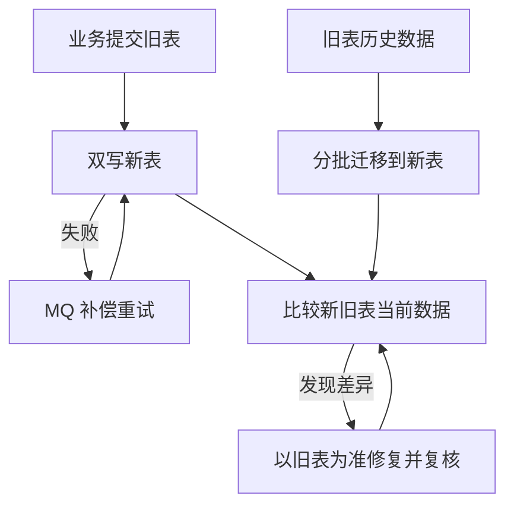
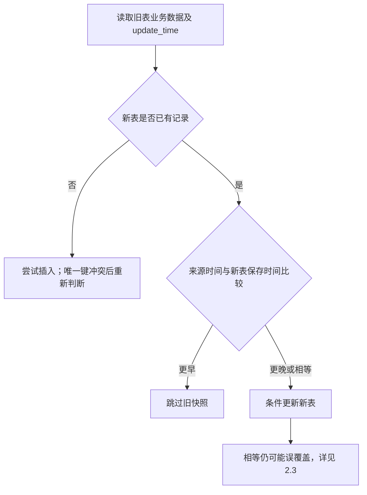
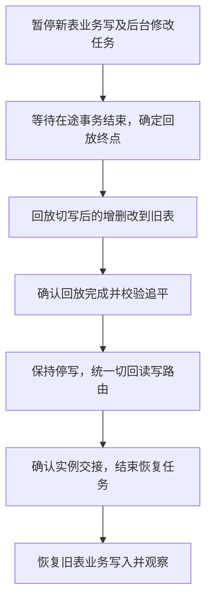

# 006_分库分表_业务双写_双写、补偿、迁移与一致性校验的版本维护

以下内容按照当前项目 AGENTS.md 项目级规则中规定的技术栈版本为准。

本文讨论旧表主写期间的并发写入，以及切换主写时的边界。当前迁移采用参考文章 01_1 的更新时间规则；新表本地 version 属于用户自行确认的项目方案；统一来源版本仅作候选分析。文中示例用于解释机制，不是生产故障记录；金额示例不新增消费业务规则。并发协议、补偿可靠性和切换效果尚未完成运行验证。

## 1 面试口述精炼版本

**先明确谁负责补数据**

旧表主写期间，以旧表为准：双写同步业务变更，失败重试补漏写，历史迁移补存量，一致性校验修正剩余差异。这些任务可能同时写同一条记录，因此除了补齐数据，还要处理旧数据晚到的问题。详见 [2.1](#21-总体思路先确定数据基准再划分各链路职责)。

**再区分时间和版本的作用**

当前迁移对新表没有的记录执行插入；已有记录则比较来源 update_time，更晚或相等才覆盖。新表自己的 version 用来判断“我读完以后，这条新表记录有没有被别人修改”，也用于 ES 同步。它不代表旧表的业务变更顺序，不能直接比较两边的版本大小。详见 [2.2](#22-当前方案更新时间判断新旧本地版本保护目标)。

**最后说明方案的边界**

不同业务状态可能保存相同时间，所以时间戳比较仍可能放过迟到的旧状态；改成毫秒也不能完全排除。统一 version 方案仍是候选，尚未采用。物理删除后，旧快照还可能重新插入记录，需要校验持续清理。当前并发协议和最终收敛效果尚未完成运行验证。详见 [2.3](#23-时间戳限制相等时间不能判断业务先后)、[2.4](#24-物理删除通过持续校验清理多余记录)。

**切写后，数据基准也要交接**

总体上先双写、迁移和校验，再灰度切读、切写。切写时要处理尚未完成的写入和旧方向修复任务，不能只看之前几轮校验结果。切写后若回滚，已确认顺序是暂停业务写入、回补旧表、校验追平、统一切回读写路由，再恢复旧表写入；相关控制和回放能力仍待实现验证。详见 [2.5](#25-切换与回滚按业务阶段确定数据基准)。

## 2 详细方案

### 2.1 总体思路：先确定数据基准，再划分各链路职责

**适用阶段：旧表主写，新表接收数据。**

本文维护当前时间戳方案；统一 version 候选方案独立维护，尚未采用。业务记录通过 merchantNo + serialNo 定位：merchantNo 用于路由，serialNo 全局唯一且不复用。

**四条链路各有职责。**

1. **双写：**旧表提交成功后，把本次变更写到新表。
2. **失败重试：**新表写入失败后，通过消息队列（MQ）继续处理，补齐漏写。
3. **历史迁移：**开启双写后，分批读取旧表存量并写入新表。
4. **一致性校验：**比较新旧表，以旧表为准修复缺失、多余和字段差异，再次核对结果。

这是参考文章 01_1 的总体方案，依据分别为[旧库为准及失败补偿](<D:/000/sources/eas/002_消费记录分库分表、双写与ES 改造（15）/999_分库分表 + 数据迁移_参考文章_01_1.md:71>)、[历史迁移](<D:/000/sources/eas/002_消费记录分库分表、双写与ES 改造（15）/999_分库分表 + 数据迁移_参考文章_01_1.md:79>)、[修复并复核](<D:/000/sources/eas/002_消费记录分库分表、双写与ES 改造（15）/999_分库分表 + 数据迁移_参考文章_01_1.md:109>)。文章没有给出四条链路共同使用的完整并发写入协议。

图中是职责关系；迁移和校验在线运行，并不要求业务停写。用户自行确认的项目目标是允许暂时落后，通过补偿和校验最终追平，不停写等待数亿条全量核对。新表业务链路与迁移、补偿逻辑分开；数据库一致也不代表 ES 已一致，ES 链路需独立验证。

本文只解释各链路交叉写入时的规则。双写流程见[004_分库分表_业务双写](<D:/000/sources/eas/002_消费记录分库分表、双写与ES 改造（15）/004_分库分表_业务双写.md:1>)；迁移断点、幂等和限流见[007_分库分表_在线历史迁移](<D:/000/sources/eas/002_消费记录分库分表、双写与ES 改造（15）/007_分库分表_在线历史迁移.md:1>)；校验流程见[008_分库分表_新旧表一致性校验](<D:/000/sources/eas/002_消费记录分库分表、双写与ES 改造（15）/008_分库分表_新旧表一致性校验.md:1>)；切换和回滚见[009_分库分表_流量切换与回滚预案](<D:/000/sources/eas/002_消费记录分库分表、双写与ES 改造（15）/009_分库分表_流量切换与回滚预案.md:1>)。

### 2.2 当前方案：更新时间判断新旧，本地版本保护目标

#### 2.2.1 历史迁移：目标存在时比较更新时间

参考文章方案要求读取业务数据及其最后更新时间 gmt_modified（下文统称 update_time）：目标缺失就插入，目标已有记录时，来源时间更晚或相等才覆盖。不是只插入缺失记录。来源：[参考文章 01_1：幂等与时间戳迁移（第 83 行）](<D:/000/sources/eas/002_消费记录分库分表、双写与ES 改造（15）/999_分库分表 + 数据迁移_参考文章_01_1.md:83>)、[参考文章 01_1：读取更新时间（第 86 行）](<D:/000/sources/eas/002_消费记录分库分表、双写与ES 改造（15）/999_分库分表 + 数据迁移_参考文章_01_1.md:86>)、[参考文章 01_1：覆盖条件（第 89 行）](<D:/000/sources/eas/002_消费记录分库分表、双写与ES 改造（15）/999_分库分表 + 数据迁移_参考文章_01_1.md:89>)。

**先判断是否缺失，再比较来源时间。**

这是参考规则的判断流程，不代表先查后无条件写；并发插入冲突和条件更新仍需由实现处理。

**生效前提：时间可比，条件判断与更新原子执行。**

新表应保留来源业务更新时间，不能改用迁移落库时间；各路径时间生成方式和精度需核实。比较与写入应作为一个不可分割的数据库操作，不能先查时间、再无条件覆盖。文章没有提供可直接证明并发安全的 SQL。

**示例：目标已有记录，来源时间确实更早。**

1. S1 是双写开启前的历史记录，某未完成批次已将其导入新表，但尚未保存完成游标。
2. 批次恢复后重新查询旧表，读到金额 100、时间 10:00:00；新表此时也为 100。
3. 业务将旧表更新为金额 200、时间 10:00:01，并成功更新新表中已有的 S1。
4. 迁移尝试写入第 2 步的快照。若原子比较时间，10:00:00 小于目标的 10:00:01，写入被拒绝，新表保留 200。

这里重复处理的是未确认完成的批次，且使用本次重新读取的数据。重新读取不代表快照在后续写入前不会过期。时间相等的反例见[2.3](#23-时间戳限制相等时间不能判断业务先后)。

#### 2.2.2 新表本地 version：检测目标是否被并发修改

在当前时间戳方案中，旧表不额外增加 version；新表首次插入时本地 version 初始化为 1，实际修改业务字段时在同一 SQL 中递增，用于本地并发控制和 Canal 下游 ES 版本管理。

**生效前提：所有实际修改都维护本地版本。**

迁移、补偿和修数也应遵守这一约束，不能为修复数据而降低新表版本。业务状态未变的重复执行，不应仅因“重试一次”生成新的业务变化；字段、时间和版本如何原子维护仍需实现确认。

**示例：本地版本记录的是新表变化。**

1. 新表插入 S1，本地 version=1。
2. 旧表发生一次修改，但双写失败，新表仍为 version=1。
3. 补偿成功修改新表，新表才递增为 version=2。

因此，新表 version 不能告诉我们旧表已经改过几次。当前旧表没有新增 version；统一来源版本是另一套候选设计，见 [2.3](#23-时间戳限制相等时间不能判断业务先后)。

#### 2.2.3 失败补偿：先区分重放旧数据还是重新读取

参考文章方案要求通过 MQ 重试失败操作，并追踪到问题解决；日志和告警本身不能补齐数据。还需保证幂等，即重复处理同一操作不重复创建记录或破坏状态。来源：[参考文章 01_1：消息队列补偿（第 72 行）](<D:/000/sources/eas/002_消费记录分库分表、双写与ES 改造（15）/999_分库分表 + 数据迁移_参考文章_01_1.md:72>)、[参考文章 01_1：失败跟踪（第 129 行）](<D:/000/sources/eas/002_消费记录分库分表、双写与ES 改造（15）/999_分库分表 + 数据迁移_参考文章_01_1.md:129>)。

**示例前提：补偿保存并重放失败时的原始数据。**

1. S2 在双写开启后新增，新旧表最初金额均为 100。
2. 旧表改为 200，新表写入失败，补偿任务 A 保存金额 200；新表仍为 100。
3. 后续业务把两边都更新为 300。
4. A 迟到后若无条件重放 200，新表就会退回旧状态。

如果补偿重新查询旧表，就应使用本次读到的内容，不能默认仍重放 200；但读取后仍可能发生新变更，风险转为读取到写入之间的并发。消息标识、过期判断和条件写入协议仍待确定，不能认为 MQ 自动保证幂等或顺序。

#### 2.2.4 校验修复：目标没变，不等于来源仍然最新

参考文章要求旧库为准修复，修复后复核，但未给出锁或版本条件。来源：[参考文章 01_1：修复及复核（第 109 行）](<D:/000/sources/eas/002_消费记录分库分表、双写与ES 改造（15）/999_分库分表 + 数据迁移_参考文章_01_1.md:109>)。用户自行确认的项目保护思路是本地乐观锁：读取新表及其 version，更新时要求记录身份和该版本仍匹配，成功后递增版本；条件不满足就重新核验。

**前提一：有人在校验读取后修改了目标。**

1. 校验先读取新表，记住本地 version=4。
2. 业务修改新表，同时将 version 加到 5。
3. 校验修复时要求 version 仍为 4，条件不成立，本次不覆盖，重新核验。

这里的版本条件和数据更新必须在同一个数据库操作中执行。

**前提二：目标未变，但旧表已产生新变更。**

1. 校验读到新表金额 100、version=4，旧表金额 200。
2. 旧表随后变成 300，但双写失败；新表仍为 100、version=4。
3. 若时间条件也允许，校验的本地版本条件可以通过，将新表修为 200、version=5。
4. 新表仍落后于旧表 300，需要后续补偿或校验继续处理。

本地乐观锁检测的是目标有没有变，不能替代来源新旧判断，也不能保证读到的来源一直最新。该思路与时间戳条件如何共同执行，仍需验证。

### 2.3 时间戳限制：相等时间不能判断业务先后

**前提：目标已有记录，但不同状态保存了相同时间。**

时间戳相等不能证明业务状态相同；毫秒精度只能降低碰撞概率，不能保证每次更新都产生不同时间。以下时序说明当前时间戳规则的缺口。具体时间是假设，不代表项目字段精度或回查耗时。

1. **迁移读取，暂未写入。**旧表为“异常（未确认）、10:00:00.123”；新表也已有该异常记录。
2. **回查得到成功。**旧表更新为成功，保存时间仍为 10:00:00.123。新表尚未更新，仍为异常。
3. **双写实际更新已有目标。**新表成为“成功、10:00:00.123”。
4. **迁移提交第 1 步的旧快照。**新表已是成功，迁移仍携带异常、相同时间。

按参考文章允许时间相等覆盖的规则，第 4 步可能把成功回退成异常；终态为失败时同理。即使原子执行条件更新，也无法消除比较值相等的歧义。规则来源见[参考文章 01_1：相等时间允许覆盖（第 89 行）](<D:/000/sources/eas/002_消费记录分库分表、双写与ES 改造（15）/999_分库分表 + 数据迁移_参考文章_01_1.md:89>)。

若改成严格大于，旧快照会被拒绝；但反过来，目标是异常、来源已成功且时间相等，真正的新状态也会被拒绝。仅调整等号不能同时解决两个方向的问题。

**实现前提不满足，也会判断错误。**

时间应保留旧表的业务更新时间，比较与更新应原子执行，详见 [2.2.1](#221-历史迁移目标存在时比较更新时间)。以下是两类独立反例：

**示例一：把迁移落库时间当成业务更新时间。**

1. 旧快照在 10:05 才写入新表，新表误将 update_time 记成 10:05。
2. 随后收到业务更新时间为 10:04 的较新状态。
3. 新表比较得到 10:04 小于 10:05，反而拒绝真正较新的业务状态。

**示例二：判断后无条件更新。**

1. 迁移先查询，发现来源时间 10:04 比新表 10:00 更新。
2. 双写抢先把新表更新到 10:05。
3. 迁移仍按第 1 步的判断无条件写入 10:04，覆盖了较新数据。

这些例子说明实现应满足哪些前提，不代表项目已发生相应问题。实际时间来源、字段精度及条件写入方式仍待核实。

统一 version 的候选同步机制及新表主写职责划分见 [候选方案 2.1](<D:/000/sources/eas/002_消费记录分库分表、双写与ES 改造（15）/999_分库分表_业务双写_双写、补偿、迁移与一致性校验的版本维护_候选方案.md:27>)。该方案尚未确认采用，不能拿当前新表本地 version 直接替代来源版本。

### 2.4 物理删除：通过持续校验清理多余记录

**用户自行确认的项目方案：物理删除后，以旧表为准清理新表。**

项目直接执行 DELETE。旧表主写期间，一致性校验按以下顺序处理：

1. 分批扫描新旧表的业务标识 serialNo，将两边标识合并去重，再查询对应的新旧表记录；不按整行内容或两边不同的自增主键去重，也不要求把全量标识一次放入内存。
2. 若旧表不存在、新表存在，将其识别为待清理的多余记录。必须覆盖新表扫描，否则无法发现旧表已删除的记录。
3. 删除前重新查询旧表主库当前状态，确认记录仍不存在，再对对应新表记录执行 DELETE；查询失败不能当作记录不存在。两边查询和删除并非跨库原子操作，迟到快照仍可能在清理后重新插入，须由后续校验再次处理。
4. 删除后复核；查询或删除失败时保留任务并重试。若迟到的迁移或补偿再次插入旧快照，后续校验继续发现并删除。

“新表有、旧表无”可能是新表漏执行删除，也可能是删除成功后又被迟到快照重新插入，不能仅凭这一结果确定故障原因。serialNo 全局唯一且删除后不复用；迟到快照写回的是已删除的旧记录，不是业务创建了另一条相同编号的新记录。

**示例：删除后被迟到迁移重新插入。**

1. 迁移读取 S1 的“异常”快照，尚未写入。
2. 业务将 S1 从旧表和新表中物理删除。
3. 迁移提交旧快照，因新表不存在 S1 而重新插入；目标行已不存在，不能依赖行内版本拦截这次插入。
4. 校验扫描新表发现 S1，重新查询旧表主库确认 S1 不存在，删除新表中的 S1，并复核结果。
5. 若仍有旧任务再次插入，后续校验重复清理；迟到写入最终结束且校验、删除重试持续成功后，两边都不存在 S1。

**收敛条件：**迟到写入最终结束，校验持续覆盖新表多余记录，失败删除最终成功，并在最后一次迟到写入后完成清理。一次校验或行内 version 无法保证删除后绝不重现。

参考文章方案明确要求发现差异时“以旧库为准”，并指出迁移未感知的删除需由校验最终修正。来源：[参考文章 01_1：删除处理（第 90 行）](<D:/000/sources/eas/002_消费记录分库分表、双写与ES 改造（15）/999_分库分表 + 数据迁移_参考文章_01_1.md:90>)、[参考文章 01_1：以旧库为准修复及复核（第 109 行）](<D:/000/sources/eas/002_消费记录分库分表、双写与ES 改造（15）/999_分库分表 + 数据迁移_参考文章_01_1.md:109>)。分批扫描两边、标识去重后回查是项目确认的校验方式，不是文章给出的完整实现。

### 2.5 切换与回滚：按业务阶段确定数据基准

#### 2.5.1 正向切换：采用参考文章 01_1 的总体方向

参考文章流程是迁移后全量校验，修复后重新核对，连续 2～3 轮一致再进入灰度；次数来自文章，不是已验证的切换安全保证。来源：[参考文章 01_1：连续多轮一致（第 146 行）](<D:/000/sources/eas/002_消费记录分库分表、双写与ES 改造（15）/999_分库分表 + 数据迁移_参考文章_01_1.md:146>)。

**用户自行确认的项目方向：采用参考文章 01_1 的总体流程。**

1. 开启双写：旧表主写，同时写新表，失败通过补偿处理。
2. 迁移历史数据：保持双写，分批搬运旧表存量。
3. 一致性校验：以旧表为准修复差异，连续多轮完整校验一致。
4. 先灰度切读，再切写：读灰度期间保持旧表主写和双写；新表查询稳定后，再将业务写入切到新表。
5. 稳定后关闭双写：保留旧表一段时间，并准备回滚预案。

来源：[参考文章 01_1：先切读、再切写及关闭双写（第 119 行起）](<D:/000/sources/eas/002_消费记录分库分表、双写与ES 改造（15）/999_分库分表 + 数据迁移_参考文章_01_1.md:119>)、[参考文章 01_1：回滚预案（第 123 行）](<D:/000/sources/eas/002_消费记录分库分表、双写与ES 改造（15）/999_分库分表 + 数据迁移_参考文章_01_1.md:123>)、[参考文章 01_1：保留旧库数据（第 152 行）](<D:/000/sources/eas/002_消费记录分库分表、双写与ES 改造（15）/999_分库分表 + 数据迁移_参考文章_01_1.md:152>)。

正向切换只确定总体方向，灰度阈值及切写操作协议仍待完善。切写后回滚单独采用文章 04 的日志回放思路，并按 [006 2.5.3](#253-切写后回滚暂停业务写入追平后切回) 修正执行顺序；不据此采用文章 04 的全部切换建议。

#### 2.5.2 主写交接：历史校验一致不能代替交接完成

**示例前提：校验结束后，旧表仍可继续写入。**

1. 最近一轮校验结束，S3 两边金额均为 100。
2. 切写前旧表提交 200，新表双写失败，补偿尚未完成。
3. 此时交给新表提供服务，新表仍是 100；先前几轮一致不能证明最后这笔更新已到达。

因此切换需要处理在途写入、积压补偿及后台任务的交接；具体协议仍待确认，不能把连续几轮一致等同于交接完成。

**主写已切换时，必须更换事实来源。**

1. 切写后，新表已经变为金额 300、version=6，旧表仍为金额 200。
2. 旧方向校验任务读取新表 version=6，却仍把旧表 200 当成正确数据。
3. 它按 version=6 更新新表，若没有其他并发修改，条件可以通过，结果变成金额 200、version=7。

版本虽然增加了，业务数据却倒退了。这里的问题是修复依据选错，不能靠本地版本条件解决。

必须由切换方案决定修复方向和旧任务退出方式；本地乐观锁或来源版本都不能替代主写归属的交接。参考文章未提供完整协议。

#### 2.5.3 切写后回滚：暂停业务写入，追平后切回

**参考文章方案：**文章 04 提出切换后的新库写操作应有日志可追溯回放，用于回补旧库。来源：[参考文章 04：回滚时通过日志回放补齐旧库（第 475 行）](<D:/000/sources/eas/002_消费记录分库分表、双写与ES 改造（15）/999_分库分表 + 数据迁移_参考文章_04.md:475>)。

**用户自行确认的项目方案：先停新表业务写入，追平旧表后再切回。**

以下步骤适用于已经切写到新表、旧表不再同步新变更的阶段，原文前提见[参考文章 04：旧库退出写入](<D:/000/sources/eas/002_消费记录分库分表、双写与ES 改造（15）/999_分库分表 + 数据迁移_参考文章_04.md:464>)。仅完成读灰度、旧表仍承担全部业务主写时，回退读路由不需要执行这套日志回补流程。

1. **暂停新表业务写入，等待在途事务结束。**暂停新增、修改、删除，以及异常回查等修改任务，等待已开始的事务提交或回滚，确定本次回放需要覆盖的最终位置。旧表也不开放业务写入，只允许恢复任务写入。
2. **将切写后的变更回放到旧表。**完整覆盖新增、修改和物理删除，保证同一 serialNo 的变更顺序，失败重试，重复回放不能破坏结果。例如记录经历“新增、修改、删除”，恢复后旧表也应不存在该记录，不能让迟到的新增重试将其复活。
3. **确认回放完成，再校验旧表追平。**暂停前已提交的全部变更都应处理成功，没有遗漏或失败项，并核对对应记录的内容和存在性。此时以新表中正确的已提交状态为恢复依据，不能用落后的旧表反向修复新表。
4. **保持业务停写，统一切回读写路由。**确认旧表具备承接条件后，切换应用和后台任务的读写入口，确认全部实例生效；结束恢复写入任务，并阻止仍指向新表的旧实例继续写入。不能只切回读取，却继续把业务变更写到新表。
5. **恢复旧表业务写入并观察。**交接完成后，解除旧表业务写入限制。是否重新开启向新表双写，按故障原因和后续迁移计划决定，不能自动恢复到仍有故障的目标。

回补期间旧表只允许恢复任务写入；路由未交接完成前，两边都不开放业务写入。

**示例：切写后新增记录，再回滚。**

1. 新表接管业务后新增 S4；旧表已经停止接收新变更，所以没有 S4。
2. 回滚时暂停新表业务写入，等待在途事务结束。
3. 回放日志，把 S4 补到旧表，并确认回放范围内的全部变更已经追平。
4. 保持业务停写，统一切回旧表读写路由，再恢复旧表业务写入。
5. 此时用户仍能查到 S4；若省略第 3 步就先切回读取，会暂时查不到 S4。

**适用边界与实现状态**

上述顺序是用户自行确认的项目方案，不是参考文章 04 原有的完整流程。原文[第 474 行起](<D:/000/sources/eas/002_消费记录分库分表、双写与ES 改造（15）/999_分库分表 + 数据迁移_参考文章_04.md:474>)先切回读取，再回补；项目将其修正并补全为“暂停业务写入、回补、校验追平、切回路由、恢复写入”。重新开启双写不能代替历史日志回放。

若事故原因是新表业务数据本身被错误修改，不能盲目回放所有日志，需要先确定正确恢复点或修复数据。

方案顺序已确认，但日志完整记录、停写控制、回放终点、幂等重试、实例确认及校验能力仍需实现和验证；停写时长、回放吞吐和故障恢复效果尚无运行证据。

## 3 已确认规则

- 文档新增“方案调整记录”，用于记录对参考文章方案进行调整的历史；后续调整应追加记录，保留已有调整历史，不与只保留最新一次的“复核记录”混用。
- 对话中的讨论、建议和方案，在用户明确要求写回文档之前，只输出到当前对话，不得写入文档；用户确认方案本身，不等于授权写回文档。
- 文档内容必须明确标识方案来源：用户自行确认的方案标为“用户自行确认的项目方案”；参考文章提出的方案标为“参考文章方案”，并注明参考文章及对应行号。参考文章之外的建议，未经用户确认不得标为已确认方案。
- 004—009 的基础流程参考文章 01_1；恢复 MQ 失败重试，迁移采用更新时间覆盖规则；本文切写后回滚补充参考文章 04 的日志回放思路。
- 不保留“迁移仅插入缺失记录”作为当前采用方案。
- 不使用两张表独立 version 的大小比较代替业务状态判断。
- 新表 version 和 ES 链路是项目约束，不归为参考文章原方案。
- 项目自行确认的目标、文章明确的机制、未完成的实现分别标识。
- 来源使用绝对路径和行号；示例明确历史记录或双写后新增记录的起点。
- 本次整理要求阐述有条理、逻辑层层递进、表述易懂并适合面试口述；不改变当前方案与候选方案的状态。
- 整理全文时结合各知识点的前提、对象和阶段去重，保留必要边界；用流程图和易懂示例辅助说明，示例每个步骤单独换行；优化后执行 java-interview-doc-review-loop 连续复核。
- 项目采用 DELETE 物理删除；旧表主写期间以旧表为准，校验任务分批扫描新旧表、按 serialNo 合并去重后回查，清理旧表不存在而新表仍存在的记录，并复核、重试。
- serialNo 全局唯一，记录删除后也不复用，不存在使用同一 serialNo 创建另一条业务记录的场景。
- 切换与回滚采用参考文章 01_1 的总体方向：开启双写、历史迁移、一致性校验、先灰度切读再切写、稳定后关闭双写并保留旧表；正向切换暂不展开操作细节。切写后回滚参考文章 04 的日志回放思路，自行确认的顺序为暂停新表业务写入、等待在途事务结束、回补旧表、校验追平、统一切回读写路由、恢复旧表业务写入；回补期间旧表只允许恢复任务写入。
- 本文维护当前方案；原 2.4 及相关候选内容迁入指定 999 文档，整套候选方案尚未确认采用。

## 4 待确认或待验证事项

以下事项尚未实现核验或取得运行证据；已确认方向不等于功能已经具备。

**当前时间戳方案**

- 更新时间由哪个组件生成，各写入路径是否保留同一来源时间。
- 时间字段及读写链路的实际精度。
- 相同时间戳但业务内容不同的冲突处理方式。
- 时间戳比较与写入是否在数据库侧原子执行。
- 消息队列可靠投递及失败操作的完整追踪机制。
- 重复补偿的幂等条件，以及原始数据重放或重新读取的选择。
- 迟到任务的过期判断和失败升级处理。
- 新表业务字段、更新时间与本地 version 的原子维护方式。

**校验与删除的完整性**

- 物理删除校验的双向扫描覆盖、查询失败识别、删除重试和迟到写入后再次清理的实现及运行验证。
- 目标不存在、更新影响 0 行时的分类及后续处理。
- 全量校验能否完整发现缺失、多余及字段差异。
- 校验失败后的恢复方式与实际收敛证据。

**切换与回滚**

- 主写交接时在途写入、补偿和旧方向校验任务的退出顺序。
- 切写后回滚的日志记录与回放实现：覆盖新增、修改和物理删除，确定回放终点，处理重复、失败及追平验证；上述回滚顺序已确认，具体停写控制、实例确认和恢复执行机制仍需实现验证。

## 5 异议与分析

### 5.1 时间戳规则有明确缺口，不能写成已保证并发安全

参考文章 01_1 的“更晚或相等才覆盖”可以挡住时间更早的数据，却挡不住时间相等的旧状态。本文保留原方案及其限制；统一 version 仍为候选。反例与来源见 [2.3](#23-时间戳限制相等时间不能判断业务先后)。

### 5.2 回滚不能先暴露尚未追平的旧表

参考文章 04 在旧库退出写入后，回滚时先切回读取再回补，可能让用户读到缺失或过时数据。项目已确认改为先停写、回补并校验，再切回读写路由。该判断只针对已经切写的阶段；原文依据、分步示例及数据错误时的例外见 [2.5.3](#253-切写后回滚暂停业务写入追平后切回)。

## 6 方案调整记录

- 2026-11-07：补充相等时间戳与统一来源版本的对照时序、严格大于时间条件的局限及目标缺失边界；仅扩展候选方案分析，当前时间戳规则和新表本地 version 职责不变。

- 2026-11-07：按职责、更新时间、本地版本、失败重试、校验修复及主写交接重排当前方案，精简面试口述；来源版本保留在候选分析中，未改变现有业务规则和验证状态。

- 2026-11-07：连续复核统一详细方案的标题层级，补充本地乐观锁的生效示例，明确候选来源版本应覆盖参与比较的业务字段，并拆分待验证事项；当前采用方案不变。

- 2026-11-07：按适用前提整理全文，合并重复的版本职责、时间戳对照时序和验证声明，保留目标缺失、来源变化与主写切换的独立边界；未改变当前方案。

- 2026-11-07：按用户要求记录来源版本在双写、补偿、历史迁移及校验中的候选设计与 SQL 示例；仅确认写回文档，未确认采用，现行时间戳方案不变。

- 2026-11-07：按用户确认的目标重写 5.3，替换双版本候选设计为新旧表各单一 version，补充可靠事件、失败重试、迁移进度及同版本行锁修复；仍未确认正式采用，现行时间戳方案不变。

- 2026-11-07：明确 5.3 候选方案在双写前新增旧表 version、初始化存量为 1 并改造所有修改入口；保留已有新表初始化待确认项，不展开初始化覆盖场景，整套方案仍未确认采用。

- 2026-11-07：确认开启双写前新表为空，先开启双写再执行历史迁移；移除已有新表存量数据的初始化待确认项，明确首次写入配套保存旧表数据及版本、迁移遇到已有记录仍需比较版本；候选方案仍未确认采用。

- 2026-11-07：按项目物理删除规则替换逻辑删除建议，补充以旧表为准的双向扫描、标识去重、回查删除及复核重试；区分漏删与迟到快照重新插入，明确删除最终收敛条件和参考文章依据，版本方案仍为候选。

- 2026-11-07：明确 serialNo 全局唯一且删除后不复用，删除同标识重建的讨论及待确认项；保留迟到快照重新插入旧记录后的校验清理机制，候选版本方案状态不变。

- 2026-11-08：按用户确认将切换与回滚统一为参考文章 01_1 的总体方向，补充先读后写、稳定后关闭双写及保留旧表的流程；暂停文章 04 修正方案的细节讨论，保留切写后回滚机制待完善，统一版本方案仍为候选。

- 2026-11-08：切换总体流程仍按参考文章 01_1，切写后回滚补充采用文章 04 的日志回放思路并标明第 475 行来源；明确先追平再切回是项目对原文顺序的修正，日志与回放实现仍待验证。

- 2026-11-08：将 5.3.9 末尾按主写切换、切写后回滚、ES 同版本修复三个主题整理，分别说明已确认方向与待完善机制，保留参考来源及候选、未验证状态。

- 2026-11-08：整篇按目标前提、当前时间戳方案、版本取舍、候选统一版本实现、物理删除、切换回滚及 ES 边界重排；前置初始化条件，合并重复说明，保留时序示例、来源和全部调整历史，未改变方案采用状态。

- 2026-11-08：补全切写后的回滚顺序，区分文章 04 的日志回放思路与用户自行确认的停写、追平、切回和恢复步骤；保留仅切读的例外、数据污染边界及实现待验证状态。

- 2026-11-08：重整异议与分析，按时间戳覆盖、切写后回滚顺序及版本能力边界分别说明前提、判断和项目处理，补充来源与详细章节导航；不改变已确认方案状态。

- 2026-11-08：整理全文的口述与详细说明，按正向切换、主写交接、切写后回滚重排 2.6；口述版补齐已确认的回滚顺序，异议章节合并重复例子并导航到完整时序。保留当前与候选方案的区别、全部调整历史及待验证边界。

- 2026-11-08：优化 2.4 的递进关系，先说明目标与前提，再解释版本、统一入口及四条链路，最后归纳最终一致性的成立条件；补清重试确认与迁移批次恢复时序，保留候选状态、SQL 和原有约束。

- 2026-11-08：按用户确认将 2.4 的新表业务方法与同步方法分开，说明切写前复制旧表版本、切写后由新表业务方法维护版本；补充跨切写示例及交接边界，统一版本整套方案仍为候选。

- 2026-11-08：将原 2.4 及相关候选分析、规则、待验证事项和 ES 边界迁入指定 999 文档；本文保留当前方案、删除和切换回滚流程，更新编号及导航，既有调整历史完整保留。

- 2026-11-08：按职责、写入规则、并发限制、删除和主写交接重整 006；合并重复解释，补充流程图与分步示例，统一文内导航。当前方案和候选状态不变，保留全部调整历史。

## 7 复核记录

2026-11-08 22:17：已执行 [$java-interview-doc-review-loop](<C:/Users/Administrator/.codex/skills/java-interview-doc-review-loop/SKILL.md:1>)。
