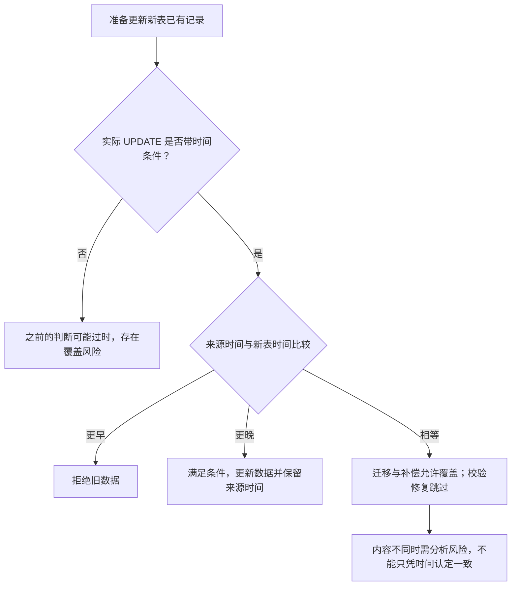

# 006_分库分表_分析双写、双写失败补偿、迁移与一致性校验过程中是否存在旧数据覆盖新数据的情况

以下内容按照当前项目 `AGENTS.md` 项目级规则中规定的技术栈版本为准。

本文集中分析双写、失败补偿、历史迁移和一致性校验修复中的旧数据覆盖风险。规则已确认不代表代码已验证；示例明确区分业务事实与分析前提。迁移任务的扫描、进度保存及删除处理见 [007](</D:/000/sources/eas/002_消费记录分库分表、双写与ES 改造（15）/007_分库分表_在线历史迁移.md:1>)。

## 1 面试口述精炼版本

**有并发，不代表一定发生旧数据覆盖**

几个任务可能同时处理同一笔交易，也可能把之前读取的数据延迟写入。只要更新时间能区分先后、数据与时间对应，并在实际 UPDATE 中比较，就能拒绝时间戳更早的数据。只在 Java 中比较后再无条件更新，判断可能已经过时。详见 [2.1](</D:/000/sources/eas/002_消费记录分库分表、双写与ES 改造（15）/006_分库分表_分析双写、双写失败补偿、迁移与一致性校验过程中是否存在旧数据覆盖新数据的情况.md:27>)。

**四条写入路径要分别检查**

正常双写是否会乱序、使用什么比较条件，仍需核验。双写失败补偿保留原操作：INSERT 冲突不自动覆盖，UPDATE 按来源时间更晚或相等更新。历史迁移也允许相等时间覆盖；校验修复采用参考文章 04，要求来源时间严格更晚。迁移的 SQL 保护不了其他写入路径，各路径都要落实自己的规则。详见 [2.2](</D:/000/sources/eas/002_消费记录分库分表、双写与ES 改造（15）/006_分库分表_分析双写、双写失败补偿、迁移与一致性校验过程中是否存在旧数据覆盖新数据的情况.md:70>) 至 [2.5](</D:/000/sources/eas/002_消费记录分库分表、双写与ES 改造（15）/006_分库分表_分析双写、双写失败补偿、迁移与一致性校验过程中是否存在旧数据覆盖新数据的情况.md:144>)。

**重点核验相同时间戳的旧补偿**

消费过程中可能同秒修改多次记录。如果两份不同内容保存了相同时间戳，旧数据被补偿保留，较新数据先写入新表，那么允许相等时间更新的补偿可能覆盖较新字段。这不要求整个消费流程一秒内完成，也不要求迁移读到中间状态。是否实际成立，需要核对时间精度、补偿消息和 UPDATE 字段。详见 [2.6](</D:/000/sources/eas/002_消费记录分库分表、双写与ES 改造（15）/006_分库分表_分析双写、双写失败补偿、迁移与一致性校验过程中是否存在旧数据覆盖新数据的情况.md:168>)。

**校验能发现差异，不代表每种差异都能自动修复**

校验的严格时间比较可以拒绝较早或同时间戳的数据，但也无法更新“时间相等、字段不同”的记录。这类差异不能记为一致，修复办法仍待确认。详见 [5](</D:/000/sources/eas/002_消费记录分库分表、双写与ES 改造（15）/006_分库分表_分析双写、双写失败补偿、迁移与一致性校验过程中是否存在旧数据覆盖新数据的情况.md:212>)。

## 2 详细分析

### 2.1 共同前提：时间比较要在实际 UPDATE 中执行

**先分清阶段和数据来源**

历史迁移期间，业务双写和失败补偿仍在执行。正式一致性校验在历史迁移完成后开始，此时仍可能与双写、补偿同时处理同一条记录。消费流程结束，不代表所有后台写入都已完成。

任务之前读取或保存的那份数据称为“快照”。如果业务后来修改了记录，这份快照就可能过时。因此，迁移、补偿、校验修复都要检查自己的写入条件，不能只依靠迁移 SQL 的保护。

**先明确判断依据**

本阶段以旧表为准。来源数据指任务从旧表读到或在失败时保存的那份数据，必须携带与它对应的 update_time，不能换成迁移或补偿执行时的系统时间。还需核验时间生成方式，确保它能够反映同一记录的修改先后。

按 merchantNo 找到对应分片，用全局唯一且不复用的 serialNo 匹配同一笔交易；旧表 id 不用来定位新表。更新时间相同只代表时间值相同，不能证明业务字段相同。

**参考依据：时间比较用于防止并发覆盖**

参考文章指出，迁移读取旧数据后，业务可能先完成更新，迁移再写入旧快照就可能覆盖新数据。因此文章要求携带更新时间，只允许来源时间更晚或相等时覆盖目标记录。来源：[参考文章 01_1：迁移并发风险，第 81 行](</D:/000/sources/eas/002_消费记录分库分表、双写与ES 改造（15）/999_分库分表 + 数据迁移_参考文章_01_1.md:81>)、[时间比较规则，第 85 行起](</D:/000/sources/eas/002_消费记录分库分表、双写与ES 改造（15）/999_分库分表 + 数据迁移_参考文章_01_1.md:85>)。

**先比较、后无条件更新：判断可能在执行前过时**

1. 任务查询新表，在 Java 中判断当前允许更新。

2. 业务双写先把新表更新成较新数据。

3. 任务仍沿用之前的判断，执行不带时间条件的 UPDATE，便可能覆盖较新数据。

因此，时间条件必须放在实际 UPDATE 中。项目已确认迁移执行该比较，不能把上述缺陷直接写成迁移实现的问题；其他路径也需要核对代码。

**判断流程：先检查写入条件，再分析时间是否能区分先后**

图中的比较规则针对已确认的迁移、补偿和校验修复；正常双写的具体条件仍待核验。迁移 SQL 示例见 [007 的写入规则](</D:/000/sources/eas/002_消费记录分库分表、双写与ES 改造（15）/007_分库分表_在线历史迁移.md:64>)。

### 2.2 正常双写：检查写入顺序和时间条件

两次旧表修改产生的数据，写到新表时不一定仍按原顺序到达。是否会乱序取决于实际线程、事务和写入链路，不能默认已经发生。

假设新表已有 S0，且实际 UPDATE 带时间条件：

1. 较早修改产生数据 A，更新时间为 10:00:00，写新表的操作尚未完成。

2. 后续修改产生数据 B，更新时间为 10:00:02，并先写入新表。

3. A 随后尝试更新。因为时间更早，条件不成立，新表保留 B。

如果正常双写没有在 UPDATE 中比较时间，A 可能覆盖 B；如果允许相等时间更新，还需检查同时间戳不同内容的情况。正常双写的实际 SQL 和写入顺序仍待核验，不能直接套用补偿已确认的比较规则。

### 2.3 双写失败补偿：区分原操作和重试数据来源

**双写补偿：保留原操作类型，UPDATE 重试比较时间**

- 原来失败的是 INSERT，重试仍执行 INSERT。相同 serialNo 已存在时会触发唯一键冲突，不自动覆盖，也不因冲突直接改成 UPDATE。如何核对已有记录并判断补偿完成，仍需核验实现。
- 原来失败的是 UPDATE，重试仍执行 UPDATE。实际 SQL 判断 `新表 update_time <= 重试数据 update_time`，只有重试数据的时间更晚或相等才更新。

补偿的数据来源尚未核验：如果保存失败时的原始数据，重试可能使用旧快照；如果重新查询旧表，就使用本次查询结果，但查询到写入之间仍可能发生业务修改。下面的补偿示例只采用第一种前提。

**示例一：旧 UPDATE 补偿晚到，但没有覆盖成功状态**

前提：S3 在双写开启前已存在，新表还没有它。示例假设一次 UPDATE 未找到新表记录后，程序保存失败数据并安排重试，不代表已核验项目实现。

1. **10:00，旧表 S3 的消费流程结束，结果仍未确认。**旧表状态为异常、update_time 为 10:00。双写 UPDATE 未找到新表记录，补偿保存“异常、10:00”。

2. **10:02，历史迁移插入 S3。**新表成为“异常、10:00”。

3. **10:06，异常回查确认成功。**旧表更新为“成功、10:06”，双写也成功更新新表已有的 S3。

4. **10:07，原来的 UPDATE 开始重试。**任务携带的仍是之前保存的“异常、10:00”，不是旧表此刻的成功状态。

5. **数据库检查时间条件。**`10:06 <= 10:00` 不成立，跳过旧数据，新表保留成功。

如果新表的成功状态是由校验修复写入的，随后到达的这份旧 UPDATE 补偿也会被相同的时间条件拒绝，无需另设一套处理规则。

### 2.4 历史迁移：较早时间被拒绝，同时间风险需核对读取时机

**并发处理：按更新时的目标状态判断**

假设业务修改后的更新时间晚于迁移读取的时间，可以分两种顺序理解：

- **双写先完成：**新表已经保存了较新状态，迁移再执行 UPDATE 时，时间条件不成立，跳过旧数据。
- **迁移先完成：**新表先收到迁移的数据，随后双写成功，将它更新为较新状态。

如果两个 UPDATE 同时修改同一行，InnoDB 行锁会让冲突的更新等待。迁移等待双写提交后，会根据新表当前的记录重新判断条件。行锁能协调执行顺序，但如果不同内容的时间戳相同，仍不能判断哪份内容更新。

**示例：重试携带旧快照，时间条件保留新表终态**

本例中，S1 在开启双写前已存在，新表中的 S1 由历史迁移插入。假设批次数据提交与进度保存分开，恢复时会再次处理已写入但未保存进度的记录；这不要求批内逐条提交。

1. **10:00:00，S1 的消费流程结束，仍未取得终态。**S1 创建时初始化为“未知”；本例将流程结束后仍未确认结果称为“异常（未确认）”，此时旧表更新时间为 10:00:00。

2. **10:05:00，迁移扫描到 S1。**同步到新表，批次数据提交成功，但随后保存完成进度失败。

3. **10:05:58，批次重试重新读取 S1。**读到异常、10:00:00，尚未执行更新。

4. **10:06:00，异常回查确认成功。**10:00:00 早于此时的五分钟截止点 10:01:00，满足回查门槛。旧表更新为成功、10:06:00。

5. **10:06:01，双写更新已有的新表记录。**新表变为成功、10:06:00。

6. **10:06:02，迁移重试执行条件更新。**数据库判断 `10:06:00 <= 10:00:00` 不成立，不覆盖该记录，新表保留成功。

该例说明旧快照被成功拦截，时间仅用于表示顺序，不代表固定重试周期。反过来，如果重试读到旧表“成功、10:06”，新表仍为“异常、10:00”，则允许更新、补齐终态；只插入缺失记录无法修正这类已有记录的差异。

**为什么不能直接把同秒修改写成项目反例**

消费流程最多几秒内完成，期间可能在同一秒多次修改记录。但是，迁移不一定会读到这些修改之间的状态。如果迁移读到的是流程结束后已经提交的数据，就不能再把“迁移读到了消费中间状态”作为示例前提。是否会因事务的读取方式看到更早的数据，需要检查实际实现，不能直接假定。

消费结束后仍可能发生异常回查。回查门槛是记录的 `update_time` 早于“当前系统时间减去五分钟”，不是消费结束满五分钟；本节示例中回查把更新时间从 10:00 改为 10:06，迁移旧快照会被时间条件拦截。

### 2.5 一致性校验修复：来源时间严格更晚才更新

**校验修复：采用参考文章 04，来源时间更晚才覆盖**

以旧表为准修复新表，但不直接覆盖已有记录。实际 UPDATE 判断 `新表 update_time < 来源 update_time`，成立才更新需要修复的业务字段，并保存来源时间；修复后重新校验差异记录。

来源：[参考文章 04：修复遵循旧库为准和时间戳覆盖，第 420 行](</D:/000/sources/eas/002_消费记录分库分表、双写与ES 改造（15）/999_分库分表 + 数据迁移_参考文章_04.md:420>)、[修复后重新校验，第 421 行](</D:/000/sources/eas/002_消费记录分库分表、双写与ES 改造（15）/999_分库分表 + 数据迁移_参考文章_04.md:421>)。严格大于的条件来自其[时间戳 SQL 示例，第 180 行起](</D:/000/sources/eas/002_消费记录分库分表、双写与ES 改造（15）/999_分库分表 + 数据迁移_参考文章_04.md:180>)：示例原用于迁移，这里结合“修复同样遵循”的要求应用于校验修复，实际代码未核验。

三种流程的条件要分开记：历史迁移和双写 UPDATE 重试允许来源时间更晚或相等；校验 UPDATE 修复要求来源时间严格更晚。以上条件针对已有记录的更新，不能代替缺失记录的插入和多余记录的删除。

**示例二：校验读完后，业务先更新了新表**

前提：历史迁移已完成，新表已有 S4，但某个待校验字段与旧表不同。示例假设修复会一并写入状态和来源时间。

1. **10:05:58，校验发现差异。**读取旧表 S4，取得“异常、10:00”，与新表比较后发现字段不同，将 S4 加入本轮不一致记录集合，尚未修复。

2. **10:06，异常回查确认成功。**旧表变为“成功、10:06”，双写随后成功更新新表已有的 S4。

3. **校验尝试写入先前读取的数据。**修复仍携带“异常、10:00”，但新表已经是“成功、10:06”。

4. **时间条件拒绝这次修复。**`10:06 < 10:00` 不成立，新表保留成功。校验重新读取并核对原来的字段差异；本轮发现过差异的事实与修复后的检查结果分开记录，结果含义见 [007 的校验衔接](</D:/000/sources/eas/002_消费记录分库分表、双写与ES 改造（15）/007_分库分表_在线历史迁移.md:148>)。

这个例子说明：“以旧表为准”不等于“之前从旧表读到的数据永远有效”。时间相等但字段不同能否出现、如何处理，见本文第 5 节。

### 2.6 同时间戳：旧补偿覆盖较新字段的条件示例

**时间相同但内容不同：旧补偿仍可能覆盖较新内容**

以下是结合业务规则的条件示例，不是参考文章原例，也不是已确认的生产问题。前提是：同一秒的两次修改保存了完全相同的 update_time；补偿保存失败时的原始数据；UPDATE 允许相等时间覆盖，并会写入发生差异的字段。

1. 消费过程中，旧表先更新一批字段，保存为数据 A，update_time 为 10:00:00，此时尚未补充核心流水号。本次双写 UPDATE 失败，补偿保存 A。新表已有该交易记录。

2. 同一秒内，旧表补充核心系统返回的流水号，成为数据 B，但保存的 update_time 仍为 10:00:00。

3. B 双写成功，新表已有核心流水号，更新时间也是 10:00:00。

4. 消费流程结束后，补偿才重试 A。因为两份数据的时间相等，UPDATE 的时间条件成立。

5. 如果 UPDATE 会写入核心流水号字段，A 就可能把新表中的流水号覆盖回旧值。

这里不要求整个消费流程在一秒内完成，也不要求迁移读到消费中间状态。旧数据由失败补偿保存，稍后才写入。如果补偿重新读取旧表、时间精度足以区分这两次修改，或者 UPDATE 不覆盖该字段，这个具体示例就不成立。目前仍需核对实际时间精度、消息内容和 SQL。

## 3 已确认规则

- 历史迁移时，目标缺失就插入；已有记录执行更新时间比较，来源更晚或相等才更新，不能只插入缺失记录。
- 按 merchantNo 路由、serialNo 关联；serialNo 全局唯一且不复用，旧表 id 不用于定位新表。
- 正常扫描不回头处理已确认完成的记录；失败恢复是否重复处理取决于进度保存和恢复方式。
- 消费交易创建时，状态初始化为“未知”。消费流程执行完成后，如果结果为终态（成功或失败），则将状态更新为对应终态。
- 消费流程通常不会在 1 秒内完成，但这不是严格的耗时下限；用户进一步说明，整个消费流程最多几秒内完成。
- 消费流程中可能在同一秒多次修改消费记录，例如补充核心系统返回的流水号等字段；这不代表整个消费流程在 1 秒内完成。
- 异常回查只处理 update_time 早于当前系统时间 5 分钟的记录，避免消费流程尚未结束就提前回查；这不是五分钟内必须得到终态的保证。
- 并发分析覆盖历史迁移、双写失败重试和一致性校验修复，不能只考虑消费流程中的业务修改。
- 双写重试按原操作类型处理：INSERT 重试遇到唯一键冲突，不自动覆盖已有记录；UPDATE 重试在实际 SQL 中比较 update_time，来源时间更晚或相等才更新。
- 一致性校验修复采用参考文章 04 的方案：以旧表为准，修复已有记录时按 update_time 严格比较，来源时间更晚才覆盖，修复后再次校验；参考来源标注原文行号。

## 4 待确认或待验证事项

- 正常双写是否会乱序到达，以及实际 UPDATE 的时间比较条件。
- update_time 的生成方式、保存精度和各修改入口的维护情况，是否能区分同一记录的不同修改。
- 补偿使用失败时保存的数据，还是执行时重新查询旧表。
- 原始数据补偿是否会覆盖核心流水号等后来修改的字段。
- INSERT 重试冲突后，如何核对已有记录并判断补偿完成。
- 迁移、补偿、校验修复是否把时间比较与更新放在同一条 SQL 中，且保留来源时间。
- 迁移的扫描时机与事务可见性，是否可能读到消费过程中的中间状态。
- 校验修复涉及哪些字段，跳过更新后如何重新核对差异。
- 时间相等但字段不同的差异如何安全修复；参考文章 04 未给出完整办法。
- 相关并发时序、失败重试及修复效果尚未进行数据库验证。

## 5 异议与分析

**严格时间比较的修复边界**

校验修复采用严格大于条件，因此不会因时间相等而覆盖已有记录。但如果校验确实发现“两边时间相等、字段不同”，这条 UPDATE 也无法修复它。应记录这项差异，不能直接判为一致；具体修复办法待确认。参考文章 04 没有给出这类差异的完整处理方案，这属于本文的边界分析，不是已发生的项目问题。

**不把条件分析当作生产事实**

同秒修改是已确认业务行为，但实际保存相同时间戳、补偿保留旧数据、UPDATE 覆盖差异字段仍需核验。没有确认的项目反例，不等于机制上绝不可能；有条件示例，也不等于生产已经发生。

**删除后的重新插入，不属于 UPDATE 覆盖**

物理删除后，旧快照可能因“新表缺失”再次被插入，这时没有目标记录的时间可比较。该问题由后续校验清理，完整处理见 [007 的删除章节](</D:/000/sources/eas/002_消费记录分库分表、双写与ES 改造（15）/007_分库分表_在线历史迁移.md:124>)，不能用它证明时间比较判断错误。

## 6 迁移与复核记录

- 2026-11-09：从 007 迁入旧数据覆盖分析、业务前提、并发时序、参考来源及相关待验证项；007 保留历史迁移流程并引用本文。

2026-11-09 17:21：已执行 [java-interview-doc-review](</C:/Users/Administrator/.codex/skills/java-interview-doc-review/SKILL.md>)。
