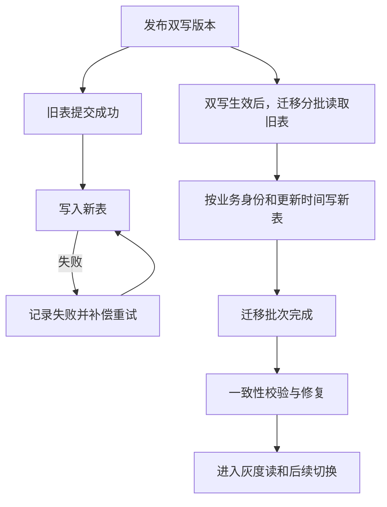
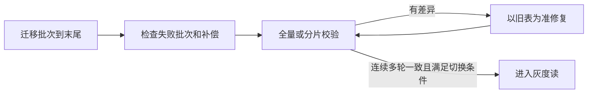

# 007_分库分表_在线历史迁移

以下内容按照当前项目 `AGENTS.md` 项目级规则中规定的技术栈版本为准。

本文按参考文章 01_1 的在线迁移主线整理：先开启双写，再迁移旧表存量；迁移按批次读取，使用业务更新时间保证幂等，迁移完成后再做一致性校验。项目仍保留 `merchantNo + serialNo` 的记录定位方式，以及直接物理删除后由一致性校验清理新表多余记录的规则。流程和示例只是设计说明，未证明代码或生产环境已经实现。

## 1 面试口述精炼版本

**先双写，再迁移存量**

先发布支持双写的应用版本：业务先写旧表，旧表提交成功后再写新表；新表写失败进入补偿。双写生效后启动历史迁移，把旧表已有数据分批搬到新表。这样迁移期间旧表仍可正常提供业务，迁移工具只负责补历史数据。

**迁移按业务身份和更新时间幂等写入**

每批从旧表读取完整记录及最后更新时间，按 `merchantNo` 路由、`serialNo` 关联新旧记录。新表没有记录就插入；已有记录时，只有来源更新时间更晚或相等才覆盖。在唯一约束、来源时间可比及原子条件写入成立时，重复读取不会插入两份记录，时间更早的快照会被拒绝；时间相等的不同状态仍有歧义，详见 [5.1](#51-参考文章的时间戳规则仍有边界)。

**迁移结束后必须校验**

迁移游标到末尾只代表扫描完成，不代表两边已经一致。迁移完成后，以旧表为准做全量或分片校验，修复缺失、字段差异和删除差异，再进入灰度读和后续切换。参考文章 01_1 的整体流程和迁移规则见[第 79 行起](<D:/000/sources/eas/002_消费记录分库分表、双写与ES 改造（15）/999_分库分表 + 数据迁移_参考文章_01_1.md:79>)。

## 2 详细方案

### 2.1 上线顺序：双写开启后启动迁移

**第一步：完成双写改造**

1. 所有旧表修改入口完成双写改造。
2. 业务请求先提交旧表；旧表提交失败，直接按旧表业务失败处理。
3. 旧表提交成功后，尝试写新表。
4. 新表写入失败，记录失败并进入消息队列补偿流程，不能只记录日志后结束。

参考文章 01_1 将旧表视为当前权威来源，要求旧表成功是业务继续的前提，新表失败则由监控和补偿追平。来源：[旧库为准及失败补偿，第 71—72 行](<D:/000/sources/eas/002_消费记录分库分表、双写与ES 改造（15）/999_分库分表 + 数据迁移_参考文章_01_1.md:71>)。

**第二步：启动在线历史迁移**

双写已经生效后启动迁移工具，不等待旧表停写，也不要求先把历史数据全部搬完。迁移工具读取旧表存量，按主键 ID 范围或时间范围分批处理；文章中的“每批 1 万条”只是示例，不是项目生产参数。

### 2.2 迁移写入：缺失插入，已有记录按更新时间覆盖

**读取同一份完整快照**

每次迁移读取时，应同时取得业务字段、`merchantNo`、`serialNo` 和最后更新时间，例如 `gmt_modified`。写入新表时使用同一份快照，不能把不同时间读取的字段拼成一条记录。

**按业务身份定位记录**

旧表自增主键和新表自增主键不要求相同。项目按 `merchantNo` 路由到目标分片，再用全局唯一且不复用的 `serialNo` 关联记录；新表自己的 `consumeId` 由新表生成或沿用已有记录身份。

**按更新时间决定是否覆盖**

1. 新表没有该 `serialNo`，插入迁移快照。
2. 新表已有该 `serialNo`，比较来源快照和目标记录的更新时间。
3. 来源时间更晚或相等，才允许覆盖目标记录。
4. 来源时间更早，跳过本次快照。

来源：[读取更新时间并检查目标，第 86—89 行](<D:/000/sources/eas/002_消费记录分库分表、双写与ES 改造（15）/999_分库分表 + 数据迁移_参考文章_01_1.md:86>)。

**实现前提（技术分析，非文章提供的完整协议）**

新表保留旧表业务更新时间；时间比较与更新应原子执行。并发插入由 serialNo 唯一约束识别冲突，再重新判断目标状态。文章没有给出对应 SQL，实际实现仍待验证。

**示例：迁移读取异常，业务随后更新为成功**

1. 新表已有 S1 的异常记录；迁移读取旧表 S1，状态为“异常（未确认）”，更新时间为 10:00。
2. 业务回查得到成功，旧表更新为“成功”，更新时间为 10:05；双写已经把新表更新为成功。
3. 迁移随后提交 10:00 的旧快照。
4. 新表当前时间为 10:05，迁移快照更早，因此跳过，不把成功改回异常。

上述示例说明如何跳过较早快照。反过来，若新表仍是 10:00 的异常状态，而迁移读到旧表 10:05 的成功状态，就需要覆盖已有记录；只插入缺失记录无法完成这类修正。消费记录通常在较短时间内从异常变为成功或失败，但这只是业务背景，不能替代时间比较和一致性校验。

### 2.3 删除处理：迁移工具发现不了的删除交给校验修复

**参考文章的边界**

迁移读取旧表记录后，旧表可能在写入新表前删除该记录，迁移工具如果没有删除事件，就可能把旧快照重新插入新表。参考文章将删除处理交给后续一致性校验，并提到软删除时间点是一种常见做法。来源：[删除竞态，第 90 行](<D:/000/sources/eas/002_消费记录分库分表、双写与ES 改造（15）/999_分库分表 + 数据迁移_参考文章_01_1.md:90>)。

**项目采用物理删除**

项目直接执行 DELETE，不把记录改成逻辑删除。校验任务分批扫描新旧表的 `serialNo`，合并去重后重新查询旧表主库；如果旧表不存在而新表仍存在，则删除新表记录并复核。删除后的迟到迁移仍可能短暂插入，必须由后续校验继续清理，具体校验职责见 [008_分库分表_新旧表一致性校验](<D:/000/sources/eas/002_消费记录分库分表、双写与ES 改造（15）/008_分库分表_新旧表一致性校验.md:1>)。

**示例：删除后旧快照重新插入**

1. 迁移读取 S2，尚未写入新表。
2. 业务将旧表和新表中的 S2 物理删除。
3. 迁移提交旧快照，新表重新出现 S2。
4. 校验扫描到 S2，重新确认旧表主库中不存在 S2。
5. 校验删除新表 S2 并复核；若仍有迟到任务再次插入，下一轮继续清理。

### 2.4 断点续跑、幂等与限流

参考文章要求可重入、幂等、断点续传和限流，见[迁移要求，第 83 行](<D:/000/sources/eas/002_消费记录分库分表、双写与ES 改造（15）/999_分库分表 + 数据迁移_参考文章_01_1.md:83>)及[断点与限流，第 145 行](<D:/000/sources/eas/002_消费记录分库分表、双写与ES 改造（15）/999_分库分表 + 数据迁移_参考文章_01_1.md:145>)。以下进度处理是解释这些能力的实施建议，并非文章给出的完整协议。

**断点续跑**

迁移工具保存已完成的批次位置。批次全部处理成功后再推进进度；从已确认完成的位置继续时，不需要重新处理此前已确认完成的批次。

**批次失败可能重复处理**

1. 任务读取一批旧表记录并写入新表。
2. 新表写入成功，但任务在保存批次进度前崩溃。
3. 恢复后从上一个已保存位置重新读取，这批记录会再次尝试写入。
4. 由于写入按业务身份和更新时间幂等，重复处理不等于插入两份记录。

恢复时如果重新查询旧表，应使用本次读到的状态和更新时间，不能默认重放上一次过期快照。即使重新读取，读取到写入之间仍可能发生变化，因此写入条件仍需原子执行。

**限流和失败追踪**

迁移工具应限制并发线程数、单批条数和单位时间读取写入量，避免影响在线业务。失败批次需要保留、重试并告警，不能用“游标已经推进”掩盖未处理记录。具体批量参数和限流阈值需要通过演练确定。

### 2.5 迁移完成：先校验，再进入切换流程

**迁移完成与数据一致分开判断**

迁移工具完成既定范围的各批次处理后，进入一致性校验；失败批次不能被遗漏。双写补偿继续处理在线写入失败，“已登记失败”不等于已经修复。文章没有给出精确的扫描终点和批次验收协议，这部分仍需落实。

游标到末尾只说明扫描完成，不能代替一致性校验。参考文章要求迁移后进行全量或分片校验，以旧库为准修复差异，修复后再次核对。来源：[一致性校验，第 94—109 行](<D:/000/sources/eas/002_消费记录分库分表、双写与ES 改造（15）/999_分库分表 + 数据迁移_参考文章_01_1.md:94>)。

正式一致性校验的具体扫描和修复流程由 008 负责；灰度读、切写和回滚由 009 负责。007 只定义迁移如何把数据送到新表，不重复展开另外两个文档的职责。

## 3 已确认规则

- 迁移采用参考文章 01_1 的顺序：先开启双写，再进行历史迁移，迁移完成后进行一致性校验。
- 迁移按主键 ID 或时间范围分批读取，不把文章示例的批次大小当成生产参数。
- 目标记录不存在时插入；目标已存在时，来源更新时间更晚或相等才覆盖，不能只同步新表不存在的记录。
- 旧表和新表通过 `merchantNo + serialNo` 关联；旧表自增主键不作为新表记录身份。
- 项目采用物理 DELETE；删除差异由一致性校验发现、清理并复核。
- 异常回查只处理 `update_time` 早于当前系统时间 5 分钟的记录，避免消费流程尚未完成就提前回查；5 分钟是回查触发门槛，不代表记录一定在 5 分钟内得到最终状态。
- 迁移支持断点续跑、重复处理、失败重试和限流；这些能力的实现效果仍需验证。
- 迁移自动任务正常扫描时，继续向后推进，不回头重复处理已确认完成的记录；失败重试是否再次处理已写入记录，取决于进度保存和恢复方式。

## 4 待确认或待验证事项

- 按 ID 或时间划分迁移范围、确定扫描终点的具体方式。
- 批次进度保存方式、恢复起点和部分提交后的重试协议。
- 迁移写入的唯一键冲突、更新时间条件更新及事务边界。
- 更新时间的生成方式、实际精度及同时间不同内容的处理。
- 删除迟到快照的校验覆盖、删除重试和最终清理时机。
- 迁移失败、补偿积压和校验修复完成后的切换验收标准。
- 迁移并发度、批次大小、限流阈值及对在线业务的实际影响。

## 5 异议与分析

### 5.1 参考文章的时间戳规则仍有边界

**问题：查询时比较通过，不代表写入时仍然可以覆盖**

参考文章要求按更新时间比较新旧，但没有给出完整的并发写入 SQL。若先查询新表、在程序里比较时间，随后无条件更新，这两步之间可能发生双写，之前的判断就会过期。

**示例：迁移批次重试时，异常回查先把新表更新为成功**

**先说明为什么会再次读取 S1。** 正常扫描继续向后推进，不会回头处理已确认完成的记录。本例假设存在以下失败恢复过程：

1. 上一次迁移已将 S1 写入新表并提交，但保存该批次完成进度前任务失败。
2. 重试从上一个已确认完成的位置恢复，因此再次读取 S1。
3. 此时旧表和新表中的 S1 都是“异常（未确认）”，`update_time=10:00:00`，重试进入已有记录的时间比较流程。

这只是解释并发风险的恢复方式假设，不代表参考文章或项目已确定这种实现，也不要求批内逐条提交。如果重试能够精确跳过已经写入的 S1，下面的示例就不适用。具体进度保存和恢复方式仍待确认。

**再看重试与异常回查交错的时序。** 异常回查只处理更新时间早于当前系统时间 5 分钟的记录：

1. **10:06:00，迁移重试读取旧表。** 重新查询得到“异常、10:00:00”，暂未写入新表，并非直接重放上次缓存。
2. **10:06:01，迁移查询新表并比较。** 新表仍是“异常、10:00:00”，来源时间与目标相等，程序判断允许覆盖，但尚未执行更新。
3. **10:06:02，异常回查确认成功。** S1 的更新时间早于此时的五分钟截止点 10:01:02，满足回查条件。旧表更新为“成功”，并将更新时间更新为 10:06:02。
4. **10:06:03，双写更新成功。** 新表已有 S1，双写将它更新为“成功、10:06:02”。
5. **10:06:04，迁移继续写入。** 若仍依据第 2 步的比较结果，无条件写入“异常、10:00:00”，就会把新表的成功状态覆盖回异常。

**正确处理：更新时再次由数据库判断时间条件**

将时间比较放进实际更新条件，与数据修改原子执行。第 5 步执行时，新表已经是 10:06:02，来源快照只有 10:00:00，条件不成立，旧快照就不会覆盖成功状态。后续仍需通过一致性校验处理其他遗漏和差异。

这个例子说明的是比较与更新分开执行的风险，不是秒级精度不足。五分钟回查门槛与本例相容；如果更新时间正常维护，异常到成功的这次变化具有不同时间，不能用它证明“同时间戳覆盖”的问题。其他同时间戳冲突是否存在，需要结合实际修改入口核实，不能凭空假设。

### 5.2 固定扫描范围不属于参考文章原方案

参考文章只要求按 ID 或时间范围分批，没有给出“扫描前获取最大 ID 并固定上界”的完整协议。本版已移除该项目自定义上界规则，避免把参考文章之外的限制写成 01_1 的原方案。若后续需要固定上界，应单独确认并在本文标为项目方案。

## 6 方案调整记录

- 2026-11-09：按用户要求删除独立版本维护文档及候选方案文档，并将 007 调整为参考文章 01_1 的迁移主线；移除参考文章 03 的固定最大 ID 方案，保留项目身份关联、物理删除和 008 校验边界。

- 2026-11-09：为 5.1 补充相同时间戳下旧异常快照覆盖成功状态的分步示例，明确示例前提、严格大于条件的局限及校验修复仍待验证。

- 2026-11-09：按五分钟回查门槛替换 5.1 示例，改用新表已有记录、迁移判断后回查双写先完成的时序；移除不符合业务前提的同秒状态变化反例，说明原子条件更新的作用。

- 2026-11-09：补充 5.1 示例的批次失败重试前提，明确正常扫描不回头处理已确认完成记录；进度保存与恢复方式仍待确认。

## 7 复核记录

2026-11-09 11:05：已执行 [java-interview-doc-review](<C:/Users/Administrator/.codex/skills/java-interview-doc-review/SKILL.md:1>)。
