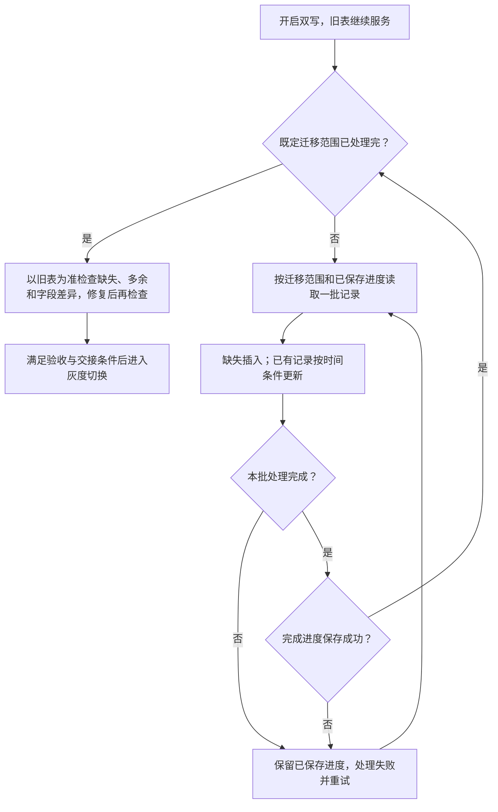

# 007_分库分表_在线历史迁移

以下内容按照当前项目 `AGENTS.md` 项目级规则中规定的技术栈版本为准。

本文按参考文章 01_1 的思路介绍历史迁移，一致性校验的时间戳修复规则采用参考文章 04，并结合项目说明如何找到同一笔交易、何时进行异常回查，以及如何处理删除。时间比较方案已确认，具体 SQL、事务和运行效果尚未核验；文中的示例用于解释处理过程，不是生产执行记录。

## 1 面试口述精炼版本

**先双写，再分批迁移**

目标是在旧表继续服务的同时，把已有数据搬到新表。先开启应用层双写，让后续业务修改也写入新表；再按主键 ID 或时间范围，分批读取旧表。每条记录同时读取业务字段和更新时间，按商户号 merchantNo 找到对应分片，再用交易流水号 serialNo 找到同一笔交易。详见 [2.1](</D:/000/sources/eas/002_消费记录分库分表、双写与ES 改造（15）/007_分库分表_在线历史迁移.md:27>)。

**缺失就插入，已有记录按时间条件更新**

新表没有这条记录，就插入。已经有记录，就比较本次从旧表读到的更新时间与新表当前的更新时间：只有前者更晚或相等，才允许覆盖。比较条件直接放进 UPDATE，让数据库在更新时判断，避免使用之前已经过时的判断结果。如果两份不同内容保存了相同时间戳，时间比较就无法区分谁新谁旧；项目是否会遇到这种情况仍待核验。详见 [2.2](</D:/000/sources/eas/002_消费记录分库分表、双写与ES 改造（15）/007_分库分表_在线历史迁移.md:67>) 和 [5.1](</D:/000/sources/eas/002_消费记录分库分表、双写与ES 改造（15）/007_分库分表_在线历史迁移.md:286>)。

**补偿和校验也要防止旧快照覆盖**

任务之前读取或保存的那份数据，称为“快照”。即使消费流程已经结束，补偿任务仍可能拿着旧数据重试；校验任务读完数据后，也可能遇到业务再次修改记录。因此，不能只检查迁移的 UPDATE，还要检查双写、补偿和校验修复的代码，确保它们不会直接用旧数据覆盖新数据。这些代码的实际处理方式仍待核验。详见 [2.4](</D:/000/sources/eas/002_消费记录分库分表、双写与ES 改造（15）/007_分库分表_在线历史迁移.md:148>)。

**重试补失败，校验补差异**

迁移要控制每批条数和处理速度，避免影响在线业务。正常扫描一直向后推进，失败后从已保存的位置继续；如果再次处理同一条记录，仍按唯一标识和更新时间写入。迁移完成后，以旧表为准检查新表是否缺记录、多记录或字段不一致，修复后再次检查。通过验收，并处理好切换时尚未完成的写入和补偿任务，才能进入相应的切换阶段。恢复和切换的具体实现仍待验证。详见 [2.3](</D:/000/sources/eas/002_消费记录分库分表、双写与ES 改造（15）/007_分库分表_在线历史迁移.md:132>)、[2.5](</D:/000/sources/eas/002_消费记录分库分表、双写与ES 改造（15）/007_分库分表_在线历史迁移.md:217>)、[2.6](</D:/000/sources/eas/002_消费记录分库分表、双写与ES 改造（15）/007_分库分表_在线历史迁移.md:241>)。

## 2 详细方案

### 2.1 启动与扫描：先开启双写，再分批读取

**启动顺序：旧表继续服务，双写覆盖新增变更**

1. 将涉及旧表增删改的业务和后台入口纳入双写。

2. 明确旧表提交成功后，再尝试写新表；旧表写入失败不继续新表写入，新表失败则记录、告警并通过消息队列补偿。

3. 双写生效后启动历史迁移，分批搬运旧表存量，不等待旧表停写。双写也同步历史记录后续发生的修改，不只处理新创建的记录。

来源：[参考文章 01_1：旧表为准与失败补偿，第 71 行起](</D:/000/sources/eas/002_消费记录分库分表、双写与ES 改造（15）/999_分库分表 + 数据迁移_参考文章_01_1.md:71>)、[历史迁移，第 79 行](</D:/000/sources/eas/002_消费记录分库分表、双写与ES 改造（15）/999_分库分表 + 数据迁移_参考文章_01_1.md:79>)。双写具体职责见 [004](</D:/000/sources/eas/002_消费记录分库分表、双写与ES 改造（15）/004_分库分表_业务双写.md:1>)。

**读取方式：分批读取，不代表逐条提交**

文章要求按主键 ID 或时间范围分批查询，并对每条记录判断插入或覆盖。它没有规定逐条执行 SQL、批量执行 SQL，还是整批统一提交。每批 1 万条只是文章示例，不是项目生产参数。来源：[分批扫描与逐条判断，第 85 行起](</D:/000/sources/eas/002_消费记录分库分表、双写与ES 改造（15）/999_分库分表 + 数据迁移_参考文章_01_1.md:85>)。

项目正常扫描向后推进，不回头处理已确认完成的记录。具体迁移哪些记录、扫描到哪里结束，以及一批数据是否在同一个事务中提交，仍需落实。文章只说明分批读取，没有替项目确定这些细节。

**整体流程：一批完成并保存进度后，再推进**



图中的“处理完成”包括三种结果：成功写入、确认两边数据已相同、确认新表数据更新而跳过本次写入。UPDATE 影响 0 行可能有不同原因，需要判断清楚后才能推进，详见 2.2。图中的进度保存顺序是实施建议，实际如何保存和恢复仍待核验。

<a id="22-迁移写入缺失插入已有记录按更新时间覆盖"></a>

### 2.2 迁移写入：按业务身份定位，按更新时间更新

**先取得完整记录，再定位新表**

一次查询同时读取业务字段、merchantNo、serialNo 和最后更新时间 update_time。下文的“来源数据”就是这次从旧表读到的数据，“来源时间”就是随它一起读到的 update_time。写入新表时保留这个时间，不能改成迁移执行时的系统时间，否则会把较早的数据标记成较新的数据。

项目按 merchantNo 路由、serialNo 匹配记录。serialNo 全局唯一、有唯一索引且不复用；旧表 id 不用来定位新表，新表首次插入时生成 consumeId，已有记录继续沿用。

**写入规则：时间条件在更新时生效**

1. **新表缺失：**插入记录及其来源更新时间。

2. **新表已存在：**实际 UPDATE 判断 `新表 update_time <= 来源 update_time`，成立才更新同步字段和时间。

3. **来源时间更早：**跳过旧快照；时间相等时仍按当前规则允许覆盖，但不能据此认定内容相同，风险见 [5.1](</D:/000/sources/eas/002_消费记录分库分表、双写与ES 改造（15）/007_分库分表_在线历史迁移.md:286>)。

缺失插入、更晚或相等覆盖来自[参考文章 01_1，第 85 行起](</D:/000/sources/eas/002_消费记录分库分表、双写与ES 改造（15）/999_分库分表 + 数据迁移_参考文章_01_1.md:85>)。用户已确认执行时间比较。实现时需要把比较和更新放在同一条 SQL 中完成，下文称为“原子条件更新”；插入冲突也需要单独处理。文章没有提供完整 SQL，项目代码仍待核验。

**核心 SQL：比较与更新在同一条语句中执行**

下面按 MySQL 8.0.33 的 InnoDB 更新机制解释。SQL 仅为说明原理，表名和字段为示意，尚未核验项目实际实现。

```sql
-- 已根据 merchantNo 路由到目标分片。
-- 实际 SET 应包含需要同步的业务字段，时间沿用来源记录。
UPDATE new_record
SET status = :source_status,
    update_time = :source_update_time
WHERE serial_no = :serial_no
  AND update_time <= :source_update_time;
```

**执行结果：跳过旧快照不等于执行失败**

- 插入遇到业务唯一键冲突，说明可能已有其他任务插入同一记录；重新查询目标，再按时间规则处理，不直接覆盖。
- UPDATE 影响 0 行，需要核对是目标较新、记录不存在，还是字段相同而未发生实际变化；返回匹配行数或实际变更行数也取决于驱动配置。
- 锁等待超时、死锁等数据库执行失败，进入失败处理和重试，不能记为本批完成。

**并发处理：按更新时的目标状态判断**

假设业务修改后的更新时间晚于迁移读取的时间，可以分两种顺序理解：

- **双写先完成：**新表已经保存了较新状态，迁移再执行 UPDATE 时，时间条件不成立，跳过旧数据。
- **迁移先完成：**新表先收到迁移的数据，随后双写成功，将它更新为较新状态。

如果两个 UPDATE 同时修改同一行，InnoDB 行锁会让冲突的更新等待。迁移等待双写提交后，会根据新表当前的记录重新判断条件。行锁能协调执行顺序，但如果不同内容的时间戳相同，仍不能判断哪份内容更新。

**示例：重试携带旧快照，时间条件保留新表终态**

本例中，S1 在开启双写前已存在，新表中的 S1 由历史迁移插入。假设批次数据提交与进度保存分开，恢复时会再次处理已写入但未保存进度的记录；这不要求批内逐条提交。

1. **10:00:00，S1 的消费流程结束，仍未取得终态。**S1 创建时初始化为“未知”；本例将流程结束后仍未确认结果称为“异常（未确认）”，此时旧表更新时间为 10:00:00。

2. **10:05:00，迁移扫描到 S1。**同步到新表，批次数据提交成功，但随后保存完成进度失败。

3. **10:05:58，批次重试重新读取 S1。**读到异常、10:00:00，尚未执行更新。

4. **10:06:00，异常回查确认成功。**10:00:00 早于此时的五分钟截止点 10:01:00，满足回查门槛。旧表更新为成功、10:06:00。

5. **10:06:01，双写更新已有的新表记录。**新表变为成功、10:06:00。

6. **10:06:02，迁移重试执行条件更新。**数据库判断 `10:06:00 <= 10:00:00` 不成立，不覆盖该记录，新表保留成功。

该例说明旧快照被成功拦截，时间仅用于表示顺序，不代表固定重试周期。反过来，如果重试读到旧表“成功、10:06”，新表仍为“异常、10:00”，则允许更新、补齐终态；只插入缺失记录无法修正这类已有记录的差异。

### 2.3 失败恢复：区分扫描完成与写入成功

**正常推进与失败恢复分开**

正常扫描不重做已确认完成的记录。参考文章要求任务可重复执行、重复执行不破坏正确结果，并能从已保存的进度继续。实施时应在本批处理完成后保存进度，未解决的失败不能被跳过；文章未给出具体事务和进度保存协议。

**为什么仍可能重复处理**

2.2 的示例中，数据已经写入新表，但任务还没记下“这一批已完成”就失败了。恢复时，任务只能按之前保存的位置继续，因此可能再次处理这一批。即使整批数据在一个事务中写入，只要进度是另外保存的，两步之间仍可能失败。如果实际恢复能识别并跳过已写入的记录，就不会出现这个示例中的重复处理。

重试如果重新查询旧表，就使用这次读到的数据和更新时间，不能假定它仍与上次相同。写入新表时，唯一索引防止同一交易插入两份记录，时间条件拒绝时间更早的数据。如果时间相同但内容不同，仍需要一致性校验发现差异。

**限流与重试：避免影响在线业务**

控制并发任务数、单批条数和单位时间读写量，观察业务延迟及数据库负载，必要时降速或暂停。失败批次应重试、告警和追踪，具体参数需演练确定。来源：[参考文章 01_1：幂等要求，第 83 行](</D:/000/sources/eas/002_消费记录分库分表、双写与ES 改造（15）/999_分库分表 + 数据迁移_参考文章_01_1.md:83>)、[断点续传与限流，第 145 行](</D:/000/sources/eas/002_消费记录分库分表、双写与ES 改造（15）/999_分库分表 + 数据迁移_参考文章_01_1.md:145>)。

### 2.4 并发写入：补偿和校验也可能带来旧快照

**先区分阶段，再检查每个入口**

历史迁移期间，业务双写与失败补偿仍在执行；正式一致性校验在历史迁移完成后开始，此时仍可能与业务双写、补偿交错。不能因为消费流程已经结束，就排除后台任务持有旧快照的可能。

迁移 UPDATE 的时间条件只保护这一次更新，不能自动保护其他入口。需要分别核对业务双写、补偿和校验修复如何防止旧数据覆盖。校验修复采用下述参考文章 04 的时间戳方案；以下业务时序是解释方案的示例，不是文章原例或生产执行记录。

**示例一：双写失败补偿晚到**

前提：本例原来失败的是 UPDATE，补偿保存失败时的数据，重试时仍执行 UPDATE。是否保存原始数据、如何登记失败，仍需核验实际实现。

1. 旧表 S3 的消费流程已结束，结果仍为异常，update_time 为 10:00。本例假设此时新表尚无 S3，双写 UPDATE 未更新到记录，程序将其登记为待补偿，保存这份异常数据，等待重试。

2. 10:02，历史迁移读取旧表，将“异常、10:00”插入新表。

3. 10:06，异常回查确认成功。旧表更新时间改为 10:06，双写成功更新新表已有的 S3，使其成为“成功、10:06”。

4. 10:07，补偿用之前保存的“异常、10:00”重试 UPDATE。新表已经是“成功、10:06”，条件 `新表 update_time <= 重试数据 update_time` 不成立，因此跳过旧数据，保留成功。

**双写重试：按原操作类型分别处理**

- **原来失败的是 INSERT：**重试仍执行 INSERT。如果新表已有相同 serialNo 的记录，就会触发唯一键冲突，不会自动覆盖已有状态，也不因冲突直接改为 UPDATE。冲突后如何核对并结束或继续补偿，仍需核验实际实现。
- **原来失败的是 UPDATE：**重试仍执行 UPDATE，并在同一条 SQL 中比较 update_time。上面的示例属于这一种：10:00 早于 10:06，因此拒绝旧数据。

如果补偿会重新查询旧表，就应该使用这次查到的数据，不能套用“再次写入旧异常状态”的前提。不过，从查询到写入之间，业务仍可能修改记录，下面的示例说明了这个问题。

**示例二：校验读取后，异常回查更新了记录**

**采用方案：以旧表为准，按更新时间修复，再次校验**

参考文章 04 第 420 行明确要求修复遵循“以旧库为准”和“基于时间戳覆盖”，第 421 行要求修复后重新校验。本文采用这一方案：校验发现字段差异后，修复已有记录时，将 `新表 update_time < 来源 update_time` 放入实际 UPDATE，只有来源时间严格更晚才更新业务字段，并保存来源时间。

来源：[参考文章 04：执行修复，第 420 行](</D:/000/sources/eas/002_消费记录分库分表、双写与ES 改造（15）/999_分库分表 + 数据迁移_参考文章_04.md:420>)、[修复后重新校验，第 421 行](</D:/000/sources/eas/002_消费记录分库分表、双写与ES 改造（15）/999_分库分表 + 数据迁移_参考文章_04.md:421>)。严格大于的比较方式见其[时间戳 SQL 示例，第 180 行起](</D:/000/sources/eas/002_消费记录分库分表、双写与ES 改造（15）/999_分库分表 + 数据迁移_参考文章_04.md:180>)；该 SQL 原用于迁移，这里根据文章“修复同样遵循”的要求应用到校验修复，实际代码尚未核验。

这条严格比较规则用于本节的校验修复。历史迁移及双写 UPDATE 重试仍按已确认的规则，允许来源时间更晚或相等时更新。时间条件用于更新已有记录；缺失记录的插入、多余记录的删除分别处理。

**示例时序：较早的修复数据被拒绝**

前提：历史迁移已完成，新表已有 S4，但某个待校验字段与旧表不同，校验准备按旧表记录修复。假设修复会一并更新状态和来源时间。

1. 10:05:58，校验读取旧表 S4，取得“异常、10:00”的快照，发现新表字段差异，尚未执行修复。

2. 10:06，异常回查确认成功，旧表更新为“成功、10:06”，双写随后成功更新新表已有的 S4。

3. 校验开始修复，但手里仍是此前读取的“异常、10:00”。这时新表已经是“成功、10:06”。

修复 UPDATE 判断 `10:06 < 10:00` 不成立，跳过旧数据，新表保留成功。随后重新查询并校验，确认原来发现的字段差异是否还存在。不能把“本次更新被跳过”直接记为“差异已修复”。

以旧表为准，指的是按旧表的正确数据修复；并不意味着之前从旧表读到的数据永远不会过时。

**方案边界：时间相等但字段不同，不能靠严格比较修复**

如果两边 update_time 相同，但某个业务字段不同，严格比较条件不会通过。校验仍应保留并报告这项差异，不能标记为一致。参考文章 04 没有展开这种差异如何安全修复，项目的处理方式仍待确认；这是本文的边界分析，不是文章已经提供的解决方案。

**示例三：补偿与校验之间也可能交错**

前提：历史迁移已完成，旧表 S5 为“成功、10:06”，新表已有 S5 但仍为“异常、10:00”。队列中还有一份待重试 UPDATE 的“异常、10:00”旧数据。

1. 校验读取旧表当前数据。来源时间 10:06 晚于新表的 10:00，条件成立，将新表修复为“成功、10:06”。

2. 补偿随后重试 UPDATE，在 SQL 中比较更新时间。因为 10:00 早于新表的 10:06，跳过旧数据，保留校验修复后的成功状态。

这些示例中，任务准备写入的旧数据，其更新时间都早于新表当前的时间。已确认双写 UPDATE 重试要比较时间；校验修复也需要防止较早数据覆盖较新数据。规则已确认不代表代码已验证，实际 SQL、冲突处理及修复字段仍待核验。

<a id="23-删除处理迁移工具发现不了的删除交给校验修复"></a>

<a id="24-物理删除通过校验清理新表多余记录"></a>

### 2.5 物理删除：通过校验清理新表多余记录

**时间条件保护已有行，不能拦住删除后的旧快照插入**

项目通过 DELETE 直接删除记录。新表中的记录被删除后，就没有这条记录的更新时间可供比较。如果迁移还拿着删除前读到的数据，就可能按“缺失则插入”的规则把它写回来。文章提到软删除时间点，并要求通过校验修正遗漏的删除；项目选择的是直接删除、再通过校验清理差异，具体实现不能归为文章已经提供的方案。来源：[参考文章 01_1：删除竞态，第 90 行](</D:/000/sources/eas/002_消费记录分库分表、双写与ES 改造（15）/999_分库分表 + 数据迁移_参考文章_01_1.md:90>)。

**示例：删除后被迁移重新插入，再由校验清理**

1. 迁移读取旧表 S2，尚未写入新表。

2. 业务删除旧表 S2；新表若有 S2，也已删除。

3. 迁移发现新表缺失，执行 INSERT 写入旧快照，新表重新出现 S2。此时没有目标记录的更新时间可比较，条件 UPDATE 无法阻止这次插入。

4. 校验分批扫描新旧表标识，合并去重后回查，发现新表有 S2、旧表主库查询成功且 S2 不存在。

5. 删除新表 S2 并复核。若查询失败，不得当成记录不存在；清理失败或后续再次插入，由重试和后续校验继续处理。

serialNo 不复用，所以这里重新出现的是已删除的旧记录，不是同一流水号下的新交易。要把它彻底清理掉，校验必须扫描到这条记录，并在最后一次旧数据插入之后成功删除、复核。扫描时保留 merchantNo，用它找到对应分片。具体校验流程见 [008](</D:/000/sources/eas/002_消费记录分库分表、双写与ES 改造（15）/008_分库分表_新旧表一致性校验.md:1>)。

<a id="25-迁移完成先校验再进入切换流程"></a>

<a id="25-完成衔接迁移完成后校验再切换"></a>

### 2.6 完成衔接：迁移完成后校验，再切换

**迁移完成不等于数据一致**

迁移范围内的所有批次处理完成后，开始正式一致性校验。迁移失败的批次不能跳过，双写失败的记录还要继续补偿；把失败记录放入队列，不代表新表已经补写成功。业务仍在继续修改数据，因此扫描结束不代表此后两边一直一致。

以旧表为准比较记录内容和存在性，发现差异后修复并复核。更新时间相同不是业务字段一致的证明，校验不能只看时间。单纯 COUNT 相等不能证明记录相同。例如旧表有 S1、新表有 S2，两边都只有一条，但内容并不一致。来源：[参考文章 01_1：校验与修复，第 94 行起](</D:/000/sources/eas/002_消费记录分库分表、双写与ES 改造（15）/999_分库分表 + 数据迁移_参考文章_01_1.md:94>)。

校验由 008 负责，灰度读、切写和回滚由 [009](</D:/000/sources/eas/002_消费记录分库分表、双写与ES 改造（15）/009_分库分表_流量切换与回滚预案.md:1>) 负责；历史迁移完成不直接触发切写。

## 3 已确认规则

- 迁移以参考文章 01_1 为依据：先双写，再分批迁移，迁移完成后校验；不采用参考文章 03 的固定最大 ID 方案。
- 按 ID 或时间范围分批读取，批次大小不照搬文章示例；具体批量写入和事务方式未确认。
- 历史迁移时，目标缺失就插入；已有记录执行更新时间比较，来源更晚或相等才更新，不能只插入缺失记录。
- 按 merchantNo 路由、serialNo 关联；serialNo 全局唯一且不复用，旧表 id 不用于定位新表。
- 正常扫描不回头处理已确认完成的记录；失败恢复是否重复处理取决于进度保存和恢复方式。
- 消费交易创建时，状态初始化为“未知”。消费流程执行完成后，如果结果为终态（成功或失败），则将状态更新为对应终态。
- 消费流程通常不会在 1 秒内完成，但这不是严格的耗时下限；用户进一步说明，整个消费流程最多几秒内完成。
- 消费流程中可能在同一秒多次修改消费记录，例如补充核心系统返回的流水号等字段；这不代表整个消费流程在 1 秒内完成。
- 异常回查只处理 update_time 早于当前系统时间 5 分钟的记录，避免消费流程尚未结束就提前回查；这不是五分钟内必须得到终态的保证。
- 项目物理 DELETE，删除差异由一致性校验发现、清理和复核。
- 迁移需支持断点续跑、幂等、失败重试和限流；用户确认的规则与已验证的实现分开说明。
- 并发分析覆盖历史迁移、双写失败重试和一致性校验修复，不能只考虑消费流程中的业务修改。
- 双写重试按原操作类型处理：INSERT 重试遇到唯一键冲突，不自动覆盖已有记录；UPDATE 重试在实际 SQL 中比较 update_time，来源时间更晚或相等才更新。
- 一致性校验修复采用参考文章 04 的方案：以旧表为准，修复已有记录时按 update_time 严格比较，来源时间更晚才覆盖，修复后再次校验；参考来源标注原文行号。

## 4 待确认或待验证事项

- 迁移范围和扫描终点的具体确定方式。
- 逐条或批量写入、事务覆盖范围、进度保存及失败恢复协议。
- 迁移、业务双写、双写失败补偿及校验修复各自的 SQL，是否保留来源时间、原子比较并更新；唯一键冲突及影响 0 行如何处理。
- 补偿是使用失败时保存的原始数据，还是重新查询旧表。
- INSERT 重试发生唯一键冲突后，如何核对已有记录，以及如何判断补偿是否完成。
- 校验修复的具体字段，以及 SQL 是否落实严格时间比较、保留来源时间和修复后复核。
- 校验发现时间相等但字段不同的记录时，如何安全修复；严格时间比较不会更新这类记录，参考文章 04 未给出具体办法。
- update_time 的生成方式、实际保存精度及各修改入口的维护情况；同秒多次修改是否保存了相同时间戳。
- 结合消费流程最多几秒完成的前提，核验迁移范围、实际扫描时机及事务可见性，判断是否可能读到消费中间状态。
- 迁移 UPDATE 是否覆盖核心流水号等字段；校验是否比较这些字段，并在最后一次旧快照写入后成功修复。
- 删除差异的双向扫描覆盖、失败重试和最后一次迟到写入后的清理。
- 补偿、校验修复完成及切换交接的验收方式。
- 并发度、批次大小、限流阈值及故障恢复演练结果。

## 5 异议与分析

### 5.1 时间比较能保证旧数据不会覆盖新数据吗？

**参考依据：时间比较用于防止并发覆盖**

参考文章指出，迁移读取旧数据后，业务可能先完成更新，迁移再写入旧快照就可能覆盖新数据。因此文章要求携带更新时间，只允许来源时间更晚或相等时覆盖目标记录。来源：[参考文章 01_1：迁移并发风险，第 81 行](</D:/000/sources/eas/002_消费记录分库分表、双写与ES 改造（15）/999_分库分表 + 数据迁移_参考文章_01_1.md:81>)、[时间比较规则，第 85 行起](</D:/000/sources/eas/002_消费记录分库分表、双写与ES 改造（15）/999_分库分表 + 数据迁移_参考文章_01_1.md:85>)。

**结论：每个写入入口都要防止旧快照覆盖**

时间比较能拒绝更新时间更早的数据，但有两个前提：写入的数据与携带的更新时间必须对应；比较条件必须在实际 UPDATE 中执行。迁移加了条件，不代表补偿或校验的 UPDATE 也有保护，需要分别检查。完整时序见 [2.2](</D:/000/sources/eas/002_消费记录分库分表、双写与ES 改造（15）/007_分库分表_在线历史迁移.md:67>)、[2.4](</D:/000/sources/eas/002_消费记录分库分表、双写与ES 改造（15）/007_分库分表_在线历史迁移.md:148>)。

**为什么不能直接把同秒修改写成项目反例**

消费流程最多几秒内完成，期间可能在同一秒多次修改记录。但是，迁移不一定会读到这些修改之间的状态。如果迁移读到的是流程结束后已经提交的数据，就不能再把“迁移读到了消费中间状态”作为示例前提。是否会因事务的读取方式看到更早的数据，需要检查实际实现，不能直接假定。

消费结束后仍可能发生异常回查。回查门槛是记录的 `update_time` 早于“当前系统时间减去五分钟”，不是消费结束满五分钟；2.2 示例中回查把更新时间从 10:00 改为 10:06，迁移旧快照会被时间条件拦截。

**时间相同但内容不同：需要核对哪些前提**

参考文章没有给出“时间相同但内容不同”的具体反例。要发生这类错误覆盖，必须同时满足以下条件：

1. 任务拿到了一份较早的数据，后来业务又修改了其中的字段，但两份数据保存的 update_time 相同。

2. 较新的数据已经写入新表，任务才开始写入手里的较早数据。

3. UPDATE 允许相等时间覆盖，而且会覆盖那个已经发生变化的字段。

较早的数据可能是迁移读到的，也可能是补偿保存的，或者校验之前查询到的。这三个条件是否同时成立，需要核对实际数据和代码；不能只因为多个任务同时运行，就认定一定会发生错误覆盖。

目前没有确认的项目实例，不把该边界写成已经发生的问题，也不把“没有反例”写成绝对不会发生。校验仍须比较业务字段，不能只比较更新时间。

### 5.2 迁移与业务写入并发时，仍可能产生数据差异

迁移读取旧表后，业务仍可能更新或删除记录。更新需要防止旧快照覆盖；物理删除后则可能因“目标缺失，执行插入”让旧记录重新出现，完整示例见 [2.5](</D:/000/sources/eas/002_消费记录分库分表、双写与ES 改造（15）/007_分库分表_在线历史迁移.md:217>)。

删除后的 INSERT 没有新表记录的更新时间可比较，所以这个问题不是“时间比较算错了”，而是“旧数据又被插入了”。需要以旧表为准，通过校验找到并删除新表多余记录，再次检查；如果之后又有旧数据插入，还需要继续清理。

## 6 方案调整记录

- 2026-11-09：补充原子时间条件更新 SQL、迁移与双写的三种执行顺序，说明行锁、失败重试、插入冲突及物理删除边界；未将设计分析记为运行验证。

- 2026-11-09：新增已确认业务规则：消费交易创建时初始化为未知状态，流程取得成功或失败结果后更新为终态；流程通常不在 1 秒内完成，不作为严格耗时下限。

- 2026-11-09：合并重复的并发边界说明，补齐流程图的进度保存失败及扫描结束分支；修正示例的初始状态前提，区分正常流程与异常回查，并补充影响 0 行的判断边界。

- 2026-11-09：合并重复时序，完整示例保留在 2.2 和 2.4，第 5 节集中说明结论与边界；简化口述及并发说明，区分执行失败与跳过旧数据，补齐流程图的范围检查。

- 2026-11-09：新增同秒多次修改消费记录的已确认规则；将时间戳碰撞从缺少业务背景的边界改为有条件的风险分析，补充核心流水号被旧快照覆盖的时序，同步口述、并发说明与待验证项。

- 2026-11-09：结合消费耗时与实际扫描时机，撤回缺少业务时序依据的流水号覆盖示例；结论改为尚无确认的项目反例，同时间戳边界仍待验证。明确回查门槛相对于 update_time，允许相等时间覆盖是已确认规则。

- 2026-11-09：补充补偿晚到、校验读取后状态变化及补偿与校验交错的条件示例；明确每个写入入口独立核验保护规则，保留正式校验晚于历史迁移的阶段顺序。

- 2026-11-09：将补偿与校验的并发示例集中到详细方案，顺延删除和完成衔接小节；口述版补齐各写入入口的保护边界，精简异议分析，保留示例假设和待验证事项。

- 2026-11-09：优化口述与详细方案的表达，解释快照、来源时间和原子条件更新；拆分并发时序、补偿结果与相同时间戳的成立条件，保留已确认规则和待验证边界。

- 2026-11-09：章节导航改为文件绝对路径和标题行号，Windows 文件链接统一增加路径起始斜杠；已核对目标文件和行号，阅读器点击效果因界面读取失败尚未验证。

- 2026-11-09：明确双写重试保留原操作类型，INSERT 冲突不自动覆盖，UPDATE 按更新时间更新；补齐示例前提并同步已确认规则、待验证事项和章节定位行号。

- 2026-11-09：校验修复采用参考文章 04 的时间戳覆盖与修复后复核方案，标注第 180、420、421 行；区分校验修复的严格比较与迁移、双写重试的相等可更新规则，记录同时间字段差异的待确认处理。

## 7 复核记录

2026-11-09 16:43：已执行 [java-interview-doc-review](</C:/Users/Administrator/.codex/skills/java-interview-doc-review/SKILL.md>)。
