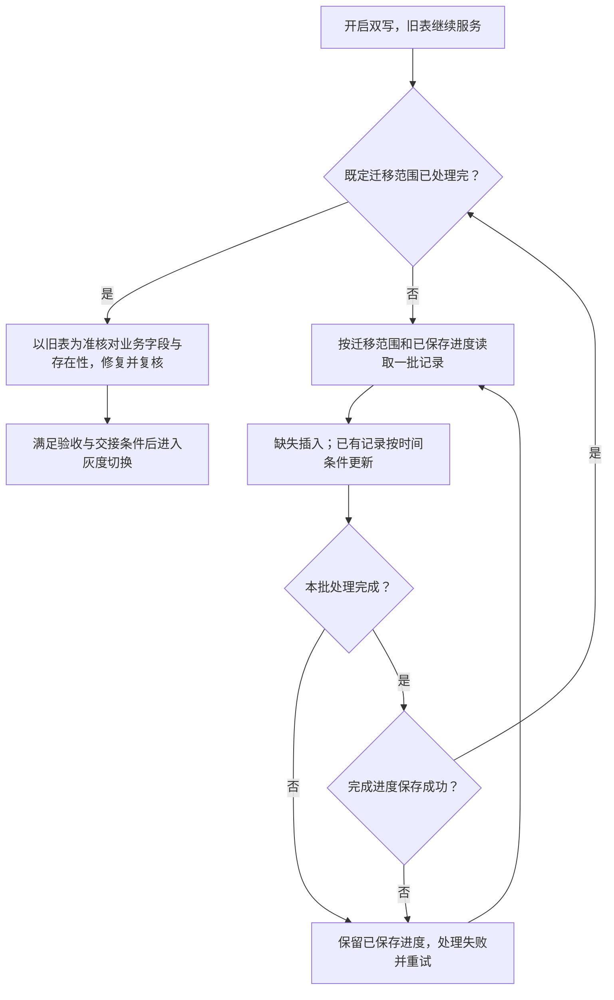

# 007_分库分表_在线历史迁移

以下内容按照当前项目 `AGENTS.md` 项目级规则中规定的技术栈版本为准。

本文采用参考文章 01_1 的迁移方向，结合项目的业务身份、回查门槛和物理删除规则说明。时间比较方案已确认；SQL、事务和运行效果尚未核验，示例不是生产执行记录。

## 1 面试口述精炼版本

**先双写，再分批迁移**

目标是在旧表继续服务的同时，把存量数据搬到新表。先开启应用层双写，接住迁移期间的业务变更，再按主键 ID 或时间范围分批读取旧表。每条记录同时带上业务字段和更新时间，按 merchantNo 路由，用 serialNo 找到同一笔交易。详见 [2.1](#21-启动与扫描先开启双写再分批读取)。

**缺失就插入，已有记录按时间条件更新**

新表没有记录就插入；已有记录时，只有来源更新时间更晚或相等，才允许覆盖。时间比较直接放进 UPDATE，避免在目标数据已变化后，仍沿用之前的判断结果覆盖。它能拦截时间戳更早的快照；若不同内容具有相同时间戳，则无法靠时间区分先后，这一边界在项目中是否会触发仍待核验。详见 [2.2](#22-迁移写入按业务身份定位按更新时间更新) 和 [5.1](#51-时间比较能保证旧数据不会覆盖新数据吗)。

**重试补失败，校验补差异**

迁移控制批次大小和执行速率，避免影响在线业务。正常扫描向后推进，失败后从已保存进度恢复；再次处理同一记录时，仍按唯一标识和更新时间写入。迁移完成后，以旧表为准校验、修复并复核，清理新表多余记录，通过验收和任务交接后再进入灰度切换。具体恢复协议及运行效果仍待验证。详见 [2.3](#23-失败恢复区分扫描完成与写入成功)、[2.4](#24-物理删除通过校验清理新表多余记录)、[2.5](#25-完成衔接迁移完成后校验再切换)。

## 2 详细方案

### 2.1 启动与扫描：先开启双写，再分批读取

**启动顺序：旧表继续服务，双写覆盖新增变更**

1. 将涉及旧表增删改的业务和后台入口纳入双写。

2. 明确旧表提交成功后，再尝试写新表；旧表写入失败不继续新表写入，新表失败则记录、告警并通过消息队列补偿。

3. 双写生效后启动历史迁移，分批搬运旧表存量，不等待旧表停写。双写也同步历史记录后续发生的修改，不只处理新创建的记录。

来源：[参考文章 01_1：旧表为准与失败补偿，第 71 行起](<D:/000/sources/eas/002_消费记录分库分表、双写与ES 改造（15）/999_分库分表 + 数据迁移_参考文章_01_1.md:71>)、[历史迁移，第 79 行](<D:/000/sources/eas/002_消费记录分库分表、双写与ES 改造（15）/999_分库分表 + 数据迁移_参考文章_01_1.md:79>)。双写具体职责见 [004](<D:/000/sources/eas/002_消费记录分库分表、双写与ES 改造（15）/004_分库分表_业务双写.md:1>)。

**读取方式：分批读取，不代表逐条提交**

文章要求按主键 ID 或时间范围分批查询，并对每条记录判断插入或覆盖。它没有规定逐条执行 SQL、批量执行 SQL，还是整批统一提交。每批 1 万条只是文章示例，不是项目生产参数。来源：[分批扫描与逐条判断，第 85 行起](<D:/000/sources/eas/002_消费记录分库分表、双写与ES 改造（15）/999_分库分表 + 数据迁移_参考文章_01_1.md:85>)。

项目正常扫描向后推进，不回头处理已确认完成的记录。具体范围、扫描终点和批次事务边界仍待落实；扫描边界不能由文章的分批示例直接推导。

**整体流程：一批完成并保存进度后，再推进**



图中处理完成包括成功写入、确认数据已相同，以及确认目标已有较新数据而跳过；不能仅凭 UPDATE 影响 0 行就推进。进度保存方式是实施建议，具体协议待核验。

<a id="22-迁移写入缺失插入已有记录按更新时间覆盖"></a>

### 2.2 迁移写入：按业务身份定位，按更新时间更新

**先取得完整记录，再定位新表**

一次读取取得业务字段、merchantNo、serialNo 和对应的最后更新时间，以下统称 update_time。新表保留来源业务更新时间，不能用迁移落库时间替代。数据与时间应来自同一份记录快照。

项目按 merchantNo 路由、serialNo 匹配记录。serialNo 全局唯一、有唯一索引且不复用；旧表 id 不用来定位新表，新表首次插入时生成 consumeId，已有记录继续沿用。

**写入规则：时间条件在更新时生效**

1. **新表缺失：**插入记录及其来源更新时间。

2. **新表已存在：**实际 UPDATE 判断 `新表 update_time <= 来源 update_time`，成立才更新同步字段和时间。

3. **来源时间更早：**跳过旧快照；时间相等时仍按当前规则允许覆盖，但不能据此认定内容相同，风险见 [5.1](#51-时间比较能保证旧数据不会覆盖新数据吗)。

缺失插入、更晚或相等覆盖来自[参考文章 01_1，第 85 行起](<D:/000/sources/eas/002_消费记录分库分表、双写与ES 改造（15）/999_分库分表 + 数据迁移_参考文章_01_1.md:85>)。用户已确认执行时间比较；原子条件更新及冲突处理是落实该规则的具体要求，文章未提供完整 SQL，代码仍待核验。

**核心 SQL：比较与更新在同一条语句中执行**

下面按 MySQL 8.0.33 的 InnoDB 更新机制解释。SQL 仅为说明原理，表名和字段为示意，尚未核验项目实际实现。

```sql
-- 已根据 merchantNo 路由到目标分片。
-- 实际 SET 应包含需要同步的业务字段，时间沿用来源记录。
UPDATE new_record
SET status = :source_status,
    update_time = :source_update_time
WHERE serial_no = :serial_no
  AND update_time <= :source_update_time;
```

**执行结果：跳过旧快照不等于执行失败**

- 插入遇到业务唯一键冲突，说明可能已有其他任务插入同一记录；重新查询目标，再按时间规则处理，不直接覆盖。
- UPDATE 影响 0 行，需要核对是目标较新、记录不存在，还是字段相同而未发生实际变化；返回匹配行数或实际变更行数也取决于驱动配置。
- 锁等待超时、死锁等数据库执行失败，进入失败处理和重试，不能记为本批完成。

**并发处理：按更新时的目标状态判断**

当来源和目标的更新时间能够区分先后时，双写先提交时间更晚的状态，迁移随后执行会因条件不成立而跳过；迁移先提交，后续双写成功后写入新状态。InnoDB 行锁会协调同一行的冲突更新，迁移等待双写提交后，会按当前目标记录判断条件。但行锁只能协调执行顺序，不能弥补两份内容具有相同时间戳的信息缺口。

**示例：重试携带旧快照，时间条件保留新表终态**

本例中，S1 在开启双写前已存在，新表中的 S1 由历史迁移插入。假设批次数据提交与进度保存分开，恢复时会再次处理已写入但未保存进度的记录；这不要求批内逐条提交。

1. **10:00:00，S1 的消费流程结束，仍未取得终态。**S1 创建时初始化为“未知”；本例将流程结束后仍未确认结果称为“异常（未确认）”，此时旧表更新时间为 10:00:00。

2. **10:05:00，迁移扫描到 S1。**同步到新表，批次数据提交成功，但随后保存完成进度失败。

3. **10:05:58，批次重试重新读取 S1。**读到异常、10:00:00，尚未执行更新。

4. **10:06:00，异常回查确认成功。**10:00:00 早于此时的五分钟截止点 10:01:00，满足回查门槛。旧表更新为成功、10:06:00。

5. **10:06:01，双写更新已有的新表记录。**新表变为成功、10:06:00。

6. **10:06:02，迁移重试执行条件更新。**数据库判断 `10:06:00 <= 10:00:00` 不成立，不覆盖该记录，新表保留成功。

该例说明旧快照被成功拦截，时间仅用于表示顺序，不代表固定重试周期。反过来，如果重试读到旧表“成功、10:06”，新表仍为“异常、10:00”，则允许更新、补齐终态；只插入缺失记录无法修正这类已有记录的差异。

### 2.3 失败恢复：区分扫描完成与写入成功

**正常推进与失败恢复分开**

正常扫描不重做已确认完成的记录。参考文章要求任务可重复执行、重复执行不破坏正确结果，并能从已保存的进度继续。实施时应在本批处理完成后保存进度，未解决的失败不能被跳过；文章未给出具体事务和进度保存协议。

**为什么仍可能重复处理**

2.2 的示例中，新表已经提交，进度却未保存。若恢复依据仍是旧进度，就会再次处理该批记录；即使整批写入采用一个事务，也不自动解决“数据提交后、进度保存前”的窗口。若实际恢复能精确跳过已写入记录，该例的重复处理前提便不成立。

重新查询旧表时，使用本次读到的数据和配套时间，不默认重放上次缓存；新表通过业务唯一约束避免重复插入，通过时间条件拒绝时间戳更早的快照；相同时间戳的内容差异仍需校验发现。

**限流与重试：避免影响在线业务**

控制并发任务数、单批条数和单位时间读写量，观察业务延迟及数据库负载，必要时降速或暂停。失败批次应重试、告警和追踪，具体参数需演练确定。来源：[参考文章 01_1：幂等要求，第 83 行](<D:/000/sources/eas/002_消费记录分库分表、双写与ES 改造（15）/999_分库分表 + 数据迁移_参考文章_01_1.md:83>)、[断点续传与限流，第 145 行](<D:/000/sources/eas/002_消费记录分库分表、双写与ES 改造（15）/999_分库分表 + 数据迁移_参考文章_01_1.md:145>)。

<a id="23-删除处理迁移工具发现不了的删除交给校验修复"></a>

### 2.4 物理删除：通过校验清理新表多余记录

**时间条件保护已有行，不能拦住删除后的旧快照插入**

项目直接执行 DELETE。目标行删除后，已没有该行的更新时间可比较，迟到迁移仍可能按“缺失则插入”写回旧记录。文章提到软删除时间点这一常见方向，并要求校验修正未感知的删除；项目采用的是物理删除加后续校验，不能写成文章完整实现了此协议。来源：[参考文章 01_1：删除竞态，第 90 行](<D:/000/sources/eas/002_消费记录分库分表、双写与ES 改造（15）/999_分库分表 + 数据迁移_参考文章_01_1.md:90>)。

**示例：删除后被迁移重新插入，再由校验清理**

1. 迁移读取旧表 S2，尚未写入新表。

2. 业务删除旧表 S2；新表若有 S2，也已删除。

3. 迁移发现新表缺失，执行 INSERT 写入旧快照，新表重新出现 S2。此时没有目标记录的更新时间可比较，条件 UPDATE 无法阻止这次插入。

4. 校验分批扫描新旧表标识，合并去重后回查，发现新表有 S2、旧表主库查询成功且 S2 不存在。

5. 删除新表 S2 并复核。若查询失败，不得当成记录不存在；清理失败或后续再次插入，由重试和后续校验继续处理。

serialNo 不复用，这里重新出现的是已删除的旧记录。最终清理依赖迟到写入结束、校验覆盖完整，以及最后一次迟到写入后删除成功。扫描时保留 merchantNo 用于定位分片，具体校验流程见 [008](<D:/000/sources/eas/002_消费记录分库分表、双写与ES 改造（15）/008_分库分表_新旧表一致性校验.md:1>)。

<a id="25-迁移完成先校验再进入切换流程"></a>

### 2.5 完成衔接：迁移完成后校验，再切换

**迁移完成不等于数据一致**

既定范围内的批次处理完成后，进入正式一致性校验。失败批次不能遗漏；双写补偿继续处理在线失败，“已登记”不能代替“已修复”。正常业务仍在运行，不能因为扫描结束就宣称两边永久一致。

以旧表为准比较记录内容和存在性，发现差异后修复并复核。更新时间相同不是业务字段一致的证明，校验不能只看时间。单纯 COUNT 相等不能证明记录相同。例如旧表有 S1、新表有 S2，两边都只有一条，但内容并不一致。来源：[参考文章 01_1：校验与修复，第 94 行起](<D:/000/sources/eas/002_消费记录分库分表、双写与ES 改造（15）/999_分库分表 + 数据迁移_参考文章_01_1.md:94>)。

校验由 008 负责，灰度读、切写和回滚由 [009](<D:/000/sources/eas/002_消费记录分库分表、双写与ES 改造（15）/009_分库分表_流量切换与回滚预案.md:1>) 负责；历史迁移完成不直接触发切写。

## 3 已确认规则

- 迁移以参考文章 01_1 为依据：先双写，再分批迁移，迁移完成后校验；不采用参考文章 03 的固定最大 ID 方案。
- 按 ID 或时间范围分批读取，批次大小不照搬文章示例；具体批量写入和事务方式未确认。
- 目标缺失时插入；已有记录执行更新时间比较，来源更晚或相等才更新，不能只插入缺失记录。
- 按 merchantNo 路由、serialNo 关联；serialNo 全局唯一且不复用，旧表 id 不用于定位新表。
- 正常扫描不回头处理已确认完成的记录；失败恢复是否重复处理取决于进度保存和恢复方式。
- 消费交易创建时，状态初始化为“未知”。消费流程执行完成后，如果结果为终态（成功或失败），则将状态更新为对应终态。
- 消费流程通常不会在 1 秒内完成，但这不是严格的耗时下限；用户进一步说明，整个消费流程最多几秒内完成。
- 消费流程中可能在同一秒多次修改消费记录，例如补充核心系统返回的流水号等字段；这不代表整个消费流程在 1 秒内完成。
- 异常回查只处理 update_time 早于当前系统时间 5 分钟的记录，避免消费流程尚未结束就提前回查；这不是五分钟内必须得到终态的保证。
- 项目物理 DELETE，删除差异由一致性校验发现、清理和复核。
- 迁移需支持断点续跑、幂等、失败重试和限流；用户确认的规则与已验证的实现分开说明。
- 并发分析覆盖历史迁移、双写失败重试和一致性校验修复，不能只考虑消费流程中的业务修改。

## 4 待确认或待验证事项

- 迁移范围和扫描终点的具体确定方式。
- 逐条或批量写入、事务覆盖范围、进度保存及失败恢复协议。
- 迁移、业务双写、双写失败补偿及校验修复各自的 SQL，是否保留来源时间、原子比较并更新；唯一键冲突及影响 0 行如何处理。
- 补偿是重放失败时的原始数据，还是重新查询旧表；插入冲突后是否更新及更新规则。
- 校验修复会更新哪些字段；读取后目标发生变化时，如何拒绝旧快照并重新核对差异。
- update_time 的生成方式、实际保存精度及各修改入口的维护情况；同秒多次修改是否保存了相同时间戳。
- 结合消费流程最多几秒完成的前提，核验迁移范围、实际扫描时机及事务可见性，判断是否可能读到消费中间状态。
- 迁移 UPDATE 是否覆盖核心流水号等字段；校验是否比较这些字段，并在最后一次旧快照写入后成功修复。
- 删除差异的双向扫描覆盖、失败重试和最后一次迟到写入后的清理。
- 补偿、校验修复完成及切换交接的验收方式。
- 并发度、批次大小、限流阈值及故障恢复演练结果。

## 5 异议与分析

### 5.1 时间比较能保证旧数据不会覆盖新数据吗？

**参考依据：时间比较用于防止并发覆盖**

参考文章指出，迁移读取旧数据后，业务可能先完成更新，迁移再写入旧快照就可能覆盖新数据。因此文章要求携带更新时间，只允许来源时间更晚或相等时覆盖目标记录。来源：[参考文章 01_1：迁移并发风险，第 81 行](<D:/000/sources/eas/002_消费记录分库分表、双写与ES 改造（15）/999_分库分表 + 数据迁移_参考文章_01_1.md:81>)、[时间比较规则，第 85 行起](<D:/000/sources/eas/002_消费记录分库分表、双写与ES 改造（15）/999_分库分表 + 数据迁移_参考文章_01_1.md:85>)。

**结论：每个写入入口都要防止旧快照覆盖**

如果来源时间为 10:00、新表时间为 10:06，原子的时间条件 UPDATE 会拦住旧快照；迁移示例见 [2.2](#22-迁移写入按业务身份定位按更新时间更新)。但迁移的条件不能保护补偿或校验发出的另一条 UPDATE，每个写新表的入口都需单独核对。消费流程结束后，任务仍可能排队、重试，或在读取后延迟写入。

**示例一：双写失败补偿晚到**

前提：补偿保存并重放失败时的原始数据。以下为并发风险示例，补偿的实际实现尚未核验。

1. 旧表 S3 的消费流程已结束，结果仍为异常，update_time 为 10:00。本例假设此时新表尚无 S3，同步新表未成功，补偿任务保存了这份异常数据，等待重试。

2. 10:02，历史迁移读取旧表，将“异常、10:00”插入新表。

3. 10:06，异常回查确认成功。旧表更新时间改为 10:06，双写成功更新新表已有的 S3，使其成为“成功、10:06”。

4. 10:07，补偿重放“异常、10:00”。如果仅插入，会遇到唯一键冲突；如果冲突后无条件更新，就可能把成功回退为异常；如果原子比较更新时间，则拒绝旧快照，保留成功。

如果补偿重新查询旧表，应使用本次查询结果，不能默认仍重放旧异常状态。但查询后的数据仍可能变化，需继续考虑下面的读写间隔。

**示例二：校验读取后，异常回查更新了记录**

前提：历史迁移已完成，新表已有 S4，但某个待校验字段与旧表不同，校验准备按旧表记录修复。假设修复会一并更新状态和来源时间。

1. 10:05:58，校验读取旧表 S4，取得“异常、10:00”的快照，发现新表字段差异，尚未执行修复。

2. 10:06，异常回查确认成功，旧表更新为“成功、10:06”，双写随后成功更新新表已有的 S4。

3. 校验继续使用此前读取的“异常、10:00”修复。如果无条件覆盖，就可能回退成功状态；如果在实际 UPDATE 中比较时间，则旧快照被拒绝，应重新读取并核对剩余差异。

旧表是校验依据，不代表校验之前读取的快照始终是最新数据。这里不是已确认的修复实现或生产故障。

**示例三：补偿与校验之间也可能交错**

前提：历史迁移已完成，新表已有 S5，旧表为“成功、10:06”。队列中仍有一份“异常、10:00”的旧补偿快照。

1. 校验读取旧表当前数据，将新表修复为“成功、10:06”。

2. 补偿随后执行。如果无条件更新，就可能把校验刚修好的状态回退；如果执行原子时间比较，则跳过旧快照。

上述三个示例都不依赖消费流程在迁移时仍然执行。时间戳不同，原子时间比较能够拦截旧数据；它们说明需要覆盖所有写入入口，不是时间比较本身失效的反例。正式校验仍按既定流程在历史迁移完成后进行，不因此假设二者同时运行。

**为什么不能直接把同秒修改写成项目反例**

用户已说明消费流程最多几秒内完成，流程中可能在同一秒多次修改记录。如果消费流程已经结束，且迁移读取的是完成后的已提交数据，就不会出现消费过程中的中间状态交错；是否读取较早的事务快照仍需结合实际事务核验。因此，不能仅凭“同秒多次修改”就断定迁移会发生旧快照覆盖。

消费结束后仍可能发生异常回查。回查门槛是记录的 `update_time` 早于“当前系统时间减去五分钟”，不是消费结束满五分钟；2.2 示例中回查把更新时间从 10:00 改为 10:06，迁移旧快照会被时间条件拦截。

**仍待验证的机制边界**

参考文章没有展开相同时间戳对应不同内容的反例；以下是机制分析。相同时间戳不能区分不同内容，要形成具体错误覆盖，还需同时满足：迁移读到较早的已提交内容；业务随后修改了迁移会覆盖的字段并保存相同的 `update_time`；新内容先进入新表，迁移旧快照后到并按相等时间覆盖。

目前没有确认的项目实例，不把该边界写成已经发生的问题，也不把“没有反例”写成绝对不会发生。校验仍须比较业务字段，不能只比较更新时间。

### 5.2 迁移与业务写入并发时，仍可能产生数据差异

**原因：读取快照后，业务数据可能已经变化**

迁移读取旧表到写入新表之间，业务仍可能更新或删除同一条记录。两条流程交错执行时，需要分别处理已有记录更新、缺失插入和删除，不能认为一种判断就能覆盖全部场景。

例如 [2.4 的删除示例](#24-物理删除通过校验清理新表多余记录)：迁移先读取记录，业务随后将新旧表中的记录删除，迁移再按“新表缺失”插入旧快照，导致旧表没有、新表却有这条记录。

**处理：以旧表为准清理，覆盖最后一次迟到插入**

本节删除场景执行的是 INSERT，没有目标记录的更新时间可比较。它属于迁移与业务删除交错产生的差异，与 5.1 的相同时间戳边界不同，不能用来证明时间比较判断错误。

后续一致性校验以旧表为准发现、清理新表多余记录，并复核结果；清理需要覆盖最后一次迟到插入。具体覆盖性、失败重试和运行效果仍见第 4 节待验证事项。

## 6 方案调整记录

- 2026-11-09：补充原子时间条件更新 SQL、迁移与双写的三种执行顺序，说明行锁、失败重试、插入冲突及物理删除边界；未将设计分析记为运行验证。

- 2026-11-09：新增已确认业务规则：消费交易创建时初始化为未知状态，流程取得成功或失败结果后更新为终态；流程通常不在 1 秒内完成，不作为严格耗时下限。

- 2026-11-09：合并重复的并发边界说明，补齐流程图的进度保存失败及扫描结束分支；修正示例的初始状态前提，区分正常流程与异常回查，并补充影响 0 行的判断边界。

- 2026-11-09：合并重复时序，完整示例保留在 2.2 和 2.4，第 5 节集中说明结论与边界；简化口述及并发说明，区分执行失败与跳过旧数据，补齐流程图的范围检查。

- 2026-11-09：新增同秒多次修改消费记录的已确认规则；将时间戳碰撞从缺少业务背景的边界改为有条件的风险分析，补充核心流水号被旧快照覆盖的时序，同步口述、并发说明与待验证项。

- 2026-11-09：结合消费耗时与实际扫描时机，撤回缺少业务时序依据的流水号覆盖示例；结论改为尚无确认的项目反例，同时间戳边界仍待验证。明确回查门槛相对于 update_time，允许相等时间覆盖是已确认规则。

- 2026-11-09：补充补偿晚到、校验读取后状态变化及补偿与校验交错的条件示例；明确每个写入入口独立核验保护规则，保留正式校验晚于历史迁移的阶段顺序。

## 7 复核记录

2026-11-09 15:26：已执行 [java-interview-doc-review](C:/Users/Administrator/.codex/skills/java-interview-doc-review/SKILL.md)。
