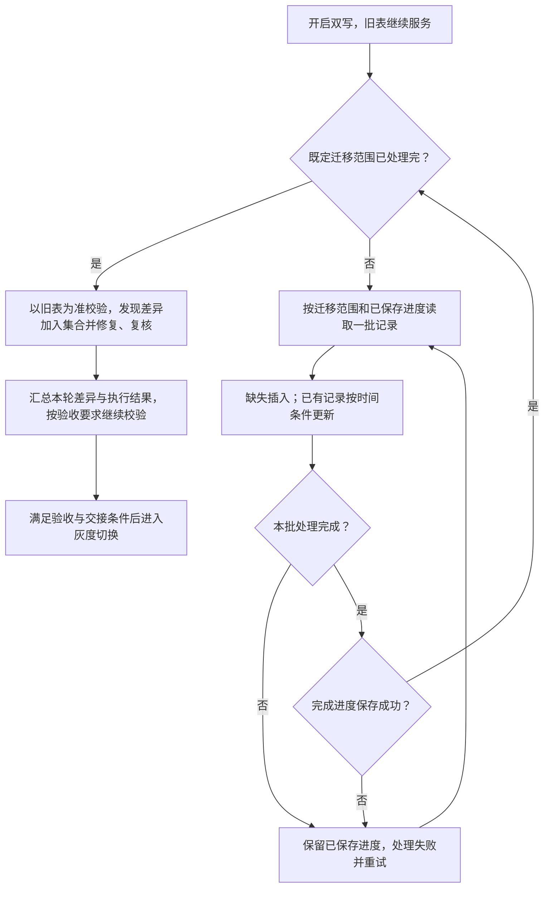

# 008_分库分表_不停机数据迁移_在线历史迁移

以下内容按照当前项目 `AGENTS.md` 项目级规则中规定的技术栈版本为准。

本文按参考文章 01_1 的思路介绍历史迁移，重点说明分批扫描、写入、失败恢复及校验衔接。双写、补偿、迁移与校验修复的旧数据覆盖分析集中在 [006](</D:/000/sources/eas/002_消费记录分库分表、双写与ES 改造（15）/005_分库分表_不停机数据迁移_如何防止旧版本数据覆盖新版数据.md:1>)。时间比较方案已确认，具体 SQL、事务和运行效果尚未核验；文中的示例用于解释处理过程，不是生产执行记录。

## 1 面试口述精炼版本

**先双写，再分批迁移**

目标是在旧表继续服务的同时，把已有数据搬到新表。先开启应用层双写，让后续业务修改也写入新表；再按主键 ID 或时间范围，分批读取旧表。每条记录同时读取业务字段和更新时间，按商户号 merchantNo 找到对应分片，再用交易流水号 serialNo 找到同一笔交易。详见 [2.1](</D:/000/sources/eas/002_消费记录分库分表、双写与ES 改造（15）/008_分库分表_不停机数据迁移_在线历史迁移.md:23>)。

**缺失就插入，已有记录按时间条件更新**

新表没有这条记录，就插入。已经有记录，就比较本次从旧表读到的更新时间与新表当前的更新时间：只有前者更晚或相等，才允许覆盖。比较条件直接放进 UPDATE，让数据库在更新时判断，避免使用之前已经过时的判断结果。时间比较的并发保护范围与相同时间戳风险统一见 006。详见 [2.2](</D:/000/sources/eas/002_消费记录分库分表、双写与ES 改造（15）/008_分库分表_不停机数据迁移_在线历史迁移.md:64>) 和 [006：同时间戳分析](</D:/000/sources/eas/002_消费记录分库分表、双写与ES 改造（15）/005_分库分表_不停机数据迁移_如何防止旧版本数据覆盖新版数据.md:168>)。

**重试补失败，校验补差异**

迁移要控制每批条数和处理速度，避免影响在线业务。正常扫描一直向后推进，失败后从已保存的位置继续；如果再次处理同一条记录，仍按唯一标识和更新时间写入。迁移完成后，以旧表为准检查新表是否缺记录、多记录或字段不一致，修复后再次检查。通过验收，并处理好切换时尚未完成的写入和补偿任务，才能进入相应的切换阶段。恢复和切换的具体实现仍待验证。详见 [2.3](</D:/000/sources/eas/002_消费记录分库分表、双写与ES 改造（15）/008_分库分表_不停机数据迁移_在线历史迁移.md:104>)、[2.4](</D:/000/sources/eas/002_消费记录分库分表、双写与ES 改造（15）/008_分库分表_不停机数据迁移_在线历史迁移.md:124>)、[2.5](</D:/000/sources/eas/002_消费记录分库分表、双写与ES 改造（15）/008_分库分表_不停机数据迁移_在线历史迁移.md:148>)。

## 2 详细方案

### 2.1 启动与扫描：先开启双写，再分批读取

**启动顺序：旧表继续服务，双写覆盖新增变更**

1. 将涉及旧表增删改的业务和后台入口纳入双写。

2. 明确旧表提交成功后，再尝试写新表；旧表写入失败不继续新表写入，新表失败则记录、告警并通过消息队列补偿。

3. 双写生效后启动历史迁移，分批搬运旧表存量，不等待旧表停写。双写也同步历史记录后续发生的修改，不只处理新创建的记录。

来源：[参考文章 01_1：旧表为准与失败补偿，第 71 行起](</D:/000/sources/eas/002_消费记录分库分表、双写与ES 改造（15）/999_分库分表 + 数据迁移_参考文章_01_1.md:71>)、[历史迁移，第 79 行](</D:/000/sources/eas/002_消费记录分库分表、双写与ES 改造（15）/999_分库分表 + 数据迁移_参考文章_01_1.md:79>)。双写具体职责见 [004](</D:/000/sources/eas/002_消费记录分库分表、双写与ES 改造（15）/007_分库分表_不停机数据迁移_业务双写.md:1>)。

**读取方式：分批读取，不代表逐条提交**

文章要求按主键 ID 或时间范围分批查询，并对每条记录判断插入或覆盖。它没有规定逐条执行 SQL、批量执行 SQL，还是整批统一提交。每批 1 万条只是文章示例，不是项目生产参数。来源：[分批扫描与逐条判断，第 85 行起](</D:/000/sources/eas/002_消费记录分库分表、双写与ES 改造（15）/999_分库分表 + 数据迁移_参考文章_01_1.md:85>)。

项目正常扫描向后推进，不回头处理已确认完成的记录。具体迁移哪些记录、扫描到哪里结束，以及一批数据是否在同一个事务中提交，仍需落实。文章只说明分批读取，没有替项目确定这些细节。

**整体流程：一批完成并保存进度后，再推进**



图中的“处理完成”包括三种结果：成功写入、确认两边数据已相同、确认新表数据更新而跳过本次写入。UPDATE 影响 0 行可能有不同原因，需要判断清楚后才能推进，详见 2.2。图中的进度保存顺序是实施建议，实际如何保存和恢复仍待核验。

<a id="22-迁移写入缺失插入已有记录按更新时间覆盖"></a>

### 2.2 迁移写入：按业务身份定位，按更新时间更新

**先取得完整记录，再定位新表**

一次查询同时读取业务字段、merchantNo、serialNo 和最后更新时间 update_time。下文的“来源数据”就是这次从旧表读到的数据，“来源时间”就是随它一起读到的 update_time。写入新表时保留这个时间，不能改成迁移执行时的系统时间，否则会把较早的数据标记成较新的数据。

项目按 merchantNo 路由、serialNo 匹配记录。serialNo 全局唯一、有唯一索引且不复用；旧表 id 不用来定位新表，新表首次插入时生成 consumeId，已有记录继续沿用。

**写入规则：时间条件在更新时生效**

1. **新表缺失：**插入记录及其来源更新时间。

2. **新表已存在：**实际 UPDATE 判断 `新表 update_time <= 来源 update_time`，成立才更新同步字段和时间。

3. **来源时间更早：**跳过旧快照；时间相等时仍按当前规则允许覆盖，但不能据此认定内容相同，风险见 [006：同时间戳分析](</D:/000/sources/eas/002_消费记录分库分表、双写与ES 改造（15）/005_分库分表_不停机数据迁移_如何防止旧版本数据覆盖新版数据.md:168>)。

缺失插入、更晚或相等覆盖来自[参考文章 01_1，第 85 行起](</D:/000/sources/eas/002_消费记录分库分表、双写与ES 改造（15）/999_分库分表 + 数据迁移_参考文章_01_1.md:85>)。用户已确认执行时间比较。实现时需要把比较和更新放在同一条 SQL 中完成，下文称为“原子条件更新”；插入冲突也需要单独处理。文章没有提供完整 SQL，项目代码仍待核验。

**核心 SQL：比较与更新在同一条语句中执行**

下面按 MySQL 8.0.33 的 InnoDB 更新机制解释。SQL 仅为说明原理，表名和字段为示意，尚未核验项目实际实现。

```sql
-- 已根据 merchantNo 路由到目标分片。
-- 实际 SET 应包含需要同步的业务字段，时间沿用来源记录。
UPDATE new_record
SET status = :source_status,
    update_time = :source_update_time
WHERE serial_no = :serial_no
  AND update_time <= :source_update_time;
```

**执行结果：跳过旧快照不等于执行失败**

- 插入遇到业务唯一键冲突，说明可能已有其他任务插入同一记录；重新查询目标，再按时间规则处理，不直接覆盖。
- UPDATE 影响 0 行，需要核对是目标较新、记录不存在，还是字段相同而未发生实际变化；返回匹配行数或实际变更行数也取决于驱动配置。
- 锁等待超时、死锁等数据库执行失败，进入失败处理和重试，不能记为本批完成。

并发更新的执行顺序和迁移重试时序已迁入 [006 的历史迁移分析](</D:/000/sources/eas/002_消费记录分库分表、双写与ES 改造（15）/005_分库分表_不停机数据迁移_如何防止旧版本数据覆盖新版数据.md:109>)。本节保留迁移工具的写入规则。

### 2.3 失败恢复：区分扫描完成与写入成功

**正常推进与失败恢复分开**

正常扫描不重做已确认完成的记录。参考文章要求任务可重复执行、重复执行不破坏正确结果，并能从已保存的进度继续。实施时应在本批处理完成后保存进度，未解决的失败不能被跳过；文章未给出具体事务和进度保存协议。

**为什么仍可能重复处理**

数据已经写入新表，但任务还没记下“这一批已完成”就失败了。恢复时，任务只能按之前保存的位置继续，因此可能再次处理这一批。即使整批数据在一个事务中写入，只要进度是另外保存的，两步之间仍可能失败。如果实际恢复能识别并跳过已写入的记录，就不会出现这个示例中的重复处理。

重试如果重新查询旧表，就使用这次读到的数据和更新时间，不能假定它仍与上次相同。写入新表时，唯一索引防止同一交易插入两份记录，时间条件拒绝时间更早的数据。如果时间相同但内容不同，仍需要一致性校验发现差异。

**限流与重试：避免影响在线业务**

控制并发任务数、单批条数和单位时间读写量，观察业务延迟及数据库负载，必要时降速或暂停。失败批次应重试、告警和追踪，具体参数需演练确定。来源：[参考文章 01_1：幂等要求，第 83 行](</D:/000/sources/eas/002_消费记录分库分表、双写与ES 改造（15）/999_分库分表 + 数据迁移_参考文章_01_1.md:83>)、[断点续传与限流，第 145 行](</D:/000/sources/eas/002_消费记录分库分表、双写与ES 改造（15）/999_分库分表 + 数据迁移_参考文章_01_1.md:145>)。

<a id="23-删除处理迁移工具发现不了的删除交给校验修复"></a>

<a id="24-物理删除通过校验清理新表多余记录"></a>

### 2.4 物理删除：通过校验清理新表多余记录

**时间条件保护已有行，不能拦住删除后的旧快照插入**

项目通过 DELETE 直接删除记录。新表中的记录被删除后，就没有这条记录的更新时间可供比较。如果迁移还拿着删除前读到的数据，就可能按“缺失则插入”的规则把它写回来。文章提到软删除时间点，并要求通过校验修正遗漏的删除；项目选择的是直接删除、再通过校验清理差异，具体实现不能归为文章已经提供的方案。来源：[参考文章 01_1：删除竞态，第 90 行](</D:/000/sources/eas/002_消费记录分库分表、双写与ES 改造（15）/999_分库分表 + 数据迁移_参考文章_01_1.md:90>)。

**示例：删除后被迁移重新插入，再由校验清理**

1. 迁移读取旧表 S2，尚未写入新表。

2. 业务删除旧表 S2；新表若有 S2，也已删除。

3. 迁移发现新表缺失，执行 INSERT 写入旧快照，新表重新出现 S2。此时没有目标记录的更新时间可比较，条件 UPDATE 无法阻止这次插入。

4. 校验分批扫描新旧表标识，合并去重后回查，发现新表有 S2、旧表主库查询成功且 S2 不存在。

5. 删除新表 S2 并复核。若查询失败，不得当成记录不存在；清理失败或后续再次插入，由重试和后续校验继续处理。

serialNo 不复用，所以这里重新出现的是已删除的旧记录，不是同一流水号下的新交易。要把它彻底清理掉，校验必须扫描到这条记录，并在最后一次旧数据插入之后成功删除、复核。扫描时保留 merchantNo，用它找到对应分片。具体校验流程见 [008](</D:/000/sources/eas/002_消费记录分库分表、双写与ES 改造（15）/009_分库分表_不停机数据迁移_新旧表一致性校验.md:1>)。

<a id="25-迁移完成先校验再进入切换流程"></a>

<a id="25-完成衔接迁移完成后校验再切换"></a>

### 2.5 完成衔接：迁移完成后校验，再切换

**迁移完成不等于数据一致**

迁移范围内的所有批次处理完成后，开始正式一致性校验。迁移失败的批次不能跳过，双写失败的记录还要继续补偿；把失败记录放入队列，不代表新表已经补写成功。业务仍在继续修改数据，因此扫描结束不代表此后两边一直一致。

以旧表为准比较记录内容和存在性，发现差异后修复并复核。更新时间相同不是业务字段一致的证明，校验不能只看时间。单纯 COUNT 相等不能证明记录相同。例如旧表有 S1、新表有 S2，两边都只有一条，但内容并不一致。来源：[参考文章 01_1：校验与修复，第 94 行起](</D:/000/sources/eas/002_消费记录分库分表、双写与ES 改造（15）/999_分库分表 + 数据迁移_参考文章_01_1.md:94>)。

校验由 008 负责，灰度读、切写和回滚由 [009](</D:/000/sources/eas/002_消费记录分库分表、双写与ES 改造（15）/010_分库分表_不停机数据迁移_流量切换与回滚预案.md:1>) 负责；历史迁移完成不直接触发切写。

**本轮结果：不一致记录集合记录发现过的差异**

按用户确认的流程，校验发现不一致记录就加入集合，任务结束后根据集合数量汇总本轮结果。要把“发现差异”和“修复结果”分开理解：

- 集合数量大于 0，说明本轮发现过不一致，不能将本轮记为未发现差异；但部分记录可能已经修复，不能把集合数量直接当作此刻仍未修复的数量。
- 集合数量为 0，且任务完整执行、没有查询失败或范围遗漏，只能说明本轮范围内未发现差异。在线业务仍可能修改数据，这不是新旧表在同一时刻完全一致或之后一直一致的证明。
- 任务失败或未扫描完整，即使集合为空，也不能记为校验通过。

**示例：发现差异后已修复，不等于本轮没发现过差异**

1. 校验发现 S4 的字段不同，将它加入本轮不一致记录集合。

2. 修复后重新查询，确认 S4 已一致，记录这次复核结果。

3. 汇总本轮时，仍要报告本轮曾发现 S4 不一致；后续完整校验再判断是否还有差异。集合的具体存储、去重和修复后处理方式需核验，不能让实现丢失“本轮发现过差异”的结果。

## 3 已确认规则

- 迁移以参考文章 01_1 为依据：先双写，再分批迁移，迁移完成后校验；不采用参考文章 03 的固定最大 ID 方案。
- 按 ID 或时间范围分批读取，批次大小不照搬文章示例；具体批量写入和事务方式未确认。
- 历史迁移时，目标缺失就插入；已有记录执行更新时间比较，来源更晚或相等才更新，不能只插入缺失记录。
- 按 merchantNo 路由、serialNo 关联；serialNo 全局唯一且不复用，旧表 id 不用于定位新表。
- 正常扫描不回头处理已确认完成的记录；失败恢复是否重复处理取决于进度保存和恢复方式。
- 项目物理 DELETE，删除差异由一致性校验发现、清理和复核。
- 迁移需支持断点续跑、幂等、失败重试和限流；用户确认的规则与已验证的实现分开说明。
- 校验发现不一致记录时加入不一致记录集合，任务结束时根据集合数量判断本轮是否发现差异；集合为空不能直接证明新旧表完全一致。

## 4 待确认或待验证事项

- 迁移范围和扫描终点的具体确定方式。
- 逐条或批量写入、事务覆盖范围、进度保存及失败恢复协议。
- 迁移 SQL 是否保留来源时间并执行原子条件更新，唯一键冲突及影响 0 行如何处理；跨写入路径的核验项见 006。
- 不一致记录集合的存储、去重及修复后处理方式，如何区分本轮发现结果与修复后结果。
- 删除差异的双向扫描覆盖、失败重试和最后一次迟到写入后的清理。
- 补偿、校验修复完成及切换交接的验收方式。
- 并发度、批次大小、限流阈值及故障恢复演练结果。

## 5 异议与分析

### 5.1 时间条件的保护范围

旧数据覆盖分析已迁入 [006](</D:/000/sources/eas/002_消费记录分库分表、双写与ES 改造（15）/005_分库分表_不停机数据迁移_如何防止旧版本数据覆盖新版数据.md:1>)，包括正常双写、失败补偿、迁移和校验修复的并发时序，以及相同时间戳的边界。本文的时间条件用于迁移 UPDATE，不能单独证明所有写入路径都安全，也不能替代迁移后的完整校验。

### 5.2 迁移与业务写入并发时，仍可能产生数据差异

迁移读取旧表后，业务仍可能更新或删除记录。更新需要防止旧快照覆盖；物理删除后则可能因“目标缺失，执行插入”让旧记录重新出现，完整示例见 [2.4](</D:/000/sources/eas/002_消费记录分库分表、双写与ES 改造（15）/008_分库分表_不停机数据迁移_在线历史迁移.md:124>)。

删除后的 INSERT 没有新表记录的更新时间可比较，所以这个问题不是“时间比较算错了”，而是“旧数据又被插入了”。需要以旧表为准，通过校验找到并删除新表多余记录，再次检查；如果之后又有旧数据插入，还需要继续清理。

## 6 方案调整记录

- 2026-11-09：补充原子时间条件更新 SQL、迁移与双写的三种执行顺序，说明行锁、失败重试、插入冲突及物理删除边界；未将设计分析记为运行验证。

- 2026-11-09：新增已确认业务规则：消费交易创建时初始化为未知状态，流程取得成功或失败结果后更新为终态；流程通常不在 1 秒内完成，不作为严格耗时下限。

- 2026-11-09：合并重复的并发边界说明，补齐流程图的进度保存失败及扫描结束分支；修正示例的初始状态前提，区分正常流程与异常回查，并补充影响 0 行的判断边界。

- 2026-11-09：合并重复时序，完整示例保留在 2.2 和 2.4，第 5 节集中说明结论与边界；简化口述及并发说明，区分执行失败与跳过旧数据，补齐流程图的范围检查。

- 2026-11-09：新增同秒多次修改消费记录的已确认规则；将时间戳碰撞从缺少业务背景的边界改为有条件的风险分析，补充核心流水号被旧快照覆盖的时序，同步口述、并发说明与待验证项。

- 2026-11-09：结合消费耗时与实际扫描时机，撤回缺少业务时序依据的流水号覆盖示例；结论改为尚无确认的项目反例，同时间戳边界仍待验证。明确回查门槛相对于 update_time，允许相等时间覆盖是已确认规则。

- 2026-11-09：补充补偿晚到、校验读取后状态变化及补偿与校验交错的条件示例；明确每个写入入口独立核验保护规则，保留正式校验晚于历史迁移的阶段顺序。

- 2026-11-09：将补偿与校验的并发示例集中到详细方案，顺延删除和完成衔接小节；口述版补齐各写入入口的保护边界，精简异议分析，保留示例假设和待验证事项。

- 2026-11-09：优化口述与详细方案的表达，解释快照、来源时间和原子条件更新；拆分并发时序、补偿结果与相同时间戳的成立条件，保留已确认规则和待验证边界。

- 2026-11-09：章节导航改为文件绝对路径和标题行号，Windows 文件链接统一增加路径起始斜杠；已核对目标文件和行号，阅读器点击效果因界面读取失败尚未验证。

- 2026-11-09：明确双写重试保留原操作类型，INSERT 冲突不自动覆盖，UPDATE 按更新时间更新；补齐示例前提并同步已确认规则、待验证事项和章节定位行号。

- 2026-11-09：校验修复采用参考文章 04 的时间戳覆盖与修复后复核方案，标注第 180、420、421 行；区分校验修复的严格比较与迁移、双写重试的相等可更新规则，记录同时间字段差异的待确认处理。

- 2026-11-09：按阶段和规则重排补偿、校验说明，合并重复补偿示例，明确原始数据补偿的假设；补充不一致记录集合的本轮结果含义，并区分相等时间覆盖风险与严格比较无法修复的边界。

- 2026-11-09：补充双写、重试、迁移、校验修复的时间比较并发分析；用同秒补充核心流水号、旧 UPDATE 补偿晚到说明相等时间覆盖的条件风险，并保留待核验前提。

- 2026-11-09：将旧数据覆盖分析、完整并发时序及相关业务前提迁入 006；本文保留迁移流程、进度恢复、删除和校验衔接，更新导航。

## 7 复核记录

2026-11-09 17:21：已执行 [java-interview-doc-review](</C:/Users/Administrator/.codex/skills/java-interview-doc-review/SKILL.md>)。