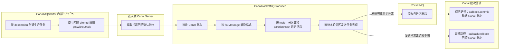

# 020_ES改造_Canal Server_Binlog发送到RocketMQ核心实现

以下内容按照当前项目 `AGENTS.md` 项目级规则中规定的技术栈版本为准。

## 1 已确认规则与适用边界

- 本文只说明 Canal Server 将 binlog 事件转换并发送到 RocketMQ 的核心实现；发布结果、Canal 批次提交与回滚影响见 [RocketMQ发布与Canal批次确认](<./021_ES改造_Canal Server_RocketMQ发布与Canal批次确认.md>)。
- 当前项目采用 Canal Server 内置 RocketMQ 生产端，不另设独立 TCP 投递组件；本文描述的是 Canal 1.1.7 源码路径，未表示实际发行包已部署或验证。
- Canal 1.1.7 官方构建资料声明使用 RocketMQ 客户端 `4.8.0`；该结论用于记录官方构建口径，不据此断言当前运行实例的 JAR 已加载。
- 当前项目规划使用 RocketMQ Broker `5.2.0`；这是已确认的设计选择，实际部署和兼容性仍需验证。
- 当前项目设计上采用 FlatMessage JSON：要求 `canal.mq.flatMessage=true`，自定义 ES 消费服务按 JSON 解析；实际运行配置、真实消息样例和端到端解析结果仍待验证。
- 两个 destination 分别使用固定 topic；两个 topic 共用同一消息契约和消费逻辑。
- `partitionHash` 源列确定为新表的 `consume_id`；INSERT 和 UPDATE 使用变更后的值，DELETE 使用删除前的值。
- 本文的“3 详细方案”按 Canal 初学者能够连续理解的顺序编写：先解释组件和术语，再说明读取、转换、分区发送及批次确认的处理步骤；示例代码和配置仍需与实际发行包、部署配置分别核对。


## 3 详细方案

### 3.1 先认识这条链路中的几个角色

在看代码前，先把几个名称对应起来：

- **Canal Server**：从 MySQL 的 Binlog 读取数据库变更，并把变更交给后续处理。
- **destination**：Canal Server 中的一条同步通道。本项目有两个 destination，分别对应 `db0` 和 `db1`。
- **Canal 批次**：Canal 一次通过 `getWithoutAck` 读取、等待确认的一组变更事件，用 `batchId` 标识。它可能包含多个表的事件、同一张表的多行 INSERT/UPDATE/DELETE，或一个事务中的多条行变化；但它不是 MySQL 事务编号，也不是一条 RocketMQ 消息，后续还可能被转换并拆成多条消息。
- **CanalMQStarter**：Canal 内置的任务入口，负责从 Server 取出未确认批次。
- **CanalRocketMQProducer**：Canal 内置的 RocketMQ 生产端，负责把批次转换成消息、选择队列并发送。
- **topic、队列和分区**：topic 是消息主题，队列是主题下的实际消息通道，分区规则根据 `consume_id` 计算消息应该进入哪一个队列。

这三者可以按“生产任务 → 批次 → 生产端”理解：CanalMQStarter 调用 `getWithoutAck` 读取一个 Canal 批次，把这个批次交给 CanalRocketMQProducer；CanalRocketMQProducer 将批次转换成 FlatMessage JSON，按 `consume_id` 计算目标队列并发送到 RocketMQ。发送完成后，生产端通过回调通知 CanalMQStarter：成功时确认这个 `batchId`，异常时回滚这个 `batchId`。

整条链路可以先记成四步：**取批次 → 转成 FlatMessage JSON → 按 `consume_id` 选队列并发送 → 根据发送结果确认或回滚 Canal 批次**。本章只展开这四步，Entry 字段定义见 [消息格式与字段边界](<./018_ES改造_Canal Server_消息格式与字段边界.md>)，发布后的确认边界见 [RocketMQ发布与Canal批次确认](<./021_ES改造_Canal Server_RocketMQ发布与Canal批次确认.md>)。

### 3.2 获取 Canal 批次

第一步是取数据。CanalMQStarter 为每个 destination 创建一个内部生产任务，使用内部 `clientId` 调用 `getWithoutAck`，从嵌入式 Canal Server 取出一批“尚未确认”的变更。`getWithoutAck` 的含义是“先取出来处理，处理成功后再确认”；这个 `clientId` 是 Canal 内部消费游标，不是 MySQL 复制使用的 `slaveId`，也不是 RocketMQ 消费者身份。



图中只表示源码层面的处理顺序：先取批次，再转换消息和发送，最后进入提交或回滚回调。这里的“提交”只是确认 Canal 已经处理这个批次；RocketMQ 已接收的消息不会因为 Canal 回滚而自动撤回。实际发送状态、Broker 持久化和恢复效果仍需结合发行包及运行环境验证。

### 3.3 转换消息格式

第二步是转消息。Canal FlatMessage JSON 可以理解为 Canal Server 为下游准备的一种 JSON 外壳：它把 Binlog 事件中的库表、操作类型和行数据整理成字段，RocketMQ 消费端收到后可以直接按 JSON 解析。`type` 表示事件类型，`data` 表示变更后的数据，`old` 表示 UPDATE 时发生变化的旧字段值；具体字段是否完整输出，仍需以实际运行配置和消息样例为准。

CanalRocketMQProducer 按 `canal.mq.flatMessage` 选择转换路径：

- 当前项目采用 `true`：调用消息转换逻辑生成 FlatMessage JSON，再序列化为 RocketMQ 消息体；`data`、`old`、事件类型和来源字段的边界见 [消息格式与字段边界](<./018_ES改造_Canal Server_消息格式与字段边界.md>)。
- Canal 1.1.7 源码仍保留 `false` 的二进制封装分支，但它不属于当前项目已确认的消息格式；不能据此把项目消息契约写成 JSON 与二进制二选一。

格式开关位于 Canal Server 解压目录下的 `conf/canal.properties`。模板默认值不等于当前部署值，实际加载结果和消费端解码方式仍需核对。

### 3.4 分区和消息发送

第三步是选队列并发送。每个 destination 使用自己的固定 topic，但两个 topic 共用同一消息契约和消费逻辑。生产端把 `partitionHash` 理解为“用哪个字段计算队列”，本项目使用新表的 `consume_id`：INSERT 和 UPDATE 取变更后的值，DELETE 取删除前的值。计算结果再结合分区数和 topic 的队列列表选择目标队列；分区数和队列映射尚未确认，不能直接套用参考文章的固定值。

每个分区形成一个待发送消息或消息集合，生产端调用 RocketMQ Producer 的同步发送方法，并等待本轮分区发送任务结束。部分分区已成功、其他分区失败时，进入 MQ 的消息不会因 Canal 回滚而自动撤回，后续可能重复发送。

### 3.5 提交、回滚与发送状态

第四步是确认批次。生产端等待本轮发送任务结束后，正常路径调用提交回调，异常路径调用回滚回调。提交只表示 Canal 内部批次确认，不等于 ES 已写入，也不等于所有消息已经完成下游消费。

源码路径会取得 RocketMQ `SendResult`，但当前核对到的发送分支主要依赖异常判断和日志记录，是否显式处置 `getSendStatus() != SEND_OK` 需要结合实际发行包进一步验证。因此不能把回调直接表述为“所有消息已可靠落盘”。

这会带来重复消息风险：一个 Canal 批次拆成多个分区消息后，部分消息可能已经进入 RocketMQ，其他分区却发送失败；Canal 回滚时不会自动撤回已经进入 RocketMQ 的消息，后续重试同一批次时，之前成功的消息可能再次发送。这个过程属于至少一次投递风险。下游消费端需要使用稳定的业务主键、业务版本或事件身份做幂等处理，避免重复写入 ES；重复消息是否最终造成重复业务数据，取决于消费端的幂等实现。

### 3.6 核心配置示例

理解配置时可以先分成两层：`canal.properties` 是整个 Canal Server 共用的配置，`conf/<destination>/instance.properties` 是某一条同步通道自己的配置。下面只列出理解这条链路所需的核心配置。`<destination_topic>`、`<namesrv_addr>` 和 `<db_name>` 是占位符，实际 topic、NameServer 地址和库名需要按两个 destination 的部署配置分别填写；分区数暂不填写，避免把未确认的部署参数写成既定事实。

```properties
# conf/canal.properties：Canal Server 全局 MQ 配置
canal.serverMode = tcp                         # Server 对外提供 Canal 协议；内置 MQ 生产任务仍由 Server 创建
canal.destinations = <destination_a>,<destination_b> # 两个 destination 分别建立生产任务
canal.mq.flatMessage = true                    # 发送 FlatMessage JSON；实际运行加载结果仍需验证
canal.mq.canalBatchSize = 50                   # 每次 getWithoutAck 的批次数量示例，按部署容量调整
canal.mq.canalGetTimeout = 100                 # 获取批次的等待时间示例，单位毫秒
canal.mq.send.thread.size = 30                 # MQ 发送任务线程数示例
canal.mq.build.thread.size = 8                 # 消息构造线程数示例

# RocketMQ 连接参数；这里的值只表达配置位置和作用，不代表当前环境值
rocketmq.producer.group = <producer_group>
rocketmq.namesrv.addr = <namesrv_addr>
rocketmq.retry.times.when.send.failed = 0      # Canal 模板示例值；是否采用需结合可靠性方案确认
rocketmq.vip.channel.enabled = false
```

每个 destination 的 `conf/<destination>/instance.properties` 还需要单独配置 topic 和分区路由：

```properties
# destination A 和 destination B 分别维护各自的 instance.properties
canal.mq.topic = <destination_topic>           # 当前 destination 的固定 topic
canal.mq.partition = 0                         # 未启用按键分区时使用的默认队列下标示例
canal.mq.partitionHash = <db_name>.<table_name>:consume_id
                                                # 按新表 consume_id 路由；实际表名需替换
# canal.mq.partitionsNum = <confirmed_partition_count>
# 分区数尚未确认，确认后再取消注释并填写实际值
```

`canal.mq.partitionHash` 的语法和 `canal.mq.flatMessage` 等配置项来自 Canal 1.1.7 模板；上述 topic、表名和分区数仍是项目部署参数，不能仅凭模板确认。两个 destination 应分别填写固定 topic，但继续共用同一消息契约和消费逻辑。

### 3.7 核心代码示例

下面代码按照前面四步链路排列：先取批次，再注册成功/失败回调，最后转换并发送消息。代码是依据 Canal 1.1.7 源码整理的核心片段，并补充了说明性注释；它用于解释处理边界，不是当前项目新增的可直接编译源码。

```java
// CanalMQStarter：每个 destination 启动一个内部 MQ 生产任务
Message message = canalServer.getWithoutAck(
    clientIdentity, batchSize, timeout, TimeUnit.MILLISECONDS);

long batchId = message.getId();
if (batchId != -1 && hasEntries(message)) {
    canalMQProducer.send(destination, message, new Callback() {
        @Override
        public void commit() {
            // 只有生产端回调成功路径才确认 Canal 批次游标
            canalServer.ack(clientIdentity, batchId);
        }

        @Override
        public void rollback() {
            // 发送异常时回滚 Canal 批次；已经进入 RocketMQ 的消息不会被自动撤回
            canalServer.rollback(clientIdentity, batchId);
        }
    });
}
```

```java
// CanalRocketMQProducer：发送入口等待本轮分区任务结束，再触发批次回调
try {
    sendByTopicAndPartition(destination, message);
    // waitForResult() 返回表示分区发送任务已结束；
    // SendResult 的非 SEND_OK 状态是否被单独判失败，仍需结合实际发行包核验
    callback.commit();
} catch (Throwable ex) {
    callback.rollback();
}

// FlatMessage JSON 分区发送的核心逻辑（示意）
List<FlatMessage> flatMessages = MQMessageUtils.messageConverter(rows, message.getId());
for (FlatMessage flatMessage : flatMessages) {
    // partitionHash=consume_id；INSERT/UPDATE 取变更后值，DELETE 取删除前值
    FlatMessage[] partitions = MQMessageUtils.messagePartition(
        flatMessage, partitionCount, "consume_id", databaseHash);
    submitPartitionTasks(partitions);
}
waitForPartitionTasks();
```

源码中的单条发送会根据分区下标选择 RocketMQ `MessageQueue`；当分区下标大于队列数量时使用取模。批量发送会优先读取 topic 的队列列表，队列信息不可用时退化为逐条发送。这里的代码和配置只说明源码处理方式，未证明当前部署的队列列表、发送结果或恢复行为已经验证。

## 4 参考文章与项目设计的对比

### 4.1 投递组件与部署范围

**相同点：**

参考文章和当前项目都由 Canal Server 内置 RocketMQ 生产端将 Binlog 变更消息发布到 RocketMQ，不另设独立 TCP 投递组件。

**不同点：**

**参考文章：** 展示了 NameServer、Broker 和 Dashboard 等 RocketMQ 实验环境组件，并展示消息发送到 RocketMQ 后的示例结果。

**当前项目：** 使用 Canal Server 内置 RocketMQ 生产端，规划连接 RocketMQ Broker `5.2.0`；Broker 的实际部署实例数量和管理组件仍待确认。

### 4.2 消息处理链路与格式

**相同点：**

参考文章和当前项目都经过 Canal Server 读取并转换 MySQL Binlog，再将消息发送到 RocketMQ，供下游消费。

**不同点：**

**参考文章：** 消费端示例直接把消息解析为 JSON，并按订单示例处理 `data` 和 `type`。

**当前项目：** 设计上固定使用 FlatMessage JSON，由自定义消费服务按 JSON 解析后写入 ES；`canal.mq.flatMessage=true` 的运行时加载结果、字段完整性和消费端实际实现仍需核对，不能把文章示例当作已完成的运行验证。

### 4.3 批次确认与结果边界

**相同点：**

参考文章和当前项目都不能仅凭消息进入 RocketMQ 或展示写入效果，证明 Canal 内部批次确认、RocketMQ Broker 持久化和 ES 写入属于同一确认阶段。

**不同点：**

**参考文章：** 主要展示发送和写入效果，没有展开 Canal 批次提交、异常回滚及部分发送成功后的处理边界。

**当前项目：** 发送任务完成后才触发 Canal 批次提交或回滚；MQ 发送、Broker 持久化、下游消费和 ES 写入分别表示不同状态，部分成功和结果不明时可能重复投递。

## 5 待确认或待验证事项

- Canal 内置客户端 `4.8.0` 连接规划中的 Broker `5.2.0` 时，批量发送、重试、认证、队列路由和结果不明恢复仍待兼容性联调验证。
- 运行实例是否实际加载 `canal.mq.flatMessage=true`、真实消息是否符合 FlatMessage JSON 契约，以及消费端解析结果仍待验证。
- 分区数、对应 topic 的队列列表和队列映射是否稳定，仍需结合实际配置验证。
- `SendResult` 非 `SEND_OK` 且未抛异常时，生产端是否仍提交 Canal 批次？参考文章未覆盖该生产端确认边界，不能作为判断依据；实际发行包和运行行为仍待验证。
- 部分分区成功、超时或结果不明时，重复消息和恢复顺序是否符合预期？

## 6 复核记录

本轮按 [java-interview-doc-review-loop](C:\Users\Administrator\.codex\skills\java-interview-doc-review-loop\SKILL.md) 复核了面向 Canal 初学者的讲解顺序，新增角色说明和“四步链路”概览，并在配置与代码前补充了阅读提示。技术结论、来源和未验证边界未改变；未执行 Canal、RocketMQ 或 ES 联调。

本轮修正了第 3 章新增小节的连续编号，将角色说明和后续步骤统一为 `3.1`～`3.7`。

本轮补充了 CanalMQStarter、Canal 批次和 CanalRocketMQProducer 三者的传递关系，以及发送完成后的确认/回滚回调关系；未改变原有技术结论。

## 7 参考来源

### 7.1 Canal Server 内置生产链路

- [CanalMQStarter（Canal 1.1.7）](https://github.com/alibaba/canal/blob/canal-1.1.7/server/src/main/java/com/alibaba/otter/canal/server/CanalMQStarter.java)：支持本文关于 destination 内部生产任务、内部 clientId、`getWithoutAck` 获取批次以及提交、回滚回调的说明。
- [CanalRocketMQProducer（Canal 1.1.7）](https://github.com/alibaba/canal/blob/canal-1.1.7/connector/rocketmq-connector/src/main/java/com/alibaba/otter/canal/connector/rocketmq/producer/CanalRocketMQProducer.java)：支持本文关于消息格式转换、分区发送、RocketMQ Producer 调用以及发送完成后触发回调的说明。
- [MQMessageUtils（Canal 1.1.7）](https://github.com/alibaba/canal/blob/canal-1.1.7/connector/core/src/main/java/com/alibaba/otter/canal/connector/core/producer/MQMessageUtils.java)：支持本文关于 FlatMessage 转换、按分区拆分和消息封装边界的说明。

### 7.2 配置与消息格式

- [Canal 1.1.7 canal.properties](https://github.com/alibaba/canal/blob/canal-1.1.7/deployer/src/main/resources/canal.properties)：支持本文关于 `canal.mq.flatMessage`、RocketMQ 连接参数和 Canal Server 全局配置入口的说明。
- [Canal 1.1.7 instance.properties](https://github.com/alibaba/canal/blob/canal-1.1.7/deployer/src/main/resources/example/instance.properties)：支持本文关于 destination 实例配置与 MQ topic、分区相关参数的来源核对。
- [Canal 1.1.7 官方构建 POM（工作区保存副本）](<../tmp/canal-doc-corrections-20261007/sources/canal-pom.xml>)：其中声明 Canal 版本为 `1.1.7`、`rocketmq_version` 为 `4.8.0`，用于确认官方构建口径；不据此断言当前运行实例的 JAR 已加载。
- [工作区 Canal 配置模板](<../tmp/canal-doc-corrections-20261007/sources/canal.properties>)：其中将 `canal.mq.flatMessage` 设为 `true`，用于确认模板默认口径；该文件不是当前运行实例的实际加载配置。
- [FlatMessage（Canal 1.1.7）](https://github.com/alibaba/canal/blob/canal-1.1.7/protocol/src/main/java/com/alibaba/otter/canal/protocol/FlatMessage.java)：支持本文关于 FlatMessage JSON 字段模型的说明；字段是否在当前部署中实际输出，仍需运行验证。
- [CanalMessageSerializerUtil（Canal 1.1.7）](https://github.com/alibaba/canal/blob/canal-1.1.7/connector/core/src/main/java/com/alibaba/otter/canal/connector/core/util/CanalMessageSerializerUtil.java)：支持本文关于 Canal 二进制消息序列化边界的说明。

### 7.3 参考文章与验证边界

- [使用 Canal + RocketMQ + Elasticsearch8 探索索引冷热节点部署方案](<./999_使用 Canal + RocketMQ + Elasticsearch8 探索索引冷热节点部署方案.md>)：用于核对参考文章中的 Canal、RocketMQ 实验环境和消息发送示例；文章版本、脚本、参数和演示结果不代表当前项目已经部署或验证。

上述来源用于支持源码和文章的静态核对，不等于当前项目已经完成发行包验证、Broker 持久化验证或 Canal、RocketMQ、ES 联调。
