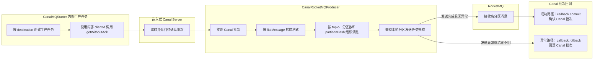

# 020_ES改造_Canal Server_Binlog发送到RocketMQ核心实现

以下内容按照当前项目 `AGENTS.md` 项目级规则中规定的技术栈版本为准。

## 1 已确认规则与适用边界

- 本文只说明 Canal Server 将 binlog 事件转换并发送到 RocketMQ 的核心实现；事务边界、提交与回滚影响见 [021 RocketMQ消息发布与事务边界](<./021_ES改造_Canal Server_RocketMQ消息发布与事务边界.md>)。
- 当前项目采用 Canal Server 内置 RocketMQ 生产端，不另设独立 TCP 投递组件；本文描述的是 Canal 1.1.7 源码路径，未表示实际发行包已部署或验证。
- Canal 1.1.7 官方构建资料声明使用 RocketMQ 客户端 `4.8.0`；该结论用于记录官方构建口径，不据此断言当前运行实例的 JAR 已加载。
- 当前项目规划使用 RocketMQ Broker `5.2.0`；这是已确认的设计选择，实际部署和兼容性仍需验证。
- 当前项目设计上采用 FlatMessage JSON：要求 `canal.mq.flatMessage=true`，自定义 ES 消费服务按 JSON 解析；实际运行配置、真实消息样例和端到端解析结果仍待验证。
- 两个 destination 分别使用固定 topic；两个 topic 共用同一消息契约和消费逻辑。
- `partitionHash` 源列确定为新表的 `consume_id`；INSERT 和 UPDATE 使用变更后的值，DELETE 使用删除前的值。

## 2 面试口述精炼版本

**Canal Server 负责读取批次并发送消息**

CanalMQStarter 为 destination 建立内部 MQ 生产任务，从 Server 获取未确认批次；CanalRocketMQProducer 再按 `flatMessage` 配置转换为 JSON 或二进制消息，按分区规则拆分并调用 RocketMQ Producer 发送。所有分区发送任务完成后，成功路径提交 Canal 批次，异常路径回滚；但 `SendResult` 的非 `SEND_OK` 处理仍需核验。

## 3 详细方案

### 3.1 获取 Canal 批次

CanalMQStarter 为每个 destination 创建内部生产端，并使用内部 clientId 从嵌入式 Server 调用 `getWithoutAck` 获取待确认批次。这个 clientId 属于 Canal 内部消费游标，不是 MySQL 复制使用的 slaveId，也不是 RocketMQ 消费者身份。

图中只表示源码层面的处理顺序：`getWithoutAck` 获取批次后，生产端完成消息转换和分区发送，再进入提交或回滚回调；RocketMQ 已接收消息不会因为 Canal 批次回滚而自动撤回。实际发送状态、Broker 持久化和恢复效果仍需结合发行包及运行环境验证。

### 3.2 转换消息格式

Canal FlatMessage JSON 是 Canal Server 将 MySQL Binlog 事件转换成的 JSON 消息格式，供 RocketMQ 消费端按字段解析。`type` 表示事件类型，`data` 表示变更后的数据，`old` 表示 UPDATE 时发生变化的旧字段值；具体字段是否完整输出，仍需以实际运行配置和消息样例为准。

CanalRocketMQProducer 按 `canal.mq.flatMessage` 选择转换路径：

- `true`：调用消息转换逻辑生成 FlatMessage JSON，再序列化为 RocketMQ 消息体；`data`、`old`、事件类型和来源字段的边界见 [消息格式与字段边界](<./018_ES改造_Canal Server_消息格式与字段边界.md>)。
- `false`：保留 Canal Entry，按 Canal Packet/Messages 二进制格式封装，再交给 RocketMQ Producer 发送。

格式开关位于 Canal Server 解压目录下的 `conf/canal.properties`。模板默认值不等于当前部署值，实际加载结果和消费端解码方式仍需核对。

### 3.3 分区和消息发送

每个 destination 使用独立且稳定的 topic；两个 topic 共用同一消息契约和消费逻辑。生产端根据对应 topic、分区数和 `partitionHash` 计算目标队列，其中 `partitionHash` 使用新表的 `consume_id`：INSERT 和 UPDATE 取变更后的值，DELETE 取删除前的值。启用按键分区时，源码可能按行重建 Entry 或重新组织 FlatMessage；同一源记录的路由稳定性仍取决于真实哈希配置和队列映射，不能直接套用参考文章的固定分区数。

每个分区形成一个待发送消息或消息集合，生产端调用 RocketMQ Producer 的同步发送方法，并等待本轮分区发送任务结束。部分分区已成功、其他分区失败时，进入 MQ 的消息不会因 Canal 回滚而自动撤回，后续可能重复发送。

### 3.4 提交、回滚与发送状态

无异常完成本轮发送后，回调提交 Canal 内部批次；发生异常时，回调回滚内部批次。提交只表示 Canal 内部批次确认，不等于 ES 已写入，也不等于所有消息已经完成下游消费。

源码路径会取得 RocketMQ `SendResult`，但当前核对到的发送分支主要依赖异常判断和日志记录，是否显式处置 `getSendStatus() != SEND_OK` 需要结合实际发行包进一步验证。因此不能把回调直接表述为“所有消息已可靠落盘”。

## 4 参考文章与项目设计的对比

### 4.1 投递组件与部署范围

**相同点：**

参考文章和当前项目都由 Canal Server 内置 RocketMQ 生产端将 Binlog 变更消息发布到 RocketMQ，不另设独立 TCP 投递组件。

**不同点：**

**参考文章：** 展示了 NameServer、Broker 和 Dashboard 等 RocketMQ 实验环境组件，并展示消息发送到 RocketMQ 后的示例结果。

**当前项目：** 使用 Canal Server 内置 RocketMQ 生产端，规划连接 RocketMQ Broker `5.2.0`；Broker 的实际部署实例数量和管理组件仍待确认。

### 4.2 消息处理链路与格式

**相同点：**

参考文章和当前项目都经过 Canal Server 读取并转换 MySQL Binlog，再将消息发送到 RocketMQ，供下游消费。

**不同点：**

**参考文章：** 消费端示例直接把消息解析为 JSON，并按订单示例处理 `data` 和 `type`。

**当前项目：** 设计上固定使用 FlatMessage JSON，由自定义消费服务按 JSON 解析后写入 ES；`canal.mq.flatMessage=true` 的运行时加载结果、字段完整性和消费端实际实现仍需核对，不能把文章示例当作已完成的运行验证。

### 4.3 批次确认与结果边界

**相同点：**

参考文章和当前项目都不能仅凭消息进入 RocketMQ 或展示写入效果，证明 Canal 内部批次确认、RocketMQ Broker 持久化和 ES 写入属于同一确认阶段。

**不同点：**

**参考文章：** 主要展示发送和写入效果，没有展开 Canal 批次提交、异常回滚及部分发送成功后的处理边界。

**当前项目：** 发送任务完成后才触发 Canal 批次提交或回滚；MQ 发送、Broker 持久化、下游消费和 ES 写入分别表示不同状态，部分成功和结果不明时可能重复投递。

## 5 待确认或待验证事项

- Canal 内置客户端 `4.8.0` 连接规划中的 Broker `5.2.0` 时，批量发送、重试、认证、队列路由和结果不明恢复仍待兼容性联调验证。
- 运行实例是否实际加载 `canal.mq.flatMessage=true`、真实消息是否符合 FlatMessage JSON 契约，以及消费端解析结果仍待验证。
- 分区数、对应 topic 的队列列表和队列映射是否稳定，仍需结合实际配置验证。
- `SendResult` 非 `SEND_OK` 且未抛异常时，生产端是否仍提交 Canal 批次？参考文章未覆盖该生产端确认边界，不能作为判断依据；实际发行包和运行行为仍待验证。
- 部分分区成功、超时或结果不明时，重复消息和恢复顺序是否符合预期？

## 6 复核记录

本文依据 Canal 1.1.7 的 [CanalMQStarter](https://github.com/alibaba/canal/blob/canal-1.1.7/server/src/main/java/com/alibaba/otter/canal/server/CanalMQStarter.java)、[CanalRocketMQProducer](https://github.com/alibaba/canal/blob/canal-1.1.7/connector/rocketmq-connector/src/main/java/com/alibaba/otter/canal/connector/rocketmq/producer/CanalRocketMQProducer.java) 和 [MQMessageUtils](https://github.com/alibaba/canal/blob/canal-1.1.7/connector/core/src/main/java/com/alibaba/otter/canal/connector/core/producer/MQMessageUtils.java) 静态核对；未执行 Canal、RocketMQ 或 ES 联调。

本轮已执行 [java-interview-doc-review-loop](C:\Users\Administrator\.codex\skills\java-interview-doc-review-loop\SKILL.md)，并按 [java-interview-doc-review](C:\Users\Administrator\.codex\skills\java-interview-doc-review\SKILL.md) 完成结构与表达复核。

本轮补充了 Canal 批次获取、消息发送和提交/回滚关系的 Mermaid 泳道图；图示仍属于源码处理顺序说明，不代表运行环境已验证。

本轮将对比章节中重复的相同点合并为单段，保留差异项的对象分段说明。

本轮再次执行 [java-interview-doc-review-loop](C:\Users\Administrator\.codex\skills\java-interview-doc-review-loop\SKILL.md)，修正了事务边界文档链接文字与当前文件编号不一致的问题；剩余内容仅保留待确认或待验证事项。

本轮根据用户确认，将消息格式从“JSON 或二进制待选”收敛为 FlatMessage JSON 设计；未将运行时配置、真实消息样例或端到端消费结果写成已验证事实。

## 7 参考来源

### 7.1 Canal Server 内置生产链路

- [CanalMQStarter（Canal 1.1.7）](https://github.com/alibaba/canal/blob/canal-1.1.7/server/src/main/java/com/alibaba/otter/canal/server/CanalMQStarter.java)：支持本文关于 destination 内部生产任务、内部 clientId、`getWithoutAck` 获取批次以及提交、回滚回调的说明。
- [CanalRocketMQProducer（Canal 1.1.7）](https://github.com/alibaba/canal/blob/canal-1.1.7/connector/rocketmq-connector/src/main/java/com/alibaba/otter/canal/connector/rocketmq/producer/CanalRocketMQProducer.java)：支持本文关于消息格式转换、分区发送、RocketMQ Producer 调用以及发送完成后触发回调的说明。
- [MQMessageUtils（Canal 1.1.7）](https://github.com/alibaba/canal/blob/canal-1.1.7/connector/core/src/main/java/com/alibaba/otter/canal/connector/core/producer/MQMessageUtils.java)：支持本文关于 FlatMessage 转换、按分区拆分和消息封装边界的说明。

### 7.2 配置与消息格式

- [Canal 1.1.7 canal.properties](https://github.com/alibaba/canal/blob/canal-1.1.7/deployer/src/main/resources/canal.properties)：支持本文关于 `canal.mq.flatMessage`、RocketMQ 连接参数和 Canal Server 全局配置入口的说明。
- [Canal 1.1.7 instance.properties](https://github.com/alibaba/canal/blob/canal-1.1.7/deployer/src/main/resources/example/instance.properties)：支持本文关于 destination 实例配置与 MQ topic、分区相关参数的来源核对。
- [Canal 1.1.7 官方构建 POM（工作区保存副本）](<../tmp/canal-doc-corrections-20261007/sources/canal-pom.xml>)：其中声明 Canal 版本为 `1.1.7`、`rocketmq_version` 为 `4.8.0`，用于确认官方构建口径；不据此断言当前运行实例的 JAR 已加载。
- [工作区 Canal 配置模板](<../tmp/canal-doc-corrections-20261007/sources/canal.properties>)：其中将 `canal.mq.flatMessage` 设为 `true`，用于确认模板默认口径；该文件不是当前运行实例的实际加载配置。
- [FlatMessage（Canal 1.1.7）](https://github.com/alibaba/canal/blob/canal-1.1.7/protocol/src/main/java/com/alibaba/otter/canal/protocol/FlatMessage.java)：支持本文关于 FlatMessage JSON 字段模型的说明；字段是否在当前部署中实际输出，仍需运行验证。
- [CanalMessageSerializerUtil（Canal 1.1.7）](https://github.com/alibaba/canal/blob/canal-1.1.7/connector/core/src/main/java/com/alibaba/otter/canal/connector/core/util/CanalMessageSerializerUtil.java)：支持本文关于 Canal 二进制消息序列化边界的说明。

### 7.3 参考文章与验证边界

- [使用 Canal + RocketMQ + Elasticsearch8 探索索引冷热节点部署方案](<./999_使用 Canal + RocketMQ + Elasticsearch8 探索索引冷热节点部署方案.md>)：用于核对参考文章中的 Canal、RocketMQ 实验环境和消息发送示例；文章版本、脚本、参数和演示结果不代表当前项目已经部署或验证。

上述来源用于支持源码和文章的静态核对，不等于当前项目已经完成发行包验证、Broker 持久化验证或 Canal、RocketMQ、ES 联调。
