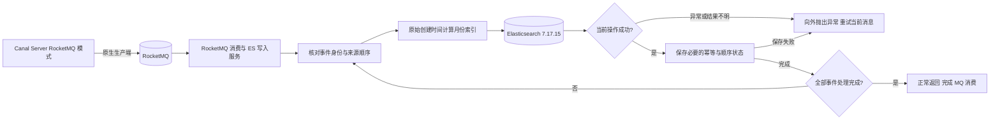

# 025_ES改造_自定义消费服务_自定义 ES 消费服务处理逻辑

**已确认规则**：本次按用户确认重命名 Canal Server 处理逻辑和自定义消费服务处理逻辑文档，同步名称标识及关联引用；不调整技术结论。

以下内容按照当前项目 `AGENTS.md` 项目级规则中规定的技术栈版本为准。

当前版本基线：Java 8、Spring Boot 2.7.18、`rocketmq-spring-boot-starter` 2.3.0、`org.apache.rocketmq:rocketmq-client` 5.2.0、Canal Server 1.1.7、Canal Adapter 1.1.7（ES 7 Adapter）、MySQL 8.0.33 和 Elasticsearch 服务端 7.17.15。5.2.0 是 MQ 客户端版本，Broker 版本未确认；本文不使用 `rocketmq-client-java` 的 gRPC 消费 API。

## 已确认规则

- 本次文件维护仅按用户确认的新名称重命名文档，并同步名称标识及关联引用；不调整正文技术结论。新建的 MySQL、Canal Server、自定义消费服务文档为空白占位文件。

- 仅新分库分表的消费表增加业务 `version`，旧表不增加；历史导入初始化为 `1`，后续更新在同一条 SQL 中修改业务字段并执行 `version = version + 1`。导入重跑不重置已有版本，MQ 重试沿用消息中的数据与版本；新旧表数据校验排除 `version`，其他口径不变，版本行为单独验证。以上为已确认、待实现验证的设计决策。
- 组件全称统一为“自定义 RocketMQ 消费与 ES 写入服务”，简称“ES 写入服务”，负责消费 RocketMQ 消息并执行 ES 增删改。
- 当前主链路为 `MySQL → Canal Server（RocketMQ 模式）→ RocketMQ → 自定义 RocketMQ 消费与 ES 写入服务 → Elasticsearch`，Adapter 1.1.7（ES 7 Adapter）保留版本边界，但不承担主链路 ES 写入。
- 两个独立 MySQL 实例对应 db0、db1；每个实例有 consume_record_01～consume_record_16。两个 destination 独立维护进度，不承诺跨库全局顺序。
- Canal Server 按 007 采用单机部署，一个进程承载两个 destination，使用本地持久化位点人工重启恢复，不配置 ZooKeeper 主备高可用；ES 写入服务的部署规模仍待确认。
- 按自然月分索引，不使用 rollover；历史回放期间暂停相关索引的 ILM cold 迁移，回放完成且新表与 ES 校验通过后恢复 ILM，所属月份下个月 1 日零点起算满 `366d` 后进入 cold；历史索引可能需要 UPDATE 或回放，MySQL DELETE 不同步为 ES 逐条 Delete，ES 删除由 ILM 管理。以上为已确认设计，实际调度、ILM 与保留期配置待实现验证。
- 新增、更新、删除、重试及补偿均根据不可变的原始 `create_time`，按统一业务时区计算 `records-yyyy.MM`，直接操作该物理索引；正常路径不先搜索，也不维护业务 ID 到索引名的持久化映射。使用 `consumeId` 作为 ES `_id`，`records-read` 用于跨月查询。原始创建时间的不可变性及全链路传递是前提；外部版本只在同一物理索引、同一 `_id` 内比较。此为已确认、待实现验证的设计决策。
- 消息 keys 不自动保序或去重；至少一次投递下，幂等须结合稳定来源版本、具体索引、冲突处理和重放规则说明，定位、业务版本维护与传递、删除保护及失败补偿不记为已完成能力。
- Canal Server 的 RocketMQ 发布、Broker 持久化、MQ 消费确认与 ES 处理完成属于不同层次。ES 失败处理采用参考文章的同步逐条调用、异常抛出和整条消息重投模型；不采用 Bulk 单项失败分类和状态驱动的恢复流程。已成功项不自动回滚，重投重新经过完整处理流程，既有幂等、具体物理索引和必要状态保存要求继续适用。
- 配置、消息契约、核心代码和验收步骤均为说明性内容，不代表已经上线、编译、联调或完成故障演练。
- 原生消息格式和内部事件契约按 007 的版本源码边界维护；默认 JSON 缺少完整源坐标，二进制按键拆行缺少原行序号，若采用坐标事件 ID，须先补齐上述缺口；业务版本直接取自行字段，其维护与传递仍待验证。
- 面试口述按“解析消息与读取业务版本、定位物理索引、执行增删改、确认 MQ 消费”先总后分，四个分点与整体概括一一对应；历史索引能力放在索引定位中说明，ES 单项异常和整条消息重投放在执行与确认中说明。采用 `CONCURRENTLY` 并发消费是已确认、待实现验证的设计决策：每条事件携带稳定来源版本，由 ES 外部版本控制拒绝旧写入，冲突区分重复、过期与异常。消息内仍逐项同步调用 ES，全部处理及必要状态保存完成后才确认消费；不把同步调用等同于队列顺序消费。
- 顺序控制与 007 保持一致：使用新表业务 `version` 判断同一记录的新旧，不再由 binlog 坐标编码生成 ES 版本；版本传递、状态保存和故障验收仍待实现验证。
- 表达边界：顺序消费、应用锁和独立日志不能写成端到端防旧写的充分依据；完整文档单次写入使用携带业务 `version` 的 Index API。MySQL DELETE 不同步为 ES 逐条 Delete，ES 删除由 ILM 管理。正文须区分无 ES 条件的普通写入与外部版本控制，不把后者描述成仍会被较旧更新无条件覆盖；`if_seq_no` 与 `if_primary_term` 属于另一套读改写条件，不能与外部版本在同一次请求中叠加。原索引定位、状态恢复和物理删除边界分别说明；索引模板继承、每半小时自动校验与兜底补偿及任务失败告警是已确认设计要求，客户端实现与验证状态仍须标明。

## 面试口述精炼版本

### 整体概括

自定义 ES 写入服务负责把 MQ（消息队列）中的变更落到 ES，采用并发消费提高吞吐量，主要做四件事：**解析消息与读取业务版本、定位物理索引、执行增删改、确认 MQ 消费**。每条事件携带稳定来源版本，由 ES 外部版本控制防止旧数据覆盖新数据；处理时还要考虑重复投递、历史索引和部分失败。以下是设计要求，实现仍待验证。

### 解析消息与读取业务版本

先解析库表、操作类型和行数据；INSERT/UPDATE 从变更后数据读取业务 `version`，不再把 binlog 坐标编码为版本。新表历史导入为 `1`，更新与业务字段在同一条 SQL 中递增，导入重跑不能重置，MQ 重试保持原消息版本。旧表不增加该字段，新旧表比较排除该字段；维护和传递效果仍待验证。

幂等就是重复处理仍得到正确结果。允许重复请求 ES、没有其他副作用，且相同版本对应相同操作和内容时，版本冲突按业务主键与业务版本核对重复、过期或异常。版本冲突须区分重复、过期与异常，不能一律反复重试。

并发消费允许同一记录的事件乱序完成；同键进入同一队列也不会自动按来源顺序处理。每次写入都携带来源版本，由 ES 原子比较并拒绝旧更新。ES 超时不代表请求已取消，重试仍须沿用原版本和原索引；物理删除后的旧请求保护须另行实现与验证。

### 定位物理索引

新增、更新、删除和重试都根据不可变的原始 `create_time`，按统一业务时区计算月份索引。例如 10 月创建的记录，11 月更新时仍写 `records-2026.10`，无需先搜索，也无需保存业务 ID 到索引名的映射。缺少创建时间时进入受控修复，不能取当前月份。`_id` 和外部版本比较的范围仍是同一物理索引。

按自然月分索引，不使用 rollover；历史回放期间暂停相关索引的 ILM cold 迁移，回放完成且新表与 ES 校验通过后恢复 ILM，所属月份下个月 1 日零点起算满 `366d` 后进入 cold（冷数据层）。冷热迁移不改变索引名，历史索引仍须保留业务所需的更新、删除能力；实现及运行效果尚待验证。

### 执行增删改

新增、更新先组装完整文档，再调用 Index API，携带业务 `version` 和 `version_type=external`，由 ES 原子比较版本。Index API 在文档不存在时会创建，因此 ILM 删除索引后，历史回放或迟到的旧写仍可能重建文档，必须由索引保留范围、来源版本和恢复流程共同约束。MySQL DELETE 不调用 ES Delete API，ES 删除由 ILM 管理；每半小时自动校验与兜底补偿负责发现和处理差异。

按参考文章的模型，逐条同步调用 ES，并等待每个操作返回。任一操作异常就中断当前消息，向外抛出运行时异常，让 RocketMQ 重投整条消息；此前已成功的操作不会自动回滚。重投重新经过完整处理流程，按既有幂等规则跳过已完成事件或幂等执行，并沿用具体物理索引；不采用 Bulk 单项失败分类和状态驱动的恢复流程。

### 确认 MQ 消费

消息内处理及必要状态保存全部完成后，监听方法才能正常返回，让 RocketMQ 按消费机制推进消费进度；任一操作或必要状态保存失败，就向外抛出异常，由 RocketMQ 按消费模式重新处理整条消息。已成功的操作不会自动回滚，不能仅记录失败后正常返回。

`CONCURRENTLY`（并发消费）模式下，正常返回表示成功，异常触发当前消息重投，其他消息可以继续并发处理；监听方法须同步等完当前消息内的全部操作。ES 成功后消费确认失败仍可能重放，MQ 留存也须覆盖修复和追赶，因此还要验证幂等与并发恢复，不能承诺端到端恰好一次。

## 详细方案

### 参考文章的吸收与版本边界

参考文档展示了 Canal、RocketMQ、稳定文档 ID 和 ILM（索引生命周期管理）的组合。本文吸收职责拆分、消息解耦与冷热分层思路，使用当前项目版本重新核对 API；参考文档的 Canal 1.1.6、RocketMQ 4.9.4、ES8 客户端和单机配置不直接套用。

`data_hot`、`data_warm`、`data_cold` 是 ES 数据层节点角色。节点角色与 `_tier_preference` 分片分配设置配合使用，不应笼统称为自定义节点标签。文章中的 max_docs=5、20 秒阶段时间和本地路径仅为演示值，不能替代项目的自然月索引与恢复 ILM 后按所属月份下个月 1 日零点起算满 `366d` 进入 cold 规则。

### 自定义服务的选型边界

选型依据是当前项目需要统一历史物理索引定位、来源顺序和跨月重放，同时按参考文章采用同步 ES 调用和整条消息重投。固定索引或当前写别名本身不足以定位旧文档；这些规则需要明确实现与验收，不能依赖组件默认的 404、重试或确认行为。这里不把 Adapter 的全部能力归结为“只能写当前索引”，也不据此推导它不支持 MQ；是否能通过扩展满足要求属于另行评估，当前主链路按已确认的自定义服务方案维护。

### 一、完整数据流



Canal Server 的 RocketMQ 生产端属于单机 Server 进程的一部分，该进程承载 db0、db1 两个 destination，按本地位点人工重启恢复。ES 写入服务独立部署，其进程数、部署方式和容量尚未确认。两者必须分别核对 Canal 位点、MQ 消费位点和 ES 实际处理结果，不能共用一个“同步成功”标记。

### 二、消息契约与顺序

消息字段与 007 保持一致。`canal.mq.flatMessage=true` 时解析 JSON 的 `data`/`old`，`false` 时解析二进制 Entry 与 RowData。UPDATE 的 JSON `old` 不保证完整前镜像。以下为内部候选契约：`sourceVersion` 取自同一 UPDATE 后值的 `after.version`，`101` 仅为示例；可选 `eventId`、`source` 展示坐标追踪方式，采用时须补齐原生消息缺失字段，不采用时可省略这两项：

```json
{
  "eventId": "<destination>|<instanceUuid>|<binlogFile>|<eventOffset>|<rowOrdinal>",
  "sourceVersion": 101,
  "destination": "db0",
  "database": "eas",
  "table": "consume_record_01",
  "eventType": "UPDATE",
  "consumeId": "<business-id>",
  "orderKey": "db0|eas|consume_record_01|<business-id>",
  "before": {},
  "after": { "version": 101, "create_time": "<immutable-original-create-time>" },
  "source": {
    "instanceUuid": "<source-instance-uuid>",
    "binlogFile": "mysql-bin.000123",
    "eventOffset": 456789,
    "rowOrdinal": 0,
    "gtid": "<transaction-gtid>"
  },
  "canalBatchId": 12345,
  "eventTime": "<source-event-time>"
}
```

`create_time` 是原始创建时间的契约名称，实际源列名、类型和业务时区仍须对齐；不是消息发送时间、修改时间或导入时间。INSERT/UPDATE 从完整行后值提取，DELETE 从删除前行数据提取；JSON 删除数据与二进制 beforeColumns 的具体转换须按实际格式核验，不能假定 UPDATE 的 `old` 包含完整创建时间。

INSERT/UPDATE 的版本按新表业务 `version` 规则处理，重放时与原数据一起保持不变，不是 binlog 坐标编码值。DELETE 事件保留删除前信息供消息契约、对账或状态判断，但不为 ES 逐条删除生成专用版本。版本只须在同一记录的生命周期内递增；源库迁移、记录重建和业务键复用须保持或明确版本衔接，不能直接重置。ILM 删除策略和每半小时自动校验与兜底补偿仍须实现验证。

INSERT/UPDATE 如需事件去重，可用“业务主键 + 业务版本”；DELETE 身份用于消息契约、对账或状态判断，不与 ES 逐条删除版本绑定。也可另用来源实例与完整 binlog 行坐标构造事件 ID，但这不影响业务版本本身的取得方式。

**可选坐标事件 ID 的边界：** 默认 JSON 缺少完整 binlog 坐标，二进制按键拆行不保留原行序号；如采用坐标事件 ID，仍须在信息丢失前补齐，不能用拆分后下标、MQ messageId 或内容 hash 冒充稳定来源顺序。这些缺口不再阻碍读取行数据中的业务 `version`，但业务版本与数据的传递仍须联调验证。

Canal Server 生产端继续通过 `canal.mq.partitionHash` 候选配置将相同业务键路由到稳定队列；消费端采用 `CONCURRENTLY` 模式，不要求同键事件按来源顺序完成。每条事件携带稳定来源版本，写入正确的目标物理索引，由 ES 外部版本控制拒绝旧写入。keys 用于查询消息，Tag 用于过滤，它们都不会自动选择队列。调整队列数量、原生生产重试、并发补发或路由变化时，须重新验证路由、来源版本、重放和最终状态。

`orderKey` 是内部状态键，不能当作原生 hash 算法的完整输入；源列名、16 张表覆盖范围和分区数按 007 核对。DDL 与主键变更须进入协调暂停或受控处置流程，不能按普通增删改静默确认。

MQ 投递或完成顺序不能代替业务版本。新增、更新按同一记录的 `version` 判断新旧，建议持久化恢复所需版本进度和删除状态，旧重试不能回退状态；GTID、时间戳、ES 内部版本及 seq_no 不能代替该业务版本；物理删除规则见下文。

#### 重复请求与可选去重

允许重复请求 ES、没有其他副作用，且同一记录的相同版本始终对应相同操作和内容时，可以只用外部版本控制文档新旧，不额外设置独立事件去重。目标月份由原始创建时间计算，删除状态及恢复所需状态仍须可靠保存；省略索引映射不等于省略删除保护。

ES 保留当前版本时，`version_type=external` 对相同或更低版本返回 409。409 只说明版本条件未满足，ES 不会自动验证同版本请求的内容相同。须核对具体物理索引、来源版本、ES 实际结果及必要状态，区分重复、过期和异常；确认是重复或过期且恢复完成后，继续处理消息内其余事件，不能一律抛异常反复重试，也不能无条件忽略。需要避免数据库等其他副作用重复执行时，再设计事件去重与状态衔接；外部版本不保证这些操作只执行一次。MySQL DELETE 的 ES 清理由 ILM 管理，不在此处建立逐条删除版本屏障。

#### 超时结果不明时的顺序保护

仅在应用侧查顺序状态、没有 ES 写入条件时，旧请求 A 超时后仍可能在 ES 执行；应用随后处理新事件 B，A 仍可能晚到并覆盖 B。MQ 顺序消费、单键锁和处理日志不能撤回已发出的请求。若 A、B 都携带正确的外部版本且 ES 仍保留 B 的版本，晚到的 A 会被 ES 拒绝；超时本身仍不能证明请求未执行，重试与状态恢复须沿用原事件和版本。

实施时须同时解决“按业务版本判断新旧”和“ES 执行时拒绝过期请求”。当前项目先组装完整文档再直接写入时，可使用 ES 7.17 的 `version_type=external`，在已确定的目标物理索引和同一 `_id` 内比较来源版本。新增、更新使用 Index API；MySQL DELETE 不使用 Delete API，ES 删除由 ILM 管理。Update API 的局部更新不能直接套用外部版本参数。外部版本不会跨索引比较，不能替代正确的月份索引计算。各写入方都遵守统一来源版本、同版本同操作和同内容规则，并验证乱序完成的结果。

校验补偿、人工修复和索引重建也须遵守统一版本规则，不能无版本覆盖或临时提高版本强行写入；补偿须读取相互对应的当前业务数据与 `version`，具体修复流程仍待确认。必要的来源顺序和消息处理状态须可靠保存，旧重试不能回退处理进度；ES 成功不代表独立状态存储也已满足这一要求。

`if_seq_no + if_primary_term` 是另一套并发条件，主要适合先读取 ES、再基于读取结果修改的流程，判断文档在读取后是否被别人改过，不能判断 binlog 事件新旧；不与外部版本参数在同一次请求中叠加。将事件、原索引和原版本或预期条件可靠绑定，结果不明时沿用原条件核对或重试；发生冲突后不能读取新条件并无条件套用旧载荷。数据库等其他副作用需要的互斥与去重另行评估。

这只是候选保护方式，尚未覆盖首次创建、物理删除和重建的全部窗口。其他方案也须让顺序判定与 ES 变更共同生效；如果需要新增 ES 同步元数据或调整 Mapping，须另行确认。业务 `version` 字段按已确认的新表规则增加，物理删除保护机制仍需实现验证。完成日志、月份计算、条件写入与恢复状态的衔接仍待实现与故障验证。

### 三、自然月索引与定位

| 名称或字段 | 作用与边界 |
| --- | --- |
| `records-2026.10`、`records-2026.11` | 按原始创建月份划分的物理索引，不使用 rollover |
| `records-read` | 覆盖各月份索引的读别名，由模板确保新索引加入；不是增删改写入口 |
| `create_time` | 不可变的原始创建时间，新增、更新、删除、重试与补偿统一时区计算月份 |
| `consumeId` | 业务 ID，作为 `_id`；无需维护业务 ID 到索引名的持久化映射 |

#### 1. 根据原始创建时间直接定位

月份计算规则为 `records-` 加业务时区下的年月（格式 `yyyy.MM`）。历史导入保留源记录的原始创建时间，不能用导入、消费或重试时间替代；同一记录跨月重放仍计算出同一索引。创建时间如为不带时区的 MySQL DATETIME，须明确其所属业务时区；如为时间戳，则先转换至该时区。具体字段类型与转换待核验。

新增、更新直接对计算出的物理索引调用 Index API，均携带既定业务版本；MySQL DELETE 不进入 ES 逐条删除分支。正常写入不依赖搜索是否已 refresh，也不因读别名覆盖多个索引而改变目标。

#### 2. 缺失与异常修复

创建时间缺失、无效或违反不可变约束时，暂停该事件的正常写入并按失败流程恢复，不能回退到当前月份。必要时按业务 ID 受控搜索或核对源数据、删除前数据及恢复资料；搜索无命中不能证明从未写入，多索引命中须先处理重复。`consumeId` 不建立普通检索索引，受控查询使用 `_id`，不能误用该业务字段的 term 查询。

普通 hot/cold 分片迁移不改物理索引名。若已有旧命名索引，新月份算法不会自动迁移其中的文档；是否存在旧数据须核实，迁移、reindex 或命名调整需单独控制在途消息和切换，避免形成两份记录。

#### 3. 首次写入与索引模板

提前配置匹配 `records-*` 的模板，统一 Mapping、索引配置、ILM 策略引用和 `records-read` 别名。配置及权限允许时，首次 Index 请求自动创建对应月份索引；ES 不会每月主动创建索引。需验证 `action.auto_create_index`、安全权限和模板匹配优先级；模板不会自动修正已有索引。

自动建索引不能无条件应用于已清理的历史月份。重放和补偿须核对保留范围，防止旧 Index 请求重建过期索引；索引不存在的 Delete 请求单独核对实际版本参数行为和删除状态，不笼统视为创建成功或幂等成功。保留与清理细则待确认。

### 四、INSERT、UPDATE、DELETE

#### 1. INSERT

新增用 `consumeId` 设置 `_id`，根据原始 `create_time` 计算月份索引，通过携带业务版本的 Index 请求写入完整文档。更新、删除和重试沿用相同月份计算规则；相同或更低版本的 409 按重复、过期与异常核对，不能一概当作成功或反复重试。

ES 成功而必要状态保存失败时，重试保持原始创建时间与版本，再计算同一月份索引；全部处理完成前不能确认消费。稳定 `_id` 本身仍不保证跨索引唯一。

#### 2. UPDATE

先确认来源版本并定位具体物理索引，组装完整文档，再用携带 `version_type=external` 和来源版本的 Index 请求覆盖。before/after 转换、字段类型与 Mapping 必须一致；完整行镜像不等于最终字段契约已经对齐。Index API 在文档不存在时会创建；默认 Update API 返回 404，但配置 upsert 后可创建，且 ES 7.17 Update API 不支持这里的外部版本参数，改用它需另定防旧写机制，当前尚未决定调整 API。不能把旧更新写到当前月份索引，也不能绕过删除状态保护重新创建已删除的文档。

创建时间缺失、受控修复时的多个命中、document_missing、index_not_found 和权限失败分别处理。外部版本冲突只说明版本条件未满足，须按来源版本核对重复、过期或异常，并恢复必要状态；由 ES 写入时的版本条件保护并发请求，不要求同键串行完成，也不能发生冲突后换成无版本写入。

#### 3. DELETE

从删除前行数据取得原始创建时间，供消息契约、对账或状态判断使用；不根据该事件调用 Delete API。ES 文档由 ILM 按自然月索引保留策略删除。索引删除后的历史回放、补偿或迟到更新仍可能重新创建文档，必须核对索引保留范围、业务版本和恢复流程；消息重试须保持原事件数据与版本。

DELETE 事件只保留删除前信息并完成必要的消息状态记录，不调用 ES Delete API。若需要对账或恢复，须根据原始 `create_time` 定位月份索引并核对数据库当前状态；索引本身不存在、权限错误、网络超时和来源不明的状态不能统一算成功，也不能因为 ES 未执行逐条删除就提前确认所有相关状态。

ILM 删除整个月份索引后，旧 Index、`create` 或 upsert 请求仍可能重建文档；因此历史回放、补偿和迟到消息必须核对索引保留范围、业务版本及恢复窗口。自动校验与兜底补偿任务每半小时执行一次，发现数据库与 ES 状态差异后按当前数据库状态补偿；任务失败或延迟须告警。自动补偿属于事后修复，不能保证异常文档在整个半小时内始终不存在。

### 五、ES 操作、重试与消费确认

#### 1. 采用参考文章的直接调用模型

候选实现使用 RocketMQ Spring 2.3.0 的 `RocketMQListener`，显式设置 `consumeMode=ConsumeMode.CONCURRENTLY`，允许多条消息由不同线程同时处理；每次回调仍同步处理当前消息内的各个 ES 操作。监听方法正常返回时，容器返回 `CONSUME_SUCCESS`；异常时返回 `RECONSUME_LATER`，重投当前消息，其他消息可以继续并发处理。文章示例也采用并发消费，失败处理模型一致，具体参数按项目版本核验。

逐条调用 ES 时，监听方法必须等待当前请求返回，并完成既有幂等、顺序和必要状态保存步骤；不能交给异步线程后立即返回。任一步骤异常就中断处理并向外抛出运行时异常，由 RocketMQ 重新处理整条原消息。此前成功的操作不自动回滚，重试重新经过完整处理流程，按既有幂等规则跳过已完成事件或幂等执行；不采用 Bulk 单项成功、可重试和终止状态驱动的恢复流程。仅记录失败不能视为成功，普通 `return` 也不能表示保持未确认。

同一消息含有多个同键事件时，每条事件都须独立携带正确来源版本，依次完成同步调用和必要状态保存；这里的逐项处理用于确保回调完成，不作为防旧写依据。其他消息中的同键事件仍可能同时执行，版本冲突须核对后处理；消息留存、并发线程容量和重投次数按实际客户端与 Broker 核验。

#### 2. Java 8 处理内核示例

以下示例只表达同步逐条调用和异常重投模型，`Delivery`、`EsOperation` 和处理方法均为待实现抽象，未编译或执行：

```java
void processDelivery(Delivery delivery) {
    for (EsOperation operation : delivery.operations()) {
        try {
            // 包含目标索引定位、携带来源版本的同步 ES 调用及必要状态保存。
            processOperationSynchronously(operation);
        } catch (Exception ex) {
            // 已完成的前序操作不会回滚；抛出后由 RocketMQ 重投整条消息。
            throw new IllegalStateException("ES 操作失败，重投原消息", ex);
        }
    }
}
```

`processOperationSynchronously` 必须核对 ES 操作结果，失败或结果不明时抛出异常；已核实的重复或过期版本冲突按幂等规则处理，不能一律作为异常反复重试。它还须完成月份计算及所需的来源顺序和消息处理状态保存，保存失败同样向外抛出。这里没有展开这些实现，不能作为完整监听器或防旧写证明，业务 `version` 按已确认的新表规则维护。

#### 3. 失败、死信与恢复边界

按该模型，网络超时、429、5xx、映射错误、权限错误、索引不存在和定位缺失等异常都先向外抛出，交给 RocketMQ 的消费失败策略；不在监听流程中分别建立可重试项和终止项的 Bulk 恢复状态。数据或配置错误仍需修复，重复投递本身不会消除错误。死信队列（DLQ）是 MQ 的后续处置机制，不代表业务已经修复；人工修复后仍须按原消息、事件身份和物理索引核对并重放。

ES 请求超时时，请求可能仍在服务端执行；重投前不能据异常直接判断请求未生效。必须沿用原事件、具体物理索引和既定写入条件核对，避免跨月时换成当前月份索引或让旧请求覆盖新结果。具体超时恢复、重试上限、退避、死信保留和故障演练尚未验证。

RocketMQ client 5.2.0 的并发消费重试、耗尽后处置和内置 DLQ 恢复仍须按实际 Broker 核验，不能直接照搬参考文章参数。后续消息可能先于重试消息完成，必须继续遵守来源版本、原索引和状态恢复规则。消息留存与容量也须覆盖暂停、修复和追赶；30 天 binlog 目标不能替代 MQ 留存检查。消息过期时应暂停复核缺口和补偿范围，不能假定 Canal 常规重启会从已推进位点自动重发。

### 六、自然月索引与冷热分离

按自然月分索引，不使用 rollover；历史回放期间暂停相关索引的 ILM cold 迁移，回放完成且新表与 ES 校验通过后恢复 ILM，所属月份下个月 1 日零点起算满 `366d` 后进入 cold。历史回放期间暂停相关索引的 ILM cold 迁移；回放完成且新表与 ES 校验通过后恢复 ILM，所属月份下个月 1 日零点起算满 `366d` 才满足 cold 迁移条件，调度及分片搬迁可能延后完成。

月份模板不再配置 rollover 动作、`index.lifecycle.rollover_alias` 或 bootstrap 写索引。`records-read` 用于查询，增删改直接指定月份索引。普通冷热迁移不改变 `_index`，cold 不等于只读；历史更新和删除仍须满足业务需求。

不能把历史回放期间的迁移控制交给时间条件单独决定：必须先暂停相关索引的 ILM cold 迁移，待回放完成且新表与 ES 校验通过后恢复 ILM，再按所属月份下个月 1 日零点起算满 `366d` 的年龄条件执行。具体暂停、恢复、重试和实际生效行为仍待实现验证。

数据层角色、`_tier_preference`、实际节点与副本分配仍须核验；没有确认 warm 阶段阈值。不得无条件加入 readonly、searchable_snapshot 等阻塞写入动作；7 天修改窗口未确认，历史删除范围及延迟缓冲仍须明确。删除整个索引前另行确认业务保留与重放处置，不能从 5 年容量规划直接推导删除配置。

### 七、客户端与版本核对

| 组件 | 静态核对结果 | 未验证边界 |
| --- | --- | --- |
| Java 8 / Spring Boot 2.7.18 | 示例使用 Java 8 语法；Boot 官方 BOM 的 elasticsearch.version=7.17.15 | 当前没有可核对的应用 pom，最终依赖树、JDK 发行版及运行尚未验证 |
| starter 2.3.0 / rocketmq-client 5.2.0 | RocketMQ Spring 2.3.0 的传统客户端父 POM 使用 Java 8 和 client 5.2.0；监听容器并发模式的成功与异常返回语义已静态核对 | Broker 版本、刷盘复制、认证、topic 队列、并发容量和恢复尚未验证 |
| Canal Server 1.1.7 | 按 007 核对 JSON/二进制格式、按键拆行、内部确认回调和 SendResult 状态检查缺口 | 最终消息格式、业务版本传递、可选坐标事件 ID 补齐、发送状态处置、发行包加载、认证与恢复尚未联调；Server 内置 MQ 客户端版本须单独核对 |
| Elasticsearch 服务端 7.17.15 | 客户端 API、ILM 与别名语义按 7.17 核对；处理内核只说明同步调用和异常抛出流程 | 实际客户端、REST/TLS、认证、Mapping、冷层写入和故障恢复尚未验证 |

只确认了 ES 服务端版本，尚未确认实际客户端类型。本例选 `org.elasticsearch.client:elasticsearch-rest-high-level-client:7.17.15` 作为说明性依赖；该客户端在 7.17 可用但已废弃，不据此强制项目采用。`co.elastic.clients.elasticsearch.ElasticsearchClient` 也存在于 `co.elastic.clients:elasticsearch-java:7.17.15`，不是 ES8 专属类。复制参考文章前应检查 Maven 坐标、版本与请求类型，不能仅凭类名判断版本；两种客户端的请求与响应类型不可混用。

核对依据：

- [Spring Boot 2.7.18 BOM](https://repo.maven.apache.org/maven2/org/springframework/boot/spring-boot-dependencies/2.7.18/spring-boot-dependencies-2.7.18.pom)、[RocketMQ Spring 2.3.0 父 POM](https://github.com/apache/rocketmq-spring/blob/rocketmq-spring-all-2.3.0/rocketmq-spring-boot-parent/pom.xml)。
- [RocketMQ Spring 2.3.0 监听容器](https://github.com/apache/rocketmq-spring/blob/rocketmq-spring-all-2.3.0/rocketmq-spring-boot/src/main/java/org/apache/rocketmq/spring/support/DefaultRocketMQListenerContainer.java)：本地保存的源码中，并发模式异常返回 `RECONSUME_LATER`，正常返回 `CONSUME_SUCCESS`；实际重试、死信与恢复仍须按 client 5.2.0 和 Broker 核验。
- [ES 7.17.15 RestHighLevelClient](https://github.com/elastic/elasticsearch/blob/v7.17.15/client/rest-high-level/src/main/java/org/elasticsearch/client/RestHighLevelClient.java)、[7.17.15 Java API Client](https://github.com/elastic/elasticsearch-java/blob/v7.17.15/java-client/src/main/java/co/elastic/clients/elasticsearch/ElasticsearchClient.java)。
- [ES 7.17 生命周期阶段](https://www.elastic.co/guide/en/elasticsearch/reference/7.17/ilm-index-lifecycle.html)、[ILM 设置](https://www.elastic.co/guide/en/elasticsearch/reference/7.17/ilm-settings.html)、[索引模板](https://www.elastic.co/guide/en/elasticsearch/reference/7.17/index-templates.html)、[Index API](https://www.elastic.co/guide/en/elasticsearch/reference/7.17/docs-index_.html)：作为年龄基准、模板与自动创建语义的参考；自然月方案尚未执行配置与运行验证。
- [ES 7.17 乐观并发控制](https://www.elastic.co/guide/en/elasticsearch/reference/7.17/optimistic-concurrency-control.html)：用于核对 Index API 的条件写入和 409 冲突语义；MySQL DELETE 不使用 ES Delete API，索引删除由 ILM 管理。

### 八、监控与验收

监控 MQ 堆积、重试、死信及最早未消费消息的剩余留存窗口，ES 单项调用失败、路由命中率、重复与旧事件拒绝量，月份计算失败、读别名覆盖及生命周期状态，节点磁盘水位，以及历史 UPDATE/DELETE 在 cold 的延迟。

验收先单独核对历史导入版本为 `1`、重跑不重置、业务字段与版本同 SQL 更新、MQ 重放版本不变，以及新旧表校验排除 `version`。再覆盖：消息格式不匹配、同一源事件多行拆分后的来源坐标与版本稳定性、相同版本对应相同操作和内容、重复与过期 409 的核对、UPDATE 前值范围、事务标记缺失、DDL/主键变更隔离、创建时间缺失或月份计算失败、UPDATE/DELETE 先于 INSERT 处理、ES 成功但日志/确认失败、跨月 INSERT 重放、旧事件晚到与 DELETE 后重放、创建时间缺失、月末时区边界和搜索未刷新、多索引命中、同键并发写入、同一消息内多事件同步处理及中途失败、失败消息重试时后续消息先完成、并发线程容量与重试积压、单项异常导致整条消息重投、重试时既有幂等检查、必要状态保存失败且旧重试不能回退状态、超时在途请求、Broker 内置 DLQ 处置、历史月份首次创建、过期月份重放、所属月份下个月 1 日零点起算满 `366d` 的迁移时点、冷热迁移后的可写性及恢复后的最终一致性。

以上为文档和官方版本 API 静态核对，未连接实际服务，未执行代码编译、端到端同步、压测或故障演练。客户端版本匹配不等于整个方案已经完成运行兼容性验证。

还须专门验证：旧请求超时后在新事件完成时才到达 ES、条件写入冲突后的恢复、物理删除后旧创建请求晚到，以及 MQ 未消费消息过期后的缺口识别和暂停。以上补充项同样尚未执行。


## 问题列表

- ES客户端依赖、原生消息格式、Index/Delete外部版本、Bulk失败和消费确认尚未端到端验证。


**已确认规则**：冷热迁移计龄以所属月份下个月 1 日零点为起点，cold 的 `min_age` 为 `366d`；历史回放、校验及观察验收后才切换正式策略。配置含义、示例及验证边界见 [ES写入链路_ES_历史回放与ILM冷热迁移](<./010_ES写入链路_ES_06_历史回放与ILM冷热迁移.md>)。
