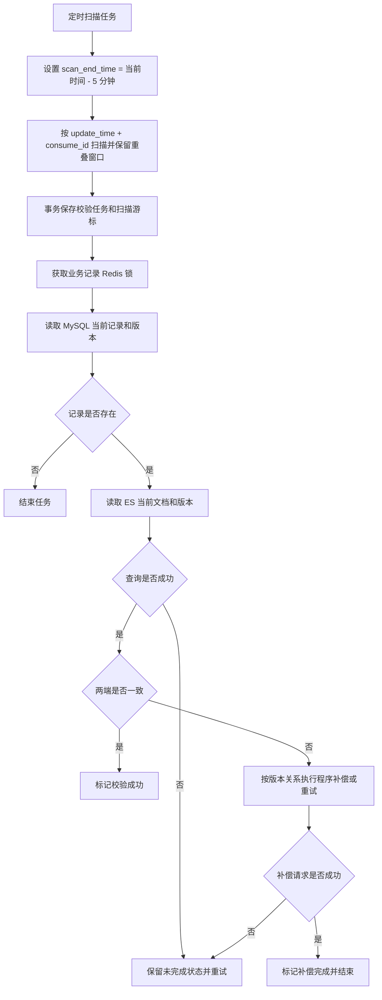

# 043_ES改造_ES_新表与 ES 增量校验总览

以下内容按照当前项目 `AGENTS.md` 项目级规则中规定的技术栈版本为准。

## 1 文档目标

本文说明 MySQL 新表与 ES 的增量校验总览。校验任务定时扫描 MySQL 当前仍存在且最近更新的记录，再读取 MySQL 和 ES 当前状态进行比较；发现明确差异后，由程序自动补偿。

Binlog、Canal 和 RocketMQ 只负责 ES 正常同步链路，不作为校验任务的变更入口。校验任务不读取已经删除的 MySQL 记录，也不处理 DELETE 事件。

## 2 已确认规则

- 使用 `update_time` 扫描最新变更记录，不按 Binlog 逐条创建校验任务。
- 每轮扫描先设置 `scan_end_time = 当前时间 - 5 分钟`，为 ES 同步链路预留延迟时间。
- 扫描使用 `update_time + consume_id` 复合游标，并保留重叠时间窗口，允许重复扫描。
- 扫描任务只处理 MySQL 当前仍存在的记录；已经删除的记录不会进入校验流程。
- 同一业务记录使用 Redis 锁避免多个校验任务同时执行。
- 任务版本只用于判断任务是否过时，补偿数据必须重新读取 MySQL 当前记录和当前版本。
- 直接比较确认两端一致时标记“校验成功”；补偿请求成功时标记“补偿完成”并结束；补偿失败保留未完成状态并继续重试。
- Binlog、Canal 和 RocketMQ 仅属于 ES 正常同步链路，不属于本校验任务入口。

## 3 面试口述精炼版本

**扫描最新状态。** 我们不按 Binlog 的每条历史变更创建校验任务，而是定时扫描 MySQL 新表最近更新且当前仍存在的记录。每轮把扫描截止时间设为当前时间减 5 分钟，给 ES 同步链路留出延迟，再用 `update_time + consume_id` 复合游标分页，并保留重叠窗口降低晚提交漏查风险。

**比较当前数据。** 扫描结果只负责定位业务记录，任务执行时还要重新读取 MySQL 当前记录和当前版本，再读取 ES 当前文档和版本。查询失败属于异常，保留未完成状态并重试，不能直接判定数据不一致。DELETE 数据已经不在 MySQL 新表中，不会进入扫描和比较。

**自动补偿。** 如果两端当前版本和业务字段一致，任务标记为“校验成功”。如果确认 ES 落后，程序使用重新读取的 MySQL 当前数据执行补偿；补偿成功标记为“补偿完成”并结束，补偿失败继续重试。Redis 锁控制同一业务记录的任务并发，ES 外部版本控制防止旧数据覆盖新数据。

## 4 文档分工

- [044_ES改造_ES_新表与 ES 增量校验方案选择](<./044_ES改造_ES_新表与 ES 增量校验方案选择.md>)：说明为什么选择 `update_time` 扫描、扫描边界和成立条件。
- [045_ES改造_ES_校验消息接收与任务持久化](<./045_ES改造_ES_校验消息接收与任务持久化.md>)：说明扫描批次、复合游标、任务持久化、Redis 锁和恢复状态。
- [046_ES改造_ES_增量比较、差异处理与恢复](<./046_ES改造_ES_增量比较、差异处理与恢复.md>)：说明当前状态读取、版本比较、并发处理、补偿和任务状态。

## 5 待确认或待验证事项

- 所有写入路径是否都可靠维护 `update_time`，并已建立适合扫描的索引？
- 5 分钟安全延迟和重叠窗口是否覆盖实际事务提交、同步积压和调度延迟？
- 扫描任务、复合游标和任务保存是否能在故障恢复后避免漏数？
- 自动补偿前重新读取 MySQL 当前数据和版本的实现是否已确定？
- MySQL 与 ES 的字段比较规则、业务版本读取方式和同版本字段不一致的补偿规则如何确定？
- Redis 锁的过期、续期、持有者校验和异常释放如何实现？
- “校验成功”和“补偿完成”的状态边界是否已在任务状态和监控中落实？
- 查询异常、补偿失败、版本冲突和长期未完成任务的退避与监控如何设计？
- 扫描遗漏、ES 同步链路故障或历史差异是否需要低频对账或重建能力兜底？

## 6 执行记录

- 本轮按新方案联动整理 043—046。
- 已静态检查章节编号、文档链接和 Mermaid 流程图。
- 未运行 Canal、RocketMQ、MySQL 或 ES 服务，运行时行为仍待验证。
