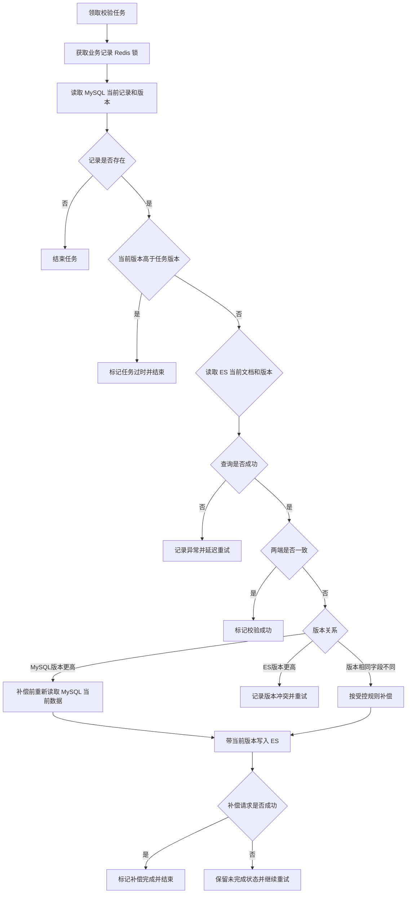

# 046_ES改造_ES_增量比较、差异处理与恢复

以下内容按照当前项目 `AGENTS.md` 项目级规则中规定的技术栈版本为准。

## 1 已确认规则

- 本文处理由 `update_time` 扫描产生的 INSERT、UPDATE 校验任务。
- 校验对象是 MySQL 新表当前仍存在的记录与 ES 当前文档。
- DELETE 数据已经不在 MySQL 新表中，不进入扫描和比较。
- 同一业务记录使用 Redis 锁避免多个校验任务同时执行。
- 任务版本只用于判断任务是否过时，补偿必须使用重新读取的 MySQL 当前数据和当前版本。
- 直接比较一致标记“校验成功”；补偿请求成功标记“补偿完成”并结束；补偿失败保留未完成状态并继续重试。

## 2 主题边界

本文说明任务领取后的当前状态读取、版本比较、并发处理、补偿、状态更新和恢复。扫描入口与任务持久化见 [044](<./044_ES改造_ES_新表与 ES 增量校验方案选择.md>) 和 [045](<./045_ES改造_ES_校验消息接收与任务持久化.md>)。

## 3 面试口述精炼版本

任务领取后，程序先按来源实例、物理库、物理表和 `consume_id` 获取 Redis 锁，再读取 MySQL 当前记录和当前版本。记录已经不存在时直接结束任务；当前版本高于任务版本时，说明任务已过时，跳过当前任务。对仍可处理的记录，再读取 ES 当前文档和版本并比较。

查询失败不能直接判定数据不一致，任务保留未完成状态并重试。确认 MySQL 版本高于 ES 后，程序重新读取 MySQL 当前数据执行补偿；补偿成功标记“补偿完成”并结束，补偿失败继续重试。直接比较确认两端一致时标记“校验成功”。同版本字段不一致时只能按受控规则补偿，不能降低版本或无版本覆盖。

## 4 当前状态读取与版本判断

任务只提供定位信息和扫描时版本，不能直接作为补偿数据来源。程序根据来源实例、物理库、物理表和 `consume_id` 查询 MySQL 当前记录：

- 查不到当前记录：记录已不存在，直接结束任务，不查询 ES；
- MySQL 当前版本高于任务版本：任务已过时，跳过当前任务；
- MySQL 当前版本等于任务版本：继续查询 ES；
- MySQL 当前版本低于任务版本：记录异常并重试。

读取 ES 当前文档和版本后，再按以下规则判断：

- MySQL 与 ES 版本和约定字段一致：标记“校验成功”；
- MySQL 版本高于 ES：补偿 ES；
- ES 版本高于 MySQL：不直接覆盖，记录版本冲突并重试；
- 版本相同但字段不同：执行受控同版本补偿，规则未确定前不能无条件写入。

## 5 比较与补偿流程



补偿前重新读取 MySQL 当前数据和版本，防止比较过程中出现新变更后仍使用旧快照。ES 写入必须携带业务版本并遵守外部版本规则；写入冲突不能直接标记为成功。

## 6 并发与恢复

同一业务记录使用 Redis 锁控制任务并发，锁键为：

```text
lock:es-check:{source_instance}:{database}:{table}:{consume_id}
```

Redis 锁需要设置 TTL、支持续期，并在释放时校验持有者。Redis 锁只负责控制任务并发，不能替代 MySQL 当前版本读取和 ES 外部版本控制。

进程异常退出或锁过期后，其他实例可以重新领取未完成任务，但必须重新读取 MySQL 当前状态。重复任务允许存在，不能依赖严格消息去重。

## 7 任务状态

- 直接比较确认两端一致：校验成功；
- 补偿请求成功：补偿完成并结束；
- MySQL 或 ES 查询失败：未完成，延迟重试；
- 版本冲突：未完成，延迟重试；
- 补偿失败：未完成，继续重试；
- 任务已过时：记录过时并结束。

## 8 待确认或待验证事项

- MySQL 与 ES 的字段比较规则、业务版本读取方式和同版本字段不一致的补偿规则；
- 版本冲突、查询失败和补偿失败的退避参数；
- Redis 锁和任务状态的故障恢复；
- ES 外部版本控制与实际写入方式是否一致。

## 9 执行记录

- 本轮按 `update_time` 扫描方案重写当前状态比较、并发和补偿流程。
- 未运行 Canal、RocketMQ、MySQL 或 ES 服务。
