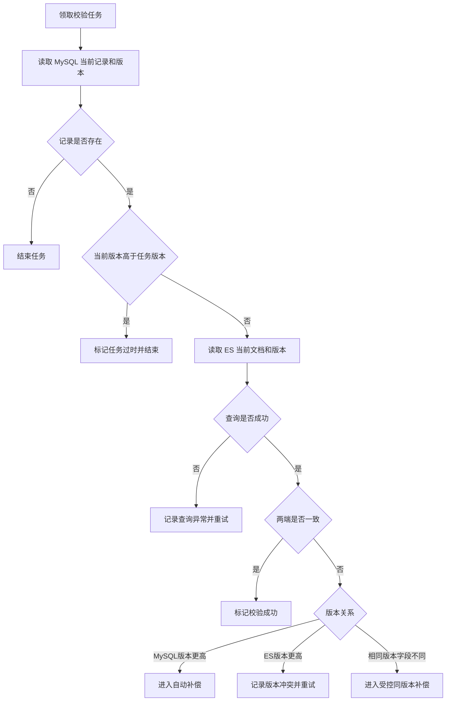

# 046_ES改造_ES_增量比较与版本判断

以下内容按照当前项目 `AGENTS.md` 项目级规则中规定的技术栈版本为准。

## 1 已确认规则

- 本文只处理 `update_time` 扫描产生的校验任务。
- 校验对象是 MySQL 新表当前仍存在的记录与 ES 当前文档。
- 任务版本只用于判断任务是否过时，不能作为补偿数据来源。
- 查询异常不能直接判定数据不一致。
- 直接比较确认两端一致时标记“校验成功”；补偿规则见 [047](<./047_ES改造_ES_自动补偿、并发与恢复.md>)。

## 2 主题边界

本文只说明如何读取 MySQL 和 ES 当前状态、判断任务是否过时，以及如何分类比较结果。扫描入口和任务持久化见 [044](<./044_ES改造_ES_新表与 ES 增量校验方案选择.md>)、[045](<./045_ES改造_ES_扫描任务持久化与调度.md>)；补偿、并发和恢复见 [047](<./047_ES改造_ES_自动补偿、并发与恢复.md>)。

## 3 面试口述精炼版本

任务领取后，根据来源实例、物理库、物理表和 `consume_id` 读取 MySQL 当前记录和版本。记录不存在就结束任务，当前版本高于任务版本就跳过过时任务；读取失败保留未完成状态并重试。再读取 ES 当前文档比较版本和业务字段：一致则校验成功，MySQL 版本更高则进入补偿，ES 版本更高则记录冲突重试。

## 4 当前状态读取

任务只保存记录定位信息和扫描时版本。执行时根据：

```text
source_instance + database + table + consume_id
```

查询 MySQL 当前记录，而不是使用任务保存的历史数据。

- 查不到记录：当前记录已不存在，结束任务，不查询 ES；
- MySQL 当前版本高于任务版本：任务已过时，跳过比较；
- MySQL 当前版本等于任务版本：继续查询 ES；
- MySQL 当前版本低于任务版本：记录异常并重试。

## 5 比较结果

| 结果 | 处理 |
|---|---|
| MySQL 与 ES 版本和字段一致 | 标记“校验成功” |
| MySQL 版本高于 ES | 说明 ES 可能落后，交给 047 执行补偿 |
| ES 版本高于 MySQL | 不直接覆盖，记录版本冲突并重试 |
| 版本相同但字段不同 | 进入受控同版本补偿；规则未确定前不无条件写入 |
| MySQL 或 ES 查询失败 | 记录查询异常并重试，不能直接判定差异 |

## 6 比较流程



## 7 待确认或待验证事项

- MySQL 与 ES 的字段比较规则和业务版本读取方式；
- 同版本字段不一致时的受控补偿规则；
- 查询失败、版本冲突和任务过时的状态记录是否已实现。

## 8 执行记录

- 本轮将比较职责从补偿和恢复职责中拆出。
- 未运行 Canal、RocketMQ、MySQL 或 ES 服务。
