# E账通对账清算：XXL-JOB 小白入门梳理版

> 版本边界：以下内容按照当前项目 `AGENTS.md` 项目级规则中规定的技术栈版本为准：Java 8、Spring Boot 2.7.18、MySQL 8.0.33、Elasticsearch 7.17.15。本文没有假定项目未确认的 XXL-JOB 版本；`${xxl-job.version}` 需要替换为实际依赖版本后再验证配置兼容性。

# 一、功能描述
“对账清算”模块，通过 XXL-JOB 分片广播 + CompletableFuture 线程并行处理海量商户交易，并通过断点续跑和小范围重跑减少全量重跑耗时。原稿中的“99.3% 提升至 100%”属于待核实项目指标，只有补充统计口径、时间范围和数据来源后才能作为事实使用。

---

# 二、业务知识
## 对账清算
E账通中的对账清算，可以理解为记录消费、撤销、退货、手续费等交易，在 T+1 按商户维度计算“消费金额 - 撤销金额 - 退货金额 - 手续费”的应清算金额，并交给后续清算流程处理。过渡户编号、文件生成顺序和最终入账账户属于项目业务事实，使用前必须以实际需求和代码核实。

---

# 三、先用小白方式理解 XXL-JOB
XXL-JOB 可以先理解成一个“定时任务管理平台”。

它主要解决这些问题：

```latex
什么时候执行任务？
由哪台机器执行任务？
任务失败了怎么办？
任务执行日志在哪里看？
多台机器怎么一起处理一个大任务？
```

在 E账通项目中，核心角色有 4 个：

```latex
XXL-JOB Admin：
    调度中心。
    负责配置任务、定时触发任务、手动触发任务和记录日志；失败重试需要在任务配置中设置重试次数。

batch-service：
    真正干活的业务服务。
    它是 E账通的批处理服务，不只执行对账清算，也可以执行清算文件生成、失败补偿、手续费重算等任务。

执行器 Executor：
    一组 batch-service 实例。
    例如 batch-service-01、batch-service-02、batch-service-03、batch-service-04 共同组成一个执行器组。

JobHandler：
    batch-service 里的某个任务入口方法。
    例如 reconcileClearJobHandler 就是“对账清算任务入口”。
```

整体关系如下：

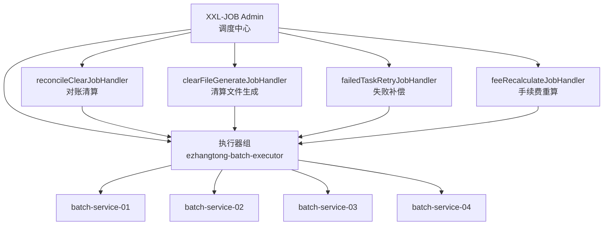

要记住一句话：

```latex
执行器不是某一个业务批次。
执行器是一组 batch-service 服务实例。
一个执行器组下面可以挂多个 JobHandler。
对账清算只是其中一个 JobHandler。
```

---

# 四、E账通项目里的两个前提
## 4.1 消费记录表采用分库分表
消费记录表设计为：

```latex
2 个数据库
每个数据库 16 张表
一共 32 个物理分片
```

分片键是：

```latex
merchantNo（数据库列名可以映射为 merchant_id）
```

分片逻辑是：

```latex
physicalShardNo = Math.floorMod(merchantNo.hashCode(), 32)
dbIndex = physicalShardNo / 16
tableIndex = physicalShardNo % 16
```

举例：

```latex
merchantNo = M10001
Math.floorMod("M10001".hashCode(), 32) = 5

physicalShardNo = 5
dbIndex = 5 / 16 = 0
tableIndex = 5 % 16 = 5

按本文的 0 基分片命名示例，数据落到：

ds_0.ez_trade_record_05
```

这里不要简单写成：

```latex
dbIndex = hash % 2
tableIndex = hash % 16
```

因为本项目真正需要和 XXL-JOB 分片对齐的是：

```latex
0 ~ 31 号物理分片
```

所以应该先计算：

```latex
physicalShardNo = Math.floorMod(merchantNo.hashCode(), 32)
```

再根据 `physicalShardNo` 推导数据库和数据表。

---

## 4.2 列表查询走 ES，对账清算走 MySQL
E账通里有两条链路：

```latex
消费记录列表查询：
    走 ES。
    因为列表查询条件多、跨商户检索复杂。深分页需要使用 search_after（必要时配合 PIT），不能简单依赖 from + size。

对账清算金额计算：
    回源 MySQL 分库分表。
    因为对账清算涉及资金结果，不能直接依赖 ES。
```

流程图如下：

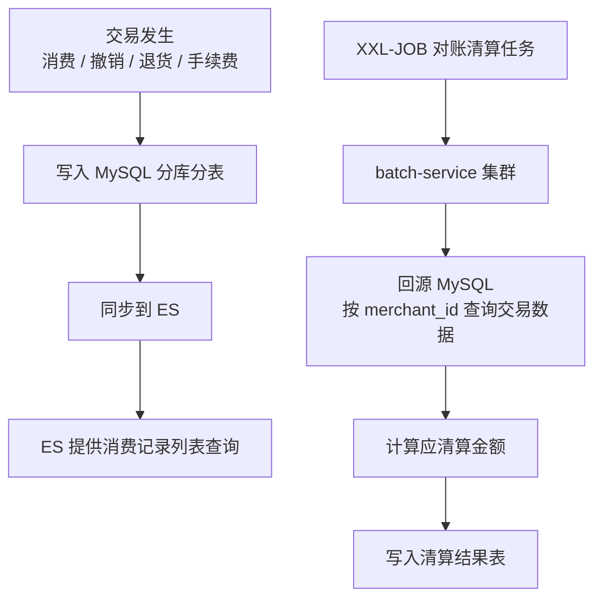

小白理解：

```latex
ES 是查询副本，适合查列表。
MySQL 是交易主数据，适合做资金计算。
对账清算不能直接用 ES 聚合结果。
```

---

# 五、对账清算整体流程
对账清算可以理解成 7 步：

```latex
第 1 步：XXL-JOB Admin 定时触发对账清算任务。

第 2 步：任务广播到多台 batch-service。

第 3 步：每台 batch-service 根据 shardIndex / shardTotal 领取一部分物理分片。

第 4 步：从每日商户交易汇总表中，拿到这些物理分片下的商户列表。

第 5 步：单台 batch-service 内部使用 CompletableFuture + 自定义线程池并行处理商户。

第 6 步：每个商户按 merchant_id 回源 MySQL 查询交易记录，计算清算金额。

第 7 步：把结果幂等写入清算结果表，并更新任务进度。
```

整体流程图：

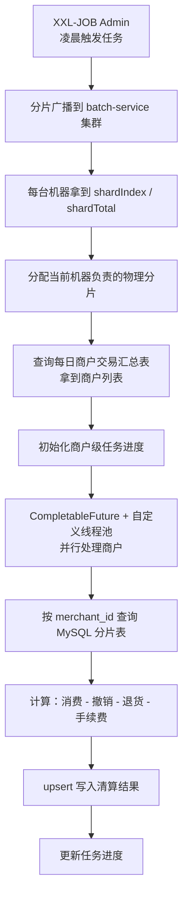

---

# 六、XXL-JOB 环境怎么搭
## 6.1 搭建 XXL-JOB Admin
XXL-JOB Admin 是官方提供的调度中心，不需要自己从零开发。

需要做 3 件事：

```latex
1. 创建 xxl_job 数据库。
2. 执行 XXL-JOB 官方初始化 SQL。
3. 启动 xxl-job-admin 项目，并配置数据库连接。
```

Admin 配置示例：

```properties
# XXL-JOB Admin 服务端口
server.port=8080

# XXL-JOB Admin 访问路径
server.servlet.context-path=/xxl-job-admin

# XXL-JOB Admin 自己的数据库
# 注意：这是 xxl_job 库，不是 E账通业务库
spring.datasource.url=jdbc:mysql://mysql-host:3306/xxl_job?useUnicode=true&characterEncoding=UTF-8&serverTimezone=Asia/Shanghai

# xxl_job 数据库用户名
spring.datasource.username=xxl_job_user

# xxl_job 数据库密码
spring.datasource.password=xxl_job_password

# MySQL 驱动
spring.datasource.driver-class-name=com.mysql.cj.jdbc.Driver

# Admin 和 batch-service 之间的访问令牌
# 两边必须配置一致
xxl.job.accessToken=ezhangtong_xxl_job_token
```

---

## 6.2 batch-service 接入 XXL-JOB
batch-service 要做 3 件事：

```latex
1. 引入 xxl-job-core 依赖。
2. 配置 Admin 地址和执行器名称。
3. 写 @XxlJob 方法。
```

Maven 依赖：

```xml
<!-- XXL-JOB 执行器依赖。
     作用：
     1. 让 batch-service 注册到 XXL-JOB Admin；
     2. 支持 @XxlJob 注解；
     3. 支持获取 shardIndex / shardTotal；
     4. 支持获取 jobParam。
-->
<dependency>
    <groupId>com.xuxueli</groupId>
    <artifactId>xxl-job-core</artifactId>
    <version>${xxl-job.version}</version>
</dependency>

```

batch-service 配置：

```yaml
xxl:
  job:
    admin:
      # XXL-JOB Admin 地址。
      # batch-service 启动后，会向这个地址注册自己。
      addresses: http://xxl-job-admin:8080/xxl-job-admin

    # Admin 和 batch-service 的通信令牌。
    # 必须和 Admin 里的 accessToken 一致。
    accessToken: ezhangtong_xxl_job_token

    executor:
      # 执行器组名称。
      # 多台 batch-service 配同一个 appname，
      # 就会被 Admin 识别成同一个执行器集群。
      appname: ezhangtong-batch-executor

      # 当前服务 IP。
      # 可以留空自动识别。
      # 多网卡机器建议手动指定内网 IP。
      ip:

      # 执行器端口。
      # Admin 会通过这个端口调用 batch-service。
      # 同一台机器部署多个实例时，端口不能重复。
      port: 9999

      # XXL-JOB 本地执行日志目录。
      logpath: /data/applogs/xxl-job/jobhandler

      # 日志保留天数。
      logretentiondays: 30
```

---

## 6.3 Admin 后台配置任务
先配置执行器：

```latex
AppName：ezhangtong-batch-executor
名称：E账通批处理执行器
注册方式：自动注册
```

然后配置对账清算任务：

```latex
执行器：ezhangtong-batch-executor
任务描述：E账通 T+1 对账清算任务
调度类型：CRON
CRON：0 0 1 * * ?
运行模式：BEAN
JobHandler：reconcileClearJobHandler
路由策略：分片广播
阻塞处理策略：单机串行
失败重试次数：2
任务超时时间：7200 秒
```

小白重点看两个字段：

```latex
JobHandler：
    要和代码里的 @XxlJob("reconcileClearJobHandler") 一致。

路由策略：分片广播
    表示多台 batch-service 都会收到这个任务。
```

---

# 七、核心代码先看五段
```latex
第一段：JobHandler 入口
第二段：分片分配
第三段：查询商户列表
第四段：CompletableFuture + 自定义线程池
第五段：单个商户处理
```

---

## 7.1 JobHandler 入口
这段代码解决的问题是：

```latex
XXL-JOB Admin 触发任务后，batch-service 从哪里开始执行？
```

流程图：

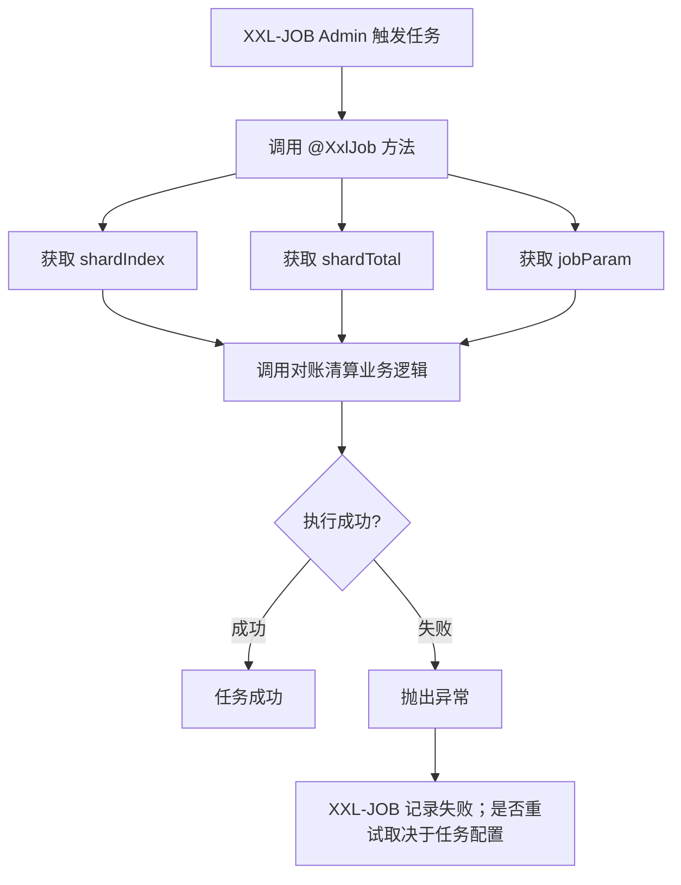

伪代码：

```java
@Component
public class EzhangtongBatchJobHandler {

    @Resource
    private ReconcileClearService reconcileClearService;

    /**
     * 对账清算任务入口。
     *
     * 这个名字必须和 XXL-JOB Admin 后台配置的 JobHandler 一致：
     * JobHandler = reconcileClearJobHandler
     */
    @XxlJob("reconcileClearJobHandler")
    public void reconcileClear() throws Exception {

        // 当前机器的分片编号。
        int shardIndex = XxlJobHelper.getShardIndex();

        // 当前总共有多少台机器参与本次任务。
        int shardTotal = XxlJobHelper.getShardTotal();

        // XXL-JOB 后台传入的参数。
        // 正常定时任务可以为空，小范围重跑时可以传 JSON。
        String jobParam = XxlJobHelper.getJobParam();

        // 不能吞异常，否则 XXL-JOB 会误以为任务成功。
        reconcileClearService.execute(shardIndex, shardTotal, jobParam);
    }
}
```

---

## 7.2 当前机器处理哪些物理分片
规则（本次触发内）：

```latex
physicalShardNo % shardTotal == shardIndex
```

`shardIndex` 是本次触发分配给执行器实例的 0 基编号，不是固定机器编号。执行器数量变化会改变分片归属；如果 `shardTotal` 大于 32，会有实例没有物理分片，任务进度和抢占逻辑必须允许后续重新分配。

例如 32 个物理分片，4 台 batch-service：

```latex
batch-service-01：shardIndex = 0，处理 0,4,8,12,16,20,24,28
batch-service-02：shardIndex = 1，处理 1,5,9,13,17,21,25,29
batch-service-03：shardIndex = 2，处理 2,6,10,14,18,22,26,30
batch-service-04：shardIndex = 3，处理 3,7,11,15,19,23,27,31
```

流程图：

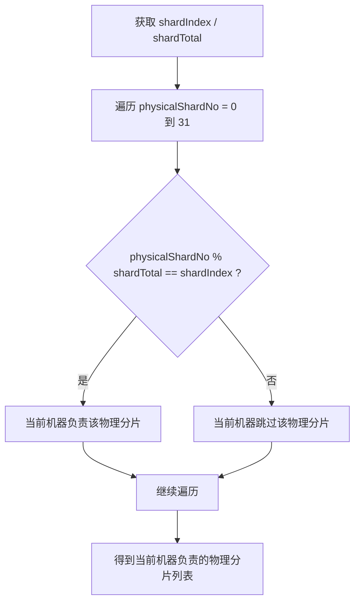

伪代码：

```java
public class PhysicalShardAllocator {

    private static final int TOTAL_PHYSICAL_SHARDS = 32;

    /**
     * 根据 shardIndex / shardTotal 计算当前机器负责哪些物理分片。
     */
    public List<Integer> allocate(int shardIndex, int shardTotal) {

        if (shardTotal <= 0) {
            throw new IllegalArgumentException("shardTotal 必须大于 0");
        }

        if (shardIndex < 0 || shardIndex >= shardTotal) {
            throw new IllegalArgumentException("shardIndex 不合法");
        }

        List<Integer> result = new ArrayList<>();

        for (int physicalShardNo = 0; physicalShardNo < TOTAL_PHYSICAL_SHARDS; physicalShardNo++) {
            if (physicalShardNo % shardTotal == shardIndex) {
                result.add(physicalShardNo);
            }
        }

        return result;
    }
}
```

---

## 7.3 如何拿到当前分片里的商户列表
XXL-JOB 的分片参数本身拿不到“每个物理分片里的商户列表”。

它只提供：

```java
shardIndex  // 当前执行器编号
shardTotal  // 本次总执行器数量
```

真正的商户列表，需要 E账通自己维护。

推荐维护一张每日商户交易汇总表：

```sql
CREATE TABLE ez_daily_merchant_trade_summary (
    id BIGINT PRIMARY KEY AUTO_INCREMENT COMMENT '主键ID',

    biz_date DATE NOT NULL COMMENT '业务日期',

    merchant_id VARCHAR(64) NOT NULL COMMENT '商户号，也是分片键',

    physical_shard_no INT NOT NULL COMMENT '物理分片号，0~31',

    trade_count INT NOT NULL DEFAULT 0 COMMENT '当天交易笔数',

    consume_amount DECIMAL(18,2) NOT NULL DEFAULT 0 COMMENT '当天消费总金额，可选',

    refund_amount DECIMAL(18,2) NOT NULL DEFAULT 0 COMMENT '当天退货总金额，可选',

    created_time DATETIME NOT NULL DEFAULT CURRENT_TIMESTAMP COMMENT '创建时间',

    updated_time DATETIME NOT NULL DEFAULT CURRENT_TIMESTAMP ON UPDATE CURRENT_TIMESTAMP COMMENT '更新时间',

    UNIQUE KEY uk_biz_merchant (biz_date, merchant_id),

    KEY idx_biz_shard (biz_date, physical_shard_no)
) COMMENT='每日商户交易汇总表';
```

这张表的作用：

```latex
记录某一天哪些商户发生过交易；
记录这个商户属于哪个物理分片；
对账清算时直接从这张表拿商户列表。
```

交易写入时维护这张表：

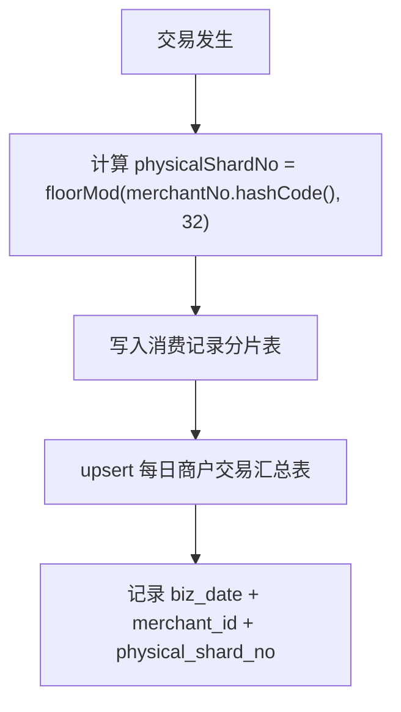

对账清算时查询商户列表：

```xml
SELECT merchant_id,
       physical_shard_no
FROM ez_daily_merchant_trade_summary
WHERE biz_date = #{bizDate}
  AND physical_shard_no IN
  <foreach collection="physicalShardNos" item="shardNo" open="(" separator="," close=")">
      #{shardNo}
  </foreach>;
```

`physicalShardNos` 是集合时，MyBatis 必须使用 `<foreach>` 展开参数，不能写成 `IN (#{physicalShardNos})`。

小白理解：

```latex
batch-service 先算出自己负责哪些 physicalShardNo；
再用这些 physicalShardNo 去每日商户交易汇总表查 merchant_id；
查出来的 merchant_id 就是当前机器要处理的商户列表。
```

---

## 7.4 CompletableFuture + 自定义线程池并行处理商户
这一段解决的是单台机器内部的并行问题：

```latex
    XXL-JOB：解决本次触发中多台 batch-service 之间怎么分工。
CompletableFuture + 自定义线程池：解决单台 batch-service 内部多个商户怎么并行处理。
```

---

### 7.4.1 ThreadPoolTaskExecutor 工作原理
核心看 3 个参数：

```yaml
core-pool-size: 8      # 核心线程数
max-pool-size: 16      # 最大线程数
queue-capacity: 500    # 等待队列容量
```

任务提交后，线程池按这个顺序处理：

```latex
1. 当前线程数 < corePoolSize
   → 创建核心线程执行任务。

2. 核心线程都忙了
   → 任务进入等待队列。

3. 等待队列也满了，并且当前线程数 < maxPoolSize
   → 创建非核心线程执行任务。

4. 线程数达到 maxPoolSize，队列也满了
   → 执行拒绝策略。
```

流程图：

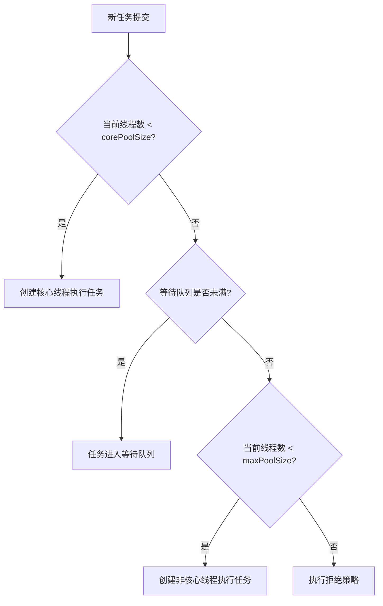

结合 E账通配置：

```latex
corePoolSize = 8
maxPoolSize = 16
queueCapacity = 500
```

那么：

```latex
第 1 ~ 8 个商户任务：
    创建 8 个核心线程处理。

第 9 ~ 508 个商户任务：
    进入等待队列。

第 509 ~ 516 个商户任务：
    队列满了，继续创建非核心线程，最多扩到 16 个线程。

第 517 个以后：
    线程数到 16，队列也满了，触发拒绝策略。
```

最容易误解的一点：

```latex
线程池不是一开始就扩到 maxPoolSize。

真实顺序是：
先用 corePoolSize；
核心线程满了，先排队；
队列满了，才扩到 maxPoolSize。
```

所以 `queueCapacity` 不能无脑设置很大。队列太大时，任务可能长期排队，最大线程数很难用上，也会造成内存压力和失败感知变慢。

---

### 7.4.2 线程池配置
```yaml
reconcile:
  thread-pool:
    # 核心线程数。
    # 表示单台 batch-service 平时保留多少个线程处理商户任务。
    core-pool-size: 8

    # 最大线程数。
    # 表示高峰时单台 batch-service 最多多少个线程并行处理商户。
    max-pool-size: 16

    # 队列容量。
    # 核心线程都忙时，新任务先进入队列。
    queue-capacity: 500

    # 非核心线程空闲多久后回收，单位秒。
    keep-alive-seconds: 60

  task:
    # 每批提交多少个商户任务到 CompletableFuture。
    # 避免一次性创建过多 Future 对象。
    merchant-batch-size: 100

    # 单个商户分页查询交易记录时，每页查询多少条。
    trade-page-size: 1000

    # RUNNING 状态超过多少分钟没有更新心跳，就认为任务可能异常中断。
    running-timeout-minutes: 60
```

---

### 7.4.3 自定义线程池配置类
不要直接使用 CompletableFuture 默认线程池。

原因：

```latex
CompletableFuture 默认使用 ForkJoinPool.commonPool。
这个线程池是公共线程池。
如果系统里还有其他异步任务，也可能共用它。

对账清算是批处理任务，访问数据库比较重。
如果不单独隔离线程池，容易影响其他业务。
```

推荐自定义一个对账清算专用线程池：

```java
@Configuration
public class ReconcileThreadPoolConfig {

    @Bean("reconcileExecutor")
    public Executor reconcileExecutor(ReconcileThreadPoolProperties properties) {

        ThreadPoolTaskExecutor executor = new ThreadPoolTaskExecutor();

        // 核心线程数。
        executor.setCorePoolSize(properties.getCorePoolSize());

        // 最大线程数。
        executor.setMaxPoolSize(properties.getMaxPoolSize());

        // 等待队列容量。
        executor.setQueueCapacity(properties.getQueueCapacity());

        // 空闲线程存活时间。
        executor.setKeepAliveSeconds(properties.getKeepAliveSeconds());

        // 线程名前缀，方便日志排查。
        executor.setThreadNamePrefix("reconcile-clear-");

        /*
         * 拒绝策略：CallerRunsPolicy
         *
         * 如果线程池满了，队列也满了，
         * 就由提交任务的线程自己执行当前任务。
         *
         * 好处：
         * 1. 在线程池仍在运行时通常不会直接丢任务；
         * 2. 会自然降低任务提交速度；
         * 3. 对数据库形成反压。
         */
        executor.setRejectedExecutionHandler(new ThreadPoolExecutor.CallerRunsPolicy());

        executor.initialize();

        return executor;
    }
}
```

---

### 7.4.4 单机并行处理流程
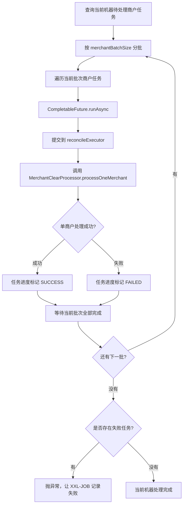

核心代码：

```java
@Service
public class ReconcileClearService {

    @Resource
    private ReconcileTaskProgressRepository progressRepository;

    @Resource
    private MerchantClearProcessor merchantClearProcessor;

    @Resource
    private ReconcileTaskProperties taskProperties;

    @Resource
    private PhysicalShardAllocator physicalShardAllocator;

    /**
     * 对账清算专用线程池。
     */
    @Resource(name = "reconcileExecutor")
    private Executor reconcileExecutor;

    /**
     * 并行处理当前 batch-service 负责的商户任务。
     */
    public void processPendingMerchantTasks(ReconcileJobParam param,
                                            ClearBatch batch,
                                            int shardIndex,
                                            int shardTotal) {

        // shardIndex 不是稳定的机器编号；它只在本次 XXL-JOB 触发中有效。
        // 必须同时使用 shardTotal 计算本次负责的物理分片。
        List<Integer> physicalShardNos = physicalShardAllocator.allocate(
                shardIndex, shardTotal);

        // 1. 查询当前机器要处理的商户任务。
        List<TaskProgress> pendingTasks = progressRepository.queryPendingTasks(
                param.getBizDate(),
                batch.getBatchNo(),
                physicalShardNos
        );

        if (pendingTasks == null || pendingTasks.isEmpty()) {
            return;
        }

        // 2. 多线程失败计数器。
        AtomicInteger failedCount = new AtomicInteger(0);

        // 3. 按 merchantBatchSize 分批，避免一次性创建过多 CompletableFuture。
        // 注意：这里仍然一次性查询了 pendingTasks；数据量很大时应改为数据库分页拉取。
        int merchantBatchSize = taskProperties.getMerchantBatchSize();

        List<List<TaskProgress>> partitions = partition(pendingTasks, merchantBatchSize);

        // 4. 每一批内部并行，批次之间顺序推进。
        for (List<TaskProgress> partition : partitions) {

            List<CompletableFuture<Void>> futures = partition.stream()
                    .map(task -> CompletableFuture.runAsync(() -> {

                        try {
                            merchantClearProcessor.processOneMerchant(param, batch, task);

                        } catch (Exception ex) {
                            failedCount.incrementAndGet();

                            try {
                                progressRepository.markFailed(
                                        task.getId(),
                                        ex.getMessage()
                                );
                            } catch (Exception markFailedEx) {
                                // 记录失败状态也失败时，不能让当前 Future 直接异常退出，
                                // 否则 allOf().join() 可能提前中断同批次其他商户。
                                // 实际代码必须记录 markFailedEx 并触发告警。
                            }
                        }

                    }, reconcileExecutor))
                    .collect(Collectors.toList());

            // 5. 等待当前批次全部完成。
            CompletableFuture.allOf(futures.toArray(new CompletableFuture[0])).join();
        }

        // 6. 如果有商户失败，抛异常，让 XXL-JOB 感知本次任务失败。
        if (failedCount.get() > 0) {
            throw new RuntimeException("本次对账清算存在失败商户数量：" + failedCount.get());
        }
    }

    private <T> List<List<T>> partition(List<T> list, int batchSize) {
        List<List<T>> result = new ArrayList<>();

        if (list == null || list.isEmpty()) {
            return result;
        }

        if (batchSize <= 0) {
            throw new IllegalArgumentException("batchSize 必须大于 0");
        }

        for (int start = 0; start < list.size(); start += batchSize) {
            int end = Math.min(start + batchSize, list.size());
            result.add(list.subList(start, end));
        }

        return result;
    }
}
```

---

## 7.5 处理单个商户
这段代码解决的问题是：

```latex
拿到一个商户后，怎么计算它的应清算金额？
```

公式：

```latex
应清算金额 = 消费金额 - 撤销金额 - 退货金额 - 手续费
```

流程图：

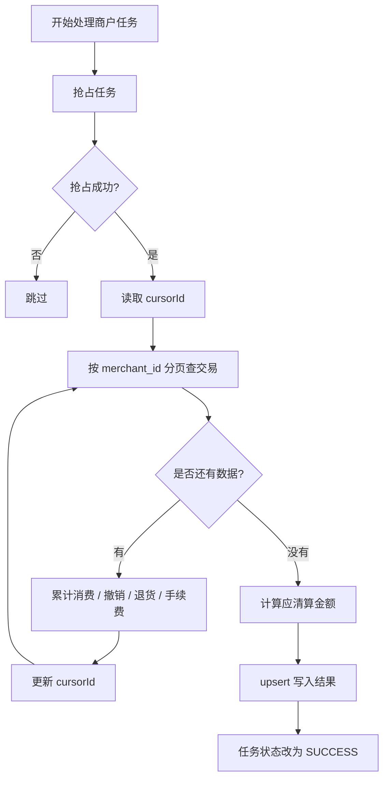

伪代码：

```java
@Component
public class MerchantClearProcessor {

    @Resource
    private TradeRepository tradeRepository;

    @Resource
    private ClearResultRepository clearResultRepository;

    @Resource
    private ReconcileTaskProgressRepository progressRepository;

    /**
     * 处理单个商户。
     *
     * 这里不把整个分页循环放进一个长事务。每页的游标和累计金额必须在
     * 独立事务中提交，否则中途失败时前面的断点也会回滚。
     */
    public void processOneMerchant(ReconcileJobParam param,
                                   ClearBatch batch,
                                   TaskProgress task) {

        // 1. 抢占任务，防止多个线程重复处理同一个商户。
        boolean locked = progressRepository.tryMarkRunning(task.getId());

        if (!locked) {
            return;
        }

        // 2. 读取断点游标和已提交的累计金额。
        // consumeId 是项目约定的 21 位字符串主键，不能使用 long。
        String cursorId = task.getCursorId();
        BigDecimal consumeAmount = defaultZero(task.getConsumeAmount());
        BigDecimal cancelAmount = defaultZero(task.getCancelAmount());
        BigDecimal refundAmount = defaultZero(task.getRefundAmount());
        BigDecimal feeAmount = defaultZero(task.getFeeAmount());

        while (true) {

            // 3. 按 merchant_id 分页查询当前商户交易记录。
            List<TradeRecord> records = tradeRepository.queryByCursor(
                    param.getBizDate(),
                    task.getMerchantId(),
                    // 必须查询全部需要清算的交易类型，不能只查询单一 tradeType。
                    param.getAllTradeTypes(),
                    cursorId, // null 表示首页查询，非 null 时使用 consume_id > cursorId
                    param.getPageSize()
            );

            if (records.isEmpty()) {
                break;
            }

            // 4. 按交易类型累计金额。
            for (TradeRecord record : records) {
                if ("CONSUME".equals(record.getTradeType())) {
                    consumeAmount = consumeAmount.add(record.getAmount());
                } else if ("CANCEL".equals(record.getTradeType())) {
                    cancelAmount = cancelAmount.add(record.getAmount());
                } else if ("REFUND".equals(record.getTradeType())) {
                    refundAmount = refundAmount.add(record.getAmount());
                } else if ("FEE".equals(record.getTradeType())) {
                    feeAmount = feeAmount.add(record.getAmount());
                }

                cursorId = record.getId();
            }

            // 5. 每处理完一页，独立提交游标、累计金额和心跳。
            // updateCursorAndTotals 必须使用 REQUIRES_NEW 或等价的独立事务。
            progressRepository.updateCursorAndTotals(
                    task.getId(), cursorId, records.size(),
                    consumeAmount, cancelAmount, refundAmount, feeAmount);
        }

        // 6. 计算应清算金额。
        BigDecimal clearAmount = consumeAmount
                .subtract(cancelAmount)
                .subtract(refundAmount)
                .subtract(feeAmount);

        // 7. 幂等写入清算结果。
        clearResultRepository.upsert(
                param.getBizDate(),
                batch.getBatchNo(),
                task.getMerchantId(),
                task.getPhysicalShardNo(),
                consumeAmount,
                cancelAmount,
                refundAmount,
                feeAmount,
                clearAmount
        );

        // 8. 标记任务成功。
        progressRepository.markSuccess(task.getId());
    }

    private BigDecimal defaultZero(BigDecimal amount) {
        return amount == null ? BigDecimal.ZERO : amount;
    }
}
```

`queryByCursor` 必须使用固定排序（例如 `ORDER BY consume_id ASC`）和稳定的游标条件（例如 `consume_id > cursorId`）；INIT 状态的空游标需要单独处理为首页查询。`updateCursorAndTotals` 要在独立事务中提交游标、四类累计金额和 `last_heartbeat_time`。该方法应放在独立的 Spring Service 中，或通过 Spring 代理调用 `REQUIRES_NEW`；同一个 Bean 内部直接调用不会开启新事务。如果继续使用一个覆盖整个分页循环的事务，不能声称支持可靠的页级断点续跑。

---

# 八、任务进度表和清算结果表不是同一张表
这两个表建议拆开设计。

```latex
任务进度表：管“任务有没有跑完”。
清算结果表：管“最后算出来多少钱”。
```

---

## 8.1 任务进度表：记录执行过程
任务进度表可以叫：

```latex
ez_reconcile_task_progress
```

它主要记录：

```latex
哪个商户要处理；
现在是 INIT / RUNNING / SUCCESS / FAILED；
处理到哪一页了；
cursorId 是多少；
失败原因是什么；
最后心跳时间是什么。
```

它偏向：

```latex
调度执行状态表
```

---

## 8.2 清算结果表：记录业务结果
清算结果表可以叫：

```latex
ez_clear_result
```

它主要记录：

```latex
商户消费金额；
撤销金额；
退货金额；
手续费；
应清算金额；
清算状态。
```

它偏向：

```latex
业务结果表 / 资金结果表
```

---

## 8.3 为什么不建议合成一张表？
如果合成一个表，就会变成：

```latex
一张表既要记录任务执行状态，
又要记录清算业务结果。
```

问题是：

```latex
1. 字段混杂，不清晰。

2. 任务重试时，会频繁更新 status、cursor_id、heartbeat；
   但清算结果金额不是每次都需要变。

3. 结果表通常要长期留存、用于审计；
   进度表更多是批处理过程数据，可以按周期归档或清理。

4. 任务失败时，可能还没有清算结果；
   但进度表已经需要记录 FAILED 和失败原因。

5. cursor_id 这种执行游标不应该和最终清算金额强绑定。
```

---

## 8.4 两张表的关系
两张表通过这些字段关联：

```latex
biz_date
batch_no
merchant_id
```

关系图：

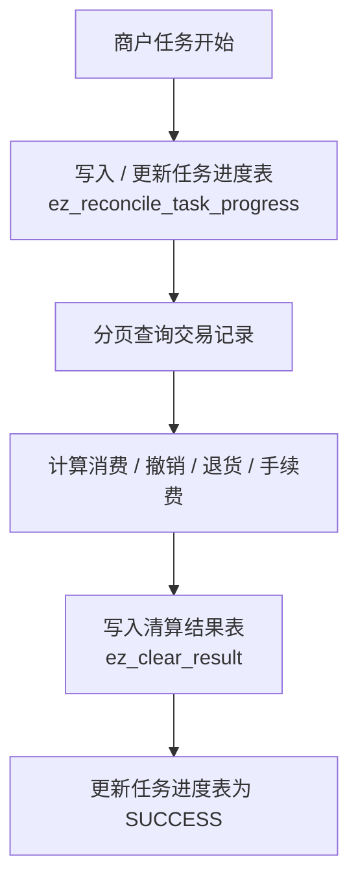

---

# 九、为什么需要任务进度表？
因为 XXL-JOB 只知道：

```latex
这个 JobHandler 成功了，还是失败了。
```

但 XXL-JOB 不知道：

```latex
已经处理到哪个商户了；
某个商户处理到第几页了；
哪几个商户成功了；
哪几个商户失败了；
哪些 RUNNING 任务其实已经因为服务宕机卡住了。
```

所以业务系统自己要设计任务进度表。

核心字段：

```latex
biz_date：业务日期
batch_no：清算批次号
merchant_id：商户号
physical_shard_no：物理分片号
status：任务状态
cursor_id：断点游标（与 21 位 `consumeId` 一致，按字符串保存）
consume_amount：已提交的消费累计金额
cancel_amount：已提交的撤销累计金额
refund_amount：已提交的退货累计金额
fee_amount：已提交的手续费累计金额
last_error_msg：失败原因
last_heartbeat_time：最近心跳时间
```

状态流转：

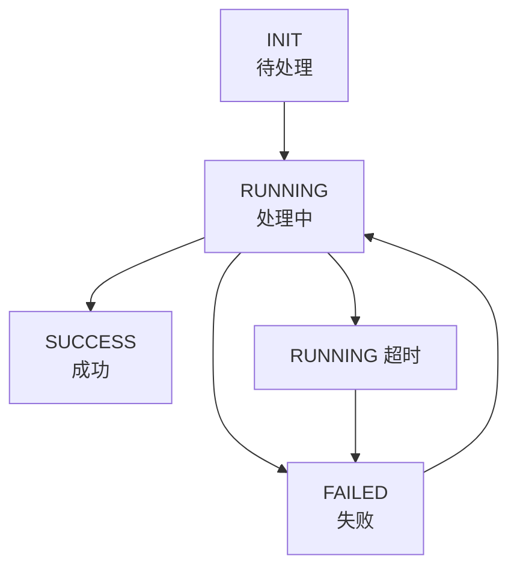

断点续跑逻辑：

```latex
SUCCESS：
    已经成功，跳过。

INIT：
    还没处理，继续处理。

FAILED：
    上次失败，继续处理。

RUNNING 超时：
    可能是服务宕机导致状态没更新，先改成 FAILED，再继续处理。
```

---

# 十、tryMarkRunning 为什么能防止重复处理？
代码中有一段：

```java
boolean locked = progressRepository.tryMarkRunning(task.getId());

if (!locked) {
    return;
}
```

它的核心不是 `boolean locked`，而是 `tryMarkRunning()` 里面的原子 UPDATE。

通常是这样：

```sql
UPDATE ez_reconcile_task_progress
SET status = 'RUNNING',
    last_heartbeat_time = NOW(),
    updated_time = NOW()
WHERE id = #{id}
  AND status IN ('INIT', 'FAILED');
```

Java 根据影响行数判断：

```java
public boolean tryMarkRunning(Long taskId) {
    String sql = "UPDATE ez_reconcile_task_progress "
            + "SET status = 'RUNNING', "
            + "last_heartbeat_time = NOW(), updated_time = NOW() "
            + "WHERE id = ? "
            + "AND status IN ('INIT', 'FAILED')";

    int rows = jdbcTemplate.update(sql, taskId);

    return rows == 1;
}
```

小白理解：

```latex
tryMarkRunning 就像“抢座”。

商户任务一开始是 INIT，表示没人处理。

多个线程都想处理这个商户时，
谁先把状态从 INIT 改成 RUNNING，
谁就抢到了这个任务。

其他线程再来改时，发现状态已经是 RUNNING，
就说明任务被别人抢走了，只能放弃。
```

流程图：

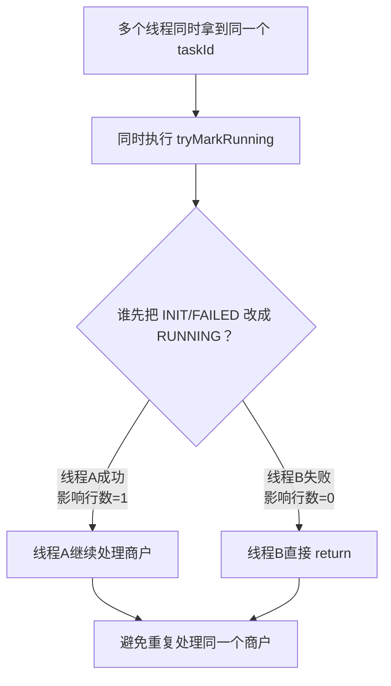

可能出现重复领取的场景：

```latex
1. 单台 batch-service 内部 CompletableFuture 多线程并发，任务列表查询或分批逻辑有重复。

2. 多台 batch-service 分片过滤条件写错，导致不同机器查到了同一个商户任务。

3. XXL-JOB 失败重试和上一次任务重叠。

4. 人工手动重跑和定时任务撞车。

5. RUNNING 超时时间设置太短，把还在执行的任务误改成 FAILED。
```

所以：

```latex
tryMarkRunning 是防止“并发领取”的第一道防线。
最终还要配合任务进度表唯一键、清算结果唯一键、upsert 幂等、心跳和超时机制。
```

---

# 十一、为什么需要 upsert 幂等？
对账清算任务可能重复执行：

```latex
XXL-JOB 失败重试；
人工手动重跑；
服务宕机后断点续跑；
小范围修复重跑。
```

所以不能每跑一次就插入一条新结果。

清算结果表要有唯一键：

```latex
biz_date + batch_no + merchant_id
```

对应数据库必须建立唯一索引，例如：

```sql
UNIQUE KEY uk_clear_result (biz_date, batch_no, merchant_id)
```

写入时使用：

```sql
INSERT INTO ez_clear_result (...)
VALUES (...)
ON DUPLICATE KEY UPDATE
    consume_amount = VALUES(consume_amount),
    cancel_amount = VALUES(cancel_amount),
    refund_amount = VALUES(refund_amount),
    fee_amount = VALUES(fee_amount),
    clear_amount = VALUES(clear_amount),
    updated_time = NOW();
```

这样：

```latex
第一次跑：
    插入结果。

重复跑：
    更新结果，不产生重复数据。
```

MySQL 8.0.33 仍兼容 `VALUES(column)` 写法，但该写法已被标记为弃用。新代码可以按实际 SQL 语法改用插入行别名；无论采用哪种写法，都必须先建立与业务重跑范围一致的唯一键。

---

# 十二、完整执行例子
假设：

```latex
batch-service 部署 4 台：

batch-service-01
batch-service-02
batch-service-03
batch-service-04

消费记录表有 32 个物理分片。
```

XXL-JOB 分片广播后：

```latex
batch-service-01：shardIndex = 0，shardTotal = 4
batch-service-02：shardIndex = 1，shardTotal = 4
batch-service-03：shardIndex = 2，shardTotal = 4
batch-service-04：shardIndex = 3，shardTotal = 4
```

物理分片分配：

```latex
batch-service-01：0,4,8,12,16,20,24,28
batch-service-02：1,5,9,13,17,21,25,29
batch-service-03：2,6,10,14,18,22,26,30
batch-service-04：3,7,11,15,19,23,27,31
```

商户 M10001（按 Java String.hashCode 计算）：

```latex
Math.floorMod("M10001".hashCode(), 32) = 5
```

所以：

```latex
physicalShardNo = 5
5 % 4 = 1
```

因此它由：

```latex
batch-service-02 处理
```

查询时必须带：

```sql
WHERE merchant_id = 'M10001'
```

如果实际 ShardingSphere 配置采用本文的 0 基命名示例，才会路由到：

```latex
ds_0.ez_trade_record_05
```

---

# 十三、Java 高级工程师面试回答版
```latex
功能描述：“对账清算”模块，通过 XXL-JOB 分片广播 + CompletableFuture 线程并行处理海量商户交易，并通过断点续跑和小范围重跑减少全量重跑耗时。
```

这个项目里的对账清算模块，主要解决海量商户 T+1 对账清算的时效性和失败恢复问题。业务上，系统会把消费、撤销、退货、手续费等交易记录归集起来，在 T+1 按商户维度计算“消费金额 - 撤销金额 - 退货金额 - 手续费”后的应清算金额，再交给后续清算流程处理。

技术上，我们用 XXL-JOB 做批处理任务调度。XXL-JOB 的执行器不是某个对账清算批次，而是一组可以执行任务的 batch-service 实例。我们把 batch-service 注册成 `ezhangtong-batch-executor`，这个执行器组下面可以挂多个 JobHandler，比如对账清算、清算文件生成、失败补偿、手续费重算等。对账清算只是其中一个 `reconcileClearJobHandler`。

对账清算数据量比较大，所以这个任务在 XXL-JOB Admin 中配置为分片广播。任务触发后，多台 batch-service 都会收到任务，每个执行器通过 `XxlJobHelper.getShardIndex()` 和 `XxlJobHelper.getShardTotal()` 获取本次触发的分片号和总分片数。XXL-JOB 只负责分配分片参数，不会自动拆业务数据，所以我们在代码里按 `physicalShardNo % shardTotal == shardIndex` 分配数据。执行器数量变化会改变物理分片归属，进度表和抢占逻辑必须支持重新分配。

消费记录表按 `merchantNo` 分库分表，采用 2 库 16 表设计，一共 32 个物理分片。分片逻辑是 `physicalShardNo = Math.floorMod(merchantNo.hashCode(), 32)`；数据库列名即使使用 `merchant_id`，也必须与该业务字段保持同一取值。为了避免临时扫描交易大表，我们维护每日商户交易汇总表，记录每个业务日期下哪些商户发生过交易，以及商户对应的物理分片号。对账清算时，每台 batch-service 先结合 `shardIndex` 和 `shardTotal` 算出自己负责哪些物理分片，再从汇总表中查询这些分片下的商户列表。

单机内部使用 CompletableFuture 和自定义线程池并行处理商户任务。这里没有直接使用 CompletableFuture 默认的 `ForkJoinPool.commonPool`，而是单独定义了对账清算专用线程池 `reconcileExecutor`。这样做主要有三个考虑：第一是资源隔离，对账清算属于批处理任务，会大量访问数据库，如果和系统其他异步任务共用公共线程池，容易互相影响；第二是并发可控，通过线程池参数限制单台 batch-service 同时处理多少商户，避免瞬间打满数据库连接池；第三是反压保护，当线程池和队列都满时，使用 `CallerRunsPolicy`，让提交任务的线程自己执行任务，降低提交速度。它通常不会丢弃尚未关闭线程池中的任务，但在线程池已关闭时不能把它当成可靠的持久化机制。

`ThreadPoolTaskExecutor` 本质上是 Spring 对 JDK `ThreadPoolExecutor` 的封装。它的核心参数主要是 `corePoolSize`、`maxPoolSize` 和 `queueCapacity`。任务提交后，并不是一上来就创建到最大线程数，而是先判断当前线程数是否小于核心线程数；如果小于，就创建核心线程执行任务；如果核心线程都忙了，任务会先进入等待队列；只有当等待队列也满了，并且当前线程数还小于最大线程数时，才会继续创建非核心线程；如果线程数已经达到最大线程数，并且队列也满了，就会触发拒绝策略。也就是说，它的执行顺序是：先用核心线程，再进队列，队列满了才扩容到最大线程数。

在本项目中，可以配置为单台 batch-service `corePoolSize = 8`、`maxPoolSize = 16`、`queueCapacity = 500`。这表示单台机器平时最多 8 个核心线程并行处理商户任务；如果核心线程都忙了，后续任务会先进入最多 500 个容量的等待队列；当队列也满了以后，线程池才会继续扩容到最多 16 个线程；如果 16 个线程都在工作、队列也满了，再提交任务就会触发拒绝策略。使用 `CallerRunsPolicy` 时，会由提交任务的线程自己执行该任务，在线程池仍在运行时通常不会直接丢任务，也能对任务提交速度形成限制。线程池关闭后不能依赖该策略持久化任务。

线程池参数不能只看 Java 服务本身，还要结合机器规格、数据库连接池大小、SQL 平均耗时、batch-service 实例数量和业务低峰窗口综合评估。比如线上部署 4 台 batch-service，每台最大线程数是 16，那么理论最大商户处理并发就是 `4 × 16 = 64`。这个并发数是否合理，要看 MySQL 连接池是否足够、分库分表后的单库压力是否可控、清算 SQL 是否存在慢查询。如果 `queueCapacity` 设置得过大，任务可能长期堆在队列里，最大线程数迟迟用不上，还会增加内存压力和失败感知延迟；如果设置得过小，又容易频繁触发拒绝策略。因此队列容量一般要适中，用来做削峰缓冲，而不是无限堆积任务。

任务提交上，我们也不会一次性把所有商户都创建成 CompletableFuture。比如某天有几万甚至十几万商户，如果一次性创建大量 Future 对象，会带来内存压力和调度压力。所以会先查询当前 batch-service 负责的待处理商户任务，再按 `merchantBatchSize` 分批，比如每批 100 个商户。每一批内部用 `CompletableFuture.runAsync` 提交到 `reconcileExecutor` 并行处理，然后通过 `CompletableFuture.allOf(...).join()` 等待当前批次完成，再继续提交下一批。这样可以在并行度、内存占用和数据库压力之间取得平衡。

单个商户处理时，会先通过 `tryMarkRunning` 抢占任务，防止多个线程重复处理同一个商户。它底层通常是一条带状态条件的原子 UPDATE，例如把任务从 INIT 或 FAILED 改成 RUNNING，只有更新成功的线程才能继续处理，更新失败的线程直接跳过。然后按稳定且有序的 `consumeId` 游标分页查询交易记录，累计消费、撤销、退货和手续费，计算应清算金额，并通过 upsert 幂等写入清算结果。每处理完一页，必须在独立事务中同时提交 cursor、累计金额和心跳；否则事务回滚或重跑时会丢失断点或重复/遗漏金额。

任务进度表和清算结果表不是同一张表。任务进度表主要记录批处理执行过程，比如商户任务状态、cursorId、失败原因和心跳时间，用来支持断点续跑、失败重试和任务抢占；清算结果表主要记录业务计算结果，比如消费金额、撤销金额、退货金额、手续费和应清算金额，用于后续清算、对账和审计。两张表通过 `biz_date + batch_no + merchant_id` 关联。这样可以做到职责清晰：进度表管“任务有没有跑完”，结果表管“最终算出来多少钱”。

单个商户失败时，不会影响同一批次中其他商户继续执行，而是把该商户标记为 FAILED，并记录失败数量。等当前 batch-service 本轮处理结束后，如果存在失败商户，就统一抛出异常，让 XXL-JOB Admin 能感知本次任务失败。是否自动重试取决于任务的失败重试次数配置，是否告警取决于外部监控配置。

消费记录列表查询走 ES，因为列表查询条件多、跨商户检索复杂；深分页需要使用 `search_after`（必要时配合 PIT）。但对账清算涉及资金结果，最终仍然回源 MySQL 分片表计算。

整体来看，这个方案是“多机分片 + 单机并行 + 进度表断点 + 结果表幂等写入”的组合。XXL-JOB 负责多台 batch-service 之间的任务分发，业务代码负责把 XXL-JOB 分片和 32 个物理分片对齐，CompletableFuture 和自定义线程池负责单机内部并行处理商户，任务进度表负责失败恢复和断点续跑，清算结果表负责保存最终业务结果，唯一键和 upsert 负责保证重复执行时结果幂等。

# 最短背诵版  
```latex
功能描述：“对账清算”模块，通过 XXL-JOB 分片广播 + CompletableFuture 线程并行处理海量商户交易，并通过断点续跑和小范围重跑减少全量重跑耗时。
```

对账清算模块批次设计：

对账清算模块主要解决商户 T+1 对账清算的时效性和失败恢复问题。业务上，会按商户维度汇总消费、撤销、退货、手续费等交易数据，计算应清算金额，后续交给清算流程处理。

技术上，我们使用 XXL-JOB 做批处理调度，<font style="background-color:#FBDE28;">并采用分片广播模式</font>。线上有多台 batch-service 注册到同一个执行器组，任务触发后，每台机器都会收到本次任务及分片参数。XXL-JOB 只负责分配参数，不会自动拆业务数据，所以我们在代码里根据 `shardIndex` 和 `shardTotal`，结合消费记录表的 32 个物理分片，把不同商户分配到不同机器处理；执行器数量变化时，必须依靠任务进度和抢占机制保证可恢复。

单机内部使用 `CompletableFuture + 自定义线程池` 并行处理商户任务。没有使用默认公共线程池，而是单独定义对账清算线程池，主要是为了资源隔离、控制并发；当线程池和队列都满时，使用 `CallerRunsPolicy`，让提交任务的线程自己执行任务，降低提交速度。线程池关闭后不能把该策略当成可靠的持久化机制。

为了避免一次性创建大量 Future，我们会按处理商户数量提交任务，比如每批 100 个商户。当前批次通过 `CompletableFuture.allOf().join()` 等待完成后，再提交下一批，<font style="background-color:#FBDE28;">从而控制内存占用和数据库压力</font>。

单个商户处理时，<font style="background-color:#FBDE28;">会先通过状态条件更新抢占任务，防止重复处理；</font>然后按稳定有序的 `consumeId` 游标分页查询全部交易类型，累计消费、撤销、退货、手续费，计算应清算金额，新增或修改清算结果。每处理完一页，必须在独立事务中同时提交 `cursorId`、累计金额和心跳，才能支持可靠断点续跑。

这里涉及两张表：任务进度表记录商户任务状态、字符串类型的 `cursorId`、累计金额、失败原因和心跳，用于失败重试和断点续跑；清算结果表记录商户 ID、消费金额、撤销金额、退货金额、手续费和应清算金额，用于后续清算、对账和审计。

如果单个商户失败，不影响其他商户继续处理，<font style="background-color:#FBDE28;">会把该商户标记为失败</font>。等本轮任务结束后，如果存在失败商户，再统一抛异常，让 XXL-JOB 感知失败并记录日志；是否重试取决于失败重试次数配置，是否告警取决于外部监控配置。

一句话总结：这个方案是 **多机分片 + 单机并行 + 进度表断点续跑 **。XXL-JOB 负责多机任务分发，CompletableFuture 负责单机并行，进度表负责失败重试断点续跑，结果表负责保存最终清算结果。

```latex
记忆线索：对账清算批次业务功能描述 → 多机分片 → 单机并行 → 分批提交 → 单个商户处理 → 局部失败
```

policy /ˈpɒləsi/


## 面试追问
### 分片广播是什么？
### 线程池设计？


