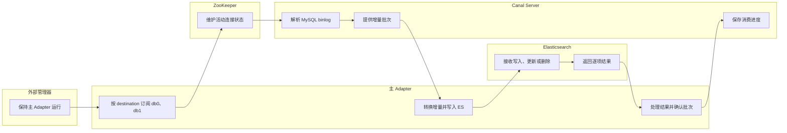
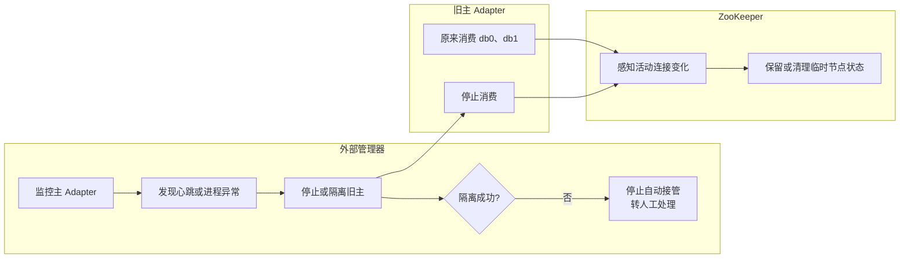
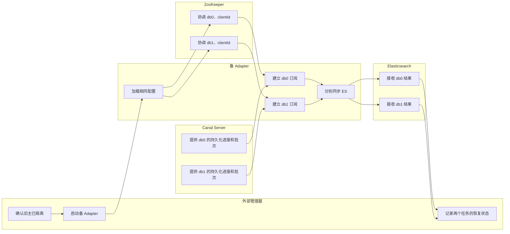
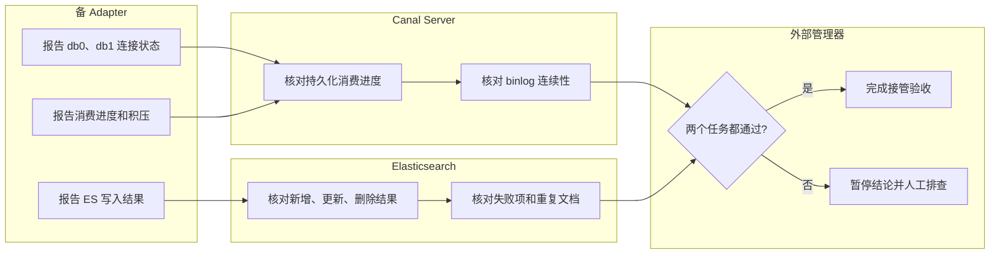

# Canal 同步 MySQL binlog 到 ES（Canal Adapter 处理逻辑）

以下内容按照当前项目 `AGENTS.md` 项目级规则中规定的技术栈版本为准：Java 8、Canal Server/Adapter 1.1.7、Elasticsearch 7.17.15、MySQL 8.0.33。

本文用于解释 Adapter 从接收 Canal 消息到确认消费批次的处理链路。配置和代码是说明性示例，未代表当前工作区已经完成发行包加载、业务同步或故障演练。

## 文档维护与已确认规则

1. 本文技术版本以项目级 `AGENTS.md` 为准：Java 8、Canal Server/Adapter 1.1.7、Elasticsearch 7.17.15、MySQL 8.0.33。
2. 两个 MySQL 实例分别对应 Canal Server 的 `db0`、`db1` 任务；每个 eas 库包含 `consume_record_01`～`consume_record_16`，共 32 张物理分表。Adapter 映射按 destination、数据源和物理表逐表配置。
3. `instance` 用于订阅 Canal 增量，`dataSourceKey` 仅用于映射初始化及必要的 MySQL 回查；二者职责不能混用。`groupId` 用于 Adapter 分组和映射关联，不等同于 TCP `clientId`。
4. 文中配置、伪代码和高可用内容均属于说明性示例或候选方案；除明确标注的源码静态核对外，不得表述为已部署、已联调或已完成故障演练。
5. 项目要求所有 ES 子批次按既定规则处理成功后才确认原 Canal 批次；不能将这一要求等同于原生 Adapter 已提供的保证。项目不承诺 exactly-once（端到端恰好处理一次）。
6. 后续修改如改变上述稳定事实、技术版本、部署模式或验证边界，必须先取得用户确认，再同步修改本节及受影响内容。
7. 本次优化已确认保留本地配置模式，不引入参考文章中的 canal-admin 和管理库；该项属于用户确认的项目边界。参考文章用于高可用拓扑及相关配置思路，涉及本地加载方式时按 007 的当前方案适配，不能直接照搬原文的集中管理配置。
8. 本次优化已确认采用 3 节点 ZooKeeper 集群，为 3 台 Canal Server 协调 `db0`、`db1` 两个 destination 的运行资格；该拓扑参考《999_Canal 同步 MySQL binlog 到 ES_参考文章.md》的“HA 模式 / ZooKeeper 部署”章节。参考文章基于 Canal 1.1.6 示例，实际配置仍按项目 Canal Server 1.1.7 核对，未据此宣称已部署或已完成故障演练。
9. 本次优化已确认 Canal Server 部署规模为 3 台不同主机；3 台 Server 使用相同版本和本地配置。每个 destination 独立选主：`db0`、`db1` 各自有一个活动 Server，其余 Server 作为接管候选；两个 destination 不要求同时切换。3 台数量依据参考文章 HA 章节“首先准备 3 个服务器”及其“每个 server 都要添加配置”步骤确认；这不代表容量和故障切换已经验证。
10. 本次优化已确认按 destination 独立选主：`db0`、`db1` 各自同一时间只允许 1 台 Server 活动，其余节点作为该 destination 的接管候选；两个 destination 可以运行在不同 Server 上，一个 destination 的切换不强制另一个同时切换。参考文章只说明 HA 故障时重新选主，未明确多 destination 的原子切换关系；本条为用户确认的项目规则。
11. 本轮已确认补全 Server 公共配置示例，覆盖注册 IP、TCP 模式、ZooKeeper 地址、两个 destination、本地 Spring 加载方式、元数据刷新参数及禁止位点缺失后自动跳到最新位置。参考来源见第二节第 1 小节的逐项说明；本地配置模式沿用 007。刷新周期 `1000` 仅为参考示例，不是已确认的生产取值；本地文件刷新参数不能替代 ZooKeeper 消费进度持久化，实际发行包加载、参数生效和故障恢复均待验证。

## 面试口述精炼版本

以下内容按照当前项目 `AGENTS.md` 项目级规则中规定的技术栈版本为准。

**整体概括**

Canal Adapter 的核心职责，是把 Canal Server 解析出的数据库变更转换成 ES 操作，并根据处理结果确认消费批次。

整个过程可以分成五步：先订阅消息并匹配映射，再把增删改转换成 ES 请求，接着检查写入结果并确认批次；如果中途失败，就处理重试和重复投递；如果进程故障，则通过主备接管恢复消费。这里“全部成功后才确认”是项目要求，原生 Adapter 的部分异常分支仍需要补齐和验证。

**第一步：订阅消息，确定使用哪份映射**

这一阶段主要解决两个问题：数据从哪个任务来，以及应该按什么规则处理。

项目有两个 MySQL 实例，分别对应 Canal Server 的 `db0`、`db1` 任务。Adapter 通过 `instance` 订阅任务，映射文件通过 `destination` 与任务关联，再结合库名、表名匹配具体规则。每个实例有 16 张消费分表，因此方案按物理表配置 32 份映射。

订阅前，3 台 Server 分别配置自己的可达注册 IP，加载同一套 `db0`、`db1` 任务配置并接入同一个 ZooKeeper 集群。公共配置明确采用本地 Spring 加载方式和 `default-instance.xml`；消费进度按 ZooKeeper 元数据机制持久化，位点无法恢复时不能自动跳到最新位置。配置参考与项目适配依据见详细方案第二节第 1 小节，实际加载和恢复仍需验证。

这里要区分增量订阅和数据库回查：`instance` 负责订阅增量，`dataSourceKey` 提供映射初始化和必要回查使用的 JDBC 连接。Server 的过滤正则只筛选变更表，不会自动生成这些映射。

**第二步：转换事件，生成 ES 增删改请求**

匹配到映射后，Adapter 根据事件类型生成对应的 ES 操作，并确定文档 ID、字段和目标索引。

在本文单表、简单字段且 `upsert=false` 的分支中，INSERT 生成 Index 请求，同一具体索引内同 ID 的文档存在时会被替换；UPDATE 根据变化列生成局部更新，目标文档不存在时默认不会自动创建；DELETE 从删除事件中提取 ID，生成删除请求。简单分支主要使用 binlog 行数据，复杂表达式或关联映射才可能触发回查。

文档 ID 和普通字段也要分开：示例通过 `esDocId` 别名提取业务主键作为 ES `_id`，另通过 `consumeId` 保留普通文档字段，供排序等场景使用。双别名解析和实际写入仍需验证。

**第三步：检查写入结果，再确认消费批次**

批量请求返回成功，不代表每条操作都成功，因此确认批次必须放在逐项检查之后。

一批 Canal 数据可能产生多个 ES Bulk 请求。项目要求所有子批次的操作都按既定规则处理成功，才能执行 ack，也就是通知 Canal Server 推进消费进度。HTTP 200 不能替代 Bulk 单项结果检查，ack 也不代表数据已经立即可搜索。

原生 Adapter 1.1.7 存在两个需要注意的分支：部分 404 失败只记录日志；有限重试耗尽且 `terminateOnException=false` 时仍可能 ack。示例建议设为 `true`，但它只能处理传递到消费循环的异常，无法解决只记日志的 404。因此失败处理机制和重试次数仍需单独确定、验证。

**第四步：处理失败重放，保证重复执行的结果正确**

失败恢复可能重复处理已经成功写入的数据，所以幂等不能只依赖稳定 `_id`，还要保证目标索引和事件顺序正确。

ES 已写入，但 ack 未被 Server 处理或消费进度未可靠持久化时，恢复后可能再次收到这些事件。消费侧 rollback 只回退消费状态，不会撤销已经写入 ES 的数据。

项目使用 rollover，也就是滚动切换写索引。写别名不会自动查找历史文档所在的索引，因此历史更新、删除和新增重放都需要定位原具体索引，否则可能漏处理或产生跨索引重复。现有 YAML 尚未实现这项能力；通过写别名读取 Mapping（字段类型定义）还存在独立兼容性缺口。因此不能承诺端到端恰好处理一次。

**第五步：恢复进程，并分别验收两个任务**

主备接管的关键，是先确保旧主停止或被隔离，再让备节点恢复消费，并分别检查两个任务的实际结果。

候选方案是在两台主机部署相同版本 Adapter，正常只运行一个进程。备节点接管时保持相同 destination 和实际 TCP clientId；`groupId` 是 Adapter 分组标识，不能代替 clientId。

ZooKeeper 能协调活动连接，但不能代替进程隔离，也不保证 `db0`、`db1` 同时恢复成功。因此需要分别检查持久化进度、binlog 连续性、连接状态、积压追赶和 ES 结果。当前配置加载、失败处理、历史索引定位和故障演练仍待验证，这些内容属于方案与能力边界，不能作为已上线成果口述。

## 详细方案

### 一、先看完整数据流

```text
MySQL
  ↓ Binlog
Canal Server：Instance=db0/db1，读取并解析变更
  ↓ TCP 订阅
Canal Adapter：instance=db0/db1，接收批次
  ↓ destination 匹配映射
映射规则：字段、_id、目标别名、回查数据源
  ↓ ES 操作
Elasticsearch：写入、更新或删除
  ↓ 全部子项成功
Canal ack：确认原批次并推进消费进度
```

上图表示项目期望的成功链路，不包含原生实现中可能确认失败批次的分支。这条链路中，Server 解决“数据从哪里来”，Adapter 解决“数据怎么转换和写入”，ack 解决“这一批是否可以认为处理完成”。

### 二、订阅配置：先让 Adapter 收到数据

#### 1. Server 定义任务

Canal Instance 是 Server 内的一项 Binlog 订阅与解析任务。`db0`、`db1` 是任务名称，不是数据库名，也不是机器名。

Server 配置入口按 007 统一为本地配置：3 台 Server 分别读取本地 `canal.properties`，并为 db0、db1 加载各自的 `instance.properties`。公共业务配置保持一致，`canal.register.ip` 分别填写当前 Server 可被 Adapter 访问的地址。下方展示的是补全后的本地公共配置示例；地址、发行包路径和参数生效情况仍需按环境核对。Adapter 自身继续使用本文的本地配置；其进程主备候选方案与 Server 的本地配置模式保持一致。

3 台 Server 的部署数量和“每个 server 都加载同一集群配置”的组织方式，参考 [`999_Canal 同步 MySQL binlog 到 ES_参考文章.md`](999_Canal%20同步%20MySQL%20binlog%20到%20ES_%E5%8F%82%E8%80%83%E6%96%87%E7%AB%A0.md) 的 HA 模式和 Canal deployer 部署步骤；原文基于 Canal 1.1.6，不能直接替代项目 1.1.7 的配置核验。

运行资格按 destination 独立协调：`db0`、`db1` 各自只保留一个活动 Server，其余 Server 等待该 destination 的接管资格。两个 destination 可以落在不同 Server 上，单个 destination 的故障切换不要求另一个同步切换。参考来源：[`999_Canal 同步 MySQL binlog 到 ES_参考文章.md`](999_Canal%20同步%20MySQL%20binlog%20到%20ES_%E5%8F%82%E8%80%83%E6%96%87%E7%AB%A0.md) 的 HA 模式故障重新选主思路；多 destination 独立切换关系为本次用户确认，实际接管仍需验证。

```properties
# conf/canal.properties：公共配置示例，尚未部署验证
canal.register.ip = <当前 Server 可达 IP>
canal.serverMode = tcp
canal.zkServers = zk1:2181,zk2:2181,zk3:2181
canal.destinations = db0,db1
# 项目已确认采用本地配置，加载方式与 007 保持一致。
canal.instance.global.mode = spring
canal.instance.global.spring.xml = classpath:spring/default-instance.xml
# 以下刷新周期仅沿用参考示例，实际取值及生效情况待验证。
canal.zookeeper.flush.period = 1000
canal.file.flush.period = 1000
# 位点无法恢复时，不自动跳到最新位置。
canal.auto.reset.latest.pos.mode = false
```

这里的 3 节点 ZooKeeper 集群规模为本次已确认方案。参考来源：[`999_Canal 同步 MySQL binlog 到 ES_参考文章.md`](999_Canal%20同步%20MySQL%20binlog%20到%20ES_%E5%8F%82%E8%80%83%E6%96%87%E7%AB%A0.md) 的“HA 模式 / ZooKeeper 部署”章节（原文示例使用 3 个节点）。原文版本和参数不直接作为项目 1.1.7 的可执行配置。

**配置参考来源与项目适配：** 下表中的“参考文章”指 [`999_Canal 同步 MySQL binlog 到 ES_参考文章.md`](999_Canal%20同步%20MySQL%20binlog%20到%20ES_%E5%8F%82%E8%80%83%E6%96%87%E7%AB%A0.md) 的“三、HA 模式”；“007”指 [`007_Canal 同步 MySQL binlog 到 ES（Canal Server 处理逻辑）.md`](007_Canal%20同步%20MySQL%20binlog%20到%20ES（Canal%20Server%20处理逻辑）.md) 的“快速入门”和“当前方案参考来源”。[CSDN 原文](https://blog.csdn.net/qq_45132989/article/details/131186939) 为参考文章中记录的外部来源。

| 配置内容 | 参考位置 | 项目适配及边界 |
| --- | --- | --- |
| `canal.register.ip`、`canal.serverMode`、`canal.zkServers` | 参考文章“二、admin 添加集群”的主配置；“三、canal-deployer 部署”要求每台 Server 添加集群配置 | 沿用注册地址、TCP 和 ZooKeeper 配置思路；每台 Server 使用自己的可达 IP，均接入同一 ZooKeeper 集群，不引入 Admin 注册配置 |
| `canal.destinations=db0,db1` | 参考文章主配置中使用 `test1,test2`，并要求与 Instance 对应 | 按项目两个 MySQL 实例改为 `db0,db1`，各自加载独立的 Instance 配置和消费进度 |
| `canal.instance.global.mode=spring` | 007“快速入门 / 配置 3 台 Canal Server”及其 1.1.7 配置模板依据 | 这是项目已确认的本地配置适配；参考文章使用 `manager` 模式，不能将 `spring` 写成原文配置 |
| `canal.instance.global.spring.xml` | 参考文章主配置及 deployer 部署均使用 `classpath:spring/default-instance.xml`；007 引用 1.1.7 同名模板 | 用于组装 Instance 组件，实际发行包是否包含并加载该模板仍须核对 |
| `canal.zookeeper.flush.period`、`canal.file.flush.period` | 参考文章主配置均示例为 `1000`；007 说明 `default-instance.xml` 的 ZooKeeper 元数据组件 | `1000` 是参考示例；当前 HA 消费进度持久化按 ZooKeeper 组件解释，不能仅凭本地文件刷新参数宣称位点已跨节点保存 |
| `canal.auto.reset.latest.pos.mode=false` | 参考文章主配置及其“生产环境保持 false”的注释；007 的位点恢复边界 | 保留禁止位点缺失后自动跳到最新位置的规则；无法恢复时暂停复核，不因此授权退回初始 GTID |

上述配置已确认纳入文档示例，不代表生产参数已经确定或 1.1.7 发行包已经验证。周期刷新也不保证每次 ack 返回时位点已持久化；实际注册地址可达性、本地配置加载、ZooKeeper 持久化和故障接管均须验证。

每个任务再指定自己的 MySQL 来源：

```properties
# Canal Server：db0 的 Instance 配置片段
canal.instance.master.address = mysql-db0:3306
canal.instance.dbUsername = canal_repl
canal.instance.dbPassword = REPLACE_WITH_SECRET
canal.instance.filter.regex = ^eas\\.consume_record_(0[1-9]|1[0-6])$
```

```properties
# Canal Server：db1 的 Instance 配置片段
canal.instance.master.address = mysql-db1:3306
canal.instance.dbUsername = canal_repl
canal.instance.dbPassword = REPLACE_WITH_SECRET
canal.instance.filter.regex = ^eas\\.consume_record_(0[1-9]|1[0-6])$
```

已确认两个 MySQL 实例的物理库均为 eas，各包含 consume_record_01～consume_record_16，共 32 张物理分表；db0、db1 是独立任务名。两个任务使用相同过滤规则，通过源库连接地址区分实例。地址、复制身份、GTID 和凭据仍须按环境核对，过滤规则的加载及事件匹配效果仍待联调。

#### 2. Adapter 订阅任务

Adapter 采用 TCP 模式，通过 ZooKeeper 找到活动 Server，再用 `instance` 指定要订阅的任务。

**连接优先级：** 1.1.7 TCP 连接器在 `canal.tcp.server.host` 非空时优先创建直连客户端；否则才使用 `canal.tcp.zookeeper.hosts` 创建集群客户端。因此本方案保留 ZooKeeper 配置，并要求核对最终生效配置中没有非空直连地址覆盖该路径。`canal.tcp.batch.size` 是连接器读取的批量参数，示例 500 不是已验证的生产取值。

**分组与消费身份：** `groupId: g1` 保留用于 Adapter 分组及映射关联，不是 TCP 客户端的 `clientId`。`CanalTCPConsumer.init` 接收 groupId，但创建连接时未使用它；该原生连接路径中的 `SimpleCanalConnector` 构造 `ClientIdentity(destination, (short) 1001)`，集群客户端内部也创建该客户端。因此 db0、db1 分别使用 `(db0, 1001)`、`(db1, 1001)` 的身份，两者由 destination 区分；相同 g1 不会把两个订阅合成一个消费身份，也不能靠修改 g1 创建独立 TCP 消费身份。

这里的 `clientId=1001` 是当前原生代码路径的默认值，不是新增 YAML 配置项，也不是读取 MySQL binlog 使用的 `slaveId`；007 的自动生成 slaveId 方案保持不变。主备恢复应保持相同 destination 与实际 clientId，并核对 Server 侧持久化进度，不能仅凭 groupId 相同就宣称位点接续正确。

**修改支持来源：** [1.1.7 CanalTCPConsumer.java](https://github.com/alibaba/canal/blob/canal-1.1.7/connector/tcp-connector/src/main/java/com/alibaba/otter/canal/connector/tcp/consumer/CanalTCPConsumer.java)的 `init` 与 [TCPConstants.java](https://github.com/alibaba/canal/blob/canal-1.1.7/connector/tcp-connector/src/main/java/com/alibaba/otter/canal/connector/tcp/config/TCPConstants.java)支持连接优先级及键名；[SimpleCanalConnector.java](https://github.com/alibaba/canal/blob/canal-1.1.7/client/src/main/java/com/alibaba/otter/canal/client/impl/SimpleCanalConnector.java)的构造方法和 [ClusterCanalConnector.java](https://github.com/alibaba/canal/blob/canal-1.1.7/client/src/main/java/com/alibaba/otter/canal/client/impl/ClusterCanalConnector.java)的 `connect` 支持上述身份结论；分组与映射关联依据第三节引用的 `ESAdapter.java` 的 `match`。这是源码静态核对，实际配置加载、连接、位点恢复和主备接管尚未测试。

```yaml
# conf/application.yml（示例）
canal.conf:
  mode: tcp
  # 已确认纳入文档的配置建议，尚未部署验证；不能解决下游只记日志的 404。
  terminateOnException: true
  # retries 的项目取值待定，不在此示例中代填。
  consumerProperties:
    canal.tcp.zookeeper.hosts: zk1:2181,zk2:2181,zk3:2181
    canal.tcp.batch.size: 500
  srcDataSources:
    ds0:
      url: jdbc:mysql://mysql-db0:3306/eas?useUnicode=true&characterEncoding=UTF-8
      username: adapter_reader
      password: REPLACE_WITH_SECRET
    ds1:
      url: jdbc:mysql://mysql-db1:3306/eas?useUnicode=true&characterEncoding=UTF-8
      username: adapter_reader
      password: REPLACE_WITH_SECRET
  canalAdapters:
    - instance: db0
      groups:
        - groupId: g1
          outerAdapters:
            - name: es7
              hosts: es-host:9200
              properties:
                mode: rest
    - instance: db1
      groups:
        - groupId: g1
          outerAdapters:
            - name: es7
              hosts: es-host:9200
              properties:
                mode: rest
```

#### 3. `es7` 是什么

`name: es7` 表示选择 Adapter 的 Elasticsearch 7 适配器。当前项目使用 Elasticsearch 7.17.15，因此使用 `es7`。它通常由 Adapter 发行包提供，不需要在 Elasticsearch 服务端安装插件。

部署前仍需检查 Adapter 发行包是否包含 `es7` 对应目录或 JAR、客户端依赖是否兼容 ES 7.17.15，以及发行包注册名称是否确实为 `es7`。不能只把它改成任意名字；只有发行包或自定义代码注册了新名称，才能使用其他值。

#### 4. 增量订阅与数据库回查的区别

- `instance: db0`：从 Canal Server 订阅 `db0` 的增量消息。
- `srcDataSources.ds0`：映射初始化及需要回查 MySQL 时使用的 JDBC 连接。

`ds0` 不负责发现增量，也不能代替 `instance: db0`。

**支持来源：** [1.1.7 ESAdapter.java](https://github.com/alibaba/canal/blob/canal-1.1.7/client-adapter/escore/src/main/java/com/alibaba/otter/canal/client/adapter/es/core/ESAdapter.java)的 `addSyncConfigToCache` 会按 dataSourceKey 查找数据源并从 JDBC URL 提取 schema；该版本匹配表达式要求 URL 含 `?` 参数段，故本例补充常用连接参数。实际驱动、认证、时区及其他连接参数仍需按环境核对，不能认为仅补参数就已通过连接验证。

### 三、映射配置：告诉 Adapter 怎么处理数据

#### 1. 用 `destination` 匹配任务

映射文件放在 Adapter 的 `conf/es7/` 目录。`destination: db0` 表示这份规则处理 `db0` 任务的数据；`dataSourceKey: ds0` 表示回查时使用 `ds0`。

```yaml
# conf/es7/db0_consume_record_01.yml
dataSourceKey: ds0
destination: db0
groupId: g1
esMapping:
  _index: consume_record_write
  _id: esDocId
  sql: >
     SELECT
       consume_id AS esDocId,
       consume_id AS consumeId,
       merchant_no AS merchantNo,
       trade_time AS tradeTime,
       trade_type AS tradeType,
       trade_status AS tradeStatus,
       product_type AS productType,
       channel_code AS channelCode,
       trade_amount AS tradeAmount,
       fee_amount AS feeAmount,
       error_code AS errorCode,
       trade_remark AS tradeRemark
     FROM consume_record_01
```

此处展示 db0 的 eas.consume_record_01 单表字段映射模板。当前方案已确认每个 destination 下每张物理表一份映射，按下列规则展开为 32 份；本文只给出组织规则，没有生成或部署实际 YAML 文件。

| 文件名范围（首尾均包含） | destination | dataSourceKey | SQL 的 FROM |
| --- | --- | --- | --- |
| db0_consume_record_01.yml ～ db0_consume_record_16.yml | db0 | ds0 | 分别为 consume_record_01 ～ consume_record_16 |
| db1_consume_record_01.yml ～ db1_consume_record_16.yml | db1 | ds1 | 分别为 consume_record_01 ～ consume_record_16 |

32 份文件平铺于 `conf/es7/`，文件名在目录内唯一。文件名是项目命名约定，不代替配置内容中的 destination、数据源或 SQL 表名。两份 JDBC 数据源都连接 eas，但连接不同 MySQL 实例，因此同名物理表通过 destination 与数据源配对区分。

公共字段列表、别名、`_id`、目标写入别名及分组等配置可用模板生成；逐份替换任务名、数据源和具体表名，前提是各分表 DDL 与所用字段一致。不能将正则或通配符写进 FROM，也不能仅修改文件名就认为完成映射。这里沿用目标写入别名不表示已解决 rollover 后的历史索引定位。

**支持来源：** [官方 Sync ES 文档](https://github.com/alibaba/canal/wiki/Sync-ES)说明多 YAML 映射及单表 SQL；[1.1.7 ESSyncConfigLoader.java](https://github.com/alibaba/canal/blob/canal-1.1.7/client-adapter/escore/src/main/java/com/alibaba/otter/canal/client/adapter/es/core/config/ESSyncConfigLoader.java)逐份转换、校验配置并以文件名保存；[1.1.7 ESAdapter.java](https://github.com/alibaba/canal/blob/canal-1.1.7/client-adapter/escore/src/main/java/com/alibaba/otter/canal/client/adapter/es/core/ESAdapter.java)的 `addSyncConfigToCache` 解析 SQL 中的表，TCP 模式按 destination、schema、table 建立键，`sync(Dml)` 按事件中的同类信息查找。对应本项目的键示例为 `db0_eas-consume_record_01` 和 `db1_eas-consume_record_01`。32 份是用户确认的项目组织方式，不是源码规定的唯一配置数量。

部署前覆盖检查：确认 db0/ds0 与 db1/ds1 各覆盖 01～16，没有遗漏、重复或错配；检查实际 DDL、大小写和 JDBC 库名；核对 outerAdapters 与映射的 key/outerAdapterKey、destination、groupId 关联能使文件被正确接受。仅存在 32 个文件不足以证明 32 张表均已生效。随后在测试环境逐表验证新增、修改、删除和目标文档结果；源码中没有匹配配置时不会调用该表的同步处理，因此不能只以任务启动成功作为覆盖验收。以上是项目待执行核验，未完成真实加载或写入测试。

#### 2. SQL 字段名如何进入 ES

当前方案约定普通文档字段的 SQL 别名与 ES Mapping 字段名保持一致；用于提取 ES 元数据 `_id` 的 `esDocId` 是单独的映射别名，不作为普通文档字段：

```text
MySQL 物理列：channel_code
        ↓ AS
SQL 返回字段：channelCode
        ↓ 映射
ES 文档字段：channelCode
```

例如 `channel_code AS channelCode` 中，`channel_code` 是 MySQL 真实列名，`channelCode` 是 Adapter 看到的结果字段和 ES 字段名。若名称不一致，可能导致字段无法写入；在 `dynamic: strict` 下还可能直接失败。

物理库名及 consume_record_01～consume_record_16 的表名范围已确认，示例通过 ds0 连接 eas 并选择其中的 consume_record_01。列名、完整 DDL 和字段映射仍须核对。主映射 SQL 用来声明表与字段关系，按官方约束不包含 WHERE；已移除原示例的参数化过滤条件，不能假定 Adapter 会为任意 `?` 自动绑定事件中的 consume_id。需要回查时的具体 SQL 生成及参数处理由相应实现决定，不能用业务自行执行的 JDBC 查询替代映射配置。

**修改支持来源：** [原参考文章的 SQL 映射限制](https://mp.weixin.qq.com/s/QwvmxqxXirjf-J6mqYY44Q)与[官方 Sync ES 文档“适配器表映射文件”](https://github.com/alibaba/canal/wiki/Sync-ES)均明确说明主 SQL 不能包含 WHERE，官方单表示例也只声明字段和来源表。[Canal 1.1.7 ESSyncConfig.java](https://github.com/alibaba/canal/blob/canal-1.1.7/client-adapter/escore/src/main/java/com/alibaba/otter/canal/client/adapter/es/core/config/ESSyncConfig.java)将 `sql`、`etlCondition` 和 SQL 解析结果 `schemaItem` 分别定义；其 `validate()` 仅检查相关必填项，不能用这段代码证明所有带 WHERE 的 SQL 都会在启动时被拒绝。本次依据官方使用约束修正示例，未完成 SQL 解析和同步执行全路径验证。

`etlCondition` 是官方示例用于全量导入的独立条件配置，不是给增量主映射 SQL 添加主键占位符的替代方案。本次没有启用全量导入，没有改变现有历史 binlog 回放流程；32 份逐表映射的组织方式已确认，实际文件生成、加载和逐表同步仍待验证。

#### 3. `_id` 和写入别名

`_id: esDocId` 从 `consume_id AS esDocId` 提取业务稳定标识作为 ES 文档 ID，同时通过 `consume_id AS consumeId` 提供普通文档字段。ES `_id` 的业务取值未改变，仍来自同一个 consume_id；只是将元数据 ID 的映射别名与排序字段分开。该模板规则适用于前述 32 份映射，尚未生成实际配置或完成同步测试。`_index: consume_record_write` 指向当前写入别名，首次新增通常写入当前索引。

**修改原因与支持来源：** [Canal 1.1.7 ES7xTemplate.java](https://github.com/alibaba/canal/blob/canal-1.1.7/client-adapter/es7x/src/main/java/com/alibaba/otter/canal/client/adapter/es7x/support/ES7xTemplate.java)的 `getESDataFromDmlData`、`getESDataFromRS` 在提取 ID 后，使用 `!fieldItem.getFieldName().equals(mapping.getId())` 排除该别名对应的普通字段。因此旧示例 `_id: consumeId` 不能保证同时写入 `_source.consumeId`。现在保留独立的 consumeId 字段，以满足 009 的取值一致要求和 012 的次排序要求；esDocId 仅供提取 ID，不要求在 ES Mapping 中新增同名字段。

**验证边界：** 双别名写法是已确认纳入文档的建议，仍须验证同一物理列使用两个别名时的 SQL 解析、INSERT/UPDATE/DELETE 增量转换及回查路径。测试应检查 `_id` 与 `_source.consumeId` 的业务标识一致、consumeId 非空且可用于排序、普通文档中未意外出现 esDocId，并检查更新删除命中正确文档。未完成这些测试前，不能将示例视为已验证的完整实现；本次也没有改变历史索引定位待定的结论。

写入别名不会自动跨 rollover 查找历史文档。因此历史更新、物理删除和新增重放仍要定位原具体索引；稳定 `_id` 不能单独解决跨索引重复或事件乱序。

**已核实的原生能力边界：** Canal 1.1.7 的 `ES7xTemplate` 在配置 `_id` 的分支中，`insert` 使用 `mapping.getIndex()` 构造 Index 或 Upsert 请求；`update` 经 `append4Update` 使用同一配置值构造 Update 请求；`delete` 使用同一配置值构造 Delete 请求。这些分支没有先按业务 ID 搜索历史索引，也没有自动把目标替换为原文档所在的具体索引。因此，本文配置 `_index: consume_record_write` 不等于已经实现历史索引定位。源码另有未配置 `_id` 时的搜索分支，以及回查 MySQL 的 `updateByQuery` 方法，不能仅凭方法名称就认定它们提供本项目所需的跨滚动索引定位能力。

**风险示例（非实测结果）：** 假设一条记录原来位于 `consume_record-000001`，rollover 后写别名改为写入 `consume_record-000002`。继续向写别名提交同一 `_id` 的新增重放，可能在新索引再生成一份文档；向当前写索引更新或删除也不能保证处理到旧索引的原文档。具体错误或返回结果取决于请求类型、Upsert 设置及别名配置，不能统一描述为“一定报错”，更不能把请求成功直接等同于历史数据已正确处理。

**修改支持来源：** [Elasticsearch 7.17 别名 API 的 `is_write_index` 规则](https://www.elastic.co/guide/en/elasticsearch/reference/7.17/indices-aliases.html)说明写索引的选择；[Canal 1.1.7 ES7xTemplate.java](https://github.com/alibaba/canal/blob/canal-1.1.7/client-adapter/es7x/src/main/java/com/alibaba/otter/canal/client/adapter/es7x/support/ES7xTemplate.java)提供上述请求构造依据。这里核实的是官方规则与指定源码分支，不是发行包联调或生产验证，也不以 `ESTemplate` 接口声明代替实现证据。

**本次决策与待验证项：** 保留 rollover 和 `consume_record_write`，不改为固定索引；历史索引定位机制记为待定，尚未选定或实现扩展方案。后续机制确定后，需验证滚动前后的新增重放、历史更新、物理删除及失败重试，确认原文档被正确处理且没有跨索引重复。当前映射仅展示字段和订阅关系，尚不能作为这些场景完整可用的部署方案。

#### 4. 写别名读取 Mapping 的兼容性缺口

ES 支持通过别名写入，不等于 Adapter 能通过该别名完成 Mapping（字段类型定义）读取。此问题发生在字段类型获取路径，与 rollover 后定位历史文档是两个独立问题。

**源码行为：** 1.1.7 `ESConnection.getMapping(index)` 的 REST 分支将配置值传给 `GetMappingsRequest.indices(index)`，取得 `response.mappings()` 后直接执行 `mappings.get(index)`。当配置值是 consume_record_write，而响应以具体索引名为键时，用别名取值会得到 null。`ES7xTemplate.getEsType()` 在字段类型缓存未命中时调用该方法；若 Mapping 为 null，则抛出 `Not found the mapping info of index: consume_record_write`。这里是基于响应键与源码取值方式的兼容性分析，不是已复现的项目故障，也不能笼统写成“一启动必然失败”。

**修改支持来源：** [Canal 1.1.7 ESConnection.java](https://github.com/alibaba/canal/blob/canal-1.1.7/client-adapter/es7x/src/main/java/com/alibaba/otter/canal/client/adapter/es7x/support/ESConnection.java)的 `getMapping`、[ES7xTemplate.java](https://github.com/alibaba/canal/blob/canal-1.1.7/client-adapter/es7x/src/main/java/com/alibaba/otter/canal/client/adapter/es7x/support/ES7xTemplate.java)的 `getEsType`，以及 [Elasticsearch 7.17 Get Mappings 响应说明](https://www.elastic.co/guide/en/elasticsearch/client/java-rest/7.17/java-rest-high-get-mappings.html)。官方响应说明按索引获取 Mapping；实际别名请求的返回键和值仍需在目标环境记录核验。

**本次决策：** 保留 rollover 和 `_index: consume_record_write`，Mapping 读取兼容性修复方式记为待定，不改为固定索引，也不宣称已经实现扩展。第三节关于首次新增写入当前索引的描述是目标路由语义，前提是连接、字段转换和 Mapping 读取均正常，不能作为当前模板可直接部署的证明。

**待验证项：** 记录通过写别名获取 Mapping 的实际响应；验证首次字段转换及缓存未命中时能否取得类型；检查别名指向一个或多个具体索引、rollover 前后和 Adapter 重启后的行为。还需检查涉及索引的 Mapping 是否一致、缓存是否影响类型读取。没有完成这些核验前，不能把修复历史索引定位等同于解决全部别名兼容性问题。本文未执行连接、别名或缓存测试。

### 四、从一批 Canal 消息到 ack

以下步骤和伪代码描述项目期望流程，不是原生实现的等价复刻。“失败不确认”是项目要求；原生实现存在下述差异，尚不能宣称已完整满足。

#### 1. 拉取批次

Adapter 通过 TCP 连接器调用 `getWithoutAck(batchSize, timeout, unit)`，一次返回一个 Message 批次容器。`canal.tcp.batch.size: 500` 是传入该调用的拉取参数，不表示返回 500 个 Message，也不等于 500 篇 ES 文档。消息中的行变更转换为 DML 后，还可能生成多个 ES 操作；不能将拉取参数、DML 数量、行数和 ES 操作数混为一谈。

**修改支持来源：** [Canal 1.1.7 CanalTCPConsumer.java](https://github.com/alibaba/canal/blob/canal-1.1.7/connector/tcp-connector/src/main/java/com/alibaba/otter/canal/connector/tcp/consumer/CanalTCPConsumer.java)的 `init`、`getMessage`。本文保留 500 的示例值，不将其视为已经压测确定的生产参数。

#### 2. 匹配事件并生成操作

Adapter 根据库表、事件类型和 `destination` 找到映射，再取得字段、业务 ID 和配置的 `_index`。本例通过 esDocId 别名提取 consume_id 的值作为 `_id`。以下针对映射被解析为“单表、简单字段”、配置 `_id` 且保持默认 `upsert=false` 的原生分支，不泛化到关联或复杂表达式映射。

| MySQL 事件 | ES 请求与数据来源 | 语义边界 |
| --- | --- | --- |
| INSERT | 从事件 data 转换映射字段，构造 Index 请求 | 同一具体索引、同一 ID 不存在则创建，存在则替换；不是遇到重复 ID 就报错的 Create。文档内容受映射字段范围限制，不等于整张 MySQL 表的全部列 |
| UPDATE | 按 old 中出现的变化列，从 data 取新值，构造局部 Update 请求 | 不保证重写完整文档，也不自动补齐未变化的缺失字段；默认不在目标文档不存在时创建文档 |
| DELETE | 当前简单主键分支从删除事件数据中提取 ID，构造 Delete 请求 | 不依赖回查已经删除的 MySQL 行；仍需指向正确具体索引 |

**回查边界：** 上述单表简单字段分支直接使用事件数据。复杂字段、关联等其他分支可能执行 MySQL 查询，不能描述为每次增删改都回查；JDBC 数据源仍参与映射初始化，不能因此删除。实际双别名模板是否按预期解析并走对应分支，仍需发行包验证。

**Upsert 与缺字段边界：** `ESSyncConfig.ESMapping` 的 upsert 默认是 false，本文继续保留默认行为，不启用 Upsert（目标文档不存在时创建）。不能为规避 404 直接改为 true：局部 UPDATE 携带的字段可能不完整，`docAsUpsert` 可能据此创建缺字段文档，也不能解决 rollover 后的原索引定位。如果已有文档缺少 consumeId，且该物理列没有变化，普通 UPDATE 通常不会携带 consumeId；新增双别名映射不能保证自动补齐这些历史文档。这里说明条件性风险，不认定当前生产已有缺字段数据，也不新增补数方案。

**修改支持来源：** [1.1.7 ESSyncConfig.java](https://github.com/alibaba/canal/blob/canal-1.1.7/client-adapter/escore/src/main/java/com/alibaba/otter/canal/client/adapter/es/core/config/ESSyncConfig.java)的 upsert 默认值；[ESSyncService.java](https://github.com/alibaba/canal/blob/canal-1.1.7/client-adapter/escore/src/main/java/com/alibaba/otter/canal/client/adapter/es/core/service/ESSyncService.java)的 `singleTableSimpleFiledInsert`、`singleTableSimpleFiledUpdate`、`delete` 及回查分支；[ES7xTemplate.java](https://github.com/alibaba/canal/blob/canal-1.1.7/client-adapter/es7x/src/main/java/com/alibaba/otter/canal/client/adapter/es7x/support/ES7xTemplate.java)的字段转换、`insert`、`append4Update` 和 `delete`。以上是源码静态核对，尚未执行重复 INSERT、局部 UPDATE、文档缺失、字段缺失和 DELETE 的同步测试。

历史事件命中原具体索引仍是待实现的项目要求；下方伪代码没有实现该机制。

```java
// Java 8 风格伪代码，不是发行包中的直接 API。
// 历史索引定位待定；此方法名不代表已实现跨 rollover 定位。
List<EsOperation> operations = messages.stream()
        .map(this::matchMappingAndBuildOperation)
        .collect(Collectors.toList());
```

#### 3. 区分三层批次与顺序边界

一批 Canal 消息可能对应多个 ES Bulk 请求，但中间包含不同层次的分批逻辑，不能直接描述为同一个列表按固定数量切分。

| 层次 | 参数或阈值 | 已核实的源码行为 |
| --- | --- | --- |
| TCP 拉取 | canal.tcp.batch.size，本文示例 500 | 传入 getWithoutAck；不等于 Message 容器数量或 ES 文档数 |
| Adapter 同步 | syncBatchSize，配置类默认 1000 | batchSync 先比较 DML 对象数量；数量不超过阈值时直接调用 adapter.sync，否则才逐个累计 data 行数，data 为空时计 1，达到阈值后提交 |
| ES Bulk 提交 | ES7xTemplate 中 MAX_BATCH_SIZE=1000 | 当前实现累计 ES 操作达到阈值时调用 commit；一次 adapter.sync 结束时还会提交剩余操作 |

Adapter 分批分支按完整 DML 对象加入列表，不把单个 DML 内部的行再次切开；因此 syncBatchSize 不是“每批严格最多 1000 行”的保证。示例：一个 DML 包含 3000 行时，DML 对象数量只有 1，Adapter 层可能直接调用一次 adapter.sync，随后 ES 层仍可按操作数分批提交。该例是源码推导，不是同步测试结果；行数也不能无条件等同于 ES 操作数。

**修改支持来源：** [1.1.7 AdapterProcessor.java](https://github.com/alibaba/canal/blob/canal-1.1.7/client-adapter/launcher/src/main/java/com/alibaba/otter/canal/adapter/launcher/loader/AdapterProcessor.java)的 `batchSync`、[CanalClientConfig.java](https://github.com/alibaba/canal/blob/canal-1.1.7/client-adapter/common/src/main/java/com/alibaba/otter/canal/client/adapter/support/CanalClientConfig.java)的默认值、[ES7xTemplate.java](https://github.com/alibaba/canal/blob/canal-1.1.7/client-adapter/es7x/src/main/java/com/alibaba/otter/canal/client/adapter/es7x/support/ES7xTemplate.java)的 `MAX_BATCH_SIZE`、`commitBulk`、`commit`，以及 [ESAdapter.java](https://github.com/alibaba/canal/blob/canal-1.1.7/client-adapter/escore/src/main/java/com/alibaba/otter/canal/client/adapter/es/core/ESAdapter.java)的 `sync` 末尾提交。不能仅因另一配置项名称含 batch 就认定它控制这里的固定阈值。上述是指定版本源码事实，不是生产调优建议；本次不新增或调整批大小配置。

**顺序边界：** `batchSync` 按输入列表遍历并依次调用同步方法，这支持该处理路径内的调用顺序。项目仍要求拆分不能打乱同一 consumeId 的事件顺序，但不能据此宣称 db0、db1 存在全局顺序，也不能证明故障重放或其他并发写入不会造成旧事件覆盖新状态。端到端顺序仍需结合实际写入入口、重放与故障场景验证。

```java
// 项目期望流程的示意，不是原生三层批处理逻辑的等价实现。
for (List<EsOperation> subBatch : splitInOrder(operations)) {
    BulkResponse response = esClient.bulk(subBatch);
    // 下一步检查每个子项。
}
```

`splitInOrder` 是本文说明性伪代码的方法名，不是已核实的原生 API。原生实现与阈值依据见上表；实际发行包行为、请求规模、内存占用及失败恢复效果仍待验证。

#### 4. 逐项检查 ES 响应

ES 返回 HTTP 200，不代表每个操作都成功。项目要求检查每个 Bulk item；字段不符合 Mapping、目标索引不存在、版本冲突或网络异常不能未经处理就继续 ack。

**原生实现与缺口：** `ES7xTemplate.commit()` 在 `hasFailures()` 为真时调用 `processFailBulkResponse`。后者遍历失败子项：状态为 `NOT_FOUND`（404）时仅记录错误日志，其他失败状态才抛出 `RuntimeException`。因此，只有 404 失败而没有其他异常时，上层可能继续 ack。这里特指 `isFailed()` 为真的失败项，不把所有删除未命中结果都等同于此分支。404 的处理机制仍待定，不能直接放行，也不能声称本文已实现拦截。

**修改支持来源：** [1.1.7 ES7xTemplate.java](https://github.com/alibaba/canal/blob/canal-1.1.7/client-adapter/es7x/src/main/java/com/alibaba/otter/canal/client/adapter/es7x/support/ES7xTemplate.java)的 `commit`，以及 [1.1.7 ESConnection.java](https://github.com/alibaba/canal/blob/canal-1.1.7/client-adapter/es7x/src/main/java/com/alibaba/otter/canal/client/adapter/es7x/support/ESConnection.java)中 `ES7xBulkResponse.processFailBulkResponse`。下方主动抛异常的伪代码表达项目要求，并非上述原生 404 分支的行为。

```java
if (!allItemsHandledSuccessfully(response)) {
    // 已成功的 ES 项不会自动回滚；当前 Canal 批次保持未确认。
    throw new RetryableSyncException("ES bulk item failed");
}
```

#### 5. 全部成功后确认原批次

项目要求只有所有子批次的所有操作都按既定规则处理成功，才能调用 ack：

```java
canalSession.ack(batchId); // ack 是最后一步
```

ack 表示 Adapter 通知 Canal Server 推进消费进度。它不代表 ES refresh，也不代表搜索结果已经立即可见。

**原生重试与确认规则：** `AdapterProcessor.process()` 正常路径在 `writeOut` 返回后调用 `canalMsgConsumer.ack()`；异常路径在尚有尝试次数时调用 `rollback()`。有限尝试耗尽后，`terminateOnException=false` 会调用 ack，并记录 `Error sync but ACK!`；为 `true` 则调用 rollback，并关闭对应 destination 的同步开关。关闭同步开关不等于停止整个 Adapter 进程，也不代表已自动告警或完成人工恢复。

`CanalClientConfig` 中 `terminateOnException` 默认是 `false`。已同意在本文配置示例中建议设为 `true`，防止传到消费循环的异常在有限重试耗尽后被确认；实际部署和配置加载仍待验证。该配置无法拦截下游仅记录日志、未抛异常的 404，不能单靠它宣称“所有失败均不 ack”。

`retries` 未设置或为 `0` 时，该循环按一次尝试处理；正整数 N 表示循环最多尝试 N 次，不能解释为首次之外再重试 N 次；`-1` 被转换为 `Integer.MAX_VALUE`，源码意图是持续阻塞重试。项目采用的次数仍待定，不能把示例未填写视为已经选择安全重试策略。rollback 是消费侧回退操作，不撤销已经成功写入 ES 的数据。

**修改支持来源：** [1.1.7 AdapterProcessor.java](https://github.com/alibaba/canal/blob/canal-1.1.7/client-adapter/launcher/src/main/java/com/alibaba/otter/canal/adapter/launcher/loader/AdapterProcessor.java)的 `writeOut`、`process` 与 [1.1.7 CanalClientConfig.java](https://github.com/alibaba/canal/blob/canal-1.1.7/client-adapter/common/src/main/java/com/alibaba/otter/canal/client/adapter/support/CanalClientConfig.java)的配置默认值。本次结论来自指定标签源码，不等于实际发行包和环境已通过故障测试。

#### 6. 项目期望主流程（伪代码）

```java
// messages：已拉取但尚未 ack 的 Canal 批次。
// 项目期望流程：不复刻原生 404 只记日志或异常耗尽后 ack 的分支。
// splitInOrder 也不等价于原生 TCP、Adapter、ES 三层批处理实现。
// 前置缺口：历史更新、删除和新增重放的原具体索引定位尚未实现。
List<EsOperation> operations = messages.stream()
        .map(this::matchMappingAndBuildOperation)
        .collect(Collectors.toList());

for (List<EsOperation> subBatch : splitInOrder(operations)) {
    BulkResponse response = esClient.bulk(subBatch);
    if (!allItemsHandledSuccessfully(response)) {
        // 不 ack，交给重试或人工恢复。
        throw new RetryableSyncException("ES bulk item failed");
    }
}

canalSession.ack(batchId);
```

这是处理顺序示例，不代表当前工作区已经实现这些类或完成联调；尤其不能据此认为历史索引定位已完成。

### 五、失败、重放与位点边界

#### 1. ES 写入失败

已成功写入的 ES 项不会自动回滚。项目要求失败批次不能确认；原生 404 分支和重试耗尽行为须按第四节处理，不能假定默认就满足要求。后续重试可能重复执行成功项，所以必须保持稳定 `_id`、原具体索引、操作语义和事件顺序。

#### 2. 消费确认前故障

客户端 ack 方法返回、Server 处理确认并更新消费游标、消费进度完成持久化，是不同阶段。SimpleCanalConnector.ack() 写出确认报文，该方法没有等待 Server 确认响应；因此方法返回不能证明 Server 已处理或位点已持久化。Server 的 ack 根据批次更新游标并确认事件存储进度，持久化仍受 007 所述元数据管理与周期刷新机制约束。ES 写入成功而消费确认未可靠保存时，故障恢复仍可能重复处理。

原生 SimpleCanalConnector 的 rollbackOnConnect 默认 true，普通连接及 ZooKeeper 活动回调中均有连接后的 rollback 路径；rollbackOnDisConnect 默认 false，不能描述为每次断开都会主动回退。Server 的 rollback 清理消费批次状态并回退事件存储读取状态，不会撤销已经写入 ES 的数据。带 batchId 的实现仍调用事件存储的 rollback，源码保留精确回退到指定 batchId 的 TODO，不能将其描述为可任意选择历史批次进行精确回放。上述是默认代码路径，实际发行包、订阅状态及恢复结果仍须验证。

**修改支持来源：** [Canal 1.1.7 SimpleCanalConnector.java](https://github.com/alibaba/canal/blob/canal-1.1.7/client/src/main/java/com/alibaba/otter/canal/client/impl/SimpleCanalConnector.java)的连接回退开关、connect、processActiveEnter、ack 和 rollback，以及 [CanalServerWithEmbedded.java](https://github.com/alibaba/canal/blob/canal-1.1.7/server/src/main/java/com/alibaba/otter/canal/server/embedded/CanalServerWithEmbedded.java)的 ack 与两种 rollback 实现。以上是源码静态核对，不是实际恢复演练结果。

恢复时应核对 Server 可恢复的持久化进度、源日志完整性和 ES 实际结果，不能只看连接成功或 ack 方法返回。需验证 ES 已写入但确认未可靠保存时的故障、重连回退和重复处理。项目不承诺 exactly-once；初始 GTID 回退的待定规则保持不变，本次不授权位点丢失后自动回到初始 GTID。

#### 3. 待联调配置

`retries`、`terminateOnException` 和上述三层批处理路径已有源码依据；项目重试次数、404 处理机制仍待定。批次参数实际生效、单个 DML 含多行时的拆分、ES 请求规模与端到端顺序、TCP 确认及位点恢复、字段映射仍需发行包联调。需覆盖非 404 子项失败、404 失败、网络异常、有限重试耗尽和恢复重放，检查 ES 实际结果、ack 与同步开关状态；不能只以错误日志存在作为失败已阻止确认的证据。这些测试尚未执行。

### 六、Adapter 高可用候选方案

本节把高可用拆成四个独立流程：正常消费、故障隔离、备节点接管、结果验收。每张图只说明一个问题，避免把所有组件和判断条件挤在同一张图里。

#### 1. 正常消费流程：谁负责连接，谁负责同步

**结论：** 正常情况下只有主 Adapter 运行；它通过 ZooKeeper 协调 Canal Server 连接，读取 `db0`、`db1` 两个任务的消息，写入 ES 后再推进消费。



这里的职责边界是：Canal Server 负责读取和解析 binlog，Adapter 负责转换和写 ES，ZooKeeper 负责活动连接协调，ES 返回实际操作结果。`ack` 只有在项目规定的成功条件满足后才能执行。

#### 2. 故障隔离流程：先阻止旧主继续消费

**结论：** 发现主节点故障后，第一目标是确认旧主已经停止或隔离；隔离不成功时不能启动备节点。



ZooKeeper 的连接状态变化不能代替进程停止、网络隔离或在途 ES 请求处理。隔离失败时继续启动备节点，可能造成双主消费，因此必须停止自动接管。

#### 3. 备节点接管流程：两个 destination 分别恢复

**结论：** 旧主确认隔离后，备 Adapter 使用相同的 destination、映射和实际 TCP clientId 启动，并分别恢复 `db0`、`db1`；一个任务恢复成功不代表另一个任务也成功。



`groupId` 是 Adapter 分组和映射关联标识，不能代替 TCP `clientId`。默认原生路径按 `(db0, 1001)`、`(db1, 1001)` 区分。两个任务由原生协调分别管理，不提供整体原子切换保证。

#### 4. 接管验收流程：分别确认进度、积压和 ES 结果

**结论：** 接管验收必须按 `db0`、`db1` 分别进行；只有连接、位点接续、积压追赶和 ES 结果都满足要求，才能结束本次接管。



需要覆盖旧主失联、隔离失败、仅一个 destination 恢复、在途 ES 写入和旧主重新上线等场景。实际发行包配置是否生效、外部高可用管理器的仲裁和隔离方式、位点恢复、重试效果及恢复时间仍待验证。本方案是候选部署方案，不代表项目已经具备自动接管能力，也不承诺零中断。

## 本轮核对结论与未完成事项

本轮已完成本文主要技术内容及关联文档的静态核对，相关来源见各修改处。核对完成不等于部署完成、缺口已修复或联调通过；示例不能直接作为已验证的上线配置。

| 状态 | 内容与边界 |
| --- | --- |
| 已有源码依据 | 映射加载与匹配、TCP 连接优先级及默认消费身份、字段转换与默认 Upsert 行为、三层批处理、404 与重试耗尽分支、ack/rollback 边界、原生 ZooKeeper 客户端协调 |
| 方案待定或待实现 | 历史具体索引定位；写别名读取 Mapping 的兼容性修复；404 失败处理机制；项目重试次数；外部主备管理器与隔离实现 |
| 继续保留待定 | 已运行通道位点丢失后是否允许退回初始 GTID，沿用 006、007 的待定边界，不作为自动恢复授权 |
| 配置与字段待验证 | Server 注册 IP 可达性、本地配置加载及元数据刷新参数生效；实际发行包与 ES 7.17.15 兼容性、连接及认证、32 份映射的生成加载、双别名解析、完整 DDL 与字段对应关系；普通 consumeId 字段写入及排序 |
| 运行行为待验证 | 实际增删改、三层批次参数、逐项失败处理、顺序与重放幂等、位点恢复及持久化、两个 destination 分别接管、节点隔离和在途 ES 写入 |

外部参考网页与源码支持特定机制或分支，不证明实际环境已采用该实现。本轮未执行部署、数据库或 ES 连接、同步测试、压测及故障演练。集中待补充清单同步见 030。

## 完成检查

本文已将配置、映射、代码和 ack 组织为一条连续链路；配置片段、伪代码和高可用方案均明确了示例或待验证边界。写别名读取 Mapping 的兼容性、历史索引定位仍有独立待解决缺口。实际部署前仍需核对最终 DDL、ES Mapping、Adapter 发行包内容及故障演练结果。
