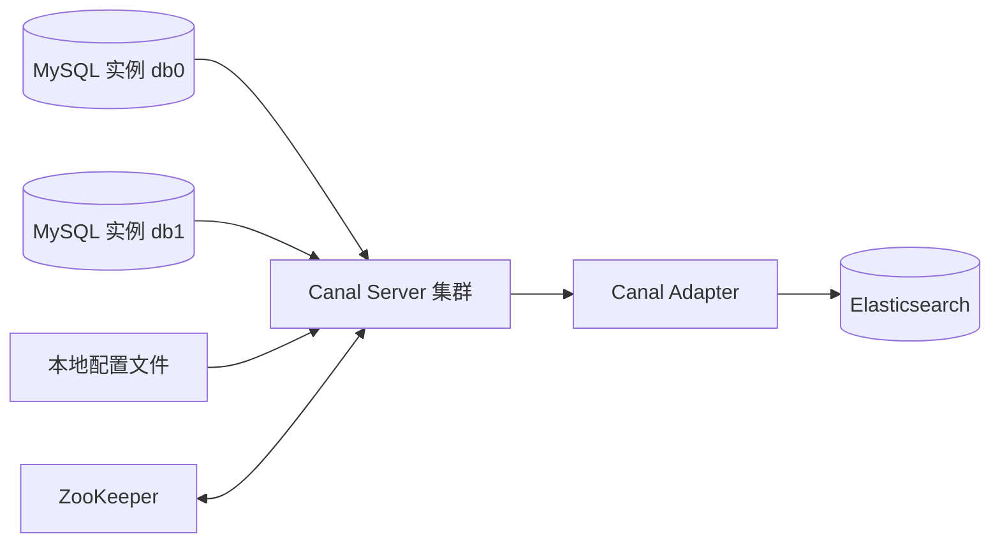
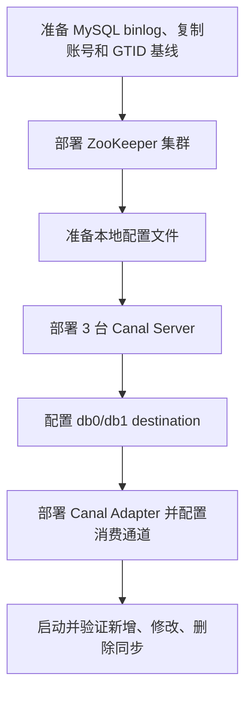
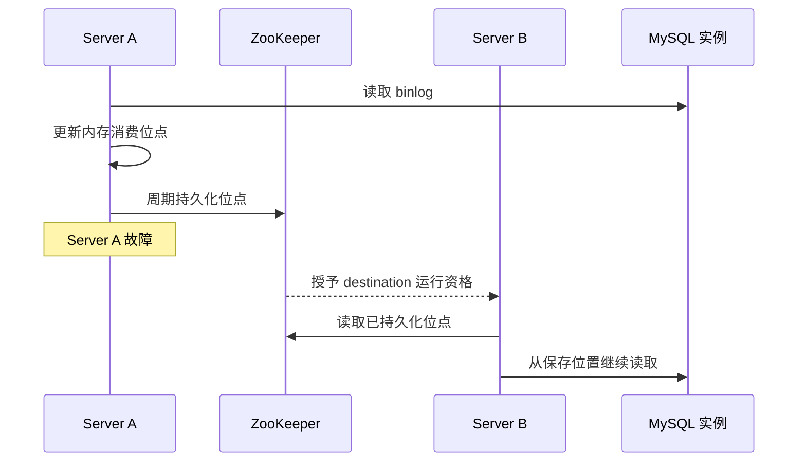
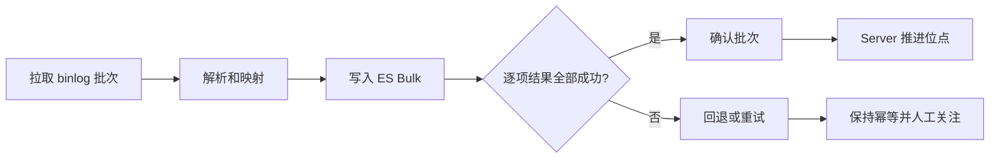
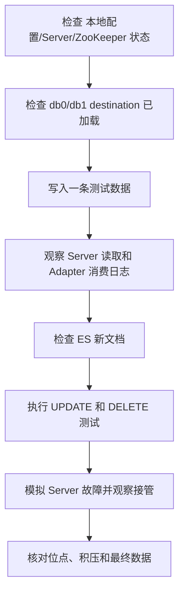
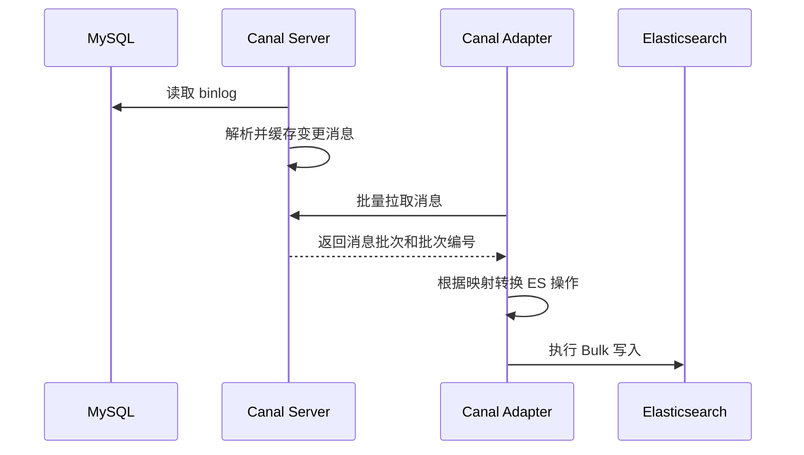
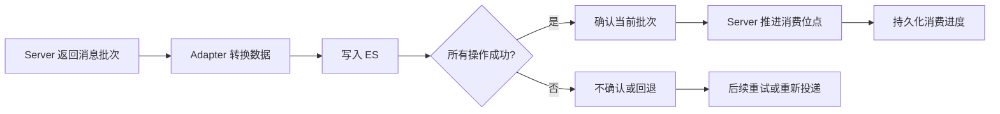
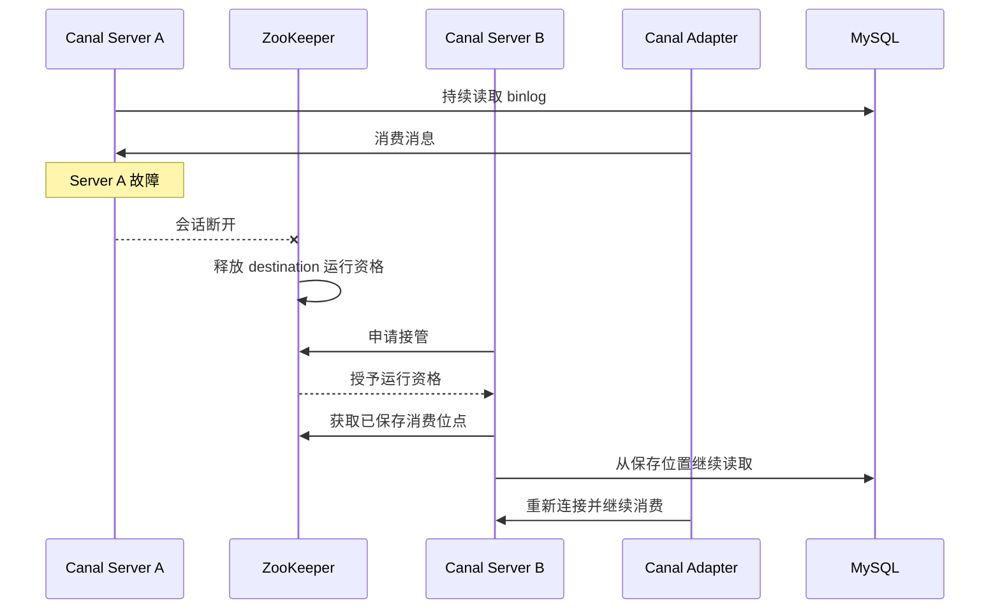

# 007_Canal 同步 MySQL binlog 到 ES（Canal Server 处理逻辑）

以下内容按照当前项目 AGENTS.md 项目级规则中规定的技术栈版本为准。

## 文档维护与已确认规则

- 本文涉及的技术版本以项目 `AGENTS.md` 为准：Java 8、Spring Boot 2.7.18、Canal Server 1.1.7、Canal Adapter 1.1.7、MySQL 8.0.33 和 Elasticsearch 7.17.15。
- 本文只说明 Canal Server 从 MySQL binlog 读取、解析、维护消费进度并向 Adapter 提供批次消息的职责；ES 文档映射、写入、逐项结果处理和批次确认（ack）前置检查由 008 负责。
- 项目包含两个独立 MySQL 分库实例，对应 `db0`、`db1` 两个 destination；两个通道分别维护源库、过滤规则、导入前 GTID 基线和消费进度，不共用起点，也不承诺跨库全局顺序。
- 已确认的部署规模为 3 台不同主机上的 Canal Server，通过 ZooKeeper 协调 destination 的主备运行资格；3 台规模依据参考文章 HA 章节“首先准备 3 个服务器”及其“每个 server 都要添加配置”步骤确认，不代表容量和故障切换已经验证。
- 当前方案采用本地配置文件，不使用集中配置管理：3 台 Canal Server 通过本地 `canal.properties` 和各 destination 的 `instance.properties` 加载配置，ZooKeeper 只负责运行资格协调和位点相关元数据管理。
- Adapter 接入方式与 008 保持一致，按参考文章“三、HA 模式 / 四、canal-adapter 部署”的正文步骤采用 TCP 和 ZooKeeper 集群发现；此前外部管理器控制 Adapter 进程冷备的候选设计不再作为当前方案。正文未明确的 Adapter 数量、运行安排及进程故障转移机制，不得补写成已确认部署事实；原文架构图的核验边界见 008，参考链接见本文第 8 节的同步说明。
- MySQL binlog 保留期已确认为 30 天。首次同步使用导入前 GTID 基线，正常重启或切换优先使用已持久化的消费进度；位点断档、无法恢复或事件含义不明确时必须暂停复核，不能直接跳到最新 GTID。
- 项目要求只有下游处理成功后才确认批次；原生 1.1.7 的重试耗尽和部分 404 分支存在继续确认的边界，不能把“失败不确认”写成 Canal 默认保证。404 处理机制、项目重试次数和实际故障恢复结果仍待联调验证。
- 监控、主备接管、位点恢复、容量、字段过滤和端到端数据一致性均已区分为待验证事项；本文中的配置、伪代码和上线步骤不能表述为已经部署或测试通过。
- 快速入门章节中的流程图、配置和伪代码用于解释搭建顺序与运行机制；它们不是已执行的部署步骤，也不替代 008 对 Adapter 写入和失败处理的详细说明。

## 面试口述精炼版本

这套方案的核心是 Canal Server：它通过本地配置，为消费记录分库后的两个 MySQL 实例分别建立 `db0`、`db1` 两条 destination。destination 可以理解为一条独立的 MySQL binlog 订阅任务。Server 取得运行资格后读取并解析 binlog，将变更按批次提供给 Adapter；Adapter 再把消息转换成 ES 的新增、更新或删除操作。ZooKeeper 负责按 destination 协调 Server 的运行资格，并保存运行元数据和已确认的消费进度。

**第一步是加载配置并确定谁来运行。** 每台 Server 读取公共的 `canal.properties` 和各 destination 的 `instance.properties`，其中配置 MySQL 地址、复制账号、过滤规则和 GTID 等信息。Server 启动后向 ZooKeeper 注册，并分别为 `db0`、`db1` 申请运行资格。一个 Server 可以同时运行两个 destination，也可以由不同 Server 分别运行，因为两个 destination 的运行资格是独立协调的。

**第二步是读取并解析 binlog。** Server 取得某个 destination 的资格后，以从库方式连接对应的 MySQL 实例，按照过滤规则持续读取已经提交事务产生的 binlog，并解析出库名、表名、INSERT/UPDATE/DELETE 类型、行数据、事务顺序和消费位点等信息，再将这些内容组织成 Canal 消息。Server 的职责到消息读取、解析、暂存和提供为止，ES 文档映射与写入由 Adapter 完成。

**第三步是按批次推进消费进度。** Adapter 从 Server 拉取一批消息，处理并写入 ES；处理成功后确认批次，Server 据此推进并持久化对应 destination 的消费进度；处理失败时批次不确认或回退，后续可能重新投递。因此，ZooKeeper 中与消费相关的核心内容可以理解为已确认的消费位点和运行状态。重复投递时，下游需要依靠稳定业务主键和正确的事件顺序保证幂等。

**第四步是故障接管和恢复。** 如果运行某个 destination 的 Server 发生故障，ZooKeeper 检测到会话断开后释放该 destination 的运行资格，备用 Server 竞争成功后加载相同配置，读取已持久化的消费进度，重新连接对应 MySQL 实例并继续读取。Adapter 再连接新的活动 Server。由于两个 destination 独立协调，一个 destination 的切换不会强制另一个同时切换；切换期间可能出现短暂中断和消息积压，实际恢复效果需要通过联调和故障演练确认。

Canal Server 1.1.7 的 `default-instance.xml` 负责组装 ZooKeeper 元数据和位点管理组件，`instance.properties` 负责定义具体 destination 的实例属性。以上是当前方案的处理主线，实际配置加载、位点恢复、主备接管和端到端一致性仍需验证。
## 快速入门：Canal Server 架构搭建

> 本快速入门采用本地配置模式，使用本地配置文件，不部署 canal-admin。原先涉及 管理库、配置页面（当前方案不使用）和 Server 向管理服务注册的内容不属于当前采用方案。

### 1. 先看整体搭建顺序

本项目按照“先准备基础组件，再创建 Server 集群，最后接入两个 destination 和 Adapter”的顺序搭建。两个 destination 分别连接消费记录分库后的两个 MySQL 实例。



搭建顺序如下：



以下内容按照当前项目 `AGENTS.md` 项目级规则中规定的技术栈版本为准。版本为 Canal Server/Adapter 1.1.7、MySQL 8.0.33、Elasticsearch 7.17.15 和 Java 8。配置中的地址、账号、密码、GTID 和端口均为占位示例，不能直接用于生产环境。

### 2. 准备 MySQL 两个分库实例

两个 MySQL 实例分别保存消费记录分库分表后的数据。每个实例都需要开启 binlog，并准备 Canal 使用的复制账号。

```ini
# my.cnf，示意配置
server-id=101                 # db0 实例使用唯一值
log_bin=mysql-bin
binlog_format=ROW
binlog_row_image=FULL
binlog_expire_logs_seconds=2592000   # 30 天，实际以运维配置为准
```

```sql
-- 按实际网络范围收敛权限；这里只展示职责所需权限
CREATE USER 'canal_repl'@'%' IDENTIFIED BY '<密码>';
GRANT SELECT, REPLICATION SLAVE, REPLICATION CLIENT
ON *.* TO 'canal_repl'@'%';
FLUSH PRIVILEGES;
```

分别在 db0、db1 采集导入历史数据前的 GTID 集合，并记录采集时间。两个实例的 GTID 基线分别保存，不能复制使用同一值。

### 3. 部署 ZooKeeper

ZooKeeper 用于 Server 节点注册、destination 运行资格协调和位点相关元数据管理。当前使用本地配置文件，不部署 canal-admin，也不需要 管理库。

### 4. 配置 3 台 Canal Server

3 台 Server 使用相同版本和集群配置，分别读取本地 canal.properties 和各 destination 的 instance.properties。每台机器的节点名和可达 IP 必须唯一。

```properties
# conf/canal.properties，本地公共配置示意
canal.register.ip=<当前 Server 可达 IP>
canal.port=11111
canal.serverMode=tcp
canal.zkServers=zk1:2181,zk2:2181,zk3:2181
canal.destinations=db0,db1
canal.instance.global.mode=spring
canal.instance.global.spring.xml=classpath:spring/default-instance.xml
canal.zookeeper.flush.period=1000
canal.auto.reset.latest.pos.mode=false
```

集群公共配置示意：

```properties
canal.serverMode=tcp
canal.zkServers=zk1:2181,zk2:2181,zk3:2181
canal.instance.global.spring.xml=classpath:spring/default-instance.xml
```

启动后先检查 Server 是否成功加载本地配置、是否能连接 ZooKeeper，以及 3 台 Server 是否属于同一目标集群。

### 5. 配置 db0、db1 destination

两个 destination 的主要差异是 MySQL 地址和 GTID 基线；表过滤规则按项目消费记录分表范围配置。

```properties
# db0 destination，示意
canal.instance.master.address=<mysql-db0>:3306
canal.instance.dbUsername=canal_repl
canal.instance.dbPassword=<复制账号密码>
canal.instance.gtidon=true
canal.instance.master.gtid=<db0 导入前 GTID 集合>
canal.instance.filter.regex=^eas\\.consume_record_(0[1-9]|1[0-6])$
```

```properties
# db1 destination，示意
canal.instance.master.address=<mysql-db1>:3306
canal.instance.dbUsername=canal_repl
canal.instance.dbPassword=<复制账号密码>
canal.instance.gtidon=true
canal.instance.master.gtid=<db1 导入前 GTID 集合>
canal.instance.filter.regex=^eas\\.consume_record_(0[1-9]|1[0-6])$
```

配置生效后核对：destination 名称、MySQL 地址、过滤范围、GTID 基线和集群归属。历史导入未完成并验收前，不应提前启动增量消费。

### 6. 位点管理和主备接管

Canal Server 1.1.7 的 `default-instance.xml` 组装 Instance 组件，`instance.properties` 提供实例属性。`PeriodMixedMetaManager` 运行期间先使用内存位点，再按 `canal.zookeeper.flush.period` 周期将元数据和消费位点持久化到 ZooKeeper。



```properties
# Instance 位点相关配置，示意
canal.instance.gtidon=true
canal.instance.master.gtid=<导入前 GTID 集合>
canal.zookeeper.flush.period=1000
```

ZooKeeper 授予运行资格不等于已经完成无损切换。实际接管还要核对旧节点隔离、配置加载、位点连续性、binlog 保留情况和 Adapter 重连结果。

### 7. Adapter 消费和确认批次

Adapter 连接当前活动 Server，批量拉取消息，转换成 ES 操作并逐项检查结果。全部操作成功后确认批次；失败时不确认或回退，后续可能重新投递。

```java
// Java 8 风格核心伪代码，不是当前项目可直接编译的完整实现。
while (running) {
    Message message = connector.getWithoutAck(batchSize);
    if (message.isEmpty()) {
        continue;
    }

    boolean success = false;
    try {
        List<EsOperation> operations = convert(message.getEntries());
        BulkResponse response = esClient.bulk(operations);
        success = allItemsSucceeded(response);

        if (success) {
            connector.ack(message.getId()); // 确认当前批次
        } else {
            connector.rollback(message.getId());
        }
    } catch (Exception ex) {
        connector.rollback(message.getId());
        recordSyncFailure(message.getId(), ex);
    }
}
```



上面代码表达项目要求的处理顺序，不等同于 Canal Adapter 1.1.7 原生实现；尤其是 404 失败、重试耗尽和历史索引定位仍需按 008 的边界处理。

### 8. 最小验证流程



每一步都要同时核对日志、destination 状态、消费进度和 ES 实际数据，不能只看进程存活或单个计数器。本文未执行上述部署、连接、同步和故障演练；配置加载、主备接管、位点恢复和端到端一致性仍需在测试环境验证。

### 9. 端到端运行流程

#### 9.1 本地配置文件加载

本地配置文件保存 Server、Instance 和 destination 配置。Canal Server 启动时读取这些文件，确定要连接哪些 MySQL 实例、过滤哪些表，以及使用哪个 ZooKeeper 集群。

本地配置文件只负责提供配置，不直接读取 MySQL binlog，也不直接写入 Elasticsearch。

#### 9.2 Canal Server 注册并竞争运行资格

Canal Server 启动后向 ZooKeeper 注册节点，并为 `db0`、`db1` 两个 destination 竞争运行资格。ZooKeeper 协调哪个 Server 当前负责某个 destination：

- Server A 获得资格后运行 `db0`；
- Server A 也可能同时运行 `db1`；
- Server B 作为备用节点等待接管；
- `db0` 和 `db1` 可以分别运行在不同 Server 上。

#### 9.3 Canal Server 读取 MySQL binlog

获得运行资格后，Canal Server 以从库方式连接对应的 MySQL 实例，持续读取已经提交事务产生的 binlog。`db0` destination 连接 MySQL 实例 db0，`db1` destination 连接 MySQL 实例 db1。

Server 根据过滤规则处理消费记录相关表的变更，并将 binlog 解析成包含库名、表名、事件类型、行数据、事务顺序和消费位点的 Canal 消息。

#### 9.4 Canal Server 向 Adapter 提供消息

Canal Adapter 连接当前活动的 Canal Server，通过批量拉取接口获取 Canal 消息。



#### 9.5 Adapter 写入 Elasticsearch

Adapter 根据库名、表名和事件类型转换 ES 操作：INSERT 创建或写入文档，UPDATE 更新文档字段，DELETE 删除文档。Adapter 必须检查 ES Bulk 返回的每一项结果，不能只根据 HTTP 200 判断整个批次成功。

#### 9.6 成功后确认批次

当一个批次中的 ES 操作全部成功后，Adapter 向 Canal Server 发送批次确认；如果存在失败项，则不确认或回退，后续可能重试或重新投递。



确认表示 Adapter 已处理该批次，不代表 ES 查询结果已经立即可见，也不代表所有异常场景都能自动恢复。

#### 9.7 消费进度持久化

Canal Server 运行期间维护当前消费位置。Canal Server 1.1.7 的 `default-instance.xml` 会组装位点管理组件，例如 `PeriodMixedMetaManager`、`ZooKeeperMetaManager` 和 `ZkClientx`。Server 通常先在内存中推进消费位置，再按配置周期将元数据和消费位点持久化到 ZooKeeper。

重启或主备接管时，新的 Server 读取已经持久化的位点，从对应位置继续消费。位点恢复效果仍需结合实际发行包、日志连续性和故障演练验证。

#### 9.8 Server 故障后的接管

如果 Server A 故障，ZooKeeper 发现其会话断开并释放相应 destination 的运行资格。Server B 获得资格后加载相同配置，获取已持久化的消费位点，重新连接对应 MySQL 实例并继续读取 binlog；Canal Adapter 再连接 Server B，继续向 ES 写入。



整条链路可以概括为：

```text
本地配置文件
    ↓ 下发配置
Canal Server
    ↓ 读取并解析 MySQL binlog
Canal Adapter
    ↓ 转换并写入
Elasticsearch
```

```text
ZooKeeper：协调 destination 运行资格，并参与位点管理
本地配置文件：管理配置
Canal Server：读取、解析和提供消息
Canal Adapter：消费消息并写入 ES
```

## 当前方案参考来源

| 来源 | 用途 | 适用边界 |
| --- | --- | --- |
| [Canal 1.1.7 canal.properties](https://github.com/alibaba/canal/blob/canal-1.1.7/deployer/src/main/resources/canal.properties) | 核对本地 Server 公共配置、ZooKeeper 地址和 Instance 加载方式 | 官方模板静态依据，不代表当前环境已加载成功 |
| [Canal 1.1.7 instance.properties](https://github.com/alibaba/canal/blob/canal-1.1.7/deployer/src/main/resources/example/instance.properties) | 核对 MySQL 地址、复制账号、slaveId、过滤规则和 GTID 属性 | 官方模板静态依据，账号、地址和 GTID 必须替换 |
| [Canal 1.1.7 default-instance.xml](https://github.com/alibaba/canal/blob/canal-1.1.7/deployer/src/main/resources/spring/default-instance.xml) | 核对 `PeriodMixedMetaManager`、`ZooKeeperMetaManager` 和位点管理组件 | 说明组件装配关系，不证明故障恢复已验证 |
| [Canal Server HA 搭建](https://www.lixin.help/2019/10/01/Canal-Server-HA) | 参考使用本地配置文件 时，两台 Server、本地配置和 ZooKeeper 主备的搭建思路 | 文章版本较旧，端口和参数不能直接照搬 |
| [Canal 官方 GitHub 仓库](https://github.com/alibaba/canal) | 核对 Server、Client、Adapter 的源码和版本标签 | 源码事实不等于项目部署结果 |

当前方案只采用上述资料中与“本地配置 + ZooKeeper 主备”相关的内容；canal-admin、管理库和配置页面（当前方案不使用）不再作为本项目部署前提。实际发行包启动、两个 destination 加载、位点恢复、Adapter 重连和故障接管仍需测试环境验证。


## 详细方案

> **方案调整说明：** 当前采用本地配置模式，使用本地配置文件。下面涉及 集中配置管理的旧内容仅保留为历史对比依据，不属于当前部署步骤；当前部署以本文“快速入门”和 `当前方案参考来源` 为准。

### 1. 本地配置加载 Server 和 destination

当前方案使用本地配置文件。3 台 Canal Server 读取本地 canal.properties 和各 destination 的 instance.properties，通过 ZooKeeper 协调运行资格和位点相关元数据。配置依据 [Canal 1.1.7 canal.properties](https://github.com/alibaba/canal/blob/canal-1.1.7/deployer/src/main/resources/canal.properties)、[instance.properties](https://github.com/alibaba/canal/blob/canal-1.1.7/deployer/src/main/resources/example/instance.properties) 和 [default-instance.xml](https://github.com/alibaba/canal/blob/canal-1.1.7/deployer/src/main/resources/spring/default-instance.xml)。

### 2. 读取 MySQL binlog

**先说结论：** 每个 destination 使用自己的复制身份连接对应 MySQL，从初始 GTID 或已保存位点继续读取 binlog。

Canal Server 模拟 MySQL 从库，通过复制账号和面向 MySQL 复制的 slaveId 连接 MySQL；该身份与 Adapter 连接 Canal 时使用的 clientId 是两套不同的身份。MySQL 使用 ROW 格式和 FULL 行镜像，使 Server 能够获得具体的行变化和较完整的字段内容。实际字段仍需结合真实事件验证。

### 3. 整理变更消息

**先说结论：** Canal Server 将 binlog 中已提交事务的行变更整理成 Canal 消息，再交给 Canal Adapter。

Server 识别 INSERT、UPDATE、DELETE 等数据变化，并保留库名、表名、事件类型、执行时间、位点和行数据等信息。同一个已提交事务中的多条变更按原有顺序组织；一个批次可以包含多个事务。项目要求 DDL、TRUNCATE 或无法识别的事件不能按普通行变更静默处理，应记录并告警或暂停；这不是对发行包默认自动处置行为的断言，支持来源和实现边界见第 7 节。

### 4. 向 Canal Adapter 提供消息

**先说结论：** Server 按批次向 Adapter 提供消息，并根据消费端的 ack 推进消费进度；下游是否真正成功由消费端负责判断。

项目要求 Adapter 完成下游处理后再确认批次，失败则不确认。未确认批次在回退或恢复时可能重新投递；已经被确认的失败批次，不能指望 Server 自动识别并重新投递。ack 只表示消费端发出了确认，不证明 ES 全部成功，也不代表搜索可见。

上述“失败不确认”是项目要求，不是原生默认保证。Canal Adapter 1.1.7 在有限重试耗尽且 terminateOnException=false 时仍会 ack，该属性默认是 false；ES7 对状态为 NOT_FOUND 的失败子项仅记录日志，不抛异常。008 已纳入 terminateOnException: true 的配置建议，但它无法解决未抛异常的 404 分支。项目重试次数和 404 处理机制仍待定，实际部署及恢复行为待验证。

**修改支持来源：** [1.1.7 AdapterProcessor.java](https://github.com/alibaba/canal/blob/canal-1.1.7/client-adapter/launcher/src/main/java/com/alibaba/otter/canal/adapter/launcher/loader/AdapterProcessor.java)、[CanalClientConfig.java](https://github.com/alibaba/canal/blob/canal-1.1.7/client-adapter/common/src/main/java/com/alibaba/otter/canal/client/adapter/support/CanalClientConfig.java)与 [ESConnection.java](https://github.com/alibaba/canal/blob/canal-1.1.7/client-adapter/es7x/src/main/java/com/alibaba/otter/canal/client/adapter/es7x/support/ESConnection.java)。以上是源码静态核对，未完成发行包故障测试。

客户端 ack 方法返回、Server 处理确认并更新消费游标、消费进度完成持久化，是不同阶段。SimpleCanalConnector.ack() 写出确认报文，该方法没有等待 Server 确认响应；因此方法返回不能证明 Server 已处理或位点已持久化。Server 的 ack 根据批次更新游标并确认事件存储进度，持久化仍受 007 所述元数据管理与周期刷新机制约束。ES 写入成功而消费确认未可靠保存时，故障恢复仍可能重复处理。

**修改支持来源：** [Canal 1.1.7 SimpleCanalConnector.java](https://github.com/alibaba/canal/blob/canal-1.1.7/client/src/main/java/com/alibaba/otter/canal/client/impl/SimpleCanalConnector.java)的连接回退开关、connect、processActiveEnter、ack 和 rollback，以及 [CanalServerWithEmbedded.java](https://github.com/alibaba/canal/blob/canal-1.1.7/server/src/main/java/com/alibaba/otter/canal/server/embedded/CanalServerWithEmbedded.java)的 ack 与两种 rollback 实现。以上是源码静态核对，不是实际恢复演练结果。

### 5. 位点持久化与恢复

**先说结论：** 导入前 GTID 负责首次初始化，正常重启和主备切换优先使用已持久化的确认进度。原方案中“没有可恢复位点时使用初始 GTID”的适用范围仍待用户确认；本次只标明待定状态，不将其确认为自动恢复规则。

首次启动时，db0、db1 分别使用本地配置文件中对应 Instance 配置的初始 GTID，实际配置加载结果须核对。运行过程中，Canal 持久化确认消费后的位点；重启时优先从已保存位点恢复，不覆盖已有消费进度。

Canal Server 1.1.7 的 [`default-instance.xml`](https://github.com/alibaba/canal/blob/canal-1.1.7/deployer/src/main/resources/spring/default-instance.xml) 负责组装 Instance 的核心组件，其中明确配置了 `PeriodMixedMetaManager`，内部引用 `ZooKeeperMetaManager`；[`instance.properties`](https://github.com/alibaba/canal/blob/canal-1.1.7/deployer/src/main/resources/example/instance.properties) 用于定义 Instance 属性，包括 GTID 相关配置。周期参数为 `canal.zookeeper.flush.period`，模板默认值为 1000。解析位置管理还引用了 `FailbackLogPositionManager`、`MemoryLogPositionManager` 和基于元数据管理器的 `MetaLogPositionManager`。这些是模板静态事实，说明本方案包含 ZooKeeper 元数据持久化，不能继续主要用“本地位点定期刷盘”解释恢复机制，也不能把 管理库当作消费位点库。

核心机制可以按下面的方式理解：

```xml
<!-- 解释性示例；具体 Bean、属性层级和默认值以项目实际使用的 1.1.7 发行包为准。 -->
<bean id="metaManager"
      class="com.alibaba.otter.canal.meta.PeriodMixedMetaManager">
    <property name="zkClientx">
        <ref bean="zkClientx"/>
    </property>
    <property name="period">
        <value>${canal.zookeeper.flush.period:1000}</value>
    </property>
</bean>

<bean id="zkMetaManager"
      class="com.alibaba.otter.canal.meta.ZooKeeperMetaManager">
    <property name="zkClientx">
        <ref bean="zkClientx"/>
    </property>
</bean>

<bean id="zkClientx"
      class="com.alibaba.otter.canal.common.zookeeper.ZkClientx">
    <property name="zkServers">
        <value>${canal.zkServers}</value>
    </property>
</bean>
```

对应的 Instance 属性通常包括：

```properties
# 是否启用 GTID 方式读取 MySQL binlog
canal.instance.gtidon=true

# 首次启动时使用的导入前 GTID 基线；db0、db1 分别填写各自集合
canal.instance.master.gtid=<导入前采集的 GTID 集合>

# ZooKeeper 位点持久化周期，单位通常为毫秒
canal.zookeeper.flush.period=1000
```

处理流程是：Server 从 MySQL 读取 binlog，把当前消费位置保存在内存中；`PeriodMixedMetaManager` 按周期将元数据和位点写入 ZooKeeper；当前节点故障后，备用节点取得运行资格，读取已持久化位点并继续消费。以上代码用于解释核心机制，不能直接当作完整可执行配置；实际 Bean 名称、属性层级、默认值和加载结果必须以项目发行包及联调结果为准。

消费确认、周期持久化、重新投递之间存在边界，仍需验证故障时能恢复到哪个位置，并按可能重复投递设计幂等。ZooKeeper 选举成功只代表取得运行资格，不等于已证明连续恢复；3 个节点实际加载同一目标配置、能读取对应元数据及所需 binlog，都是接管核验内容。固定模板不代表部署中必然生效，不能据此宣称切换无丢失或零中断。

### 6. ZooKeeper 主备高可用边界

**先说结论：** 3 台不同主机上的 Server 接入 同一 ZooKeeper 集群，共同为 db0、db1 提供主备候选节点。ZooKeeper 按 destination 分别协调，同一 destination 同一时间只允许一个节点工作；故障后由其他节点接管对应任务，位点恢复行为仍须验证。参考文章的 HA 章节说明故障后重新选主；按本次用户确认，db0、db1 的运行资格独立协调，一个 destination 切换不强制另一个同时切换。

db0、db1 是两个独立订阅任务，分别连接两个 MySQL 分库实例。两个任务可以同时在 Server A 上运行、Server B 为其备用，也可以分别运行在 A、B 上；不强制两个任务绑定在同一节点或同时完成切换。这里的 A、B 只是节点代称，不表示永久固定的主、备角色。

容量应按任意一台 Server 能承接两个任务的总负载规划，核对 binlog 峰值、解析 CPU、缓冲区内存和故障后的积压追赶能力。3 台是已选定的部署规模，是否满足实际负载仍待测试，不能写成已验证容量。

ZooKeeper 负责节点存活检测和工作节点选举。主节点故障后，备用节点获得工作资格，Canal Adapter 重新连接当前工作节点并继续消费。切换期间可能出现短暂同步中断，恢复速度取决于故障检测、节点接管、位点恢复和积压追赶。

项目已确认 MySQL binlog 保留 30 天。这个期限需要覆盖故障发现、人工处理、主备切换和积压追赶窗口；该方案降低了单节点故障影响，但不等于完全没有中断，也不代表当前已经完成真实集群部署和演练验证。

### 7. 异常处理边界

**先说结论：** 项目要求影响位点连续性或事件含义的异常必须告警或暂停，不能跳过后继续消费。这是项目规则，不代表 Canal 1.1.7 默认会对所有相关异常自动暂停或发送外部通知。

重点包括 binlog 断档、位点恢复失败、过滤规则不匹配、DDL、TRUNCATE、未知事件和主备切换失败。处理时应先确认日志完整性、实例身份、位点和过滤范围，再决定恢复、补数或人工介入。

**支持来源及证据边界：** [Canal 1.1.7 default-instance.xml](https://github.com/alibaba/canal/blob/canal-1.1.7/deployer/src/main/resources/spring/default-instance.xml)配置了 `LogAlarmHandler`，并包含 `filterQueryDdl`、`filterTableError` 等过滤属性；这能证明模板声明了日志告警处理器与相关配置入口，不能据此认定所有异常都会触发该处理器，更不能证明自动暂停、通知送达及人工恢复闭环已经实现。原参考文章也未给出上述完整异常处置流程。

实际部署前需分别核验：各类异常由 Server、Adapter 或监控系统中的哪一层发现；过滤配置是否影响事件交付；日志如何被采集并触发外部告警；暂停作用于哪个 destination、何时生效以及如何恢复。日志记录不等于通知已经发送，配置过滤不等于暂停消费，暂停进程也不能代替位点连续性核对。具体实现与演练结果仍待确认，不在本文编造自动处置能力或已通过的测试。

### 8. 相对原方案的调整及证据边界

| 调整项 | 原方案 | 当前方案与依据性质 |
| --- | --- | --- |
| 配置入口 | 本地手工维护公共与 Instance 配置 | 本地配置文件分别维护，官方明确支持；运行时本地缓存行为仍需核验 |
| 部署规模 | 多节点，数量未固定 | 3 台、不同主机，是用户已确认并参考文章 3-server 示例确定的项目选择，不是官方强制数量 |
| 任务分布 | 未展开 | 单 Server 支持多个 Instance，集群可接管及调整分布，有官方机制依据；不保证两任务绑定切换 |
| 部署流程 | 主要给出配置文件示例 | 补充管理库、集群、节点接入、Instance 创建及加载检查，有官方指南依据 |
| GTID 来源 | 本地 Instance 文件 | 本地配置 对应 Instance；导入前基线及两个独立通道的含义不变 |
| 复制身份 | 固定 slaveId=1001 的候选示例 | 按官方模板保留自动生成机制，实际身份仍待核验 |
| 位点说明 | 本地刷盘的通用描述 | 改为 Canal Server 1.1.7 `default-instance.xml` 中 ZooKeeper 元数据组件及持久化边界，实际恢复仍待验证 |
| 容量要求 | 未展开 | 单节点能够承接两任务总负载是故障容量规划要求，不是已通过测试的结论 |
| 监控与上线核验 | 仅提到监控端口 | 补充 Prometheus/Grafana 接入、指标分类和项目核验建议；逐项标明来源，实际部署与阈值待确认 |
| 异常处置 | 易将项目要求理解为默认自动能力 | 区分项目规则与模板提供的日志告警、过滤入口；检测、暂停、通知及恢复流程仍待验证，来源见第 7 节 |

项目保留两个分库实例、db0/db1 各自的导入前基线、Server/Adapter 1.1.7 和 30 天日志规则。Adapter 接入方式已按用户确认，与 [`999_Canal 同步 MySQL binlog 到 ES_参考文章.md`](999_Canal%20同步%20MySQL%20binlog%20到%20ES_%E5%8F%82%E8%80%83%E6%96%87%E7%AB%A0.md) 的“三、HA 模式 / 四、canal-adapter 部署”一致：TCP 模式、ZooKeeper 集群发现、注释直连地址并在配置变更后重启。Adapter 进程数量及自身故障恢复方式仍待确认，详细边界见 008 第六节；位点丢失后的初始 GTID 使用范围继续待定。

### 9. 网上参考资料与核验状态

| 资料 | 支持的结论 | 证据边界 |
| --- | --- | --- |
| [原参考文章：Canal高可用架构部署](https://mp.weixin.qq.com/s/QwvmxqxXirjf-J6mqYY44Q) | 本地配置、Server、Adapter、ZooKeeper 的总体部署思路 | 旧版本示例，不作为 1.1.7 全部行为的证明 |
| [1.1.7 canal_local.properties](https://github.com/alibaba/canal/blob/canal-1.1.7/deployer/src/main/resources/canal_local.properties) | 注册 IP、本地配置 地址、端口、认证、自动注册、集群及节点名属性存在 | 参数值和实际连通性待验证 |
| [1.1.7 instance.properties](https://github.com/alibaba/canal/blob/canal-1.1.7/deployer/src/main/resources/example/instance.properties) | 自动生成 slaveId 的模板说明、gtidon 和 master.gtid 属性 | 不单独证明起点优先级及历史回放完整性 |
| [1.1.7 default-instance.xml](https://github.com/alibaba/canal/blob/canal-1.1.7/deployer/src/main/resources/spring/default-instance.xml) | GTID 属性被读取；ZooKeeper 元数据组件和位点管理组件配置 | 不等同于实际安装包已加载该模板或恢复演练通过 |
| [官方 Prometheus QuickStart](https://github.com/alibaba/canal/wiki/Prometheus-QuickStart) | 指标端口配置、Prometheus 采集、Grafana 看板及延迟、吞吐、积压等指标 | 通用 Wiki 较旧，不照搬旧 Grafana 版本或默认凭据；实际 1.1.7 暴露名称、标签及看板兼容性待核验 |

以上官方页面和版本模板已进行静态阅读核对。尚未执行安装、启动、数据库连接、GTID 回放或主备故障演练。仍需确认 本地配置 最终包版本与部署位置、注册方式及凭据、ZooKeeper 环境、实际加载配置、消费确认与持久化衔接、已有位点恢复优先级、历史数据完整性和单节点容量。新增官方依据不能将这些待验证事项变成已完成事实。

### 10. 监控与上线核验

**先说结论：** 采用 Prometheus 采集 Canal Server 指标、Grafana 展示的方案，分别观察 3 台 Server 和 db0、db1 的延迟、吞吐、积压及请求异常。监控用于发现同步异常，不能单独证明 ES 数据完整正确；当前仅确认方案，未部署或验证监控链路。

**支持来源：** [原文章“监控”部分](https://mp.weixin.qq.com/s/QwvmxqxXirjf-J6mqYY44Q)与[官方 Prometheus QuickStart](https://github.com/alibaba/canal/wiki/Prometheus-QuickStart)均介绍这一组合。以下明确区分官方指标说明与基于项目拓扑提出的核验建议。

#### 10.1 采集和展示

官方指南使用 `canal.metrics.pull.port` 配置指标端口，示例为 11112；Prometheus 添加 Canal 抓取目标，Grafana 配置 Prometheus 数据源并导入 Canal Instance 看板，可通过 destination 选择任务。

项目接入建议：将 3 台 Server 的实际可达地址都加入采集目标，以抓取目标区分节点，以 destination 区分 db0、db1。不能只监控初始活动节点，否则切换后可能丢失观察范围。备用节点没有某个活动任务的业务指标，不应直接等同故障，应结合节点存活、本地配置 任务状态及切换结果判断。该建议基于本项目 3 节点部署，不是官方给定的告警规则。


#### 10.2 重点指标及含义

下表指标名称与含义来自[官方原始指标列表及应用说明](https://github.com/alibaba/canal/wiki/Prometheus-QuickStart)，原文章也列出了相应展示类别。它们是选型依据，不代表已确认当前环境输出了全部指标。

| 关注点 | 官方指标或展示类别 | 项目观察重点与边界 |
| --- | --- | --- |
| 任务状态 | `canal_instance`、`canal_instance_subscriptions` | 结合实际标签与 本地配置 状态确认任务及订阅；不要仅以某条时间序列推断唯一主节点 |
| 同步延迟 | `canal_instance_traffic_delay`、`canal_instance_put_delay`、`canal_instance_get_delay`、`canal_instance_ack_delay` | 区分采集、入缓冲、拉取、确认阶段；官方说明延迟准确度依赖 MySQL 与 Server 时钟同步，不能把这些指标直接等同 ES 搜索可见延迟 |
| 吞吐量 | `canal_instance_transactions`、`canal_instance_put_rows`、`canal_instance_get_rows`、`canal_instance_ack_rows` | 按时间窗口观察计数变化速率，不把累计计数直接当 TPS；结合业务写入判断低吞吐是否异常 |
| 事件积压 | `canal_instance_store_produce_seq` 与 `canal_instance_store_consume_seq` 的差值 | 官方用于观察 Event Store 中未 ack 的事件数量；不是 MySQL 全部未读取 binlog 的数量 |
| 缓冲内存 | `canal_instance_store_produce_mem` 与 `canal_instance_store_consume_mem` 的差值 | 官方用于观察内存模式下未 ack 事件占用，不等于整个 JVM 内存；即时性受抓取周期影响 |
| 线程阻塞 | `canal_instance_sink_blocking_time`、`canal_instance_publish_blocking_time` | 结合延迟和积压判断解析或消费瓶颈；publish 指标的相关解释适用于并行解析模式 |
| 网络流量 | `canal_instance_received_binlog_bytes`、`canal_instance_client_bytes` | 分别观察读取 binlog 和向客户端发送的速率 |
| 客户端异常 | `canal_instance_client_request_error`、`canal_instance_client_request_latency` | 观察失败请求与响应耗时，结合日志定位原因 |
| 空批次与请求量 | `canal_instance_client_empty_batches`、`canal_instance_client_packets` | 结合业务流量、GET/ACK 请求判断；业务无写入时空批次不能直接算故障 |

3 节点之间的切换可能改变时间序列归属并使进程内计数重置，查询和看板应保留节点维度、处理计数重置，避免把跨节点计数直接相减。此项是依据 3 节点运行方式提出的项目查询设计建议，具体表达式需按实际标签验证。

#### 10.3 上线前核验建议

以下是待执行的项目验收建议，不是官方承诺，也不是已经完成的测试：

1. 确认 3 台 Server 均可被采集，分别查看 db0、db1 的活动状态、吞吐、延迟和积压；结合 本地配置 和日志检查每个任务的运行节点。
2. 在测试环境针对两个实例的 eas 库核验 consume_record_01～consume_record_16 的订阅覆盖，并验证代表性新增、修改、删除最终反映到 ES；不能仅凭 Server 计数增长判断成功。
3. 在受控故障演练中观察任务接管、客户端重连、指标归属变化和积压追赶，并核对恢复后的目标数据；记录恢复时间，不预设零中断。
4. 按业务峰值核验单节点承接两个任务的能力，结合延迟、积压、阻塞及主机/JVM 资源观察容量，不把“3 台部署”当成容量已足够的证明。
5. 模拟消费失败，核对 Adapter 错误、ES 逐项结果和 Canal 确认行为。Server 的 ack 指标表示确认相关进度，不能单独证明 ES 处理逻辑正确，更不能证明搜索立即可见。


#### 10.4 待确认的监控配置

Prometheus/Grafana 版本、部署位置、采集周期、指标保留期、看板兼容性、告警阈值、持续时间和通知渠道均待确认。建议关注采集不可达、任务异常退出、延迟或积压持续上升、客户端错误增加等情况，但阈值必须结合实际业务基线和恢复目标确定，不编造固定秒数或事件数。

**支持来源：** 官方指南提供指标及使用场景，没有给出本项目的业务阈值或告警承诺；因此这些内容明确保留为待确认。本次仅完成官方资料静态核对和文档整理，未安装监控组件、采集生产指标、发送通知或执行故障演练。
