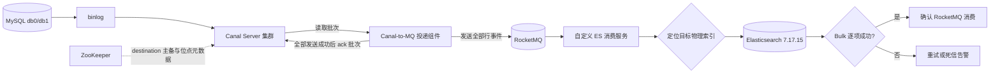

# 005_Canal 同步 MySQL binlog 到 ES（总链路）

以下内容按照当前项目 `AGENTS.md` 项目级规则中规定的技术栈版本为准：Java 8、Spring Boot 2.7.18、`rocketmq-spring-boot-starter` 2.3.0、`org.apache.rocketmq:rocketmq-client` 5.2.0、Canal Server 1.1.7、MySQL 8.0.33 和 Elasticsearch 服务端 7.17.15。5.2.0 是 MQ 客户端版本，Broker 版本未确认。

## 文档维护与已确认规则

1. 项目采用 `MySQL → Canal Server（TCP）→ Canal-to-MQ 投递组件 → RocketMQ → 自定义 ES 消费服务 → Elasticsearch` 的异步链路。Server 提供批次，由独立的投递组件发送到 MQ；Canal Adapter 不再作为当前主链路的 ES 写入组件。
2. 项目包含两个独立 MySQL 实例，分别对应 `db0`、`db1` 两个 Canal destination。两个 destination 分别维护源库、过滤规则、导入前 GTID 基线和消费进度，不共用同步起点，也不承诺跨库全局顺序。
3. 两个实例均包含 `consume_record_01`～`consume_record_16`，共 32 张物理分表。Server 侧按库表过滤；自定义服务按库名、表名和事件类型路由，不再配置 32 份 Canal Adapter 映射。
4. 首次同步使用历史导入前分别采集的 GTID 基线；基线必须在暂停写入并等待在途事务结束后采集。
5. 历史导入和后续业务写入保持 `sql_log_bin=ON`，确保变更进入 binlog。导入前 GTID 基线只用于首次启动；后续 Canal 恢复使用本通道已确认并持久化的 MQ 交接进度，MQ 消费与 ES 处理进度分别核对。
6. MySQL binlog 保留期目标为 30 天；实际参数是否生效、磁盘空间是否足够以及是否覆盖恢复窗口，仍需按环境核验。
7. 当前方案采用本地配置文件，不使用 canal-admin、管理库或集中配置管理。3 台 Canal Server 通过本地 `canal.properties` 和各 destination 的 `instance.properties` 加载配置，并接入 3 节点 ZooKeeper 集群。
8. ZooKeeper 按 destination 独立协调 Server 运行资格。`db0`、`db1` 可以运行在不同 Server 上，一个 destination 的切换不强制另一个同时切换。
9. Canal-to-MQ 投递组件必须确认一个 Canal 批次的全部行事件发送成功后，才向 Server ack 该批次。客户端 ack 返回不证明 Server 已处理或位点已持久化；MQ 发送成功也不代表 ES 已写入。
10. ES 每 30 天 rollover，索引在 rollover 后 180 天进入 cold 阶段；历史索引仍可能被更新或删除。新建文档与 INSERT 重放须区分，重放、UPDATE 和 DELETE 必须命中原具体物理索引。
11. 自定义服务使用稳定业务主键作为 ES `_id`。相同 `_id` 只在同一具体索引内唯一，索引定位、稳定事件身份、事件顺序和重放规则共同决定幂等；具体存储与恢复机制不得表述为已实现能力。
12. 当前方案不承诺端到端 exactly-once。RocketMQ 至少一次投递、ES 写入成功后消费确认失败等场景都可能导致重复处理，必须依赖稳定 `_id`、事件顺序和幂等写入。
13. 文档中的配置、伪代码和验收步骤均为说明性内容，不能表述为已经部署、联调或完成故障演练。技术版本兼容性仍以实际发行包、依赖解析和联调结果为准。

## 文档定位与分文档入口

本文是总链路文档，说明 MySQL 产生 binlog 后，如何经过 Canal Server、RocketMQ 和自定义 ES 消费服务，最终写入 Elasticsearch。具体实现细节分别维护在以下分文档中：

| 分文档 | 负责内容 |
| --- | --- |
| [006 MySQL 处理逻辑](<D:/000/sources/eas/002_消费记录分库分表、双写与ES 改造（15）/006_Canal 同步 MySQL binlog 到 ES（MySQL 处理逻辑）.md:1>) | binlog 参数、GTID 基线、写入会话、日志保留期和 MySQL 侧恢复起点 |
| [007 Canal Server 处理逻辑](<D:/000/sources/eas/002_消费记录分库分表、双写与ES 改造（15）/007_Canal 同步 MySQL binlog 到 ES（Canal Server 处理逻辑）.md:1>) | destination、Server 配置、binlog 读取解析、ZooKeeper 主备、位点管理和 RocketMQ 投递边界 |
| [008 自定义 ES 消费服务处理逻辑](<D:/000/sources/eas/002_消费记录分库分表、双写与ES 改造（15）/008_Canal 同步 MySQL binlog 到 ES（自定义 ES 消费服务处理逻辑）.md:1>) | RocketMQ 消费、索引定位、ES 增删改、rollover、冷热分离、重试和死信处理 |

## 参考文章的吸收与项目适配

参考文档展示了 `MySQL binlog → Canal → RocketMQ → 业务消费者 → Elasticsearch` 的完整演示，重点可复用的是消息解耦、按业务主键保持顺序，以及通过 rollover 和 ILM 管理索引生命周期。本文吸收这些设计思路，但不把参考文档的脚本、示例参数或演示结果写成当前项目事实。

参考文档使用 Canal 1.1.6、RocketMQ 4.9.4 和 Elasticsearch 8 的示例；当前项目按 `AGENTS.md` 规定使用 Canal Server 1.1.7、rocketmq-client 5.2.0 和 Elasticsearch 7.17.15。参考文档中的 `max_docs=5`、20 秒生命周期等演示阈值只用于观察滚动效果，不能替代当前项目的 30 天 rollover、180 天进入 cold 阶段等规则。版本兼容、发行包加载、认证和端到端联调仍需按环境核验。

## 面试口述精炼版本

### 前置知识

#### 1. GTID 是什么

GTID 是 Global Transaction Identifier，用来唯一标识已经提交的事务，通常由来源实例的 `server_uuid` 和事务序号组成，例如 `uuid-A:101`。首次同步时，如果 Canal 还没有持久化消费位点，就把 `master.gtid` 配置的 GTID 集合作为已执行范围，向 MySQL 拉取后续 binlog；重启或主备切换时，则优先从已持久化的位点继续消费。

#### 2. `ROW` 格式是什么

`binlog_format=ROW` 可以理解为“按行记账”：一条 SQL 如果修改了 100 行，就记录这 100 行的数据变化，让 Canal 知道哪些记录被新增、修改或删除。具体记录哪些列，由 `binlog_row_image` 决定。

#### 3. FULL 行镜像是什么

`binlog_row_image=FULL` 表示行事件尽量保留完整列镜像。对 UPDATE 来说，事件通常包含更新前后的完整行信息，便于下游构造文档和处理删除。实际事件字段仍需结合 MySQL 版本、表结构和真实 binlog 核对。

### 整体方案

我会把链路拆成四层：MySQL 产生 binlog，Canal Server 读取并解析，RocketMQ 做缓冲和解耦，自定义 ES 消费服务负责索引定位和写入 ES。

MySQL 侧用两个独立实例承载 `db0`、`db1`，每个实例有 16 张消费记录物理表。Canal Server 按 destination 读取已提交变更，投递组件通过 TCP 拉取批次，把全部行事件发送到 RocketMQ 后再 ack Canal。自定义服务消费 RocketMQ 消息，根据事件类型和具体索引定位结果写入 Elasticsearch。

### 为什么引入 RocketMQ

MQ 的作用是把 Canal 读取和 ES 写入解耦。MySQL 突发写入时，消息可以先在 RocketMQ 中削峰；ES 短暂不可用时，消息可以重试而不必让 Canal 直接承担 ES 的故障处理；同一份变更还可以被其他下游消费。

不引入 MQ 时，Canal 消费端通常直接写 ES，链路更短、延迟更低，但 ES 写慢或不可用会直接反向影响 Canal 消费，重试、死信、扩展下游和流量缓冲也需要自行补齐。当前场景存在 rollover 后历史更新和删除，因此选择 MQ 加自定义消费服务。

### MySQL 与 Canal Server

详细规则见 [006](<D:/000/sources/eas/002_消费记录分库分表、双写与ES 改造（15）/006_Canal 同步 MySQL binlog 到 ES（MySQL 处理逻辑）.md:1>) 和 [007](<D:/000/sources/eas/002_消费记录分库分表、双写与ES 改造（15）/007_Canal 同步 MySQL binlog 到 ES（Canal Server 处理逻辑）.md:1>)。两个实例分别开启 GTID、`ROW`、`FULL` 和 binlog，历史导入前分别采集 GTID 基线。Server 通过 ZooKeeper 取得 destination 运行资格，读取并解析 binlog，再把批次提供给投递组件。

### RocketMQ 与自定义 ES 消费服务

Canal-to-MQ 投递组件只在全部行事件获得明确的 RocketMQ 发送成功结果后 ack Canal 批次；部分失败或超时结果不明时不确认。重放可能再次发送已成功项，事件 ID 必须由稳定来源坐标生成，不能用会变化的 batchId 作为去重依据。

自定义 ES 消费服务从 RocketMQ 读取事件：建议首次 INSERT 先可靠预留目标物理索引，再写 ES；重放、UPDATE 和 DELETE 沿用原索引，并保留删除后的来源顺序。消息 keys 只用于标识，保序还需要生产端一致的队列选择、消费端顺序执行，以及阻止失败事件被后续同键事件越过的重试规则。ES Bulk 要逐项检查，同时出现可重试与终止失败时，先可靠保存死信，再决定重试或确认。Spring 监听方法正常返回会视为成功，失败须明确抛异常或返回原生失败状态。具体存储、消费模型与失败策略见 [008](<D:/000/sources/eas/002_消费记录分库分表、双写与ES 改造（15）/008_Canal 同步 MySQL binlog 到 ES（自定义 ES 消费服务处理逻辑）.md:1>)，仍待实现验证。

### rollover 与冷热分离

当前 ES 索引按 30 天 rollover，索引在 rollover 后 180 天进入 cold 阶段。ILM（索引生命周期管理）迁移分片不会改变文档的物理索引；普通 cold 迁移本身不等于只读，但只读动作或可搜索快照会影响历史 UPDATE、DELETE。具体策略、节点角色和许可需按 ES 7.17.15 集群核验。

### 方案边界

当前方案是至少一次投递和幂等写入模型，不承诺 exactly-once。仍需验证 Canal Server 1.1.7、rocketmq-client 5.2.0、自定义服务与 ES 7.17.15 的实际连接、认证、消息格式、重试恢复、索引定位和故障切换行为。

Canal 1.1.7 配置与 Message API、RocketMQ Spring 2.3.0 有序发送及监听确认语义、client 5.2.0 状态、Boot 2.7.18 BOM 和 ES 7.17.15 Bulk API 已按官方资料静态核对；实际依赖与运行尚未验证，依据见 006～008。

## 详细方案

### 1. 总体流程

### 2. 各组件职责

1. **MySQL**：产生已提交事务的 binlog，分别维护两个实例的 GTID 和日志保留窗口。
2. **Canal Server**：按 `db0`、`db1` destination 读取、解析和暂存 binlog；ZooKeeper 协调运行资格和位点元数据。
3. **Canal-to-MQ 投递组件**：通过 TCP 从 Server 拉取批次，转换为稳定事件 ID 的 RocketMQ 消息，全部发送成功后再 ack Canal；消费身份、重连和单 destination 投递互斥仍需验证。
4. **RocketMQ**：提供缓冲、异步解耦、消费重试和下游扩展能力。消息至少一次投递，不能替代业务幂等。
5. **自定义 ES 消费服务**：按事件类型路由 ES 请求，定位历史物理索引，执行 Bulk、重试、死信和监控。
6. **Elasticsearch**：通过 ILM 管理 rollover 和冷热迁移；到期删除策略仍需确认。写入别名提供新文档的目标选择，重放须沿用已保存的物理索引。

### 3. 为什么不使用 Canal Adapter

Canal Adapter 适合“收到事件后直接写当前目标索引”的简单同步场景。当前场景不使用它作为主写入组件，原因有三点：

- rollover 后，旧文档位于历史物理索引，Adapter 的写入别名不能自动告诉 UPDATE、DELETE 应该访问哪一个历史索引；
- 项目需要自定义 RocketMQ 缓冲、重试、死信、告警、幂等和顺序控制，直接套 Adapter 难以统一这些业务规则；
- 项目要求逐项判断 Bulk 结果，并在定位不到历史索引时执行可观测的补偿流程，不能依赖 Adapter 对 404 或失败项的默认处理。

如果业务只写当前索引、不会更新或删除历史数据，且不需要 MQ 和复杂补偿，才可以重新评估 Canal Adapter。

### 4. 核心验收范围

验收至少覆盖：两个 destination 的 GTID 起点和主备切换；全部消息发送成功后才 ack；MQ 部分发送成功、超时结果不明与重放；事件 ID 跨批次保持稳定及同键重试保序；ES INSERT、UPDATE、DELETE；rollover 后 INSERT 重放与定位持久化失败；Bulk 可重试项与终止项同时失败、死信写入失败；cold 索引实际可写性；DELETE 后旧事件重放、路由预留与完成日志中断；以及 db0、db1 分别恢复时的积压追赶。

上述内容是验收要求，不代表已经完成部署、联调、压测或故障演练。
