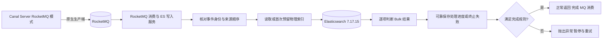

# 008_Canal 同步 MySQL binlog 到 ES（RocketMQ 消费与 ES 写入服务处理逻辑）

以下内容按照当前项目 `AGENTS.md` 项目级规则中规定的技术栈版本为准。

当前版本基线：Java 8、Spring Boot 2.7.18、`rocketmq-spring-boot-starter` 2.3.0、`org.apache.rocketmq:rocketmq-client` 5.2.0、Canal Server 1.1.7、MySQL 8.0.33 和 Elasticsearch 服务端 7.17.15。5.2.0 是 MQ 客户端版本，Broker 版本未确认；本文不使用 `rocketmq-client-java` 的 gRPC 消费 API。

## 文档维护与已确认规则

- 组件全称统一为“自定义 RocketMQ 消费与 ES 写入服务”，简称“ES 写入服务”，负责消费 RocketMQ 消息并执行 ES 增删改。
- 当前主链路为 `MySQL → Canal Server（RocketMQ 模式）→ RocketMQ → 自定义 RocketMQ 消费与 ES 写入服务 → Elasticsearch`，Adapter 1.1.7（ES 7 Adapter）保留版本边界，但不承担主链路 ES 写入。
- 两个独立 MySQL 实例对应 db0、db1；每个实例有 consume_record_01～consume_record_16。两个 destination 独立维护进度，不承诺跨库全局顺序。
- Canal Server 按 007 采用单机部署，一个进程承载两个 destination，使用本地持久化位点人工重启恢复，不配置 ZooKeeper 主备高可用；ES 写入服务的部署规模仍待确认。
- ES 每 30 天 rollover，索引在 rollover 后 180 天进入 cold 阶段；历史索引仍可能 UPDATE、DELETE。此处是索引阶段年龄，不是每条交易的年龄，实际 ILM 和保留期配置仍待验证。
- 使用稳定业务主键作为 ES `_id`；其唯一性只限于同一物理索引。首次 INSERT 与重放须区分，INSERT 重放、UPDATE、DELETE 均须命中原具体物理索引，不能只依赖当前写别名。
- 消息 keys 不自动保序或去重；至少一次投递下，幂等还依赖稳定事件 ID、来源顺序和具体索引。定位存储、顺序状态、删除标记及失败补偿的实现仍待验证，不记为已完成能力。
- Canal Server 的 RocketMQ 发布、Broker 持久化、MQ 消费确认与 ES 处理完成属于不同层次。Bulk 整体成功不等于每个 item 成功，已成功项不会自动回滚。
- 配置、消息契约、核心代码和验收步骤均为说明性内容，不代表已经上线、编译、联调或完成故障演练。
- 原生消息格式和内部事件契约按 007 的版本源码边界维护；默认 JSON 缺少完整源坐标，二进制按键拆行缺少原行序号，字段缺口未解决前不能宣称稳定事件身份与来源顺序已经实现。
- 面试口述按“解析消息与检查顺序、定位物理索引、执行增删改、确认 MQ 消费”先总后分，四个分点与整体概括一一对应；历史索引能力放在索引定位中说明，Bulk 逐项失败放在执行与确认中说明。ORDERLY 的串行与异常暂停以 MQ 队列为单位，同一消息内的同键多事件也须依次完成，不能把队列顺序当作消息内部已自动保序。
- 顺序控制与 007 保持一致：防止同一条消费记录的旧变更覆盖新结果，使用 binlog 来源位置，不在消费记录表新增版本号字段；来源位置补齐、顺序状态保存和故障验收仍待实现与验证。

## 面试口述精炼版本

### 整体概括

自定义 ES 写入服务主要做四件事：**解析消息与检查顺序、定位物理索引、执行增删改、确认 MQ 消费**。从 MQ（消息队列）接收变更后，先检查事件并确定目标索引，再写入 ES；操作及必要状态保存满足完成规则后，才允许消费成功。以下是设计要求，实现仍待验证。

### 解析消息与检查顺序

解析后，先用稳定事件 ID 识别重复，再按 binlog（二进制日志）来源位置拒绝旧变更。幂等就是重复处理仍得到正确结果；顺序状态须可靠保存，不在消费记录表新增版本号字段。

同键使用稳定队列与顺序消费；消息内同键多次变更也须依次完成，失败未解决前不能放行后续事件。去重与旧事件拒绝以 007 的源坐标、原行序号缺口已补齐并验证为前提；keys、batchId 和事件时间不能替代来源顺序。

### 定位物理索引

首次 INSERT 写入前可靠预留物理索引；INSERT 重放、UPDATE、DELETE 沿用原索引。`_id` 是 ES 文档标识，只在同一物理索引内唯一，不能单独避免跨索引重复。

项目每 30 天 rollover（创建新索引并切换写目标），旧索引在 rollover 后 180 天进入 cold（冷数据层）。rollover 不搬迁旧文档，普通冷热迁移不改索引名；历史索引仍须可更新、删除。

### 执行增删改

在确定的索引中，INSERT 用业务主键设置 `_id`，UPDATE 更新原文档，DELETE 删除原文档。删除后可靠保留删除标记与最后来源位置，防止旧事件重放使文档复活。

Bulk（批量请求）逐项检查结果，并保留操作与原消息、事件的对应关系。HTTP 成功不代表各项成功，成功项不会自动回滚；失败重试仍保持原索引与来源顺序。

### 确认 MQ 消费

只有 ES 操作及必要持久化满足完成规则，监听方法才能正常返回。可重试项保留原消费单元重试；终止项可靠记录后按明确政策处置，保存失败或政策不满足时仍不能确认。

候选实现使用 ORDERLY（顺序消费）：正常返回表示成功，异常暂停整条当前队列，其他键也会等待。须同步等完全部处理轮次，不能异步提交 ES 任务后立即返回。ES 成功而消费确认失败仍可能重放，不承诺端到端恰好一次处理。

## 详细方案

### 参考文章的吸收与版本边界

参考文档展示了 Canal、RocketMQ、稳定文档 ID 和 ILM（索引生命周期管理）的组合。本文吸收职责拆分、消息解耦与冷热分层思路，使用当前项目版本重新核对 API；参考文档的 Canal 1.1.6、RocketMQ 4.9.4、ES8 客户端和单机配置不直接套用。

`data_hot`、`data_warm`、`data_cold` 是 ES 数据层节点角色。节点角色与 `_tier_preference` 分片分配设置配合使用，不应笼统称为自定义节点标签。文章中的 max_docs=5、20 秒阶段时间和本地路径仅为演示值，不能替代项目的 30 天 rollover 与 rollover 后 180 天 cold 规则。

### 自定义服务的选型边界

选型依据是当前项目需要统一历史物理索引定位、来源顺序、跨 rollover 重放和逐项失败处置。固定索引或当前写别名本身不足以定位旧文档；这些规则需要明确实现与验收，不能依赖组件默认的 404、重试或确认行为。这里不把 Adapter 的全部能力归结为“只能写当前索引”，也不据此推导它不支持 MQ；是否能通过扩展满足要求属于另行评估，当前主链路按已确认的自定义服务方案维护。

### 一、完整数据流



Canal Server 的 RocketMQ 生产端属于单机 Server 进程的一部分，该进程承载 db0、db1 两个 destination，按本地位点人工重启恢复。ES 写入服务独立部署，其进程数、部署方式和容量尚未确认。两者必须分别核对 Canal 位点、MQ 消费位点和 ES 实际处理结果，不能共用一个“同步成功”标记。

### 二、消息契约与顺序

消息字段与 007 保持一致。须先明确 `canal.mq.flatMessage`：默认 `true` 时按 FlatMessage JSON 的 `data`/`old` 解析，`false` 时按 Canal 二进制封装解析 Entry 与 RowData。JSON 的 UPDATE `old` 不保证完整前镜像；按键分区的二进制 Entry 不保留原始行序号与事务开始/结束标记。以下是内部事件的候选契约，字段缺口须由上游封装与消费端共同解决：

```json
{
  "eventId": "<destination>|<sourceUuid>|<binlogFile>|<eventOffset>|<rowOrdinal>",
  "destination": "db0",
  "database": "eas",
  "table": "consume_record_01",
  "eventType": "UPDATE",
  "consumeId": "<business-id>",
  "orderKey": "db0|eas|consume_record_01|<business-id>",
  "before": {},
  "after": {},
  "source": {
    "instanceUuid": "<source-instance-uuid>",
    "binlogFile": "mysql-bin.000123",
    "eventOffset": 456789,
    "rowOrdinal": 0,
    "gtid": "<transaction-gtid>"
  },
  "canalBatchId": 12345,
  "eventTime": "<source-event-time>"
}
```

稳定 eventId 取自来源实例和 binlog 行事件坐标；rowOrdinal 是该源行事件内的行序号，不能使用 MQ 分批后的列表下标。batchId 只用于追踪；GTID 唯一标识事务，不能单独区分事务内每一行。source 坐标及 before/after 完整性须由 Canal Server 原生消息和 ES 写入服务共同验证，不能把示例视为已实现的 Canal 原生字段。源库替换、日志重置或重新生成 binlog 时，必须复核来源身份与坐标规则。

**源字段缺口是实施前置条件：** 默认 JSON 没有 `binlogFile`、`eventOffset`、原始 `rowOrdinal`；二进制按键拆行会让同一源事件的多行共享 Header，消费端给每个单行 Entry 编号为 0 会造成 eventId 冲突。不能用消息列表下标、MQ messageId 或内容 hash 补作稳定源顺序。须在拆分前保留所需信息，或另行确认可验证的身份与顺序规则；缺口未解决时，后文的去重和旧事件拒绝只是设计要求。

Canal Server 生产端通过 `canal.mq.partitionHash` 候选配置将相同业务键路由到稳定队列；消费端用 ORDERLY 模式并按键串行完成 ES 写入。keys 用于查询消息，Tag 用于过滤，它们都不会自动选择队列。调整队列数量、原生生产重试、并发补发或路由变化时须重新验证顺序。

`orderKey` 是内部状态键，不能当作原生 hash 算法的完整输入；源列名、16 张表覆盖范围和分区数按 007 核对。DDL 与主键变更须进入协调暂停或受控处置流程，不能按普通增删改静默确认。

MQ 顺序消费不能阻止上游切换后把旧事件追加到队列尾部。顺序控制按 007 使用 binlog 来源位置，不在消费记录表新增版本号字段。建议持久化每个业务键已处理的来源顺序、事件身份和删除状态：重复事件跳过或幂等执行，旧事件拒绝覆盖新结果。来源顺序须按同一日志来源定义文件序号、事件偏移与行序号的比较规则；GTID 字符串、时间戳、ES 内部版本及 seq_no 均不能直接代替源事件先后关系。多来源或源库替换时另行确认比较规则。

### 三、物理索引与定位记录

| 候选名称 | 作用与边界 |
| --- | --- |
| consume_write | rollover 写别名，可覆盖多代索引，显式指定唯一的 is_write_index=true |
| consume_read | 查询别名，覆盖业务需要查询的热、温、冷索引；新索引加入须由模板或别名流程保证 |
| consume-000001 等 | 数字后缀物理索引，供 rollover 递增 |
| consumeId → index | 待实现的持久化路由，供首次写入预留、重放和历史更新删除使用 |

#### 1. 先预留路由，再执行首次写入

“写 ES 成功后再记录 `_index`”存在失败窗口：ES 已成功，定位记录或 MQ 确认失败，重放时写别名可能已 rollover，导致同一 `_id` 出现在两个索引。搜索也可能尚未刷新，查不到不能证明从未写入。

建议以业务键建立持久化路由与处理日志：首次 INSERT 在单键互斥下解析当前写索引，使用唯一约束或条件写可靠预留具体物理索引，然后直接写该索引；重复事件先读取预留记录并沿用原索引。索引预留成功但 ES 失败时保留记录，继续重试原目标。ES 成功后可靠记录事件完成，再允许监听方法返回。

该机制是待实现设计，不新增已确认数据库、缓存或字段。存储位置、事务边界、故障隔离、备份和修复仍需选择并验证。定位存储与 ES 不是原子事务，必须覆盖每个中断点；索引不存在或被阻塞时不得悄悄改投当前写索引。

#### 2. 定位缺失时受控修复

优先读取持久化路由，不能只依赖易失缓存。缺失时可通过 consume_read 进行受控 `_id` 查询：单一命中则复核并补写定位；多索引命中先处理重复；没有命中须结合处理日志、删除标记、刷新状态和源数据判断。搜索是近实时的，无命中不能单独作为首次创建或删除成功的依据。012 的 consumeId 字段不建立普通检索索引，定位查询不能误用对该字段的 term 查询。

普通 hot/cold 分片迁移不改物理索引名；只有 reindex、索引替换或命名变更等操作才需要切换路由。重建期间必须控制在途消息和路由切换，避免同时写旧、新两代。

### 四、INSERT、UPDATE、DELETE

#### 1. INSERT

首次事件预留具体物理索引，使用 consumeId 设置 `_id`，并在 `_source` 中保留普通字段 consumeId 供排序。已处理事件沿用原索引，不再经当前写别名重新选目标。Index 覆盖或 Create 冲突的处理方式须与幂等规则一致；Create 的 409 不能一概当作成功，须确认是同一已完成事件。

ES 成功而完成日志失败时，保留原路由并重试；不能先消费确认再补写定位，也不能认为稳定 `_id` 自动保证跨索引唯一。

#### 2. UPDATE

先检查来源顺序，再定位原物理索引，使用 Update 或完整文档覆盖。before/after 转换、字段类型与 Mapping 必须一致；完整行镜像不等于最终字段契约已经对齐。未经核实不使用 upsert 把缺失的历史文档写到当前索引。

定位缺失、多个命中、document_missing、index_not_found 和权限失败分别处理。ES 乐观锁冲突只能说明目标存在竞争，不能证明源事件顺序正确；需要来源顺序状态和单键串行保护。

#### 3. DELETE

定位原物理索引后删除，同时可靠保留删除标记（tombstone）及最后来源顺序，防止旧 INSERT/UPDATE 在重放时复活文档。不能在删除后立即移除全部路由和去重信息；保留期限须覆盖重放、补发与恢复窗口，具体期限尚未确认。

已知目标索引内文档 not_found，可在确认路由和顺序正确后按幂等删除处理；索引本身不存在、权限错误、网络超时和来源不明的 404 不能统一算成功。删除标记写失败时仍须重试，不能提前确认 MQ。

### 五、Bulk、重试与消费确认

#### 1. 先确定确认模型

候选实现使用 RocketMQ Spring 2.3.0 的 RocketMQListener，并设置 consumeMode=ConsumeMode.ORDERLY；onMessage 正常返回时容器返回 SUCCESS，异常时返回 SUSPEND_CURRENT_QUEUE_A_MOMENT。该接口没有示例中的手动 ackRocketMqMessage；普通 return 不能表示“保持未确认”。CONCURRENTLY 模式的失败返回 RECONSUME_LATER，不能据此承诺单键保序。

ORDERLY 以 MQ 队列为单位串行处理，异常暂停会阻塞该队列的后续消息，包括其他业务键；不同队列仍可能并行。它也不替应用安排一条消息内多行事件的执行顺序。若同一消息包含同键的 INSERT、UPDATE、DELETE，须分轮依次执行，每轮确认 ES 结果和必要状态后再处理下一轮；整条消息的全部轮次满足完成规则后，监听器才能正常返回。暂停粒度和容量影响须据此验收，不能说默认只暂停一个业务键。

监听器必须等待 ES 结果和必要的持久化处理完成。不得把任务放进异步线程或内存 Bulk 缓冲后立即返回。若聚合多个 MQ 消息做 Bulk，每条消息的完成条件与 item 映射须明确，失败前不得执行同键后续操作；一个 Bulk 中不能混入同键尚未完成的连续事件并指望失败自动回滚后续项。

本文选择“保留原消费单元并由顺序消费重试”的示例模型。若另选持久化重试队列，须先可靠转交并明确原消息完成条件、顺序隔离与去重，不能同时异步补发并让原消息无限重试。

#### 2. 同时处理两类失败

以下是 Java 8 单轮批处理内核示例，ES API 采用 `org.elasticsearch.client.RestHighLevelClient` 7.17.15；Delivery、EsOperation 和日志方法为待实现抽象。Delivery 表示外层按序拆出的一个执行轮次，不能直接等同于包含同键多事件的整条 MQ 消息。外层须把每个 item 映射回原消息，依次完成全部轮次并同步等待，通常一个行事件对应一个 ES 操作。本例未编译或执行：

执行前须完成来源顺序检查和原索引定位，并确保同一 Bulk 中每个业务键最多有一个待完成操作。该内核不实现前面的路由、锁、事件身份和持久化状态机，不能作为可直接上线的完整监听器。

```java
void processDelivery(Delivery delivery) {
    // 已可靠完成或保存为终止项的操作不再次发送；完成政策仍须复核
    List<EsOperation> pending = loadUnfinishedOperations(delivery);
    if (pending.isEmpty()) {
        requireAllResolvedAndAckAllowed(delivery); // 不满足就抛异常
        return;
    }

    BulkResponse response;
    try {
        BulkRequest request = buildBulkRequest(pending);
        response = esClient.bulk(request, RequestOptions.DEFAULT);
    } catch (Exception ex) {
        // HTTP 错误或响应丢失可能已有部分写入，须按原路由重试
        throw new IllegalStateException("Bulk 请求未可靠完成", ex);
    }

    List<EsOperation> succeeded = new ArrayList<>();
    List<FailedOperation> retryable = new ArrayList<>();
    List<FailedOperation> terminal = new ArrayList<>();
    requireMatchingItemCount(response, pending);
    for (BulkItemResponse item : response.getItems()) {
        EsOperation operation = pending.get(item.getItemId());
        if (!item.isFailed()) {
            validateSuccessfulOperation(operation, item); // 含幂等删除核对
            succeeded.add(operation);
        } else {
            FailedOperation failure = classify(operation, item.getFailure());
            if (failure.isRetryable()) {
                retryable.add(failure);
            } else {
                terminal.add(failure);
            }
        }
    }

    // 即使同时有可重试项，也须保存所有终止项；保存失败必须抛异常
    persistTerminalFailuresIdempotently(terminal);
    recordSucceededOperationsDurably(succeeded);
    if (!retryable.isEmpty()) {
        recordRetryDiagnostics(retryable);
        throw new IllegalStateException("仍有可重试项，暂停队列重试");
    }
    // 终止项不能凭保存日志就确认，须满足已明确的业务处置政策
    requireAllResolvedAndAckAllowed(delivery);
    // 仅此处正常完成，外层监听器才能正常返回
}
```

对应类型为 `org.elasticsearch.action.bulk.BulkRequest/BulkResponse/BulkItemResponse` 和 `org.elasticsearch.client.RequestOptions`。成功、终止和重试状态按稳定事件 ID 幂等记录；持久化失败也算消费未完成。ES 与日志写入不是原子事务，重复执行仍须保护原索引与来源顺序。

#### 3. 错误分类与死信边界

网络超时、429、部分 5xx 通常可重试；映射错误通常需修复字段后处理；认证、索引丢失和定位缺失需按原因暂停或修复。409、404 不能仅按状态码统一认定成功或终止。请求层失败可能拿不到 item 列表，应保留整个未完成单元并检查结果不明的写入。

自定义持久化终止失败记录与 Broker 内置 DLQ（死信队列）是两套机制。落入内置 DLQ 不代表业务已经修复，也不能自动保障后续同键操作安全。5.2.0 顺序客户端在重试耗尽后的处理与默认并发重试次数不同，不能照搬“默认 16 次”或参考文章的 retries: 5。

重试上限、退避、死信保留、失败后暂停粒度，以及终止项持久化后是否允许确认均待确认。到达上限不能无条件放行同键后续事件；必须先有失败隔离或业务处置规则。成功项不自动回滚，重试只处理尚未完成的项；若状态保存失败导致重放成功项，也必须幂等。

### 六、ILM rollover 与冷热分离

别名 rollover 的候选配置骨架须包含：

1. 生命周期策略：hot 的 rollover.max_age=30d；cold 的 min_age=180d。后续阶段 min_age 对已 rollover 索引以 rollover 时间计，不按 tradeTime 逐条判断；策略轮询和执行延迟使其不是严格整点调度。
2. 匹配物理索引的模板：Mapping、index.lifecycle.name、index.lifecycle.rollover_alias=consume_write，以及新索引加入 consume_read 的别名定义。
3. bootstrap（初始）索引 consume-000001：绑定策略，并为 consume_write 显式设置 is_write_index=true。不能只有策略和别名名而没有初始写索引。
4. 分片迁移：使用数据层角色与 `_tier_preference`；实际节点、分片、副本和许可核对后再生成部署配置。没有确认 warm 阶段阈值，不额外新增业务周期。
5. 普通 cold 历史索引保持所需更新删除能力；不得无条件加入 readonly、searchable_snapshot 或其他阻塞写入动作。普通数据层分配与需要许可核对的可搜索快照分开评估。
6. 删除索引前确认业务保留、历史修复及删除标记保留规则；不从容量规划自动推导到期删除参数。

别名可关联多个索引，但写请求只路由到唯一写索引。首次 INSERT 预留时参考该写目标，重放与历史 UPDATE/DELETE 访问已保存的具体索引。rollover 不迁移旧文档，普通冷热迁移也不改 `_index`。

### 七、客户端与版本核对

| 组件 | 静态核对结果 | 未验证边界 |
| --- | --- | --- |
| Java 8 / Spring Boot 2.7.18 | 示例使用 Java 8 语法；Boot 官方 BOM 的 elasticsearch.version=7.17.15 | 当前没有可核对的应用 pom，最终依赖树、JDK 发行版及运行尚未验证 |
| starter 2.3.0 / rocketmq-client 5.2.0 | RocketMQ Spring 2.3.0 的传统客户端父 POM 使用 Java 8 和 client 5.2.0；有序发送与监听器异常语义已核对 | Broker 版本、刷盘复制、认证、topic 队列和恢复尚未验证 |
| Canal Server 1.1.7 | 按 007 核对 JSON/二进制格式、按键拆行、内部确认回调和 SendResult 状态检查缺口 | 最终消息格式、稳定源身份补齐、发送状态处置、发行包加载、认证与恢复尚未联调；Server 内置 MQ 客户端版本须单独核对 |
| Elasticsearch 服务端 7.17.15 | 示例 HLRC 使用 bulk(request, RequestOptions.DEFAULT)；ILM 与别名语义按 7.17 核对 | 实际客户端、REST/TLS、认证、Mapping、冷层写入和故障恢复尚未验证 |

只确认了 ES 服务端版本，尚未确认实际客户端类型。本例选 `org.elasticsearch.client:elasticsearch-rest-high-level-client:7.17.15` 作为说明性依赖；该客户端在 7.17 可用但已废弃，不据此强制项目采用。`co.elastic.clients.elasticsearch.ElasticsearchClient` 也存在于 `co.elastic.clients:elasticsearch-java:7.17.15`，不是 ES8 专属类。复制参考文章前应检查 Maven 坐标、版本与请求类型，不能仅凭类名判断版本；两种客户端的请求与响应类型不可混用。

核对依据：

- [Spring Boot 2.7.18 BOM](https://repo.maven.apache.org/maven2/org/springframework/boot/spring-boot-dependencies/2.7.18/spring-boot-dependencies-2.7.18.pom)、[RocketMQ Spring 2.3.0 父 POM](https://github.com/apache/rocketmq-spring/blob/rocketmq-spring-all-2.3.0/rocketmq-spring-boot-parent/pom.xml)。
- [RocketMQ Spring 2.3.0 监听容器](https://github.com/apache/rocketmq-spring/blob/rocketmq-spring-all-2.3.0/rocketmq-spring-boot/src/main/java/org/apache/rocketmq/spring/support/DefaultRocketMQListenerContainer.java)、[rocketmq-client 5.2.0 顺序消费实现](https://github.com/apache/rocketmq/blob/rocketmq-all-5.2.0/client/src/main/java/org/apache/rocketmq/client/impl/consumer/ConsumeMessageOrderlyService.java)。
- [ES 7.17.15 RestHighLevelClient](https://github.com/elastic/elasticsearch/blob/v7.17.15/client/rest-high-level/src/main/java/org/elasticsearch/client/RestHighLevelClient.java)、[7.17.15 Java API Client](https://github.com/elastic/elasticsearch-java/blob/v7.17.15/java-client/src/main/java/co/elastic/clients/elasticsearch/ElasticsearchClient.java)。
- [ES 7.17 rollover](https://www.elastic.co/guide/en/elasticsearch/reference/7.17/ilm-rollover.html)、[生命周期阶段](https://www.elastic.co/guide/en/elasticsearch/reference/7.17/ilm-index-lifecycle.html)、[数据层](https://www.elastic.co/guide/en/elasticsearch/reference/7.17/data-tiers.html)及 [7.17.15 rollover 生命周期日期更新源码](https://github.com/elastic/elasticsearch/blob/v7.17.15/x-pack/plugin/core/src/main/java/org/elasticsearch/xpack/core/ilm/UpdateRolloverLifecycleDateStep.java)：后续阶段年龄使用 rollover 日期。

### 八、监控与验收

监控 MQ 堆积、重试及死信，ES Bulk item 失败分类、路由命中率、重复与旧事件拒绝量，写别名及 ILM 状态，节点磁盘水位，以及历史 UPDATE/DELETE 在 cold 的延迟。

验收至少覆盖：消息格式不匹配、同一源事件多行拆分后的 eventId 唯一性与重放稳定性、UPDATE 前值范围、事务标记缺失、DDL/主键变更隔离、首次预留路由前后故障、ES 成功但日志/确认失败、rollover 后 INSERT 重放、旧事件晚到与 DELETE 后重放、定位缺失和搜索未刷新、多索引命中、同键失败阻塞、同一消息内同键多事件分轮处理及中途失败、整条队列暂停对其他键的影响、Bulk 可重试和终止项同时失败、终止记录持久化失败、HTTP/网络异常、Broker 内置 DLQ、冷热迁移后的可写性及恢复后的最终一致性。

以上为文档和官方版本 API 静态核对，未连接实际服务，未执行代码编译、端到端同步、压测或故障演练。客户端版本匹配不等于整个方案已经完成运行兼容性验证。
